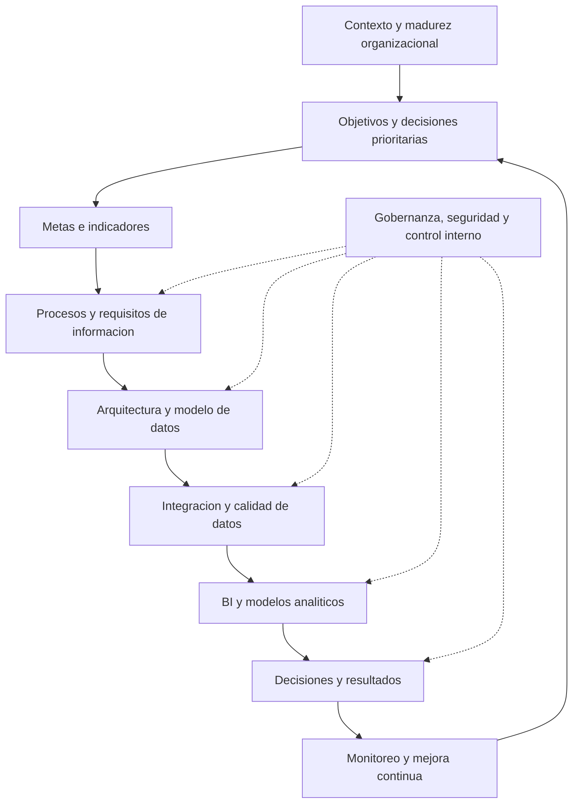

# Clase 5: Transformación digital, gobernanza y evaluación estratégica de proyectos de BI

> **Objetivo académico:** Analizar la inteligencia de negocios como transformación organizacional, articulando estrategia, procesos, arquitectura de datos, gestión del cambio, gobernanza, control interno y evaluación económica para producir decisiones confiables y sostenibles.

## 1. Contexto y marco conceptual

### La transformación digital como cambio organizacional

La transformación digital incorpora tecnología para modificar la manera en que una organización opera, utiliza información y genera valor. Su alcance comprende procesos, competencias, responsabilidades, cultura y orientación estratégica. Instalar una herramienta puede formar parte de esa transformación, pero su funcionamiento técnico no demuestra por sí mismo que exista una mejora organizacional.

La sesión sitúa al business intelligence —inteligencia de negocios o BI— dentro de este marco. Un proyecto de BI requiere comprender qué decisiones se desean apoyar, qué información necesitan sus responsables y qué cambios permitirán utilizarla. Reducirlo al manejo de Power BI omite la definición de objetivos, la calidad de los datos, el involucramiento directivo y la adaptación de las personas.

### Mejora y reingeniería de procesos

| Dimensión | Mejora de procesos | Reingeniería de procesos |
| --- | --- | --- |
| Punto de partida | Conserva la estructura esencial del proceso existente. | Reconsidera su estructura y sus fundamentos. |
| Tipo de intervención | Optimiza actividades, tiempos o recursos. | Rediseña flujos, funciones e interacciones. |
| Ejemplo conceptual | Reducir demoras en una secuencia operativa vigente. | Sustituir una secuencia fragmentada por una organización con funciones cruzadas. |
| Implicación organizacional | Ajustes sobre prácticas conocidas. | Cambios más profundos en responsabilidades y formas de trabajo. |

La implementación de un ERP —sistema de planificación de recursos empresariales— puede involucrar ambos enfoques. Su alcance depende de cuánto cambien los procesos y las relaciones organizacionales.

**Enriquecimiento conceptual:** Cambiar de proveedor o adquirir un ERP más sofisticado no constituye automáticamente reingeniería. La distinción depende del rediseño efectivo del trabajo. De manera semejante, la transformación digital puede desplegarse gradualmente; un cambio abrupto no es una condición necesaria de su existencia.

### Aplicaciones y alcance del BI

La sesión menciona como iniciativas de transformación digital la implementación de ERP, comercio electrónico, digitalización documental, internet de las cosas, análisis de datos y BI. La inteligencia de negocios puede ocupar dos posiciones:

- **Proyecto organizacional integral:** articula indicadores, fuentes y decisiones bajo una visión estratégica compartida.
- **Componente de otra iniciativa:** aporta análisis y visualización a una solución específica, como detección de fraude o aprovechamiento de datos de dispositivos conectados.

En una entidad financiera, por ejemplo, los registros del sistema central pueden alimentar modelos de análisis, indicadores y alertas. En un entorno con internet de las cosas, los dispositivos generan datos que pueden procesarse en el borde o enviarse a infraestructura centralizada para su análisis. Los modelos predictivos y los tableros conectan esos datos con decisiones operativas.

También se menciona la posibilidad de incorporar interfaces conversacionales sobre conjuntos de datos. Esta integración se plantea como una posibilidad tecnológica; la sesión no desarrolla una implementación ni presenta resultados verificables.

### Industria y cultura organizacional

La exposición relaciona la industria 4.0 con conectividad, analítica, inteligencia artificial y modelos predictivos. En el plano cultural, destaca adaptabilidad, colaboración e innovación. La industria 5.0 aparece como una orientación hacia mayor personalización, centralidad de las personas y sostenibilidad.

**Enriquecimiento conceptual:** Estas denominaciones sirven como marcos interpretativos. No constituyen una escala universal con etapas obligatorias ni permiten inferir la madurez de una empresa únicamente por su tamaño, sector o estructura de propiedad. Una organización puede presentar capacidades avanzadas en ciertos procesos y debilidades en otros.

## 2. Fundamentos teóricos y arquitectura

### Alineación entre estrategia, procesos y datos

La lógica central del proyecto parte del contexto organizacional: objetivos, tamaño, madurez, recursos, procesos y restricciones. Ese contexto orienta la arquitectura, el modelo de datos, la selección tecnológica y la forma de implementación.

Los objetivos estratégicos deben traducirse en metas e indicadores. Una métrica cuantifica un fenómeno; un KPI es un indicador seleccionado por su relevancia para evaluar un objetivo clave. La visualización de un resultado histórico y la definición de una meta cumplen funciones distintas: la primera describe lo ocurrido y la segunda establece una referencia para orientar la acción.

La sesión distingue dos formas de impulsar iniciativas:

- **Top-down:** parte de la dirección y de prioridades estratégicas explícitas.
- **Bottom-up:** surge de necesidades o iniciativas de un área y puede adquirir posteriormente respaldo y alcance organizacional.

La iniciativa local puede demostrar utilidad, pero su expansión exige coordinación, responsabilidades y coherencia con los objetivos de la organización.

El diagrama representa una relación de dependencia y retroalimentación. Los controles atraviesan el proceso completo; no aparecen como una corrección incorporada únicamente al finalizar el desarrollo.

### Arquitectura técnica y ciclo de vida del proyecto

La arquitectura describe componentes y relaciones técnicas: fuentes, integración, almacenamiento, modelos y consumo de información. El ciclo de vida describe cómo se organiza el trabajo para concebir, construir, validar, desplegar y mantener la solución.

| Perspectiva | Pregunta principal | Elementos ilustrativos |
| --- | --- | --- |
| Arquitectura | ¿Cómo se estructura la solución? | Fuentes, integración, almacenes, modelos y tableros. |
| Ciclo de vida | ¿Cómo se conduce su implementación? | Diagnóstico, planificación, diseño, construcción, validación y operación. |
| Aspectos transversales | ¿Qué condiciones deben sostenerse? | Seguridad, gobernanza, calidad, gestión del cambio y control interno. |

El diseño arquitectónico forma parte del trabajo de diseño del proyecto. Sus componentes no equivalen a las fases de implementación, aunque ambas perspectivas deben ser coherentes.

### Modelado de datos y propósito analítico

La sesión recupera la relación entre propósito de análisis, tabla de hechos, medidas, atributos y dimensiones. Un esquema en estrella puede organizar la información para analizar un proceso de negocio, pero su selección debe responder a necesidades concretas.

También se insiste en que la escala y la complejidad de la solución deben guardar relación con las capacidades organizacionales. La adopción de una metodología o arquitectura por prestigio, sin recursos para sostenerla, genera una brecha entre el diseño y la operación.

**Enriquecimiento conceptual:** Antes de definir medidas y dimensiones es necesario precisar el grano de la tabla de hechos: qué representa cada registro. Mezclar registros de distinta granularidad puede producir duplicaciones y agregaciones incorrectas, aun cuando el esquema visual parezca adecuado.

### Integración de fuentes para decidir

La organización puede combinar registros del ERP, información del data warehouse, tableros de BI, modelos predictivos, planificación estratégica, análisis externos y simulaciones. Su utilidad depende de que las diferencias entre resultados sean comprensibles.

**Enriquecimiento conceptual:** Coherencia no significa igualdad automática. Un dato realizado, una meta y un pronóstico representan objetos distintos. Antes de compararlos deben revisarse período, moneda, alcance, fecha de corte, definición del indicador y supuestos del modelo. La proximidad numérica aislada no acredita calidad.

## 3. Implementación técnica y lógica de negocio

### Diagnóstico previo y preparación organizacional

Antes de implementar un ERP o BI, la sesión propone identificar debilidades en procesos, políticas, procedimientos, competencias y responsabilidades. El diagnóstico permite reconocer condiciones que deben atenderse para reducir problemas posteriores.

Las experiencias relatadas destacan el mapeo de procesos y la identificación de entradas y salidas. La tecnología debe adecuarse a un entendimiento del negocio y, cuando corresponda, acompañar su rediseño.

En implementaciones de ERP se menciona el blueprint como instrumento para contrastar necesidades organizacionales con capacidades del sistema. Ese contraste distingue funcionalidades disponibles de forma nativa, capacidades que requieren parametrización y necesidades que no están cubiertas.

Las personalizaciones pueden introducir costos y complejidad. Por ello, la decisión debe considerar tanto la necesidad de negocio como la conveniencia de modificar prácticas existentes. La sesión destaca además la importancia de una contraparte con capacidad para revisar la correspondencia entre lo contratado y lo que necesita la organización. Esa función puede reunir especialidades de procesos, datos y seguridad.

### Adaptación metodológica y mejora continua

No se presenta una ruta única aplicable a cualquier proyecto. La metodología debe ajustarse al contexto sin perder coherencia entre objetivos, recursos y mecanismos de verificación.

La exposición utiliza el ciclo PDCA como referencia de mejora continua:

1. **Planificar:** comprender la situación, establecer objetivos y definir cómo intervenir.
2. **Hacer:** ejecutar lo planificado.
3. **Verificar:** contrastar resultados y funcionamiento con los criterios previstos.
4. **Actuar:** corregir, ajustar o consolidar las mejoras.

Las fases pueden organizarse de distintas maneras y no necesariamente siguen una secuencia rígida. Lo esencial es que exista conexión entre planificación, ejecución, evidencia y ajuste.

**Enriquecimiento conceptual:** La adaptación metodológica requiere explicar qué se conserva, qué se modifica y cómo se mantienen capacidades indispensables como validación, trazabilidad y gestión de cambios. Una combinación de nombres de metodologías no demuestra por sí misma una integración consistente.

### Controles, gobernanza y calidad

El control interno comprende medidas tecnológicas, manuales y mixtas destinadas a apoyar operaciones eficaces, información confiable y cumplimiento. La sesión lo ilustra con restricciones de acceso, arqueos de caja, revisiones documentales, inspecciones y mecanismos de continuidad.

La gobernanza de datos incorpora responsabilidades sobre propiedad funcional, mantenimiento, calidad y ciclo de vida de la información. Las políticas, los procedimientos y los comités pueden facilitar la coordinación entre áreas y la resolución de problemas.

La responsabilidad por la calidad no debe atribuirse de forma automática al área de sistemas. Las áreas de negocio intervienen en la definición y generación de los datos; las áreas técnicas aportan capacidades para gestionarlos y protegerlos.

**Enriquecimiento conceptual:** Conviene distinguir la gobernanza, que establece autoridad y criterios de decisión, de la gestión de datos, que ejecuta actividades bajo esos criterios. Un comité resulta útil cuando dispone de responsabilidades, capacidad de decisión y seguimiento de acciones; su existencia formal no garantiza resultados.

La sesión menciona ISO 27001 para seguridad de la información, ISO 31000 para gestión de riesgos y COSO para control interno. También aparece una denominación transcrita como «COVID», probablemente referida a COBIT; la identificación no puede confirmarse sin la diapositiva. Estos referentes se mencionan de manera introductoria y no se desarrollan sus requisitos.

### Evaluación y tratamiento de riesgos

La exposición presenta la secuencia de identificación, análisis, evaluación y tratamiento de riesgos. Los tratamientos mencionados son evitar, transferir, reducir y asumir. La evaluación debe actualizarse cuando cambian el proyecto, los procesos o el entorno.

**Enriquecimiento conceptual:** Para describir un riesgo con precisión conviene diferenciar una condición existente del evento incierto y sus consecuencias. La ausencia de capacitación es una debilidad; la divulgación de credenciales por engaño es un evento posible; el acceso indebido y la pérdida de confidencialidad son consecuencias potenciales. Esta distinción aclara el debate de la sesión sobre riesgo y negligencia, sin atribuir responsabilidad jurídica a partir de una descripción incompleta.

La relación entre probabilidad e impacto puede expresarse, bajo supuestos específicos, como:

$$
R=p\,L
$$

Aquí $p\in[0,1]$ es la probabilidad de un evento durante un horizonte definido y $L\geq0$ es la pérdida monetaria media condicionada a ese evento. Bajo esta interpretación simplificada, $R$ es la pérdida esperada en la misma moneda. La expresión requiere delimitar el evento y el horizonte; no representa por sí sola escenarios múltiples, pérdidas extremas o dependencias complejas.

**Enriquecimiento conceptual:** Cuando se multiplican puntuaciones ordinales de probabilidad e impacto, el producto constituye un índice de priorización, no una pérdida esperada. Las categorías alto, medio y bajo requieren criterios organizacionales. Un riesgo clasificado como bajo también necesita una decisión de aceptación y seguimiento cuando corresponda.

Los controles buscan modificar la exposición, pero no garantizan eliminarla. El riesgo que permanece después de aplicarlos debe valorarse y gestionarse.

### Alcance técnico efectivamente presentado

La sesión no incluye código, consultas, configuración de plataformas ni ejecución de modelos. Su implementación técnica se aborda como diseño de componentes, lógica de negocio y criterios de conducción. Las aplicaciones de analítica avanzada, simulación y chatbots se presentan como posibilidades de integración.

## 4. Análisis crítico de casos y auditoría práctica

### Conciliación entre ERP y BI

El ejemplo central compara un importe de 800 000 en el ERP con 820 000 en BI, 810 000 en un modelo predictivo y una media simulada de 805 000. Estos valores ilustran cercanía entre fuentes, pero la transcripción no aporta todos los períodos, unidades y criterios de cálculo.

También se plantea una discrepancia entre 800 000 en un ERP cerrado y 2 000 000 en BI. Una diferencia de esa magnitud exige investigar el origen antes de utilizar la información para decidir.

**Enriquecimiento conceptual:** La conciliación debería revisar filtros temporales, devoluciones, anulaciones, impuestos, conversiones de moneda, duplicación por uniones y diferencias de granularidad. Una discrepancia puede deberse a un error o a definiciones diferentes. La investigación debe establecer cuál de esas situaciones ocurre, en lugar de declarar confiable una fuente por su nombre.

### Cierres y confiabilidad de la información

Los cierres periódicos permiten revisar registros, ajustes, reversiones y operaciones pendientes para producir información consistente con un corte definido. La sesión subraya que las transacciones tardías o no consolidadas pueden modificar sustancialmente la lectura del desempeño.

**Enriquecimiento conceptual:** Reconocimiento contable y cobro no son equivalentes. Bajo contabilidad de devengo, una venta puede reconocerse antes de cobrarse si cumple los criterios aplicables. El cierre debe aplicar la política contable correspondiente; no puede definirse como exclusión automática de toda transacción impaga. Un tablero puede acelerar la consulta de información, pero no reemplaza por sí mismo conciliaciones, ajustes y aprobaciones del cierre.

### Simulación Montecarlo e incertidumbre

Se expone un ejemplo en el que las ventas simuladas se sitúan entre 700 000 y 860 000 con una probabilidad del 90 %. No se proporcionan distribuciones de entrada, horizonte ni número de simulaciones.

**Enriquecimiento conceptual:** Si $V$ representa las ventas de un período definido, expresadas en una misma unidad monetaria, la afirmación ilustrativa puede escribirse como:

$$
P(700\,000\leq V\leq860\,000)=0{,}90
$$

En una simulación, esta probabilidad se estima como la proporción de resultados generados dentro del intervalo. Su interpretación está condicionada a los supuestos del modelo; no constituye una garantía de ventas futuras. Sin conocer esos supuestos no puede validarse la cifra del ejemplo.

### Seguridad, ingeniería social y accesos

Las experiencias relatadas muestran que controles tecnológicos pueden verse debilitados por prácticas organizacionales: compartir credenciales, facilitar información sensible o autorizar accesos sin verificar adecuadamente la identidad y el alcance de la solicitud.

El riesgo es especialmente relevante en BI porque una cuenta puede exponer información consolidada e histórica de clientes, finanzas, ventas y planificación estratégica. Un ejemplo adicional plantea accesos mal segregados que permiten consultar datos laborales o información personal ajena a las funciones del usuario.

El análisis de estos casos destaca la necesidad de integrar capacitación, procedimientos, control de accesos y supervisión. Las experiencias de evaluación de seguridad se describen como autorizadas; no aportan tasas generales de vulnerabilidad.

**Enriquecimiento conceptual:** Entre los controles pertinentes se encuentran privilegios mínimos, cuentas individuales, verificación independiente de solicitudes sensibles, revisión de permisos y trazabilidad. La capacitación debe acompañarse de controles técnicos y organizacionales. Del mismo modo, un límite de tres intentos fallidos de autenticación, citado como ejemplo en la sesión, no es un umbral universal: su conveniencia depende del contexto y de controles complementarios.

### Continuidad y riesgos externos

Un ciberincidente puede interrumpir operaciones, pero la continuidad también puede verse afectada por fallas de infraestructura, energía o servicios. La disponibilidad de un tablero o de un modelo predictivo pierde utilidad si los datos y sistemas necesarios quedan inaccesibles.

La sesión destaca planes y pruebas de continuidad y contingencia. También señala que el contexto macroeconómico puede alterar costos, disponibilidad de recursos y viabilidad de un proyecto. Los riesgos globales deben interpretarse junto con las condiciones locales y la exposición particular de cada organización.

En las estadísticas comentadas, ciberincidentes e interrupción del negocio aparecen con un 34 % cada uno. Se aclara que las organizaciones podían seleccionar varias categorías y que los porcentajes no tenían que sumar 100 %.

**Enriquecimiento conceptual:** Dos categorías con igual frecuencia no demuestran causalidad ni correspondencia entre respuestas. Para analizar su relación sería necesario conocer su ocurrencia conjunta. Además, una frecuencia de selección en una encuesta no equivale a la probabilidad de sufrir ese evento.

### Evaluación económica del BI

El primer ejemplo plantea una reducción del tiempo de cierre de cinco días a un día, un ahorro anual aproximado de 50 000 dólares y un costo de proyecto de 30 000 dólares. La reducción es de cuatro días por cierre. La conversión mencionada a 3 840 horas anuales no puede reconstruirse porque faltan cantidad de personas, duración de jornada y frecuencia de cierres.

**Enriquecimiento conceptual:** Si el costo de 30 000 dólares y el beneficio atribuible de 50 000 dólares pertenecen al mismo horizonte y el costo incluye todos los conceptos pertinentes, el ROI simple se calcula como:

$$
ROI=\frac{B-C}{C}\times100\%
$$

Aquí $B$ es el beneficio monetario del horizonte y $C>0$ es el costo total, ambos en la misma moneda. Para el ejemplo:

$$
ROI=\frac{50\,000-30\,000}{30\,000}\times100\%\approx66{,}7\%
$$

Esto reproduce el 67 % aproximado de la exposición. La interpretación depende de que el beneficio sea atribuible al proyecto y de que no se omitan costos recurrentes. El indicador simple no incorpora el valor temporal del dinero.

El segundo ejemplo compara 4 104 horas anuales antes de la intervención con 120 horas después. La reducción calculable es:

$$
\frac{4\,104-120}{4\,104}\times100\%\approx97{,}1\%
$$

El denominador corresponde a las horas anuales iniciales y la diferencia representa horas liberadas en el proceso analizado. El resultado concuerda con la reducción aproximada del 97 % mencionada.

Sin embargo, la exposición también menciona un ROI del 59 %, un costo aparentemente de 25 000 y un beneficio de 39 000. Con esos dos últimos importes, la fórmula de ROI simple produciría 56 %. La información disponible no permite resolver la discrepancia ni certificar el 59 %.

**Enriquecimiento conceptual:** Horas liberadas no equivalen automáticamente a ahorro de caja. Pueden convertirse en capacidad disponible, reasignación de funciones o reducción efectiva de costos, según las decisiones posteriores. Tampoco implican necesariamente desvinculaciones. Una evaluación económica debe evitar contabilizar dos veces un mismo beneficio y considerar licencias, operación, mantenimiento, formación y controles.

## 5. Principios de diseño, buenas prácticas y anti-patrones

### Diseño proporcional y orientado a decisiones

La complejidad de la solución debe justificarse por su propósito y por la capacidad de sostenerla. Un modelo técnicamente sofisticado puede resultar inadecuado si la organización carece de responsables, procesos o recursos para operarlo.

| Principio | Aplicación | Anti-patrón asociado |
| --- | --- | --- |
| Partir de decisiones y objetivos | Definir qué información necesita cada responsable. | Elegir primero la herramienta y buscar después su utilidad. |
| Diagnosticar antes de implementar | Revisar procesos, competencias y calidad. | Automatizar prácticas deficientes sin analizarlas. |
| Integrar controles desde el inicio | Incorporar seguridad y gobernanza en diseño y operación. | Posponerlos hasta la puesta en marcha. |
| Conciliar y explicar indicadores | Acordar definiciones, cortes y fuentes. | Publicar cifras sin trazabilidad. |
| Adaptar la metodología con criterio | Ajustar fases y responsabilidades al contexto. | Copiar etapas o mezclar metodologías sin justificación. |
| Evaluar adopción y resultados | Revisar uso, utilidad y cambios en el proceso. | Considerar exitoso el proyecto porque el software funciona. |
| Valorar beneficios con evidencia | Diferenciar tiempo liberado y ahorro realizable. | Convertir toda automatización en ahorro financiero inmediato. |

### Responsabilidad compartida con funciones diferenciadas

La sesión insiste en que el control interno involucra a toda la organización. Una instancia de auditoría puede evaluar controles sin ejecutar cada control operativo. Por ello, no corresponde asignarle automáticamente la responsabilidad de cualquier incumplimiento.

**Enriquecimiento conceptual:** La participación general debe traducirse en responsabilidades específicas. La dirección establece orientación y recursos; los responsables de procesos diseñan y ejecutan controles; las funciones especializadas apoyan y supervisan según su mandato; auditoría aporta evaluación independiente. La responsabilidad compartida no elimina la rendición de cuentas por funciones concretas.

### Gestión del cambio y competencias

Las experiencias de implementación muestran resistencia al cambio, necesidad de acompañamiento y posibles desajustes entre perfiles y responsabilidades. La preparación puede incluir comunicación, formación y apoyo especializado en cambio organizacional.

**Enriquecimiento conceptual:** La resistencia debe analizarse antes de atribuirla a falta de capacidad. Puede revelar sobrecarga, pérdida de autonomía, problemas de diseño o incentivos contradictorios. Las alternativas de capacitación, participación y reasignación merecen evaluación antes de decisiones sobre personal. La sesión ofrece experiencias particulares, no evidencia que permita generalizar sobre empresas familiares o sectores completos.

### Monitoreo después del despliegue

La transformación continúa durante la operación. Deben revisarse adopción, calidad, incidentes, utilidad de los indicadores y efectividad de los controles. La revisión periódica permite ajustar la solución cuando cambia el negocio.

La exposición describe una trayectoria ilustrativa de madurez: prácticas tradicionales, iniciativas aisladas, formalización, orientación estratégica, integración colectiva y adaptación permanente. Su utilidad consiste en reconocer capacidades y brechas, no en asignar una etiqueta definitiva.

## 6. Síntesis conceptual y profundización académica

La inteligencia de negocios genera valor cuando conecta registros confiables con decisiones relevantes dentro de un sistema organizacional capaz de utilizarla. Estrategia, procesos, arquitectura, cultura y controles forman relaciones de dependencia: una debilidad en cualquiera de ellos puede limitar el resultado de los demás.

Los indicadores ejecutivos mencionados incluyen rentabilidad sobre ventas, activos y patrimonio, liquidez corriente, endeudamiento, flujo de caja, desviaciones presupuestarias, crecimiento y participación de mercado. La sesión los presenta como información relevante para decisiones de inversión, expansión y desempeño; no desarrolla sus fórmulas ni todas sus variantes.

**Enriquecimiento conceptual:** Un tablero estratégico necesita definiciones compartidas, período de referencia, fuente y criterio de interpretación para cada indicador. Asimismo, observar un resultado no equivale a explicar sus causas. El análisis descriptivo informa qué ocurrió, el diagnóstico investiga por qué y la predicción estima comportamientos futuros bajo supuestos. La decisión requiere además valorar restricciones y consecuencias.

Los principios integradores de la clase son:

- La transformación digital debe evaluarse por cambios en capacidades y resultados organizacionales.
- La arquitectura y el ciclo de vida del proyecto son perspectivas distintas que necesitan coherencia mutua.
- La confiabilidad exige trazabilidad, conciliación y explicación de las diferencias entre información realizada, metas y pronósticos.
- La gobernanza establece responsabilidades y criterios para sostener la calidad durante el ciclo de vida de los datos.
- La seguridad y el control interno atraviesan concepción, construcción y operación.
- La evaluación económica debe declarar horizonte, costos, beneficios atribuibles y límites del cálculo.
- La mejora continua depende de evidencia sobre adopción, utilidad y funcionamiento de los controles.

Como líneas de profundización conceptual destacan la relación entre madurez y adopción de BI, la atribución causal de beneficios económicos, la calidad de las probabilidades utilizadas en modelos de riesgo y la coordinación entre automatización, responsabilidad humana y continuidad operativa.
