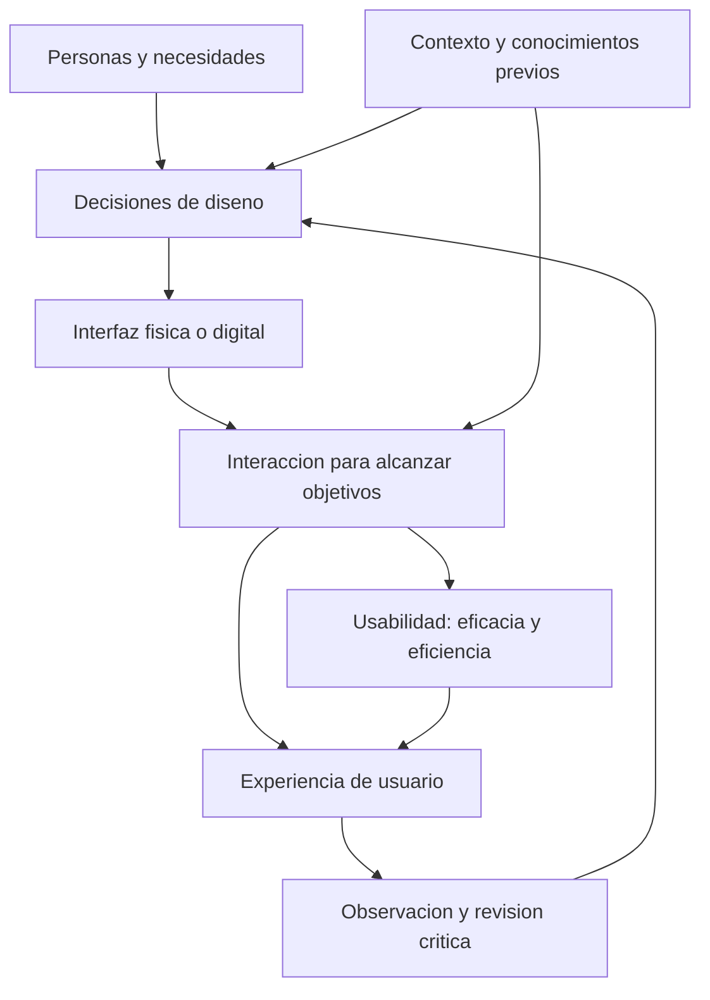

# Clase 1: Fundamentos de UX y UI: contexto de uso, percepción visual y diseño centrado en el usuario

> **Objetivo académico:** Distinguir experiencia de usuario, interfaz y usabilidad; analizar cómo el contexto, las necesidades y la percepción visual influyen en la interacción; y fundamentar decisiones de diseño mediante la revisión crítica de productos físicos e interfaces digitales.

## 1. Contexto y marco conceptual

La interacción humano-computadora requiere comprender cómo las personas utilizan los sistemas para alcanzar objetivos. La sesión introduce esta perspectiva mediante ejemplos físicos y digitales: recorridos en una plaza, envases de alimentos, símbolos de dispositivos, metáforas de escritorio y productos tecnológicos. El argumento conductor es que un producto no puede juzgarse únicamente por su funcionamiento interno ni por su apariencia: debe analizarse la relación entre sus características y las necesidades de quienes lo utilizan.

El diseño de experiencias e interfaces comprende una visión integral del producto. Programar correctamente una función y organizar una pantalla son componentes necesarios, pero insuficientes para comprender la experiencia completa. También importan las expectativas, los conocimientos previos, las condiciones materiales y el entorno de interacción.

### UX, UI y usabilidad

| Concepto | Alcance en la sesión | Pregunta orientadora |
| --- | --- | --- |
| Experiencia de usuario, UX, de *user experience* | Experiencia que surge al interactuar con un producto, servicio o espacio en un contexto determinado | ¿La interacción responde a las necesidades y expectativas de la persona? |
| Interfaz de usuario, UI, de *user interface* | Medio mediante el cual la persona percibe información y actúa sobre un producto o sistema | ¿Cómo se presentan las acciones, los contenidos y los estados? |
| Usabilidad | Facilidad de uso, analizada especialmente mediante eficacia y eficiencia | ¿La persona consigue su objetivo y qué recursos necesita para conseguirlo? |

La UI y la UX mantienen una relación de dependencia: la interfaz influye en la experiencia, mientras que comprender la experiencia orienta el diseño de la interfaz. Sin embargo, no son términos intercambiables.

**Enriquecimiento conceptual:** La UI incluye controles, organización, estados y mecanismos de interacción; no se limita a la ornamentación visual. La UX tiene un alcance más amplio: una pantalla comprensible puede formar parte de una experiencia insatisfactoria si el servicio falla, demora excesivamente o impide completar el objetivo. La usabilidad aporta una perspectiva específica dentro de esa experiencia, sin agotar todas sus dimensiones.

### Interacción física y digital

La experiencia de usuario también existe fuera del software. Un envase propone una manera de sujetar y dispensar; una plaza ofrece trayectorias; un dispositivo incorpora controles físicos. En el ámbito digital, la interfaz organiza posibilidades de acción mediante botones, menús, textos, iconos y respuestas del sistema.

El traslado entre ambos ámbitos permite reconocer una pregunta común: ¿la configuración del producto facilita lo que la persona necesita hacer? La analogía resulta útil si se conserva su límite: los fenómenos físicos y digitales comparten problemas de interacción, pero sus restricciones y mecanismos no son idénticos.

## 2. Fundamentos teóricos y arquitectura

### Contexto de uso y significado

La sesión destaca que los símbolos no poseen un significado práctico independiente de su contexto. Los iconos de conexión inalámbrica, carga y batería son reconocibles para muchas personas por su exposición cotidiana a dispositivos digitales. Esa familiaridad no puede presuponerse en cualquier población o momento histórico.

En estos ejemplos deben distinguirse dos niveles:

- **Identificación del elemento:** reconocer que una figura representa una batería o una conexión inalámbrica.
- **Interpretación de su estado:** comprender que una batería está próxima a agotarse o que la intensidad de señal es reducida.

La forma, el color y la cantidad de segmentos visibles contribuyen a esa interpretación. Un indicador de carga, además, comunica que existe un proceso en curso y reduce la incertidumbre sobre la respuesta del sistema.

**Enriquecimiento conceptual:** Reconocer un símbolo no garantiza comprender su alcance. Un indicador de carga puede informar que existe actividad sin explicar cuánto falta o si la operación puede cancelarse. La calidad de la retroalimentación depende de la información que necesita la persona en ese momento.

### Metáforas y modelos mentales

La metáfora del escritorio relaciona el entorno informático con un espacio de trabajo físico. La sesión utiliza la transformación de la oficina para ilustrar cómo funciones antes distribuidas entre objetos —calendario, documentos o medios de comunicación— se concentran en computadoras y dispositivos móviles.

La utilidad de una metáfora consiste en conectar una interacción nueva con conocimientos anteriores. Así, la denominación de un entorno como «escritorio» proporciona una referencia inicial para comprender su organización.

**Enriquecimiento conceptual:** Un modelo mental es la representación que una persona construye sobre el funcionamiento de un sistema. Las metáforas pueden facilitar esa construcción, pero también inducir expectativas equivocadas cuando el comportamiento digital se aparta del referente físico. Por ello, una metáfora debe evaluarse por su capacidad explicativa para la población concreta.

### Eficacia y eficiencia

La sesión introduce ambas nociones como dimensiones relevantes de la usabilidad:

- **Eficacia:** posibilidad de alcanzar el objetivo previsto.
- **Eficiencia:** relación entre el logro de ese objetivo y los recursos utilizados, como tiempo, esfuerzo o cantidad de acciones.

**Enriquecimiento conceptual:** Un recorrido más corto sugiere una posible mejora de eficiencia si conserva seguridad, accesibilidad y posibilidad de llegar al destino. La distancia por sí sola no demuestra mayor eficacia ni una experiencia superior. De manera semejante, reducir clics no mejora necesariamente una interfaz si elimina información necesaria para tomar decisiones.

### Relación conceptual entre necesidades, interfaz y experiencia

El siguiente esquema organiza las relaciones discutidas. La retroalimentación representa que observar la interacción puede conducir a revisar las decisiones de diseño.

**Enriquecimiento conceptual:** El esquema es una síntesis analítica, no un modelo causal validado en la sesión. La experiencia resulta de múltiples condiciones; no puede deducirse únicamente de propiedades visuales de una pantalla.

## 3. Implementación técnica y lógica de negocio

La sesión no desarrolla código, una arquitectura de software ni una implementación funcional. Su componente técnico consiste en analizar interfaces y reconocer propiedades visuales que influyen en la interacción. La relación con el desarrollo de productos aparece al discutir cómo estos criterios deben complementar la corrección funcional del sistema.

### Criterios visuales desarrollados

| Criterio | Función en la interfaz | Riesgo cuando se aplica deficientemente |
| --- | --- | --- |
| Alineación | Organizar textos, imágenes y controles mediante relaciones espaciales coherentes | Dificultar la exploración y producir una apariencia desordenada |
| Consistencia | Mantener patrones de presentación y comportamiento entre situaciones equivalentes | Obligar a reaprender acciones o interpretar señales contradictorias |
| Contraste | Diferenciar elementos y facilitar su percepción respecto al fondo | Ocultar bordes, textos o controles importantes |
| Tipografía y legibilidad | Permitir la lectura y distinguir niveles de información | Dificultar la comprensión mediante tamaños o estilos inadecuados |
| Jerarquía visual | Orientar la atención hacia contenidos y acciones relevantes | Presentar prioridades confusas o competir por la atención |
| Espaciado | Separar elementos y organizar sus relaciones | Confundir agrupaciones o producir proximidades accidentales |
| Color | Diferenciar estados, categorías y acciones con coherencia | Introducir ambigüedad o variaciones sin significado |
| Proporción | Mantener relaciones adecuadas entre componentes, iconos y contenedores | Distorsionar controles o desequilibrar la composición |

La fuente menciona un documento con ocho principios, pero no desarrolla íntegramente todos sus apartados. La tabla sintetiza los criterios efectivamente nombrados durante la explicación y la comparación visual; no reproduce un documento completo no disponible.

### Consistencia en una aplicación bancaria

El ejemplo de un botón de confirmación con ubicación y color estables muestra cómo la repetición puede facilitar el reconocimiento de acciones. Su lógica consiste en evitar que la persona deba buscar e interpretar desde cero un control equivalente en cada pantalla.

**Enriquecimiento conceptual:** La ubicación inferior derecha y el color verde son decisiones del ejemplo, no reglas universales. Su pertinencia depende del dispositivo, la dirección de lectura, las convenciones del producto y el significado de la acción. Las operaciones con consecuencias importantes pueden requerir confirmaciones o diferenciaciones adicionales. La consistencia debe preservar el significado, no uniformar acciones que tienen riesgos distintos.

### Comparación visual de alternativas

Se presenta una herramienta web de comparación entre dos capturas de interfaz. Las diferencias observables incluyen alineación de iconos, separación entre indicadores, tonos, contraste, grosor de líneas y proporción de componentes. El mecanismo proporciona retroalimentación sobre la alternativa que considera mejor resuelta.

Como método de análisis, la comparación hace visibles pequeñas decisiones que una observación rápida puede pasar por alto. La explicación del defecto aporta más conocimiento que la selección aislada de una alternativa.

**Enriquecimiento conceptual:** Una revisión visual fundamentada puede organizarse en cuatro operaciones: localizar la diferencia, identificar el principio relacionado, explicar su posible efecto y contrastar si ese efecto importa para el objetivo de uso. Estas operaciones convierten una preferencia estética en una hipótesis de diseño susceptible de revisión.

### Herramientas y alcance de la automatización

La sesión menciona Figma, Adobe XD y Balsamiq en relación con diseño y prototipado, y Google Stitch como herramienta de generación asistida por inteligencia artificial. No se demuestra su funcionamiento ni se presentan resultados producidos con ellas.

La idea técnica relevante es que la generación automática necesita revisión humana. Una interfaz generada puede requerir correcciones visuales y evaluación de su adecuación a las necesidades del usuario.

**Enriquecimiento conceptual:** La automatización puede acelerar la producción de alternativas; la validación requiere evidencia sobre personas, objetivos y contexto. Generar una pantalla no acredita su usabilidad.

## 4. Análisis crítico de casos y auditoría práctica

### Caso 1: caminos previstos y recorridos efectivos en una plaza

La imagen descrita contrapone caminos pavimentados con una diagonal marcada por el tránsito sobre el área verde. El contraste evidencia una posible discrepancia entre la circulación prevista y la conducta observada.

El aprendizaje transferible al diseño digital es que la organización concebida por especialistas puede no coincidir con las estrategias de los usuarios. Un recorrido alternativo puede expresar una necesidad no atendida por el trazado original.

**Enriquecimiento conceptual:** La huella de tránsito constituye un indicio de comportamiento, pero no explica por sí sola sus causas. La preferencia por esa trayectoria podría relacionarse con distancia, acceso, obstáculos o destinos habituales. El rediseño requiere investigar esas condiciones antes de decidir entre habilitar el paso, modificar el recorrido o introducir una restricción.

La conversación interpreta también el comportamiento mediante diferencias culturales. Esa dimensión puede formar parte del contexto, pero las generalizaciones continentales formuladas no están respaldadas por evidencia comparativa en la fuente.

**Enriquecimiento conceptual:** La cultura debe tratarse como una hipótesis contextual que requiere investigación. Instalar barreras puede responder a razones de seguridad o conservación, pero también aumentar esfuerzo o dificultar accesibilidad. La decisión necesita explicitar qué necesidad protege y qué efectos produce sobre la interacción.

### Caso 2: envase de vidrio y envase dispensador invertido

La comparación entre una botella de vidrio y un envase plástico con tapa inferior desplaza la atención desde la apariencia hacia el uso. En el segundo caso, la posición de salida favorece que el contenido se encuentre próximo a la abertura, facilitando su extracción conforme disminuye la cantidad disponible.

El ejemplo muestra cómo material, orientación y geometría modifican la interacción. Una decisión aparentemente pequeña puede afectar el esfuerzo y la facilidad de uso.

**Enriquecimiento conceptual:** Ambos envases tienen interfaz y producen una experiencia. No corresponde identificar uno como «UI» y el otro como «UX» de manera excluyente. Tampoco puede establecerse una superioridad universal sin considerar agarre, dosificación, limpieza, resistencia y características del contenido. La sesión ofrece una explicación cualitativa de dispensación, no una comparación experimental.

### Caso 3: iconos y comunicación de estados

Los símbolos de conexión, carga y batería permiten analizar la diferencia entre representar un objeto y comunicar una condición operativa. La información visual debe ayudar a interpretar qué está ocurriendo y qué acción podría ser necesaria.

**Enriquecimiento conceptual:** Un estado relevante no debería depender exclusivamente de una variación cromática sutil. Complementar el color con forma, texto o indicadores adicionales puede facilitar la interpretación bajo distintas capacidades visuales y condiciones de pantalla.

### Caso 4: evolución de productos y contexto histórico

Las referencias al iMac G3, iPod nano, iPhone y MacBook Air ilustran cambios en integración, portabilidad, tamaño y presentación. La enseñanza metodológica consiste en comprender qué problema y qué expectativas rodeaban a cada producto, en lugar de interpretarlo únicamente desde capacidades actuales.

La sesión utiliza presentaciones comerciales como material ilustrativo. Estas muestran decisiones de posicionamiento y atributos destacados por el fabricante, pero no aportan por sí solas evidencia independiente sobre satisfacción o usabilidad.

**Enriquecimiento conceptual:** Deben corregirse dos simplificaciones históricas del discurso: las interfaces gráficas preceden a Windows 95 y Windows 98, y el iPhone no fue el primer teléfono inteligente. El argumento sobre contextualización no depende de atribuir esos primeros hitos. Del mismo modo, la valoración favorable de una empresa no demuestra que todos sus productos produzcan experiencias superiores.

### Caso 5: condiciones materiales de la observación visual

Durante la comparación de interfaces se señala que la resolución y el contraste del monitor influyen en la visibilidad de diferencias pequeñas. Se trata de observaciones de participantes, no de resultados de un estudio controlado.

**Enriquecimiento conceptual:** El desempeño en una comparación visual depende tanto de la diferencia presentada como de las condiciones de observación. Resolución, escala, brillo, contraste y capacidades visuales pueden alterar lo perceptible. Por tanto, una dificultad para detectar un borde no puede atribuirse exclusivamente a falta de atención o conocimiento.

La consecuencia para el diseño es sustantiva: un producto debe resultar comprensible en condiciones reales de uso, no únicamente en la pantalla del equipo que lo crea.

## 5. Principios de diseño, buenas prácticas y anti-patrones

### Diseñar desde necesidades observadas

La perspectiva del diseñador debe contrastarse con el comportamiento y las necesidades de las personas. La plaza y los envases muestran que el uso efectivo puede revelar limitaciones ausentes en una revisión centrada solo en la forma.

El anti-patrón correspondiente consiste en asumir que los usuarios actuarán de acuerdo con la intención del autor del producto. La revisión debe considerar tanto el recorrido previsto como las estrategias alternativas.

### Vincular apariencia y funcionamiento

La funcionalidad interna no garantiza una interacción clara. La sesión cuestiona la tendencia a concentrarse en que el programa ejecute correctamente una operación y relegar la presentación de esa operación al usuario.

**Enriquecimiento conceptual:** La calidad funcional y la calidad de interacción deben evaluarse conjuntamente. Una operación puede estar bien implementada y resultar difícil de descubrir, interpretar o completar desde la interfaz.

### Tratar los principios como criterios contextualizados

La alineación, el contraste y la consistencia orientan decisiones; no sustituyen el análisis del contexto. Una variación visual puede ser un defecto accidental o una señal deliberada de prioridad, estado o riesgo. Su evaluación exige explicar qué comunica y por qué.

El anti-patrón es convertir una preferencia de una herramienta de comparación en una norma universal. La observación de capturas permite analizar composición, pero ofrece evidencia limitada sobre navegación, comprensión y comportamiento durante el uso.

### Integrar revisión visual, funcional y de experiencia

La conversación plantea si las pruebas de software incluyen estos detalles y reconoce que su cobertura depende del alcance de la revisión. No puede afirmarse que las pruebas funcionales excluyan necesariamente los problemas de interfaz.

**Enriquecimiento conceptual:** La revisión visual puede integrarse en el aseguramiento de calidad y complementarse con investigación de usuarios. Las competencias deben definirse por formación y capacidad de análisis, sin atribuir sensibilidad visual a un género. La calidad de la revisión depende de criterios explícitos y evidencia.

### Conservar el juicio humano en el uso de IA

Las herramientas automáticas pueden apoyar el diseño, pero sus resultados necesitan revisión. El anti-patrón es equiparar rapidez de generación con adecuación al usuario. Las decisiones sobre legibilidad, prioridades y comprensión siguen requiriendo análisis contextual.

## 6. Síntesis conceptual y profundización académica

La clase establece tres distinciones centrales. La interfaz es el medio de interacción; la usabilidad permite analizar el logro de objetivos y los recursos empleados; la experiencia de usuario comprende una relación más amplia entre persona, producto y contexto. Estas dimensiones se influyen mutuamente, pero requieren preguntas y evidencias diferentes.

Los casos físicos permiten identificar necesidades que el diseño previsto puede omitir. Los iconos y la metáfora del escritorio muestran que comprender una interfaz depende de convenciones y conocimientos previos. La comparación de capturas revela que alineación, contraste, espaciado y proporción intervienen en la percepción, mientras que el debate sobre monitores recuerda que esa percepción está condicionada materialmente.

**Enriquecimiento conceptual:** Conviene distinguir tres niveles de evidencia: una captura permite revisar propiedades visuales; observar una interacción permite estudiar conducta y dificultades; conocer la experiencia requiere además comprender objetivos, expectativas e interpretación. Ninguno de estos niveles sustituye por completo a los otros.

Como líneas de profundización conceptual, la sesión deja abiertas las relaciones entre percepción y carga cognitiva, convenciones e interpretación, consistencia y diferenciación de riesgos, y generación automática y validación humana. El criterio transversal es justificar las decisiones por su contribución a una interacción comprensible y pertinente para personas concretas.
