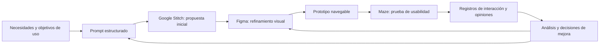

# Clase 4: Ecosistema de diseño centrado en el usuario: Google Stitch, Figma y Maze

> **Objetivo académico:** Comprender y analizar el ciclo de ideación generativa, refinamiento de interfaces y evaluación empírica de usabilidad mediante la integración de Google Stitch, Figma y Maze, distinguiendo los artefactos de diseño de la evidencia sobre su uso.

## 1. Contexto y marco conceptual

El diseño digital integra estética, interacción, organización de información y eficiencia funcional. Una interfaz puede ser visualmente atractiva y, aun así, dificultar la comprensión de sus controles o la realización de una operación. Por ello, diseñar exige considerar cómo las personas perciben los elementos, interpretan sus funciones y recorren las pantallas para alcanzar un objetivo.

La sesión articula tres plataformas como un ecosistema de diseño centrado en el usuario:

- **Google Stitch:** convierte descripciones en lenguaje natural en propuestas visuales de interfaz y permite acceder al código generado.
- **Figma:** permite editar esas propuestas, mantener consistencia visual y construir prototipos navegables.
- **Maze:** permite configurar pruebas de usabilidad y recoger registros de interacción y respuestas de los participantes.

El recorrido general es **idea → interfaz → prototipo interactivo → evidencia → revisión del diseño**. La aceleración de la producción visual libera tiempo para explorar alternativas, pero no elimina la necesidad de justificar las decisiones ni de observar su funcionamiento con personas.

En contextos de investigación y docencia, estos artefactos permiten materializar propuestas pedagógicas, representar hipótesis de interacción y comunicar decisiones de diseño. Figma se presenta, en particular, como un espacio donde se hacen explícitas jerarquías de información, pesos visuales y expectativas sobre el comportamiento del usuario.

**Enriquecimiento conceptual:** Un prototipo constituye una representación operativa de ciertas decisiones, no una demostración de que estas sean correctas. Del mismo modo, una pantalla que muestra un pronóstico o una alerta no prueba que exista un modelo predictivo implementado. Conviene separar tres niveles: representación visual, comportamiento simulado y funcionalidad ejecutable del producto.

El diagrama representa un proceso iterativo: la evidencia puede exigir modificar una conexión entre pantallas, revisar un componente o reformular la propuesta inicial.

## 2. Fundamentos teóricos y arquitectura

### 2.1. Diseño generativo mediante lenguaje natural

En Stitch, la descripción de la solución funciona como entrada para producir una primera propuesta de interfaz. El prompt puede especificar pantallas, jerarquías, componentes, navegación y funcionalidades esperadas. La ventaja metodológica consiste en reducir el esfuerzo necesario para visualizar y comparar ideas.

La sesión insiste en incorporar criterios concretos de UI y UX: jerarquía visual, alineación consistente, contraste para la lectura, espaciado, tipografía y paleta cromática. La accesibilidad también se menciona como criterio relevante, aunque no se desarrolla una revisión de estándares ni se verifica su cumplimiento.

**Enriquecimiento conceptual:** Expresiones generales como «moderna» o «intuitiva» dejan abiertas muchas decisiones. Un requisito resulta más útil si describe una propiedad observable: qué información debe destacar, qué controles deben permanecer disponibles o qué recorrido necesita completar la persona. La generación asistida requiere posteriormente una revisión humana de esas propiedades.

### 2.2. Arquitectura visual y prototipado en Figma

Se destacan tres capacidades de Figma:

1. **Colaboración en tiempo real:** varias personas pueden intervenir sobre un mismo diseño.
2. **Componentes reutilizables:** bibliotecas, estilos y variantes permiten mantener consistencia entre pantallas.
3. **Prototipado interactivo:** las conexiones representan respuestas a acciones del usuario y permiten simular recorridos.

El prototipo se organiza mediante pantallas o *frames*. Una interacción combina un **desencadenante**, como un clic, con una **acción**, como navegar hacia otro frame. La transición expresa cómo se presenta el cambio entre estados de la interfaz.

**Enriquecimiento conceptual:** Puede interpretarse el prototipo como un grafo dirigido: las pantallas representan estados y las conexiones representan transiciones disponibles. Esta lectura permite detectar pantallas inaccesibles, rutas sin retorno o diferencias entre los recorridos previstos y los efectivamente implementados. No implica que el prototipo reproduzca todos los estados internos de una aplicación real.

### 2.3. Pruebas de usabilidad

Las pruebas de usabilidad consisten en observar cómo las personas interactúan con un diseño para obtener información que permita perfeccionarlo. Pueden aplicarse tanto a propuestas tempranas de baja fidelidad como a prototipos cercanos a la apariencia final.

La sesión distingue dos modalidades:

| Modalidad | Papel del facilitador | Aporte principal | Limitación relevante |
|---|---|---|---|
| Moderada | Acompaña la sesión, observa y puede intervenir | Permite registrar dificultades y aclarar lo que sucede durante la interacción | La coordinación y la cobertura de participantes pueden resultar costosas |
| Sin moderación | Configura el estudio y analiza posteriormente sus registros | Facilita la participación remota y la recopilación estructurada de datos | Depende especialmente de la claridad del escenario y de las instrucciones |

Maze se utiliza para la segunda modalidad: el investigador prepara el prototipo, define misiones, comparte un enlace y analiza los registros obtenidos.

**Enriquecimiento conceptual:** La moderación y la ubicación son dimensiones distintas. Una sesión moderada también puede ser remota. Además, cualquier ayuda del facilitador debe registrarse porque puede modificar la autonomía observada durante el recorrido.

### 2.4. Complementariedad de las plataformas

| Plataforma | Entrada utilizada en la sesión | Resultado principal | Criterio de revisión |
|---|---|---|---|
| Google Stitch | Descripción textual del producto y sus criterios visuales | Pantallas iniciales y código generado | Correspondencia con la intención de diseño |
| Figma | Diseño importado mediante un complemento | Pantallas editables y conexiones de navegación | Consistencia visual y coherencia del recorrido |
| Maze | Enlace al prototipo y configuración del estudio | Métricas, mapas de clics y respuestas | Dificultades observables y oportunidades de mejora |

Las herramientas cubren funciones diferentes. La calidad visual, la navegación simulada y los resultados de uso deben revisarse con criterios propios.

## 3. Implementación técnica y lógica de negocio

### 3.1. Caso conductor: interfaz financiera

El caso desarrollado es una aplicación móvil orientada al análisis y pronóstico del valor del dólar en Bolivia. La propuesta inicial incluye un panel principal, análisis histórico, pronóstico, noticias económicas, alertas y configuración.

Para formular el prompt se utiliza un asistente conversacional. Se solicita que la descripción incorpore jerarquía visual, alineación, contraste, espaciado, una paleta basada en azules y verdes, tipografía y componentes de interfaz. Ese texto se traslada después a Stitch para generar las pantallas.

La transcripción no reproduce íntegramente el prompt final ni el código generado. Tampoco presenta una implementación del pronóstico financiero, fuentes de cotización o validación de sus resultados. El caso se desarrolla como diseño y navegación de interfaz.

**Enriquecimiento conceptual:** La lógica de negocio debe preceder a la selección de componentes. En este dominio, consultar una cotización, explorar datos y configurar una alerta son objetivos diferentes. Su separación en pantallas debe responder a esas diferencias y no únicamente a la disponibilidad de plantillas visuales.

### 3.2. Importación desde Stitch hacia Figma

La demostración utiliza el complemento **HTML to Design** para convertir el código de una pantalla en elementos editables dentro de Figma. El procedimiento mostrado es:

1. Seleccionar una pantalla en Stitch y abrir la opción de visualización de código.
2. Copiar el código completo de esa pantalla.
3. Abrir un archivo de diseño en Figma y ejecutar el complemento.
4. Pegar el código en el editor del complemento.
5. Ajustar el tamaño de la pantalla de destino antes de importar.
6. Incorporar el resultado al lienzo, organizar sus frames y revisar su apariencia.
7. Repetir el procedimiento para las pantallas restantes.

En el ejemplo se utiliza una anchura de 390 píxeles para una pantalla móvil. Es una configuración de la demostración, no una dimensión universal para interfaces móviles. También se mencionan opciones de importación relacionadas con layout, variables y componentes, sujetas a lo que permita el complemento.

Se prefiere el editor de código frente a la importación por URL debido a dificultades observadas durante el uso de esta última alternativa. La herramienta consume créditos por importación, lo que introduce una restricción operativa al trasladar muchas pantallas.

**Enriquecimiento conceptual:** La conversión entre herramientas requiere auditar el resultado. La semejanza visual no garantiza que se hayan preservado la estructura de componentes, el comportamiento adaptable ni las relaciones entre elementos. El código importado tampoco debe suponerse equivalente a interacciones ya configuradas en Figma.

### 3.3. Organización de frames y conexiones

Después de importar las pantallas, se recomienda sustituir los nombres genéricos de los frames por nombres reconocibles, como «Dashboard», «Tipo de cambio» o «Explorador de datos». Esta identificación facilita localizar las pantallas al configurar el estudio en Maze.

En la pestaña de prototipado de Figma se selecciona el componente que actuará como control y se conecta con el frame de destino. La vista de presentación permite comprobar la navegación. Se muestran tanto conexiones hacia pantallas de detalle como controles para regresar a una pantalla anterior.

También se ajusta el área visible de una pantalla extensa para permitir desplazamiento vertical. El menú puede mantenerse fijo mediante una opción equivalente a *Fixed in place*, de modo que el contenido se desplace mientras ese control conserva su posición.

**Enriquecimiento conceptual:** Fijar un menú favorece su disponibilidad durante el desplazamiento, pero debe comprobarse que no cubra información o controles. La evaluación debe realizarse con el tamaño de viewport utilizado por los participantes.

### 3.4. Configuración del estudio en Maze

La demostración organiza el estudio mediante bloques:

| Bloque | Función metodológica |
|---|---|
| Bienvenida | Introducir la participación en la investigación |
| Context screen | Presentar el producto y el contexto de uso |
| Prototipo | Exponer una misión sobre la interfaz importada |
| Escala de opinión | Recoger una valoración estructurada de facilidad percibida |
| Pregunta abierta | Obtener comentarios sobre la experiencia |
| Cierre | Finalizar la participación |

Para incorporar el prototipo se copia el enlace de Figma y se importa en Maze. La pantalla inicial se selecciona explícitamente: no tiene por qué coincidir con la primera pantalla del archivo. A continuación, se registra el recorrido que la configuración considerará satisfactorio.

Se presentan dos recorridos ilustrativos:

- Acceder al explorador de datos pasando por la pantalla de tipo de cambio.
- Acceder al centro de aprendizaje pasando por la configuración de alertas.

El archivo se duplica parcialmente para distinguir visualmente los recorridos durante la explicación. Esa duplicación no constituye un requisito metodológico: distintas misiones pueden utilizar un mismo conjunto de pantallas.

Una dificultad de integración aparece cuando Maze no dispone de acceso al archivo de Figma. La solución mostrada consiste en revisar los permisos de visualización del enlace. Una vez configurados los bloques, se utiliza una vista previa y se habilita el estudio para obtener un enlace de participación.

**Enriquecimiento conceptual:** La interoperabilidad exige permisos suficientes, pero no permisos de edición innecesarios. Si el prototipo contiene información sensible, su distribución debe revisarse antes de ampliar el acceso.

## 4. Análisis crítico de casos y auditoría práctica

### 4.1. Lectura de los resultados

Maze presenta información individual de los participantes y reportes agregados por misión. En la demostración se revisan recorridos, finalización, tiempos por pantalla, clics y mapas de calor. También se consultan valoraciones de facilidad y comentarios abiertos.

| Evidencia | Pregunta que ayuda a analizar | Límite interpretativo |
|---|---|---|
| Éxito de la misión | ¿Se alcanzó el destino configurado? | Depende de cómo se haya definido el éxito |
| Tiempo de realización | ¿Cuánto tardó el recorrido? | No distingue por sí solo lectura, duda e interrupción |
| Clics fuera del recorrido previsto | ¿Dónde se intentó interactuar? | Pueden responder a expectativas razonables no implementadas |
| Abandono | ¿Qué participaciones no concluyeron? | No establece por sí mismo la causa |
| Mapa de calor | ¿Dónde se concentran los clics? | No equivale a seguimiento ocular |
| Escala de facilidad | ¿Cómo se percibe la navegación? | Es una valoración subjetiva |
| Respuestas abiertas | ¿Qué dificultades o impresiones se expresan? | Su interpretación requiere contexto |

Los porcentajes del reporte se comentan mientras continúan llegando participaciones y algunas cifras quedan ambiguas en la transcripción. Por ello, permiten ilustrar las categorías del reporte, pero no sostienen una estimación estable de la usabilidad del producto.

**Enriquecimiento conceptual:** Una escala ordenada de facilidad genera datos ordinales: existe un orden entre categorías, pero no queda garantizado que la distancia entre categorías sea constante. Las respuestas abiertas proporcionan evidencia cualitativa; no deben confundirse ambas formas de medición.

### 4.2. Operacionalización de métricas

**Enriquecimiento conceptual:** Para interpretar cualquier reporte conviene definir sus denominadores. Una tasa básica de éxito puede expresarse como:

$$
S = \frac{n_s}{n_i}\times 100\%
$$

Aquí, $S$ es el porcentaje de éxito; $n_s$ es el número entero no negativo de participantes que satisfacen el criterio de éxito, y $n_i$ es el número entero positivo de participantes que iniciaron la misión. Se supone una observación por participante y una definición uniforme de éxito, con $0 \leq n_s \leq n_i$. Si la plataforma utiliza otro denominador o diferencia éxito directo e indirecto, la interpretación debe adaptarse a esa definición.

Un promedio de duración entre quienes completaron puede escribirse como:

$$
\bar{t} = \frac{1}{n_c}\sum_{j=1}^{n_c} t_j
$$

En esta expresión, $n_c$ es el número entero positivo de participantes que completaron la misión; $j$ identifica a cada uno de ellos; $t_j$ es su duración observada en segundos, con $t_j \geq 0$; y $\bar{t}$ es el tiempo medio, también en segundos. Este resumen excluye a quienes no completaron y puede resultar afectado por interrupciones o valores extremos. No debe interpretarse aisladamente como facilidad de uso.

No se calcula una tasa de error a partir de la transcripción porque no queda establecido su denominador ni la definición exacta utilizada por la plataforma. Contar clics fuera de áreas interactivas y contar participantes con dificultades son operaciones distintas.

### 4.3. Clics deliberados y validez del caso

Durante la demostración se realizan clics deliberadamente incorrectos para mostrar su aparición posterior en los reportes. Esto evidencia la capacidad de registro de la herramienta, pero modifica intencionalmente el patrón observado.

**Enriquecimiento conceptual:** Esas interacciones deben distinguirse de las sesiones destinadas a estudiar comportamiento espontáneo. Si se agregan sin identificación, pueden aumentar artificialmente los clics fallidos y alterar los mapas de calor. La prueba de instrumentación y la evaluación de usabilidad cumplen objetivos distintos.

La presencia de áreas no conectadas también limita la interpretación. Un participante puede seleccionar un elemento que parece interactivo y no obtener respuesta porque el prototipo es incompleto. Antes de atribuir la dificultad a la persona, debe revisarse la correspondencia entre apariencia, significado y comportamiento implementado.

### 4.4. Alcance de la evidencia

La sesión menciona posibles registros de navegación y métricas cognitivas, pero la demostración se concentra en comportamiento observable y opiniones declaradas.

**Enriquecimiento conceptual:** Un clic o una duración no permiten inferir directamente atención, comprensión o carga cognitiva. Es necesario justificar cómo cada indicador representa el fenómeno que se desea estudiar. Del mismo modo, una simulación puede ayudar a revisar conexiones, pero no sustituye evidencia de usuarios representativos.

El caso de alertas de transferencias bancarias aporta otra distinción: mostrar cuentas de origen y destino o una probabilidad de fraude requiere seleccionar información relevante para el analista. Sin embargo, diseñar ese panel no valida el sistema que produce la probabilidad. La calidad del modelo y la calidad de la interfaz son objetos de evaluación diferentes.

## 5. Principios de diseño, buenas prácticas y anti-patrones

| Principio | Buena práctica | Anti-patrón |
|---|---|---|
| Objetivos explícitos | Describir qué necesita lograr la persona | Generar pantallas sin precisar su función |
| Consistencia | Compartir estilos y componentes entre vistas | Introducir variaciones arbitrarias en controles equivalentes |
| Jerarquía y legibilidad | Priorizar información y revisar contraste, tipografía y espaciado | Confundir atractivo visual con comprensión |
| Integridad del prototipo | Comprobar conexiones, retornos y desplazamiento | Interpretar controles sin implementar como fallos del usuario |
| Claridad metodológica | Definir inicio, objetivo y criterio de éxito | Cambiar la definición de éxito después de observar resultados |
| Triangulación | Relacionar métricas con recorridos y comentarios | Explicar la experiencia mediante una sola cifra |
| Iteración | Vincular cada cambio con evidencia y volver a observar | Producir reportes sin traducirlos en decisiones |

**Enriquecimiento conceptual:** Las instrucciones de una misión deben ajustarse a la pregunta de investigación. Si se estudia descubribilidad, indicar exactamente qué botón pulsar puede revelar la solución y ocultar problemas de navegación. Si se estudia la ejecución de un procedimiento conocido, una instrucción más específica puede ser pertinente. La elección debe declararse antes de interpretar el resultado.

Los límites gratuitos y las opciones de pago condicionan el número de importaciones o bloques disponibles. La transcripción ofrece referencias variables a esas cuotas; deben entenderse como restricciones de la demostración, no como especificaciones permanentes del servicio. También pueden cambiar nombres y ubicaciones de controles entre versiones.

**Enriquecimiento conceptual:** La automatización reduce parte del esfuerzo de creación y registro, pero la responsabilidad metodológica permanece: seleccionar participantes, configurar escenarios, verificar la instrumentación y analizar explicaciones alternativas. Una valoración favorable no sustituye el cumplimiento del objetivo, y una finalización exitosa no garantiza una experiencia satisfactoria.

## 6. Síntesis conceptual y profundización académica

La integración de Stitch, Figma y Maze permite recorrer un ciclo completo de diseño: expresar una intención, materializarla visualmente, simular su interacción y contrastarla con registros de uso. Su valor reside en conectar producción y aprendizaje, de manera que los resultados orienten nuevas decisiones.

Stitch acelera la exploración inicial; Figma permite precisar estructura visual y navegación; Maze facilita recopilar evidencia sobre recorridos concretos. Ninguna etapa garantiza por sí sola la calidad de la experiencia. La coherencia del ciclo depende de que los objetivos, las conexiones y los criterios de interpretación correspondan entre sí.

La sesión demuestra una integración operativa entre herramientas y una lectura inicial de reportes. Su evidencia permite comprender el procedimiento, pero no establecer resultados generalizables sobre la aplicación financiera ni certificar su accesibilidad o sus capacidades predictivas.

**Enriquecimiento conceptual:** La profundización académica puede organizarse alrededor de tres problemas: la validez de los indicadores utilizados para representar usabilidad, la influencia de la fidelidad del prototipo sobre el comportamiento observado y la trazabilidad entre evidencia y cambios de diseño. Estas cuestiones permiten pasar de la producción rápida de pantallas a una investigación de interacción sustentada y revisable.
