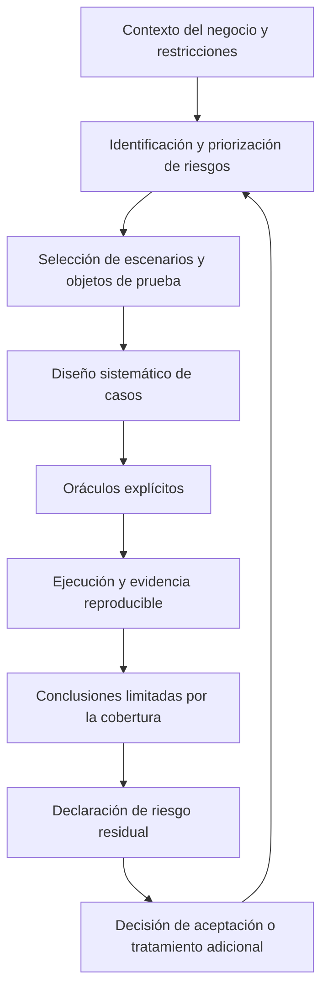

# Clase 1: Calidad de software basada en riesgos: diseño sistemático, oráculos y evidencia defendible

> **Objetivo académico:** Analizar cómo priorizar riesgos de calidad, derivar pruebas sistemáticas y formular oráculos defendibles, manteniendo trazabilidad entre decisiones, escenarios, evidencia y riesgo residual, así como límites explícitos de validez.

## 1. Contexto y marco conceptual

La sesión articula dos dimensiones de la calidad de software: la selección de riesgos relevantes y el diseño sistemático de pruebas capaces de producir evidencia sobre ellos. El problema central es decidir qué probar cuando el tiempo, el presupuesto, la infraestructura y la capacidad humana son finitos.

La aspiración de verificar exhaustivamente un sistema encuentra límites en la cantidad de entradas, estados, rutas de ejecución e interacciones posibles. La analogía presentada con el control industrial ilustra que verificar cada unidad puede ser inviable o destructivo. En software, el límite dominante no es necesariamente la destrucción del producto, sino el costo de explorar un espacio de comportamientos potencialmente enorme.

Aceptar riesgo residual significa reconocer y documentar qué incertidumbre permanece después de las acciones adoptadas. No equivale a declarar irrelevantes los riesgos omitidos ni a afirmar que el sistema carece de defectos. Una decisión defendible conecta el alcance de las pruebas con la criticidad del negocio y explica tanto las inclusiones como las exclusiones.

### Conceptos articuladores

- **Sistema bajo prueba, SUT:** producto, servicio o componente cuyo comportamiento se evalúa.
- **Objeto de prueba:** unidad delimitada sobre la que se aplica una técnica, como una operación de una API y sus parámetros.
- **Riesgo de calidad:** posibilidad de que un comportamiento o condición comprometa atributos relevantes del sistema o del negocio.
- **Escenario de prueba:** situación concreta que especifica condiciones, estímulos y observaciones pertinentes para un riesgo.
- **Oráculo:** criterio utilizado para decidir si una observación satisface lo esperado.
- **Evidencia:** registro que permite relacionar la ejecución con sus entradas, resultados y reglas de interpretación.
- **Riesgo residual:** exposición que permanece tras el tratamiento considerado, incluidos comportamientos y condiciones no cubiertos.

La trazabilidad integra estas nociones en una cadena argumentativa: un riesgo justifica un escenario; el escenario requiere un criterio de decisión; su ejecución produce evidencia; esa evidencia sustenta una conclusión delimitada y permite declarar incertidumbre restante.

**Enriquecimiento conceptual:** Las pruebas aportan información para gestionar el riesgo; por sí solas no necesariamente reducen la probabilidad de un fallo. La reducción efectiva puede requerir corregir defectos, modificar la arquitectura, introducir controles o restringir el uso. Conviene distinguir entre descubrir un problema, reducir incertidumbre sobre él y mitigar su causa.

## 2. Fundamentos teóricos y arquitectura

### 2.1. Priorización por impacto y probabilidad

Varios casos utilizan un puntaje obtenido al multiplicar impacto y probabilidad:

$$
S_r = I_r P_r
$$

Aquí, $r$ identifica un riesgo, $S_r$ es su puntaje de priorización, $I_r$ representa su impacto y $P_r$ su probabilidad valorada en una escala definida por el equipo. En el caso de la API de artículos se comunican escalas ordinales de 1 a 5 para ambos factores; por tanto, allí $I_r,P_r\in\{1,2,3,4,5\}$ y el puntaje no tiene unidad física.

Se reportan los siguientes ejemplos:

| Riesgo | Impacto | Probabilidad valorada | Puntaje |
| --- | ---: | ---: | ---: |
| Indisponibilidad de la API de artículos | 5 | 3 | 15 |
| Errores de robustez en esa API | 4 | 4 | 16 |
| Latencia en esa API | 4 | 3 | 12 |
| Pérdida de reservas en el caso de gestión de reservas | 5 | 4 | 20 |

El puntaje organiza la discusión, pero requiere justificar las valoraciones. Un fallo observado, la dependencia de un proveedor, la ausencia de mecanismos de recuperación o el bloqueo de una operación crítica constituyen fundamentos distintos y deben quedar documentados.

**Enriquecimiento conceptual:** Multiplicar escalas ordinales produce una heurística de ordenación, no una estimación calibrada de pérdida esperada. En particular, el valor 4 de una escala no significa una probabilidad del 80 %, ni permite afirmar que un puntaje 20 representa el doble de riesgo real que uno de 10. La comparación presupone criterios consistentes de valoración.

Los empates requieren una regla explícita cuando afectan la selección. En Games Shop se favorecen los riesgos que comprometen datos o bloquean la funcionalidad principal frente a los que degradan solamente la experiencia. En el caso Petstore, la discusión muestra que justificar puntajes iguales no resuelve por sí mismo cómo elegir entre dos riesgos empatados cuando existe una restricción de capacidad.

### 2.2. Gestión del riesgo y técnicas de análisis

El caso Petstore declara apoyarse en ISO 31000 para organizar la gestión del riesgo y en la referencia identificada en el discurso como 31010 para seleccionar técnicas. La secuencia expuesta comprende identificación, análisis, evaluación y tratamiento.

| Etapa | Función conceptual en el caso |
| --- | --- |
| Identificación | Reconocer riesgos mediante lluvia de ideas y conocimiento del contexto. |
| Análisis | Examinar escenarios, controles, consecuencias e incertidumbres. |
| Evaluación | Comparar los riesgos con los criterios de decisión y establecer prioridades. |
| Tratamiento | Seleccionar acciones y delimitar la exposición que se acepta o permanece abierta. |

Se menciona SWIFT como técnica de indagación mediante preguntas hipotéticas sobre posibles fallos. La transcripción presenta variantes imprecisas en las denominaciones normativas; no permite verificar una aplicación completa de los estándares.

**Enriquecimiento conceptual:** El uso de preguntas hipotéticas estructuradas favorece la exploración de desviaciones y consecuencias. No exige, como propiedad universal, revisar código línea por línea ni dividir siempre el sistema en nodos. La unidad de análisis depende del alcance definido.

### 2.3. Particiones de equivalencia, límites y combinaciones

La técnica predominante es dividir el dominio de entrada en clases que se espera que produzcan comportamientos similares y seleccionar representantes. El análisis de valores límite complementa esa partición con entradas próximas a sus fronteras.

La validez de la equivalencia depende del comportamiento supuesto: dos entradas de la misma clase pueden activar rutas internas diferentes si la partición omite una distinción relevante. Por ello, una reducción del número de casos conserva únicamente la cobertura definida por el modelo de particiones.

Se menciona también la técnica combinatoria por pares como una alternativa, pero no se desarrolla su aplicación.

**Enriquecimiento conceptual:** Cubrir todos los pares de valores de factores definidos no equivale a cubrir todas sus combinaciones. Tampoco convierte automáticamente el conjunto de pruebas en una muestra estadística ni proporciona una garantía probabilística de confiabilidad. Las afirmaciones de cobertura deben referirse a factores, clases, fronteras o requisitos expresamente identificados.

### 2.4. Arquitectura y relevancia del riesgo

La arquitectura modifica qué riesgos resultan plausibles y qué pruebas son pertinentes. Un chatbot con memoria local y sin aislamiento de sesiones plantea problemas distintos de una API transaccional de reservas. Asimismo, un entorno local reduce algunas exposiciones, pero no demuestra que el producto sea seguro o escalable en otro contexto.

La sesión debate la prioridad relativa entre disponibilidad y seguridad. Los equipos presentan criterios distintos según el propósito del sistema y su madurez.

**Enriquecimiento conceptual:** La aceptación de usuarios aporta información sobre utilidad, pero no valida por sí sola seguridad, integridad o cumplimiento. La priorización debe incorporar obligaciones, amenazas y consecuencias que pueden no ser visibles en la experiencia inmediata del usuario.

## 3. Implementación técnica y lógica de negocio

La fuente describe operaciones de API, scripts, registros y reportes, pero no proporciona código ejecutable completo ni los artefactos originales. Por ello, se reconstruye la lógica del diseño sin simular ejecuciones ni atribuir resultados nuevos.

### 3.1. Derivación de casos para identificadores

En Games Shop se utilizan identificadores hexadecimales de longitud 24. Las particiones distinguen formato válido, caracteres ajenos al alfabeto permitido y longitud incorrecta. La existencia del recurso constituye una dimensión adicional, independiente de la sintaxis.

**Enriquecimiento conceptual:** Una formalización del dominio sintáctico descrito es:

$$
H=\{0,1,\ldots,9,a,b,c,d,e,f,A,B,C,D,E,F\}
$$

$$
D_{\mathrm{formato}}=\{x\in\Sigma^*:\lvert x\rvert=24\ \land\ \forall c\in x,\ c\in H\}
$$

$H$ es el alfabeto hexadecimal aceptado; $\Sigma^*$ representa las cadenas finitas sobre el alfabeto de entrada; $x$ es una cadena, $c$ uno de sus caracteres y $\lvert x\rvert$ su longitud en caracteres. La expresión describe sintaxis, sin asegurar que el identificador pertenezca a un registro almacenado.

Un ejemplo de derivación, sin atribuirle ejecución, consiste en elegir cadenas hexadecimales de 23, 24 y 25 caracteres y otra de 24 caracteres que contenga una letra fuera de $H$. Las tres primeras aíslan la frontera de longitud; la última aísla el alfabeto. La cadena sintácticamente válida debe separarse después entre recurso existente y recurso ausente si se pretende predecir un código HTTP específico.

En Pet Clinic se selecciona una operación que recibe el identificador de un veterinario y devuelve sus datos junto con especialidades. Su relevancia combina una entrada delimitada con una consulta que, según la exposición, integra información relacionada mediante uniones. Se consideran representantes del dominio, fronteras y variantes de formato y signo; no se explicitan los límites numéricos concretos, por lo que no corresponde inventarlos.

### 3.2. Oráculos mínimos, por partición y estrictos

Las categorías empleadas en la sesión responden al alcance de las afirmaciones que los equipos consideran defendibles:

| Categoría | Ejemplos descritos | Límite de interpretación |
| --- | --- | --- |
| Mínimos | Obtener una respuesta HTTP, registrar el cuerpo y evitar una respuesta HTML inesperada. | Demuestran observabilidad y ciertos requisitos básicos del intercambio. |
| Por partición | Diferenciar identificadores inválidos, recursos ausentes y entradas válidas. | Requieren conocer la clase de entrada y, cuando procede, el estado de los datos. |
| Estrictos | Verificar correspondencia del identificador, coherencia de fechas o restricciones de campos. | Evalúan propiedades semánticas específicas, sin cubrir automáticamente toda la lógica del negocio. |

**Enriquecimiento conceptual:** Guardar un código y una respuesta es un requisito de evidencia; no constituye por sí solo un oráculo de corrección. Para decidir aprobación o fallo hace falta una regla que determine qué observaciones son admisibles. Del mismo modo, mínimo y estricto son categorías operativas de esta sesión, no una clasificación universal de los oráculos.

En Games Shop, admitir 200 o 404 para un identificador de formato válido resuelve la falta de conocimiento sobre su existencia. La regla es defendible como comprobación limitada, pero no determina si el sistema recupera correctamente los recursos.

En Pet Clinic, una respuesta 200 debe incluir un cuerpo no vacío y, bajo una regla más específica, el identificador devuelto debe corresponder al solicitado. Comprobar únicamente que exista un campo de identificación resulta más débil que verificar su valor.

**Enriquecimiento conceptual:** La relación de correspondencia puede expresarse como:

$$
\operatorname{status}=200\ \Rightarrow\ \operatorname{id}_{\mathrm{respuesta}}=\operatorname{id}_{\mathrm{solicitado}}
$$

$\operatorname{status}$ es el código HTTP entero de la respuesta; ambos identificadores pertenecen al dominio definido por la API. Se supone que la operación devuelve un recurso individual identificado por la entrada. La regla comprueba identidad, pero no la exactitud de nombres, especialidades u otros atributos.

### 3.3. Restricciones semánticas de reservas y pedidos

En la API de reservas se describen 15 casos derivados mediante equivalencia y valores límite. Además del formato de respuesta, se considera la relación temporal entre ingreso y salida:

$$
t_{\mathrm{checkin}}<t_{\mathrm{checkout}}
$$

Ambas variables representan fechas de la misma reserva en un dominio temporal comparable. La desigualdad expresa la regla de negocio declarada en el caso: la salida debe ser posterior al ingreso. Validar el formato de ambas fechas no demuestra que se cumpla esta relación.

En Petstore se selecciona una operación de creación de pedidos por su relevancia transaccional y por las restricciones de campos como `quantity` y `status`. Se comunican 14 casos y cobertura de las particiones y fronteras principales, sin afirmar cobertura combinatoria ni comportamiento bajo carga.

El equipo reporta que el simulador acepta entradas que deberían incumplir reglas estrictas y decide registrar esos casos como fallos. Sin embargo, una frase de la transcripción menciona datos válidos donde el argumento parece requerir datos inválidos; sin el cuerpo de las solicitudes no puede establecerse cuál fue la entrada concreta.

### 3.4. Oráculos para un chatbot

El chatbot informativo utiliza una operación descrita como `POST memory`. Las reglas incluyen formato JSON, respuesta a preguntas básicas, precios expresados en bolivianos y presencia de términos esperados sobre ubicación. También se plantea una respuesta de derivación cuando no existe información suficiente.

Las comprobaciones por palabras clave permiten evaluar requisitos concretos y fácilmente observables. El equipo reconoce que no abarcan preguntas complejas ni una evaluación completa de coherencia lingüística.

**Enriquecimiento conceptual:** La presencia de palabras esperadas puede coexistir con una respuesta falsa, contradictoria o ajena a la pregunta. Una evaluación semántica más sólida distinguiría exactitud factual, pertinencia, suficiencia de información, comportamiento ante desconocimiento y conservación del contexto. Estas dimensiones complementan el formato y los códigos HTTP; no se presentan como resultados obtenidos en la sesión.

### 3.5. Evidencia reproducible

Los equipos describen scripts, archivos JSON, registros de ejecución y resúmenes por caso. La evidencia debe permitir vincular el estímulo aplicado con la observación y el oráculo utilizado. El procedimiento documentado tiene un papel central para que otra persona pueda repetir el análisis.

**Enriquecimiento conceptual:** Un script aislado no garantiza el mismo resultado. La reproducción requiere conocer versión del sistema, configuración, dependencias, datos iniciales, orden de operaciones y condiciones de ejecución. En sistemas externos o generativos, además debe distinguirse repetir el procedimiento de obtener una salida idéntica.

## 4. Análisis crítico de casos y auditoría práctica

### 4.1. Games Shop: seguridad, robustez y disponibilidad

El caso prioriza acceso no autorizado, errores internos y disponibilidad básica. Se mencionan fallos de configuración y posibles omisiones de controles intermedios como causas de inseguridad; los errores observados reciben mayor atención por su evidencia empírica.

Su fortaleza metodológica es conectar riesgos con escenarios específicos y declarar que las pruebas de identificadores no demuestran existencia del recurso ni corrección de la lógica interna. Se reconocen como límites el estado variable de los datos, la cobertura de una sola operación y la falta de comprobaciones semánticas completas.

**Enriquecimiento conceptual:** Un chequeo de salud posterior a entradas inválidas puede mostrar que el servicio continúa respondiendo en ese momento. No demuestra disponibilidad sostenida ni ausencia de degradación en otras operaciones. Además, un código distinto de 200 ante una entrada inválida resulta insuficiente si admite tanto un rechazo controlado como un error interno; los oráculos deben evaluarse conjuntamente.

### 4.2. Chatbot: diferencia entre capacidad arquitectónica y evidencia funcional

El caso prioriza escalabilidad, dependencia de un proveedor externo y latencia asociada a recursos locales. La revisión cuestiona que se declare aprobación sobre aislamiento o coherencia de sesiones sin haber probado concurrencia real.

El equipo aclara que se trata de un prototipo orientado a un usuario y que ampliar ese alcance requeriría gestionar sesiones y memoria. También reconoce que la arquitectura necesita cambios antes de una puesta en producción.

**Enriquecimiento conceptual:** Que la concurrencia no pertenezca al alcance previsto puede justificar excluirla de una conclusión funcional. No permite afirmar que el riesgo de concurrencia desapareció. Deben distinguirse una capacidad soportada, una capacidad no soportada y una capacidad efectivamente comprobada.

La seguridad recibe una prioridad menor por la confianza depositada en las salvaguardas del modelo y por la decisión de atender primero la conectividad.

**Enriquecimiento conceptual:** Que un modelo rechace una solicitud de generación de SQL no demuestra seguridad de la aplicación. Persisten superficies como autorización, exposición de datos, memoria entre sesiones e instrucciones adversarias. Los controles del proveedor no sustituyen los controles propios del sistema integrado.

La preferencia por preguntas sobre precios frente a fechas se justifica por una expectativa de interés del usuario. Esa razón debe distinguirse de evidencia observada de uso: la transcripción no aporta mediciones que la corroboren.

### 4.3. API de artículos: cobertura declarada y métricas inconsistentes

Se priorizan disponibilidad, robustez y latencia. El equipo comunica 12 casos, siete oráculos y un balance de seis casos aprobados y seis fallidos. También declara cobertura completa de las clases y fronteras que definió.

**Enriquecimiento conceptual:** Una cobertura declarada del 100 % solo resulta interpretable si se conoce su denominador. Puede significar que se probaron todas las clases seleccionadas, sin implicar cobertura de todos los requisitos, estados, rutas o amenazas. La proporción de casos aprobados tampoco equivale a una probabilidad de confiabilidad operacional.

El discurso alterna umbrales de 1 ms, 500 ms y 10 000 ms, además de una observación aproximada de 34,64 ms. No queda establecido si corresponden a operaciones o criterios diferentes. Tampoco se dispone de la distribución de mediciones.

**Enriquecimiento conceptual:** El percentil 95 puede definirse mediante:

$$
q_{0.95}=\inf\{t\in\mathbb{R}_{\geq 0}:F_T(t)\geq 0.95\}
$$

$T$ es una variable aleatoria de latencia medida en una unidad fija, por ejemplo milisegundos; $F_T(t)=P(T\leq t)$ es su función de distribución, y $q_{0.95}$ es el umbral bajo el cual se sitúa al menos el 95 % de esa distribución. Su interpretación presupone una carga y un entorno definidos. Un valor aislado no permite estimar de forma defendible este percentil ni caracterizar la cola de latencia.

### 4.4. Pet Clinic: contrato, identidad y datos relacionados

El caso prioriza disponibilidad, robustez y rendimiento. Utiliza la respuesta del contrato de la API como señal inicial de disponibilidad y una operación de consulta de veterinarios como objeto de diseño sistemático.

Se explicita que las conclusiones no incluyen seguridad, concurrencia, rendimiento en producción ni estabilidad temporal prolongada. La revisión destaca la correspondencia entre el identificador solicitado y el devuelto, y pregunta por la ausencia de validación de otros campos.

**Enriquecimiento conceptual:** Que el documento del contrato esté disponible no demuestra que todas las operaciones funcionen. Asimismo, validar el identificador no comprueba las asociaciones de especialidades ni la integridad de sus datos. El alcance puede ser deliberadamente reducido, pero debe nombrarse con precisión.

La discusión sobre el manejo de errores distingue la respuesta de la API de su presentación al usuario. Una interfaz puede agrupar fallos en un único mensaje, aunque sus causas técnicas sean diferentes.

**Enriquecimiento conceptual:** La experiencia visual puede simplificar mensajes sin eliminar la necesidad de distinguir técnicamente entre recurso ausente y fallo interno. Esa distinción afecta observabilidad, diagnóstico y tratamiento de incidentes.

### 4.5. API de reservas: prioridad declarada frente a cobertura efectiva

El caso prioriza pérdida de datos, degradación bajo concurrencia y acceso no autorizado. Comunica puntajes de 20, 16 y 15 respectivamente. Describe como residuales la corrupción bajo reinicios o fallos, la carga sostenida y ataques de autorización más complejos.

La revisión revela una tensión: los riesgos de mayor puntaje resultaron más difíciles de cubrir, mientras que una operación de actualización parcial recibió mejor cobertura. También cuestiona qué justifica considerar suficientes los 15 casos derivados.

**Enriquecimiento conceptual:** Un número de casos no constituye por sí mismo un criterio de suficiencia. La justificación debe relacionar cada caso con clases, fronteras, reglas de negocio y riesgos. Si los riesgos prioritarios quedan con poca evidencia, esa brecha debe permanecer visible en la matriz de trazabilidad.

La generación de datos mediante un script responde a la dependencia de registros preexistentes. La exposición distingue además entre generalizar resultados obtenidos sobre una API de demostración y reutilizar el procedimiento metodológico en otras APIs.

### 4.6. Petstore: método explícito y fidelidad del simulador

El caso presenta una secuencia explícita de gestión de riesgos y prioriza disponibilidad, latencia y consistencia. Deja seguridad y cumplimiento completo del contrato fuera de la selección principal por el contexto local simulado y su valoración de relevancia.

La decisión de conservar como fallos las violaciones de oráculos estrictos evita adaptar silenciosamente el criterio de éxito a una respuesta permisiva del simulador. La revisión propone documentar desempates y considerar combinaciones de fronteras.

**Enriquecimiento conceptual:** Una divergencia del simulador puede ser un defecto de su fidelidad respecto del contrato, pero no constituye evidencia directa de un defecto de una implementación de producción. La conclusión debe identificar cuál es el sistema evaluado y qué contrato se usa como referencia.

### 4.7. Amenazas a la validez

| Dimensión | Pregunta central | Manifestaciones observadas |
| --- | --- | --- |
| Interna | ¿Qué factores alternativos pueden explicar los resultados? | Datos cambiantes, estado previo, configuración local y dependencia de servicios externos. |
| De constructo | ¿Las observaciones representan el atributo que se afirma evaluar? | Equiparar código HTTP con corrección, palabras clave con coherencia o formato con seguridad. |
| Externa | ¿Hasta dónde se pueden trasladar los resultados? | Una sola operación, un prototipo, un simulador y ausencia de condiciones de producción. |

**Enriquecimiento conceptual:** Estas dimensiones no dependen solamente del tipo de tecnología. Una dependencia externa puede introducir variación en una ejecución y limitar la generalización; su clasificación debe explicitar qué inferencia amenaza. La selección sistemática de entradas tampoco elimina por sí sola amenazas de constructo si el oráculo mide una propiedad insuficiente.

## 5. Principios de diseño, buenas prácticas y anti-patrones

### Principios de diseño

1. **Priorizar consecuencias y justificar valoraciones.** Explicar cómo un fallo afecta datos, operaciones y usuarios, incluyendo el fundamento del impacto y de la probabilidad asignada.
2. **Conservar trazabilidad completa.** Cada conclusión debe poder recorrerse hasta el riesgo, el escenario, los casos, el oráculo y la evidencia que la sustentan.
3. **Explicitar exclusiones y supuestos.** Delimitar entorno, operación, dominio de entrada, estado de datos y propiedades no evaluadas.
4. **Documentar decisiones ambiguas.** Registrar la regla utilizada para resolver respuestas alternativas, selección de criterios o empates, de modo que otro integrante pueda aplicar el mismo razonamiento.
5. **Separar estructura, semántica y operación.** Un JSON bien formado, una respuesta de negocio correcta y un servicio disponible bajo carga son propiedades diferentes.
6. **Controlar los datos cuando el resultado depende de existencia o persistencia.** La preparación de registros permite formular expectativas más precisas que aceptar respuestas alternativas por desconocimiento del estado.
7. **Formular mejoras observables.** Una recomendación útil identifica qué cambiar, qué condición evaluar y qué evidencia permitiría valorar el cambio.
8. **Revisar el riesgo residual al cambiar el contexto.** Un alcance aceptable para un prototipo local necesita una nueva evaluación cuando cambian usuarios, exposición, carga o criticidad.

### Anti-patrones identificados

| Anti-patrón | Problema metodológico |
| --- | --- |
| Probar solo lo fácil de medir | Desplaza la atención desde el impacto hacia la conveniencia técnica. |
| Presentar un puntaje sin sus criterios | Impide auditar la priorización y resolver discrepancias. |
| Ajustar el oráculo después de observar un fallo para hacerlo aprobar | Destruye la independencia del criterio de corrección. |
| Afirmar concurrencia a partir de solicitudes individuales | Extiende la conclusión a una condición no observada. |
| Equiparar cobertura completa del diseño con confiabilidad total | Confunde el modelo de pruebas con el universo de comportamiento. |
| Suponer seguridad por las salvaguardas de un proveedor | Omite responsabilidades y amenazas propias de la integración. |
| Conservar solo resúmenes sin condiciones de reproducción | Impide reconstruir el vínculo entre entradas y resultados. |
| Usar umbrales de tiempo sin unidad o criterio consistente | Hace imposible decidir de manera estable si el resultado cumple. |

**Enriquecimiento conceptual:** No conviene declarar todos los errores 500 como equivalentes ni imponer su ausencia como regla descontextualizada. En las pruebas descritas, un 500 ante una entrada que debería rechazarse de manera controlada es una señal relevante de robustez insuficiente. Otras condiciones, como fallos deliberadamente inyectados en dependencias, requieren un contrato de respuesta específico.

## 6. Síntesis conceptual y profundización académica

La tesis metodológica de la sesión es que la calidad defendible depende de la coherencia entre el riesgo relevante, la prueba seleccionada, el criterio de corrección y la fuerza de la conclusión. El número de pruebas, el volumen de registros y la disponibilidad de herramientas no sustituyen esa coherencia.

Los casos muestran que una prueba puede ser reproducible y, aun así, medir una propiedad demasiado débil; que una partición puede estar completamente cubierta sin abarcar el riesgo prioritario; y que un sistema puede responder correctamente en un entorno local sin ofrecer evidencia suficiente sobre su comportamiento en producción.

El cierre de la sesión contrapone las decisiones basadas exclusivamente en experiencia tácita con un enfoque investigativo que documenta fundamentos, explicita métricas y permite repetir y discutir el razonamiento.

**Enriquecimiento conceptual:** La experiencia profesional aporta hipótesis y conocimiento contextual; el rigor investigativo exige hacerlos explícitos y contrastables. Cuantificar ayuda, pero una cifra no elimina la subjetividad si la escala, el constructo o el procedimiento de medición permanecen indefinidos. También las decisiones cualitativas pueden ser defendibles cuando sus criterios y límites son transparentes.

La profundización conceptual se orienta a cuatro relaciones: la correspondencia entre atributos de calidad y métricas; la diferencia entre detectar defectos y mitigar riesgos; la fidelidad de los simuladores respecto del sistema objetivo; y el vínculo entre suficiencia del diseño y consecuencias del negocio. Estas relaciones permiten transformar la prueba aislada en un argumento de calidad verificable y revisable.
