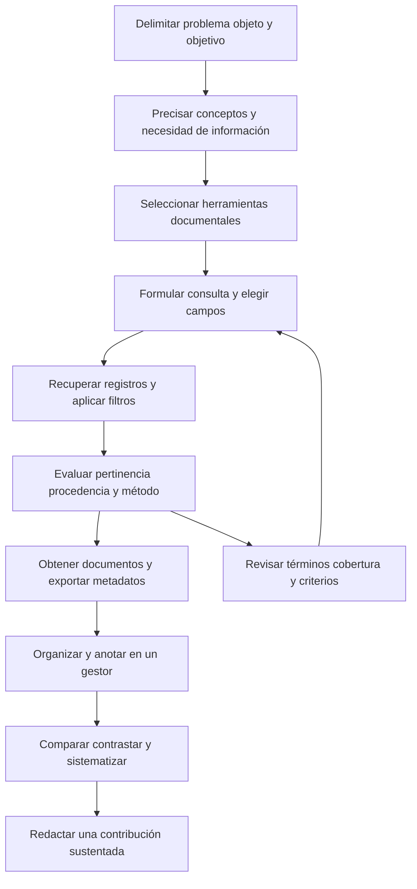

# Clase 1: Recuperación de información científica, evaluación de fuentes y construcción del artículo

> **Objetivo académico:** Fundamentar una estrategia de recuperación, selección y sistematización de literatura científica coherente con el problema de investigación, distinguiendo herramientas documentales, condiciones de acceso, evidencias de calidad y formas de contribución del artículo científico.

## 1. Contexto y marco conceptual

### De la disponibilidad de información a la pertinencia científica

La abundancia de documentos digitales desplaza la dificultad investigativa: disponer de información no equivale a identificar evidencia pertinente, comprenderla ni convertirla en una contribución científica. La sesión sitúa la búsqueda bibliográfica dentro de un proceso más amplio que comprende delimitar una necesidad, elegir herramientas, formular consultas, evaluar documentos, organizarlos y construir una interpretación propia.

El problema de fondo es cómo transformar la densidad empírica o teórica de una investigación extensa en un artículo riguroso y breve. Esta transformación exige seleccionar un argumento central y sostenerlo con evidencia suficiente. El artículo no reproduce íntegramente una tesis ni hereda automáticamente su título, objetivo o tipo de contribución.

La tríada **problema, objeto y objetivo** funciona como criterio orientador:

- **Problema:** interrogante o insuficiencia de conocimiento que motiva la investigación.
- **Objeto:** proceso, fenómeno o relación delimitada sobre la que se construye conocimiento.
- **Objetivo:** propósito cognoscitivo que especifica qué se busca explicar, comprender, describir, evaluar o desarrollar.

Una fuente puede estar relacionada con el tema general y, aun así, no aportar al objetivo particular. La delimitación metodológica consiste en reconocer cuáles conexiones son necesarias para el argumento y cuáles corresponden a otras líneas de investigación.

### Descubrimiento, recuperación y evaluación

Los buscadores generales permiten una primera aproximación a conceptos, autores y obras. La sesión reconoce ese uso orientador, aunque insiste en recurrir a herramientas académicas cuando se requiere mayor control sobre campos de búsqueda, tipos documentales, cobertura e indicadores.

**Enriquecimiento conceptual:** deben distinguirse tres operaciones. El **descubrimiento** identifica documentos potencialmente útiles; la **recuperación** obtiene registros o documentos mediante una consulta; la **evaluación** determina su pertinencia y solidez. El canal de descubrimiento no certifica ni invalida por sí mismo el documento encontrado: un buscador general puede conducir a un artículo arbitrado, y una herramienta académica puede recuperar materiales con distintos niveles de revisión.

La expresión *information retrieval* se utiliza en la sesión para explicar la recuperación de información: el sistema recibe una necesidad expresada como consulta y devuelve resultados relacionados. No significa recuperar un archivo previamente perdido.

### Conceptos, términos y definiciones

La búsqueda comienza con una traducción del problema a un vocabulario operativo. La sesión distingue el concepto, como contenido abstracto, de su expresión lingüística mediante términos y definiciones.

**Enriquecimiento conceptual:** un **término** es una denominación especializada que puede contener una o varias palabras; una **definición** explicita el significado atribuido a un concepto. Su precisión depende del marco disciplinar y del uso contextual. Por ello, una estrategia documental requiere reconocer sinónimos, variantes y diferencias entre denominaciones aparentemente equivalentes.

El inglés amplía la recuperación en muchas herramientas internacionales. La traducción automática, ejemplificada mediante DeepL, puede ayudar a formular consultas y leer documentos, pero exige comprobar la equivalencia conceptual. Traducir la interfaz al español no modifica necesariamente el idioma de los metadatos ni el vocabulario con el que se recuperan los registros.

## 2. Fundamentos teóricos y arquitectura

### Herramientas documentales y funciones complementarias

La sesión compara bases de datos y repositorios. La distinción más útil es funcional: algunas herramientas se especializan en describir, relacionar e identificar documentos; otras preservan y ofrecen objetos digitales. Ambas funciones pueden coexistir.

| Tipo de recurso | Función principal | Utilidad investigativa | Límite que debe comprobarse |
| --- | --- | --- | --- |
| Buscador general | Localizar recursos heterogéneos de la web | Orientación y descubrimiento inicial | Selección y ordenamiento poco específicos para una investigación |
| Buscador académico, como Google Scholar | Descubrir literatura académica de múltiples procedencias | Ampliar cobertura y localizar versiones | Heterogeneidad documental y menor control de algunos criterios de búsqueda |
| Base bibliográfica o de citas, como Scopus o Web of Science | Organizar metadatos, referencias y relaciones de citación | Búsqueda estructurada y análisis bibliométrico | Cobertura selectiva y condiciones de acceso |
| Plataforma editorial, como ScienceDirect | Ofrecer publicaciones y sus textos | Consultar contenido editorial y localizar documentos | Acceso dependiente de cada publicación y de la suscripción |
| Repositorio institucional o temático | Depositar, preservar y difundir documentos u otros productos | Acceder a tesis, manuscritos y materiales de investigación | Estado de revisión y versión variables |
| Directorio de herramientas de IA | Agrupar aplicaciones por funciones o categorías | Descubrir apoyos para lectura y procesamiento | La inclusión no demuestra eficacia ni rigor científico |

**Enriquecimiento conceptual:** un repositorio puede utilizar bases de datos, índices y motores de búsqueda sofisticados. No se define por carecer de organización o por recuperar información de forma menos eficiente. Asimismo, la **indexación informática**, que optimiza consultas, y la **inclusión de una revista en un índice bibliográfico** son procesos distintos.

La sesión menciona recursos de cobertura internacional, regional y especializada: Scopus, Web of Science, ScienceDirect, Lens, OpenAlex, Redalyc, SciELO, Dialnet, Latindex, DOAJ, LA Referencia, arXiv y Zenodo. Esta enumeración reúne servicios con funciones diferentes; no constituye una clasificación homogénea.

**Enriquecimiento conceptual:** Lens permite relacionar literatura académica y patentes; OpenAlex organiza metadatos y relaciones de la producción científica; DOAJ es un directorio de revistas de acceso abierto; LA Referencia agrega contenidos de repositorios latinoamericanos; arXiv difunde principalmente manuscritos científicos, y Zenodo admite distintos productos de investigación. La utilidad de cada recurso depende de la pregunta y del tipo de evidencia requerido.

### Web profunda y calidad documental

La sesión utiliza *deep web* para contrastar la búsqueda general con el acceso a servicios académicos especializados.

**Enriquecimiento conceptual:** la web profunda designa contenido no indexado por buscadores generales; no es una categoría de calidad científica. Una base académica puede tener páginas públicamente indexadas, y un contenido no indexado puede carecer de valor investigativo. Acceso, visibilidad, arbitraje e indexación bibliográfica deben analizarse por separado.

### Literatura gris: oportunidad y cautela

El debate central enfrenta la rapidez de difusión con la necesidad de evaluación. Los manuscritos previos a publicación, informes técnicos, tesis y documentos institucionales pueden ofrecer información reciente, detalles metodológicos o resultados que todavía no aparecen en revistas.

**Enriquecimiento conceptual:** la literatura gris se caracteriza por circular fuera de los canales editoriales comerciales o académicos convencionales. No se define exclusivamente por la ausencia de revisión por pares. Una tesis puede haber pasado por una evaluación académica y continuar siendo literatura gris; un informe institucional puede incorporar controles técnicos sin seguir el arbitraje de una revista. La clasificación documental y la calidad de la evidencia son dimensiones diferentes.

En arXiv, el depósito de un manuscrito no equivale a la revisión por pares de una revista. También pueden existir versiones relacionadas con publicaciones posteriores. En un repositorio institucional pueden coexistir tesis, informes, preprints y artículos ya publicados.

Consultar literatura gris puede permitir reconocer tendencias y localizar fuentes adicionales. Citarla exige establecer su relevancia, procedencia, versión y respaldo metodológico, además de atender las políticas editoriales aplicables. La sesión distingue acertadamente entre usar un documento para orientarse y emplearlo como apoyo de una afirmación científica.

### Arquitectura del proceso documental

La ruta presentada por el docente se propone como una sistematización de su experiencia, abierta a revisión. No se presenta como un estándar formal validado.



**Enriquecimiento conceptual:** la retroalimentación del diagrama explicita que la búsqueda es iterativa. Resultados escasos, excesivos o poco pertinentes pueden exigir revisar términos, campos y herramientas. Una consulta inicial insuficiente no determina de manera irreversible el resto del proceso.

## 3. Implementación técnica y lógica de negocio

La sesión desarrolla principalmente fundamentos y una metodología documental. No presenta código, una búsqueda reproducible completa ni resultados empíricos de comparación entre bases. La demostración de interfaces se concentra en directorios de herramientas de IA; las funcionalidades bibliográficas se describen de manera conceptual.

### Selección de herramientas

La selección se organiza mediante criterios complementarios:

1. **Alcance temático:** cobertura multidisciplinaria o especializada y correspondencia con el problema.
2. **Cobertura geográfica y lingüística:** presencia de literatura regional y de los idiomas pertinentes.
3. **Políticas de inclusión y tipos documentales:** revistas, actas, libros, tesis, preprints, informes u otros productos.
4. **Metadatos y vocabularios:** campos disponibles, referencias, palabras clave y lenguajes controlados.
5. **Acceso:** consulta de registros, disponibilidad del texto y posibles derechos institucionales.
6. **Interoperabilidad:** exportación de referencias y compatibilidad con gestores.
7. **Costo:** viabilidad del acceso y funcionalidades efectivamente disponibles.

La sesión recomienda dominar un conjunto manejable de herramientas antes que recorrer muchas superficialmente.

**Enriquecimiento conceptual:** el número de herramientas debe depender de la cobertura requerida. En una revisión que pretende exhaustividad, la comodidad operativa no justifica limitarse a recursos que omitan evidencia relevante. Las sugerencias de una IA pueden servir para descubrir servicios, pero es necesario verificar su existencia, alcance y condiciones reales.

### Construcción de una ecuación de búsqueda

Una estrategia organiza bloques conceptuales. Los sinónimos de un mismo bloque se conectan mediante `OR`; los bloques que deben coincidir se conectan mediante `AND`. `NOT` excluye resultados y requiere cautela, porque puede eliminar documentos pertinentes.

| Recurso de consulta | Función | Precaución |
| --- | --- | --- |
| `AND` | Exigir coincidencia entre condiciones | Puede reducir excesivamente los resultados |
| `OR` | Incorporar alternativas | Puede ampliar la recuperación con términos ambiguos |
| `NOT` | Excluir una condición | Puede descartar estudios útiles que mencionan el término excluido |
| Comillas | Buscar una frase como unidad | El comportamiento exacto depende del sistema |
| Paréntesis | Agrupar condiciones | Deben reflejar la lógica conceptual de la consulta |
| Asterisco u otros comodines | Recuperar variantes según una raíz o patrón | La sintaxis y el alcance cambian entre plataformas |
| Operadores de proximidad | Limitar la distancia entre términos | No existe una notación universal |

**Enriquecimiento conceptual — ejemplo trabajado:** tomando el tema discutido sobre inteligencia artificial y aprendizaje autónomo, una consulta ilustrativa es:

```
("artificial intelligence" OR "machine learning")
AND
("autonomous learning" OR "self-directed learning")
AND
("higher education" OR universit*)
```

El primer bloque agrupa denominaciones tecnológicas; el segundo, expresiones relacionadas con el aprendizaje; el tercero delimita el contexto universitario. Estos términos son candidatos, no equivalencias conceptuales garantizadas. Antes de utilizar la consulta debe comprobarse si corresponden al marco teórico y si la plataforma acepta el truncamiento `universit*`.

El ejemplo no reproduce una ecuación íntegra de las diapositivas ni informa resultados de ejecución. Permite explicar la lógica de agrupación: se amplía dentro de cada bloque con alternativas y se restringe entre bloques mediante coincidencia.

**Enriquecimiento conceptual:** una ecuación más larga no es necesariamente más precisa. Añadir condiciones con `AND` suele restringir; añadir alternativas con `OR` suele ampliar. La calidad depende de la correspondencia entre consulta y necesidad de información.

### Campos, filtros y ordenamiento

Los campos mencionados incluyen título, autor, resumen, año, DOI y afiliación. Buscar un término en el título suele producir un conjunto diferente de buscarlo en título, resumen y palabras clave. El campo debe elegirse según la función de la consulta: localizar un documento conocido, recuperar una temática o identificar producción institucional.

Los filtros delimitan los resultados por acceso, periodo, idioma, región, tipo de fuente o documento. La ordenación por relevancia reorganiza la presentación y no equivale a una evaluación metodológica.

**Enriquecimiento conceptual:** no todas las herramientas ofrecen los mismos campos, filtros o indicadores. Conviene distinguir **tipo de fuente**, como revista o serie, de **tipo de documento**, como artículo de revisión o trabajo de congreso. La denominación precisa depende de la interfaz.

Los tesauros o vocabularios controlados ayudan a identificar descriptores y relaciones entre términos. La expansión automática a sinónimos o conceptos relacionados solo ocurre si el sistema dispone de esa función y se utiliza de la manera correspondiente.

### Acceso abierto y obtención del texto

El filtro *open access* se presenta como una estrategia práctica para localizar documentos accesibles cuando no se dispone de suscripciones. Debe distinguirse el acceso a los metadatos del acceso al texto completo.

**Enriquecimiento conceptual:** las vías de acceso abierto no determinan que unas sean gratuitas para leer y otras necesariamente de pago:

- **Dorada:** acceso abierto mediante la publicación editorial; puede implicar cargos de publicación, pero estos no son cargos de lectura.
- **Verde:** acceso mediante una versión depositada en un repositorio, sujeto a las condiciones correspondientes.
- **Diamante:** acceso abierto sin cobros a lectores ni autores.
- **Híbrida:** apertura de determinados artículos dentro de una revista que también publica contenido por suscripción.
- **Bronce:** contenido disponible gratuitamente en el sitio editorial sin una licencia abierta claramente identificada; su permanencia puede ser incierta.

Los colores de una interfaz no forman un código universal. Además, el acceso abierto no garantiza que el formato disponible sea PDF: puede existir texto completo en HTML u otro formato.

Las licencias Creative Commons especifican condiciones de reutilización. Debe comprobarse la licencia concreta: poder leer un documento no autoriza automáticamente cualquier redistribución o modificación. Tampoco corresponde identificar *open access* con *open source*, término utilizado principalmente para software.

### Exportación, organización y alertas

La sesión destaca la exportación de metadatos como criterio de selección. RIS y BibTeX permiten transferir referencias a gestores como Zotero, Mendeley y EndNote. El flujo comprende obtener el registro, importar la referencia, incorporar el texto cuando esté disponible y organizarlo mediante colecciones, temas y notas.

El gestor facilita la inserción de citas y la composición de bibliografías según un estilo. También permite anotar documentos y conservar fragmentos relevantes.

**Enriquecimiento conceptual:** la importación requiere revisar autores, título, año, DOI, tipo documental y datos editoriales. Un gestor automatiza el formato de los datos disponibles; no comprueba por sí mismo su exactitud ni la pertinencia de la cita. Cuando se combinan varias fuentes de búsqueda, también resulta necesario identificar duplicados y distinguir versiones.

Las alertas de búsqueda notifican nuevas incorporaciones relacionadas con una consulta. Su utilidad depende de la calidad de la estrategia guardada: una consulta ambigua genera avisos poco pertinentes.

## 4. Análisis crítico de casos y auditoría práctica

### Caso: educación en línea en ciencias de la computación

La consulta discutida sobre educación en línea para estudiantes universitarios permite mostrar cómo una necesidad local se traduce en una búsqueda más amplia. Es necesario identificar el fenómeno educativo, la población, el contexto disciplinar y la función que tendrá la literatura en el argumento.

**Enriquecimiento conceptual:** incluir desde el inicio el nombre de una universidad puede restringir demasiado la recuperación de fundamentos generales. Una estrategia puede combinar literatura internacional sobre el fenómeno con antecedentes regionales y documentos institucionales sobre el contexto. La ampliación debe seguir vinculada al problema, sin convertir el marco teórico en una colección de temas adyacentes.

### Caso: informes institucionales y preprints

En el debate se consideran documentos de Microsoft como posibles fuentes recientes sobre desarrollo de software. El prestigio institucional se utiliza como señal de confianza.

**Enriquecimiento conceptual:** la reputación ayuda a establecer procedencia, pero no sustituye la revisión del documento. Deben comprobarse autoría, fecha, propósito, métodos, datos disponibles, limitaciones y posibles intereses institucionales. Un informe empresarial puede ser relevante y técnicamente sólido, aunque no equivalga a una publicación arbitrada.

Para un preprint, la evaluación debe atender a la claridad del problema, suficiencia del método, respaldo de los resultados, discusión de limitaciones y existencia de una versión posterior. No hay una prohibición universal de citar literatura gris por pertenecer una revista a determinado cuartil: las condiciones dependen de sus políticas y de la función de la referencia.

### Caso: coherencia entre tesis y artículo

La sesión identifica un error frecuente: presentar un artículo como propuesta cuando su contenido realiza una revisión o una validación. El título debe expresar la contribución efectivamente desarrollada.

| Dimensión | Pregunta de auditoría |
| --- | --- |
| Título | ¿Describe el objeto y la contribución reales? |
| Problema y objetivo | ¿Plantean una necesidad abordable con el estudio realizado? |
| Método | ¿Permite responder al objetivo declarado? |
| Resultados | ¿Proceden del método y de la evidencia disponibles? |
| Discusión | ¿Interpreta, contrasta y delimita los hallazgos? |
| Conclusiones | ¿Responden al objetivo sin exceder el respaldo disponible? |

Un ejemplo tratado distingue una tesis que propone una estrategia para el aprendizaje autónomo de un artículo centrado en revisar el impacto de la IA sobre ese aprendizaje. Comparten un ámbito, pero no el mismo objeto inmediato ni la misma contribución.

Una investigación extensa puede dar lugar a artículos sobre componentes o subproblemas. También puede desarrollarse primero un artículo y posteriormente integrarse su contribución en una tesis. La relación exige coherencia y transparencia sobre los antecedentes del trabajo.

### Bibliometría: orientación y límites

La sesión introduce el recuento de citas, el índice h, el índice m, SJR, SNIP, los cuartiles, CiteScore y el factor de impacto. Su tratamiento es introductorio y se vincula a identificar autores, revistas y áreas de actividad.

**Enriquecimiento conceptual — definición precisa del índice h:** sea $n$ el número de publicaciones incluidas en una fuente bibliográfica y sean $c_1 \geq c_2 \geq \cdots \geq c_n$ sus recuentos de citas, con cada $c_i$ entero no negativo. El índice se define como:

$$
h = \max\left(\{k \in \{1,\ldots,n\}: c_k \geq k\} \cup \{0\}\right).
$$

El valor $h$ es un entero no negativo y expresa que existen al menos $h$ publicaciones con al menos $h$ citas cada una. Por ejemplo, para los recuentos hipotéticos $[8,5,4,1]$, se obtiene $h=3$: la tercera publicación tiene al menos tres citas y la cuarta no alcanza cuatro.

Esto permite corregir una confusión del debate: tener nueve publicaciones y nueve citas distribuidas entre ellas no implica $h=9$. Ese valor requiere al menos nueve publicaciones con nueve citas cada una. Además, la fórmula no excluye autocitas por definición; su inclusión depende de los datos y de la configuración del análisis.

**Enriquecimiento conceptual — normalización temporal:** el índice m se expresa habitualmente como:

$$
m = \frac{h}{t}.
$$

Aquí $h$ es el índice anterior y $t>0$ es el número de años transcurridos desde la primera publicación, según una convención temporal explícita. El cociente expresa puntos de índice h por año. Intenta contextualizar la duración de la trayectoria, pero no elimina diferencias disciplinares, interrupciones de carrera ni sesgos de cobertura.

| Indicador o recurso | Nivel principal | Interpretación y límite |
| --- | --- | --- |
| Recuento de citas | Documento o conjunto de documentos | Mide citación observada; no demuestra validez |
| Índice h | Trayectoria o conjunto de publicaciones | Combina producción y citación; depende de cobertura y antigüedad |
| Índice m | Trayectoria | Contextualiza el índice h respecto del tiempo |
| Journal Impact Factor | Revista | Indicador de citación consultado en Journal Citation Reports; no es una medida de cada artículo |
| CiteScore | Fuente de publicación | Indicador de citación basado en la cobertura y metodología correspondientes |
| SJR | Revista | Considera el prestigio de las fuentes de las citas |
| SNIP | Revista | Contextualiza el impacto según diferencias en prácticas de citación entre campos |
| Cuartil | Revista dentro de una categoría y periodo | Posición relativa que debe informarse junto con categoría, año e indicador |

**Enriquecimiento conceptual:** JCR es el informe o producto de consulta, no un sinónimo del factor de impacto. SJR y CiteScore son indicadores diferentes, aunque empleen datos vinculados a Scopus. Un cuartil Q1 corresponde al tramo superior de la clasificación considerada; no certifica por sí mismo cada documento publicado. Tampoco la ordenación por relevancia de una búsqueda constituye una clasificación bibliométrica.

La recomendación de identificar autores mediante el índice h debe acompañarse de lectura temática. Un investigador con menor índice puede aportar evidencia decisiva, especialmente en un campo emergente o especializado.

### Autocitación, endogamia y diversidad

La sesión diferencia el reconocimiento de trabajos propios de la concentración de referencias en una misma revista o comunidad. Una autocita pertinente puede explicar antecedentes metodológicos o continuidad investigativa. Su uso instrumental para aumentar indicadores carece de justificación científica.

**Enriquecimiento conceptual:** ninguna de estas prácticas debe juzgarse solo por un recuento aislado. Importan la necesidad argumental, el contexto y las políticas editoriales. La diversidad disciplinar fortalece el marco cuando responde al problema; incorporar referencias de otras áreas sin una función explícita también puede producir dispersión.

## 5. Principios de diseño, buenas prácticas y anti-patrones

### Sistematizar en lugar de acumular

La sesión caracteriza la sistematización teórica como una secuencia de operaciones: identificar conceptos y posiciones; seleccionar lo pertinente; ordenar y estructurar; analizar, comparar y valorar; refutar o asumir argumentos; entrelazar perspectivas y redactar una construcción propia.

El anti-patrón central es la **sumatoria de citas**: presentar sucesivamente autores sin explicar relaciones, acuerdos, contradicciones o implicaciones. La alternativa es organizar el texto por problemas y argumentos, mostrando para qué se incorpora cada fuente.

La continuidad expositiva también es una propiedad del razonamiento. Los saltos entre párrafos pueden revelar fragmentación conceptual: cada sección debe preparar la siguiente y contribuir al objetivo general.

### Redacción científica y autonomía del investigador

La sesión destaca precisión, claridad, brevedad y objetividad. La densidad conceptual significa que las afirmaciones tienen una función argumental; no justifica escribir de manera oscura. Deben evitarse frases genéricas, reiteraciones y afirmaciones que no añaden información verificable.

El esquema IMRyD —introducción, métodos, resultados y discusión— ofrece una organización extendida para comunicar investigación. Sin embargo, la estructura final depende del tipo de artículo y de las normas editoriales. Una revisión o una reflexión pueden requerir otra organización.

### Uso de inteligencia artificial

Se consideran usos de apoyo como traducción, corrección lingüística, resumen y consulta de documentos. Se mencionan DeepL y Grammarly para asistencia lingüística, y Umata, ChatPDF y ChatDOC para interacción con textos, sin una evaluación comparativa de sus resultados.

También se presentan Toolify y There’s An AI For That como directorios de aplicaciones. La sesión no confirma que sus buscadores admitan operadores booleanos; esa capacidad no debe darse por supuesta.

El principio metodológico es que el conocimiento del investigador permite formular mejores preguntas y evaluar críticamente las respuestas. Delegar la lectura o la escritura sin capacidad de verificación puede producir textos plausibles, pero conceptualmente débiles.

**Enriquecimiento conceptual:** los resúmenes generados deben contrastarse con el documento original, especialmente en métodos, resultados y limitaciones. La responsabilidad por las afirmaciones y las referencias permanece en quien firma el trabajo. El estilo genérico o repetitivo tampoco demuestra por sí solo que un texto haya sido generado con IA; la evaluación debe centrarse en su trazabilidad y solidez.

| Buena práctica | Anti-patrón asociado |
| --- | --- |
| Delimitar la necesidad desde el problema y el objetivo | Recuperar todo lo relacionado con un tema amplio |
| Combinar recursos según su cobertura | Suponer que una sola herramienta contiene toda la evidencia |
| Verificar la sintaxis de cada plataforma | Trasladar consultas sin revisar su interpretación |
| Evaluar el método y las limitaciones del documento | Confiar exclusivamente en prestigio institucional o métricas |
| Revisar referencias importadas | Asumir que la automatización garantiza exactitud |
| Contrastar versiones y procedencia | Tratar un depósito como certificación de arbitraje |
| Construir una síntesis argumentada | Encadenar resúmenes o citas sin elaboración propia |
| Verificar la asistencia de IA contra fuentes originales | Incorporar texto generado sin control conceptual |

## 6. Síntesis conceptual y profundización académica

La recuperación de literatura es una fase del razonamiento científico. Su calidad depende de la relación entre delimitación del problema, selección de recursos, estrategia de consulta y evaluación de la evidencia. La cantidad de resultados y la sofisticación de una plataforma no sustituyen esa coherencia.

La sesión articula tres distinciones fundamentales: **encontrar no equivale a validar; acceder no equivale a poder reutilizar sin condiciones; citar no equivale a construir conocimiento**. Bases de citas, plataformas editoriales, repositorios, gestores y aplicaciones de IA intervienen en operaciones distintas y deben utilizarse de acuerdo con sus límites.

### Formas de contribución científica

El debate corrige la idea de que únicamente la investigación empírica original puede aportar conocimiento. Una revisión puede integrar resultados, identificar contradicciones o proponer una interpretación fundamentada. Una reflexión puede desarrollar una posición argumentada; un trabajo metodológico puede introducir o mejorar procedimientos.

**Enriquecimiento conceptual:** las categorías no son necesariamente excluyentes. Un estudio de caso puede constituir investigación original, y un artículo metodológico puede aportar un método nuevo acompañado de evidencia. La originalidad también puede ser teórica, computacional o formal; no depende siempre de datos de campo ni de análisis estadísticos paramétricos.

Una revisión rigurosa no produce novedad por el simple hecho de reunir citas. Su contribución reside en la síntesis justificable que construye. Tampoco toda revisión debe formular una nueva teoría: esclarecer evidencia, establecer límites o identificar vacíos relevantes puede constituir un aporte.

### Relación entre conocimiento y propuesta

La sesión plantea que transformar una realidad exige conocer su estado y los desarrollos teóricos pertinentes. Presenta el estudio empírico, la revisión teórica y la modelación como momentos que pueden fundamentar una propuesta.

**Enriquecimiento conceptual:** esta es una lógica metodológica posible, no una secuencia universal de capítulos. La articulación depende del diseño investigativo. Un modelo adquiere valor por su claridad, supuestos, capacidad explicativa y respaldo; su denominación no garantiza un nivel superior de conocimiento.

Las líneas de profundización que se desprenden de la clase son la reproducibilidad de las búsquedas, la evaluación diferenciada de literatura gris, la interpretación contextual de indicadores y la relación entre síntesis documental y contribución original. Todas convergen en una misma exigencia: conservar la trazabilidad entre lo que se busca, la evidencia que se selecciona y las conclusiones que se sostienen.
