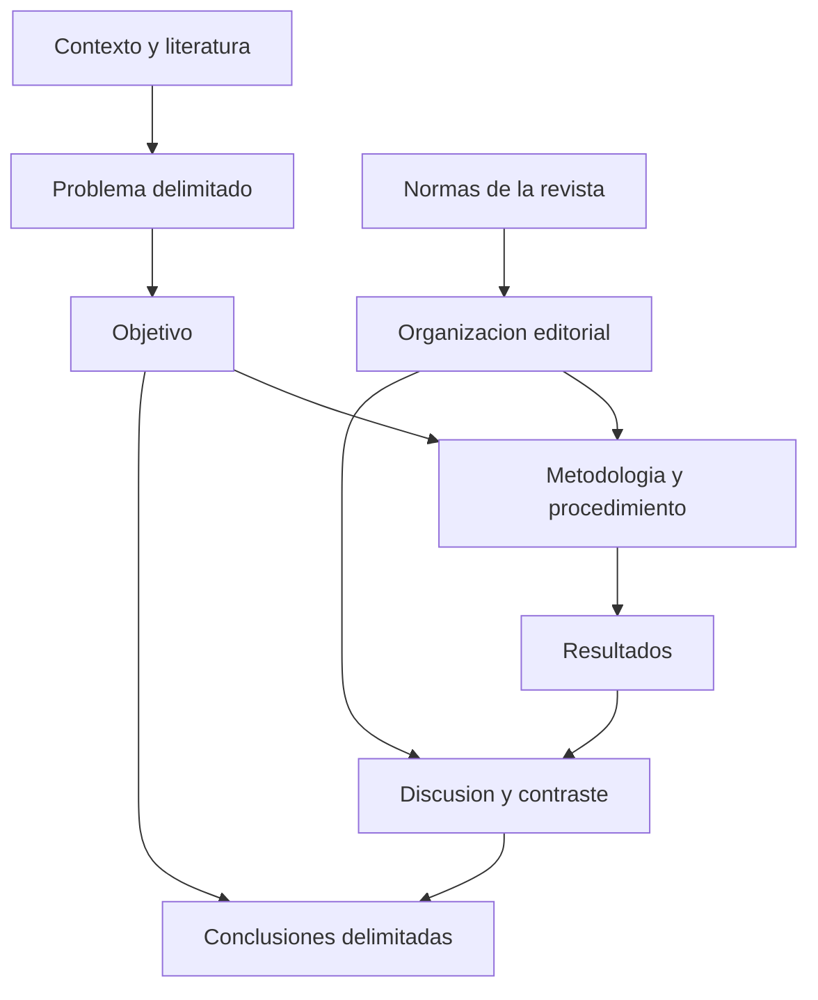

# Clase 2: Coherencia del artículo científico, validación y evaluación bibliométrica

> **Objetivo académico:** Analizar la coherencia entre problema, objetivos, metodología, resultados y conclusiones de un artículo científico; distinguir modalidades de contribución y formas de validación, e interpretar críticamente los identificadores y los indicadores bibliométricos que apoyan la comunicación científica.

## 1. Contexto y marco conceptual

La sesión articula tres dimensiones de la producción científica: la construcción argumentativa del artículo, la selección y evaluación de la literatura y la infraestructura editorial que permite comunicar los resultados. Su planteamiento central es que aprender a investigar requiere leer críticamente investigaciones existentes: reconocer cómo formulan sus problemas, justifican sus decisiones, documentan sus procedimientos y delimitan sus conclusiones.

La lectura académica tiene, por tanto, dos planos complementarios. El **plano temático** permite comprender el conocimiento producido; el **plano estructural** permite reconstruir cómo se sostiene ese conocimiento. Un artículo puede resultar útil por su tema y, simultáneamente, presentar debilidades metodológicas o argumentativas que no conviene reproducir.

### Estructura editorial y lógica científica

El modelo **IMRyD** organiza la exposición en introducción, métodos, resultados y discusión. Se presenta como una referencia para identificar funciones científicas, aunque las revistas pueden combinar secciones, cambiar sus nombres o distribuir parte de sus contenidos en otros apartados.

La distinción decisiva es entre **encabezado** y **función**. Que no exista una sección denominada «Metodología» no demuestra que falte información metodológica; esa información puede aparecer integrada en otra sección. A la inversa, incluir el encabezado no garantiza que el procedimiento esté descrito con suficiente precisión.

La flexibilidad editorial conserva exigencias sustantivas: comprender qué se investiga, por qué importa, cómo se obtuvo la evidencia y qué permite concluir. La coherencia de esas relaciones es más importante que el cumplimiento superficial de una plantilla.

El diagrama expresa una dependencia argumentativa: las conclusiones deben responder al objetivo y estar sustentadas en los resultados, mientras que estos deben poder vincularse con los procedimientos declarados. Las normas editoriales organizan su presentación, pero no sustituyen esa justificación.

### Modalidades de contribución

| Modalidad | Base principal de trabajo | Contribuciones posibles | Riesgo central |
| --- | --- | --- | --- |
| Investigación empírica | Datos obtenidos mediante observación, medición u otros procedimientos | Caracterización de fenómenos, comparación de métodos, evaluación de una intervención | Presentar resultados sin documentar su obtención o sus límites |
| Revisión | Literatura y documentos seleccionados mediante criterios explícitos | Síntesis crítica, identificación de brechas, comparación de enfoques e integración conceptual | Convertirse en una sucesión de citas sin análisis |
| Reflexión | Problematización y argumentación fundamentada | Posturas, conjeturas, reinterpretaciones y apertura de debates | Confundir libertad argumentativa con opinión sin sustento |

La sesión destaca que una revisión puede producir conocimiento nuevo. Identificar contradicciones, construir una definición o proponer una integración de modelos son aportes posibles cuando se justifican mediante el análisis de la literatura.

**Enriquecimiento conceptual:** «Originalidad» y «obtención de datos empíricos» son dimensiones diferentes. Una contribución teórica puede ser original sin incorporar datos de campo. La clasificación editorial como revisión, artículo teórico, reflexión o investigación original depende también de la política de la revista; no puede resolverse únicamente preguntando si hubo trabajo empírico.

## 2. Fundamentos teóricos y arquitectura

### Problema, necesidad y brecha de conocimiento

La introducción debe vincular contexto, justificación, problema y objetivo. Estos elementos pueden aparecer en una narrativa continua, pero sus funciones deben reconocerse.

- El **contexto** delimita las condiciones en que el fenómeno adquiere significado.
- La **justificación** explica la relevancia científica, tecnológica o social del estudio.
- El **problema** identifica aquello que requiere comprensión, explicación o transformación.
- El **objetivo** precisa el conocimiento o producto que se pretende alcanzar.

Durante el análisis de un artículo sobre un modelo de formación profesional se distingue entre la falta de determinadas capacidades y las dificultades que esa carencia podría generar en la gestión de transformaciones digitales. La distinción ayuda a evitar que una necesidad general se presente automáticamente como problema de investigación.

**Enriquecimiento conceptual:** Conviene diferenciar tres niveles: una situación práctica insatisfactoria, una explicación tentativa de sus causas y una brecha en el conocimiento disponible. La ausencia de profesionales con ciertas capacidades puede constituir una condición relevante; atribuirle causalmente un problema exige evidencia. Una brecha de conocimiento también puede fundamentar por sí misma una investigación teórica, sin que deba traducirse obligatoriamente en un perjuicio práctico inmediato.

El objetivo debe expresar una operación reconocible. Conceptualizar, comparar, diseñar y evaluar no son equivalentes: cada verbo compromete un tipo de evidencia y de resultado. Si se declara que se conceptualiza un modelo, el texto debe ofrecer una delimitación conceptual y mostrar cómo se obtuvo, no limitarse a mencionar la intención.

### Modelos, conceptos y constructos

El caso analizado propone integrar componentes de la formación profesional con una perspectiva de ciencia, tecnología y sociedad. Su interés reside en relacionar capacidades técnicas con responsabilidad social y transformación del entorno.

Un modelo requiere identificar componentes y relaciones. En la sesión se mencionan el enfoque sistémico, estructural y funcional, el análisis comparativo y la reconstrucción histórica como recursos para desarrollar y fundamentar propuestas. Nombrar esos métodos resulta insuficiente si no se explica qué permitió hacer cada uno.

**Enriquecimiento conceptual:** El enfoque sistémico, estructural y funcional es una opción pertinente para ciertos modelos, pero no constituye un requisito universal de toda modelación. La elección depende de la pregunta, el objeto y el tipo de representación buscada. Tampoco basta con denominar «modelo» a un esquema para demostrar su novedad o utilidad.

El término **constructo** se introduce a propósito de la elaboración de una definición conceptual. La idea rescatable es que precisar un concepto puede constituir una contribución si resuelve una insuficiencia identificada y explica sus diferencias respecto de definiciones previas.

**Enriquecimiento conceptual:** Un constructo es una entidad conceptual elaborada dentro de un marco teórico; no es necesariamente nuevo ni toda definición nueva constituye un aporte suficiente. Cuando se pretende medirlo, debe establecerse el vínculo entre definición, dimensiones e indicadores observables.

### De la operacionalización a la validación

La sesión relaciona la calidad de la evidencia con la construcción de instrumentos. La secuencia conceptual presentada va desde la variable hasta sus dimensiones e indicadores, y desde estos hasta los ítems o registros mediante los cuales se obtiene información.

Se distingue entre una técnica de obtención de información y el instrumento que la implementa. Una entrevista puede apoyarse en una guía; una observación, en un protocolo o sistema de registro; una encuesta, en un cuestionario. La clasificación de algunas prácticas como método o técnica varía entre tradiciones, por lo que conviene definir el uso adoptado.

**Enriquecimiento conceptual:** La validación no es una certificación definitiva de objetividad. Reúne evidencia que respalda determinadas interpretaciones y usos de las mediciones en una población y un contexto. Un instrumento previamente estudiado puede requerir nueva evaluación si cambia su idioma, población o finalidad.

## 3. Implementación técnica y lógica de negocio

La sesión desarrolla procedimientos de lectura, escritura y análisis bibliográfico. No proporciona código ni una implementación informática completa; las demostraciones de herramientas se describen por su función, sin atribuirles ejecuciones verificadas fuera de la transcripción.

### Construcción de las partes del artículo

| Componente | Función científica | Criterio de revisión |
| --- | --- | --- |
| Título | Identificar el objeto y la contribución | ¿Describe lo que el artículo efectivamente contiene? |
| Resumen | Permitir valorar rápidamente la pertinencia del estudio | ¿Expone propósito, enfoque y hallazgos principales sin promesas incumplidas? |
| Introducción | Fundamentar y delimitar el estudio | ¿Son reconocibles contexto, problema, relevancia y objetivo? |
| Métodos | Documentar cómo se produjo o seleccionó la evidencia | ¿Se explican decisiones y procedimientos suficientes para evaluarlos? |
| Resultados | Exponer lo encontrado o construido | ¿Cada resultado puede vincularse con un procedimiento? |
| Discusión | Interpretar y contrastar los hallazgos | ¿Distingue evidencia, explicación e implicaciones? |
| Conclusiones | Responder al propósito con afirmaciones sustentadas | ¿Respeta el alcance del estudio? |
| Referencias | Hacer trazables las fuentes utilizadas | ¿Existe correspondencia con las citas y pertinencia temática? |

El **resumen** se concibe como una representación sintética de un contenido ya desarrollado. La sesión recomienda incluir problema o contexto pertinente, objetivo, metodología y resultados. Su redacción se beneficia de realizarse cuando esos elementos están definidos, y debe actualizarse si cambia el artículo.

El **título** y el resumen funcionan como primera puerta de acceso al trabajo. La concisión consiste en expresar con precisión una idea mediante las palabras necesarias. Por ejemplo, «conceptualizar» puede sustituir «realizar una conceptualización» cuando ambas expresiones comunican la misma operación.

**Enriquecimiento conceptual:** Las extensiones mencionadas en la sesión, como títulos de aproximadamente doce palabras o resúmenes cercanos a 250 palabras, son orientaciones contextuales. No deben tratarse como límites universales ni atribuirse sin matices a APA. Prevalecen las directrices vigentes de cada revista.

La introducción puede redactarse inicialmente para orientar el trabajo y revisarse conforme evoluciona la investigación. Su función no consiste en anticipar resultados inexistentes, sino en hacer inteligible el problema y la contribución buscada.

### Documentación del procedimiento de revisión

La metodología de una revisión debe superar la enumeración de bases de datos o nombres de métodos. Su trazabilidad requiere explicar, según el tipo de revisión:

1. La pregunta o propósito que orienta la búsqueda.
2. Las fuentes consultadas y la cobertura temporal pertinente.
3. Los términos, descriptores, operadores y filtros utilizados.
4. Los criterios de inclusión y exclusión.
5. La identificación y eliminación de duplicados.
6. El procedimiento de lectura, extracción, comparación y síntesis.
7. Las limitaciones de cobertura y selección.

La clase menciona PRISMA como apoyo para transparentar la selección documental y organizar el reporte.

**Enriquecimiento conceptual:** PRISMA es una guía de reporte, no una metodología completa ni una garantía automática de calidad. Su utilización no sustituye el protocolo de búsqueda, la evaluación de las fuentes ni el método de síntesis. Las cantidades de ítems mencionadas oralmente son ambiguas porque no se identifica con precisión la versión o extensión; por ello no se adoptan aquí como una especificación normativa.

La búsqueda en distintos idiomas también afecta la recuperación. En la sesión se relata una diferencia amplia entre búsquedas en inglés y español, pero esas cantidades corresponden a una experiencia particular, no a una estimación general del campo.

**Enriquecimiento conceptual:** Traducir literalmente una consulta no garantiza equivalencia: cambian los términos de uso, los vocabularios controlados y la cobertura de las plataformas. La estrategia debe justificar sus idiomas y reconocer el posible sesgo lingüístico sin excluir automáticamente producción local pertinente.

### Validación de instrumentos y evaluación de algoritmos

La conversación reúne procedimientos distintos bajo el término «validación». Separarlos evita aplicar criterios de cuestionarios a cualquier sistema computacional.

| Objeto evaluado | Evidencia pertinente | Límite de interpretación |
| --- | --- | --- |
| Contenido de un instrumento | Revisión de claridad, relevancia y cobertura por personas expertas | El acuerdo no demuestra por sí solo todas las formas de validez |
| Consistencia interna de una escala | Relaciones entre ítems y coeficientes adecuados al modelo de medición | La consistencia no equivale a validez ni ausencia de redundancia |
| Acuerdo entre observaciones | Comparación de registros de distintos observadores o momentos | Requiere un diseño acorde con el tipo de dato |
| Predicción de un algoritmo | Comparación con una referencia y evaluación en datos apropiados | Un buen resultado en un conjunto no asegura generalización |

Se mencionan la V de Aiken y kappa como recursos relacionados con juicios o acuerdos, además del alfa de Cronbach para consistencia interna. Su elección depende del objetivo y de las escalas de medición; no son intercambiables.

**Enriquecimiento conceptual:** Para una escala con $k>1$ ítems numéricos, una expresión habitual del alfa de Cronbach es:

$$
\alpha=\frac{k}{k-1}\left(1-\frac{\sum_{j=1}^{k}s_j^2}{s_T^2}\right).
$$

Aquí $k$ es el número de ítems, $s_j^2$ es la varianza del ítem $j$ y $s_T^2>0$ es la varianza de la puntuación total obtenida al sumarlos, calculadas sobre las mismas observaciones. El coeficiente es adimensional. Su interpretación exige examinar el modelo de medición y los supuestos de los ítems; no demuestra unidimensionalidad, cobertura conceptual ni inexistencia de preguntas repetidas. Un valor elevado puede reflejar redundancia, y bajo ciertas estructuras de covarianza puede resultar negativo.

En el caso de un algoritmo aplicado a imágenes de hojas de quinua se mencionan Pearson, MAE, RMSE y un nombre transcrito de forma incierta compatible con un análisis de acuerdo. La fuente no permite reconstruir valores ni protocolos completos.

**Enriquecimiento conceptual:** Para $n\geq1$ pares de valores observados $y_i$ y predichos $\hat y_i$, con $i=1,\ldots,n$, pueden definirse:

$$
\operatorname{MAE}=\frac{1}{n}\sum_{i=1}^{n}|y_i-\hat y_i|,
$$

$$
\operatorname{RMSE}=\sqrt{\frac{1}{n}\sum_{i=1}^{n}(y_i-\hat y_i)^2}.
$$

Ambas medidas expresan error en las unidades de la variable evaluada. RMSE penaliza más los errores grandes por el término cuadrático. Su pertinencia requiere que predicción y referencia representen la misma magnitud y que los datos de evaluación sean adecuados. La correlación de Pearson mide asociación lineal, no acuerdo: dos mediciones pueden correlacionarse fuertemente y mantener un sesgo sistemático.

La comparación con el criterio de una fitopatóloga puede aportar evidencia de desempeño respecto de una referencia experta. No equivale automáticamente a validar el contenido de un cuestionario; deben documentarse el protocolo de anotación, la incertidumbre de esa referencia y, cuando corresponda, su repetibilidad o el acuerdo entre personas expertas.

### Identificadores e infraestructura editorial

| Elemento | Función | Precisión necesaria |
| --- | --- | --- |
| ORCID | Identificar persistentemente a una persona investigadora y vincular su producción | No certifica la calidad de sus contribuciones |
| DOI | Identificar persistentemente un objeto digital | No equivale a acceso abierto ni demuestra calidad metodológica |
| ISSN | Identificar publicaciones seriadas | Corresponde a la revista o recurso seriado, no al artículo individual |
| ISBN | Identificar una edición o formato de una publicación monográfica | No constituye un indicador de impacto |
| Crossref | Gestionar registro de DOI y metadatos vinculados para sus miembros | Permite contrastar registros, pero no valida la verdad de los hallazgos |
| Open Journal Systems | Gestionar procesos editoriales y publicación de revistas | Su utilización no prueba indexación ni calidad científica |

**Enriquecimiento conceptual:** Las agencias nacionales de ISBN forman parte de un sistema internacional; un ISBN obtenido en Bolivia no tiene menor alcance por el idioma del libro. Las diferencias entre ediciones, traducciones y formatos pueden requerir identificadores distintos. Asimismo, la vinculación de una publicación con ORCID o un perfil académico depende de los mecanismos de integración, permisos y metadatos: no debe suponerse automática en todos los casos.

## 4. Análisis crítico de casos y auditoría práctica

### Caso de revisión con propuesta de modelo

El artículo utilizado como ejemplo presenta una propuesta de formación profesional en ingeniería relacionada con inteligencia organizacional. La sesión identifica como elementos de interés la contextualización, el objetivo de conceptualizar, la comparación de modelos existentes, la identificación de brechas y la presentación de una propuesta integradora.

Su principal valor didáctico es la correspondencia entre **promesa y contenido**: si el título anuncia una propuesta, el texto debe mostrarla y explicar su fundamento. Un artículo derivado de una tesis debe sostenerse como unidad comunicativa comprensible; no puede remitir implícitamente a una propuesta ausente porque exista en otro documento.

La revisión también identifica debilidades: una figura con baja legibilidad y conclusiones que atribuyen efectos económicos o transformadores sin mostrar evidencia suficiente. La existencia de un modelo conceptual no demuestra que produzca esos efectos al implementarse.

**Enriquecimiento conceptual:** Deben distinguirse propiedades diseñadas, beneficios esperados y efectos observados. Una formulación prudente sería que el modelo «integra determinadas dimensiones» si ello está demostrado por su estructura, y que «requiere evaluación empírica para determinar sus efectos» cuando todavía no se ha aplicado. La precisión del alcance es más importante que emplear adjetivos moderados.

También se discute el término «modelo profesional». Conviene evitar juicios sobre adjetivos sin analizar su función técnica.

**Enriquecimiento conceptual:** En un contexto curricular, «modelo del profesional» puede designar el perfil de formación esperado, sin afirmar que el modelo posee una calidad superior. Antes de cuestionar una expresión por valorativa debe verificarse su significado disciplinar y su definición en el propio artículo.

### Datos restringidos y reproducibilidad

El caso de las imágenes de quinua plantea una restricción concreta: la persona investigadora dispone de autorización para utilizar datos de una institución, pero no necesariamente para redistribuirlos. Describir preprocesamiento, algoritmo y versiones de software mejora la trazabilidad, aunque no elimina la barrera de acceso al conjunto de datos.

**Enriquecimiento conceptual:** Conviene distinguir la posibilidad de repetir un análisis con los mismos datos y código de la posibilidad de contrastar sus hallazgos con nuevos datos; la terminología de reproducibilidad y replicabilidad varía entre disciplinas. Cuando los datos están restringidos, el artículo puede documentar su procedencia, características, condiciones de adquisición, permisos y vías legítimas de acceso, si existen. Publicar código o ejemplos autorizados puede facilitar la evaluación, pero no convierte el estudio en completamente reproducible si faltan insumos esenciales. La restricción debe declararse como limitación concreta.

La protección de datos o de propiedad intelectual no justifica omitir decisiones que condicionan los resultados. Si una parte del procedimiento no puede revelarse, debe reconocerse cómo afecta la verificabilidad.

### Resultados, discusión y conclusiones

Los resultados responden a qué se encontró; la discusión analiza qué significa, cómo se relaciona con otros trabajos y qué explicaciones alternativas admite. Pueden presentarse en secciones separadas o integradas tanto en estudios empíricos como en revisiones, según el diseño y las normas editoriales.

Las tablas y figuras requieren contexto e interpretación. Mostrar una tabla no explica por sí mismo qué patrón importa ni qué límites tiene. En una revisión, las comparaciones conceptuales, las brechas y las integraciones justificadas también son resultados.

Las conclusiones deben responder a los objetivos mediante afirmaciones sustentadas. No son un inventario de actividades ni una sección de recomendaciones encubiertas. Tampoco necesitan corresponder numéricamente, una por una, con los objetivos.

**Enriquecimiento conceptual:** Una conclusión puede incluir una estimación cuantitativa central si ayuda a responder la pregunta. Lo que debe evitarse es reproducir datos sin síntesis. Tampoco toda conclusión adopta forma de ley general: los estudios descriptivos, contextuales o exploratorios pueden producir conocimiento válido dentro de límites estrechos.

La discusión sobre muestras reducidas introduce el problema de la generalización. El alcance depende de la selección, el diseño, la población y las condiciones observadas, además del tamaño muestral. Un resultado local no autoriza automáticamente afirmaciones universales.

### Inferencia y perspectiva sistémica

La sesión aclara que inferir no equivale exclusivamente a generalizar desde una parte hacia un todo. La inferencia inductiva y la deductiva son formas diferentes de relacionar premisas y conclusiones. La atención a componentes y relaciones sistémicas no elimina esa necesidad lógica.

**Enriquecimiento conceptual:** Un enfoque holístico es compatible con formular inferencias. La denominación «holístico-holográfico» aparece en la conversación para insistir en la relación entre partes y totalidad; no debe convertirse en una exigencia universal de todo análisis sistémico ni confundirse sin definición con otros usos especializados de esos términos.

### Demostración bibliométrica y control de pertinencia

La demostración plantea buscar literatura, exportar registros, elaborar redes y revisar perfiles de autor. Durante el recorrido se detecta una incongruencia: una consulta sobre inteligencia artificial y educación conduce a un perfil asociado a óptica y láseres. La fuente no permite determinar si hubo mezcla de archivos, una coincidencia de nombres u otro problema.

El caso muestra que un mapa visualmente convincente no garantiza que el corpus corresponda a la pregunta. Antes de interpretar posiciones o indicadores deben comprobarse la procedencia del archivo, los registros incluidos y la identidad de las personas autoras. Un índice alto no corrige una selección temática errónea.

## 5. Principios de diseño, buenas prácticas y anti-patrones

### Trazabilidad y suficiencia argumentativa

Una buena metodología explica cómo se aplicaron las decisiones relevantes. Es preferible una descripción precisa y conectada con los resultados a una lista extensa de métodos sin función demostrable. La extensión adecuada depende del estudio: la brevedad no debe eliminar información esencial ni la amplitud convertirse en contenido repetitivo.

| Buena práctica | Anti-patrón | Consecuencia |
| --- | --- | --- |
| Alinear título, objetivo y evidencia | Anunciar una propuesta que no se presenta | Incumplimiento del alcance declarado |
| Explicar procedimientos aplicados | Enumerar nombres de métodos | Imposibilidad de reconstruir el análisis |
| Diferenciar tipos de validación | Aplicar una única receta a cuestionarios y algoritmos | Evidencia inadecuada para el objeto |
| Delimitar conclusiones | Afirmar impactos no observados | Sobreinterpretación |
| Documentar restricciones | Omitir condiciones de acceso a datos | Verificabilidad limitada y opaca |
| Revisar pertinencia de cada fuente | Seleccionar únicamente por métricas | Sesgos y pérdida de relevancia |

Diseñar y evaluar una propuesta pueden formar parte de un mismo artículo si existe espacio y evidencia suficientes. La advertencia de la sesión contra acumular verbos en el objetivo es útil como control de alcance, pero no exige separar siempre cada operación en una publicación distinta.

### Citación y escritura científica

La paráfrasis permite integrar ideas ajenas en una argumentación propia, pero exige fidelidad semántica y atribución. Una cita literal conserva la formulación de la fuente; su utilidad depende de que esa formulación sea relevante para el análisis.

**Enriquecimiento conceptual:** Deben separarse dos ejes: cita narrativa frente a parentética, y cita textual frente a paráfrasis. Tanto una paráfrasis como una cita textual pueden presentarse de forma narrativa o parentética. Ninguna modalidad tiene superioridad científica automática: la elección depende de la finalidad y de la fidelidad a la fuente.

Los tiempos verbales deben responder a la función de cada afirmación. Los procedimientos ejecutados suelen describirse en pasado; las definiciones, interpretaciones y contenidos del documento pueden expresarse en presente. Alternar tiempos no es por sí mismo una incoherencia si cambia correctamente la referencia temporal. Un artículo que comunica resultados concluidos debe evitar formularlos como si fueran un plan pendiente.

Las figuras deben ser legibles y sus rótulos, notas y atribuciones suficientes para interpretarlas. La sesión cuestiona el uso rutinario de «elaboración propia» cuando no aporta información.

**Enriquecimiento conceptual:** No existe motivo para convertir esa observación en una prohibición universal: la revista puede exigir una indicación de procedencia. Las adaptaciones y reproducciones requieren atribución y, cuando corresponda, permisos; las notas aclaratorias deben resolver necesidades reales de comprensión.

### Calidad bibliográfica y evaluación responsable

La calidad de una revisión no depende de alcanzar una cantidad fija de referencias. Importan la pertinencia, la cobertura del problema, la diversidad de enfoques y la evaluación de la evidencia. La actualidad es relevante en áreas que cambian rápidamente, pero no vuelve prescindibles los trabajos fundacionales.

La sesión menciona porcentajes de antigüedad bibliográfica que no permiten una interpretación consistente: las ventanas de tres y cinco años pueden solaparse y las cifras orales no justifican sumarlas. Por ello no se extrae un indicador numérico del ejemplo ni se adopta un porcentaje universal de referencias recientes.

**Enriquecimiento conceptual:** Indexación, visibilidad y calidad metodológica son propiedades relacionadas, pero diferentes. Google Scholar, Latindex, DOAJ, SciELO, Redalyc, Scopus y Web of Science cumplen funciones y aplican criterios distintos. No forman una escalera universal de etapas obligatorias. La inclusión en uno de esos servicios debe comprobarse en el propio servicio y no inferirse del uso de OJS, del ISSN o de una declaración editorial.

### Uso crítico de inteligencia artificial

La sesión presenta la IA como apoyo para explorar documentos, identificar relaciones, resumir y revisar redacción. Menciona Mapify para mapas mentales y describe sistemas que responden preguntas sobre documentos aportados. Su principio rector es mantener el juicio de la persona investigadora antes y después de la interacción.

**Enriquecimiento conceptual:** La generación aumentada por recuperación, habitualmente denominada RAG, puede mejorar el anclaje documental, pero no elimina las alucinaciones. También puede recuperar fragmentos irrelevantes, omitir matices o vincular una afirmación con una referencia que no la respalda. La supervisión requiere comprobar el pasaje original, la correspondencia entre cita y afirmación y la cobertura del corpus. Un texto generado con apariencia académica no demuestra que exista un razonamiento científico consistente.

## 6. Síntesis conceptual y profundización académica

### Interpretación de indicadores bibliométricos

La bibliometría aporta información sobre producción y circulación de la literatura. Sus indicadores ayudan a orientar búsquedas y comparar ciertos patrones, pero requieren conocer su unidad de análisis, fuente, ventana temporal y campo disciplinar.

**Enriquecimiento conceptual:** Si una persona tiene $N\geq1$ publicaciones con citas ordenadas de mayor a menor, $c_1\geq c_2\geq\cdots\geq c_N$, donde cada $c_i$ es un entero no negativo, el índice h se define como:

$$
h=\max\left(\{0\}\cup\{i\in\{1,\ldots,N\}:c_i\geq i\}\right).
$$

El índice es un conteo adimensional. Por ejemplo, para cinco artículos con citas $12,8,5,3,1$, se obtiene $h=3$: tres artículos tienen al menos tres citas, mientras que el cuarto no alcanza cuatro. Es un ejemplo ilustrativo añadido, no un resultado de la demostración. El índice depende de la base consultada, la trayectoria y el área; no mide directamente la pertinencia de un artículo ni debe excluir por sí solo a personas con producción reciente.

La explicación oral del factor de impacto contiene una inconsistencia en los años del denominador. Una formulación coherente de la ventana de dos años es:

**Enriquecimiento conceptual:**

$$
\operatorname{JIF}(t)=\frac{C_t(t-1,t-2)}{D(t-1,t-2)}.
$$

Aquí $t$ es el año de referencia; $C_t(t-1,t-2)$ cuenta las citas recibidas en $t$ a contenidos de los dos años anteriores, conforme a las reglas de la base, y $D(t-1,t-2)>0$ cuenta los documentos considerados citables publicados en esos años. La razón se interpreta como citas por documento bajo esas reglas. Es una métrica de revista; no demuestra la calidad de cada artículo y puede ocultar distribuciones de citación muy desiguales.

| Indicador | Qué aporta | Precaución principal |
| --- | --- | --- |
| Índice h | Umbral que combina cantidad de publicaciones y citas | Depende de trayectoria, cobertura y disciplina |
| Factor de impacto | Citación de una revista en una ventana definida | No debe trasladarse como calidad individual de cada artículo |
| SJR | Información de citación ponderada por la influencia de las fuentes citantes | No es equivalente al factor de impacto |
| Cuartil | Posición relativa de una revista dentro de una categoría y año | Puede cambiar entre categorías, años y sistemas |
| SNIP | Impacto de citación ajustado por el potencial de citación del entorno temático | No elimina todas las diferencias entre campos |

Los cuartiles dividen una clasificación en cuatro grupos: Q1 corresponde al tramo superior y Q4 al inferior. Siempre debe identificarse la clasificación utilizada, la categoría y el año. Q1 no está reservado a un tema particular ni garantiza la calidad de cada contribución.

**Enriquecimiento conceptual:** La explicación inicial de SNIP puede representarse esquemáticamente como:

$$
\operatorname{SNIP}\approx\frac{\operatorname{RIP}}{\operatorname{DCP}}.
$$

RIP representa el impacto bruto por publicación y DCP un potencial de citación normalizado, que debe ser positivo para expresar la razón. Se trata de una relación conceptual adimensional, no de una receta suficiente para reproducir el indicador oficial; su cálculo depende de la versión y de reglas específicas de normalización. SNIP es una métrica de revista, no una herramienta de búsqueda temática por sí misma.

### Comunicación editorial como proceso de control

La presentación de una revista del área de computación permite reconocer funciones generales de la infraestructura editorial: directrices para autores, metadatos, gestión de manuscritos, revisión metodológica y técnica, decisiones editoriales y maquetación. La preparación con LaTeX y el uso de plantillas pueden mejorar consistencia tipográfica y legibilidad, pero no sustituyen la evaluación científica.

La revisión por pares debe analizar la adecuación del método y la solidez de la contribución. Las modalidades de anonimato requieren definición explícita; la expresión «pares ciegos» por sí sola no permite reconstruir el procedimiento completo de una revista.

### Integración final

El hilo conductor de la clase es la responsabilidad de sostener cada afirmación con evidencia pertinente. La estructura del artículo facilita esa tarea cuando permite recorrer con claridad la relación entre pregunta, método, hallazgo e interpretación.

Una revisión aporta cuando transforma literatura dispersa en una síntesis justificada; una reflexión aporta cuando desarrolla una posición argumentada y reconoce sus objeciones; una investigación empírica aporta cuando documenta cómo obtuvo sus datos y qué permiten afirmar. En todas ellas, las métricas, los identificadores y la IA son apoyos subordinados al juicio crítico.

Las líneas de profundización que se desprenden de la sesión son la reproducibilidad con datos restringidos, la diferencia entre validez y confiabilidad, la construcción de aportes teóricos y la evaluación responsable de la producción científica. Su punto común es distinguir lo documentado, lo inferido y lo que todavía requiere contrastación.
