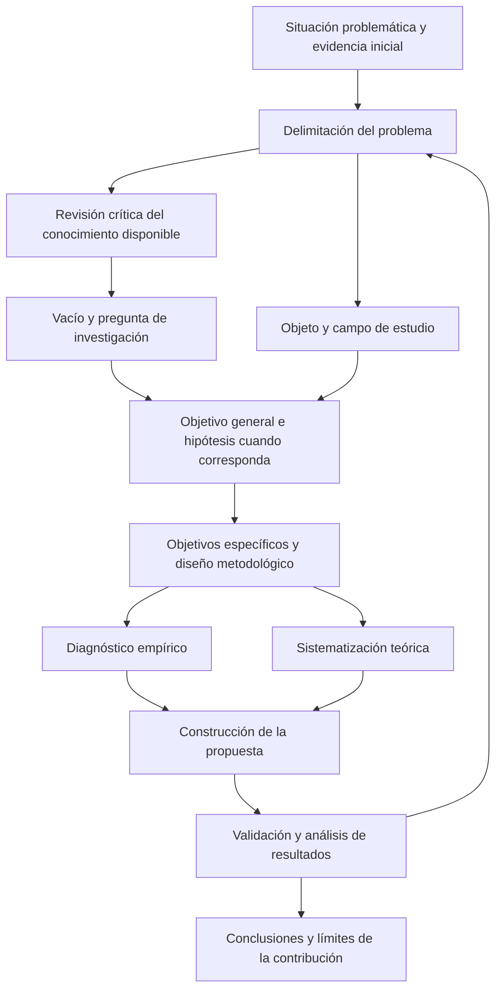

# Clase 5: Coherencia del diseño doctoral, revisión sistemática y validación de contribuciones científicas

> **Objetivo académico:** Articular problema, vacío de conocimiento, objeto, campo, objetivos, hipótesis y metodología en investigaciones aplicadas; evaluar críticamente la originalidad, la reproducibilidad y el alcance de las evidencias en artículos científicos y propuestas doctorales.

## 1. Contexto y marco conceptual

La sesión desarrolla una revisión metodológica de investigaciones en computación mediante casos de visión computacional, auditoría de tecnologías de información, simulación hidráulica con GPU, optimización cuántica de portafolios y predicción de incendios forestales. El eje común es la **coherencia entre lo que se afirma que ocurre, lo que se desconoce, lo que se propone y la evidencia necesaria para sostener la contribución**.

### Problema real, carencia técnica y vacío científico

La orientación central consiste en identificar primero una dificultad verificable en el comportamiento de una realidad: mediciones variables, latencia elevada, predicciones insuficientemente fiables o resultados deficientes de un proceso de evaluación. A partir de esa dificultad se justifica investigar.

| Concepto | Qué expresa | Evidencia o justificación necesaria |
|---|---|---|
| Situación problemática | Contexto en el que aparecen dificultades y consecuencias | Antecedentes, observaciones y datos contextualizados |
| Problema práctico | Diferencia relevante entre un funcionamiento observado y uno esperado | Indicadores del estado actual y criterio que justifica el estado deseado |
| Carencia técnica u operativa | Ausencia de un recurso, procedimiento o capacidad | Comprobación de la carencia y de sus efectos |
| Vacío de conocimiento | Aspecto que el conocimiento disponible no explica o no permite resolver suficientemente | Revisión crítica de antecedentes y delimitación de sus límites |
| Pregunta de investigación | Incertidumbre específica que orienta la indagación | Correspondencia con el problema y posibilidad de respuesta mediante evidencia |
| Propuesta | Respuesta desarrollada o evaluada en la investigación | Fundamento conceptual, diseño explícito y validación pertinente |

Decir «falta un software» suele anticipar una solución. En cambio, señalar que un proceso presenta una demora determinada identifica una manifestación que todavía admite explicaciones y respuestas alternativas. La ausencia de una herramienta no demuestra, por sí sola, una necesidad de investigación doctoral.

**Enriquecimiento conceptual:** Un problema práctico persistente tampoco prueba automáticamente un vacío teórico. Puede deberse a dificultades de implementación, restricciones económicas, incumplimiento de procedimientos o conocimiento disponible que aún no se aplica. La justificación científica debe mostrar qué incertidumbre permanece después de considerar esas explicaciones.

### La pregunta y el riesgo de anticipar la respuesta

El docente cuestiona las preguntas que incorporan como necesaria una solución todavía no fundamentada. El ejemplo de la latencia distingue entre preguntar cómo construir un software y preguntar cómo disminuir una demora de procesamiento: la segunda formulación permite investigar distintos mecanismos antes de elegir una intervención.

La cautela se extiende a las causas. Una sospecha causal no debe redactarse como un hecho demostrado. La situación problemática puede describir asociaciones observadas; la investigación debe establecer qué interpretación admiten.

**Enriquecimiento conceptual:** Esta advertencia debe entenderse como prevención del sesgo de confirmación, no como prohibición universal de investigar soluciones. Es legítimo estudiar el diseño de un algoritmo o la eficacia de una intervención cuando su elección está justificada y persiste una incertidumbre genuina. También puede investigarse un problema con causas parcialmente conocidas. La exigencia es distinguir antecedentes establecidos, hipótesis y resultados pendientes.

## 2. Fundamentos teóricos y arquitectura

### Arquitectura lógica de la investigación aplicada

El recorrido expuesto integra estudio teórico, diagnóstico, construcción de una propuesta y validación. Estos momentos se relacionan, pero producen evidencias diferentes: la revisión delimita el conocimiento disponible; el diagnóstico caracteriza el estado actual; la propuesta concreta una respuesta; la validación analiza su pertinencia o funcionamiento.

La retroalimentación representa que los hallazgos pueden exigir revisar delimitaciones o supuestos. La consistencia no equivale a inmovilidad: las modificaciones deben justificarse y mantener trazabilidad.

### Objeto de estudio y campo de acción

En la convención metodológica utilizada durante la sesión, el **objeto** designa el proceso o ámbito más amplio que se estudia, mientras que el **campo** delimita la parte específica de ese objeto sobre la que se concentra el aporte.

El objeto no debe ser tan amplio que pierda capacidad orientadora. «Sistemas» puede incluir realidades muy distintas; «auditoría de sistemas de información» ofrece una delimitación más informativa. El campo debe precisar el contenido que se desarrollará dentro de ese ámbito, por ejemplo, determinados procedimientos de evaluación de controles de TI.

En el caso fitopatológico se discuten alternativas entre estimación computacional y medición de severidad foliar. El intercambio no establece una formulación definitiva. Lo sustantivo es mantener una relación de inclusión conceptualmente defendible entre objeto y campo, en correspondencia con el objetivo.

**Enriquecimiento conceptual:** Las denominaciones objeto y campo no son uniformes en todas las tradiciones. Tampoco basta con que una expresión tenga menos palabras o parezca más específica. Es necesario mostrar qué procesos incluye, cuáles excluye y dónde se sitúa la contribución.

### Objetivos y momentos de investigación

El docente recomienda un verbo rector abarcador para el objetivo general. En una investigación propositiva, «proponer» o «elaborar» puede expresar el resultado central, mientras que la validación se explicita en un objetivo específico. Se distingue diseñar, referido a definir una estructura, de elaborar, que puede comprender un desarrollo más amplio.

| Momento | Verbo orientador discutido | Resultado intelectual esperado |
|---|---|---|
| Estudio teórico | Sistematizar | Organización, comparación, valoración y crítica del conocimiento |
| Diagnóstico | Caracterizar | Identificación de propiedades, magnitud y condiciones del problema |
| Construcción | Elaborar o diseñar | Propuesta fundamentada y explícita |
| Validación | Evaluar o validar | Evidencia sobre pertinencia, funcionamiento y límites |

Sistematizar supera la acumulación de citas: incluye identificar, organizar, analizar y valorar posiciones. Caracterizar pretende superar una enumeración superficial de rasgos mediante el análisis de propiedades relevantes.

La sesión vincula objetivos específicos y capítulos como recurso para orientar la escritura. También reconoce que un capítulo metodológico no siempre necesita un objetivo separado.

**Enriquecimiento conceptual:** La correspondencia fundamental es entre objetivos y resultados de investigación. Los capítulos organizan su comunicación; no generan por sí mismos necesidades científicas. Un objetivo puede atravesar varios capítulos y un capítulo puede contribuir a varios objetivos. Usar un verbo principal favorece claridad, pero no constituye una ley universal de formulación.

### Hipótesis y variables

En los estudios propositivos discutidos, la hipótesis relaciona características de la propuesta con una mejora esperada. Por ejemplo, un sistema computacional con propiedades definidas podría contribuir a obtener mediciones más consistentes de severidad foliar.

La propuesta desempeña el papel de intervención o factor explicativo; el desempeño de la medición constituye el resultado que interesa observar.

**Enriquecimiento conceptual:** «Independiente» no significa que una variable no dependa de nada: describe su papel en el modelo o diseño. Deben operacionalizarse tanto el resultado como los factores cuya variación sea necesaria para contrastar la hipótesis. No toda investigación requiere exactamente dos variables ni una hipótesis causal. Un estudio de diseño o una revisión pueden organizarse mediante preguntas y criterios explícitos de análisis.

### Paradigma, enfoque y propósito

La sesión cuestiona la declaración automática del positivismo y propone considerar postpositivismo y complejidad. Del enfoque complejo destaca interdependencias, relaciones entre partes y totalidad, acción y retroacción, frente a explicaciones excesivamente lineales.

**Enriquecimiento conceptual:** Conviene separar planos: el paradigma expresa compromisos epistemológicos; el enfoque organiza el tratamiento cuantitativo, cualitativo o integrado de la evidencia; el propósito aplicado busca atender problemas prácticos; y el alcance describe qué tipo de conocimiento se pretende producir. Una investigación aplicada puede ser descriptiva o explicativa en algunas de sus fases. Cuantificación y positivismo no son equivalentes, ni la complejidad invalida por sí misma otros enfoques. La elección debe justificarse por la pregunta y el diseño, no por una supuesta jerarquía de modernidad.

## 3. Implementación técnica y lógica de negocio

La fuente no presenta código completo ni protocolos ejecutables. Su implementación técnica consiste en decisiones de diseño metodológico y esquemas de propuestas; no permite reproducir experimentos ni certificar resultados.

### Declarar métodos por su función

El diseño metodológico debe explicar **qué se hizo, con qué información, mediante qué procedimiento y para qué resultado**. Una definición genérica de entrevista o de análisis estadístico no sustituye esa explicación.

La organización discutida distingue métodos teóricos, empíricos y estadísticos. Se mencionan análisis y síntesis, razonamiento inductivo y deductivo, estudio histórico y lógico, entrevistas e instrumentos de recolección. Cada uno necesita una función concreta y debe declararse únicamente si fue utilizado.

Una entrevista requiere precisar a quiénes se dirigió, qué información buscó, cómo se estructuró y cómo se analizó. Su guía o cuestionario es un instrumento, no una explicación suficiente del procedimiento.

**Enriquecimiento conceptual:** El rigor no aumenta por acumular nombres de métodos. Una entrevista puede producir datos cualitativos, cuantitativos o ambos según las preguntas y su tratamiento. Un diseño mixto requiere explicar cómo se integran las evidencias y qué aporta esa integración.

### Revisión sistemática y reproducibilidad

Para una revisión, la sesión prioriza bases de datos, estrategias de búsqueda, criterios de inclusión y exclusión, procedimientos de selección y medidas para controlar sesgos. Se mencionan identificación, cribado, elegibilidad e inclusión como momentos del flujo de selección.

La extensión textual del apartado no determina su suficiencia. Importa que permita comprender y reconstruir decisiones que afectan al corpus y a los resultados.

| Componente | Información que debe quedar explícita |
|---|---|
| Búsqueda | Fuentes consultadas, términos, ecuaciones y restricciones utilizadas |
| Selección | Criterios operativos y motivos de exclusión |
| Flujo documental | Registros identificados, depurados, revisados e incluidos |
| Extracción | Categorías o variables analizadas y reglas de codificación |
| Síntesis | Procedimientos de comparación e integración de hallazgos |
| Sesgos y calidad | Procedimientos aplicados y limitaciones que permanecen |

**Enriquecimiento conceptual:** PRISMA es una guía de reporte de revisiones sistemáticas, no un método completo de investigación ni una garantía automática de ausencia de sesgo. Los criterios precisos reducen arbitrariedad, pero no eliminan sesgos de publicación, cobertura, selección o interpretación. La evaluación de calidad debe ajustarse a los tipos de estudios incluidos.

Las cuatro dimensiones mencionadas en un caso de aprendizaje adaptativo ilustran cómo la pregunta puede orientar búsqueda, selección y tablas comparativas. Si esas dimensiones surgieron durante el análisis, debe distinguirse su identificación emergente de los criterios definidos previamente.

El uso de Zotero o Mendeley no demuestra reproducibilidad científica. La sesión lo diferencia de las decisiones que determinan qué documentos se incluyen. **Enriquecimiento conceptual:** Una herramienta sí debe describirse cuando sus funciones, configuración o versión afectan deduplicación, selección, extracción o análisis. Además, el estilo bibliográfico debe verificarse: las citas dentro del texto y las referencias finales siguen reglas diferentes, y la automatización no asegura su corrección.

### Introducción, resultados y discusión

La introducción presenta tema, contexto, justificación racional y objetivo o pregunta. En una revisión, los resultados son la síntesis obtenida del corpus: posiciones teóricas, comparaciones, tendencias, contradicciones, limitaciones y vacíos sustentados.

El docente favorece resultados y discusión integrados en revisiones, porque permite valorar las posiciones mientras se presentan. También reconoce estructuras separadas y la influencia de las normas editoriales. En estudios originales puede resultar útil distinguir datos obtenidos de su interpretación.

**Enriquecimiento conceptual:** La distinción depende de la función de cada pasaje. Las definiciones necesarias para comprender la pregunta pueden aparecer en la introducción; las categorías y relaciones producidas mediante la revisión pertenecen a los resultados. Una revisión no debe convertirse en un glosario, pero tampoco necesita trasladar todos los conceptos introductorios a sus hallazgos.

La discusión interpreta los resultados, los contrasta con antecedentes, explica diferencias y delimita implicaciones. Las conclusiones responden al objetivo dentro del alcance de la evidencia. El resumen debe ajustarse al trabajo efectivamente realizado; su formato estructurado o en un párrafo depende del medio de publicación.

## 4. Análisis crítico de casos y auditoría práctica

### Medición de severidad foliar en quinua

El caso propone integrar un modelo jerárquico híbrido, una aplicación móvil y una caja de captura para cuantificar severidad foliar. Se diferencia el desarrollo del algoritmo de su funcionamiento en campo. La comparación con valoraciones fitopatológicas aparece como componente de validación, pero no se proporcionan datos suficientes para comprobar superioridad.

El debate precisa que «subjetividad» es demasiado general para describir el problema de medición. Interesan diferencias entre observadores, variación de un mismo observador, proximidad a una referencia y estabilidad de las condiciones de captura.

**Enriquecimiento conceptual:** Repetir siempre un valor no garantiza que sea correcto. La repetibilidad se refiere a mediciones bajo condiciones equivalentes; la reproducibilidad considera cambios de condiciones especificados; la precisión describe dispersión y la exactitud expresa cercanía al valor de referencia. Un sistema puede ser consistente y presentar un sesgo sistemático. Asimismo, interpretar un resultado es distinto de que ese resultado sea válido.

**Enriquecimiento conceptual:** Si la severidad se define mediante proporción de superficie afectada, una expresión operacional posible es:

$$
S = 100\frac{A_{\mathrm{afectada}}}{A_{\mathrm{foliar}}}
$$

Aquí $S\in[0,100]$ es la severidad porcentual; $A_{\mathrm{afectada}}\geq0$ y $A_{\mathrm{foliar}}>0$ son áreas en la misma unidad, con $A_{\mathrm{afectada}}\leq A_{\mathrm{foliar}}$. La expresión supone una delimitación válida de hoja y lesión; en imágenes, los píxeles representan área proyectada bajo condiciones de captura especificadas. No establece por sí sola un valor verdadero ni resuelve oclusiones, síntomas ambiguos o diferencias de criterio diagnóstico.

La validación de campo debe distinguir desempeño de medición, robustez de captura y utilidad para usuarios. La opinión experta y la prueba práctica pueden complementarse; una no sustituye automáticamente a la otra.

### Auditoría de controles de TI en pequeñas y medianas empresas

Este caso enfrenta dos delimitaciones: mejorar la evaluación de controles o mejorar resultados organizacionales relacionados con seguridad, gestión y decisiones. La discusión no establece una definición final del problema.

La ausencia de políticas, las restricciones de infraestructura y la dificultad para aplicar marcos extensos pueden ser condiciones relevantes, pero requieren relacionarse con consecuencias verificables. Un FODA ayuda a organizar información; no demuestra por sí mismo relaciones causales.

El docente cuestiona inicialmente «cómo evaluar los controles» por considerar que anticipa la solución. Más adelante admite que puede ser una pregunta pertinente si el problema demostrado consiste precisamente en evaluaciones poco fiables o insuficientes. Esta precisión es central: **el carácter abierto o sesgado de la pregunta depende del problema y de la incertidumbre, no solo del verbo utilizado**.

**Enriquecimiento conceptual:** Conviene distinguir tres niveles: calidad del procedimiento de auditoría, calidad de la información que produce y efectos de las decisiones posteriores. Mejorar el primero no demuestra automáticamente menor vulnerabilidad ni mejor desempeño empresarial. Cada vínculo exige evidencia propia.

### Simulación hidráulica con GPU y condición de Courant

Se propone un factor adaptativo para modificar la elección del paso temporal en simulaciones unidimensionales y mejorar el aprovechamiento computacional. La sesión menciona una posible reducción del 20–25 %, pero no aporta protocolo, ecuación completa del factor ni resultados verificables. Se trata de una expectativa de la propuesta.

**Enriquecimiento conceptual:** La condición de Courant–Friedrichs–Lewy relaciona paso temporal, escala espacial y velocidad de propagación; no determina directamente la duración física total simulada. Una forma representativa para ciertos esquemas explícitos unidimensionales es:

$$
\Delta t \leq C_{\max}\min_i\left(\frac{\Delta x_i}{|u_i|+\sqrt{g h_i}}\right)
$$

Aquí $\Delta t>0$ se mide en segundos; $i$ identifica una celda; $\Delta x_i>0$ es su tamaño en metros; $u_i$ es la velocidad en metros por segundo; $g>0$ es la aceleración gravitatoria en metros por segundo cuadrado; $h_i\geq0$ es la profundidad en metros; y $C_{\max}>0$ es un límite adimensional dependiente del esquema. Se consideran celdas con denominador positivo. La expresión es ilustrativa para aguas someras: no reconstruye la ecuación mostrada durante la sesión y no sustituye el análisis de estabilidad del método concreto.

Un factor pequeño no garantiza estabilidad ni exactitud. Debe especificarse cómo cambia el paso temporal y qué propiedades conserva. Además, menos iteraciones no implican necesariamente igual reducción del tiempo de ejecución: influyen coste por paso, sincronización, memoria y paralelismo.

**Enriquecimiento conceptual:** Como corrección aritmética del ejemplo oral, reducir un tiempo inicial de siete días en un 20–25 % ahorra entre 1,4 y 1,75 días, dejando entre 5,6 y 5,25 días. Esto ilustra un cálculo, no un rendimiento observado. Una propuesta limitada a una dimensión tampoco permite afirmar su eficacia en dos dimensiones.

### Optimización cuántica de portafolios

El caso plantea comparar QAOA y variantes con métodos clásicos mediante un benchmark con datos del S&P 500. Se describen ventanas temporales, indicadores financieros, filtros, estimación de retornos y covarianzas, y conjuntos de 10, 20 y 30 activos. La calidad de solución, la estabilidad y la escalabilidad son criterios de interés; las tablas comparativas no se muestran.

El control de sesgo temporal exige usar información disponible en el momento de la decisión. **Enriquecimiento conceptual:** Desplazar indicadores un trimestre puede ayudar, pero debe comprobarse su fecha efectiva de publicación, así como cambios en el universo de activos y posibles sesgos de supervivencia.

**Enriquecimiento conceptual:** Una formulación binaria ilustrativa de selección con cardinalidad fija es:

$$
\max_{x\in\{0,1\}^n}\; \mu^\top x-\lambda x^\top\Sigma x
\quad\text{sujeto a}\quad \sum_{i=1}^{n}x_i=k
$$

Aquí $n$ es el número de activos candidatos; $x_i=1$ indica inclusión del activo $i$; $k\in\{1,\ldots,n\}$ fija cuántos se seleccionan; $\mu\in\mathbb{R}^n$ contiene retornos esperados del mismo horizonte; $\Sigma\in\mathbb{R}^{n\times n}$ es su matriz de covarianzas, simétrica y semidefinida positiva; y $\lambda>0$ pondera riesgo frente a retorno con una escala compatible. Esta formulación representa selección binaria y no determina por sí sola pesos de inversión arbitrarios.

Una penalización cuadrática permite escribir una forma QUBO:

$$
\min_{x\in\{0,1\}^n}\; -\mu^\top x+\lambda x^\top\Sigma x+\rho\left(\sum_{i=1}^{n}x_i-k\right)^2
$$

El parámetro $\rho>0$ penaliza incumplir la cardinalidad y debe elegirse respecto a la escala del objetivo. Cambiar el signo convierte la maximización en minimización; añadir la penalización permite retirar la restricción explícita únicamente si su peso preserva la factibilidad de la solución óptima. La equivalencia algebraica no garantiza mayor facilidad computacional. Tampoco una ejecución variacional garantiza alcanzar el estado fundamental del Hamiltoniano.

Durante la sesión se afirma que utilizar datos publicados impide clasificar un estudio como original. **Enriquecimiento conceptual:** Esa restricción es excesiva. Un experimento computacional, un benchmark o un análisis nuevo sobre datos secundarios puede constituir investigación original. Deben distinguirse procedencia de los datos y originalidad de la contribución. Una revisión sintetiza estudios previos; ejecutar algoritmos sobre un conjunto común de datos produce evidencia diferente. En ambos casos se exige justificar procedencia, calidad y límites de las fuentes.

### Predicción de propagación de incendios forestales

La propuesta combina imágenes satelitales y datos espaciotemporales con conocimiento físico y meteorológico. Se pretende superar limitaciones de modelos basados exclusivamente en patrones históricos. El problema práctico se conecta con incertidumbre sobre la propagación y decisiones de respuesta insuficientemente informadas.

La cifra de 0,75 de exactitud se presenta como un valor encontrado en la literatura consultada por el participante; no constituye un límite general del campo. Tampoco queda verificada la ausencia de trabajos que incorporen las variables propuestas.

**Enriquecimiento conceptual:** Incorporar viento como predictor no equivale necesariamente a aprendizaje informado por física: debe precisarse cómo entra el conocimiento físico, por ejemplo, mediante restricciones, ecuaciones, arquitectura o función de pérdida. La novedad requiere mostrar qué integración se aporta y contrastarla con antecedentes. No debe adoptarse la fecha de inicio del campo mencionada oralmente como un hecho histórico verificado.

Una comparación válida debe precisar métrica, horizonte predictivo y separación espacial y temporal de datos. La superioridad del modelo híbrido permanece como hipótesis hasta su validación.

## 5. Principios de diseño, buenas prácticas y anti-patrones

### Trazabilidad entre afirmación y evidencia

Cada afirmación debe corresponder a un tipo de respaldo. La existencia del problema necesita datos; su interpretación causal necesita un diseño adecuado; la novedad requiere comparación con antecedentes; y la eficacia necesita validación. La coherencia del relato favorece comprensión, pero no prueba por sí misma la validez de los resultados.

| Buena práctica | Anti-patrón | Consecuencia del anti-patrón |
|---|---|---|
| Precisar el resultado problemático | Presentar una herramienta ausente como problema suficiente | Confundir necesidad técnica con aporte científico |
| Mantener alternativas razonadas | Elegir una solución y buscar solo evidencia favorable | Sesgo de confirmación |
| Formular indicadores observables | Usar «exacto», «mejor» o «efectivo» sin definición | Afirmaciones imposibles de contrastar |
| Describir procedimientos y configuraciones | Enumerar métodos sin explicar su aplicación | Baja auditabilidad |
| Comparar bajo condiciones comunes | Usar datos, presupuestos o métricas incompatibles | Ventajas aparentes sin fundamento |
| Interpretar y contrastar hallazgos | Repetir tablas en la discusión | Ausencia de síntesis analítica |
| Explicitar límites | Generalizar fuera del contexto estudiado | Sobreestimación de la contribución |

La novedad puede aparecer en una síntesis crítica, una caracterización empírica, un modelo, un procedimiento o una propuesta. Debe explicarse qué cambia respecto al conocimiento disponible y por qué ese cambio importa. La replicación y la comprobación de límites también pueden aportar conocimiento, aunque no introduzcan una teoría completamente nueva.

### Fuentes recientes, obras seminales y preprints

La sesión recomienda combinar actualidad y fundamentos clásicos, y menciona como orientación una proporción elevada de publicaciones recientes frente a obras seminales. Esas proporciones no se establecen como norma universal ni como sustituto de la pertinencia.

Los preprints permiten conocer desarrollos recientes, pero su difusión no equivale a revisión por pares. El docente propone justificar su uso mediante continuidad temática y antecedentes de los autores.

**Enriquecimiento conceptual:** La reputación no valida un resultado. También deben revisarse método, datos, consistencia y estado de publicación. La revisión por pares aporta un control relevante, pero tampoco garantiza ausencia de errores. Las conclusiones sensibles deben reconocer el carácter provisional de la evidencia cuando corresponda.

### Discusión y revisión por pares

El caso final de agrupación de embeddings para identificar competencias ilustra dos exigencias: diferenciarse de trabajos cercanos y detallar configuraciones de los modelos. La respuesta científica consiste en contrastar contribuciones y aportar información metodológica pertinente.

La preferencia expresada por evitar «resultados principales» refleja preocupación por la selección arbitraria de hallazgos. **Enriquecimiento conceptual:** El rótulo no demuestra sesgo. Lo decisivo es reportar los resultados previstos, incluidos los desfavorables, justificar la selección editorial y hacer accesible la evidencia relevante.

La tutoría se concibe como construcción argumentada de una comprensión común. Las diferencias metodológicas se resuelven delimitando términos, contrastando literatura y revisando evidencia. El consenso orienta el trabajo, pero no sustituye la justificación científica.

## 6. Síntesis conceptual y profundización académica

La contribución doctoral requiere conectar una incertidumbre delimitada con un procedimiento capaz de producir evidencia pertinente. Un producto tecnológico puede concretar conocimiento, pero su existencia no demuestra por sí sola novedad, explicación causal ni utilidad práctica.

La sesión permite distinguir cinco preguntas de control conceptual:

1. **¿Qué ocurre?** Identifica una manifestación verificable y sus consecuencias.
2. **¿Qué se conoce y qué permanece incierto?** Delimita antecedentes, supuestos y vacío.
3. **¿Qué se pretende aportar?** Explicita el resultado intelectual o tecnológico.
4. **¿Cómo se obtendrá y analizará la evidencia?** Define métodos, fuentes, criterios y procedimientos.
5. **¿Qué permiten concluir los resultados?** Separa hallazgos, interpretación, límites y posibilidades de generalización.

En visión computacional, consistencia y corrección de la medición requieren análisis distintos. En auditoría, mejorar procedimientos y mejorar resultados organizacionales son niveles relacionados que no deben confundirse. En simulación, estabilidad numérica y rendimiento computacional necesitan evidencias complementarias. En optimización, una reformulación matemática no prueba ventaja algorítmica. En predicción de incendios, la incorporación de conocimiento físico debe verificarse frente a alternativas comparables.

**Enriquecimiento conceptual:** La relación entre teoría y tecnología es recíproca. La teoría puede orientar artefactos; el desarrollo tecnológico también puede revelar fenómenos y originar nuevas explicaciones. Por ello, no todo aporte teórico culmina necesariamente en un producto tecnológico ni toda innovación técnica equivale a una teoría nueva.

Las líneas de profundización que emergen son la evaluación de incertidumbre, la validez de constructos, el control de sesgos, la comparación reproducible y la delimitación de condiciones de uso. Todas convergen en un principio: **una contribución científica debe mostrar qué aporta, con qué fundamento y hasta dónde puede sostenerse**.
