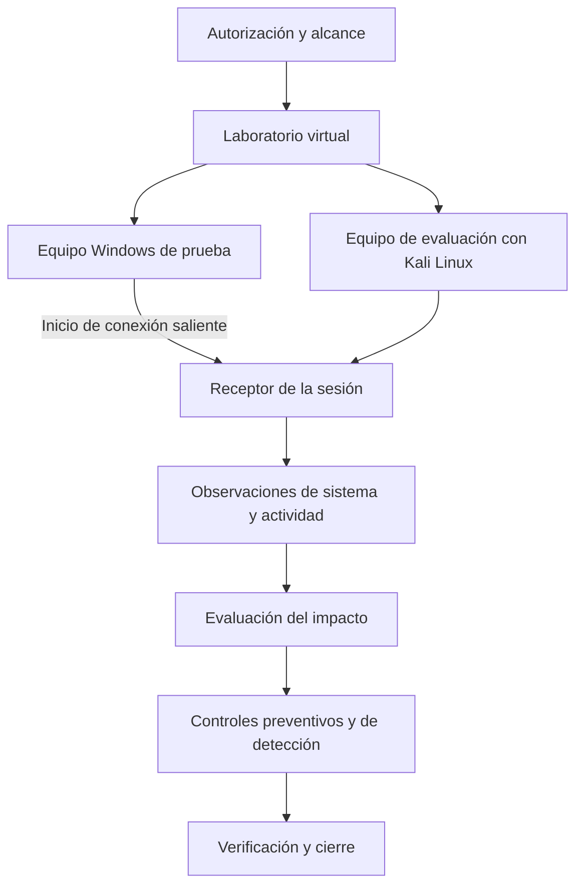

# Clase 1: Fundamentos de seguridad informática y análisis de una demostración de acceso remoto

> **Objetivo académico:** Distinguir el análisis de vulnerabilidades, las pruebas de penetración y el hacking ético; comprender la arquitectura conceptual de una sesión de acceso remoto en un laboratorio virtual y evaluar sus implicaciones defensivas, éticas y organizacionales.

## 1. Contexto y marco conceptual

### Seguridad informática y protección de activos

La digitalización de servicios, las transacciones por internet y la expansión de los dispositivos móviles incrementan la dependencia organizacional de sistemas informáticos. La seguridad informática responde a esta dependencia mediante políticas, tecnologías, procedimientos y prácticas destinados a proteger sistemas, redes y datos frente a accesos no autorizados, alteraciones e interrupciones.

La sesión presenta controles técnicos y administrativos: autenticación, cifrado, cortafuegos, políticas de acceso y monitoreo. Su propósito es proteger activos digitales y reducir consecuencias como pérdidas económicas, robo de información e indisponibilidad de servicios.

La protección se organiza alrededor de la tríada de confidencialidad, integridad y disponibilidad:

| Propiedad | Significado | Relación con el caso de acceso remoto |
| --- | --- | --- |
| Confidencialidad | Restringir el acceso a información a entidades autorizadas | La consulta de archivos, pantalla o cámara puede revelar información privada |
| Integridad | Preservar la información y los sistemas frente a modificaciones no autorizadas | Crear, modificar o eliminar archivos altera el estado del equipo |
| Disponibilidad | Mantener los servicios accesibles cuando se necesitan | Apagar equipos o interrumpir procesos puede afectar la operación |

**Enriquecimiento conceptual:** La seguridad no busca impedir cualquier acceso, sino permitir los accesos legítimos bajo condiciones controladas. Una política que bloquea toda interacción también puede perjudicar la disponibilidad y la función del servicio.

### Alcance efectivo de la clase

El núcleo de la sesión combina una introducción a la evaluación de seguridad con una demostración de acceso remoto entre máquinas virtuales. La criptografía, blockchain, los entornos de captura de banderas, la seguridad Android y la desofuscación aparecen como conexiones temáticas, sin desarrollo técnico suficiente para tratarlos como contenidos ya demostrados.

En particular, se mencionan hashes, firmas digitales, identidad digital, trazabilidad de registros y cadenas de suministro como ámbitos relacionados con blockchain. No se presenta un mecanismo de consenso, una implementación ni evidencia que permita evaluar una solución blockchain concreta.

## 2. Fundamentos teóricos y arquitectura

### Análisis de vulnerabilidades, pentesting y hacking ético

El análisis de vulnerabilidades identifica, clasifica y prioriza debilidades. Estas pueden originarse en errores de software, configuraciones inseguras o controles insuficientes. La automatización facilita una revisión amplia, pero sus hallazgos necesitan interpretación contextual.

Las pruebas de penetración, o pentesting, intentan validar de manera controlada si determinadas debilidades pueden aprovecharse y qué impacto producirían. Requieren autorización explícita, alcance definido y una metodología de trabajo.

El hacking ético se presenta como el uso legítimo de técnicas similares a las de un atacante para anticipar y corregir problemas. La sesión también vincula esta perspectiva con la ingeniería social y las simulaciones de adversarios.

| Enfoque | Pregunta principal | Evidencia esperada | Límite relevante |
| --- | --- | --- | --- |
| Análisis de vulnerabilidades | ¿Qué debilidades potenciales existen? | Hallazgos sobre versiones, configuraciones y exposición | Una alerta no demuestra por sí sola explotación |
| Prueba de penetración | ¿Qué impacto puede demostrarse dentro del alcance autorizado? | Validación técnica y consecuencias observadas | La cobertura está limitada por tiempo, alcance y condiciones |
| Hacking ético | ¿Cómo utilizar técnicas ofensivas con fines legítimos de protección? | Evidencia interpretable y recomendaciones | La legitimidad depende de autorización y conducta, no de la herramienta |

**Enriquecimiento conceptual:** La secuencia presentada en clase —análisis de vulnerabilidades, pentesting y hacking ético— es una organización didáctica, no una jerarquía universal. El pentesting suele formar parte del hacking ético. Del mismo modo, una operación de red team no equivale automáticamente a una prueba de penetración: puede orientarse a comprobar la detección y respuesta frente a objetivos adversarios definidos.

### Metodologías y referencias mencionadas

La transcripción alude a OSSTMM, ISSAF y OWASP, aunque sus siglas aparecen deformadas por el reconocimiento de voz.

- **OSSTMM:** se introduce como un marco para estructurar pruebas de seguridad y considerar distintas dimensiones operativas, incluidas redes, telecomunicaciones y factores humanos.
- **ISSAF:** se presenta como un marco de evaluación de seguridad de sistemas de información que organiza procedimientos de análisis y pruebas.
- **OWASP:** se describe como una organización y un conjunto de recursos orientados a mejorar la seguridad de las aplicaciones, con especial referencia al Top 10.

**Enriquecimiento conceptual:** OWASP es una organización que produce distintos proyectos; no constituye por sí misma una única metodología. Su Top 10 agrupa categorías de riesgos de aplicaciones web, por lo que no debe tratarse como una lista exhaustiva de vulnerabilidades ni como sustituto de una evaluación completa. La sesión no identifica la edición utilizada.

La comparación documental mencionada durante la exposición no está reproducida íntegramente. Por ello, no es posible reconstruir con fidelidad una matriz de cumplimiento entre los marcos.

### Modalidades según información disponible

| Modalidad | Información inicial del evaluador | Utilidad conceptual |
| --- | --- | --- |
| Caja negra | Conocimiento interno mínimo o inexistente | Analizar lo observable desde una posición externa |
| Caja gris | Conocimiento parcial o credenciales limitadas | Evaluar escenarios con acceso inicial restringido |
| Caja blanca | Información amplia sobre arquitectura, configuración o código | Facilitar una revisión interna de mayor profundidad |

**Enriquecimiento conceptual:** La transcripción atribuye al final de esta explicación la ausencia de conocimiento a la caja blanca, contradiciendo su definición anterior. La tabla corrige ese desliz: la ausencia de conocimiento corresponde a caja negra. Estas modalidades describen información disponible; no determinan por sí solas los privilegios ni el alcance autorizado.

### Exploit, payload y sesión remota

Un exploit aprovecha una vulnerabilidad específica. El payload, o carga útil, define una funcionalidad que se ejecuta en el contexto alcanzado. La sesión remota es el canal mediante el cual se intercambian instrucciones y resultados.

**Enriquecimiento conceptual:** Estos conceptos no son equivalentes. Un exploit no es necesariamente un virus, y una carga útil no implica autorreplicación. Un ejecutable iniciado voluntariamente puede establecer una conexión remota sin que se haya demostrado una vulnerabilidad de software. Esta distinción es decisiva para interpretar la demostración.

En la conexión inversa descrita, el equipo que ejecuta la carga inicia una comunicación hacia un receptor. Esta dirección de establecimiento puede facilitar la comunicación cuando las conexiones entrantes están restringidas, pero no garantiza atravesar controles de salida, filtros de aplicaciones o mecanismos de detección.

El diagrama representa relaciones funcionales y de evaluación. No presupone que establecer una sesión conceda privilegios administrativos ni que el laboratorio esté aislado por el solo hecho de utilizar virtualización.

## 3. Implementación técnica y lógica de negocio

### Componentes del laboratorio descrito

La exposición utiliza VirtualBox para ejecutar Kali Linux y Windows. Kali se presenta como una distribución basada en Debian que reúne herramientas de evaluación de seguridad. También se mencionan otras distribuciones y la posibilidad de instalar herramientas en un entorno Linux distinto.

| Componente | Papel en la demostración | Precisión necesaria |
| --- | --- | --- |
| VirtualBox | Alojar los sistemas invitados | La configuración de red determina su exposición |
| Kali Linux | Entorno del evaluador | Su uso no concede autorización sobre otros equipos |
| Windows | Sistema de prueba | La versión y configuración condicionan los resultados |
| Metasploit Framework | Plataforma modular de evaluación | Integra capacidades diferentes, no una única operación |
| `msfconsole` | Interfaz de interacción con Metasploit | Abrirla no demuestra que se hayan actualizado los paquetes |
| `msfvenom` | Componente de generación de cargas | La compatibilidad depende de plataforma, arquitectura y formato |
| Meterpreter | Entorno de sesión remota | Sus capacidades dependen de permisos y condiciones del sistema |
| Handler | Receptor asociado a la sesión | Es parte del funcionamiento del framework, no un sistema operativo independiente |

### Red virtual y conectividad

La demostración configura adaptadores en modo puente para que los invitados participen en la red local. Después consulta las direcciones de los sistemas y comprueba comunicación mediante `ping`.

**Enriquecimiento conceptual:** En modo puente, una máquina virtual aparece como otro participante de la red física. Puede obtener su dirección mediante DHCP o usar configuración estática; el modo puente no obliga a que el router asigne la dirección ni garantiza acceso a internet.

**Enriquecimiento conceptual:** Compartir una subred fue una condición del montaje mostrado, pero no es un requisito universal de las conexiones remotas. Lo necesario es que exista una ruta de comunicación permitida entre los extremos. Asimismo, `ping` prueba una forma de conectividad ICMP: una respuesta no valida todos los servicios y una ausencia de respuesta no demuestra aislamiento completo.

La transcripción contiene direcciones y puertos dictados de forma inconsistente. Se conserva su función conceptual, sin reconstruir una configuración ejecutable que la fuente no permite verificar con certeza.

### Flujo observado

El relato sigue una secuencia de preparación de sistemas, comprobación de conectividad, preparación de una carga, transferencia al invitado Windows, configuración del receptor y ejecución en el sistema de prueba. A continuación, describe la aparición de una sesión y la consulta de información del equipo.

La lógica técnica exige coherencia entre la carga y el receptor: deben ser compatibles en tipo de sesión y parámetros de comunicación. Sin esa correspondencia, o sin conectividad y permisos suficientes, la sesión puede no establecerse.

**Enriquecimiento conceptual:** Cambiar el nombre de una plataforma en una configuración no basta para trasladar una carga de Windows a Android. Cambian el formato, la arquitectura, las interfaces del sistema y los requisitos de ejecución. Tampoco todas las cargas de Windows deben adoptar necesariamente el formato de un ejecutable independiente.

### Evidencias y capacidades mostradas

La sesión describe las siguientes observaciones:

1. **Información del sistema:** identificación del sistema operativo y su arquitectura.
2. **Procesos:** comparación de la lista obtenida remotamente con el administrador de tareas.
3. **Sistema de archivos:** navegación por directorios y creación de una carpeta como modificación visible.
4. **Pantalla:** obtención de una captura del escritorio del sistema de prueba.
5. **Cámara:** enumeración de una cámara virtual e intento de visualizar su señal.
6. **Dependencia del canal:** pérdida de comunicación al desconectar el entorno que sostenía la sesión.

Como referencias de inspección, la exposición utiliza `sysinfo`, `ps` y `help` en el entorno de sesión. En la consola de Windows se mencionan `dir` y `cd` para listar y recorrer directorios. Estos comandos pertenecen a contextos diferentes: no deben confundirse las funciones de una sesión remota con las de la consola nativa del sistema.

La demostración también describe migración de ejecución entre procesos. Su significado defensivo es que la actividad maliciosa puede alojarse en un proceso cuyo nombre resulte familiar. La revisión no debe limitarse al nombre del proceso o a la presencia del ejecutable inicial.

**Enriquecimiento conceptual:** La migración de procesos no demuestra persistencia tras reiniciar, invisibilidad frente a herramientas de seguridad ni escalada de privilegios. Son propiedades distintas y requieren evidencia específica.

### Relación con el impacto organizacional

Las acciones técnicas tienen consecuencias diferentes para el negocio. Leer una pantalla puede comprometer información confidencial; modificar archivos puede afectar registros operativos; acceder a audio o cámara introduce riesgos de privacidad; interrumpir procesos puede detener servicios. La relevancia de cada acción depende del activo, los permisos de la sesión y la sensibilidad de los datos.

La fuente describe una demostración, no una auditoría completa: no incluye inventario de controles, trazas íntegras, validación de privilegios, medición de detección ni comprobación sistemática de limpieza posterior.

## 4. Análisis crítico de casos y auditoría práctica

### Alertas automatizadas y falsos positivos

Se mencionan Sucuri, ZAP, Nessus y Vega como herramientas de análisis, con distintos ámbitos de aplicación. La exposición destaca que los reportes automatizados pueden ser extensos y contener hallazgos que requieren validación.

**Enriquecimiento conceptual:** La herramienta ZAP se distingue de la organización OWASP y de su Top 10. Tampoco deben considerarse intercambiables un escáner de aplicaciones web y uno de infraestructura. Las afirmaciones sobre licencias, disponibilidad o continuidad de proyectos no quedan verificadas por la transcripción.

El caso discutido es el de un puerto abierto, por ejemplo un servicio web o de base de datos. Su presencia puede ser esperada por diseño.

**Enriquecimiento conceptual:** Un puerto abierto evidencia exposición de un servicio; por sí solo no demuestra una vulnerabilidad explotable. Tampoco es automáticamente un falso positivo: puede ser un hallazgo informativo correcto. Para clasificarlo deben revisarse el servicio, su configuración, los accesos permitidos, la autenticación y la necesidad de negocio.

Una auditoría debe separar:

- **Observación:** qué se detectó y mediante qué evidencia.
- **Interpretación:** qué debilidad representa dentro del contexto.
- **Impacto:** qué consecuencias plausibles o demostradas tiene.
- **Recomendación:** qué control reduce el riesgo y cómo se verificará.

**Enriquecimiento conceptual:** La afirmación de que los puertos superiores a 60000 están libres es incorrecta. Un número elevado no garantiza disponibilidad ni ausencia de uso. La disponibilidad depende del equipo, el protocolo, las vinculaciones existentes y sus reglas de red.

### Antivirus, firmas y ofuscación

La conversación aborda diferencias entre motores antivirus, búsqueda de patrones y dificultades introducidas por el ocultamiento del código. También menciona VirusTotal como servicio de análisis y MalwareBazaar como repositorio de muestras.

**Enriquecimiento conceptual:** Los productos de protección pueden combinar firmas, heurísticas, reputación y análisis de comportamiento. Una firma es una representación utilizada para detectar una característica; no debe confundirse con una copia ejecutable completa del malware. La exposición no demuestra que una representación almacenada por un antivirus pueda activarse como programa malicioso.

**Enriquecimiento conceptual:** La discrepancia entre motores no demuestra por sí sola que la causa sea ofuscación. Pueden variar las reglas, versiones, criterios de reputación y umbrales de detección. Una alerta tampoco debe descartarse únicamente porque el archivo tenga un propósito legítimo.

La afirmación de que toda técnica de ofuscación debe pasar por Base64 es técnicamente incorrecta.

**Enriquecimiento conceptual:** Base64 es una codificación reversible de datos, no un cifrado ni un requisito universal para ejecutar programas. La ofuscación puede alterar nombres, flujo de control o representación de cadenas sin emplearla. Decodificar Base64 tampoco equivale a completar un análisis de malware.

### Qué demuestra el acceso remoto

El caso muestra, según el relato, que ejecutar un archivo preparado puede habilitar capacidades remotas en ese entorno. Sin embargo, no se identifica una vulnerabilidad específica de software ni se demuestra una escalada de privilegios.

**Enriquecimiento conceptual:** La expresión «control total» excede la evidencia disponible. Las capacidades efectivas están limitadas por el contexto de seguridad del proceso, las políticas del sistema y los controles activos. Acceder a archivos o capturar la pantalla no demuestra dominio administrativo sobre todo el equipo.

La visualización de cámara utiliza una fuente virtual y presenta demoras. No prueba el acceso a una cámara física ni permite atribuir los problemas observados a una versión concreta de Kali. La actualización del sistema es una práctica pertinente, pero la causa de un fallo requiere diagnóstico y evidencia.

El aumento de memoria descrito tras la migración tampoco constituye una firma concluyente: el consumo de memoria puede variar por múltiples razones.

### Inteligencia artificial, gobernanza e inversión

El debate plantea automatizar la preparación de entornos y utilizar inteligencia artificial en actividades de seguridad. También cuestiona cómo justificar una inversión tecnológica ante la dirección.

No se presenta una implementación de IA ni una comparación reproducible entre modelos. Las afirmaciones sobre productos, restricciones o capacidades específicas permanecen sin verificación y no sustentan conclusiones técnicas.

**Enriquecimiento conceptual:** Una máquina virtual y un contenedor no son equivalentes. Un contenedor comparte el núcleo del anfitrión; una máquina virtual ejecuta un sistema invitado mediante virtualización. La elección depende de los requisitos de aislamiento y del comportamiento que se pretende observar.

**Enriquecimiento conceptual:** Comprar una herramienta de seguridad, con o sin IA, no permite garantizar ausencia de ataques durante un período. La justificación debe considerar reducción del riesgo residual, cobertura, capacidad de detección y respuesta, y costos de operación e integración.

Un modelo simplificado para razonar sobre una inversión es:

$$
B_{\mathrm{neto}} = L_{\mathrm{antes}} - L_{\mathrm{después}} - C
$$

Aquí, $B_{\mathrm{neto}} \in \mathbb{R}$ representa el beneficio neto esperado durante un horizonte definido; $L_{\mathrm{antes}}$ y $L_{\mathrm{después}}$ son pérdidas esperadas no negativas sin y con el control; y $C \geq 0$ es el costo total del control en ese horizonte. Todas las cantidades deben expresarse en la misma moneda y período. La expresión es un enriquecimiento conceptual, no un cálculo realizado en clase. Su utilidad depende de estimaciones defendibles y no acredita causalidad ni elimina la incertidumbre.

## 5. Principios de diseño, buenas prácticas y anti-patrones

### Autorización y alcance verificables

La sesión insiste en que las pruebas deben realizarse con autorización. Esta condición distingue una evaluación legítima de una intrusión.

**Enriquecimiento conceptual:** La autorización debe especificar activos, técnicas permitidas, restricciones sobre datos, condiciones de interrupción y responsables. El alcance debe contemplar también terceros y servicios compartidos que podrían verse afectados.

### Aislamiento del laboratorio

**Enriquecimiento conceptual:** Virtualizar no equivale a aislar. Para estudiar comportamientos potencialmente dañinos conviene una red interna controlada, sin acceso innecesario a la red de producción, junto con instantáneas y restricciones sobre carpetas compartidas, portapapeles y dispositivos extraíbles. El modo puente mostrado amplía la superficie de interacción con otros sistemas.

La habilitación indiscriminada del modo promiscuo y el uso de medios extraíbles compartidos deben justificarse por una necesidad concreta. No son requisitos generales para todas las demostraciones de conectividad.

### Defensa por capas

Las medidas expresamente señaladas son actualizar sistemas y aplicaciones, mantener protección antimalware y evitar archivos o enlaces de procedencia desconocida.

**Enriquecimiento conceptual:** Estas medidas ganan eficacia al combinarse con mínimos privilegios, control de ejecución de aplicaciones, segmentación, restricciones de comunicaciones salientes y monitoreo de procesos. La respuesta a una sesión sospechosa debe considerar tanto la contención del equipo como la conservación de evidencia.

### Interpretación responsable de resultados

| Buena práctica | Anti-patrón asociado |
| --- | --- |
| Validar hallazgos con contexto y evidencia | Equiparar todas las alertas con vulnerabilidades confirmadas |
| Describir permisos y capacidades demostradas | Afirmar control total por observar una sesión |
| Registrar versiones y configuraciones | Suponer que el resultado será idéntico en cualquier Windows |
| Diferenciar prevención, detección y respuesta | Confiar toda la protección a un antivirus |
| Identificar causas mediante diagnóstico | Atribuir cada demora a la versión del sistema |
| Evaluar la automatización con criterios medibles | Sustituir evidencia por promesas comerciales de IA |

### Factor humano y responsabilidad del diseño

La exposición destaca que la apertura de un archivo puede activar la cadena de compromiso.

**Enriquecimiento conceptual:** Presentar al usuario como la única o principal debilidad simplifica el problema. La seguridad depende también de interfaces, permisos, controles de ejecución y arquitectura. Un diseño robusto intenta impedir que un único error humano produzca consecuencias desproporcionadas.

## 6. Síntesis conceptual y profundización académica

La clase permite conectar tres planos: los objetivos de protección de la información, las metodologías para evaluar debilidades y las consecuencias observables de una sesión remota. El valor de la demostración reside en hacer visibles esas consecuencias; su límite es que no constituye una prueba universal de vulnerabilidad ni una medición integral de seguridad.

Las distinciones fundamentales son:

- Una exposición de servicio no equivale por sí sola a una vulnerabilidad explotable.
- Detectar una debilidad y demostrar su impacto son actividades relacionadas que producen evidencias distintas.
- Exploit, payload, malware y sesión remota describen elementos diferentes.
- Una conexión inversa depende de rutas, políticas de salida y controles del sistema.
- Migración de procesos, persistencia y escalada de privilegios necesitan validaciones independientes.
- Las herramientas adquieren valor cuando sus resultados pueden interpretarse y traducirse en decisiones de protección.

**Enriquecimiento conceptual:** La profundización académica puede organizarse alrededor de la calidad de la evidencia: qué observaciones sostienen una afirmación, qué explicaciones alternativas existen y bajo qué condiciones dejaría de cumplirse. Esta perspectiva conecta la seguridad ofensiva con el diagnóstico de sistemas, la gestión del riesgo y la evaluación crítica de tecnologías.

La conexión con blockchain queda limitada a una motivación introductoria. Antes de atribuirle beneficios de seguridad sería necesario definir qué amenaza aborda, quién controla las identidades y claves, cómo se valida la información de entrada y qué propiedades aporta frente a otras arquitecturas. Ninguna de esas respuestas puede deducirse de la mera mención de trazabilidad o registros distribuidos.
