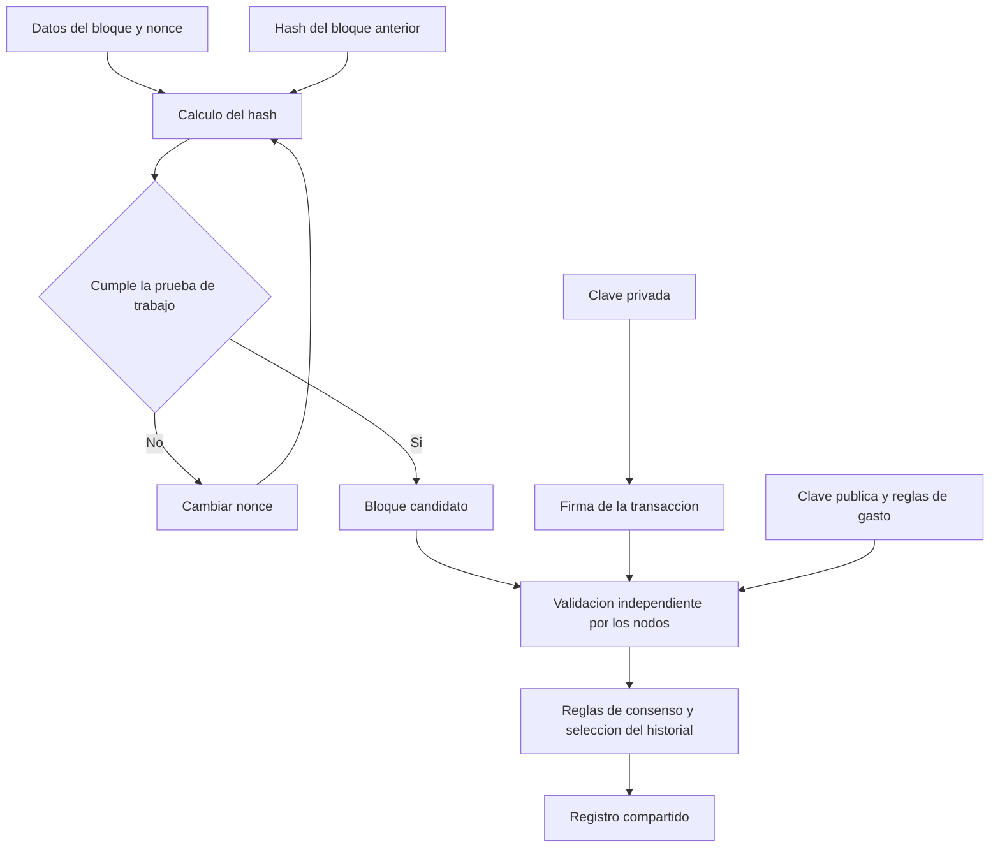

# Clase 4: Blockchain: hashes, prueba de trabajo, consenso distribuido y firmas digitales

> **Objetivo académico:** Explicar cómo el encadenamiento criptográfico, la prueba de trabajo, la replicación distribuida y las firmas digitales contribuyen a la integridad y autorización de un registro blockchain, distinguiendo sus garantías de las simplificaciones de una demostración educativa.

## 1. Contexto y marco conceptual

### De la confianza institucional a la verificación mediante protocolos

La sesión presenta blockchain como una respuesta al problema de mantener registros compartidos entre participantes que no necesariamente confían entre sí. En un sistema centralizado, una institución custodia el registro y decide qué operaciones acepta. Su funcionamiento depende de controles técnicos, integridad organizacional y mecanismos jurídicos; los errores humanos, los ataques y la corrupción pueden comprometer esa confianza.

Blockchain desplaza parte de esa confianza hacia reglas verificables, criptografía y procedimientos de consenso. No elimina la confianza: modifica sus condiciones y distribuye funciones que antes concentraba un intermediario.

**Enriquecimiento conceptual:** La confianza también depende de la implementación del software, la custodia de claves, los incentivos económicos y las condiciones de comunicación de la red. Un protocolo matemáticamente definido puede estar implementado incorrectamente o utilizarse bajo supuestos que no se cumplen.

### Bitcoin como contexto histórico

La exposición sitúa el bloque génesis de Bitcoin el 3 de enero de 2009 y vincula su creación con el seudónimo Satoshi Nakamoto. El mensaje incorporado en ese bloque remite a un titular sobre rescates bancarios y sirve para contextualizar la búsqueda de una alternativa al dinero administrado mediante intermediarios centrales.

Conviene distinguir tres niveles: Bitcoin es un sistema monetario concreto; una blockchain es una estructura de registro encadenado; y las tecnologías de registro distribuido abarcan diseños con diferentes reglas de participación y consenso. La clase menciona contratos inteligentes, trazabilidad y votación electrónica como posibles ámbitos de aplicación, sin desarrollar sus arquitecturas particulares.

### Acuerdo entre participantes potencialmente adversarios

El problema de los generales bizantinos introduce la dificultad de coordinar decisiones cuando algunos participantes pueden mentir, actuar de manera inconsistente o intentar sabotear el acuerdo. Su traducción al registro digital consiste en decidir qué historial de operaciones se acepta sin depender de un árbitro único.

La prueba de trabajo se presenta como el mecanismo empleado en Bitcoin para hacer costosa la producción de bloques y dificultar la sustitución del historial.

**Enriquecimiento conceptual:** La prueba de trabajo no constituye por sí sola todo el consenso. Debe combinarse con reglas de validez, propagación de bloques y selección de historial. Tampoco debe generalizarse a todas las blockchains: existen otros mecanismos de consenso.

## 2. Fundamentos teóricos y arquitectura

### Funciones hash y SHA-256

Una función hash criptográfica transforma una entrada de longitud variable en una salida de longitud fija. Para SHA-256 puede expresarse:

$$
H:\{0,1\}^{*}\rightarrow\{0,1\}^{256}.
$$

Aquí $H$ representa SHA-256, $\{0,1\}^{*}$ es el conjunto de secuencias binarias finitas y $\{0,1\}^{256}$ contiene las salidas de 256 bits. Esos 256 bits equivalen a 32 bytes o 64 caracteres hexadecimales, pues cada carácter hexadecimal representa cuatro bits.

La demostración destaca cuatro propiedades: una misma entrada produce siempre la misma salida; una modificación pequeña cambia radicalmente el resultado; la longitud de salida no depende del tamaño del mensaje; y conocer el hash no permite recuperar fácilmente la entrada. La entrada vacía también tiene un hash definido.

**Enriquecimiento conceptual:** Una salida de longitud fija no puede identificar de manera absolutamente única todas las entradas posibles. Existen colisiones porque el espacio de entradas es mayor que el de salidas. La garantía relevante es la resistencia computacional a encontrarlas y a resolver problemas de preimagen, bajo los supuestos de seguridad del algoritmo. Por ello, «irreversible» significa inviable computacionalmente en las condiciones consideradas, no imposible en sentido lógico. Un hash tampoco es un cifrado que pueda descifrarse con una clave.

### Bloques, referencias y dependencia del historial

En la demostración, un bloque reúne un identificador, datos, un nonce y, cuando forma parte de una cadena, una referencia al hash anterior. El bloque génesis inicia la secuencia y utiliza una referencia convencional porque carece de predecesor.

**Enriquecimiento conceptual:** Como modelo abstracto de la demostración, el encadenamiento puede escribirse:

$$
h_i=H\bigl(\operatorname{enc}(i,n_i,d_i,h_{i-1})\bigr).
$$

El índice $i\in\mathbb{N}_{>0}$ identifica el bloque; $n_i$ es un nonce admisible; $d_i$ representa los datos; $h_{i-1}$ es el hash del predecesor; y $\operatorname{enc}$ es una codificación determinista y no ambigua de los campos. Esta expresión explica la dependencia entre bloques; no reproduce el formato exacto de Bitcoin, cuya cabecera y compromiso con las transacciones tienen una estructura específica.

Cambiar los datos de un bloque modifica su hash. En consecuencia, el sucesor deja de referenciar el contenido modificado. Si se actualiza esa referencia, también cambia el hash del sucesor, propagando la necesidad de reconstrucción hacia adelante. Los bloques anteriores permanecen intactos.

La referencia apunta al pasado porque el predecesor ya existe cuando se construye el nuevo bloque.

**Enriquecimiento conceptual:** Incorporar en cada bloque el hash definitivo de su sucesor produciría una dependencia circular o exigiría modificar bloques anteriores al añadir otros nuevos. La navegación hacia adelante puede resolverse mediante índices auxiliares; no requiere alterar el compromiso criptográfico del historial.

El diagrama distingue la búsqueda de una prueba de trabajo de la validación de las operaciones. Encontrar un hash aceptable no sustituye las comprobaciones sobre firmas y disponibilidad de fondos.

### Prueba de trabajo y nonce

La demostración considera válido un hash cuyo prefijo contiene cuatro ceros hexadecimales. El procedimiento de minería cambia el nonce y recalcula el hash hasta encontrar un resultado aceptable. Aunque se describe como un valor arbitrario, el nonce puede recorrerse secuencialmente: no necesita generarse aleatoriamente en cada intento.

**Enriquecimiento conceptual:** Bajo el supuesto idealizado de salidas uniformes e intentos independientes, la probabilidad de obtener $k$ ceros hexadecimales iniciales es:

$$
p=16^{-k},\qquad \mathbb{E}[N]=16^k.
$$

Aquí $k\in\mathbb{N}_{>0}$ es la cantidad de ceros exigida, $p$ es la probabilidad de éxito por intento y $N$ es el número de intentos hasta el primer éxito. Para $k=4$, la probabilidad es $1/65\,536$ y el número esperado de intentos es $65\,536$. Es una esperanza estadística, no un máximo ni una predicción de una ejecución particular.

En una formulación más general se exige que el valor numérico del hash sea menor que un objetivo de dificultad. El prefijo de ceros es una representación pedagógica de esa restricción.

## 3. Implementación técnica y lógica de negocio

### Secuencia de la demostración visual

La herramienta atribuida en la sesión a Anders permite recorrer progresivamente los siguientes componentes:

| Componente | Operación observada | Concepto que permite comprender |
| --- | --- | --- |
| Hash | Modificar texto y volver a introducirlo | Sensibilidad a cambios y determinismo |
| Bloque | Cambiar datos y buscar un nonce | Prueba de trabajo |
| Blockchain | Alterar un bloque intermedio | Dependencia de los sucesores |
| Distribución | Comparar copias entre pares | Detección de divergencias |
| Tokens | Sustituir texto por movimientos de valor | Semántica de las operaciones |
| Coinbase | Introducir emisión según reglas | Procedencia inicial de fondos |
| Firmas | Modificar una operación firmada | Autorización e integridad del mensaje |

La exposición muestra estados visuales de validez y cambios de hash. No proporciona el código de la herramienta ni una implementación completa de un nodo, por lo que estos apuntes describen sus mecanismos sin atribuir resultados a una ejecución independiente.

### Replicación y selección del historial

La demostración utiliza pares A, B y C con copias inicialmente idénticas. Si se modifica y remina la copia A, esta puede volver a satisfacer su condición local de trabajo, pero sus hashes difieren de los de B y C. La comparación revela que existe una divergencia.

**Enriquecimiento conceptual:** Esa divergencia no determina por sí sola qué copia debe aceptarse. En Bitcoin no se decide mediante una mayoría simple de computadoras: entre cadenas válidas, la selección considera el trabajo acumulado. Contar nodos como votos permitiría que un atacante fabricara identidades para influir en el resultado.

Comparar hashes de cabecera o de punta permite detectar diferencias cuando se conoce la referencia esperada. No sustituye la validación de bloques y transacciones, ni demuestra por sí solo la corrección de todo el historial. Asimismo, la copia completa corresponde a determinados tipos de nodo; no todos los participantes almacenan necesariamente todos los datos históricos.

### Tokens, movimientos y disponibilidad de fondos

La sección de tokens reemplaza datos genéricos por transferencias entre participantes. Un token representa una unidad de valor, un derecho o un activo definido por las reglas del sistema. En la demostración, los importes ilustran movimientos; no prueban una equivalencia económica con una moneda externa.

El registro de transferencias plantea una cuestión esencial: que una operación esté escrita no implica que su emisor disponga de los fondos. Es necesario comprobar su procedencia y evitar que una misma disponibilidad se utilice más de una vez.

La transacción coinbase introduce el origen de nuevas unidades en el modelo explicado. En Bitcoin es una transacción especial, situada al inicio del bloque y sin entradas ordinarias de gasto. Debe distinguirse de la empresa que comparte ese nombre.

**Enriquecimiento conceptual:** La coinbase no soluciona por sí sola toda la validación monetaria. En Bitcoin deben verificarse también las salidas no gastadas, las condiciones de gasto y las restricciones de emisión. La coinbase puede asignar el subsidio permitido y las comisiones correspondientes, con restricciones adicionales como la madurez de sus salidas. Por ello, seguir movimientos anteriores ayuda a comprender la procedencia, pero no equivale a ejecutar todas las reglas del protocolo.

### Claves públicas, claves privadas y firmas

La clave privada es un secreto que permite autorizar operaciones. La clave pública se deriva de ella y permite verificar firmas sin revelar ese secreto. La generación del par puede realizarse localmente, sin solicitarlo a una autoridad central.

**Enriquecimiento conceptual:** Una clave privada debe pertenecer al dominio válido del esquema y generarse con suficiente entropía. Elegir un número pequeño o predecible puede servir para una demostración, pero resulta inseguro en un sistema real. La dificultad de recuperar la clave privada depende del algoritmo y sus parámetros; no es una imposibilidad absoluta.

El mecanismo de firma puede representarse abstractamente como:

$$
\sigma=\operatorname{Firmar}(sk,m),\qquad
\operatorname{Verificar}(pk,m,\sigma)\in\{\text{verdadero},\text{falso}\}.
$$

Aquí $sk$ es una clave privada válida; $pk$, su clave pública asociada; $m$, el mensaje o representación de la operación; y $\sigma$, la firma digital. El esquema puede requerir parámetros y aleatoriedad adicionales no representados en esta notación. La verificación comprueba la compatibilidad criptográfica entre esos elementos.

En la demostración, modificar el importe de una transferencia invalida su firma. Reminar el bloque puede restaurar la condición de trabajo, pero no permite fabricar la firma del propietario de la clave privada. Esta separación constituye uno de los resultados conceptuales más relevantes de la sesión.

**Enriquecimiento conceptual:** Una firma válida acredita autorización respecto de una clave bajo los supuestos del esquema. No acredita por sí sola identidad civil, disponibilidad de fondos, veracidad del contenido ni ausencia de compromiso de la clave. Además, una clave pública y una dirección de recepción no son conceptos intercambiables en todos los sistemas.

### Simulador aritmético en hoja de cálculo

La sesión también utiliza una hoja de cálculo para representar bloques mediante filas. El modelo combina un registro categórico, un identificador, conversiones de caracteres a números, un nonce y una referencia parcial al resultado anterior. Su condición local consiste en obtener un resultado divisible entre tres.

Los componentes técnicos recuperables son:

- Conversión del primer carácter de distintos campos mediante una tabla ASCII.
- Nonce restringido a los valores $1$, $2$ y $3$.
- Referencia formada por los últimos dos dígitos del resultado anterior.
- Cálculo aritmético sencillo y comprobación de su residuo módulo tres.
- Propagación de cambios hacia filas posteriores cuando se actualizan sus dependencias.

La explicación verbal de la fórmula es incompleta y los valores mencionados para el bloque inicial no son consistentes. Sin el archivo no puede certificarse la fórmula efectiva ni un resultado numérico completo. La condición local sí queda expresada con claridad:

$$
x_i\bmod 3=0.
$$

Aquí $x_i\in\mathbb{Z}$ es el resultado aritmético del bloque simulado $i$, y $\bmod 3$ devuelve el residuo en $\{0,1,2\}$. Cumplir esa condición solo establece divisibilidad; no acredita seguridad criptográfica ni corrección semántica de los datos.

## 4. Análisis crítico de casos y auditoría práctica

### Alteración de un bloque intermedio

La modificación de datos antiguos produce dos problemas diferentes: el hash del bloque cambia y las referencias de sus sucesores dejan de corresponder al historial modificado. Reconstruir la cadena exige actualizar dependencias y volver a satisfacer las pruebas de trabajo correspondientes.

**Enriquecimiento conceptual:** Esta resistencia es económica y probabilística. En una red activa también importa competir con el crecimiento de la cadena honesta. La viabilidad de una reorganización depende, entre otros factores, del poder de cómputo relativo y de la profundidad del bloque. No resulta riguroso describir cualquier modificación como matemáticamente imposible.

### Una cadena local coherente puede diferir del historial aceptado

Reminar varios bloques puede producir una secuencia localmente consistente. La replicación permite contrastarla con otros historiales, pero su aceptación depende de las reglas del protocolo. Deben separarse la coherencia de enlaces, la validez de las operaciones y la selección del historial compartido.

### Una prueba de trabajo válida puede contener una operación inválida

El cambio de un importe firmado muestra que existen controles independientes:

| Control | Pregunta que responde | Límite principal |
| --- | --- | --- |
| Hash y referencia anterior | ¿El contenido coincide con su compromiso y encadenamiento? | No acredita autorización |
| Prueba de trabajo | ¿El bloque satisface el umbral exigido? | No legitima sus operaciones |
| Firma digital | ¿La firma es válida para esta clave y este mensaje? | No prueba disponibilidad de fondos |
| Reglas de gasto | ¿Los recursos pueden utilizarse de esta manera? | No seleccionan por sí solas entre historiales concurrentes |
| Consenso | ¿Qué historial válido adopta la red? | Depende de supuestos operativos y adversariales |

### Por qué el color verde no prueba corrección

En el simulador, un dato incorrecto puede seguir produciendo un resultado divisible entre tres. Esta observación separa la corrección de una condición aritmética de la corrección del registro representado.

**Enriquecimiento conceptual:** Si, como modelo hipotético simplificado, el resultado fuera $x=s+n$, con $s\in\mathbb{Z}$ como suma fija de los demás términos y $n\in\{1,2,3\}$, siempre existiría exactamente una elección de $n$ que hiciera $x\bmod 3=0$. Esos tres valores recorren todas las clases residuales módulo tres. Por ejemplo, para $s=214$, elegir $n=2$ produce $216$, divisible entre tres. Este cálculo explica por qué una regla tan sencilla no detecta errores de contenido; no reconstruye una fórmula verificada del archivo.

### Límites del resumen aritmético

**Enriquecimiento conceptual:** Utilizar únicamente el primer carácter de un campo provoca colisiones inmediatas: dos identificadores distintos que comiencen igual aportan el mismo valor. Conservar solo dos dígitos del resultado anterior deja, como máximo, cien referencias posibles. Una suma simple también admite compensaciones entre campos que preservan el resultado. El simulador ilustra dependencias y búsqueda de un nonce, pero carece de resistencia criptográfica a manipulaciones.

Los códigos breves llamados claves públicas en ese modelo deben interpretarse como identificadores educativos: sin un algoritmo de derivación y un mecanismo de firma, no constituyen evidencia de criptografía asimétrica.

## 5. Principios de diseño, buenas prácticas y anti-patrones

1. **Separar los mecanismos de seguridad.** Hash, firma, prueba de trabajo y consenso resuelven problemas distintos. Su combinación debe justificarse mediante reglas explícitas.
2. **Expresar los supuestos de inmutabilidad.** La resistencia a cambios depende de dificultad, recursos adversarios, profundidad y funcionamiento de la red. El encadenamiento aislado permite detectar modificaciones, pero no evita toda reconstrucción.
3. **Validar las operaciones independientemente del productor del bloque.** Un bloque con trabajo válido puede contener firmas incorrectas o gastos no permitidos.
4. **Proteger las claves privadas.** Deben generarse de forma segura y mantenerse bajo control de su propietario. Su exposición permite autorizar operaciones en nombre de esa clave.
5. **Distinguir replicación de consenso.** Mantener varias copias permite comparar estados; hacen falta reglas adicionales para resolver divergencias.
6. **Diferenciar identificadores, claves y direcciones.** Compartir una apariencia textual no les otorga las mismas propiedades criptográficas.
7. **Auditar la codificación del contenido.** **Enriquecimiento conceptual:** El hash debe comprometerse con una representación completa y no ambigua de los campos relevantes. Omitir datos o reducirlos excesivamente debilita la detección de cambios.
8. **Delimitar el alcance de los simuladores.** Las conversiones ASCII, referencias truncadas y residuos pequeños sirven para visualizar relaciones, no para proteger activos.

Son anti-patrones relevantes llamar firma digital a un prefijo de hash, identificar consenso con mayoría simple de nodos, asumir que un registro inalterado necesariamente contiene hechos verdaderos y presentar un indicador visual como garantía integral de seguridad.

## 6. Síntesis conceptual y profundización académica

La clase construye blockchain desde una secuencia de dependencias: los hashes comprometen contenido; los bloques agrupan datos; las referencias enlazan el historial; la prueba de trabajo introduce un costo de producción; la distribución permite contrastar copias; y las firmas delimitan quién puede autorizar determinadas operaciones. Las reglas monetarias y de gasto completan la validación de las transferencias.

La distinción central es que **integridad del historial, autorización de operaciones y acuerdo distribuido son propiedades diferentes**. Ninguna queda plenamente demostrada por un único hash, una firma aislada o una copia local coherente.

El simulador aritmético permite observar cómo una modificación afecta dependencias posteriores, pero su simplicidad impide equipararlo a una blockchain segura. La demostración criptográfica, a su vez, muestra por qué reminar un bloque no repara una firma alterada.

**Enriquecimiento conceptual:** La profundización académica puede organizarse alrededor de tres relaciones: el vínculo entre seguridad criptográfica y costo económico; la diferencia entre validez de una operación y aceptación de un historial; y la separación entre integridad de los datos y veracidad de los hechos registrados. Estas relaciones permiten evaluar críticamente una propuesta blockchain sin reducir su seguridad al uso de criptografía.
