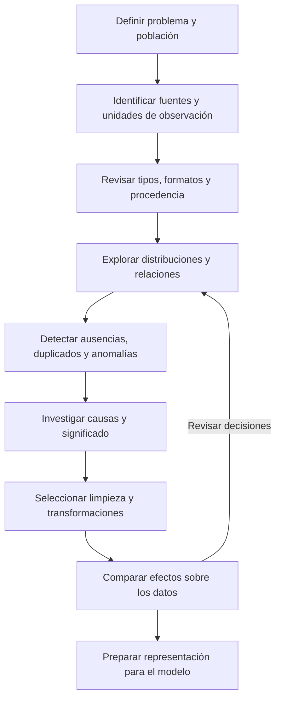

# Clase 1: Fundamentos estadísticos, exploración y preparación de datos para machine learning

> **Objetivo académico:** Comprender cómo la estadística descriptiva, la probabilidad y la inferencia sustentan el análisis exploratorio de datos, y justificar decisiones de limpieza, transformación e imputación antes de construir modelos de aprendizaje automático.

## 1. Contexto y marco conceptual

### 1.1. De la abundancia de datos a la comprensión del problema

La sesión sitúa el aprendizaje automático en un entorno de producción continua de datos: interacciones digitales, dispositivos conectados, sensores, satélites, sistemas empresariales y registros de aplicaciones. El reto científico consiste en convertir esos registros en conocimiento defendible, identificando qué representan, cómo se generaron y qué limitaciones tienen.

El **análisis exploratorio de datos**, o EDA, organiza esta comprensión inicial. Combina resúmenes estadísticos, visualizaciones y análisis de relaciones para reconocer distribuciones, ausencias, inconsistencias y observaciones inusuales. Su resultado es una caracterización del conjunto de datos que orienta las decisiones posteriores; no constituye por sí solo una explicación causal.

La idea central es que la calidad del resultado depende de la calidad y pertinencia de la entrada. Un algoritmo ejecuta una lógica matemática sobre los datos disponibles: no determina automáticamente si una edad imposible, un identificador o una categoría mal codificada representan información válida.

### 1.2. Tres planos que conviene distinguir

| Plano | Pregunta principal | Alcance |
| --- | --- | --- |
| Descripción | ¿Cómo son los datos observados? | Resume el conjunto disponible sin justificar automáticamente generalizaciones. |
| Inferencia | ¿Qué puede concluirse sobre una población a partir de una muestra? | Requiere supuestos sobre selección, variabilidad e incertidumbre. |
| Modelado predictivo | ¿Qué patrones permiten anticipar una respuesta? | Depende de la representación de los datos y de su capacidad de generalizar. |

La clase insiste en comprender cada variable antes de combinarla con otras. El análisis univariado permite detectar problemas básicos; el análisis bivariado y multivariado incorpora relaciones que una revisión por columnas no revela.

### 1.3. Enfoque de investigación y naturaleza de las variables

Una investigación cualitativa puede trabajar con entrevistas, transcripciones, codificación y construcción de temas. Una investigación cuantitativa analiza mediciones y relaciones mediante procedimientos estadísticos. Los enfoques mixtos pueden conectar ambos procesos: explorar cualitativamente para construir instrumentos cuantitativos, o utilizar resultados cuantitativos para orientar una indagación cualitativa posterior.

El enfoque de investigación no se deduce del tipo de una columna. Una investigación cuantitativa puede incluir variables categóricas, mientras que una investigación cualitativa puede registrar edades u otras cantidades como información contextual.

**Enriquecimiento conceptual:** La generalización estadística depende del diseño muestral y de los supuestos del análisis, no solamente de que existan números. La investigación cualitativa puede ofrecer transferibilidad contextual y generalización analítica, aunque no estime automáticamente parámetros poblacionales. Asimismo, las decisiones de medición, selección y modelado introducen criterios interpretativos también en los estudios cuantitativos.

## 2. Fundamentos teóricos y arquitectura

### 2.1. Tipos de variables y operaciones admisibles

| Tipo | Característica | Ejemplos tratados | Consecuencia analítica |
| --- | --- | --- | --- |
| Categórica nominal | Categorías sin orden intrínseco | País, categoría de usuario | Frecuencias, proporciones y moda; los códigos no representan magnitudes. |
| Categórica ordinal | Categorías ordenadas | Bajo, medio, alto; respuestas Likert | El orden tiene significado, pero las distancias entre categorías requieren justificación. |
| Cuantitativa discreta | Valores contables | Número de personas que ingresan a un local | Distribuciones de conteos. |
| Cuantitativa continua | Magnitudes medidas | Temperatura, peso, estatura | Resúmenes numéricos y análisis de distribución. |
| Temporal | Instantes o secuencias | Fecha, marca de tiempo | Importan orden, frecuencia y posibles dependencias temporales. |
| Geoespacial | Localización o geometría | Coordenadas, ubicación de eventos | Permite estudiar patrones ligados al territorio. |
| Textual o multimedia | Contenido que requiere representación específica | Texto, imágenes, audio y video | No se convierte directamente en una tabla numérica sin decisiones de representación. |

**Enriquecimiento conceptual:** Si una categoría binaria se representa mediante un indicador $X\in\{0,1\}$, su media sí tiene interpretación: es la proporción de observaciones de la categoría codificada como uno. No representa una categoría intermedia. Para un ítem Likert, calcular una media presupone tratar sus distancias como aproximadamente comparables; la mediana y la distribución de frecuencias evitan ese supuesto. La codificación numérica, por sí sola, no convierte una variable nominal en cuantitativa.

### 2.2. Tendencia central, dispersión y posición

La media resume el centro aritmético; la mediana corresponde al centro de los datos ordenados; la moda identifica el valor o categoría más frecuente. La media es sensible a valores extremos, mientras que la mediana ofrece mayor resistencia frente a ellos. En una cantidad par de observaciones numéricas, la mediana se obtiene promediando los dos valores centrales.

**Enriquecimiento conceptual:** Para precisar las medidas revisadas, sean $x_1,\ldots,x_n\in\mathbb{R}$ observaciones de una misma magnitud, con $n\geq2$. La media, la varianza muestral, la desviación estándar y el rango son:

$$
\bar{x}=\frac{1}{n}\sum_{i=1}^{n}x_i,
\qquad
s^2=\frac{1}{n-1}\sum_{i=1}^{n}(x_i-\bar{x})^2,
\qquad
s=\sqrt{s^2},
\qquad
R=\max_i x_i-\min_i x_i.
$$

Aquí $i$ identifica cada observación, $\bar{x}$ es la media, $s^2$ la varianza muestral, $s$ la desviación estándar y $R$ el rango. La varianza promedia desviaciones **cuadráticas**, con la corrección muestral indicada; no es el promedio de las desviaciones con signo, cuya suma es cero. Si la magnitud se mide en años, la varianza se expresa en años cuadrados y la desviación en años. Para describir la dispersión de una población finita completa se utiliza el denominador correspondiente a su tamaño.

Una variable constante carece de variación observada y no permite distinguir registros dentro de ese conjunto. Un identificador autonumérico presenta variación, pero esta no implica contenido predictivo sustantivo.

**Enriquecimiento conceptual:** La utilidad depende del objetivo. Un identificador puede ser indispensable para unir tablas, evitar duplicados o establecer grupos de validación, aunque no deba introducirse como predictor arbitrario. Una fecha puede aportar estacionalidad o tendencias, pero debe respetarse el momento en que esa información está disponible.

Los percentiles localizan posiciones en los datos ordenados; los cuartiles dividen esa distribución en cuatro partes. Su interpretación depende del sentido de la variable: el primer cuartil corresponde al extremo inferior de los valores, no necesariamente al grupo de mejor desempeño.

### 2.3. Probabilidad, información y actualización

La probabilidad se construye sobre un espacio muestral y sus eventos. La unión representa que ocurra al menos uno de dos eventos; la intersección, que ocurran ambos; el complemento, que un evento no ocurra.

**Enriquecimiento conceptual:** En un espacio finito $\Omega$ con resultados equiprobables, para un evento $A\subseteq\Omega$:

$$
P(A)=\frac{|A|}{|\Omega|}.
$$

$P(A)\in[0,1]$ es la probabilidad del evento y las barras denotan cantidad de elementos. La razón entre casos favorables y posibles requiere equiprobabilidad: no sirve automáticamente para cualquier fenómeno.

La probabilidad condicional incorpora información adicional. Para eventos $A$ y $B$, con $P(B)>0$:

$$
P(A\mid B)=\frac{P(A\cap B)}{P(B)}.
$$

En un dado equilibrado, si $A$ es obtener cuatro y $B$ obtener un número par, conocer $B$ restringe los resultados posibles a dos, cuatro y seis. Por tanto, $P(A\mid B)=(1/6)/(3/6)=1/3$. El ejemplo desarrolla la condición planteada en la sesión.

El teorema de Bayes relaciona probabilidades previas con evidencia:

$$
P(H\mid E)=\frac{P(E\mid H)P(H)}{P(E)}.
$$

**Enriquecimiento conceptual:** $H$ representa una hipótesis o evento, $E$ la evidencia y $P(E)>0$. $P(H)$ es la probabilidad previa, $P(E\mid H)$ la verosimilitud de la evidencia bajo la hipótesis y $P(H\mid E)$ la probabilidad posterior. La actualización sucesiva exige modelar correctamente las dependencias y evitar contar dos veces la misma evidencia. Bayes no garantiza acercarse a una verdad si el modelo o los datos son inadecuados. Las redes bayesianas pueden explicitar dependencias probabilísticas, pero su interpretabilidad depende de su estructura y especificación.

### 2.4. Distribuciones y comportamiento de los promedios

La sesión distingue distribuciones discretas y continuas, y menciona Bernoulli, binomial, Poisson y normal como familias útiles para representar fenómenos o generar datos sintéticos.

**Enriquecimiento conceptual:**

| Distribución | Fenómeno representado | Supuestos o límites básicos |
| --- | --- | --- |
| Bernoulli | Un resultado binario | Una probabilidad de éxito definida. |
| Binomial | Número de éxitos en una cantidad fija de ensayos | Ensayos independientes con la misma probabilidad de éxito. |
| Poisson | Conteo de eventos en una exposición definida | El modelo elemental supone una tasa estable e incrementos independientes. |
| Normal | Magnitud continua simétrica | Es una hipótesis de modelado que debe justificarse. |

El ejemplo de lanzar repetidamente una moneda ilustra que la frecuencia relativa puede aproximarse a su probabilidad bajo condiciones apropiadas.

**Enriquecimiento conceptual:** Ese resultado corresponde a la **ley de los grandes números**. El **teorema del límite central** se refiere a la distribución de promedios o sumas estandarizados. Para observaciones independientes e idénticamente distribuidas $X_1,\ldots,X_n$, con media finita $\mu$ y varianza finita $\sigma^2>0$:

$$
\frac{\sqrt{n}(\bar{X}_n-\mu)}{\sigma}
\xrightarrow{d}\mathcal{N}(0,1).
$$

$\bar{X}_n$ es la media aleatoria de las $n$ observaciones; $\xrightarrow{d}$ indica convergencia en distribución y $\mathcal{N}(0,1)$ la normal estándar. El teorema no afirma que los datos originales se vuelvan normales al aumentar la muestra. Tampoco la estandarización convierte por sí sola una distribución asimétrica en normal.

### 2.5. Inferencia, estimación y contrastes

Una población delimita el universo de interés; una muestra es el subconjunto observado. Un parámetro describe la población y un estimador es una función de la muestra utilizada para aproximarlo. La distribución muestral expresa cómo cambiaría ese estimador al repetir el muestreo.

La clase revisa estimaciones puntuales, intervalos de confianza, pruebas de hipótesis y remuestreo bootstrap.

**Enriquecimiento conceptual:** Un intervalo de confianza frecuentista del 95 % procede de un método que cubriría el parámetro fijo en el 95 % de repeticiones bajo sus supuestos. No garantiza un resultado particular. A tamaño muestral fijo, aumentar el nivel de confianza suele ampliar el intervalo; mantener su precisión exige generalmente más observaciones. El error estándar cuantifica variabilidad de un estimador, mientras que un error de predicción compara una respuesta observada con una predicha.

**Enriquecimiento conceptual:** El bootstrap aproxima la variabilidad de un estadístico mediante muestras con reemplazo del conjunto observado. No corrige automáticamente sesgos de selección; si hay dependencia temporal o por grupos, el esquema de remuestreo debe respetarla.

## 3. Implementación técnica y lógica de negocio

### 3.1. Flujo de preparación y exploración

La demostración utiliza cuadernos de Python en un entorno tipo Jupyter o Colab para cargar datos, revisar tipos, producir resúmenes y visualizar relaciones. La fuente no contiene las celdas completas ni salidas numéricas suficientes para reproducirlas. Por ello, se conserva la lógica técnica sin atribuir código ni resultados no disponibles.

Las fuentes incluyen bases relacionales, almacenes analíticos, archivos CSV, hojas de cálculo, JSON, XML, APIs, extracción web y flujos de sensores. El formato de almacenamiento y el significado estadístico son dimensiones distintas: una columna numérica en un archivo puede representar una categoría o un código.

La conexión con procesos de extracción, transformación y carga introduce la necesidad de trazabilidad: conocer de dónde proviene cada registro y qué operaciones se aplicaron.

### 3.2. Instrumentos de exploración

| Instrumento | Uso principal | Precaución |
| --- | --- | --- |
| Histograma | Visualizar la distribución de una variable numérica mediante intervalos | La elección de intervalos modifica la apariencia. |
| Diagrama de caja | Resumir mediana, cuartiles y observaciones alejadas | Una señal estadística no demuestra un error. |
| Gráfico de barras | Comparar frecuencias o proporciones categóricas | No presupone continuidad entre categorías. |
| Diagrama de dispersión | Revisar relaciones entre dos variables numéricas | Permite detectar curvaturas o grupos que un coeficiente oculta. |
| Tabla de contingencia | Cruzar frecuencias de dos variables categóricas | Requiere interpretar tamaños de grupos y frecuencias esperadas. |

### 3.3. Selección de procedimientos estadísticos

| Pregunta | Variables | Procedimiento revisado |
| --- | --- | --- |
| ¿Existe asociación lineal? | Dos numéricas | Correlación de Pearson. |
| ¿Difieren las medias de dos grupos? | Una numérica y una categórica con dos grupos | Prueba t. |
| ¿Existe asociación entre categorías? | Dos categóricas | Prueba de independencia chi-cuadrado. |

**Enriquecimiento conceptual:** Esta tabla orienta la selección inicial, pero no sustituye la revisión del diseño y los supuestos. Pearson requiere variación en ambas variables y es sensible a observaciones influyentes. Un valor cercano a cero indica poca asociación lineal, no ausencia de cualquier relación; una correlación de 0,8 no es perfecta. Convertir categorías nominales en enteros arbitrarios no produce una alternativa equivalente a chi-cuadrado.

**Enriquecimiento conceptual:** La prueba t compara una respuesta numérica entre grupos. Debe distinguirse entre muestras independientes y mediciones pareadas; la versión de Welch permite abordar varianzas desiguales entre grupos independientes. Chi-cuadrado analiza frecuencias y requiere revisar independencia entre observaciones y suficiencia de las frecuencias esperadas. No establece una dirección causal entre las variables.

En los contrastes se plantea una hipótesis nula y una alternativa. La sesión utiliza 0,05 como umbral de referencia para el valor p.

**Enriquecimiento conceptual:** El valor p cuantifica, bajo la hipótesis nula y los supuestos del contraste, la probabilidad de un resultado tan extremo o más que el observado. No es la probabilidad de que la hipótesis nula sea verdadera. Un resultado por encima del umbral implica evidencia insuficiente para rechazarla, no demostración de igualdad o independencia. La significación debe acompañarse de magnitud del efecto e incertidumbre.

### 3.4. Transformaciones y codificación

La sesión diferencia escalamiento a un rango, estandarización, discretización, creación de características y codificación de categorías.

**Enriquecimiento conceptual:** Para un valor numérico $x$, el escalamiento mínimo-máximo y la estandarización pueden expresarse como:

$$
x'=\frac{x-a}{b-a},
\qquad
z=\frac{x-\mu}{\sigma}.
$$

$a$ y $b$ son el mínimo y máximo de referencia, con $b>a$; $\mu$ y $\sigma>0$ son la media y desviación de referencia. Ambas salidas son adimensionales. El primer procedimiento sitúa los valores de referencia entre cero y uno; nuevos valores pueden quedar fuera del rango. El segundo centra y escala, sin garantizar normalidad. Las columnas constantes requieren un tratamiento específico para evitar divisiones por cero.

Las codificaciones mencionadas incluyen:

- **One-hot:** genera indicadores de pertenencia a categorías.
- **Label encoding:** asigna un código a cada categoría.
- **Target encoding:** representa categorías mediante resúmenes de la respuesta.
- **Frequency encoding:** utiliza frecuencias de aparición.
- **Codificación binaria:** representa categorías mediante una combinación de indicadores binarios.

**Enriquecimiento conceptual:** Un código entero puede imponer un orden artificial si el algoritmo lo interpreta como magnitud. One-hot evita esa interpretación, aunque aumenta la dimensionalidad. Target encoding requiere precauciones especiales para evitar fuga de información. La capacidad de un árbol para recibir categorías depende de su implementación: algunos sistemas las admiten directamente y otros requieren codificación.

### 3.5. Características derivadas y redundancia

El índice de masa corporal ilustra la creación de una variable a partir de otras.

**Enriquecimiento conceptual:** Para masa $m>0$ en kilogramos y estatura $h>0$ en metros:

$$
\mathrm{IMC}=\frac{m}{h^2}.
$$

El resultado se expresa en kilogramos por metro cuadrado. Es una característica derivada de peso y estatura, no de edad. Su carácter determinista introduce dependencia con las variables originales, pero no demuestra que deba sustituirlas: individuos con distinto peso y altura pueden compartir IMC. La selección depende del objetivo, del modelo y de la información que convenga preservar.

El análisis de componentes principales y los métodos de vecinos cercanos aparecen como conexiones con reducción de dimensionalidad e imputación multivariada. La sesión no desarrolla su derivación ni una implementación detallada.

## 4. Análisis crítico de casos y auditoría práctica

### 4.1. Generalización desde un contexto local

El caso de una institución educativa muestra que observar a todos sus integrantes no equivale a representar todas las instituciones. Un análisis exhaustivo de un centro privado puede describir ese centro y, aun así, resultar inadecuado para generalizar a centros públicos o a otros territorios.

La población objetivo debe definirse antes de justificar la muestra. El muestreo aleatorio simple y el estratificado se mencionan como mecanismos para mejorar la cobertura de la población. El traslado de un instrumento entre contextos también requiere revisar si conserva su significado.

**Enriquecimiento conceptual:** Una muestra grande no elimina un sesgo de selección. La validez de las mediciones, la cobertura, la no respuesta y las diferencias entre contextos condicionan la inferencia. Tampoco toda investigación en computación debe ser experimental: el diseño adecuado depende de si la pregunta es empírica, teórica, descriptiva o causal.

### 4.2. Anomalías: detectar antes de intervenir

Una edad muy alejada del grupo puede ser un error de captura, una observación válida o un registro perteneciente a otra población. La decisión debe considerar la fuente, el dominio y la finalidad del análisis.

**Enriquecimiento conceptual:** Una regla exploratoria habitual emplea el rango intercuartílico:

$$
\mathrm{IQR}=Q_3-Q_1,
\qquad
L=Q_1-1{,}5\,\mathrm{IQR},
\qquad
U=Q_3+1{,}5\,\mathrm{IQR}.
$$

$Q_1$ y $Q_3$ son los cuartiles inferior y superior; $L$ y $U$ son límites convencionales, en las mismas unidades de la variable. Los valores inferiores a $L$ o superiores a $U$ se señalan para revisión. La regla no prueba invalidez y puede marcar observaciones legítimas en distribuciones asimétricas. El uso de puntuaciones z también exige interpretar la forma de la distribución y la sensibilidad de sus parámetros.

Las acciones revisadas son conservar, corregir, imputar, transformar, segmentar o eliminar. La clase distingue anomalías de una columna y anomalías de una observación multivariada: una combinación puede ser extraña aunque cada componente sea habitual por separado.

### 4.3. Sensores y cambios de régimen

En una serie de temperatura, un cero puede significar una medición real o una falla del dispositivo. Eliminarlo sin análisis puede romper la continuidad; reemplazarlo automáticamente puede borrar un episodio genuino.

El ejemplo de mortalidad durante una pandemia plantea otra dificultad: un aumento excepcional puede ser real y modificar temporalmente el proceso generador de datos.

**Enriquecimiento conceptual:** Un cambio de régimen no equivale necesariamente a un error. Suavizar o eliminar el episodio cambia la pregunta: estimar una tendencia habitual, describir la mortalidad efectivamente observada y anticipar situaciones extremas son objetivos diferentes. La intervención debe explicitar qué fenómeno se desea representar.

### 4.4. Ausencias, formatos y calidad de captura

La fuente relata que una eliminación de filas con cualquier dato faltante dejó sin registros un conjunto originalmente numeroso. La lección es que pérdidas pequeñas por columna pueden combinarse y producir una pérdida extrema de casos completos.

Otro caso corresponde a un campo de identificación que recibió códigos, documentos, teléfonos y correos electrónicos. El problema es semántico y de diseño de captura: valores no vacíos pueden seguir siendo incorrectos o incomparables.

**Enriquecimiento conceptual:** Conviene distinguir ausencia, valor inválido y dato no aplicable. Una pregunta omitida porque una respuesta previa la hace irrelevante no debe rellenarse como si se hubiera olvidado medirla. Del mismo modo, no corresponde inferir atributos personales a partir de nombres para fabricar un dato ausente; debe preservarse su condición de desconocido o verificarse en una fuente válida.

### 4.5. Uso de inteligencia artificial para interpretar resultados

La sesión propone utilizar modelos generativos como apoyo para explicar gráficos y resultados estadísticos. Esa asistencia requiere conocimiento conceptual para formular preguntas y revisar las respuestas.

**Enriquecimiento conceptual:** Una explicación plausible no constituye validación. La revisión debe contrastar lo afirmado con variables, unidades, gráficos, procedimientos y resultados disponibles. Los modelos pueden producir errores incluso ante preguntas bien formuladas; la novedad de una propuesta y su confirmación empírica son cuestiones distintas.

## 5. Principios de diseño, buenas prácticas y anti-patrones

### 5.1. Diagnosticar el mecanismo de ausencia

La clase introduce MCAR, MAR y MNAR. Estas categorías describen dependencias del mecanismo de ausencia, no simplemente cuánto dato falta.

**Enriquecimiento conceptual:**

| Mecanismo | Definición precisa | Implicación |
| --- | --- | --- |
| MCAR | La ausencia es independiente de los valores observados y no observados. | El análisis de casos completos puede conservar representatividad bajo los supuestos pertinentes, pero pierde precisión. |
| MAR | Condicionada a los datos observados, la ausencia no depende adicionalmente de los valores no observados. | La imputación puede apoyarse en las variables observadas con un modelo adecuado. |
| MNAR | La ausencia conserva dependencia con valores no observados tras condicionar por los observados. | Requiere supuestos adicionales sobre el mecanismo y análisis de sensibilidad. |

**Enriquecimiento conceptual:** MNAR no significa que toda imputación sea imposible; significa que los datos observados no bastan para identificar el mecanismo sin supuestos adicionales. La existencia de una variable latente, como un constructo psicológico, tampoco prueba por sí sola que las ausencias sean MNAR.

Además del mecanismo, interesa el patrón: ausencias en una variable, distribuidas entre varias columnas o asociadas a grupos y secuencias. La severidad debe valorarse por variable, subpoblación y finalidad; un porcentaje aislado no decide automáticamente si el análisis es viable.

**Enriquecimiento conceptual:** Un patrón monótono supone que, tras ordenar apropiadamente las variables, la ausencia de una implica ausencia en las posteriores. No es sinónimo de cualquier bloque contiguo de celdas vacías.

### 5.2. Elegir una estrategia de imputación

| Estrategia | Idea | Límite relevante |
| --- | --- | --- |
| Media o mediana | Rellenar con una medida central de los valores observados | Puede deformar dispersión y relaciones. |
| Hot deck | Utilizar valores de observaciones donantes semejantes | La selección de donantes determina la plausibilidad. |
| Regresión | Predecir la variable incompleta desde otras variables | La versión determinista puede subestimar incertidumbre. |
| Imputación múltiple | Construir varios conjuntos completados plausibles | Requiere combinar análisis e incertidumbre. |
| Expectation-maximization | Estimar parámetros con datos incompletos bajo un modelo | Depende de la distribución y del mecanismo asumidos. |
| Métodos basados en aprendizaje automático | Aprovechar relaciones multivariadas | Necesitan validación y control de sobreajuste. |

**Enriquecimiento conceptual:** La imputación múltiple no consiste en probar varias técnicas y elegir un valor por coincidencia. Genera varias realizaciones plausibles y combina los resultados para reflejar incertidumbre. Expectation-maximization estima parámetros mediante pasos iterativos de esperanza y maximización; su uso no elimina los supuestos del modelo.

### 5.3. Efecto de imputar por la media

La discusión final destaca que completar ausencias con la media puede mantener el centro y reducir artificialmente la variabilidad.

**Enriquecimiento conceptual:** Sean $n_o\geq2$ valores numéricos observados, con media $\bar{x}_o$ y varianza muestral $s_o^2$. Si se agregan $n_m\geq1$ valores faltantes reemplazados todos por $\bar{x}_o$, el tamaño final es $n=n_o+n_m$. La media completada sigue siendo $\bar{x}_o$, porque los valores agregados coinciden con ella. Como tampoco añaden desviaciones cuadráticas:

$$
s_{\mathrm{completada}}^2
=\frac{(n_o-1)s_o^2}{n_o+n_m-1}.
$$

La suma de desviaciones cuadráticas original permanece igual, pero se divide entre un denominador mayor. Por eso la varianza disminuye, salvo que ya fuera cero. Esta derivación supone imputación simple por la media observada; no demuestra que se haya recuperado la media poblacional ni las relaciones originales con otras variables.

La auditoría debe comparar distribuciones, dispersión, asociaciones y comportamiento de los modelos antes y después de imputar. La comparación con casos completos es informativa, aunque estos también pueden estar sesgados.

### 5.4. Reglas de diseño y anti-patrones

- Investigar la causa de una anomalía antes de eliminarla o reemplazarla.
- Documentar unidades, categorías, formatos y reglas de captura; validar rangos y relaciones entre campos.
- Distinguir duplicados técnicos de eventos legítimamente repetidos antes de borrar registros.
- Revisar los supuestos de cada procedimiento en lugar de forzar una prueba estadística por disponibilidad.
- Seleccionar transformaciones según el algoritmo, la distribución y el significado de la variable.
- Mantener trazabilidad entre registros originales, correcciones y datos preparados.

**Enriquecimiento conceptual:** Para evaluar modelos, los parámetros de imputación, escalamiento y codificación deben aprenderse dentro del conjunto de entrenamiento y de cada partición de validación pertinente. Ajustarlos con información de los datos reservados produce fuga de información. En series temporales, utilizar observaciones futuras para completar el pasado puede invalidar una evaluación predictiva.

Los anti-patrones principales son entrenar sin comprender los datos, interpretar códigos como magnitudes, eliminar filas indiscriminadamente, sustituir ausencias por cero sin fundamento, confundir estandarización con normalidad y presentar asociación como causalidad.

## 6. Síntesis conceptual y profundización académica

La preparación de datos es una parte del razonamiento científico. Describir permite reconocer qué se observó; la probabilidad formaliza incertidumbre; la inferencia conecta muestras y poblaciones bajo supuestos; la limpieza y la representación determinan qué información recibe el algoritmo.

La sesión converge en cuatro criterios: comprender la semántica de las variables, justificar la población a la que se pretende generalizar, investigar el origen de los problemas de calidad y comprobar los efectos de cada transformación. No existe una receta universal para anomalías o ausencias: las decisiones cambian con el mecanismo generador, el diseño y el objetivo.

**Enriquecimiento conceptual:** La causalidad requiere una pregunta causal explícita y supuestos de identificación sustentados por el diseño y el conocimiento del dominio. Los experimentos y los métodos causales para datos observacionales pueden aportar evidencia bajo condiciones determinadas; Pearson, una prueba t o chi-cuadrado no establecen causalidad de forma automática.

Como conexiones de profundización, la imputación multivariada vincula preparación y modelado; la reducción de dimensionalidad plantea un compromiso entre compresión e información; y los métodos de vecinos relacionan semejanza, escala y representación. Estos vínculos permiten entender por qué las decisiones previas al entrenamiento influyen directamente en los patrones que el modelo puede reconocer.

El criterio de calidad final es que cada conclusión pueda relacionarse con datos identificables, operaciones justificadas y límites explícitos de interpretación.
