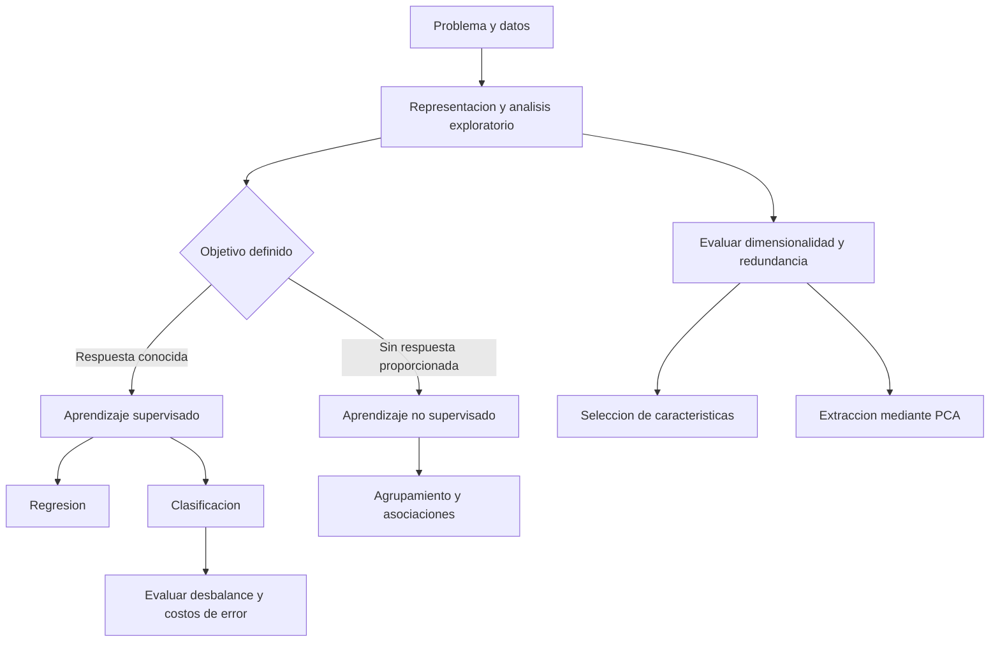
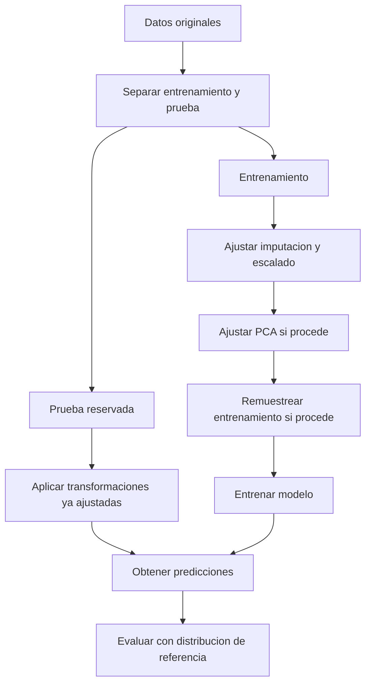

# Clase 2: Preparación de datos: desbalance de clases y análisis de componentes principales

> **Objetivo académico:** Comprender cómo la representación de los datos, el desbalance de clases y la dimensionalidad condicionan el aprendizaje automático; analizar estrategias de remuestreo y los fundamentos geométricos del análisis de componentes principales, con criterios de interpretación y validación que eviten conclusiones engañosas.

## 1. Contexto y marco conceptual

### Del análisis exploratorio al aprendizaje automático

El análisis exploratorio de datos permite conocer distribuciones, asociaciones, valores ausentes, observaciones atípicas y posibles problemas de representación antes de construir modelos. Aplicar un algoritmo sin comprender los datos puede producir resultados numéricamente favorables pero conceptualmente inválidos. Las técnicas de inteligencia artificial son herramientas: su utilidad depende de la formulación del problema, de la calidad de la información y de la interpretación de los resultados.

La sesión desarrolla dos problemas de preparación: el **desbalance de clases**, especialmente relevante en clasificación supervisada, y la **dimensionalidad elevada**, abordada mediante selección o extracción de características. Ambos requieren decisiones contextualizadas; ni balancear ni reducir dimensiones constituye una obligación universal.

### Observaciones, variables y representación

En la representación tabular, cada fila corresponde a una observación y cada columna a una variable, característica, atributo o campo. Una tabla puede proceder de una hoja de cálculo, un archivo CSV o una base de datos. El significado de las unidades de análisis debe conservarse al transformar su formato.

**Enriquecimiento conceptual:** Después de una codificación numérica apropiada, la matriz de características puede expresarse como:

$$
X=(x_{ij})\in\mathbb{R}^{m\times p}.
$$

Aquí, $m\in\mathbb{N}_{>0}$ es el número de observaciones, $p\in\mathbb{N}_{>0}$ el número de características y $x_{ij}$ el valor de la característica $j$ en la observación $i$. Esta notación supone datos numéricos utilizables por el método; una tabla original con fechas, categorías y texto no se convierte automáticamente en una matriz numérica válida. Los índices que utiliza un lenguaje de programación no cambian la estructura conceptual de los datos.

La representación tabular tampoco es universal. En una red de carreteras, los pueblos pueden representarse mediante nodos y las carreteras mediante aristas. Un grafo conserva explícitamente relaciones que una tabla de atributos individuales podría ocultar. La representación debe responder a la estructura del fenómeno.

### Tipos de aprendizaje y definición del objetivo

| Modalidad | Información disponible | Propósito y ejemplos |
|---|---|---|
| Supervisado | Características y respuestas conocidas durante el entrenamiento | Aprender una correspondencia para predecir respuestas en nuevas observaciones |
| Regresión supervisada | Respuesta numérica | Estimar una cantidad, como ventas o precio |
| Clasificación supervisada | Respuesta categórica | Reconocer una clase, como presencia o ausencia de una condición |
| No supervisado | Características sin respuesta objetivo proporcionada | Explorar agrupamientos, asociaciones o representaciones de menor dimensión |
| Por refuerzo | Interacciones y señales de recompensa | Se menciona como otra modalidad; sus algoritmos no se desarrollan en la sesión |

En aprendizaje supervisado, la variable objetivo se define mediante el problema. Puede existir en el conjunto original o construirse mediante criterios explícitos, por ejemplo, una decisión crediticia histórica o una etiqueta establecida por especialistas. El algoritmo no debe descubrir por sí mismo qué significa el objetivo.

**Enriquecimiento conceptual:** La predicción se representa como:

$$
\hat{y}_i=f_{\theta}(\mathbf{x}_i).
$$

El vector $\mathbf{x}_i\in\mathbb{R}^{p}$ contiene las características de la observación $i$; $f_{\theta}$ es el modelo con parámetros aprendidos $\theta$ y $\hat{y}_i$ es su predicción. En regresión escalar, la respuesta pertenece a $\mathbb{R}$; en clasificación, a un conjunto finito de categorías. Algunos métodos admiten respuestas vectoriales. La predicción debe distinguirse del valor observado $y_i$: el modelo aproxima una relación y puede cometer errores.

En aprendizaje no supervisado no existe una respuesta objetivo entregada durante el ajuste. El agrupamiento puede generar identificadores de grupos, pero su significado depende de la geometría, del algoritmo y del análisis del dominio.

**Enriquecimiento conceptual:** Un identificador de grupo no equivale a una etiqueta verdadera descubierta. Asimismo, PCA produce coordenadas transformadas; no asigna necesariamente clases ni descubre por sí solo una variable causal o un diagnóstico.

### Asociación y causalidad

La correlación describe asociación lineal entre variables numéricas; las pruebas de chi cuadrado permiten analizar independencia entre variables categóricas bajo sus correspondientes supuestos. Una asociación estadística no demuestra causalidad. Incluso una relación intuitivamente plausible requiere un diseño y una argumentación adicionales para sostener una interpretación causal.

**Enriquecimiento conceptual:** Asignar números a categorías nominales no autoriza a tratarlas como magnitudes cuantitativas. Codificar categorías como 1, 2 y 3 introduce un orden y distancias que podrían carecer de significado. La técnica de asociación debe elegirse según el tipo de variable y la pregunta; una correlación cercana a cero tampoco descarta relaciones no lineales.

## 2. Fundamentos teóricos y arquitectura

### Desbalance de clases y métricas engañosas

Existe desbalance cuando las clases tienen frecuencias diferentes. El problema práctico aparece cuando esa distribución, combinada con el objetivo de aprendizaje y la métrica utilizada, favorece predicciones insuficientes para la clase de interés. En detección de enfermedades, fraude o incumplimiento, la clase minoritaria puede concentrar los casos más relevantes.

La sesión utiliza un ejemplo de 1000 observaciones: 950 negativas y 50 positivas. Un clasificador que siempre predice la clase negativa obtiene un porcentaje alto de aciertos y, simultáneamente, no reconoce ningún caso positivo.

**Enriquecimiento conceptual — ejemplo trabajado:** Si la condición de interés es la clase positiva, la matriz de confusión del clasificador constante es:

| Condición real | Predicción positiva | Predicción negativa |
|---|---:|---:|
| Positiva | 0 | 50 |
| Negativa | 0 | 950 |

Con $TP$, $TN$, $FP$ y $FN$ como cantidades de verdaderos positivos, verdaderos negativos, falsos positivos y falsos negativos, respectivamente:

$$
\operatorname{Accuracy}=\frac{TP+TN}{TP+TN+FP+FN}=\frac{950}{1000}=0.95.
$$

$$
\operatorname{Recall}=\frac{TP}{TP+FN}=0.
$$

La exactitud global es del 95 %, pero la sensibilidad o recall es cero. Estas proporciones son adimensionales. El ejemplo demuestra por qué no debe confundirse el porcentaje general de aciertos con la capacidad de detectar la clase minoritaria. La cifra del 98 % mencionada oralmente es ilustrativa y no se deriva de esta matriz.

**Enriquecimiento conceptual:** Conviene distinguir exactitud de precisión positiva:

$$
\operatorname{Precision}=\frac{TP}{TP+FP},\qquad F_1=\frac{2TP}{2TP+FP+FN}.
$$

La precisión positiva indica qué proporción de las predicciones positivas es correcta. $F_1$ combina precisión y recall mediante su media armónica cuando ambos están definidos. Los denominadores deben ser positivos; si no hay predicciones positivas, la precisión requiere una convención de reporte. En el ejemplo, la expresión directa de $F_1$ vale cero.

Para clasificación binaria, la exactitud balanceada es:

$$
\operatorname{BalancedAccuracy}=\frac{1}{2}\left(\frac{TP}{TP+FN}+\frac{TN}{TN+FP}\right).
$$

Esta métrica promedia la sensibilidad de ambas clases, suponiendo que ambas están presentes en la evaluación. El clasificador constante obtiene 0.5. Ninguna métrica elimina la necesidad de analizar los costos de los errores.

### Dimensionalidad, redundancia y sobreajuste

Un número elevado de variables puede dificultar la visualización, incrementar los recursos computacionales y favorecer el aprendizaje de ruido. El sobreajuste aparece cuando el modelo se adapta a particularidades del conjunto de entrenamiento y pierde capacidad de generalizar.

**Enriquecimiento conceptual:** La maldición de la dimensionalidad abarca también la dispersión de las observaciones en espacios de alta dimensión y la mayor cantidad de datos necesaria para caracterizar sus regiones. No se reduce a tener muchas columnas ni implica que todo conjunto de alta dimensión deba comprimirse. Su impacto depende del tamaño muestral, de la estructura de los datos, de la métrica y del modelo.

Una variable constante no discrimina entre las observaciones del conjunto analizado. Por ejemplo, si todos los registros pertenecen al mismo país, esa columna no aporta variabilidad interna. Su exclusión debe documentarse y considerar el alcance del conjunto: una constante en una muestra no tiene por qué ser constante en toda población futura.

### Selección y extracción de características

| Estrategia | Transformación | Ventajas y límites |
|---|---|---|
| Selección por filtros | Conserva variables según criterios estadísticos | Suele ser rápida; un criterio individual puede omitir interacciones |
| Métodos envolventes | Comparan subconjuntos mediante el desempeño de un modelo | Consideran la relación con el modelo, con mayor costo computacional |
| Métodos embebidos | Seleccionan variables durante el ajuste | Vinculan selección y aprendizaje; dependen del algoritmo |
| Extracción de características | Construye nuevas variables a partir de las originales | Puede concentrar variación, pero dificulta la interpretación directa |

La selección conserva características originales; la extracción produce representaciones nuevas. PCA pertenece a la segunda categoría y no utiliza una respuesta objetivo.

**Enriquecimiento conceptual:** La selección de características también puede aplicarse sin etiquetas, por ejemplo, eliminando constantes o redundancias. Por tanto, su uso no se limita a clasificación. Si un filtro utiliza correlación con la respuesta, sí requiere un objetivo definido y debe ajustarse dentro del proceso de entrenamiento.

### Fundamento geométrico de PCA

PCA busca direcciones ortogonales que capturen, sucesivamente, la mayor varianza de los datos. Proyectar una nube sobre una dirección adecuada puede conservar gran parte de su dispersión con menos coordenadas. La primera componente maximiza la varianza proyectada; las siguientes la maximizan bajo restricciones de ortogonalidad respecto de las anteriores.

**Enriquecimiento conceptual:** PCA no se limita a elegir entre los ejes originales. Puede rotarlos. Las puntuaciones de las componentes son incorrelacionadas en los datos utilizados para el ajuste, pero esto no implica independencia estadística general ni significado causal.

La reducción preserva el número de observaciones: una matriz con $m$ filas y $p$ variables se transforma en otra con $m$ filas y $k$ componentes retenidas, donde $1\leq k\leq p$. No se comprimen las filas por el hecho de aplicar PCA.

## 3. Implementación técnica y lógica de negocio

### Estrategias frente al desbalance

La sesión presenta dos familias básicas: retirar observaciones de la clase mayoritaria y aumentar las de la minoritaria. También menciona ponderación y combinaciones de técnicas.

| Estrategia | Operación | Riesgo principal |
|---|---|---|
| Submuestreo aleatorio | Reduce observaciones mayoritarias | Pérdida de diversidad y de información útil |
| Sobremuestreo por duplicación | Repite observaciones minoritarias | Sobreajuste a ejemplos repetidos |
| Sobremuestreo sintético | Construye ejemplos nuevos siguiendo una regla | Generación de observaciones poco plausibles o en zonas de solapamiento |
| Ponderación de clases | Modifica la penalización de errores | Pesos inadecuados pueden deteriorar otras dimensiones del desempeño |
| Métodos híbridos | Combinan aumento, reducción o limpieza | Mayor complejidad y dependencia de la geometría de los datos |

En la ilustración con 70 registros de una clase y 30 de otra, reducir ambas a 30 descarta 40 registros mayoritarios; aumentar la minoritaria a 70 agrega 40. Estas cifras describen cantidades originales y finales: no deben interpretarse como porcentajes invariables, porque cambia el total de observaciones.

No existe una proporción universal a partir de la cual deba aplicarse remuestreo. Importan el comportamiento del modelo, la separación entre clases, el tamaño de la minoría y el costo de falsos positivos y falsos negativos.

### Vecindad, distancia y enlaces de Tomek

Las técnicas basadas en vecinos requieren una noción de cercanía. La sesión destaca la distancia euclidiana como extensión del teorema de Pitágoras.

**Enriquecimiento conceptual:** Para dos observaciones numéricas $\mathbf{x},\mathbf{z}\in\mathbb{R}^{p}$:

$$
d(\mathbf{x},\mathbf{z})=\sqrt{\sum_{j=1}^{p}(x_j-z_j)^2}.
$$

Las coordenadas deben tener escalas comparables o contar con una ponderación justificada. Una variable de gran magnitud puede dominar la distancia sin ser la más importante para el problema. En datos estandarizados, la distancia resulta adimensional.

Los enlaces de Tomek permiten identificar proximidad entre observaciones de clases diferentes y limpiar zonas de frontera.

**Enriquecimiento conceptual — precisión del criterio:** Dos observaciones de clases distintas forman un enlace de Tomek cuando son vecinas más cercanas mutuamente, con una regla consistente ante empates. No basta con eliminar cualquier punto mayoritario cercano a una minoría. Una política habitual retira el miembro mayoritario del par. El procedimiento limpia fronteras, pero no garantiza igualar las cantidades de las clases.

La fuente también describe selección y eliminación mediante vecinos cercanos, así como combinaciones de limpieza. Las denominaciones y reglas de esos procedimientos no quedan suficientemente identificadas para reconstruir un algoritmo específico.

### SMOTE y generación sintética

SMOTE genera observaciones minoritarias entre ejemplos próximos de esa misma clase. La intuición central es interpolar dentro del espacio de características, en lugar de limitarse a duplicar registros. La sesión menciona variantes como Borderline-SMOTE, orientadas a situaciones de frontera.

**Enriquecimiento conceptual — formulación estándar:** Sean $\mathbf{x}_i\in\mathbb{R}^{p}$ una observación minoritaria y $\mathbf{x}_{nn}\in\mathbb{R}^{p}$ una de sus vecinas minoritarias seleccionadas. Un ejemplo sintético puede construirse como:

$$
\mathbf{x}_{\mathrm{nuevo}}=\mathbf{x}_i+\lambda(\mathbf{x}_{nn}-\mathbf{x}_i),\qquad \lambda\sim\mathcal{U}(0,1).
$$

El escalar adimensional $\lambda$ determina la posición sobre el segmento entre ambas observaciones. Esta formulación describe interpolación entre dos ejemplos; no equivale, en general, a promediar cuatro puntos. Supone que el segmento contiene combinaciones plausibles. Puede fallar ante ruido, minorías multimodales, solapamiento o restricciones del dominio. La interpolación numérica directa tampoco es apropiada para categorías nominales.

### Secuencia de ajuste y evaluación

La evaluación debe utilizar observaciones que no hayan intervenido en el aprendizaje. El diálogo de la clase identifica esta necesidad y plantea explícitamente el riesgo de fuga de información al ajustar PCA antes de separar los datos.

**Enriquecimiento conceptual — corrección metodológica:** En modelado predictivo, la separación precede al ajuste de transformaciones aprendidas. Aunque PCA reduzca columnas, sus direcciones se estiman a partir de las filas. Si utiliza observaciones reservadas para prueba, incorpora información de su distribución. Que PCA no use etiquetas no evita esa fuga.

**Enriquecimiento conceptual:** El diagrama muestra una configuración posible; el orden entre PCA y remuestreo debe justificarse, porque ambas operaciones pueden modificar la geometría relevante. En validación cruzada, las transformaciones y el remuestreo se ajustan dentro de cada partición de entrenamiento. La prueba final conserva la distribución que represente el uso previsto y no se utiliza para elegir técnicas o parámetros. Una muestra adicional enriquecida con casos raros puede aportar información diagnóstica, pero sus métricas deben distinguirse de las obtenidas con prevalencia representativa.

### Construcción de PCA

La sesión presenta el centrado, la estandarización, la matriz de covarianza o correlación, los valores propios y los vectores propios. También distingue una implementación de biblioteca y otra basada en descomposición en valores singulares. El código completo de los cuadernos no está disponible en la transcripción; por ello, no se reproducen instrucciones ni resultados de ejecución inexistentes en la fuente.

**Enriquecimiento conceptual — formalización del procedimiento:** Para una variable numérica $j$ con desviación estándar positiva, la estandarización es:

$$
z_{ij}=\frac{x_{ij}-\bar{x}_j}{s_j}.
$$

La media $\bar{x}_j$ y la desviación estándar $s_j>0$ se estiman con las observaciones de ajuste; ambas tienen las unidades de la variable original. El resultado $z_{ij}$ es adimensional. Las columnas constantes requieren tratamiento previo. El escalado es especialmente pertinente cuando las unidades difieren, aunque su conveniencia depende del significado de las magnitudes: estandarizar asigna la misma varianza inicial a cada variable.

Sea $Z\in\mathbb{R}^{m\times p}$ la matriz centrada y estandarizada, con $m>1$. Su matriz de covarianza muestral es:

$$
S=\frac{1}{m-1}Z^{\mathsf T}Z.
$$

Si la estandarización emplea la misma convención muestral, $S$ coincide con la matriz de correlación. Sus direcciones principales satisfacen:

$$
S\mathbf{v}_j=\lambda_j\mathbf{v}_j,\qquad \lambda_1\geq\lambda_2\geq\cdots\geq\lambda_p\geq0.
$$

Los vectores $\mathbf{v}_j\in\mathbb{R}^{p}$ se eligen ortonormales y describen direcciones; los valores propios $\lambda_j$ cuantifican la varianza en esas direcciones. Para una dirección unitaria $\mathbf{v}$, la varianza de la proyección es $\mathbf{v}^{\mathsf T}S\mathbf{v}$. Maximizar esta expresión conduce al vector propio de mayor valor propio, lo que fundamenta la primera componente.

Si $V_k=[\mathbf{v}_1,\ldots,\mathbf{v}_k]\in\mathbb{R}^{p\times k}$, las coordenadas reducidas son:

$$
T=ZV_k\in\mathbb{R}^{m\times k}.
$$

La entrada $t_{ij}$ es la puntuación de la observación $i$ en la componente $j$. Cada componente es una combinación lineal de las características originales, con coeficientes definidos por su vector propio.

La proporción de varianza retenida es:

$$
R_k=\frac{\sum_{j=1}^{k}\lambda_j}{\sum_{j=1}^{p}\lambda_j}.
$$

Esta proporción adimensional requiere varianza total positiva. Mide dispersión conservada, no porcentaje de relevancia clínica, causal o predictiva. Como el centrado limita el rango, existen a lo sumo $\min(m-1,p)$ componentes con varianza no nula.

**Enriquecimiento conceptual — conexión con SVD:** Si $Z=U\Sigma V^{\mathsf T}$ es su descomposición en valores singulares, las columnas de $V$ proporcionan las direcciones de PCA y $\lambda_j=\sigma_j^2/(m-1)$, donde $\sigma_j\geq0$ es el valor singular correspondiente. SVD es una vía de cálculo de PCA, no una técnica necesariamente alternativa en su objetivo. Las implementaciones pueden diferir en convenciones de escalado, orientación y signo.

## 4. Análisis crítico de casos y auditoría práctica

### Clasificación médica: aciertos globales y errores relevantes

El caso de detección de cáncer ilustra una falla de evaluación: reportar exactitud elevada sin verificar la sensibilidad de la clase positiva. El criterio de selección debe considerar qué ocurre cuando una persona positiva recibe una predicción negativa y qué recursos demanda investigar un falso positivo.

**Enriquecimiento conceptual:** Una puntuación de modelo, una probabilidad calibrada y un porcentaje de aciertos son objetos distintos. Un desempeño agregado del 99 % no significa que cada predicción individual tenga probabilidad de acierto del 99 %. Del mismo modo, un error monetario pequeño solo puede calificarse como tolerable con relación a su escala y a las decisiones que afecta.

### PCA con USArrests

La demostración utiliza el conjunto denominado USArrests, con observaciones correspondientes a 50 estados de Estados Unidos y cuatro variables: Murder, Assault, UrbanPop y Rape. La sesión lo sitúa en 1973. Se describe una secuencia de resumen estadístico, matriz de correlación, estandarización, ajuste de PCA y visualización de las dos primeras componentes.

**Enriquecimiento conceptual — precisión de las unidades:** Las variables delictivas representan tasas de arrestos por cada 100 000 habitantes; UrbanPop representa porcentaje de población urbana. Los valores no deben interpretarse como recuentos en miles. Esta diferencia de unidades refuerza la necesidad de justificar el escalado y limita cualquier interpretación de las componentes como mediciones directas de seguridad.

La correlación entre Assault y Murder se describe como aproximadamente 0.80. La diagonal de la matriz de correlación vale uno para variables con varianza positiva y la matriz es simétrica. Una asociación pequeña entre UrbanPop y Murder no autoriza a descartar toda relación entre urbanización y delincuencia.

La explicación oral presenta aproximadamente las siguientes proporciones:

| Componente | Varianza explicada aproximada | Lectura |
|---|---:|---|
| PC1 | 62 % | Mayor concentración de variación |
| PC2 | 24.7 % | Segunda dirección de variación |
| PC3 | 8.9 % | Aporte adicional menor |
| PC4 | 4.3 % | Aporte restante menor |

Las cifras están redondeadas. Interpretar 0.62 como 0.62 % sería incorrecto: como proporción corresponde aproximadamente al 62 %. Las dos primeras componentes acumulan cerca del 86.7 % de la varianza, según los valores comunicados.

En el biplot descrito, las variables delictivas se asocian principalmente con PC1 y UrbanPop destaca en PC2. La interpretación propuesta diferencia una dimensión vinculada con delitos y otra con urbanización.

**Enriquecimiento conceptual — alcance de la interpretación:** Se trata de predominio relativo, no de pertenencia exclusiva de variables a componentes. En PCA ordinario, una variable puede aportar a varias componentes. Un nombre como «seguridad» es una interpretación humana que requiere cautela: el conjunto mide tasas de arrestos y urbanización, no toda la complejidad de la seguridad pública. El signo de una componente puede invertirse sin alterar la solución geométrica.

### Cargas, umbrales y reconstrucción

La sesión utiliza las cargas para interpretar qué variables contribuyen a cada componente y menciona umbrales ilustrativos, como 0.30. También relaciona la reducción con un error de reconstrucción.

**Enriquecimiento conceptual — distinción esencial:** Los coeficientes de combinación, las correlaciones entre variables y componentes y las contribuciones normalizadas no siempre se denominan «cargas» de la misma manera. Todo umbral debe indicar qué magnitud se está comparando y si se considera su valor absoluto.

Una variable con carga pequeña puede omitirse de una explicación resumida sin eliminarla del cálculo. Anular coeficientes modifica la solución; no es una operación automática de PCA y puede alterar la ortogonalidad y la varianza retenida. Conservar algunas variables originales porque presentan cargas altas tampoco garantiza conservar la varianza alcanzada por las componentes completas.

**Enriquecimiento conceptual — reconstrucción:** Con direcciones ortonormales, una aproximación de los datos estandarizados es:

$$
\hat{Z}=TV_k^{\mathsf T}.
$$

Su pérdida cuadrática total cumple:

$$
\lVert Z-\hat{Z}\rVert_F^2=(m-1)\sum_{j=k+1}^{p}\lambda_j.
$$

La norma de Frobenius al cuadrado suma los errores cuadrados de todas las entradas. Bajo los supuestos anteriores, el error proviene de descartar direcciones completas. No requiere haber eliminado variables dentro de cada componente. Para reconstruir en unidades originales, se revierte la estandarización. Si se conserva todo el subespacio con varianza no nula, la reconstrucción es exacta salvo errores numéricos.

### Analogías, constructos y visualización no lineal

Las analogías de fotografías, pistas y características de casas o vehículos comunican la idea de simplificar preservando aspectos relevantes. Sus límites deben mantenerse explícitos.

**Enriquecimiento conceptual:** Seleccionar una fotografía entre muchas es selección de observaciones, no PCA. Comprimir sin pérdida permite recuperar exactamente el original; truncar componentes generalmente produce pérdida. Pasar de RGB a escala de grises reduce canales de tres a uno mediante una transformación específica y no equivale automáticamente a PCA.

En cuestionarios psicológicos, las componentes pueden resumir patrones de respuestas y recibir nombres interpretativos. Sin embargo, una componente no demuestra la existencia de un constructo latente ni establece un diagnóstico. Esa interpretación exige teoría y evidencia adicionales; PCA y análisis factorial no tienen objetivos idénticos.

La sesión menciona t-SNE y UMAP como alternativas útiles para explorar visualmente datos de alta dimensión.

**Enriquecimiento conceptual:** t-SNE prioriza relaciones locales entre observaciones; no garantiza conservar la forma global ni distancias entre grupos. UMAP también construye una representación basada en vecindades y depende de sus parámetros. Una separación visual no prueba la existencia de clases naturales. Además, llevar dos coordenadas a tres mediante una transformación no crea información independiente. El comentario sobre «money flow» y anomalías de código no identifica con precisión un método y no permite reconstruir sus supuestos ni resultados.

### F1 bajo, deciles y datos sintéticos

Un caso de uso productivo plantea dificultades para mejorar $F_1$ en modelos de abandono e incumplimiento con fuerte desbalance. Se describe una decisión operativa: ordenar las puntuaciones y dividirlas en deciles para priorizar intervenciones comerciales.

**Enriquecimiento conceptual:** Un modelo puede ser útil para ordenar casos aunque su clasificación con un umbral específico tenga un $F_1$ limitado. La utilidad de los deciles debe evaluarse mediante concentración de positivos, capacidad de atención y resultados de la intervención. Cambiar el umbral puede modificar precisión y recall, pero debe decidirse con datos de validación y costos explícitos, sin prometer una mejora universal.

La generación sintética y la simulación se plantean como posibilidades frente a datos escasos. No se documentan experimentos que demuestren una mejora en estos casos.

**Enriquecimiento conceptual:** Más registros sintéticos no equivalen a más evidencia independiente. Pueden reproducir sesgos o crear una mejora aparente si la evaluación comparte sus supuestos. El aprendizaje por refuerzo requiere estados, acciones, recompensas y una dinámica de interacción; disponer de pocos ejemplos no basta para justificarlo. La calidad y representatividad de la información importan tanto como su cantidad.

Un último caso mezcla variables incorporadas en distintos momentos, valores ausentes y correlaciones nulas. Antes de imputar es necesario distinguirlos: un coeficiente de correlación cero no es un dato ausente y no debe sustituirse por una media. Si una variable no se midió en una etapa anterior, la ausencia puede reflejar un cambio del proceso de recolección que necesita análisis específico.

## 5. Principios de diseño, buenas prácticas y anti-patrones

| Principio | Justificación | Anti-patrón que evita |
|---|---|---|
| Definir unidad de análisis, variables y objetivo | Determina qué puede aprenderse y cómo interpretarlo | Confundir filas, columnas, etiquetas y componentes |
| Elegir métricas según el problema | Los errores pueden tener consecuencias asimétricas | Declarar éxito únicamente por exactitud global |
| Comparar con un modelo de referencia | Permite medir si el tratamiento aporta valor | Balancear por costumbre sin evaluar el modelo original |
| Ajustar transformaciones dentro del entrenamiento | Evita información procedente de la prueba | Ajustar PCA, imputación o remuestreo sobre todos los datos antes de separar |
| Conservar una evaluación representativa | Aproxima las condiciones de uso | Presentar métricas de una prueba artificialmente balanceada como desempeño poblacional |
| Documentar escalas y codificaciones | Las distancias y varianzas dependen de ellas | Tratar códigos nominales como cantidades o mezclar unidades sin justificación |
| Justificar la reducción de dimensiones | La varianza descartada puede contener información útil | Adoptar un porcentaje fijo como garantía de suficiencia |
| Distinguir cálculo e interpretación de componentes | Los nombres son hipótesis del analista | Identificar automáticamente una componente con una causa o un diagnóstico |
| Auditar la generación sintética | La plausibilidad depende del dominio | Suponer que todo ejemplo generado añade conocimiento nuevo |

Los porcentajes de varianza retenida mencionados en la sesión, como 65 %, 70 %, 75 % o 90 %, ilustran decisiones dependientes del contexto; no constituyen umbrales universales. La selección del número de componentes puede considerar varianza acumulada, gráficos de sedimentación, reconstrucción, estabilidad y desempeño posterior.

**Enriquecimiento conceptual:** Una dirección de baja varianza puede ser decisiva para distinguir clases, ya que PCA no utiliza la respuesta. Una representación que reconstruye bien las características no garantiza una buena predicción. Asimismo, PCA es matemáticamente calculable sin superar una prueba de hipótesis específica. Su utilidad depende de la estructura y del objetivo; las pruebas de adecuación mencionadas en la sesión no quedan identificadas y no deben presentarse como requisitos universales.

La comparación entre alternativas debe ser sistemática y reproducible. La experiencia relatada con imputación aleatoria muestra que un procedimiento sencillo puede funcionar bien en un caso, pero no prueba superioridad general. La imputación debe analizarse considerando el mecanismo de ausencia y las relaciones que conviene conservar. Del mismo modo, una mala evaluación no debe corregirse modificando los datos hasta obtener una cifra favorable.

## 6. Síntesis conceptual y profundización académica

La preparación de datos establece las condiciones bajo las cuales un modelo puede aprender y ser evaluado. El desbalance obliga a distinguir frecuencia de importancia: una clase rara puede ser central para la decisión y quedar oculta por una exactitud global elevada. El remuestreo, la ponderación y los umbrales son alternativas cuyo valor depende del modelo, de la distribución y de los costos del error.

PCA aborda un problema diferente: concentrar la varianza de muchas características en un número menor de coordenadas. Sus componentes son combinaciones lineales ortogonales, ordenadas por varianza, y conservan las observaciones. Interpretarlas exige conocer las variables originales y distinguir predominio de cargas, significado sustantivo y evidencia causal.

La conexión entre ambos temas es metodológica: transformar datos modifica qué estructura ve el modelo. Por ello, toda transformación debe justificarse y evaluarse con información independiente. En una exploración puramente descriptiva, PCA puede resumir el conjunto completo observado; cuando se pretende estimar generalización predictiva, sus parámetros se aprenden exclusivamente con los datos de entrenamiento.

**Enriquecimiento conceptual:** Las principales líneas de profundización son la relación entre prevalencia, umbral y costo de error; la estabilidad de las componentes ante cambios muestrales; la diferencia entre varianza conservada y utilidad predictiva; y la distinción entre representaciones geométricas y modelos de constructos latentes. Estas conexiones permiten comprender por qué una transformación técnicamente correcta puede resultar inadecuada para una decisión concreta.
