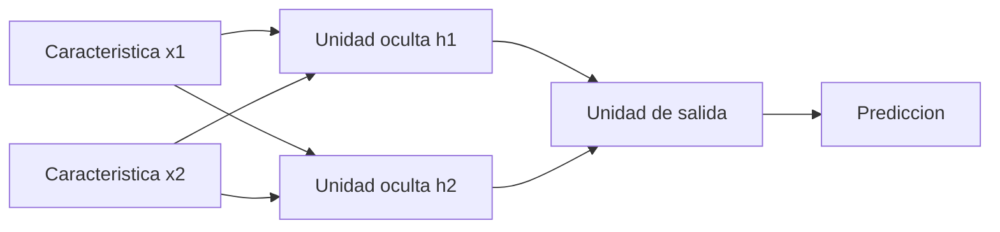
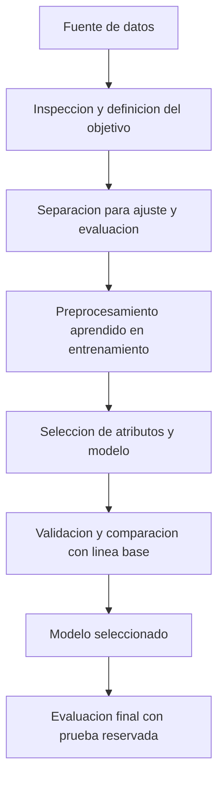

# Clase 4: Redes neuronales artificiales: fundamentos, aprendizaje del perceptrón y experimentación visual

> **Objetivo académico:** Comprender la abstracción matemática de una neurona artificial, derivar e interpretar el aprendizaje del perceptrón binario, reconocer sus límites de separabilidad lineal y relacionar estos fundamentos con la preparación de datos y la evaluación de modelos mediante herramientas visuales.

## 1. Contexto y marco conceptual

### Redes neuronales dentro del aprendizaje automático

Las redes neuronales artificiales constituyen una familia de modelos de aprendizaje automático. La sesión las introduce como una continuación de los métodos de regresión y clasificación, particularmente KNN, y concentra su desarrollo matemático en el perceptrón simple. Su idea central es construir una transformación de entradas numéricas en salidas mediante conexiones ponderadas cuyos parámetros se ajustan durante el aprendizaje.

La familia neuronal comprende modelos supervisados y no supervisados. En los primeros se dispone de ejemplos con una salida deseada; en los segundos se buscan estructuras o representaciones sin contar con una etiqueta objetivo para cada observación. La sesión menciona perceptrón, Adaline y perceptrón multicapa entre los modelos supervisados, y mapas autoorganizativos entre los no supervisados. Adaline y los mapas autoorganizativos no reciben un desarrollo técnico en esta fuente.

**Enriquecimiento conceptual:** Regresión y clasificación son dos tipos de problemas supervisados cuando se aprende a partir de salidas conocidas. No equivalen, respectivamente, a aprendizaje supervisado y no supervisado. En regresión se predice una magnitud numérica; en clasificación se asigna una categoría. El término predicción puede emplearse para ambos.

### Inspiración biológica y alcance de la analogía

La exposición utiliza el cerebro como motivación: muchas unidades interconectadas pueden producir un comportamiento colectivo que supera la capacidad de una unidad aislada. La analogía destaca procesamiento distribuido, conexiones modificables y cierta redundancia funcional.

En la abstracción artificial, el equivalente operativo de la fuerza de una conexión es su peso numérico. Aprender consiste, principalmente, en modificar estos pesos y otros parámetros ajustables. Esta correspondencia orienta la construcción del modelo, pero no demuestra que una red artificial reproduzca fielmente el funcionamiento cerebral.

**Enriquecimiento conceptual:** Conviene separar tres niveles: inspiración biológica, formulación matemática e implementación computacional. La validez predictiva de una red se establece mediante evidencia sobre su comportamiento, sin exigir una equivalencia neurobiológica. Las afirmaciones de la sesión sobre edades límite de generación neuronal, pérdida cotidiana de neuronas y enfermedad de Alzheimer son simplificaciones y no deben utilizarse como fundamentos clínicos ni como explicación suficiente de la memoria.

### Desarrollo histórico y condiciones tecnológicas

El recorrido histórico de la sesión conecta los siguientes hitos:

- Modelos neuronales binarios de McCulloch y Pitts en la década de 1940.
- Propuestas de Hebb sobre aprendizaje y modificación de conexiones hacia 1949.
- Desarrollo del perceptrón por Rosenblatt en las décadas de 1950 y 1960.
- Análisis de las limitaciones del perceptrón por Minsky y Papert en 1969.
- Renovación del interés por redes multicapa y aprendizaje mediante retropropagación, asociada en la exposición con Rumelhart y el año 1986.
- Ampliación posterior de las aplicaciones gracias a avances algorítmicos y a una mayor capacidad de procesamiento, incluidas las GPU.

**Enriquecimiento conceptual:** La transcripción presenta este proceso como un parón casi completo seguido de una reactivación. Es más prudente entenderlo como una trayectoria de interés e inversión variables. Las limitaciones del perceptrón simple no implican la imposibilidad general de aprender con redes neuronales, y el hardware no constituye la única explicación de su evolución.

## 2. Fundamentos teóricos y arquitectura

### De la neurona biológica a la unidad matemática

La sesión describe una unidad que recibe señales, las combina y produce una respuesta. En una neurona artificial, las señales se representan mediante números y las conexiones mediante pesos.

**Enriquecimiento conceptual:** En la descripción biológica habitual, las dendritas participan principalmente en la recepción de señales y el axón en su conducción hacia otras células. Una sinapsis es una conexión funcional; no es sinónimo de neurona. La analogía con pesos artificiales conserva solo algunos aspectos de esta organización.

Para una unidad con $n$ entradas, la combinación de señales se expresa como:

$$
z=\sum_{i=1}^{n}w_i x_i+b,\qquad y=f(z).
$$

Aquí, $n\in\mathbb{N}^{+}$ es el número de características; $x_i\in\mathbb{R}$ es la entrada correspondiente a la característica $i$; $w_i\in\mathbb{R}$ es su peso; $b\in\mathbb{R}$ es el sesgo; $z\in\mathbb{R}$ es la entrada neta, e $y$ es la salida de la función de activación $f$. El dominio de salida depende de la función y del problema. Si las características tienen unidades físicas, su escala y la de los pesos deben permitir una suma coherente; el modelo introductorio trabaja con representaciones numéricas.

La transcripción utiliza un término denominado umbral que en el desarrollo manual se suma a la combinación ponderada. Para evitar ambigüedad, estos apuntes denominan $b$ a ese término aditivo. Si se define un umbral $\theta\in\mathbb{R}$ como cantidad que debe superar la suma ponderada, ambas convenciones se relacionan mediante:

$$
b=-\theta.
$$

Por tanto, sumar un sesgo y restar un umbral son formulaciones equivalentes cuando se conserva esta relación de signos.

### Unidad binaria y perceptrón bipolar

El modelo de McCulloch y Pitts se presenta con entradas y salida binarias, representadas por ceros y unos. Posteriormente, el ejemplo del perceptrón utiliza codificación bipolar: las dos clases se representan mediante $-1$ y $+1$.

La función utilizada en el desarrollo manual es:

$$
y=f(z)=\begin{cases}
+1, & z>0,\\
-1, & z\leq 0.
\end{cases}
$$

La igualdad se asigna a la clase negativa. Esta convención debe mantenerse en todos los cálculos, especialmente cuando una observación cae exactamente sobre la frontera.

**Enriquecimiento conceptual:** La salida binaria no obliga a que las entradas del perceptrón sean binarias. El perceptrón también puede recibir vectores reales. La codificación bipolar de las entradas se adopta aquí porque facilita la representación de compuertas lógicas. Además, una activación escalón produce una decisión determinista; no convierte por sí misma el cálculo en probabilístico.

### Interpretación geométrica

La frontera de decisión del perceptrón está definida por:

$$
\mathbf{w}^{\mathsf T}\mathbf{x}+b=0.
$$

En esta expresión, $\mathbf{x}\in\mathbb{R}^{n}$ es el vector de entrada, $\mathbf{w}\in\mathbb{R}^{n}$ es el vector de pesos y $b\in\mathbb{R}$ desplaza la frontera. Se supone $\mathbf{w}\neq\mathbf{0}$ para obtener un hiperplano no degenerado. En dos dimensiones la frontera es una recta; en tres, un plano; en dimensiones superiores, un hiperplano. El signo de la expresión determina el lado al que pertenece cada observación.

La separabilidad lineal significa que existe una frontera de este tipo que distingue las clases del conjunto considerado. Graficar ayuda cuando hay dos características, pero no constituye un requisito operativo para entrenar en dimensiones mayores.

### Redes como grafos y organización por capas

Una red neuronal puede representarse mediante un grafo dirigido: los nodos corresponden a unidades de procesamiento y las aristas a conexiones ponderadas. En una arquitectura de propagación hacia delante, las señales avanzan desde la entrada hacia la salida sin ciclos.

El diagrama muestra una arquitectura ilustrativa con dos entradas, dos unidades ocultas y una salida; no representa una configuración entrenada durante la sesión. Cada conexión hacia una unidad de procesamiento tiene un peso, y cada unidad puede incorporar su propio sesgo y activación.

La dimensión de entrada depende de la representación de los datos, mientras que la salida depende del problema. La cantidad de capas ocultas y de unidades por capa son decisiones de arquitectura.

**Enriquecimiento conceptual:** Una capa oculta no es imprescindible en todas las redes: el perceptrón simple carece de ella. Asimismo, profundidad y recurrencia son propiedades distintas. Una red recurrente contiene realimentación o dependencias de estado; no se define simplemente por tener una sola capa. La recuperación de patrones incompletos mencionada en la sesión corresponde a ciertas arquitecturas de memoria asociativa, no a toda red monocapa.

### Capacidad no lineal

La sesión vincula la incorporación de varias neuronas con la posibilidad de abordar problemas que una sola frontera lineal no resuelve.

**Enriquecimiento conceptual:** Esta capacidad requiere transformaciones no lineales. Apilar capas exclusivamente lineales o afines sigue produciendo una transformación afín equivalente. Por ello, la combinación de arquitectura y activaciones resulta decisiva; añadir capas por sí solo no garantiza resolver relaciones no lineales.

## 3. Implementación técnica y lógica de negocio

### Representación numérica de los datos

La operación de suma ponderada exige entradas numéricas. Las variables nominales o textuales necesitan una representación compatible con el modelo. En la sesión, esta necesidad conecta el preprocesamiento de datos con el entrenamiento neuronal.

**Enriquecimiento conceptual:** Asignar números consecutivos a categorías sin orden puede introducir relaciones artificiales de distancia u orden. La codificación debe responder al significado de cada variable. También conviene controlar las escalas, porque características de magnitudes muy diferentes pueden afectar la dinámica de aprendizaje. La compatibilidad con variables categóricas en árboles de decisión depende de la implementación; no debe generalizarse a todas las bibliotecas.

### Aprendizaje supervisado del perceptrón

El conjunto de entrenamiento contiene pares entrada–salida deseada. Para formalizar el procedimiento de la sesión, sea:

$$
\mathcal{D}=\{(\mathbf{x}^{(p)},d^{(p)})\}_{p=1}^{m},\qquad \mathbf{x}^{(p)}\in\mathbb{R}^{n},\quad d^{(p)}\in\{-1,+1\}.
$$

Aquí, $m\in\mathbb{N}^{+}$ es el número de patrones, $n\in\mathbb{N}^{+}$ es el número de características y $p$ identifica una observación. La salida deseada es una etiqueta, no una característica de entrada.

El procedimiento consiste en:

1. Inicializar pesos y sesgo.
2. Seleccionar un patrón y calcular su entrada neta y su clase predicha.
3. Comparar la predicción con la salida deseada.
4. Actualizar los parámetros únicamente si existe una clasificación incorrecta.
5. Continuar con los patrones restantes y repetir las pasadas necesarias, conservando los parámetros aprendidos.

La regla utilizada en la sesión, escrita con una tasa de aprendizaje explícita, es:

$$
\mathbf{w}_{t+1}=\mathbf{w}_{t}+\eta d\mathbf{x},\qquad b_{t+1}=b_t+\eta d,\qquad \text{si } y\neq d.
$$

Si $y=d$, los parámetros permanecen sin cambios. Aquí, $t$ identifica el estado antes de procesar el patrón, $\eta>0$ es la tasa de aprendizaje, $d\in\{-1,+1\}$ es su etiqueta y $\mathbf{x}\in\mathbb{R}^{n}$ es su entrada. El ejemplo de la fuente utiliza $\eta=1$.

**Enriquecimiento conceptual:** La tasa $\eta$ hace explícita la magnitud del paso; en la exposición está implícitamente fijada en uno. La regla anterior no debe confundirse sin ajustar escalas con una implementación que use directamente la diferencia $d-y$, pues, ante un error bipolar, esa diferencia vale $2d$.

La dirección de la corrección tiene una interpretación: si un patrón positivo se clasifica como negativo, se suma su vector a los pesos y aumenta el sesgo; si un patrón negativo se clasifica como positivo, se resta su vector y disminuye el sesgo. Así se modifica la respuesta de la unidad sobre el patrón que originó el error.

**Enriquecimiento conceptual:** Para verificar ese efecto sobre el mismo patrón, la variación de su entrada neta es:

$$
z_{t+1}-z_t=\eta d\left(\lVert\mathbf{x}\rVert_2^2+1\right).
$$

La norma cuadrática $\lVert\mathbf{x}\rVert_2^2=\sum_{i=1}^{n}x_i^2$ es no negativa; el término adicional proviene del sesgo. Por tanto, la entrada neta aumenta si $d=+1$ y disminuye si $d=-1$. Esto explica la dirección correctiva, pero no asegura que una actualización resuelva todos los patrones: también puede modificar decisiones anteriores.

### Épocas, inicialización y condiciones de parada

Una época es una pasada completa por el conjunto de entrenamiento. Los pesos se conservan entre épocas. La sesión discute la posibilidad de reinicializar cuando el entrenamiento no converge; esto debe distinguirse de la repetición normal del aprendizaje.

**Enriquecimiento conceptual:** Reinicializar en cada época elimina lo aprendido. Además, para el perceptrón lineal estándar la inicialización aleatoria no es indispensable: pueden utilizarse pesos iniciales nulos. Reiniciar tampoco corrige una imposibilidad de representación, como la ausencia de separabilidad lineal.

Los criterios de parada mencionados incluyen un máximo de épocas, estabilidad del porcentaje de aciertos y seguimiento mediante validación. Para un conjunto separable, una época completa sin errores permite verificar que todos los patrones del conjunto de entrenamiento están correctamente clasificados con los parámetros actuales. Esta comprobación no garantiza por sí sola generalización a otros datos.

### Entrenamiento, validación y prueba

La sesión distingue tres funciones de los datos:

| Conjunto | Función | Decisión que permite apoyar |
|---|---|---|
| Entrenamiento | Ajustar pesos y sesgos | Aprendizaje de parámetros |
| Validación | Observar el comportamiento durante el desarrollo | Selección de arquitectura, configuración o momento de parada |
| Prueba | Medir el desempeño final con datos reservados | Estimación del comportamiento sobre datos no utilizados en el ajuste |

En aprendizaje supervisado existe una salida deseada con la cual comparar la predicción. En aprendizaje no supervisado no se dispone de esa etiqueta para cada ejemplo; aun así, el modelo utiliza información contenida en los datos y un criterio de aprendizaje. No se trata de ausencia total de información del entorno.

**Enriquecimiento conceptual:** Al reutilizar validación para elegir modelos, sus resultados dejan de ser una estimación completamente independiente del proceso de selección. El conjunto de prueba debe mantenerse separado de esas decisiones. El preprocesamiento aprendido y la selección de atributos también forman parte del ajuste y deben respetar esta separación.

### Entrenamiento e inferencia

Durante el entrenamiento se modifican los parámetros. Durante la inferencia se aplica el modelo ya ajustado a nuevas entradas. La sesión enfatiza que el aprendizaje queda representado en los parámetros y que no es necesario repetir todo el entrenamiento para cada consulta.

**Enriquecimiento conceptual:** En una red paramétrica convencional, la inferencia puede ejecutarse sin consultar cada registro original de entrenamiento. Sin embargo, los datos siguen siendo relevantes para reproducibilidad, auditoría y actualización. La distinción no debe generalizarse a todos los métodos: KNN, por ejemplo, necesita conservar ejemplos o una representación de ellos.

## 4. Análisis crítico de casos y auditoría práctica

### Caso trabajado: compuerta AND con codificación bipolar

El caso central utiliza dos entradas, donde $-1$ representa falso y $+1$ verdadero. La salida positiva aparece únicamente cuando ambas entradas son positivas.

| $x_1$ | $x_2$ | Salida deseada $d$ |
|---:|---:|---:|
| -1 | -1 | -1 |
| +1 | -1 | -1 |
| -1 | +1 | -1 |
| +1 | +1 | +1 |

La inicialización presentada es $w_1=1$, $w_2=1$ y $b=0.5$. Se utiliza $\eta=1$ y la activación bipolar definida anteriormente.

**Enriquecimiento conceptual — reconstrucción aritmética:** La transcripción contiene vacilaciones en el signo del término aditivo. La siguiente secuencia aplica de manera consistente la regla enunciada y conserva la solución final desarrollada en la sesión.

| Patrón | Parámetros antes: $(w_1,w_2,b)$ | Entrada neta $z$ | Predicción $y$ | Acción y parámetros después |
|---|---|---:|---:|---|
| $(-1,-1)$, $d=-1$ | $(1,1,0.5)$ | $-1.5$ | -1 | Sin cambio |
| $(1,-1)$, $d=-1$ | $(1,1,0.5)$ | $0.5$ | +1 | Actualizar a $(0,2,-0.5)$ |
| $(-1,1)$, $d=-1$ | $(0,2,-0.5)$ | $1.5$ | +1 | Actualizar a $(1,1,-1.5)$ |
| $(1,1)$, $d=+1$ | $(1,1,-1.5)$ | $0.5$ | +1 | Sin cambio |

En el segundo patrón la salida es incorrecta. La actualización se obtiene como:

$$
w_1'=1+(-1)(1)=0,
$$

$$
w_2'=1+(-1)(-1)=2,
$$

$$
b'=0.5+(-1)=-0.5.
$$

Las primas indican los parámetros posteriores a esa corrección. Con ellos, el tercer patrón todavía se clasifica mal y provoca la segunda actualización. El resultado final es:

$$
\mathbf{w}=(1,1),\qquad b=-1.5.
$$

La frontera correspondiente es:

$$
x_1+x_2-1.5=0.
$$

La comprobación de los cuatro patrones con este modelo produce entradas netas $-3.5$, $-1.5$, $-1.5$ y $0.5$, respectivamente. Sus signos coinciden con las etiquetas de AND. Una nueva pasada completa no requeriría modificaciones.

La representación geométrica utiliza dos coordenadas de entrada y una etiqueta de clase. No es necesario interpretar la etiqueta como una tercera dimensión espacial: puede representarse mediante la pertenencia a uno de dos grupos.

### Contraste entre AND, OR y XOR

La sesión utiliza las compuertas lógicas para mostrar que la capacidad del perceptrón depende de la geometría del problema.

| Relación | Condición para salida positiva | Separabilidad lineal en las dos entradas originales |
|---|---|---|
| AND | Ambas entradas verdaderas | Sí |
| OR | Al menos una entrada verdadera | Sí |
| XOR | Exactamente una entrada verdadera | No |

En XOR las clases ocupan esquinas alternadas del conjunto de cuatro combinaciones. Una única recta no puede separarlas correctamente.

**Enriquecimiento conceptual — demostración breve:** Con codificación bipolar, XOR exige salida positiva para $(1,-1)$ y $(-1,1)$, y negativa para $(1,1)$ y $(-1,-1)$. Si un perceptrón pudiera representarlo con la convención de activación utilizada, deberían cumplirse:

$$
w_1-w_2+b>0,\qquad -w_1+w_2+b>0.
$$

Al sumar estas dos desigualdades se obtiene $2b>0$. Para los dos patrones negativos se requeriría:

$$
w_1+w_2+b\leq 0,\qquad -w_1-w_2+b\leq 0.
$$

Su suma implica $2b\leq 0$. La contradicción muestra que no existen $w_1,w_2,b\in\mathbb{R}$ capaces de satisfacer simultáneamente las cuatro condiciones.

Por tanto, aumentar el número de épocas no resuelve XOR con un perceptrón simple sobre esas dos entradas. Es necesario modificar la representación o utilizar una arquitectura con capacidad no lineal. La sesión no desarrolla una construcción multicapa completa para este caso ni establece un número mínimo demostrado de unidades.

### Auditoría de la analogía computacional

| Afirmación utilizada como intuición | Interpretación técnicamente prudente |
|---|---|
| El cerebro procesa en paralelo y el ordenador secuencialmente | Las arquitecturas biológicas y digitales organizan el cálculo de forma diferente; CPU, GPU y sistemas distribuidos también permiten paralelismo real |
| El conocimiento está en las conexiones | Los pesos son componentes centrales del estado aprendido; también importan sesgos, arquitectura y otros estados del modelo |
| La distribución del conocimiento asegura tolerancia a fallos | La redundancia puede aportar robustez, pero su grado depende de la estructura y debe comprobarse |
| Una red es una caja negra sin explicación posible | La interpretabilidad puede ser difícil; el perceptrón lineal permite una lectura geométrica directa |
| Un modelo entrenado ya no necesita sus datos | Puede inferir sin consultar cada registro original, pero la conservación de los datos sigue siendo relevante para su ciclo de vida |

**Enriquecimiento conceptual:** Las precisiones de esta tabla limitan el alcance de las analogías. En particular, la frecuencia de reloj de un procesador y la frecuencia de actividad neuronal no son medidas directamente comparables del rendimiento de dos sistemas. Tampoco debe confundirse tolerancia a fallos con cometer errores de predicción: la primera alude a mantener funcionamiento ante daños o fallos de componentes.

### Experimentación gráfica con Weka

La demostración de Weka introduce un flujo de trabajo que comprende carga de datos, exploración, transformación, elección del objetivo, entrenamiento y revisión de resultados.

En **Explorer**, la sección de preprocesamiento permite inspeccionar atributos numéricos mediante mínimo, máximo, media y desviación estándar, y revisar frecuencias de atributos nominales. La sesión muestra posibilidades de carga desde archivos, URL y bases de datos, así como generación de datos sintéticos.

Los filtros ilustran transformaciones como normalización, discretización, conversión de atributos, tratamiento de valores y remuestreo. Su disponibilidad permite experimentar con rapidez, aunque aplicar un filtro no demuestra automáticamente que los datos hayan alcanzado calidad suficiente.

La sección **Classify** permite utilizar métodos de clasificación o regresión según el tipo de atributo objetivo. La demostración menciona evaluación sobre el conjunto de entrenamiento, conjunto de prueba suministrado, validación cruzada y partición porcentual.

**Enriquecimiento conceptual:** Si una partición utiliza el 66 % para entrenamiento, el complemento es el 34 %, no el 64 % mencionado incidentalmente en la transcripción. Asimismo, reutilizar el entrenamiento para medir aciertos informa sobre ajuste a los datos conocidos, pero no sustituye una evaluación de generalización.

**ZeroR** se presenta como línea base que un modelo más elaborado debería superar. **Enriquecimiento conceptual:** En clasificación predice la clase mayoritaria y en regresión la media del objetivo, sin utilizar las características predictoras. Su utilidad es proporcionar un punto de comparación sencillo bajo el mismo protocolo de evaluación.

La fuente menciona aproximadamente un 58 % de aciertos para una ejecución inicial y un 79 % para un perceptrón multicapa. No documenta de forma suficiente el conjunto exacto, la partición, la semilla ni la configuración; estas cifras ilustran la interfaz y no permiten establecer una comparación reproducible ni una conclusión general sobre superioridad.

La sección **Select attributes** combina evaluación de subconjuntos y búsqueda para proponer atributos útiles respecto del objetivo. El resultado ilustrativo selecciona cinco de diez variables. Esto no demuestra que las variables descartadas carezcan universalmente de información: la selección depende de los datos, del criterio y del procedimiento.

### Orange y KNIME como flujos visuales

Orange se presenta como un entorno de componentes conectables: una fuente de datos puede enlazarse con selección de columnas, un algoritmo como KNN y una visualización de dispersión. KNIME se menciona como otra plataforma de flujos visuales. El valor destacado es el prototipado rápido y la posibilidad de trabajar sin escribir todo el proceso en Python.

**Enriquecimiento conceptual:** El diagrama organiza las operaciones mostradas según una separación metodológica que evita contaminación entre ajuste y evaluación; no reproduce literalmente una ejecución de la interfaz. En validación cruzada, las transformaciones aprendidas y la selección de atributos deben ajustarse dentro de cada partición de entrenamiento.

La sesión también describe la posibilidad de repartir experimentos de Weka entre equipos y reunir resultados. No aporta configuración ni mediciones de aceleración. Distribuir ejecuciones independientes de varios modelos debe distinguirse del entrenamiento distribuido de una única red.

## 5. Principios de diseño, buenas prácticas y anti-patrones

### Separar capacidad de representación y optimización

Un modelo puede fallar porque no representa la relación buscada, porque el aprendizaje está mal configurado o porque los datos son inadecuados. XOR con un perceptrón simple ejemplifica el primer caso. Más iteraciones o nuevas inicializaciones no eliminan esa limitación.

**Enriquecimiento conceptual:** Para un conjunto finito linealmente separable, la regla estándar del perceptrón con tasa positiva constante converge tras un número finito de errores bajo sus supuestos habituales. Esta garantía se refiere al ajuste del conjunto separable; no garantiza desempeño sobre datos nuevos ni se extiende sin más a redes multicapa.

### Mantener convenciones matemáticas consistentes

La codificación de clases, el signo del sesgo y el tratamiento de $z=0$ forman parte de la definición del modelo. Cambiarlos durante una derivación produce aparentes contradicciones. En el caso AND, conservar $b=-0.5$ después de la primera corrección es indispensable para reproducir el desarrollo.

### Preservar el aprendizaje entre épocas

Los parámetros aprendidos deben pasar de una época a la siguiente. Reinicializar pertenece a una ejecución nueva, no al recorrido ordinario por los patrones. Tras una actualización conviene revisar el conjunto completo: corregir un patrón no certifica la clasificación de los demás.

### Evaluar con datos independientes y líneas base

El porcentaje de aciertos del entrenamiento no basta para sostener capacidad de generalización. La comparación debe utilizar particiones y condiciones equivalentes, junto con una línea base pertinente.

**Enriquecimiento conceptual:** La exactitud puede ser engañosa cuando las clases están desbalanceadas. Una evaluación adecuada puede requerir matriz de confusión y métricas por clase, según el coste de cada tipo de error. La sesión introduce la lectura de resultados, pero no desarrolla estas métricas en detalle.

### Evitar fugas de información

**Enriquecimiento conceptual:** Ajustar normalizadores, seleccionar atributos o decidir configuraciones utilizando información de prueba produce estimaciones optimistas. Estas operaciones deben pertenecer al procedimiento de entrenamiento y validación. Una interfaz visual facilita ejecutarlas, pero no garantiza por sí sola que el diseño experimental sea correcto.

### Documentar también los experimentos visuales

**Enriquecimiento conceptual:** Para reproducir un resultado conviene conservar fuente de datos, roles de atributos, filtros, configuración del modelo, partición, semilla y métricas. La facilidad de conectar componentes no sustituye la trazabilidad.

### Reconocer costes y límites

La sesión prioriza entender el mecanismo del aprendizaje antes de abordar modelos de gran escala. El perceptrón muestra cómo ajustar parámetros mediante operaciones elementales, pero no describe por completo los modelos contemporáneos de lenguaje.

**Enriquecimiento conceptual:** Ni el tiempo de entrenamiento ni la interpretabilidad pueden declararse irrelevantes de manera general: dependen de restricciones de cómputo, actualización y uso. Tampoco toda red neuronal es robusta a fallos, ni una inferencia se vuelve paralela automáticamente por utilizar neuronas artificiales; el paralelismo efectivo depende del grafo de cálculo y del hardware.

## 6. Síntesis conceptual y profundización académica

El núcleo de la clase es la distinción entre una operación neuronal y un proceso de aprendizaje. La operación transforma entradas mediante pesos, sesgo y activación. El aprendizaje modifica esos parámetros a partir de un criterio; en el perceptrón supervisado de la sesión, ese criterio es la coincidencia entre clase predicha y clase deseada.

El caso AND permite seguir el proceso completo: representar las entradas, calcular la respuesta, identificar una clasificación incorrecta, modificar parámetros y obtener una frontera interpretable. La solución $x_1+x_2-1.5=0$ resume el estado aprendido para ese conjunto. No es la única frontera posible, sino una solución compatible con el orden y la inicialización utilizados.

XOR introduce una separación fundamental entre aprender y poder representar. Su imposibilidad para una sola frontera lineal justifica estudiar representaciones transformadas y redes con capas ocultas no lineales. El perceptrón simple decide si hubo un error de clase; la referencia de la sesión a cuantificar cuánto se equivocó abre la conexión conceptual con funciones de pérdida y métodos posteriores, sin que estos se desarrollen aquí.

Las herramientas Weka, Orange y KNIME trasladan esta lógica a entornos de experimentación rápida. Su utilidad depende de conservar la disciplina metodológica: representación adecuada, preprocesamiento sin fuga de información, comparación con una línea base y evaluación sobre datos independientes.

Como líneas de profundización conceptual quedan la relación entre geometría y convergencia, la diferencia entre decisión discreta y pérdida continua, el papel de las activaciones no lineales y la separación entre complejidad del modelo, interpretabilidad y generalización. Estos ejes conectan el cálculo manual de una unidad con el análisis de arquitecturas neuronales más amplias sin confundir la analogía introductoria con una descripción completa de ellas.
