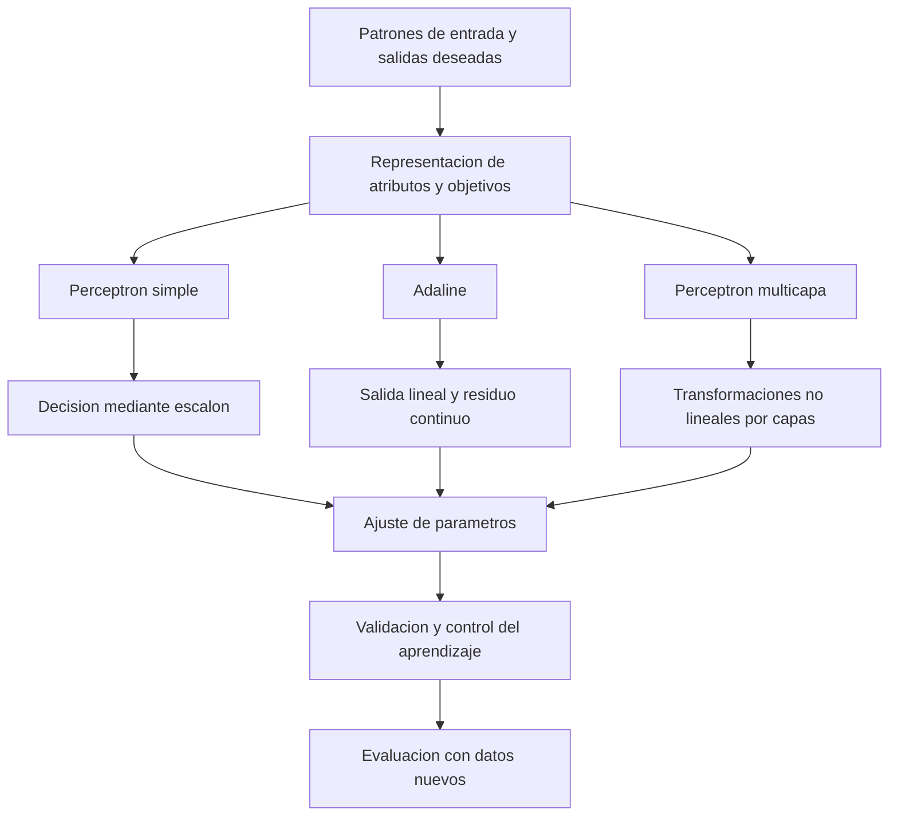

# Clase 5: Adaline y perceptrón multicapa: aprendizaje por gradiente, representación y generalización

> **Objetivo académico:** Comprender la transición del perceptrón simple al aprendizaje mediante error continuo en Adaline y a las redes multicapa, relacionando representación de datos, optimización de parámetros, capacidad de generalización y límites de interpretación.

## 1. Contexto y marco conceptual

La sesión desarrolla una progresión conceptual: una neurona que corrige decisiones de clasificación, una neurona lineal que aprende a partir de la magnitud del error y una red de neuronas capaz de representar relaciones no lineales. El hilo conductor es la modificación de parámetros para aproximar una relación entre entradas y salidas.

En el **aprendizaje supervisado**, cada patrón de entrada dispone de una salida deseada. La predicción se compara con esa referencia y la discrepancia orienta el ajuste. En el **aprendizaje no supervisado** no se proporciona una salida objetivo equivalente: se buscan estructuras en los datos. La explicación técnica de esta clase se concentra en aprendizaje supervisado; no se desarrolla un algoritmo no supervisado.

### Del error de clasificación al error cuantitativo

El perceptrón simple presentado utiliza una combinación ponderada de entradas y una función escalón con salida bipolar:

$$
z=\mathbf{w}^{\mathsf T}\mathbf{x}+b,\qquad
\widehat{c}=\begin{cases}1,&z\geq 0,\\-1,&z<0.\end{cases}
$$

Aquí, $\mathbf{x}\in\mathbb{R}^{n}$ es un vector de $n$ atributos, $\mathbf{w}\in\mathbb{R}^{n}$ contiene sus pesos, $b\in\mathbb{R}$ es el sesgo y $z\in\mathbb{R}$ es la activación previa al escalón. La predicción $\widehat{c}\in\{-1,1\}$ representa una de dos clases. Se adopta la convención aditiva para el sesgo; si se usa un umbral sustractivo, cambia su signo en la expresión.

La distinción relevante no es que un algoritmo pueda automatizarse y el otro no: ambos pueden implementarse computacionalmente. El cambio consiste en **qué señal utiliza el aprendizaje**. El perceptrón corrige errores de clasificación a partir de su salida discreta; Adaline utiliza la discrepancia entre una respuesta lineal continua y el valor deseado.

| Aspecto | Perceptrón simple de la sesión | Adaline | Perceptrón multicapa |
| --- | --- | --- | --- |
| Respuesta considerada | Clase bipolar | Valor lineal real | Escalar o vector, según el problema |
| Señal de aprendizaje | Desacuerdo con la clase deseada | Residuo continuo | Pérdida y gradientes propagados entre capas |
| Representación | Frontera lineal | Relación lineal o afín | Relación no lineal con activaciones adecuadas |
| Restricción principal | Separabilidad lineal para clasificación perfecta | Capacidad limitada a relaciones lineales o afines | Optimización, datos, complejidad y generalización |

La sesión conecta esta evolución con arquitecturas neuronales contemporáneas. La continuidad reside en el aprendizaje de parámetros mediante optimización; no implica que toda arquitectura moderna sea simplemente un perceptrón multicapa con más capas.

## 2. Fundamentos teóricos y arquitectura

### 2.1. Adaline y función de pérdida

Adaline conserva la suma ponderada de entradas, pero utiliza directamente su respuesta lineal para calcular el error. Para el patrón $p$:

$$
y_p=\mathbf{w}^{\mathsf T}\mathbf{x}_p+b,\qquad e_p=d_p-y_p.
$$

El índice $p\in\{1,\ldots,m\}$ identifica una observación entre $m$ patrones; no es un exponente. El vector $\mathbf{x}_p\in\mathbb{R}^{n}$ contiene sus atributos, $d_p\in\mathbb{R}$ es la salida deseada, $y_p\in\mathbb{R}$ es la respuesta del modelo y $e_p\in\mathbb{R}$ es el residuo con signo. Tanto el residuo como la predicción tienen las unidades de la variable objetivo, si esta posee unidades físicas.

Sumar residuos directamente no mide adecuadamente el desacierto total: errores positivos y negativos pueden cancelarse. La sesión introduce la pérdida cuadrática:

$$
E_p=\frac{1}{2}(d_p-y_p)^2,\qquad E=\sum_{p=1}^{m}E_p.
$$

$E_p\geq 0$ es la pérdida individual y $E\geq 0$ es la mitad de la suma de errores cuadrados. El factor $1/2$ simplifica la derivación. La pérdida queda expresada en unidades cuadradas de la variable objetivo.

**Enriquecimiento conceptual:** Esta suma no es, por sí sola, el error cuadrático medio. Este último se define como:

$$
\operatorname{MSE}=\frac{1}{m}\sum_{p=1}^{m}(d_p-y_p)^2.
$$

Con el mismo conjunto de datos, ambas funciones tienen los mismos minimizadores porque difieren por una constante positiva. Sin embargo, producen escalas distintas de gradiente y requieren interpretar de manera consistente los umbrales de parada y la tasa de aprendizaje.

El cuadrado evita cancelaciones y permite derivar de forma continua. El valor absoluto también evita cancelaciones, pero no es diferenciable en residuo cero. Además, la pérdida cuadrática penaliza con mayor intensidad los errores grandes, lo que puede aumentar la influencia de observaciones atípicas.

### 2.2. Regla delta y descenso del gradiente

El aprendizaje busca parámetros que reduzcan la pérdida. La actualización por patrón se escribe:

$$
\Delta w_j=-\eta\frac{\partial E_p}{\partial w_j}.
$$

Aquí, $j\in\{1,\ldots,n\}$ identifica un peso, $\eta>0$ es la tasa de aprendizaje y $\Delta w_j$ es su incremento. La magnitud apropiada de $\eta$ depende de la escala de los atributos y de la normalización elegida para la pérdida.

Aplicando la regla de la cadena al modelo lineal:

$$
\frac{\partial E_p}{\partial y_p}=-(d_p-y_p),\qquad
\frac{\partial y_p}{\partial w_j}=x_{pj},
$$

$$
\frac{\partial E_p}{\partial w_j}=-(d_p-y_p)x_{pj},
$$

$$
w_j^{\mathrm{nuevo}}=w_j^{\mathrm{actual}}+\eta(d_p-y_p)x_{pj}.
$$

La componente $x_{pj}\in\mathbb{R}$ es el atributo $j$ del patrón $p$. El signo del residuo orienta la corrección; la entrada determina la contribución del peso a ese patrón. Si la entrada correspondiente vale cero, ese peso no cambia en esta actualización.

**Enriquecimiento conceptual:** Si el sesgo se entrena, su actualización es:

$$
b^{\mathrm{nuevo}}=b^{\mathrm{actual}}+\eta(d_p-y_p).
$$

Esta expresión sigue de que la derivada de la respuesta respecto al sesgo es uno. En el ejemplo numérico de la sesión, el sesgo se fija en cero y no se actualiza.

La presentación sucesiva de patrones con actualización inmediata corresponde a aprendizaje en línea o descenso estocástico del gradiente. Una **época** es una pasada completa por el conjunto de entrenamiento. La tasa de aprendizaje controla el tamaño de cada ajuste: valores excesivos pueden producir oscilación o divergencia; valores muy pequeños pueden exigir más iteraciones. El coste por actualización no aumenta necesariamente al disminuir la tasa: lo que puede aumentar es el número de actualizaciones necesarias.

**Enriquecimiento conceptual:** La recomendación de utilizar una tasa entre cero y uno es una pauta del ejemplo, no una condición universal de convergencia. En Adaline con pérdida cuadrática, la función es convexa respecto a los parámetros. Por tanto, el problema no presenta mínimos locales de distinta calidad como puede ocurrir en una red multicapa no lineal. La unicidad del mínimo depende de la información independiente disponible en los atributos.

### 2.3. Perceptrón multicapa

Una sola transformación lineal no representa relaciones arbitrarias. La imposibilidad de separar XOR mediante una única frontera lineal motiva la combinación de varias neuronas con activaciones no lineales.

El perceptrón multicapa contiene:

- **Capa de entrada:** recibe la representación de los datos.
- **Capas ocultas:** transforman las representaciones mediante parámetros y funciones de activación.
- **Capa de salida:** produce la predicción con la dimensión y el significado definidos por el problema.

El flujo de cálculo es hacia adelante, mientras que la retropropagación distribuye hacia atrás las derivadas necesarias para ajustar los parámetros.

**Enriquecimiento conceptual:** Una notación matricial compacta para ese cálculo es:

$$
\mathbf{a}^{(0)}=\mathbf{x},\qquad
\mathbf{z}^{(\ell)}=W^{(\ell)}\mathbf{a}^{(\ell-1)}+\mathbf{b}^{(\ell)},\qquad
\mathbf{a}^{(\ell)}=\phi^{(\ell)}\!\left(\mathbf{z}^{(\ell)}\right).
$$

La capa $\ell\in\{1,\ldots,L\}$ tiene $n_\ell$ neuronas; $L$ es el número de capas con parámetros. La matriz $W^{(\ell)}\in\mathbb{R}^{n_\ell\times n_{\ell-1}}$ contiene los pesos, $\mathbf{b}^{(\ell)}\in\mathbb{R}^{n_\ell}$ los sesgos y $\mathbf{a}^{(\ell)}\in\mathbb{R}^{n_\ell}$ las activaciones. La función $\phi^{(\ell)}$ representa la activación de esa capa y la predicción final es $\mathbf{a}^{(L)}$. La entrada tiene dimensión $n_0$.

Las funciones de activación determinan parte de la capacidad representacional. La sesión menciona la sigmoide, la tangente hiperbólica, el escalón y las funciones lineales, y señala que distintas capas pueden utilizar funciones diferentes.

**Enriquecimiento conceptual:** Apilar únicamente transformaciones afines sin activaciones no lineales sigue produciendo una transformación afín. La profundidad por sí sola no resuelve esa limitación. Asimismo, el escalón no proporciona una derivada útil para la retropropagación convencional: su derivada es cero fuera del salto y no está definida en él.

### 2.4. Aproximación universal e interpretación

La sesión presenta al perceptrón multicapa como aproximador universal. Esta propiedad debe distinguirse de una garantía de resolución práctica.

**Enriquecimiento conceptual:** Bajo condiciones adecuadas sobre la activación y con capacidad suficiente, una red con una capa oculta puede aproximar funciones continuas sobre dominios compactos con precisión arbitraria. El resultado expresa capacidad de representación; no garantiza encontrar los parámetros mediante entrenamiento, disponer de datos suficientes, generalizar ni resolver cualquier problema computacional.

Los pesos y sesgos codifican la relación aprendida, pero no suelen tener una interpretación semántica individual directa. En un decodificador binario, los coeficientes tienen una lectura explícita; en una red con muchas capas, la representación suele estar distribuida. La dificultad de interpretación justifica evaluar si una aplicación necesita explicaciones adicionales, además de buenas predicciones.

## 3. Implementación técnica y lógica de negocio

### 3.1. Secuencia operativa de Adaline

El procedimiento explicado consiste en inicializar pesos, presentar un patrón, calcular la respuesta lineal, obtener el residuo y actualizar los parámetros. El proceso se repite sobre los patrones y, si no se cumple el criterio de parada, comienza otra época.

Los criterios discutidos son un máximo de épocas, una pérdida suficientemente pequeña, una mejora muy reducida entre épocas y la observación del comportamiento en validación. No equivalen entre sí: un límite de épocas restringe el cómputo, mientras que la validación aporta evidencia sobre datos no utilizados para ajustar directamente los pesos.

La fuente contiene cálculos manuales y una descripción de una implementación en Python, pero no incluye el código completo legible. Por ello, el procedimiento se reconstruye matemáticamente sin atribuirle una ejecución adicional.

### 3.2. Ejemplo trabajado: decodificador de tres bits

El caso central transforma un vector binario de tres componentes en su valor decimal. Se fija el sesgo en cero y se utiliza:

$$
\mathbf{w}^{(0)}=(0.84,\;0.394,\;0.783),\qquad \eta=0.3.
$$

Los pesos y la tasa son adimensionales en este ejemplo. Las entradas pertenecen a $\{0,1\}^{3}$ y las salidas deseadas son enteros representados por esos bits.

Para el primer patrón, $\mathbf{x}=(0,0,1)$ y $d=1$:

$$
y=0.84(0)+0.394(0)+0.783(1)=0.783,
$$

$$
e=1-0.783=0.217,
$$

$$
\mathbf{w}^{(1)}=(0.84,\;0.394,\;0.783+0.3(0.217))
=(0.84,\;0.394,\;0.8481).
$$

Solo cambia el tercer peso porque las otras dos entradas valen cero. La respuesta es $0.783$ y el residuo es $0.217$; son cantidades diferentes.

Para el segundo patrón, $\mathbf{x}=(0,1,0)$ y $d=2$, se utilizan los pesos ya actualizados:

$$
y=0.394,\qquad e=2-0.394=1.606,
$$

$$
\mathbf{w}^{(2)}=(0.84,\;0.394+0.3(1.606),\;0.8481)
=(0.84,\;0.8758,\;0.8481).
$$

**Enriquecimiento conceptual:** Se ha conservado la precisión decimal de los parámetros para corregir las oscilaciones y redondeos de la exposición oral. Estos cálculos verifican dos actualizaciones; no constituyen una nueva ejecución de entrenamiento.

### 3.3. Entrenamiento de una red multicapa

El procedimiento mantiene la estructura general de Adaline, pero la corrección debe atravesar las capas:

1. Inicializar pesos y sesgos.
2. Propagar las entradas hacia adelante.
3. Comparar la predicción con el objetivo mediante una pérdida.
4. Calcular las derivadas mediante retropropagación.
5. Actualizar parámetros y repetir según el criterio de parada.

**Enriquecimiento conceptual:** La retropropagación calcula gradientes mediante la regla de la cadena; el optimizador utiliza esos gradientes para modificar parámetros. No son operaciones conceptualmente idénticas. En conjunto, generalizan la lógica de la regla delta a composiciones de transformaciones.

La pérdida de una red no lineal suele ser no convexa respecto a sus parámetros. La sesión explica la diferencia entre mínimos locales y globales y menciona estrategias aleatorias y evolutivas como alternativas de optimización. Ninguna de estas menciones establece una garantía de alcanzar el mínimo global.

### 3.4. Preparación de datos y configuración en Weka

El flujo mostrado en Weka comprende cargar datos tabulares, identificar la variable objetivo, seleccionar `MultilayerPerceptron`, configurar capas ocultas, tasa de aprendizaje y épocas, ejecutar el entrenamiento y revisar los resultados. Se menciona CSV como formato de intercambio y la posibilidad de visualizar la red.

Para imágenes pequeñas de letras, cada fila del conjunto de datos corresponde a una observación. Los píxeles se convierten en atributos y se añade una variable objetivo. Una matriz de $4\times5$ produce veinte atributos; una de $5\times5$ produce veinticinco. Son dos representaciones distintas comentadas durante la sesión y no deben mezclarse.

**Enriquecimiento conceptual:** La declaración de la variable objetivo determina el tipo de problema. Una etiqueta nominal como A, E, I, O o U representa categorías; un atributo numérico puede conducir a una formulación de regresión. Asignar números a clases no garantiza que la herramienta los trate como categorías.

La evaluación sobre el mismo conjunto de entrenamiento puede mostrar que el algoritmo ajusta los ejemplos disponibles. No estima por sí sola el desempeño ante nuevas observaciones.

## 4. Análisis crítico de casos y auditoría práctica

### 4.1. Generalización del decodificador binario

En la implementación presentada se utilizaron los valores decimales del uno al cinco para entrenamiento y los del seis y siete como observaciones nuevas. Se describieron predicciones próximas a seis y siete y una reducción del error durante las épocas. La transcripción no permite verificar todos los valores del código, la curva ni la configuración completa; esos resultados son reportados, no reproducidos aquí.

La explicación estructural es más informativa que afirmar que la red simplemente reconoció un patrón.

**Enriquecimiento conceptual:** La conversión de tres bits a decimal es exactamente lineal:

$$
d=4x_1+2x_2+x_3,\qquad (x_1,x_2,x_3)\in\{0,1\}^{3}.
$$

Los coeficientes cuatro, dos y uno son los valores posicionales de los bits, ordenados de mayor a menor significación. El conjunto de entrenamiento contiene los patrones $001$, $010$ y $100$, que activan individualmente cada componente. Sus objetivos identifican directamente los tres coeficientes cuando el sesgo se fija en cero. Por eso el modelo puede producir seis para $110$ y siete para $111$: aplica una relación aditiva identificada, no memoriza únicamente las combinaciones vistas.

La sesión también considera invertir el subconjunto de entrenamiento y utilizar los patrones correspondientes a cuatro, cinco, seis y siete.

**Enriquecimiento conceptual:** Con sesgo fijo en cero, estos patrones siguen aportando información suficiente: $100$ identifica el primer peso y las diferencias entre $101$ y $100$, y entre $110$ y $100$, identifican los otros dos. El orden numérico de las etiquetas no determina por sí solo la dificultad. Si el sesgo se estimara libremente, el hecho de que la primera entrada sea siempre uno impediría distinguir su peso del sesgo sin información adicional.

### 4.2. Cuatro bits y una variable nunca activada

El segundo caso amplía el decodificador a cuatro componentes y analiza qué ocurre cuando el entrenamiento solo contiene valores del uno al siete.

**Enriquecimiento conceptual:** La relación buscada es:

$$
d=8x_1+4x_2+2x_3+x_4,\qquad \mathbf{x}\in\{0,1\}^{4}.
$$

Para todos los valores del uno al siete, el bit más significativo cumple $x_1=0$. En la regla delta:

$$
\Delta w_1=\eta(d-y)x_1=0.
$$

Por tanto, el entrenamiento no aporta información sobre $w_1$: ese parámetro conserva su valor inicial en el modelo sin regularización descrito. Cuando aparece $1000$, la predicción depende de un peso que no pudo aprenderse con esos datos. Incluir observaciones que activen esa componente aporta la información que faltaba, aunque la precisión posterior depende también de la convergencia.

La interpretación rigurosa es que **el coeficiente no es identificable con ese subconjunto**, no que cualquier inicialización haga lógicamente imposible acertar. Una coincidencia accidental con el valor correcto no sería evidencia de aprendizaje de esa contribución.

Este caso muestra un límite fundamental: reducir la pérdida sobre los ejemplos disponibles no garantiza conocer el efecto de atributos que nunca variaron de forma informativa.

### 4.3. Reconocimiento de vocales y ruido

Se discuten dos representaciones de una matriz binaria de $5\times5$: resumir cada fila mediante un valor y vectorizar los veinticinco píxeles.

| Representación | Dimensión de entrada | Ventaja | Riesgo |
| --- | --- | --- | --- |
| Resumen de cada fila | Cinco atributos | Reduce el tamaño del problema | Puede perder posición y hacer indistinguibles patrones distintos |
| Vectorización de píxeles | Veinticinco atributos | Conserva cada posición de la cuadrícula | Aumenta parámetros y sensibilidad al alineamiento |

**Enriquecimiento conceptual:** La vectorización puede formalizarse como:

$$
x_{5(r-1)+c}=M_{rc},\qquad r,c\in\{1,\ldots,5\}.
$$

La matriz $M\in\{0,1\}^{5\times5}$ representa la imagen y $\mathbf{x}\in\{0,1\}^{25}$ es el vector obtenido al recorrer sus filas. Esta operación conserva los valores y su posición mediante un orden fijo; no proporciona invariancia frente a desplazamientos o rotaciones.

El caso propone reconocer letras aunque algunos píxeles estén alterados. Eso plantea una prueba de generalización frente a ruido, pero no demuestra que una sola neurona vaya a ser robusta ante cualquier deformación.

**Enriquecimiento conceptual:** Si la perturbación es $\boldsymbol{\epsilon}\in\mathbb{R}^{25}$, la variación de la respuesta lineal es:

$$
y(\mathbf{x}+\boldsymbol{\epsilon})-y(\mathbf{x})
=\mathbf{w}^{\mathsf T}\boldsymbol{\epsilon}.
$$

La sensibilidad depende de cuáles componentes cambian y de sus pesos. Una alteración visual pequeña puede afectar fuertemente la predicción si modifica posiciones con gran influencia.

Codificar vocales mediante un único número real exige una regla posterior para convertir esa respuesta en una categoría. Además, impone distancias numéricas entre clases que carecen de un orden natural.

**Enriquecimiento conceptual:** Una alternativa para cinco categorías es una salida de cinco componentes con codificación de un único componente activo. Por ejemplo, E se representa mediante $(0,1,0,0,0)$. En una formulación probabilística multiclase, la predicción puede obtenerse seleccionando el componente de mayor probabilidad. La sesión contiene una enumeración oral de longitud inconsistente; el criterio conceptual es una componente por categoría.

### 4.4. Reconocimiento facial: píxeles o descriptores

El reconocimiento facial aparece como una extensión del problema de representación. Se comparan entradas basadas en píxeles con atributos geométricos derivados de puntos de referencia del rostro. También se mencionan redimensionamiento, escala de grises y reducción de dimensionalidad mediante PCA.

**Enriquecimiento conceptual:** Para una imagen de altura $H$, anchura $W$ y $C$ canales, la vectorización directa produce:

$$
n=HWC.
$$

Los valores $H,W,C$ son enteros positivos y $n$ es el número de atributos. Una imagen de $128\times128$ en escala de grises tiene $16\,384$ atributos; con tres canales RGB tiene $49\,152$. Escala de grises significa una intensidad por píxel, no necesariamente una imagen binaria.

Si la primera capa oculta tiene $h$ neuronas, contiene $(n+1)h$ parámetros contando sesgos. Esto explica por qué aumentar la resolución puede elevar rápidamente el coste y el riesgo de sobreajuste en un perceptrón totalmente conectado.

Los descriptores geométricos reducen la dimensión de entrada, pero dependen de la localización de puntos, la pose, la escala y la normalización. La referencia oral a una cantidad concreta de medidas no identifica un procedimiento verificable ni demuestra suficiencia universal. La sesión no presenta resultados de reconocimiento facial.

### 4.5. Clasificación, regresión y series temporales

La arquitectura debe corresponder al significado de la salida. Reconocer una identidad o decidir si llueve son problemas de clasificación. Estimar el caudal de un río o una temperatura son problemas de regresión cuando la variable objetivo es continua. Una etiqueta numérica de identidad sigue siendo una categoría, no una magnitud física.

Las series temporales se introducen como observaciones ordenadas en el tiempo. En una serie univariada se observa una variable; en una multivariada se observan varias variables por instante. Se mencionan temperatura, ventas, valores financieros, caudal y viento como ámbitos de aplicación, sin desarrollar una implementación temporal.

**Enriquecimiento conceptual:** Un perceptrón multicapa puede recibir ventanas de observaciones pasadas para pronosticar valores futuros. En esa formulación, las entradas deben contener solo información disponible al momento de predecir y la evaluación debe respetar el orden temporal. El simple hecho de incluir el tiempo no garantiza capacidad predictiva.

## 5. Principios de diseño, buenas prácticas y anti-patrones

### Separar ajuste, selección y evaluación final

La sesión distingue entrenamiento, validación y prueba. El entrenamiento ajusta los parámetros; la validación orienta decisiones sobre arquitectura y parada; la prueba final estima el desempeño con datos que no participaron en esas decisiones.

**Enriquecimiento conceptual:** Si las observaciones denominadas de prueba se consultan repetidamente para decidir cuándo detenerse o qué configuración elegir, pasan a cumplir una función de validación. Hace falta otro conjunto independiente para una estimación final menos sesgada. En imágenes, separar variantes de la misma fotografía entre entrenamiento y prueba puede producir fuga de información y una impresión exagerada de generalización.

### Controlar capacidad y sobreajuste

Una red puede reducir mucho el error de entrenamiento y aun así fallar ante cambios de apariencia o ruido. Un ajuste menos preciso a los ejemplos conocidos puede producir mejores predicciones nuevas. La selección de profundidad y anchura debe apoyarse en validación, coste y comparación con alternativas, no únicamente en aumentar neuronas.

**Enriquecimiento conceptual:** No existe una fórmula universal que determine la arquitectura óptima. Las comparaciones sistemáticas y la regularización ofrecen un marco más fiable que la modificación indefinida por intuición. La parada temprana puede utilizar el comportamiento en validación para limitar el sobreajuste.

### Revisar datos antes de aumentar complejidad

El análisis exploratorio debe comprobar tipos de variables, escalas, valores faltantes, observaciones atípicas y relevancia de atributos. Es necesario distinguir errores de registro de casos extremos válidos: eliminarlos automáticamente puede borrar información importante.

**Enriquecimiento conceptual:** La normalización y PCA deben ajustarse con los datos de entrenamiento y aplicarse después, sin volver a estimarlos, a validación y prueba. De lo contrario, el preprocesamiento incorpora información de las observaciones destinadas a evaluar el modelo.

### Evitar promesas excesivas

| Anti-patrón | Problema conceptual | Principio correctivo |
| --- | --- | --- |
| Declarar generalización usando solo datos de entrenamiento | Confunde ajuste con predicción nueva | Evaluar con observaciones independientes |
| Afirmar que una red siempre debe tener error residual positivo | Ignora relaciones exactamente representables | Analizar capacidad, datos y precisión numérica |
| Suponer que más capas garantizan mejores resultados | Omite coste y sobreajuste | Comparar arquitecturas mediante validación |
| Tratar códigos numéricos de categorías como distancias naturales | Introduce una geometría arbitraria | Elegir una codificación compatible con clasificación |
| Considerar universal la robustez al ruido | Confunde posibilidad con propiedad garantizada | Definir perturbaciones y medir su efecto |
| Usar una red compleja para una relación lineal conocida | Aumenta complejidad sin necesidad demostrada | Mantener un modelo simple como referencia |

### Interpretabilidad, entrenamiento e inferencia

La sesión diferencia el coste del entrenamiento del uso posterior de los parámetros aprendidos. Una vez fijados los pesos, la inferencia realiza principalmente una propagación hacia adelante. Puede ser más rápida que entrenar, aunque su coste depende del tamaño de la red y del hardware.

**Enriquecimiento conceptual:** Los datos originales no suelen ser necesarios para calcular cada nueva predicción, pero siguen siendo relevantes para auditoría, reproducibilidad y actualización. El artefacto operativo incluye también arquitectura, orden de atributos, preprocesamiento y correspondencia de etiquetas. Asimismo, un conjunto de pesos no equivale a una copia íntegra y verificable de todo el conocimiento utilizado durante su entrenamiento.

La falta de interpretación directa de cada peso no significa ausencia absoluta de métodos explicativos. Sí exige distinguir explicaciones parciales, funcionamiento matemático y comprensión semántica completa. La necesidad de explicación depende del contexto de uso y de las consecuencias de las decisiones.

## 6. Síntesis conceptual y profundización académica

La contribución de Adaline es convertir la discrepancia continua entre respuesta y objetivo en una señal de actualización. Su regla delta deriva de minimizar una pérdida cuadrática y permite observar cómo cada atributo participa en el ajuste. El perceptrón multicapa extiende esa lógica a composiciones no lineales, utilizando retropropagación para calcular gradientes a través de las capas.

El decodificador binario permite distinguir aprendizaje e identificabilidad. Cuando las entradas aportan información independiente sobre cada valor posicional, los pesos pueden aproximar la regla exacta y responder a combinaciones no vistas. Si una variable permanece inactiva, su efecto no puede inferirse únicamente reduciendo la pérdida sobre ese subconjunto.

Los casos de vocales y rostros muestran que la representación es parte central del modelo. Vectorizar, resumir filas o calcular descriptores produce problemas distintos, con pérdidas de información y sensibilidades diferentes. La salida también expresa una hipótesis: categorías, magnitudes reales y vectores requieren interpretaciones y criterios de evaluación propios.

La capacidad representacional, la optimización y la generalización son propiedades diferentes. Una arquitectura puede contener una solución adecuada y, aun así, no encontrarla durante el entrenamiento; también puede ajustar los datos disponibles sin predecir correctamente nuevas observaciones. La aproximación universal no elimina estas diferencias.

**Enriquecimiento conceptual:** Las líneas de profundización que se desprenden de la clase son la relación entre rango e identificabilidad en modelos lineales, la estabilidad del gradiente según la escala de los datos, la selección de capacidad mediante validación y el diseño de representaciones robustas. En series temporales, estas cuestiones se combinan con disponibilidad de información y dependencia temporal; en reconocimiento de imágenes, con variación de apariencia y conservación de la estructura espacial.
