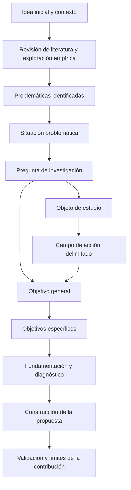

# Clase 1: Congruencia teórica y metodológica del proyecto de investigación doctoral

> **Objetivo académico:** Analizar los nexos lógicos entre los componentes de un proyecto doctoral en ciencias de la computación y fundamentar su congruencia conceptual, epistemológica y metodológica, desde la construcción del problema hasta la propuesta y su validación.

## 1. Contexto y marco conceptual

### La integración doctoral como problema de coherencia

La integración de una investigación doctoral exige que sus componentes formen un sistema argumentativo. El título, el problema, el objeto de estudio, el campo de acción, los objetivos, las hipótesis o ideas orientadoras, los fundamentos teóricos y el diseño metodológico deben referirse a una misma investigación y sostener decisiones compatibles entre sí.

La sesión denomina **nexos lógicos** a los vínculos de congruencia que conectan esas partes. Su revisión permite identificar cambios injustificados de significado, objetivos que no responden al problema, instrumentos que no producen la información requerida y propuestas cuya contribución no se encuentra fundamentada.

Se distinguen dos planos complementarios:

- **Congruencia terminológica:** continuidad del significado de los conceptos centrales a lo largo del documento. Sustituir términos por aparentes sinónimos puede modificar el fenómeno investigado.
- **Congruencia metodológica:** compatibilidad entre perspectiva epistemológica, enfoque, diseño, métodos, técnicas, instrumentos, población, selección de participantes y procedimientos de análisis.

La coherencia inicial condiciona el desarrollo posterior: una insuficiencia en la formulación del problema puede propagarse hacia el campo de acción, los objetivos y la construcción de instrumentos.

### Del perfil proyectivo a la fundamentación doctoral

El perfil expresa una proyección de la investigación. El informe doctoral desarrolla y fundamenta esas decisiones mediante argumentos, evidencia y posicionamiento del investigador. Por ello, transformar el perfil en tesis requiere más que ampliar listados de teorías o procedimientos.

En el marco institucional presentado, la arquitectura comprende fundamentos teórico-referenciales, fundamentos metodológicos, una base empírica con diagnóstico y resultados, y una propuesta con fundamentación, descripción y validación. Las conclusiones deben apoyarse en lo efectivamente establecido; el resumen se redacta cuando existe una visión completa del estudio.

La diferencia respecto de una investigación de menor nivel no se reduce al volumen documental. La clase destaca la profundidad conceptual, la articulación de evidencias y la contribución teórica y práctica. Un producto computacional debe vincularse con una relación entre variables o categorías que permita sostener una aportación distintiva.

**Enriquecimiento conceptual:** La complejidad técnica de un artefacto y su originalidad científica son propiedades diferentes. Un sistema sofisticado puede reproducir conocimiento conocido; una contribución doctoral requiere explicar qué conocimiento se obtiene, qué evidencia lo respalda y bajo qué condiciones resulta válido.

### Inserción disciplinar, interdisciplinariedad y transformación

La ubicación en áreas, líneas y ejes de investigación permite justificar la pertinencia del tema. La sesión relaciona esta ubicación con problemas educativos, industriales, de inteligencia artificial, bioinformática, computación científica y ciberseguridad, articulados con objetivos de desarrollo sostenible.

Esta adscripción también depende de la experiencia del investigador, la relevancia del problema y la disponibilidad de recursos y colaboración para desarrollar y validar la propuesta. Una investigación puede contribuir a varias líneas si explica de forma sustantiva esa relación. La organización institucional del conocimiento no elimina el carácter transversal de los problemas.

La transformación social se entiende en sentido amplio: comprende cambios en procesos organizacionales, productivos, educativos, económicos y tecnológicos. Un problema puede localizarse en otra disciplina y recibir una contribución desde las ciencias de la computación. En ese caso, la propuesta debe hacer explícito su núcleo computacional y su aportación de conocimiento.

## 2. Fundamentos teóricos y arquitectura

### De la idea inicial al problema científico

La idea inicial es provisional. La revisión de literatura, la exploración del contexto y la formulación de preguntas permiten modificarla y delimitar un problema investigable. El título debe evolucionar con esa comprensión, en lugar de fijar anticipadamente una solución que condicione toda la investigación.

La exposición introductoria sigue una aproximación de lo general a lo particular: relevancia global, regional y local; ubicación disciplinar; antecedentes; problemáticas del contexto; situación problemática y pregunta de investigación.

| Componente | Función conceptual | Distinción necesaria |
| --- | --- | --- |
| Antecedentes teóricos | Identificar autores y aportes relevantes para el tema | En el perfil se presentan de forma sintética; el estado del arte desarrolla una revisión crítica más extensa |
| Antecedentes prácticos | Reconocer manifestaciones del problema mediante experiencia, observación y datos del contexto | La experiencia orienta la exploración, pero necesita respaldo empírico |
| Problemáticas | Describir insuficiencias concretas y recurrentes | Su enumeración todavía no constituye la síntesis del problema |
| Situación problemática | Integrar las insuficiencias en una carencia central | Debe mostrar qué resulta insatisfactorio y por qué requiere investigación |
| Problema científico | Formular una interrogante precisa y abordable | En la convención presentada, no incorpora anticipadamente el artefacto propuesto |

La situación problemática se interpreta como una contradicción entre el estado real y un estado considerado satisfactorio. La sesión recomienda redactarla enfatizando la insuficiencia observada, sin convertirla en una descripción anticipada de la propuesta. Ambas indicaciones son compatibles: el criterio de satisfacción permite reconocer la carencia, mientras que la solución específica permanece abierta.

El problema debe ser relevante, actual, delimitable, susceptible de análisis y factible de abordar. Su formulación requiere precisar fenómenos o relaciones, contexto y temporalidad cuando estos elementos condicionen la interpretación.

**Enriquecimiento conceptual:** Un vacío práctico y un vacío de conocimiento requieren argumentos diferentes. Que una organización carezca de una herramienta no demuestra que exista un problema científico abierto. La relevancia doctoral exige establecer qué aspecto permanece insuficientemente explicado, modelado, evaluado o resuelto por el conocimiento disponible.

### Problema, objeto de estudio y campo de acción

La clase adopta una convención institucional específica:

- **Objeto de estudio:** parte de la realidad, proceso o ámbito disciplinar en el que se sitúa el problema. Es más amplio que el aspecto directamente investigado.
- **Campo de acción:** parte delimitada del objeto que concentra los procesos, variables o relaciones que se pretende estudiar y transformar.
- **Objetivo general:** meta de máximo alcance; en una investigación propositiva expresa el producto o servicio y su contribución al problema.

El campo de acción debe corresponder al contenido del problema. Puede comprender varias variables y estar delimitado espacial y temporalmente, pero no se reduce al lugar de aplicación. El objeto tampoco equivale automáticamente al producto que se construirá.

Las flechas representan dependencias de formulación y justificación. La investigación puede requerir revisiones iterativas de estas relaciones.

### Justificación y delimitación

La justificación explica por qué merece realizarse la investigación y qué contribución se espera desde distintas dimensiones:

- **Teórica:** conocimiento, conceptos o relaciones que se pretende enriquecer.
- **Práctica:** utilidad de la propuesta para afrontar la insuficiencia identificada.
- **Social o económica:** beneficios pertinentes para personas, organizaciones o procesos.
- **Metodológica:** contribución de procedimientos o formas de actuación vinculados con la solución.
- **Personal:** motivación y relación del investigador con el problema, sin sustituir la fundamentación científica.

La sesión distingue especialmente la justificación metodológica de la descripción del diseño de investigación. Enumerar entrevistas, encuestas o métodos de análisis no demuestra por sí mismo una contribución metodológica.

La delimitación establece los límites temáticos, espaciales, temporales y de profundidad. La profundidad se refiere al detalle y complejidad con que se estudia el problema; no debe reducirse a repetir el enfoque o el diseño seleccionado.

**Enriquecimiento conceptual:** La delimitación expresa decisiones sobre lo que el estudio abarcará. Las limitaciones describen restricciones que afectan su ejecución o sus inferencias. Distinguirlas permite separar el alcance elegido de las condiciones que restringen la evidencia obtenida.

## 3. Implementación técnica y lógica de negocio

La fuente desarrolla procedimientos de diseño investigativo; no presenta código, experimentos ejecutados ni resultados computacionales. Su implementación técnica consiste en traducir el problema y los conceptos en una estrategia de obtención, integración y análisis de evidencia.

### Objetivo general y objetivos específicos

En la concepción institucional expuesta, una investigación basada en diseño y de carácter propositivo puede formular su objetivo general con **proponer** o **desarrollar**. La validación se considera parte del proceso necesario para sostener la propuesta. Por ello, se recomienda un verbo rector en el objetivo general y un objetivo específico dedicado a la validación.

Esta elección responde al significado institucional de propuesta: un producto o servicio fundamentado y respaldado mediante evidencia. La discusión de la sesión muestra que otras comunidades emplean el mismo término para un diseño preliminar todavía no evaluado. El verbo debe interpretarse junto con el alcance declarado y los criterios de logro.

Los objetivos específicos deben cubrir los resultados de las etapas esenciales:

1. Establecer fundamentos teórico-referenciales.
2. Caracterizar o diagnosticar el estado del problema.
3. Fundamentar y construir la propuesta.
4. Evaluar su validez según criterios pertinentes.

El orden entre fundamentación y diagnóstico puede variar. Puede existir una exploración inicial que oriente la revisión teórica y un diagnóstico posterior más profundo. La correspondencia con etapas o capítulos funciona como una guía de cobertura, no como una sustitución del razonamiento metodológico.

Un objetivo debe identificar una acción investigativa, su contenido, las unidades de análisis pertinentes y el contexto necesario para interpretar su alcance. La temporalidad es especialmente importante cuando cambian las condiciones del fenómeno o de su evaluación.

Los objetivos específicos expresan resultados cognoscitivos o productos; una lista de actividades como buscar documentos o aplicar instrumentos corresponde al procedimiento para alcanzarlos.

### Hipótesis e ideas orientadoras

La hipótesis es una respuesta tentativa al problema, sustentada en antecedentes teóricos y empíricos. Su formulación depende del enfoque, del propósito de la investigación y de la evidencia que puede obtenerse. La sesión considera hipótesis descriptivas, correlacionales, causales, direccionales y no direccionales, además de hipótesis de diseño.

Una hipótesis de diseño puede expresar una expectativa sobre el desempeño o la utilidad de un artefacto. No necesita asumir causalidad si la pregunta y el diseño no buscan establecerla. Diferentes fases de una investigación pueden requerir proposiciones de distinto tipo.

**Enriquecimiento conceptual:** Las hipótesis de investigación y las hipótesis estadísticas cumplen funciones relacionadas, pero distintas. Formular una expectativa de diseño no obliga a crear una hipótesis nula y una alternativa. Estas últimas requieren una proposición contrastable y un procedimiento inferencial definido. Tampoco debe suponerse que tres enunciados denominados de investigación, nulo y alternativo constituyen posibilidades mutuamente excluyentes y exhaustivas.

### Matrices de congruencia, operacionalización y categorización

| Matriz | Pregunta que organiza | Contenido principal | Resultado esperado |
| --- | --- | --- | --- |
| Congruencia | ¿Las partes del proyecto responden al mismo problema? | Problema, objetivos, hipótesis o proposiciones, conceptos y decisiones metodológicas | Trazabilidad entre propósitos y procedimientos |
| Operacionalización | ¿Cómo se observarán o medirán las variables? | Definiciones conceptuales y operacionales, dimensiones, indicadores y medidas | Conexión explícita entre constructos y datos |
| Categorización | ¿Qué aspectos orientarán inicialmente la comprensión cualitativa? | Conceptos, categorías, temas y subtemas iniciales | Orientación de guías y análisis, abierta a revisión |

La definición conceptual establece el significado teórico de una variable. La definición operacional especifica cómo se reconocerá o medirá en el contexto. Las dimensiones descomponen aspectos del concepto; los indicadores establecen manifestaciones observables.

En la investigación cualitativa, las categorías iniciales pueden orientar una entrevista, una observación participante o un grupo focal. La interacción con el contexto puede modificar esas categorías y los instrumentos. Esta apertura exige documentar cambios y razones.

**Enriquecimiento conceptual:** La matriz de congruencia es un recurso de coherencia del diseño. Por sí misma no demuestra que los datos se ajusten a un modelo teórico ni establece validez empírica. Asimismo, asociar una pregunta con un indicador no garantiza que el instrumento mida adecuadamente el constructo.

### Cadena de decisiones metodológicas

La sesión distingue el paradigma como tradición compartida de supuestos, valores y prácticas; la perspectiva epistemológica como posicionamiento sobre el conocimiento; y el enfoque como ruta general de investigación. Estas decisiones orientan el diseño y los procedimientos concretos.

Se presentan paradigmas positivista, interpretativo-hermenéutico, crítico, constructivista y sistémico, y se destaca una posición institucional sistémica y holística. La exposición relaciona el positivismo con la ruta cuantitativa, la interpretación con la cualitativa y las perspectivas transformativas o integradoras con rutas mixtas.

**Enriquecimiento conceptual:** Estas correspondencias constituyen una simplificación pedagógica. No existe una equivalencia universal entre un paradigma y un único enfoque. Una perspectiva crítica puede sostener estudios cualitativos, cuantitativos o mixtos. La selección debe justificarse mediante supuestos y operaciones compatibles, sin tratar las clasificaciones como una jerarquía epistemológica universal.

El hilo metodológico debe conectar enfoque, diseño, propósito y métodos. En el componente cuantitativo se distingue entre diseños experimentales y no experimentales. En el cualitativo se consideran aproximaciones narrativas, fenomenológicas y de investigación-acción, entre otras.

Un estudio mixto necesita caracterizar cada componente y explicar su integración. Denominarlo únicamente no experimental o transversal describe, a lo sumo, ciertos rasgos de un componente, pero deja sin especificar cómo se combinan las evidencias.

| Diseño mixto tratado | Organización de los componentes |
| --- | --- |
| Exploratorio secuencial | La exploración cualitativa orienta una fase cuantitativa posterior |
| Explicativo secuencial | Los resultados cuantitativos orientan una fase cualitativa destinada a profundizar su interpretación |
| Transformativo secuencial | Las fases se articulan desde una perspectiva transformativa explícita |
| Triangulación concurrente | Los componentes se desarrollan en paralelo y se contrastan o integran |
| Anidado o incrustado | Un componente se incorpora dentro de otro que organiza el diseño principal |

**Enriquecimiento conceptual:** Las descripciones de esta tabla precisan el sentido de las denominaciones enumeradas en la sesión. La elección exige definir secuencia, prioridad y puntos de integración. La metainferencia es la interpretación resultante de relacionar ambos componentes; reunir datos de dos tipos sin integrarlos deja incompleta la justificación de un enfoque mixto.

La clase advierte que las integraciones múltiples pueden exigir recursos difíciles de sostener en una investigación individual. Esta advertencia se entiende como criterio de viabilidad, no como prohibición absoluta de determinados diseños.

### Métodos, técnicas, instrumentos y selección de unidades

Los métodos teóricos permiten analizar, sintetizar, abstraer y modelar información. Los empíricos permiten obtener evidencia del contexto. En la terminología adoptada, la técnica especifica cómo se realiza la obtención de datos y el instrumento constituye el recurso concreto con el que se registra información.

La observación, la encuesta, la entrevista y el grupo focal deben conectarse con instrumentos y procedimientos de análisis congruentes. Su clasificación exacta como método o técnica puede variar entre tradiciones; lo indispensable es explicitar qué se hará y qué evidencia producirá.

En instrumentos cuantitativos, la sesión destaca la revisión por especialistas y el pilotaje antes de la aplicación principal. En instrumentos cualitativos, subraya la adaptación durante el trabajo de campo y la presentación de su versión final.

**Enriquecimiento conceptual:** La revisión por especialistas, el pilotaje y la evaluación de propiedades de medición aportan evidencias diferentes. Ninguna actuación aislada permite declarar una validez universal. En lo cualitativo, conservar las versiones y decisiones de ajuste mejora la trazabilidad; el rigor no se reduce a modificar una guía hasta considerar agotada la información.

La población comprende las unidades con características pertinentes para la pregunta. Si se estudian todas las unidades de la población delimitada, se realiza un censo. Si se selecciona una parte, debe justificarse el muestreo.

En el componente cuantitativo se distinguen estrategias probabilísticas y no probabilísticas. La sesión enfatiza, para lo cualitativo, la selección intencional según pertinencia y propósitos, considerando criterios estratégicos, éticos y pragmáticos. No se desarrolla un catálogo completo de tipos de muestra.

**Enriquecimiento conceptual:** La selección intencional es habitual en investigación cualitativa, pero no debe convertirse en una prohibición universal de otras estrategias. Un censo tampoco elimina errores de cobertura, no respuesta o medición. Las inferencias dependen del procedimiento efectivamente ejecutado y de la calidad de los datos.

## 4. Análisis crítico de casos y auditoría práctica

### Caso de peritaje informático y fuerza probatoria

La clase analiza una pregunta sobre cómo dotar al peritaje informático de una medida de fuerza probatoria con tasa de error conocida y admisibilidad judicial, situada en TikTok y en el contexto judicial boliviano durante 2025–2027. Se trata de un ejemplo de formulación, sin resultados empíricos reportados.

El objeto se identifica como el peritaje judicial boliviano. El campo de acción se concentra en el proceso de dotar al peritaje informático de una medida de fuerza probatoria. El ejemplo busca distinguir el ámbito general del proceso particular que requiere investigación.

La discusión revela dificultades útiles para una revisión crítica:

- La amplitud del objeto puede dificultar el reconocimiento del proceso específicamente informático.
- Un campo de acción expresado mediante una frase extensa necesita conceptos definidos y relaciones identificables.
- Conocer una tasa de error, establecer fuerza probatoria y justificar admisibilidad judicial son exigencias relacionadas que requieren evidencias diferentes.
- Incluir validación experimental en la pregunta anticipa una decisión metodológica que debe justificarse por separado.

**Enriquecimiento conceptual:** Una tasa de error necesita especificar qué se considera error, sobre qué unidades se calcula y bajo qué condiciones se observa. La admisibilidad judicial incorpora criterios jurídicos que no pueden deducirse únicamente del rendimiento técnico. El caso exige articular evidencia computacional y argumentación jurídica, manteniendo diferenciadas sus funciones.

### Objeto y campo frente a variables independientes y dependientes

Durante el intercambio se plantea identificar el objeto de estudio con la variable independiente y el campo de acción con la dependiente. El docente rechaza esa equivalencia dentro de la convención empleada.

La distinción es fundamental: objeto y campo expresan niveles de delimitación del fenómeno; independencia y dependencia describen funciones de variables dentro de una relación analítica o de un diseño. El campo puede incluir varias variables y el objeto puede comprender múltiples procesos.

**Enriquecimiento conceptual:** Una variable no adquiere carácter independiente porque sea más general. Esa función depende de la pregunta, el modelo y el diseño. En una investigación cualitativa o de diseño puede resultar más pertinente trabajar con categorías, requisitos, mecanismos y criterios de desempeño que imponer una estructura causal binaria.

En la sesión también aparece la metáfora del campo como ecosistema del objeto. Aunque ayuda a reconocer relaciones, no coincide de manera estricta con la definición previa del campo como parte delimitada del objeto. Para sostener precisión conceptual conviene conservar esta última relación y evitar que la metáfora sustituya la definición operativa.

### El debate sobre proponer, desarrollar y validar

El desacuerdo terminológico surge porque los participantes atribuyen alcances diferentes a una propuesta. Para unos significa una formulación inicial; para la concepción presentada incluye construcción y validación. La coherencia se recupera haciendo explícita la definición y vinculando la meta general con resultados específicos verificables.

**Enriquecimiento conceptual:** El verbo no demuestra por sí mismo el nivel doctoral. Desarrollar puede describir tanto una implementación rutinaria como la creación de un artefacto que produce conocimiento nuevo. La diferencia debe sostenerse en el problema científico, el argumento de originalidad, la evaluación y las conclusiones justificadas.

### Hipótesis, correlación e impacto

La clase vincula la evaluación de efectividad con posibles hipótesis correlacionales y menciona comparaciones previas y posteriores. Esta relación necesita precisión para evitar atribuir más capacidad inferencial al diseño de la que posee.

**Enriquecimiento conceptual:** Una hipótesis correlacional no exige necesariamente mediciones antes y después. A su vez, una diferencia entre mediciones previas y posteriores no demuestra por sí sola que la propuesta causó el cambio: pueden intervenir tendencias temporales, cambios externos o diferencias en la medición. La evidencia de impacto debe interpretarse según el diseño y sus explicaciones alternativas.

### Tres planos de validación de la propuesta

La exposición distingue validación técnica, valoración por especialistas y evaluación en una muestra piloto o en el contexto de aplicación.

| Plano | Cuestión central | Límite interpretativo |
| --- | --- | --- |
| Técnico | ¿El producto funciona conforme a requisitos y criterios definidos? | El funcionamiento no demuestra automáticamente utilidad contextual |
| Especialistas | ¿La propuesta resulta pertinente, coherente o factible según criterios argumentados? | El juicio especializado no sustituye la observación de su desempeño |
| Aplicación contextual | ¿Qué ocurre cuando se utiliza en condiciones delimitadas? | La extensión de las conclusiones depende del diseño y de las unidades estudiadas |

**Enriquecimiento conceptual:** La distinción entre preguntas y límites de esta tabla desarrolla las tres modalidades mencionadas. Conviene separar además la evaluación de los instrumentos de recolección de la evaluación de la propuesta: un instrumento puede registrar datos adecuadamente y el artefacto resultar ineficaz; también puede ocurrir que una propuesta prometedora se evalúe con mediciones insuficientes.

## 5. Principios de diseño, buenas prácticas y anti-patrones

### Principios de coherencia

1. **Mantener trazabilidad conceptual.** Cada resultado esperado debe remontarse a una necesidad del problema, y cada instrumento debe producir evidencia pertinente para un propósito definido.
2. **Justificar decisiones y significados.** Las etiquetas epistemológicas o metodológicas requieren explicar su relación con las operaciones del estudio.
3. **Distinguir problema, medio y resultado.** La insuficiencia investigada, el artefacto construido y la transformación esperada cumplen funciones diferentes.
4. **Integrar teoría y práctica.** El diagnóstico permite contrastar la comprensión teórica con el contexto; la propuesta debe apoyarse en ese contraste.
5. **Ajustar el alcance a los recursos.** Acceso a datos, colaboración, infraestructura y posibilidades de validación condicionan la viabilidad.
6. **Declarar límites temporales.** El perfil necesita un corte de información identificable; la investigación posterior puede incorporar novedades y justificar los ajustes que produzcan.
7. **Redactar desde una postura argumentada.** La fundamentación requiere comparar alternativas y explicar elecciones, en lugar de concatenar definiciones.

### Anti-patrones y sus consecuencias

| Anti-patrón | Consecuencia | Criterio de corrección |
| --- | --- | --- |
| Incorporar el artefacto elegido en la pregunta antes de justificarlo | Cierre prematuro de alternativas | Separar la necesidad de transformación de la solución seleccionada |
| Reducir el campo de acción a un territorio | Pérdida de delimitación temática | Identificar procesos, relaciones o variables concretas |
| Equiparar objeto con variable independiente | Confusión entre delimitación y función analítica | Definir ambos planos por separado |
| Presentar únicamente objetivos de diagnóstico | Ausencia de cobertura de construcción y validación | Vincular objetivos con todas las etapas necesarias |
| Confundir justificación metodológica con lista de técnicas | Falta de argumento sobre la contribución | Explicar qué aporta el procedimiento propuesto |
| Denominar mixto un estudio sin integración | Yuxtaposición de evidencias | Precisar dónde y cómo se construyen interpretaciones conjuntas |
| Describir instrumentos que no se corresponden con sus versiones concretas | Ruptura entre diseño y evidencia | Contrastar definiciones, indicadores, preguntas y procedimientos |
| Usar generación automática sin revisión conceptual | Terminología cambiante y decisiones incompatibles | Verificar significados, pertinencia institucional y fundamento científico |

La sesión advierte particularmente sobre textos producidos con inteligencia artificial que no han sido revisados ni adaptados al posicionamiento del investigador. Su fluidez no garantiza correspondencia con el protocolo ni congruencia entre los componentes.

**Enriquecimiento conceptual:** La revisión de contenido generado debe distinguir adecuación institucional y suficiencia científica. Un documento puede utilizar correctamente las denominaciones locales y, aun así, formular inferencias que su evidencia no sostiene. Ambas dimensiones requieren evaluación explícita.

## 6. Síntesis conceptual y profundización académica

La unidad del proyecto doctoral reside en una cadena de justificaciones: una insuficiencia contextual se convierte en problema científico; el problema delimita un objeto y un campo; los objetivos establecen resultados alcanzables; los conceptos se traducen en evidencia; y la propuesta se fundamenta y evalúa dentro de límites explícitos.

La matriz de congruencia permite revisar esa unidad. La operacionalización y la categorización conectan los significados con los procedimientos de observación. El diseño metodológico determina qué evidencia puede obtenerse y qué conclusiones resulta legítimo sostener.

El marco institucional presentado privilegia investigaciones propositivas basadas en diseño, con una perspectiva sistémica y holística. Sus convenciones sobre objeto, campo, verbo rector y alcance de la propuesta deben reconocerse como convenciones situadas. La pluralidad de enfoques exige que los desacuerdos se resuelvan mediante definiciones claras, argumentos y criterios de evidencia.

**Enriquecimiento conceptual:** La articulación entre artefacto y contribución científica puede profundizarse distinguiendo tres preguntas: qué se construyó, qué cambió al utilizarlo y qué conocimiento se obtuvo sobre su funcionamiento y condiciones de uso. Responderlas evita confundir un producto terminado con una explicación científica suficientemente respaldada.

Las líneas de profundización que emergen de la clase incluyen la diferencia entre novedad contextual y contribución teórica, la relación entre hipótesis de diseño y contrastación empírica, los criterios de integración en métodos mixtos y los límites de la inferencia causal en la evaluación de propuestas. Estas cuestiones permiten pasar de una estructura documental congruente a una investigación con argumentos y evidencia defendibles.
