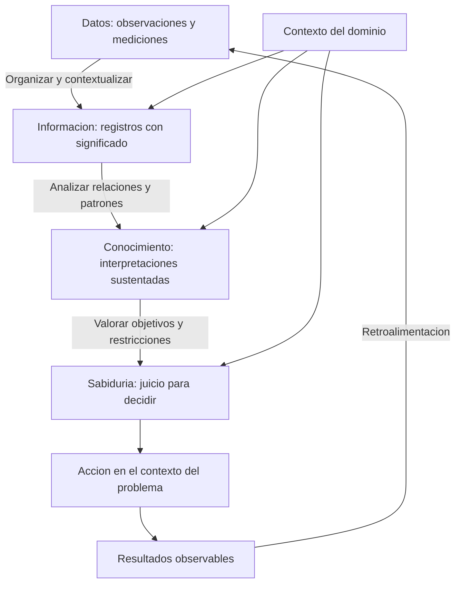

# Clase 1: De los datos al conocimiento: fundamentos de ciencia de datos y bases de datos

> **Objetivo académico:** Distinguir datos, información, conocimiento y decisiones mediante el modelo DIKW; reconocer las principales representaciones y modelos de bases de datos; y comprender por qué la organización de la información y las prácticas de ingeniería de software condicionan el desarrollo de soluciones de ciencia de datos.

## 1. Contexto y marco conceptual

### Ciencia de datos e ingeniería de software

La sesión presenta la ciencia de datos como una actividad transversal: puede aplicarse a finanzas, comercio electrónico, salud, agricultura, energía y otros dominios donde existan observaciones susceptibles de análisis. Su propósito no se limita a almacenar registros, sino que comprende encontrar relaciones y patrones que permitan orientar decisiones.

La ingeniería de software aporta las prácticas necesarias para convertir ese análisis en componentes utilizables. Un modelo puede integrarse en una aplicación, un servicio o un sistema de automatización; por ello, el trabajo con datos requiere también organizar código, gestionar dependencias, documentar y facilitar el mantenimiento. La sesión subraya que numerosos resultados de ciencia de datos terminan formando parte de productos de software.

**Enriquecimiento conceptual:** Un resultado analítico y un producto operativo tienen criterios de calidad complementarios. El primero necesita evidencia que respalde sus conclusiones; el segundo requiere además interfaces claras, manejo de fallos y condiciones reproducibles de ejecución. Una aplicación puede funcionar correctamente y producir conclusiones estadísticas deficientes, del mismo modo que un análisis sólido puede resultar difícil de mantener si su implementación carece de estructura.

### Qué se entiende por dato

Un dato se introduce como una observación, hecho, característica, señal o símbolo. Para distinguirlo de la información, se utilizan ejemplos de valores aislados: una masa de 20 kg, una duración de 30 milisegundos o una humedad de 25 %. Sin identificar el objeto observado y las condiciones de medición, estos valores ofrecen un significado limitado.

La información aparece cuando se organizan los datos y se les asigna un contexto. Registrar una humedad junto con el lote de castaña, la fecha y el procedimiento de medición permite interpretar el valor. La diferencia central no es únicamente la cantidad de elementos reunidos, sino la posibilidad de comprender qué representan y cómo se relacionan.

**Enriquecimiento conceptual:** La definición de dato como «unidad mínima de información» es una simplificación didáctica. En la práctica, los datos pueden incluir contexto y tener estructuras complejas. Un registro completo continúa siendo un dato de entrada para otro proceso. Por ello, dato e información deben distinguirse según su función en el análisis, evitando tratarlos como categorías absolutamente separadas.

### Datos estructurados y no estructurados

La clase distingue dos grupos principales:

| Tipo | Caracterización introductoria | Ejemplos de la sesión | Implicaciones para el procesamiento |
|---|---|---|---|
| Estructurados | Registros organizados mediante campos definidos, frecuentemente en tablas | Registros empresariales, transacciones financieras y mediciones tabuladas | Facilitan consultas, filtros y cruces cuando los campos tienen significado consistente |
| No estructurados | Contenidos cuya información relevante no está expresada directamente como un conjunto uniforme de campos | Imágenes, textos, audio y video | Requieren procedimientos específicos para obtener representaciones analizables |

La fuente destaca la heterogeneidad de tamaños, duraciones y dispositivos de captura. Por ejemplo, un conjunto de fotografías puede contener resoluciones diferentes, y un conjunto de grabaciones puede reunir archivos con distintas duraciones. Estas variaciones afectan la preparación de los datos.

**Enriquecimiento conceptual:** La variabilidad de tamaño no define por sí sola que un dato sea no estructurado. Una imagen tiene una estructura digital, aunque su contenido semántico no esté organizado como una tabla de atributos de negocio. Del mismo modo, una serie de sensores puede almacenarse en registros estructurados, incluso si presenta mediciones faltantes o frecuencias irregulares. Las interacciones de una red social pueden representarse mediante tablas o grafos. Deben distinguirse la estructura de representación, la heterogeneidad y la calidad de los datos.

## 2. Fundamentos teóricos y arquitectura

### La jerarquía DIKW

La sesión utiliza la pirámide de datos, información, conocimiento y sabiduría, vinculada en la exposición con Russell Ackoff. Sus niveles describen un aumento de organización, interpretación y orientación a la acción.

| Nivel | Función | Ejemplo de ascenso al Illimani presentado en la sesión |
|---|---|---|
| Datos | Registrar observaciones o valores | Una medición de altura o temperatura |
| Información | Organizar y contextualizar observaciones | Una descripción de las características de la montaña |
| Conocimiento | Relacionar información y elaborar criterios útiles | Un reporte de prácticas para alcanzar la cumbre |
| Sabiduría | Valorar el conocimiento para decidir | Decidir si conviene ascender por una ruta y en una estación determinadas |

La transición de **datos a información** se describe mediante el verbo procesar: registrar, organizar y contextualizar. La transición de **información a conocimiento** se asocia con conectar: identificar relaciones, patrones o regularidades. La transición de **conocimiento a sabiduría** se presenta como reflexionar: valorar alternativas y seleccionar una acción dentro de un contexto.

La secuencia se completa con retroalimentación. Una decisión produce efectos y esos efectos generan nuevas observaciones. El análisis puede repetirse, permitiendo revisar la interpretación y mejorar las decisiones posteriores.

### Estadística, visualización y modelos

Para identificar conexiones, la clase menciona visualizaciones, medidas de tendencia central y medidas de dispersión. También presenta los modelos de inteligencia artificial como instrumentos capaces de automatizar parte de la detección de patrones.

En este marco, el trabajo analítico se concentra especialmente en transformar información organizada en conocimiento aprovechable. No todo patrón exige un modelo complejo: una visualización o una estadística descriptiva pueden revelar una regularidad relevante.

**Enriquecimiento conceptual:** Calcular una estadística no garantiza que se haya producido conocimiento. Una media puede constituir información resumida; adquiere valor explicativo cuando se relaciona con una pregunta, un contexto y evidencia suficiente. Asimismo, detectar una asociación no demuestra causalidad. La pirámide DIKW es una guía para razonar sobre transformaciones de significado, no una regla mecánica que asigne automáticamente cada operación a un nivel.

### Automatización de decisiones

El caso de un reloj inteligente permite distinguir dos funciones: detectar una posible anomalía a partir de señales y activar una respuesta, como emitir una alerta. La primera corresponde a una inferencia sobre las observaciones; la segunda depende de una política de actuación.

La exposición introduce también los agentes y los sistemas de múltiples agentes como mecanismos para automatizar acciones y coordinar decisiones. No desarrolla su arquitectura ni presenta implementaciones concretas.

**Enriquecimiento conceptual:** Una decisión automatizada no equivale por sí misma a sabiduría humana. El sistema actúa según objetivos, reglas y restricciones definidos o aprendidos. En el caso sanitario, la detección de una señal anómala tampoco debe confundirse con un diagnóstico clínico confirmado: se necesitan validación, consideración de falsas alarmas y protocolos de respuesta apropiados.

### Bases de datos como soporte de la información

Una base de datos se caracteriza como un conjunto de datos relacionados, organizado y referido a un contexto. La exposición utiliza un sentido amplio que incluye registros físicos, aunque el desarrollo técnico se concentra en sistemas digitales.

Conviene distinguir la base de datos de su gestor. La primera es el conjunto organizado; el sistema gestor proporciona las operaciones para almacenar, consultar y modificar ese conjunto. Esta distinción resulta decisiva cuando se compara una representación textual con una plataforma capaz de administrar grandes volúmenes.

## 3. Implementación técnica y lógica de negocio

### Alcance técnico de la sesión

La clase desarrolla conceptos y ejemplos de representación; no contiene código ejecutado, consultas SQL completas, mediciones de rendimiento ni una implementación de modelos. Las herramientas mencionadas sitúan el ecosistema de trabajo, pero no constituyen demostraciones de uso.

### Python y el ecosistema de ciencia de datos

Python se presenta como un lenguaje accesible por su sintaxis y por la disponibilidad de bibliotecas. También se mencionan R y Julia como alternativas para el trabajo con datos. La exposición destaca la cercanía entre investigación e implementaciones disponibles en Python: numerosos algoritmos pueden aprovecharse mediante bibliotecas, evaluando su utilidad en problemas concretos.

**Enriquecimiento conceptual:** Python es un lenguaje de tipado dinámico y fuerte. La ausencia de declaraciones obligatorias de tipos no significa que carezca de tipos ni que estos se conviertan arbitrariamente. La disponibilidad temprana de un algoritmo en Python depende de la comunidad y del área de investigación; no existe un orden universal de publicación entre lenguajes.

Las herramientas y prácticas introducidas pueden organizarse por responsabilidad:

| Responsabilidad | Elementos mencionados | Función conceptual |
|---|---|---|
| Cálculo y datos tabulares | NumPy y pandas | Representar y transformar datos numéricos o tabulares |
| Visualización | Matplotlib y seaborn | Explorar distribuciones y relaciones mediante gráficos |
| Trabajo interactivo | Jupyter y Google Colab | Combinar celdas de código, resultados y explicaciones |
| Aprendizaje automático e imágenes | scikit-learn, scikit-image y OpenCV | Proporcionar herramientas especializadas de análisis y procesamiento |
| Archivos y directorios | `os`, `shutil` y `glob` | Acceder a rutas, localizar archivos y realizar operaciones de gestión |
| Seguimiento de procesos | tqdm | Mostrar el avance de operaciones iterativas |
| Versionado y pruebas | Git, DVC, unittest y pytest | Apoyar trazabilidad y comprobación del comportamiento |
| Despliegue | Docker y Kubernetes, con énfasis en Docker | Introducir mecanismos de distribución y operación de aplicaciones |

La sesión sitúa la programación modular, la orientación a objetos, las estructuras de datos, los entornos aislados y la documentación como componentes del desarrollo en Python. También menciona herencia y polimorfismo, sin desarrollar todavía sus mecanismos.

El aislamiento de entornos se motiva por la necesidad de compartir proyectos y reducir incompatibilidades entre equipos. La distinción entre notebooks, scripts, módulos y paquetes se introduce como una decisión de organización del trabajo.

**Enriquecimiento conceptual:** Un notebook favorece la exploración interactiva, pero puede depender del orden de ejecución de sus celdas. Los módulos permiten concentrar funciones reutilizables y los scripts pueden ofrecer un punto de ejecución explícito. PEP 8 orienta principalmente el estilo del código Python; una documentación suficiente también debe explicar interfaces, supuestos y decisiones que el estilo por sí solo no comunica.

### Clasificaciones de bases de datos

La exposición propone tres ejes de clasificación:

| Eje | Categorías mencionadas | Interpretación |
|---|---|---|
| Variabilidad | Estáticas y dinámicas | Si el conjunto permanece fijo o admite actualizaciones durante su uso |
| Contenido | Bibliográficas, textos completos y directorios | Qué clase de información se almacena |
| Organización y funcionamiento | Relacionales, documentales, jerárquicas, deductivas y transaccionales | Cómo se representan o procesan los datos |

Una base estática funciona como referencia estable; una dinámica admite cambios. El carácter estático debe entenderse respecto del período y la política de uso, no como una propiedad eterna del tema registrado.

Las bases jerárquicas organizan relaciones mediante niveles. Las deductivas incorporan hechos y reglas con los que se pueden inferir relaciones no almacenadas explícitamente. El ejemplo familiar muestra la idea: a partir de relaciones entre progenitores e hijos, puede deducirse una relación entre abuelo y nieto.

**Enriquecimiento conceptual:** Estas categorías no son mutuamente excluyentes. «Transaccional» describe propiedades y formas de procesamiento, mientras que «relacional» o «documental» describen modelos de organización. Una transacción es una unidad lógica de trabajo que puede agrupar varias operaciones; no equivale necesariamente a modificar un único campo. Su comportamiento concreto depende del gestor y de las operaciones admitidas.

### Modelo relacional

En el ejemplo de usuarios y acciones bursátiles, las tablas contienen columnas que describen atributos y filas que representan registros. Los identificadores permiten vincular la propiedad de las acciones con un usuario.

La lógica de negocio es la pertenencia: una posición o registro de tenencia debe poder asociarse con su propietario. Las claves hacen posible recuperar esa relación sin repetir todos los atributos del usuario en cada registro.

La fuente destaca que el esquema debe planificarse. Agregar un atributo puede exigir decidir cómo representar su ausencia en registros anteriores; modificar una relación puede requerir cambios adicionales para mantener la consistencia.

**Enriquecimiento conceptual:** El esquema relacional puede evolucionar mediante migraciones. La dificultad no reside en una imposibilidad de cambio, sino en preservar las restricciones, las aplicaciones dependientes y el significado de los datos existentes. Una clave foránea permite expresar y, cuando está habilitada, comprobar una referencia válida entre tablas.

### Modelo documental y representación JSON

La representación documental se explica mediante claves y valores, objetos delimitados por llaves y listas delimitadas por corchetes. El ejemplo reúne atributos del usuario y una lista de elementos asociados dentro de una representación anidada.

La lógica de negocio puede expresarse agrupando la información que suele recuperarse conjuntamente. Sin embargo, esa agrupación debe responder a los accesos previstos y al tamaño de los documentos.

**Enriquecimiento conceptual:** Un archivo con contenido JSON puede representar datos documentales, pero no constituye por sí solo un sistema gestor. Los gestores documentales administran colecciones de documentos, índices y mecanismos de persistencia; no requieren almacenar toda la base en un único archivo de texto.

SQL significa *Structured Query Language*. MySQL, PostgreSQL, Oracle Database y SQL Server se mencionan como gestores asociados al modelo relacional y a dialectos de SQL. El conocimiento del lenguaje facilita transferir habilidades, aunque existen diferencias de sintaxis y comportamiento entre plataformas.

**Enriquecimiento conceptual:** NoSQL agrupa varias familias, además de la documental. No significa ausencia de relaciones conceptuales ni prohibición absoluta de lenguajes de consulta similares a SQL. Cassandra, mencionada en la exposición, corresponde a la familia de columnas anchas; no debe clasificarse como gestor documental. El modelo debe identificarse por su organización efectiva, no solamente por la etiqueta NoSQL.

## 4. Análisis crítico de casos y auditoría práctica

### Casos para distinguir niveles de significado

La discusión utiliza distintos dominios para precisar las fronteras de DIKW. Los casos son ilustrativos: no constituyen resultados empíricos verificados.

| Caso | Datos e información contextualizada | Conocimiento propuesto | Decisión orientada al contexto |
|---|---|---|---|
| Instituto técnico | Valores individuales organizados como registros de personas y programas | Distribución de participantes por programa o área | Seleccionar una campaña de oferta académica |
| Producción de castaña | Mediciones de humedad y calibre asociadas con lotes y períodos | Criterios y prácticas relacionados con la calidad | Elegir un proceso productivo |
| Servicios REST | Tiempos, códigos de error y registros de consultas vinculados con servicios | Identificación de lentitud y posibles factores asociados | Priorizar optimizaciones y revisar la arquitectura |
| Crédito | Ingresos, edad, historial y otras variables organizadas por solicitante | Relación entre perfiles y comportamiento de pago | Aprobar, rechazar o derivar una solicitud a revisión |

El punto recurrente de la discusión es que listar nombres de variables no equivale a presentar observaciones concretas. «Edad» designa un atributo; un valor de edad es una observación; y ese valor vinculado con una persona forma parte de un registro contextualizado.

También se aclara que una información organizada puede describir a una sola persona. No se necesita reunir muchos individuos para que exista contexto y estructura.

### Latencia de servicios: del resumen al diagnóstico

El caso de servicios REST distingue el registro de solicitudes de su análisis. Los tiempos de ejecución y los códigos de error pueden organizarse por servicio; luego se calculan resúmenes y se investigan hipótesis como consultas sin índices o exceso de conexiones simultáneas.

Las intervenciones mencionadas incluyen optimizar consultas, revisar solicitudes frecuentes y considerar un pool de conexiones. Deben interpretarse como alternativas condicionadas por la causa del problema.

**Enriquecimiento conceptual:** Si se dispone de $n$ solicitudes comparables, su latencia media puede expresarse como:

$$
\bar{t}=\frac{1}{n}\sum_{i=1}^{n}t_i
$$

Aquí $n$ es un entero positivo que representa el número de solicitudes observadas, $i$ identifica cada solicitud y $t_i\geq 0$ es su duración en milisegundos. La media $\bar{t}$ conserva esa unidad. Para tres observaciones ilustrativas de 20, 30 y 100 milisegundos, la suma es 150 milisegundos y la media es 50 milisegundos. Estos valores son un ejemplo añadido, no mediciones de la sesión.

La interpretación exige delimitar el servicio y el período observado. Mezclar operaciones muy distintas puede ocultar diferencias relevantes; además, la media no describe por sí sola los casos más lentos ni demuestra la causa de la demora. Un pool reutiliza conexiones y puede limitar su creación, pero no garantiza mayor rendimiento si el cuello de botella está en consultas costosas, bloqueos o capacidad insuficiente del servidor.

### Crédito: atributos derivados y evidencia

En el caso financiero se discute una proporción entre deuda e ingreso y una medida de estabilidad laboral. La aclaración relevante es que esos atributos pueden pertenecer al registro de una sola persona; no necesariamente resumen una población.

**Enriquecimiento conceptual:** Que un atributo sea calculado no lo convierte automáticamente en conocimiento. Una razón financiera individual puede formar parte de la información descriptiva de un solicitante. Para sostener que un perfil tiene determinado riesgo se requiere evidencia sobre una población, un horizonte temporal y un criterio de incumplimiento. Una tasa ilustrativa mencionada en una conversación no debe trasladarse a una política crediticia como estimación validada.

### Rendimiento de bases documentales

Una intervención cuestiona el consumo de recursos al leer archivos muy extensos. La respuesta diferencia finalmente la lectura manual de un documento y las consultas realizadas mediante un gestor especializado.

**Enriquecimiento conceptual:** La velocidad de consulta no se deduce de que los datos estén en un único documento ni de que el modelo sea documental. Depende de índices, selectividad, volumen transferido, distribución, memoria, concurrencia y diseño de acceso. Sin un índice u otra estructura adecuada, una búsqueda puede requerir recorrer muchos registros. La elección de una entidad principal ayuda a modelar los accesos, pero no garantiza por sí sola consultas eficientes.

## 5. Principios de diseño, buenas prácticas y anti-patrones

### Organizar antes de automatizar

La sesión describe una trayectoria frecuente de maduración: registros en papel, archivos ofimáticos, sistemas gestores y, posteriormente, análisis más sistemático. Cada transición responde a limitaciones de acceso, crecimiento, integración o confiabilidad.

Cuando la información se encuentra en documentos escaneados o archivos difíciles de procesar, parte importante del esfuerzo analítico debe dedicarse a adquirirla y estructurarla. El problema no se resuelve únicamente seleccionando un algoritmo: puede requerir mejorar la captura y los sistemas de información de origen.

**Enriquecimiento conceptual:** Esta trayectoria es ilustrativa, no una secuencia obligatoria. Un análisis puede trabajar con archivos bien organizados sin una base de datos central. El requisito general es disponer de fuentes accesibles, identificables y suficientemente confiables para el objetivo perseguido.

| Principio | Justificación | Anti-patrón relacionado |
|---|---|---|
| Conservar contexto y unidades | Permite interpretar y comparar observaciones | Combinar valores cuyo significado o unidad se desconoce |
| Separar representación y gestor | Evita atribuir capacidades operativas al formato de un archivo | Suponer que un documento JSON aporta automáticamente índices y concurrencia |
| Diseñar según consultas y reglas de negocio | Alinea la organización con los usos relevantes | Elegir una tecnología solo por una promesa genérica de velocidad |
| Planificar cambios de esquema | Protege consistencia y compatibilidad | Agregar campos sin definir el significado de su ausencia |
| Aislar dependencias y registrar versiones | Reduce diferencias entre entornos | Depender de instalaciones locales no documentadas |
| Modularizar y documentar | Facilita reutilización y comprensión | Concentrar toda la lógica en un bloque difícil de revisar |
| Evaluar antes de automatizar acciones | Vincula inferencias con evidencia y consecuencias | Tratar cualquier patrón detectado como una decisión justificada |

### Equilibrio entre flexibilidad y consistencia

La flexibilidad documental facilita representar objetos heterogéneos y anidados. El esquema relacional ofrece una organización explícita y mecanismos de integridad. Ninguno elimina la necesidad de definir significados y reglas.

**Enriquecimiento conceptual:** La flexibilidad desplaza parte de la responsabilidad hacia la validación y las aplicaciones. Si distintos documentos expresan el mismo concepto mediante tipos o nombres incompatibles, la ingestión puede ser sencilla y el análisis posterior complejo. La comparación entre modelos debe considerar consistencia, evolución, patrones de consulta y mantenimiento, además del rendimiento.

## 6. Síntesis conceptual y profundización académica

La clase establece una continuidad entre observación, organización, interpretación y acción. Los datos permiten describir fenómenos; la información aporta contexto; el conocimiento relaciona evidencias; y el juicio orientado a objetivos transforma esas relaciones en decisiones. La retroalimentación permite contrastar los efectos de las acciones con las interpretaciones iniciales.

La pirámide DIKW ayuda a distinguir funciones, pero sus fronteras son contextuales. Una tabla no garantiza significado correcto, una estadística no garantiza una explicación y una decisión automatizada no garantiza una acción conveniente. Estas distinciones permiten utilizar el modelo sin convertirlo en una clasificación rígida.

Las bases de datos ofrecen una infraestructura para organizar y recuperar información. Las diferencias entre modelos relacionales y documentales deben analizarse junto con sus reglas de integridad, formas de evolución y patrones de acceso. El formato visible de los datos y el funcionamiento interno del gestor son niveles distintos.

La ingeniería de software conecta estos fundamentos con soluciones sostenibles: organización modular, entornos aislados, documentación, versionado y despliegue facilitan transformar una exploración en software compartible y mantenible. En esta sesión tales prácticas se introducen como marco conceptual; no se presentan implementaciones ni resultados de ejecución.

**Enriquecimiento conceptual:** Tres líneas de profundización articulan lo expuesto: la relación entre calidad de datos y validez de las inferencias; la relación entre modelos de almacenamiento y costos de acceso; y la relación entre predicción, política de decisión y consecuencias observadas. En conjunto, permiten evaluar una solución de datos por la solidez de su evidencia y por su comportamiento dentro del sistema donde se utiliza.
