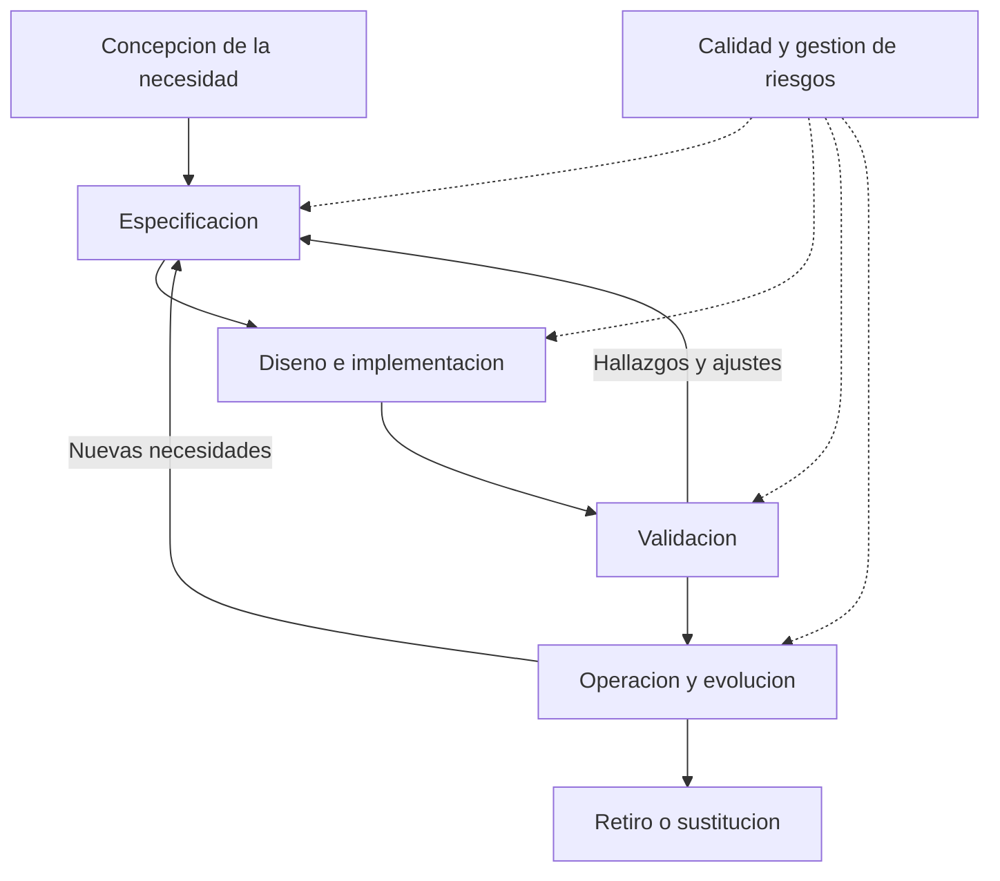
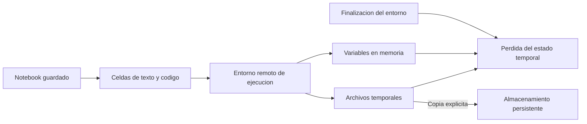

# Clase 3: Ingeniería de software para ciencia de datos: procesos, agilidad y entornos Python

> **Objetivo académico:** Comprender cómo los procesos, el diseño, la calidad y la coordinación propios de la ingeniería de software contribuyen a construir productos de datos mantenibles, y distinguir los entornos de experimentación en Python de las condiciones necesarias para su operación.

## 1. Contexto y marco conceptual

### El producto de datos como software

La sesión articula dos ámbitos: la ciencia de datos, caracterizada por la exploración y la experimentación, y la ingeniería de software, orientada a organizar la construcción, operación y evolución de sistemas. Su encuentro surge porque un producto de datos también necesita código, documentación, datos y condiciones de ejecución.

La definición amplia de software utilizada en la clase comprende los programas y los elementos asociados que permiten utilizarlos y mantenerlos. Desde esta perspectiva, entregar un algoritmo o un análisis no agota necesariamente el producto: también importan sus entradas, sus dependencias, la interpretación de sus resultados y la documentación que permite reproducirlo.

El trabajo en ciencia de datos presenta un carácter experimental e iterativo. Se prueban alternativas y se revisan decisiones según la evidencia obtenida. La ingeniería de software aporta métodos para que esa exploración pueda convertirse en un producto comprensible, modificable y operable.

**Enriquecimiento conceptual:** Conviene distinguir los datos como artefactos del producto de la afirmación de que todo dato es, por sí mismo, un programa. La definición amplia permite incluir conjuntos de datos en la entrega, pero no elimina sus diferencias con el código: sus problemas de calidad, procedencia y actualización requieren controles específicos.

### Por qué se necesita una disciplina de ingeniería

La evolución del software se presenta mediante el paso desde el procesamiento por lotes y los desarrollos a medida hacia sistemas multiusuario, bases de datos, redes, arquitecturas cliente-servidor y aplicaciones conectadas. El interés conceptual de este recorrido está en tres presiones persistentes:

- **Capacidad de aprovechar el hardware:** disponer de más recursos no garantiza que el software los utilice de manera adecuada.
- **Crecimiento de la demanda:** más usuarios y solicitudes pueden introducir saturación, concurrencia y dificultades de escalabilidad.
- **Mantenimiento del software existente:** incorporar cambios resulta más difícil cuando el sistema acumula dependencias, decisiones poco documentadas o deuda técnica.

Estas tendencias no constituyen leyes universales. Expresan problemas recurrentes cuya importancia depende de la arquitectura, el contexto de uso y la organización.

La sesión también destaca la distancia entre lo que necesita el cliente, lo que interpreta el equipo y lo que finalmente se implementa. Esa divergencia puede producir un sistema técnicamente ejecutable que no resuelve el problema del negocio. Por ello, desarrollar software exige construir entendimiento compartido, además de programar.

### Ingeniería de software y alcance del ciclo de vida

La ingeniería de software se define como la aplicación de enfoques sistemáticos, disciplinados y cuantificables al desarrollo, la operación y el mantenimiento. La clase recoge además una perspectiva centrada en todos los aspectos de producción de software y en su viabilidad económica, con menciones a Pressman y Sommerville, sin precisar ediciones.

Su alcance incluye procesos, métodos de diseño, pruebas, aseguramiento de calidad, automatización, gestión de riesgos, coordinación de equipos y buenas prácticas de programación. Los patrones de diseño ofrecen soluciones reutilizables a problemas de diseño; los antipatrones ayudan a reconocer decisiones que generan dificultades recurrentes.

El ciclo de vida puede comenzar con la concepción de una necesidad y continúa después del despliegue. La entrega inicial no equivale al fin del producto: siguen la operación, las modificaciones y el mantenimiento, hasta su retiro o sustitución.

## 2. Fundamentos teóricos y arquitectura

### Actividades fundamentales y modelos de proceso

La clase identifica cuatro actividades comunes a los procesos de desarrollo:

| Actividad | Pregunta central | Resultado conceptual |
| --- | --- | --- |
| Especificación | ¿Qué necesita el sistema y bajo qué restricciones? | Requerimientos y acuerdos sobre el comportamiento esperado |
| Diseño e implementación | ¿Cómo se organizará y construirá la solución? | Modelos, componentes y código |
| Validación | ¿La solución satisface las necesidades y condiciones previstas? | Evidencia obtenida mediante revisiones y pruebas |
| Evolución | ¿Cómo se incorporarán cambios durante su uso? | Correcciones, adaptaciones y nuevas capacidades |

Estas actividades no imponen una única secuencia. Pueden repetirse, solaparse y combinarse. Un **proceso** organiza el trabajo concreto de un equipo; un **modelo de proceso** representa una forma general de organizarlo. No existe un modelo ideal para todos los proyectos.



El diagrama sintetiza el ciclo de vida explicado en la sesión. Las conexiones de retorno representan retroalimentación y no prescriben una metodología particular.

### Comparación de modelos

| Modelo | Organización principal | Aporte | Límite o condición de uso |
| --- | --- | --- | --- |
| Cascada | Progresión por requerimientos, diseño, implementación, integración y mantenimiento | Ofrece una secuencia explícita de actividades y resultados | La retroalimentación tardía puede encarecer cambios importantes |
| Basado en componentes | Identificación y adaptación de componentes existentes | Aprovecha capacidades ya implementadas | La disponibilidad, compatibilidad y adecuación de los componentes condicionan la solución |
| Espiral | Ciclos organizados alrededor de objetivos, alternativas, riesgos, desarrollo y planificación | Hace explícito el análisis de riesgos | Requiere capacidad para identificar riesgos y evaluar alternativas |
| Desarrollo incremental | Incorporación progresiva de capacidades utilizables | Permite obtener retroalimentación antes de completar todo el producto | Exige coordinar los incrementos y mantener coherencia técnica |

En cascada, la clase presenta una organización fuertemente secuencial y una entrega posterior al recorrido de las etapas principales. La crítica se centra en la poca flexibilidad ante necesidades descubiertas durante la implementación.

En el desarrollo basado en componentes, el análisis de elementos disponibles puede conducir a revisar los requerimientos antes del diseño y la integración. Esta revisión debe entenderse como una negociación sobre la solución posible, no como una razón automática para abandonar necesidades esenciales.

La descripción del modelo espiral enfatiza cuatro dimensiones: determinar objetivos y restricciones; evaluar alternativas y resolver riesgos; desarrollar y verificar; planificar el ciclo siguiente.

**Enriquecimiento conceptual:** La fuente aproxima entrega incremental y espiral, pero conviene distinguirlas. La entrega incremental describe cómo se incorpora capacidad al producto; la espiral organiza el proceso alrededor del riesgo. Asimismo, repetir ciclos no basta para que un proceso sea ágil. La clasificación de un modelo como tradicional tampoco determina por sí sola su conveniencia: importan la estabilidad de los requerimientos, la criticidad y la necesidad de retroalimentación.

### Requerimientos, diseño y UML

Los requerimientos se obtienen mediante entrevistas y conversaciones con las partes interesadas o *stakeholders*. El cliente suele describir necesidades en lenguaje cotidiano; el equipo debe convertirlas en formulaciones claras y comprobables.

- **Funcionales:** describen comportamientos o servicios. Los ejemplos incluyen autenticar usuarios y administrar roles y permisos.
- **No funcionales y restricciones asociadas:** expresan cualidades, condiciones de operación o compromisos de la solución. En la clase se mencionan respaldos automáticos cada 24 horas, almacenamiento externo seguro y disponibilidad de manuales.

La precisión evita que una formulación mezcle capacidades diferentes o permita interpretaciones incompatibles. Estas especificaciones pueden formar parte de acuerdos entre la organización solicitante y la desarrolladora.

**Enriquecimiento conceptual:** La visibilidad en la interfaz no constituye el criterio para clasificar un requerimiento. Un proceso automático también puede ser funcional. Los respaldos combinan comportamiento, periodicidad y restricciones de almacenamiento; los manuales pueden representar un requisito de documentación del producto. Además, autenticar mediante usuario y contraseña describe un mecanismo, pero no demuestra por sí mismo la seguridad del sistema.

El diseño abstrae la solución antes o durante su construcción. UML proporciona un lenguaje para representar perspectivas del sistema, como estructura, comportamiento e interacciones. La sesión anuncia un interés particular por el diagrama de clases, aunque no desarrolla un modelo concreto.

**Enriquecimiento conceptual:** Las perspectivas de diseño arquitectónico, interfaces o datos no deben confundirse automáticamente con nombres de diagramas UML. El modelo adecuado depende de la pregunta que se busca resolver; no es necesario producir todos los diagramas para diseñar con rigor.

## 3. Implementación técnica y lógica de negocio

### Agilidad y organización con Scrum

La motivación del desarrollo ágil es reducir la distancia entre la construcción del software y la retroalimentación sobre su utilidad. La sesión destaca personas e interacciones, software funcionando, colaboración cercana con el cliente, aceptación del cambio y simplicidad documental.

**Enriquecimiento conceptual:** Estas prioridades no eliminan procesos, herramientas o documentación. Requieren utilizarlos en la medida en que sostienen la entrega de valor, el aprendizaje y la continuidad del producto. Las fechas mencionadas en la transcripción sobre el manifiesto y la evolución de Scrum no se emplean aquí como cronología validada.

Scrum se presenta como un marco de trabajo iterativo e incremental. La metáfora del rugby ilustra coordinación y reorganización del equipo; el contenido operativo está en cómo se selecciona, inspecciona y adapta el trabajo.

| Responsabilidad | Función explicada en la sesión | Precisión conceptual |
| --- | --- | --- |
| Product Owner | Mantener relación con el negocio, aportar retroalimentación y participar en la definición de capacidades | Orienta el valor y la ordenación del trabajo del producto |
| Scrum Master | Facilitar la organización y el funcionamiento del equipo | Facilita Scrum y la mejora del equipo |
| Developers | Construir y evaluar la solución | Integran las capacidades necesarias para producir un incremento |
| Stakeholders | Aportar necesidades y perspectivas de las áreas interesadas | Su participación no implica que todos integren el Scrum Team |

**Enriquecimiento conceptual:** La caracterización del Scrum Master como líder no debe interpretarse como una jefatura que asigna y controla individualmente todo el trabajo. El equipo necesita autogestión, colaboración y responsabilidades claras. La calidad tampoco queda confinada a un grupo que prueba después de que otros terminan de desarrollar.

El **Product Backlog** reúne y ordena el trabajo necesario para el producto. La sesión incluye funcionalidades, defectos, trabajo técnico y adquisición de conocimiento. Cada sprint concentra trabajo en un ciclo corto y busca producir una versión utilizable.

Las historias de usuario se presentan con la estructura:

> Como [rol], quiero [capacidad], para [beneficio].

El ejemplo de una aplicación de lectura puede expresarse así: «Como lector infantil, quiero acceder a un libro digital desde una tableta para leerlo con facilidad». El rol sitúa la necesidad, la capacidad delimita lo solicitado y el beneficio expresa su propósito.

**Enriquecimiento conceptual:** Las historias de usuario no sustituyen universalmente a los requerimientos ni son un formato obligatorio de Scrum. Los criterios de aceptación ayudan a concretar resultados verificables para un elemento; las condiciones de calidad y operación siguen siendo necesarias aunque no se redacten como historias.

### Inspección del avance y visualización del trabajo

El Daily Scrum aparece en la sesión como un encuentro breve para compartir avance, intención de trabajo y bloqueos. Las tres preguntas utilizadas son: qué se hizo, qué se hará y qué impide avanzar. La discusión también menciona la revisión del trabajo y del funcionamiento del equipo al terminar ciclos.

**Enriquecimiento conceptual:** Las tres preguntas constituyen una técnica posible, no una obligación universal. El Daily Scrum busca inspeccionar el avance hacia el objetivo del sprint y adaptar el plan; su duración de referencia es de 15 minutos. Las conversaciones técnicas prolongadas pueden continuar después entre quienes las necesiten. La Sprint Review inspecciona el producto con las partes interesadas, mientras la Sprint Retrospective analiza cómo mejorar el trabajo del equipo. Estas precisiones amplían la introducción de la fuente.

El tablero básico contiene tres estados: **To do**, **In progress** y **Done**. Los elementos se desplazan según su situación real. Pueden añadirse estados como revisión, validación o despliegue cuando representan pasos efectivos del flujo. Se mencionan Jira, Trello, Asana, Taiga, Notion y ClickUp como herramientas posibles; Taiga se destaca por su posibilidad de despliegue propio.

**Enriquecimiento conceptual:** Visualizar trabajo en columnas no equivale a aplicar por completo Kanban, ni disponer de un tablero demuestra que se utiliza Scrum. También es necesario acordar qué significa cada estado y controlar la acumulación de trabajo. Los gráficos de trabajo restante, mencionados como *burndown charts*, permiten observar tendencias, pero una reducción de elementos pendientes no acredita por sí sola valor o calidad.

### Python: intérprete, scripts y notebooks

La parte práctica distingue tres formas de interacción:

| Entorno | Característica | Uso principal en la sesión |
| --- | --- | --- |
| Intérprete interactivo | Recibe instrucciones y devuelve resultados inmediatamente | Probar fragmentos breves |
| Archivo `.py` | Conserva instrucciones en un script ejecutable | Organizar código fuera de una sesión interactiva |
| Notebook `.ipynb` | Combina celdas de código, texto y resultados | Documentar y desarrollar experimentación |

El comando `python3` abre habitualmente el intérprete de Python 3; la disponibilidad de `python` depende de la instalación. El indicador `>>>` identifica el entorno interactivo de Python y no debe copiarse como parte de una instrucción en un script.

**Enriquecimiento conceptual:** Aunque la explicación oral utiliza la palabra compilador, lo observado es la interacción con el intérprete. Esta precisión no implica que las implementaciones de Python carezcan de etapas internas de compilación.

**Enriquecimiento conceptual — reconstrucción didáctica:** Como el texto no conserva literalmente todas las instrucciones proyectadas, el siguiente ejemplo reproduce el mecanismo explicado, sin afirmar que sea el archivo exacto de la demostración:

```python
# saludo.py
print("Hola, mundo")
```

Desde una terminal, `python3 saludo.py` solicita al intérprete ejecutar el archivo. El editor puede ser Nano, Visual Studio Code u otro; la extensión identifica el tipo de archivo, pero no garantiza que su contenido sea correcto.

### Colab: documento, ejecución y recursos

Google Colab permite trabajar con notebooks desde el navegador sin preparar inicialmente un entorno local. Las celdas de código ejecutan Python; las de texto documentan decisiones, fórmulas e interpretaciones. Cada celda puede mostrar sus resultados, lo que facilita explorar por etapas.

La conexión asigna un entorno remoto de ejecución con memoria, almacenamiento y paquetes. Las cantidades observadas durante la demostración describen esa sesión y no constituyen recursos garantizados. La distribución de Linux, las bibliotecas preinstaladas y los aceleradores disponibles pueden variar.

La distinción fundamental es entre **documento persistente** y **estado de ejecución**. Conservar el notebook no implica conservar los objetos en memoria ni los archivos del almacenamiento temporal del entorno.



La fuente muestra la exploración de carpetas, la ubicación habitual `/content`, la creación de directorios y la carga de archivos mediante la interfaz. También utiliza comandos del sistema desde celdas.

**Enriquecimiento conceptual — reconstrucción didáctica:** En Colab y otros entornos basados en IPython pueden emplearse instrucciones como las siguientes:

```python
!pwd
!pip freeze
```

`!pwd` consulta el directorio de trabajo mediante el sistema operativo; `!pip freeze` lista paquetes instalados y sus versiones en un formato habitual para registrar dependencias. No son sentencias de Python estándar: el prefijo `!` es una capacidad del entorno interactivo. La extensión `.ipynb`, por sí sola, no asegura que todos los entornos interpreten estos comandos igual.

**Enriquecimiento conceptual:** `pip` es una herramienta de gestión de paquetes del ecosistema Python; su presencia depende de cómo se haya preparado el entorno. El prefijo `%` corresponde a comandos especiales de IPython y su efecto depende del comando concreto. No significa de forma general que una instrucción afectará a todas las celdas. Por ejemplo, `%cd /content` cambia el directorio de trabajo del proceso interactivo; una orden de shell lanzada con `!` puede ejecutarse en un proceso separado.

Anaconda se menciona como una opción para preparar trabajo local con notebooks y Visual Studio Code como otro entorno posible. **Enriquecimiento conceptual:** Anaconda facilita esa preparación, pero no es una condición necesaria para utilizar notebooks; existen otras instalaciones de Python y Jupyter.

### Recursos computacionales y transición a operación

La sesión diferencia CPU y GPU, y relaciona estas últimas con aprendizaje profundo. Colab puede ofrecer aceleradores y modalidades con unidades de cómputo, sujetos a disponibilidad y límites. No se conservan precios ni capacidades como condiciones permanentes.

**Enriquecimiento conceptual:** Seleccionar GPU no garantiza más memoria principal ni una aceleración automática. El código y sus bibliotecas deben aprovecharla, y la ganancia depende del tipo de operación y de la transferencia de datos.

Para el despliegue, la clase recomienda trasladar la lógica desde notebooks hacia archivos `.py`. El propósito es pasar de una exploración flexible a componentes organizados y reutilizables.

**Enriquecimiento conceptual:** Esta recomendación no constituye una prohibición universal de ejecutar notebooks de manera automatizada. La decisión depende del producto; el criterio central es que la ejecución pueda reproducirse, observarse y mantenerse con un entorno y unas dependencias explícitos.

## 4. Análisis crítico de casos y auditoría práctica

### Problemas profesionales y mecanismos de respuesta

La discusión reúne experiencias técnicas y organizativas. Sus soluciones son prácticas situadas, no resultados experimentales cuya eficacia se haya medido en la sesión.

| Problema | Respuesta discutida | Evaluación crítica |
| --- | --- | --- |
| Lentitud, configuración y exceso de conexiones a bases de datos | Ajustes de configuración y revisión tecnológica | Cambiar tecnología requiere identificar antes el cuello de botella |
| Alcance incompleto y cambios tardíos | Comunicación frecuente, gestión explícita del cambio y ciclos ágiles | Aceptar cambios exige revisar impacto, costo y arquitectura |
| Dificultad para obtener requerimientos | Reuniones sucesivas y prototipos visuales | Mostrar alternativas ayuda a concretar necesidades que resultan difíciles de expresar |
| Demanda mayor que la capacidad prevista | Uso de nube y seguimiento del comportamiento | La nube ofrece opciones de capacidad, pero no elimina límites de diseño |
| Equipos distribuidos entre zonas horarias | Ventanas comunes y comunicación asíncrona de bloqueos | El relevo debe dejar contexto suficiente para continuar sin esperar otra reunión |
| Deuda técnica acumulada | Refactorización continua y capacidad reservada para mejoras | La mejora debe reducir dificultades concretas de mantenimiento |
| Tecnología desconocida o sistemas heredados | Investigación focalizada, documentación y prueba de concepto | El aprendizaje debe resolver incertidumbres relevantes para decidir |
| Dependencias entre frontend y backend | Acuerdos sobre entradas y salidas, y uso de mocks | Los sustitutos deben mantenerse alineados con el servicio real |
| Estimaciones deficientes y roles ambiguos | Criterios de aceptación, planificación y retroalimentación | La herramienta de gestión no sustituye un entendimiento compartido |

Las experiencias de nube mencionan AWS y Azure. Su función en el argumento es ofrecer alternativas frente a restricciones de infraestructura propia; la sesión no desarrolla ni compara arquitecturas concretas en esos proveedores.

### Deuda técnica: separar funcionalidad y refactorización

Una práctica relatada consiste en separar un cambio funcional de una mejora de estructura mediante commits distintos. Se menciona también reservar una parte de la capacidad del equipo para reducir deuda técnica, con un ejemplo de distribución de 80 % para funcionalidad y 20 % para mejoras.

El valor de estas prácticas reside en hacer visible la inversión en mantenimiento y en evitar que toda la capacidad se consuma en nuevas funciones. La refactorización se plantea como una mejora de estructura que procura preservar el comportamiento y las pruebas existentes.

**Enriquecimiento conceptual:** Ni dos commits ni una proporción fija constituyen reglas universales. La separación facilita revisar la intención de los cambios, pero un commit adicional sin mejora pertinente añade ruido. La refactorización debería responder a dificultades observables y contar con evidencia razonable de que preserva el comportamiento. Un commit registra una versión en el repositorio; compartirla en un remoto es una operación adicional.

### Investigación técnica, pruebas de concepto y contratos de integración

Cuando el equipo desconoce una tecnología, un **spike** concentra investigación para reducir incertidumbre. Una **prueba de concepto**, o POC, implementa lo suficiente para explorar si una alternativa puede satisfacer una necesidad técnica.

La explicación oral destaca que una POC puede omitir aspectos propios de un producto terminado para acelerar el aprendizaje. **Enriquecimiento conceptual:** Esta simplificación delimita su propósito, pero no convierte el prototipo en evidencia de preparación para producción. La demostración de viabilidad y la preparación operativa responden a preguntas diferentes.

El caso frontend-backend propone acordar entradas y salidas y construir un mock para que una parte avance mientras la otra se implementa. El sustituto permite trabajar con respuestas previstas y reduce la dependencia temporal.

**Enriquecimiento conceptual:** El riesgo principal es que el mock deje de representar el contrato real. Su utilidad aumenta cuando estructuras, errores y condiciones relevantes están acordados y posteriormente se verifica la integración efectiva.

### Incidentes críticos y límites de la evidencia histórica

La clase utiliza tres relatos: una falla de software en aviación, un equipo de radioterapia con funcionamiento peligroso y un sistema bancario denominado Masternet que habría presentado grandes dificultades de costo y entrega. Su función es mostrar que los defectos pueden afectar seguridad, continuidad operativa y viabilidad económica.

La transcripción no permite establecer con rigor todos los detalles técnicos, fechas o montos. Por ello, no se atribuye un incidente complejo a una única condición de código ni se reproducen porcentajes o presupuestos como datos comprobados.

**Enriquecimiento conceptual:** El análisis de fallas críticas debe distinguir la manifestación del defecto, sus condiciones de activación y las barreras que debían limitar sus consecuencias. Reducir todo el incidente a un error de programación puede ocultar problemas de especificación, integración, validación y organización.

### Auditoría y datos sensibles en logs

Una experiencia describe un sistema que funcionaba en producción y recibió observaciones durante una auditoría interna, especialmente sobre logs e información sensible. Después de atenderlas, una revisión externa no formuló las mismas observaciones.

El caso muestra que funcionamiento observable y conformidad son dimensiones diferentes. Un sistema puede cumplir sus funciones visibles y aun registrar información de manera inadecuada.

**Enriquecimiento conceptual:** La revisión de logs debe considerar qué datos se registran, quién puede consultarlos, cuánto tiempo se conservan y qué trazabilidad aportan. Eliminar todos los registros perjudicaría la investigación de fallas; registrar información indiscriminadamente puede exponer datos sensibles. La decisión requiere equilibrar observabilidad y protección de información.

## 5. Principios de diseño, buenas prácticas y anti-patrones

### Principios derivados de la sesión

1. **Conectar capacidades con necesidades.** Los requerimientos y las historias deben explicar qué problema resuelven y para quién. Los prototipos y la retroalimentación temprana reducen interpretaciones divergentes.
2. **Elegir procesos según el contexto.** La criticidad, la incertidumbre y las restricciones del producto importan más que la popularidad de una metodología.
3. **Mantener el producto durante su evolución.** Las mejoras internas y la corrección de deuda técnica forman parte del trabajo sobre software, no de una etapa opcional posterior.
4. **Hacer explícitas las dependencias.** Entradas, salidas y criterios de aceptación permiten coordinar componentes y equipos sin depender exclusivamente de conversaciones informales.
5. **Distinguir exploración y operación.** Un notebook favorece el aprendizaje; un producto operativo requiere organizar aquello que debe ejecutarse de manera estable.
6. **Separar persistencia documental y estado temporal.** Guardar el notebook no preserva automáticamente variables ni archivos del entorno remoto.
7. **Incorporar calidad y auditoría durante el ciclo de vida.** Pruebas, revisión de información sensible y decisiones de mantenimiento deben acompañar el desarrollo.

### Antipatrones y sus consecuencias

| Antipatrón | Consecuencia probable | Alternativa razonada |
| --- | --- | --- |
| Esperar al final para validar necesidades | Descubrir tarde que el producto no resuelve el problema | Obtener retroalimentación mediante capacidades parciales y prototipos |
| Usar agilidad como justificación para omitir toda documentación | Perder contexto y dificultar continuidad | Documentar decisiones, contratos y condiciones de ejecución relevantes |
| Suponer que infraestructura adicional resuelve cualquier lentitud | Aumentar costos sin corregir el problema | Analizar carga, consultas, concurrencia y utilización de recursos |
| Convertir una POC directamente en producto | Arrastrar simplificaciones experimentales a operación | Revisar diseño, calidad y condiciones operativas |
| Mantener mocks incompatibles con el servicio real | Detectar fallas al integrar | Revisar contratos y comprobar integración |
| Acumular trabajo en progreso | Aumentar esperas y dificultar la terminación | Visualizar el flujo y reducir bloqueos |
| Confiar en que guardar el notebook conserva todos sus datos | Perder archivos o resultados al finalizar el entorno | Guardar explícitamente los artefactos necesarios |

**Enriquecimiento conceptual:** En notebooks, una dificultad adicional es el estado oculto: ejecutar celdas fuera de orden puede producir resultados que dependen de variables creadas previamente. Reiniciar el entorno y ejecutar desde el inicio ayuda a comprobar si el documento explica por sí mismo cómo reconstruir el resultado. Esta comprobación no fue documentada como ejecución realizada en la sesión.

Respecto al sistema de archivos de Colab, permanecer en el directorio de trabajo reduce modificaciones accidentales, pero no constituye una garantía de aislamiento. **Enriquecimiento conceptual:** Los permisos efectivos dependen del entorno. Reiniciar el proceso interactivo y reemplazar por completo el entorno remoto son operaciones distintas; no debe suponerse que cualquier reinicio restaurará los archivos modificados.

## 6. Síntesis conceptual y profundización académica

La ingeniería de software aporta un marco para convertir necesidades en productos que pueden construirse, validarse, operarse y evolucionar. En ciencia de datos, ese marco debe convivir con incertidumbre experimental y con decisiones que cambian a medida que se analizan los datos.

La clase establece tres conexiones centrales. Primero, la definición de necesidades, los modelos de diseño y los procesos reducen la distancia entre el problema del negocio y la solución técnica. Segundo, la agilidad ofrece ciclos de retroalimentación y mecanismos de coordinación cuya utilidad depende de cómo se aplican, no del uso de nombres o herramientas. Tercero, los entornos Python permiten explorar soluciones, pero el estado de una sesión interactiva no equivale a un producto reproducible y operable.

La experiencia relatada sobre Scrum en ciencia de datos muestra que sus mecanismos pueden adaptarse a estos equipos. No permite concluir que sus proyectos sean siempre más cortos que los de otras áreas: la duración y la incertidumbre dependen del problema y del producto.

**Enriquecimiento conceptual:** Una cuestión de profundización es distinguir resultado experimental e incremento de producto. Un experimento puede ser valioso al descartar una alternativa, aunque no produzca una nueva función utilizable. Su integración en el proceso requiere explicitar qué incertidumbre reduce y qué decisión permite tomar. Así se evita evaluar toda investigación únicamente por la cantidad de funcionalidad agregada.

Otras líneas conceptuales conectadas con la sesión son la relación entre deuda técnica y costo de cambio; la diferencia entre validación funcional, seguridad y conformidad; y el tránsito desde notebooks exploratorios hacia componentes mantenibles. En todos estos casos, la pregunta rectora es qué evidencia permite confiar en que el producto satisface su propósito y puede seguir haciéndolo cuando cambian sus datos, sus usuarios o sus condiciones de operación.
