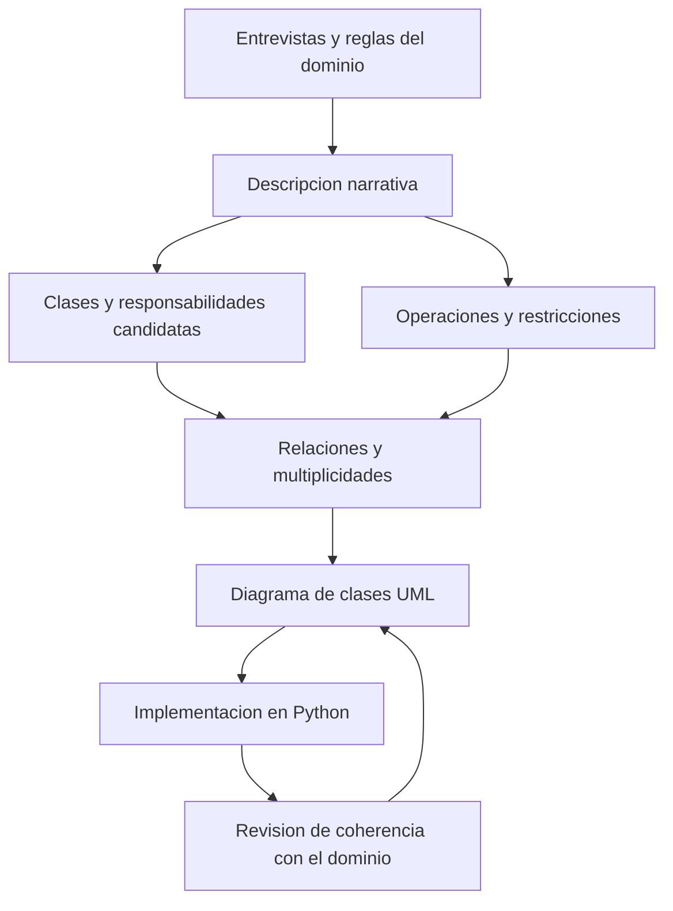

# Clase 5: Programación orientada a objetos en Python, modelado UML y entornos de ciencia de datos

> **Objetivo académico:** Comprender cómo las clases, los objetos y sus relaciones permiten organizar software en Python; traducir reglas de negocio a diagramas de clases UML y distinguir las herramientas de experimentación, gestión de dependencias y ejecución utilizadas en ciencia de datos.

## 1. Contexto y marco conceptual

La sesión conecta tres niveles del desarrollo de software: la organización del código mediante programación orientada a objetos, el diseño de sus relaciones mediante UML y la elección del entorno donde se desarrolla y ejecuta. La relación entre ellos es práctica: una estructura conceptual clara facilita implementar componentes reutilizables, mientras que un entorno de dependencias controlado permite ejecutarlos de manera consistente.

### Paradigmas y unidades de organización

La exposición parte de la programación secuencial y de la separación del código en funciones para introducir después las clases. Extraer una operación repetida a una función permite reutilizarla y mantener una única definición de su comportamiento. En Python, un archivo con extensión `.py` puede actuar como módulo importable y reunir funciones, clases y otras definiciones.

**Enriquecimiento conceptual:** Conviene distinguir programación modular de programación funcional. La primera organiza el programa en unidades con responsabilidades delimitadas; la segunda concede un papel central a la composición de funciones y, con frecuencia, al control de efectos y a la inmutabilidad. Definir funciones con `def` no convierte por sí solo un programa en funcional. Una función definida dentro de una clase puede actuar como método al acceder a ella mediante una instancia.

| Concepto | Papel en el diseño | Ejemplo de la sesión |
| --- | --- | --- |
| Módulo | Agrupar definiciones reutilizables | Archivo Python con clases de vehículos |
| Clase | Definir estructura y comportamiento de un tipo de objeto | `Auto`, `Vehiculo`, `Bus` |
| Instancia | Representar un objeto concreto con su propio estado | Un auto con marca, color y velocidad determinados |
| Atributo | Mantener información asociada a una clase o instancia | Descripción general o velocidad particular |
| Método | Ofrecer comportamiento asociado a objetos o clases | Obtener velocidad, describir un vehículo |

### Abstracción y debate sobre el sentido de la orientación a objetos

El ejemplo conductor consiste en representar un parque automotor. En lugar de mantener conjuntos dispersos de variables, una clase reúne propiedades y operaciones relacionadas. La analogía de la clase como plantilla ayuda a comprender que una misma definición permite construir múltiples instancias.

Durante la sesión se plantea una distinción relevante: modelar objetos del mundo real es una aplicación frecuente de la orientación a objetos, pero también importan la encapsulación, la modularidad y la comunicación entre objetos. Se menciona una interpretación histórica del paradigma, aunque no se proporciona una referencia verificable dentro de la fuente.

**Enriquecimiento conceptual:** La orientación a objetos no exige que cada clase corresponda a una entidad física. También puede representar servicios, estrategias de cálculo o componentes de un sistema. La calidad de la abstracción depende de que reúna responsabilidades coherentes y ofrezca una interfaz útil, además de su posible semejanza con elementos del dominio.

## 2. Fundamentos teóricos y arquitectura

### Clases, atributos y estado de las instancias

La clase `Auto` introduce dos categorías de atributos:

- **Atributos de clase:** se definen en el cuerpo de la clase y expresan información compartida o valores generales, como una descripción del tipo de vehículo.
- **Atributos de instancia:** se asignan al objeto, normalmente mediante expresiones como `self.color = color`, y representan su estado particular.

Crear varios autos no requiere repetir la definición completa de sus métodos. Cada instancia mantiene su estado y utiliza el comportamiento definido por su clase.

**Enriquecimiento conceptual:** Los métodos no se copian íntegramente en cada instancia. Su definición reside normalmente en la clase y el acceso a través de un objeto produce la vinculación con esa instancia. Además, asignar `auto.descripcion = ...` suele crear un atributo de instancia que oculta el atributo homónimo de clase para ese objeto. Las colecciones mutables definidas como atributos de clase requieren especial cuidado porque pueden compartirse accidentalmente.

### Inicialización y significado de `self`

En la sesión se denomina constructor a `__init__`, que recibe los datos necesarios para inicializar el estado de un auto. La asignación `self.velocidad = velocidad` conserva en la instancia el valor recibido; un parámetro que no se almacena como atributo sigue siendo local a la llamada correspondiente.

**Enriquecimiento conceptual:** Técnicamente, `__init__` inicializa una instancia que ya ha sido creada; `__new__` interviene en su creación. `self` es el nombre convencional del primer parámetro de un método de instancia, no una palabra reservada ni una dirección de memoria. Cuando se llama `auto.obtener_velocidad()`, Python proporciona la instancia como primer argumento del método.

Si un método ordinario se declara sin ese primer parámetro y se invoca mediante una instancia, normalmente se produce un `TypeError` por incompatibilidad en el número de argumentos. No se trata únicamente de perder acceso a los atributos. Los métodos estáticos, declarados con `@staticmethod`, no reciben automáticamente la instancia; los métodos de clase, declarados con `@classmethod`, reciben la clase y usan convencionalmente `cls`.

Ante la pregunta sobre varios constructores, la exposición adopta como regla práctica una única definición de `__init__`.

**Enriquecimiento conceptual:** Python no selecciona automáticamente entre varias definiciones de `__init__` según sus firmas: una definición posterior con el mismo nombre reemplaza la anterior dentro del cuerpo de la clase. Pueden emplearse parámetros opcionales o métodos de clase para ofrecer formas alternativas de creación. Asimismo, Python tiene tipado dinámico; esto no equivale a ausencia de tipos ni justifica describirlo como débilmente tipado.

### Encapsulación e interfaces de acceso

Los métodos de consulta, o getters, permiten obtener información del estado; los métodos de modificación, o setters, permiten actualizarla. Su utilidad radica en concentrar reglas y evitar modificaciones incompatibles con el dominio.

La sesión contrasta esta organización con los modificadores de acceso de otros lenguajes, como `public`, `private` y `protected`. Python ofrece un modelo menos restrictivo para el acceso a atributos.

**Enriquecimiento conceptual:** La encapsulación constituye una frontera de responsabilidad y una interfaz de uso, no una garantía de seguridad frente a código malicioso. En Python, `_atributo` comunica uso interno por convención; `__atributo` activa transformación de nombres para reducir colisiones, pero no impone privacidad absoluta. Las propiedades con `@property` permiten incorporar validación conservando una sintaxis de acceso a atributo. No es necesario crear getters y setters triviales para cada dato.

### Herencia, extensión y polimorfismo

La relación `Vehiculo`–`Camion` ilustra una especialización mínima: una subclase con `pass` puede utilizar la inicialización y los métodos heredados. `Bus` amplía el modelo incorporando pasajeros y precio del boleto. El uso de `super().__init__(nombre, velocidad)` reutiliza la inicialización disponible en la jerarquía sin duplicar sus asignaciones.

**Enriquecimiento conceptual:** La herencia debe expresar compatibilidad de comportamiento, habitualmente interpretada como una relación «es un». Una jerarquía de cargos organizacionales no implica automáticamente una jerarquía de tipos: un cambio de cargo puede modelarse mejor como una relación o rol. Reutilizar código es una consecuencia posible de heredar, pero no basta para justificar la relación.

El ejemplo de `Estudiante` y `Docente` muestra polimorfismo: ambos ofrecen `descripcion()`, y un mismo recorrido invoca ese método sin fijar de antemano la clase concreta de cada elemento.

**Enriquecimiento conceptual:** Este uso es característico del tipado por comportamiento, o duck typing, y no necesita una superclase común explícita. Debe distinguirse de la sobrecarga de firmas de otros lenguajes. La sobrecarga de operadores, mencionada pero no desarrollada en detalle, utiliza métodos especiales como `__add__` para definir comportamientos compatibles con los operadores de Python.

### Relaciones estructurales y UML

UML, Unified Modeling Language, permite representar distintas perspectivas de un sistema. La sesión se concentra en el diagrama de clases como puente entre las reglas del dominio y el código.

| Relación | Significado | Notación UML | Criterio de interpretación |
| --- | --- | --- | --- |
| Herencia o generalización | Un tipo especializa a otro | Línea con triángulo hueco hacia el tipo general | Compatibilidad del subtipo con el contrato general |
| Asociación | Existen vínculos entre instancias | Línea entre clases | Colaboración o referencia sin imponer propiedad del ciclo de vida |
| Agregación compartida | Relación de todo y partes con autonomía | Rombo hueco en el extremo del todo | Las partes pueden existir independientemente |
| Composición | Relación de todo y partes con propiedad fuerte | Rombo lleno en el extremo del todo | La parte pertenece como máximo a un compuesto a la vez y su ciclo de vida está ligado al conjunto |

La exposición presenta estas relaciones como grados crecientes de dependencia. **Enriquecimiento conceptual:** Esa gradación es una guía inicial; la elección debe apoyarse en propiedad, identidad y ciclo de vida. La agregación compartida tiene una semántica menos restrictiva y debe aclararse con reglas del dominio. Una asociación tampoco exige que se utilice un identificador: puede implementarse mediante una referencia directa a otro objeto.

## 3. Implementación técnica y lógica de negocio

Los ejemplos se explican oralmente sobre un notebook cuyo texto completo de código no está incluido en la fuente. Los siguientes fragmentos son **Enriquecimiento conceptual:** reconstrucciones didácticas coherentes con los conceptos expuestos; no son transcripciones literales ni resultados de una ejecución realizada.

### Inicialización, consulta y modificación de un auto

```python
class Auto:
    descripcion = "Vehiculo de motor con ruedas"

    def __init__(self, marca, velocidad, color):
        self.marca = marca
        self.color = color
        self.definir_velocidad(velocidad)

    def obtener_velocidad(self):
        return self.velocidad

    def definir_velocidad(self, velocidad):
        if velocidad < 0:
            raise ValueError("La velocidad debe ser no negativa")
        self.velocidad = velocidad

    def __str__(self):
        return f"{self.marca}, {self.color}, {self.velocidad} km/h"
```

Se supone que `velocidad` es un valor numérico expresado en kilómetros por hora y que representa una magnitud no negativa; `marca` y `color` son textos. La restricción agregada ilustra cómo un setter puede proteger una regla del dominio. No representa velocidades con signo para indicar sentido de desplazamiento ni verifica exhaustivamente los tipos recibidos.

La asignación inicial utiliza el mismo método de modificación para centralizar la regla. Sin embargo, como `velocidad` sigue siendo un atributo público, otro código puede reasignarlo directamente. El ejemplo muestra una interfaz de uso, pero no impone que todas las modificaciones pasen por ella; una propiedad permite reforzar esa centralización.

### Reutilización mediante herencia

```python
class Vehiculo:
    def __init__(self, nombre, velocidad):
        self.nombre = nombre
        self.velocidad = velocidad

    def descripcion(self):
        return f"{self.nombre}: {self.velocidad} km/h"


class Camion(Vehiculo):
    pass


class Bus(Vehiculo):
    def __init__(self, nombre, velocidad, pasajeros, precio_boleto):
        super().__init__(nombre, velocidad)
        self.pasajeros = pasajeros
        self.precio_boleto = precio_boleto
```

`Camion` utiliza la inicialización heredada. `Bus` incorpora dos atributos y delega la inicialización de los atributos comunes. Se asume que `pasajeros` es una cantidad entera no negativa y `precio_boleto` un importe monetario no negativo; el fragmento no implementa todavía esas validaciones.

La fuente menciona una operación denominada `calcular_ganancia` con un parámetro de impuesto, pero no proporciona su expresión completa. No puede reconstruirse su cálculo ni determinarse si representa ingresos, beneficio neto o un ajuste tributario. El punto verificable es que un parámetro como `impuesto` no queda disponible como atributo persistente si no se asigna explícitamente a la instancia.

### Polimorfismo mediante una interfaz común

```python
class Estudiante:
    def descripcion(self):
        return "Soy estudiante"


class Docente:
    def descripcion(self):
        return "Soy docente"


personas = (Estudiante(), Docente())
for persona in personas:
    texto = persona.descripcion()
```

El recorrido depende de que cada objeto responda a `descripcion()`. El nombre local `persona` puede vincularse sucesivamente con objetos de clases diferentes. Para que esta colaboración sea útil, ambos métodos deben ofrecer un contrato compatible: por ejemplo, devolver un texto descriptivo en lugar de producir resultados de naturaleza incompatible.

### Referencias, agregación y composición

En el ejemplo de agregación, `Universidad` conserva una lista de estudiantes creados previamente. Agregar un objeto a esa lista almacena una referencia; no duplica automáticamente al estudiante. Si existen otras referencias al mismo objeto, una modificación puede observarse desde ellas.

En el ejemplo de composición, `Estudiante` crea una instancia de `Fecha` para representar su registro. La intención es que ese componente forme parte del estado del estudiante y se gestione junto con él.

**Enriquecimiento conceptual:** Crear internamente una parte expresa una intención de propiedad, pero no impide que se compartan referencias a ella. Tampoco el uso de una lista distingue por sí solo una agregación de una composición: ambas pueden implementarse mediante colecciones. La diferencia pertenece al contrato del modelo y a cómo se gestiona el ciclo de vida.

### De los requisitos narrativos al diagrama de clases

La sesión describe un proceso de diseño basado en entrevistas, reglas de negocio y una descripción escrita del sistema. Un caso de gestión de cuentas institucionales permite identificar personas, docentes, estudiantes y cuentas; entre las reglas relevantes aparece la necesidad de evitar cuentas repetidas.

La heurística propuesta consiste en reconocer sustantivos como candidatos a clases, acciones como candidatos a operaciones y propiedades descriptivas como candidatos a atributos. A partir de ahí se establecen relaciones y multiplicidades.



**Enriquecimiento conceptual:** La identificación lingüística genera candidatos, no decisiones automáticas. Un sustantivo puede representar un atributo, una infraestructura ajena al alcance del modelo o un rol temporal. La unicidad de las cuentas, por ejemplo, requiere una regla sobre el conjunto de cuentas existentes, no solo un atributo textual en cada objeto.

### Notación de las clases y multiplicidad

Una clase UML se presenta en tres compartimentos: nombre, atributos y operaciones. Una forma habitual de especificar un atributo es `visibilidad nombre: Tipo = valorInicial`; para una operación, `visibilidad nombre(parametro: Tipo): TipoRetorno`. Los símbolos `+`, `-` y `#` representan, respectivamente, visibilidad pública, privada y protegida.

La multiplicidad indica cuántas instancias de un extremo pueden relacionarse con una instancia del extremo opuesto:

| Notación | Interpretación |
| --- | --- |
| `1` | Exactamente una |
| `0..1` | Ninguna o una |
| `0..*` o `*` | Ninguna o varias |
| `1..*` | Una o varias |
| `n..m` | Entre los límites enteros no negativos `n` y `m`, con `n` menor o igual que `m` |

En la asociación alumno–módulo, admitir cero alumnos o exigir al menos uno depende del estado del módulo y de sus reglas de apertura. En la relación directivo–empleado, permitir varios directivos por empleado expresa una estructura distinta de una supervisión única. Las multiplicidades deben justificarse en ambos sentidos.

La sesión muestra draw.io como herramienta para construir clases y conectores UML. Su función es facilitar la representación; no determina por sí misma la corrección del modelo.

## 4. Análisis crítico de casos y auditoría práctica

### Herencia múltiple y resolución de métodos

Se explora la posibilidad de heredar desde varias clases y se observa una combinación que genera una resolución inconsistente. También surge la pregunta sobre qué ocurre si dos bases ofrecen un método con el mismo nombre. La explicación oral no llega a establecer la regla correcta y generaliza a partir de una observación sobre `__str__`.

**Enriquecimiento conceptual:** Python utiliza un orden de resolución de métodos, MRO, calculado mediante linealización C3. La elección no se rige por «el último método definido». Se consulta el orden de la clase concreta, observable mediante `Clase.__mro__` o `Clase.mro()`. Una definición en la propia subclase tiene prioridad; en herencia múltiple, el orden de las bases y sus jerarquías restringe la búsqueda. Si no puede construirse un orden consistente, la definición de la clase falla con `TypeError`. `super()` continúa la búsqueda según ese MRO, por lo que no significa de forma general «acceder a un padre fijo».

### Introspección y representación textual

`type(objeto)` permite conocer su tipo; `dir(objeto)` facilita explorar nombres de atributos y métodos disponibles. La sesión utiliza estas funciones para relacionar la definición de una clase con los miembros accesibles desde sus instancias.

**Enriquecimiento conceptual:** `dir()` es una ayuda de exploración, no un inventario contractual exhaustivo para todos los objetos. Los nombres con doble guion bajo al inicio y al final suelen corresponder a protocolos del lenguaje, como `__str__` y `__repr__`; su disponibilidad concreta depende del tipo y de su jerarquía.

Debe distinguirse entre consultar `objeto.__str__`, que obtiene un método, e invocar `objeto.__str__()`, que obtiene su resultado. `print(objeto)` utiliza la conversión textual correspondiente. Al mostrar una lista, la representación de sus elementos se obtiene normalmente mediante `repr`, no mediante `str`; por ello, personalizar solo `__str__` puede no modificar la representación de una lista de instancias. Una representación predeterminada de objeto no debe interpretarse como una especificación portable de su ubicación física en memoria.

### Eliminación de nombres y ciclo de vida

La demostración con universidad, estudiantes y fecha busca distinguir autonomía de las partes y dependencia respecto del conjunto. Su intuición de modelado es útil, pero requiere separar las relaciones UML de la semántica de ejecución de Python.

**Enriquecimiento conceptual:** `del estudiante` elimina una vinculación del nombre, no garantiza la destrucción inmediata del objeto. Si una lista u otra variable conserva una referencia al estudiante, este continúa siendo accesible. Asimismo, eliminar una referencia a la universidad no elimina estudiantes que siguen referenciados desde otros lugares. La recuperación de memoria depende de la alcanzabilidad y de la implementación; no debe utilizarse una demostración con `del` como prueba automática de composición UML.

### Empresa, cliente y empleado: identidad y roles

El caso empresarial distingue clientes autónomos de empleados vinculados a una empresa. Se propone agregación para clientes y composición para empleados, y se representa al directivo como especialización de empleado.

**Enriquecimiento conceptual:** Esta decisión solo es defendible si se aclara qué significa cada objeto. El cierre de una empresa puede finalizar una relación laboral, pero no elimina a la persona ni necesariamente su historial. Separar `Persona` de una entidad que represente el vínculo laboral permite expresar ese ciclo de vida con mayor precisión. De modo semejante, «cliente» puede representar una persona u organización, o bien su rol respecto de una empresa. Cambiar esa interpretación cambia las relaciones adecuadas.

### Revisión de notebooks y modelos de terceros

La exploración de Kaggle muestra un flujo de trabajo con importación de bibliotecas, carga de datos, análisis exploratorio, limpieza, entrenamiento y evaluación. Estos notebooks pueden servir para comprender decisiones y descubrir alternativas de implementación.

La exposición menciona una métrica próxima a `0.86` en un ejemplo de salud, pero no identifica con suficiente precisión su definición, el conjunto de evaluación ni el protocolo utilizado. Por ello, ese valor no permite concluir que el modelo sea adecuado o insuficiente.

**Enriquecimiento conceptual:** La evaluación exige conocer la tarea, la distribución de clases, las métricas, la partición de datos y los costos de error. En aplicaciones de salud, métricas agregadas pueden ocultar diferencias relevantes entre sensibilidad, especificidad o calibración. La popularidad de un notebook o modelo tampoco certifica su validez científica.

## 5. Principios de diseño, buenas prácticas y anti-patrones

### Diseño orientado a responsabilidades

Las clases deben reunir datos y operaciones relacionados, ofrecer una interfaz comprensible y evitar duplicar reglas. La herencia resulta útil para especializaciones compatibles; la asociación y la composición permiten construir colaboradores sin forzar una jerarquía.

| Buena práctica | Justificación | Anti-patrón asociado |
| --- | --- | --- |
| Definir invariantes del estado | Mantener condiciones válidas durante la vida del objeto | Repartir validaciones contradictorias entre varios consumidores |
| Justificar la herencia mediante el contrato del subtipo | Facilitar sustitución y comprensión | Heredar únicamente para copiar unas pocas operaciones |
| Precisar propiedad y ciclo de vida | Evitar ambigüedades entre asociación, agregación y composición | Elegir relaciones solo por semejanza visual con el mundo real |
| Revisar multiplicidades con reglas del dominio | Representar casos opcionales, mínimos y máximos | Añadir `0..*` a todas las relaciones sin análisis |
| Mantener correspondencia entre UML y código | Conservar utilidad del diseño durante la implementación | Tratar el diagrama como representación definitiva e inmutable |
| Revisar código reutilizado | Comprender supuestos, dependencias y limitaciones | Adoptar un notebook por sus votos o por mostrar una métrica elevada |

**Enriquecimiento conceptual:** La visibilidad UML expresa una intención de diseño. La ausencia de modificadores equivalentes en Python no obliga a declarar todos los elementos como públicos en el modelo. Puede documentarse una interfaz pública junto con convenciones de uso interno.

### Ecosistema para experimentar con datos

La sesión presenta Colab, Deepnote y Kaggle como alternativas de notebooks en la nube. Su utilidad incluye disponer de recursos sin depender exclusivamente del equipo local; Deepnote incorpora colaboración sobre documentos compartidos.

Kaggle se describe mediante varios tipos de recursos:

- Competencias que plantean problemas de análisis y comparación de soluciones.
- Conjuntos de datos que pueden apoyar una investigación o implementación, sin garantizar que exista uno adecuado para cada necesidad.
- Modelos preentrenados que permiten reutilizar capacidades existentes.
- Notebooks con código, procedimientos y proyectos de referencia.
- Recursos de comparación de modelos y resultados.

**Enriquecimiento conceptual:** Un benchmark no se define únicamente por ser un conjunto de datos popular. Una comparación reproducible necesita una tarea, datos o particiones definidos, métricas y un protocolo de evaluación. Los límites de cómputo y las opciones de las plataformas pueden variar; las cifras mostradas en una sesión no deben asumirse como prestaciones permanentes.

La sesión también menciona Google Drive, Amazon S3 y Firebase en el contexto de almacenamiento. **Enriquecimiento conceptual:** Son servicios de distinto alcance; Firebase es una plataforma que incluye varios servicios y no un equivalente directo de un sistema de archivos o de un almacén de objetos.

### Herramientas locales: categorías que conviene separar

Windows, macOS y Linux pueden alojar flujos de trabajo de ciencia de datos, sujeto a la compatibilidad de las dependencias. Entre las herramientas locales mencionadas aparecen Spyder, Jupyter Notebook, JupyterLab, PyCharm y Visual Studio Code.

| Elemento | Función principal |
| --- | --- |
| Anaconda | Distribución que integra Python, paquetes y herramientas |
| Anaconda Navigator | Interfaz gráfica para gestionar entornos y acceder a aplicaciones |
| Conda | Gestor de paquetes y entornos |
| Spyder | Entorno de desarrollo orientado al trabajo científico |
| Jupyter Notebook | Interfaz de documentos computacionales con celdas |
| JupyterLab | Interfaz de trabajo que integra notebooks y otros recursos |
| PyCharm y Visual Studio Code | Herramientas de desarrollo con soporte para Python y, según configuración y edición, notebooks |

**Enriquecimiento conceptual:** JupyterLab no es exclusivamente un servicio en la nube. Tanto Jupyter Notebook como JupyterLab pueden ejecutarse localmente o en un servidor remoto. Que la interfaz se abra en un navegador no determina dónde se realiza el cómputo. Un notebook `.ipynb` es un documento que contiene celdas, metadatos y posiblemente salidas; su ejecución depende de un kernel.

### Entornos y aislamiento de dependencias

La demostración en Navigator compara entornos con diferentes versiones de Notebook y JupyterLab. Un entorno mantiene un conjunto de paquetes y puede incluir una versión específica del intérprete de Python. Seleccionar otro entorno cambia el contexto de ejecución y las dependencias disponibles; no significa actualizar automáticamente todos los proyectos.

Las operaciones mostradas incluyen crear, activar, eliminar, clonar e importar o exportar entornos. El entorno `base` es el entorno inicial de Conda, pero no tiene por qué concentrar las dependencias de todos los proyectos.

**Enriquecimiento conceptual:** Es preferible disponer de entornos por proyecto o por conjuntos compatibles de dependencias. El aislamiento no sustituye el registro de versiones, canales y condiciones de instalación. En notebooks debe verificarse también el kernel seleccionado: el entorno desde el cual se abre la interfaz puede diferir del utilizado para ejecutar las celdas. La referencia oral a Python `2.9` es un lapsus y no corresponde a una versión publicada.

### Experimentación y producción

La sesión diferencia el uso interactivo de notebooks de la ejecución de software desplegado. Para producción se propone recurrir a programas Python invocables desde terminal o mecanismos de automatización, reduciendo la dependencia de interfaces de escritorio.

**Enriquecimiento conceptual:** Un despliegue necesita el intérprete, las dependencias y la configuración requerida; copiar únicamente un archivo `.py` no basta. Conda también puede utilizarse en producción: lo que debe justificarse es el tamaño y la composición del entorno, no excluir su gestor por principio. La decisión de empaquetado debe considerar reproducibilidad, compatibilidad y operación del servicio.

## 6. Síntesis conceptual y profundización académica

La orientación a objetos permite organizar estado y comportamiento en componentes con interfaces explícitas. La clase define capacidades compartidas; cada instancia mantiene su identidad y estado. `self` conecta una llamada de método con el objeto receptor, mientras que la encapsulación concentra reglas y establece cómo debe utilizarse el componente.

La herencia facilita especialización cuando existe compatibilidad de contratos. El polimorfismo permite escribir consumidores que dependen de una interfaz de comportamiento en lugar de una clase concreta. En Python, este mecanismo es habitual y no requiere siempre una jerarquía explícita.

Los diagramas de clases hacen visibles decisiones sobre atributos, operaciones, relaciones y multiplicidades. Su valor reside en expresar reglas del dominio que después deben sostenerse en el código. Asociación, agregación y composición no son distintas sintaxis para almacenar objetos: representan compromisos sobre colaboración, propiedad y ciclo de vida.

El entorno de ejecución completa esta arquitectura. Un diseño correcto puede fallar si utiliza dependencias incompatibles o un kernel distinto del esperado. Del mismo modo, un notebook reproducible no garantiza que sus clases representen correctamente el dominio ni que sus métricas demuestren utilidad.

**Enriquecimiento conceptual:** Tres líneas de profundización conectan los contenidos de la sesión: contratos e invariantes para razonar sobre el comportamiento de los objetos; identidad, roles y propiedad para afinar el modelado del dominio; y trazabilidad de dependencias y protocolos de evaluación para sostener la reproducibilidad de los sistemas de ciencia de datos. Estas perspectivas permiten analizar conjuntamente la calidad del diseño, la ejecución y la evidencia producida.
