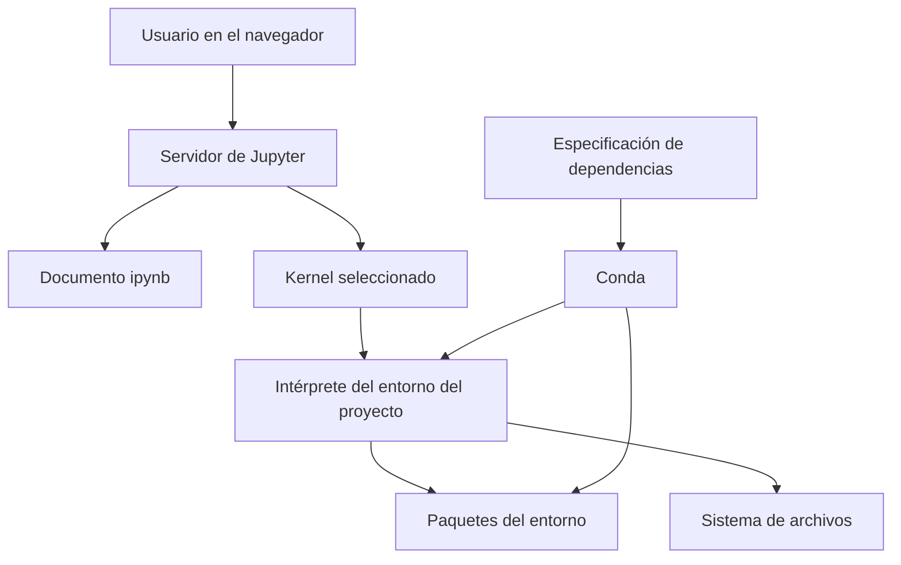
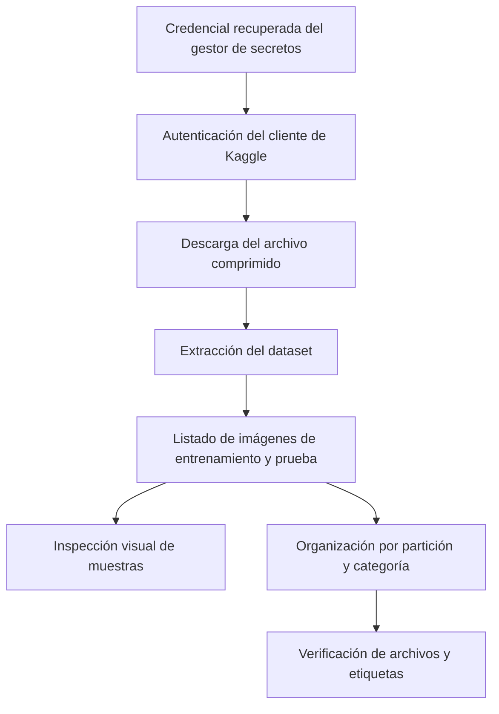

# Clase 6: Entornos reproducibles de Python y automatización del procesamiento de archivos

> **Objetivo académico:** Comprender la relación entre notebooks, kernels y entornos de Python, gestionar dependencias para facilitar la reproducibilidad y automatizar operaciones sobre archivos mediante un caso de organización de imágenes de problemas urbanos.

## 1. Contexto y marco conceptual

La sesión articula dos problemas de ingeniería de software habituales en ciencia de datos: ejecutar un proyecto bajo condiciones compatibles entre equipos y procesar colecciones de archivos que resultan impracticables de gestionar manualmente. Ambos afectan la transición desde una exploración individual hacia un flujo de trabajo compartido y repetible.

Un notebook combina código, explicaciones y resultados. Su formato habitual es `.ipynb`, mientras que un script de Python utiliza `.py`. Ambos pueden ejecutar Python, pero difieren en la forma de organizar la interacción: el notebook permite ejecutar celdas de manera independiente y conservar sus salidas; el script expresa una secuencia de instrucciones en un archivo de código.

En la sesión se presenta Jupyter Notebook como una aplicación que puede instalarse independientemente de Anaconda. Al iniciarse, pone en funcionamiento un servidor web al que se accede mediante un navegador. Que la interfaz aparezca en el navegador no significa que la ejecución ocurra necesariamente en un servicio externo: puede realizarse en la misma computadora.

Anaconda reúne herramientas y paquetes; Conda gestiona entornos y paquetes; Jupyter proporciona la interfaz de trabajo; el kernel ejecuta el código. Estas responsabilidades deben distinguirse para comprender por qué un notebook puede abrirse correctamente y, aun así, utilizar un intérprete o unas dependencias diferentes de las esperadas.

| Elemento | Responsabilidad | Implicación práctica |
| --- | --- | --- |
| Anaconda | Distribuir Python, paquetes y herramientas de trabajo | Su instalación suele incorporar Conda y un entorno `base` |
| Conda | Crear entornos y resolver instalaciones de paquetes | Permite mantener configuraciones distintas por proyecto |
| Jupyter Notebook | Editar documentos y coordinar su ejecución | Separa el documento de la infraestructura que ejecuta el código |
| Kernel de Python | Mantener una sesión de ejecución de Python | Determina qué intérprete y paquetes utiliza el notebook |
| Archivo `.ipynb` | Almacenar celdas, salidas y metadatos | Compartirlo no transfiere automáticamente sus dependencias |
| Archivo `.py` | Almacenar instrucciones de Python | También requiere un entorno compatible para ejecutarse |

**Enriquecimiento conceptual:** El kernel no equivale estrictamente a un compilador, aunque durante la explicación se emplee esa analogía. Es un proceso que recibe solicitudes de ejecución y mantiene el estado de la sesión: variables, objetos e importaciones. En Python, `ipykernel` implementa esta integración con Jupyter.

## 2. Fundamentos teóricos y arquitectura

### 2.1. Separación entre interfaz, ejecución y entorno

El servidor de Jupyter gestiona la interacción con el navegador y los documentos. El kernel ejecuta las celdas con el intérprete asociado a su configuración. Por ello, el entorno desde el que se inicia Jupyter y el entorno utilizado por un kernel pueden ser diferentes.



Las celdas principales son de código y Markdown. Las primeras solicitan ejecución al kernel; las segundas permiten documentar supuestos, procedimientos y conclusiones. La interfaz también permite insertar, mover, copiar y eliminar celdas, guardar el documento y exportarlo a otros formatos.

Debe distinguirse entre interrumpir una ejecución, reiniciar el kernel y apagarlo. Interrumpir intenta detener el cálculo actual. Reiniciar crea una sesión de ejecución nueva. Apagar termina el proceso del kernel. Cerrar una pestaña o cerrar la sesión de la interfaz no debe tomarse como prueba de que todos los procesos de ejecución hayan terminado.

**Enriquecimiento conceptual:** Reiniciar elimina el estado en memoria, pero no necesariamente las salidas guardadas en el documento. Reiniciar y limpiar las salidas son operaciones diferentes. Asimismo, interrumpir un proceso no revierte los archivos que ya haya creado o modificado.

### 2.2. Entornos como unidades de aislamiento

Un entorno agrupa un intérprete y un conjunto de paquetes destinados a un proyecto. Su utilidad aparece cuando distintos proyectos requieren versiones incompatibles de Python o de sus bibliotecas. En lugar de sustituir una instalación global y arriesgar la ejecución de otros proyectos, se mantienen configuraciones separadas.

La clase utiliza como motivación la transferencia de código desde Colab hacia servidores locales, también denominados *on-premises*. Colab puede proporcionar aceleradores útiles para ciertos modelos, pero trasladar el notebook exige revisar la versión de Python y las dependencias del destino. Disponer de GPU y disponer de un entorno compatible son cuestiones diferentes.

El entorno `base` de Conda es un entorno más: instalar un paquete allí no lo instala automáticamente en los demás. La activación selecciona los ejecutables y las dependencias del entorno para la terminal correspondiente.

**Enriquecimiento conceptual:** La activación modifica principalmente variables de entorno, como `PATH`, de la sesión de terminal y de sus procesos descendientes. No sustituye dinámicamente el Python de todas las aplicaciones del sistema ni cambia el intérprete de un kernel que ya estaba ejecutándose.

La implementación física varía según la herramienta. Conda puede administrar instalaciones de Python y reutilizar una caché de paquetes; otras herramientas crean entornos a partir de intérpretes ya disponibles. El aislamiento no exige que todos los archivos se dupliquen físicamente.

### 2.3. Herramientas y ciclo de vida

Se mencionan Conda, Mamba, Poetry, Pipenv y herramientas de entornos virtuales de Python. Comparten objetivos de aislamiento o administración de dependencias, pero sus responsabilidades y mecanismos no son idénticos.

**Enriquecimiento conceptual:** Miniconda es una distribución mínima que incluye Conda; no es un gestor distinto. `venv` crea entornos a partir de una instalación existente de Python y no descarga por sí mismo cualquier versión del intérprete. Mamba ofrece gestión compatible con el ecosistema Conda; la cantidad de paquetes instalados depende de la distribución y de las decisiones de instalación, por lo que no corresponde definirlo únicamente como una alternativa para equipos de pocos recursos.

La sesión distingue etapas del ciclo de vida de una versión de Python: incorporación de funcionalidades, correcciones de errores, mantenimiento de seguridad y fin de soporte. Esta distinción permite comprender por qué mantener un proyecto antiguo requiere considerar tanto compatibilidad como mantenimiento. Las versiones citadas funcionan como ejemplos históricos, no como recomendaciones actuales.

## 3. Implementación técnica y lógica de negocio

### 3.1. Operación básica con Conda

La secuencia expuesta consiste en consultar versiones, crear un entorno con una versión explícita de Python, activarlo y revisar sus paquetes. En Windows se utiliza Anaconda Prompt; en otros sistemas se emplea una terminal con Conda correctamente inicializado.

**Enriquecimiento conceptual:** El siguiente bloque normaliza la sintaxis de los comandos descritos oralmente; no representa una ejecución verificada. Python 3.9 se conserva como ejemplo de la sesión.

```bash
conda --version
python --version
conda create --name new_project python=3.9
conda activate new_project
python --version
conda env list
conda list
conda deactivate
```

`conda create` solicita resolver e instalar un entorno con la versión indicada. `conda activate` selecciona ese entorno en la terminal actual. `conda env list` enumera los entornos y `conda list` muestra los paquetes del entorno seleccionado. La desactivación restaura el contexto anterior; no debe suponerse que siempre conduce a `base`, porque el resultado depende de la secuencia previa de activaciones.

**Enriquecimiento conceptual:** `conda update conda` actualiza el paquete Conda en el entorno correspondiente y puede producir cambios en dependencias necesarios para resolver la operación. No equivale a actualizar todos los paquetes de todos los entornos ni debe confundirse con una simple actualización de un listado de repositorios.

### 3.2. Integración de entornos con Jupyter

La sesión muestra que crear un entorno no garantiza que aparezca de inmediato en el selector de kernels. Se mencionan `nb_conda_kernels` e `ipykernel`, y posteriormente se identifica el registro explícito del kernel como una alternativa para hacerlo visible.

**Enriquecimiento conceptual:** Hay dos mecanismos que conviene separar. `nb_conda_kernels`, instalado donde se ejecuta Jupyter, puede facilitar el descubrimiento de entornos Conda compatibles; `ipykernel` debe estar disponible en el entorno que ejecutará Python. Otra opción es registrar explícitamente ese entorno mediante una especificación de kernel:

```bash
conda activate new_project
conda install ipykernel
python -m ipykernel install --user --name new_project --display-name "Python (new_project)"
```

El comando de registro debe ejecutarse con el Python del entorno deseado. El nombre visible es una etiqueta; para comprobar qué intérprete se utiliza realmente, puede inspeccionarse desde el notebook:

```python
import sys

print(sys.executable)
print(sys.version)
```

Esta comprobación es más informativa que asumir que el entorno de la terminal y el kernel seleccionado coinciden.

### 3.3. Paquetes con pip y especificación de dependencias

Conda y pip permiten instalar paquetes, pero operan con modelos y repositorios diferentes. La sesión presenta pip como una alternativa cuando un paquete no está disponible mediante la configuración de Conda utilizada. También muestra cómo obtener un listado de dependencias y reinstalarlo en otro entorno.

**Enriquecimiento conceptual:** Se normaliza el ejemplo usando `python -m pip`, que vincula la operación al intérprete invocado y reduce la ambigüedad entre ejecutables `pip`, `pip3` y varias instalaciones de Python:

```bash
python -m pip --version
python -m pip freeze > requirements.txt
python -m pip install -r requirements.txt
```

`freeze` produce un listado de distribuciones instaladas en el contexto consultado. La redirección `>` escribe esa salida en un archivo. `install -r` interpreta el archivo como una especificación de requisitos. El nombre `requirements.txt` es convencional, aunque puede utilizarse otro.

La fijación de versiones utiliza sintaxis distinta en los ejemplos de ambos gestores: pip emplea habitualmente `paquete==versión`, mientras que Conda acepta especificaciones como `paquete=versión`. Es necesario conocer qué herramienta consumirá cada archivo.

La sesión también presenta la exportación e importación de entornos desde Anaconda Navigator. El archivo YAML expresa una configuración; no contiene copias completas de todos los paquetes. Puede incluir paquetes gestionados por Conda y una sección de dependencias pip.

**Enriquecimiento conceptual:** Los comandos equivalentes habituales para exportar y recrear un entorno son:

```bash
conda env export --name new_project > environment.yml
conda env create --file environment.yml
```

Estos comandos complementan la explicación de la interfaz; no fueron desarrollados explícitamente durante la demostración. La portabilidad del YAML depende de su contenido: fijaciones de compilación, canales o rutas locales pueden requerir ajustes entre plataformas.

### 3.4. Automatización portable del sistema de archivos

El problema práctico es gestionar miles de imágenes, audios, videos u otros archivos sin realizar operaciones manuales repetitivas. La clase contrasta los comandos del sistema operativo con las interfaces de la biblioteca estándar de Python.

**Enriquecimiento conceptual:** En IPython, `!` ejecuta comandos mediante el sistema, mientras que `%` introduce comandos mágicos como `%cd`. No son prefijos intercambiables. Además, un `!cd` ejecutado en una shell temporal normalmente no modifica el directorio de trabajo persistente del kernel.

| Herramienta | Funciones tratadas | Alcance y límites |
| --- | --- | --- |
| `os` | `getcwd`, `chdir`, `mkdir`, `listdir`, `rename`, `remove`, `rmdir` | Operaciones sobre directorios y archivos; los permisos y errores siguen dependiendo del sistema |
| `os.path` | `join`, `split`, `splitext`, `exists` | Construcción y análisis de rutas; no es una variable que señale una carpeta |
| `shutil` | Copiar, mover, eliminar árboles y crear archivos comprimidos | Operaciones de nivel superior; algunas son destructivas |
| `glob` | Seleccionar rutas mediante patrones | Utiliza comodines de nombres de archivo, no expresiones regulares generales |
| `pathlib.Path` | Representar y componer rutas como objetos | Permite utilizar `/` como operador de composición |

**Enriquecimiento conceptual:** El siguiente ejemplo reconstruye el flujo descrito con `os`: obtener el directorio de trabajo, construir una ruta, crear una carpeta y cambiar a ella.

```python
import os

current_directory = os.getcwd()
new_directory = os.path.join(current_directory, "foo")
os.mkdir(new_directory)
os.chdir(new_directory)
print(os.getcwd())
```

`os.path.join` devuelve una ruta, pero no crea la carpeta. `os.mkdir` falla si esta ya existe. El directorio obtenido con `getcwd()` es el directorio de trabajo del proceso, que no tiene por qué coincidir con la carpeta del script o del notebook. Asimismo, `chdir()` afecta al proceso del kernel y, por tanto, a las celdas posteriores.

`os.path.split` separa el directorio y el último componente de una ruta; `os.path.splitext` separa la raíz del nombre y su última extensión. Estas operaciones analizan nombres: no comprueban por sí mismas que el archivo exista.

**Enriquecimiento conceptual:** Dos alternativas para seleccionar archivos y construir destinos son:

```python
import glob
import os
from pathlib import Path

text_files = glob.glob(os.path.join("my_folder", "*.txt"))
image_directory = Path("datos") / "imagenes"
```

El patrón `*.txt` selecciona nombres compatibles con ese sufijo dentro de la ubicación indicada. El operador `/` aplicado a objetos `Path` compone rutas; no realiza una división numérica. Ninguna de estas expresiones crea automáticamente los directorios.

También se menciona `os.system` para invocar herramientas externas. Su utilidad es delegar una operación a un comando disponible en el sistema; esa delegación reintroduce dependencia de la shell y de los ejecutables instalados.

**Enriquecimiento conceptual:** `javac` compila código fuente Java; no equivale a ejecutar directamente el programa. Para integrar procesos externos desde Python, `subprocess.run` permite controlar argumentos y errores de manera más explícita que `os.system`.

### 3.5. Acceso al dataset y gestión de credenciales

El caso utiliza un dataset de Kaggle denominado en la sesión City Problems Dataset. La descarga programática evita el paso intermedio de descargar manualmente el archivo a una computadora y volver a cargarlo al entorno remoto.

El flujo expuesto comprende instalar o comprobar el cliente de Kaggle, obtener una credencial API emitida por el servicio, recuperarla desde la sección de secretos de Colab y generar el archivo de configuración que necesita el cliente. Una contraseña inventada o el nombre elegido para el secreto no sustituyen el token emitido por Kaggle.

**Enriquecimiento conceptual:** En el mecanismo mostrado, el archivo `kaggle.json` contiene campos como `username` y `key`. La clave se obtiene desde el gestor de secretos con una llamada de la forma `userdata.get("NOMBRE_DEL_SECRETO")`, después de importar `userdata` desde `google.colab`. El nombre identifica la entrada del gestor; su valor es la credencial. No se reproduce un token ni se reconstruye una orden de descarga porque la transcripción no proporciona de manera inequívoca el identificador completo del dataset.

La serialización del diccionario se realiza con el módulo `json`. La construcción `with open(...) as ...` organiza la apertura y el cierre del archivo.

**Enriquecimiento conceptual:** `with` es un gestor de contexto, no una aserción ni una comprobación booleana de que la apertura sea posible. Si `open` falla, se produce una excepción; si la apertura tiene éxito, el contexto garantiza el cierre adecuado al finalizar el bloque. En sistemas POSIX, el permiso `0o600` restringe lectura y escritura al propietario del archivo, en vez de conceder acceso general.

Después de la autenticación se descarga el archivo comprimido, se extrae su contenido y se elimina el comprimido cuando deja de ser necesario. La sesión utiliza comandos de Linux en Colab; esa parte del procedimiento no es automáticamente portable a cualquier sistema operativo.

## 4. Análisis crítico de casos y auditoría práctica

### 4.1. Organización de imágenes de problemas urbanos

El dataset contiene imágenes asociadas a categorías como ausencia de un evento identificado, árboles caídos, incendios, inundaciones, deterioro vial, basura, accidentes y congestión vehicular. Se plantea como posible base para sistemas de reconocimiento de problemas urbanos mediante cámaras.

El trabajo mostrado se centra en preparar los archivos: descargar, descomprimir, localizar imágenes, inspeccionar algunas y reorganizarlas en carpetas por partición y categoría. No se desarrolla un modelo ni se presentan métricas de reconocimiento.



La estructura inicial presenta carpetas anidadas de entrenamiento y prueba. Se muestra una reorganización hacia directorios diferenciados, como `train_data` y `test_data`, con subcarpetas por categoría. Sin embargo, el código que determina la categoría y mueve cada archivo no se explica íntegramente en la fuente; no puede reconstruirse su lógica exacta sin inventarla.

### 4.2. Conteos y comprobación de integridad

Durante la exploración aparece un conteo de 14 468 imágenes para entrenamiento. Las referencias al total del dataset son inconsistentes y la cifra de prueba no queda establecida con claridad. Por ello, los apuntes no fijan un total definitivo.

**Enriquecimiento conceptual:** La reorganización debe conservar el número de imágenes si su propósito exclusivo es cambiar su ubicación:

$$
N_{\mathrm{antes}} = N_{\mathrm{después}}
$$

Aquí $N_{\mathrm{antes}}$ y $N_{\mathrm{después}}$ son enteros no negativos que cuentan archivos de imagen válidos antes y después del proceso. La igualdad supone que no se realiza filtrado, deduplicación ni generación de imágenes. Es una condición necesaria, pero no suficiente: puede cumplirse aunque un archivo se haya perdido y otro se haya duplicado. Una auditoría más fuerte compara identidades o hashes y verifica las particiones por separado.

La concatenación de las listas de entrenamiento y prueba se utiliza para explorar visualmente el conjunto. Debe distinguirse esa operación de la preparación de entradas para entrenar un modelo.

**Enriquecimiento conceptual:** Unir listas para inspección no modifica por sí mismo las particiones. Utilizar posteriormente imágenes de prueba para ajustar el modelo sí puede contaminar la evaluación. La organización automática debe preservar el origen de cada imagen y evitar colisiones de nombres al mover archivos.

### 4.3. Muestreo aleatorio y visualización

La demostración concatena listas de rutas, elige una imagen al azar, la abre en escala de grises y la muestra con Matplotlib. Se observa que el mapa de colores predeterminado puede producir una representación coloreada aunque los datos de entrada tengan un solo canal. Para visualizar grises se especifica `cmap="gray"`.

**Enriquecimiento conceptual:** El siguiente ejemplo reconstruye esa operación sin atribuirle resultados no observados:

```python
import random
from PIL import Image
import matplotlib.pyplot as plt

all_images = train_images + test_images
if not all_images:
    raise ValueError("No se encontraron imágenes")

selected_image = random.choice(all_images)
with Image.open(selected_image) as image:
    gray_image = image.convert("L")

plt.imshow(gray_image, cmap="gray")
plt.axis("off")
plt.show()
```

`train_images` y `test_images` representan listas de rutas ya obtenidas. `random.choice` evita construir manualmente un índice y exige que la lista no esté vacía. Si se utiliza `randint`, su extremo superior es inclusivo: para una lista de longitud $n$, con $n$ entero positivo, los índices válidos son $0,1,\ldots,n-1$.

Convertir a modo `L` modifica la representación de la imagen en memoria; seleccionar un mapa de colores solo modifica su visualización. Ninguna de estas acciones cambia por sí misma el archivo original. En un notebook, un punto y coma al final de ciertas expresiones puede suprimir la representación textual del objeto devuelto, sin alterar el cálculo realizado.

### 4.4. Rendimiento y alcance de las observaciones

El docente relata una experiencia en la que operaciones con `shutil` fueron más rápidas que una implementación previa basada en `os` para una colección grande de imágenes. La observación es útil para motivar la selección de herramientas, pero no constituye una comparación controlada entre bibliotecas.

**Enriquecimiento conceptual:** `os` y `shutil` ofrecen niveles de abstracción diferentes y no tienen un orden universal de rendimiento. El costo depende de la operación, el tamaño y número de archivos, el almacenamiento, la implementación y las condiciones de caché. En operaciones dominadas por entrada y salida, el tiempo puede depender más del sistema de archivos que del bucle de Python. Las duraciones relatadas no deben convertirse en una garantía de aceleración.

## 5. Principios de diseño, buenas prácticas y anti-patrones

| Principio | Justificación | Anti-patrón que evita |
| --- | --- | --- |
| Aislar cada proyecto | Reduce conflictos entre versiones y dependencias | Acumular todos los proyectos en `base` |
| Registrar Python y dependencias | Facilita reconstruir las condiciones de ejecución | Compartir solo el notebook |
| Verificar el intérprete del kernel | Confirma dónde se ejecuta realmente el código | Suponer que activar una terminal cambia un kernel existente |
| Construir rutas con APIs de Python | Reduce dependencias de separadores y concatenaciones manuales | Incrustar rutas absolutas de una computadora |
| Mantener credenciales fuera del código | Separa la autenticación del contenido compartible | Escribir tokens directamente en celdas o archivos versionados |
| Preservar particiones y etiquetas | Mantiene el significado del dataset | Reorganizar imágenes sin conservar su procedencia |
| Validar las operaciones sobre archivos | Permite detectar pérdidas, duplicados y colisiones | Considerar correcto un proceso porque terminó sin mensajes |

**Enriquecimiento conceptual:** Una lista producida por `pip freeze` refleja el entorno consultado, incluidas dependencias transitivas y paquetes ajenos al proyecto. Es útil como captura, pero no garantiza por sí sola una reconstrucción portable ni registra necesariamente la versión de Python. Crear primero un entorno limpio reduce la inclusión accidental de dependencias irrelevantes.

**Enriquecimiento conceptual:** La disponibilidad de pip no debe darse por universal en cualquier instalación de Python. Puede faltar o requerir instalación según la distribución. Además, combinar pip y Conda exige cuidado: Conda no controla de manera completa todos los cambios efectuados por pip. Conviene resolver primero los paquetes Conda y agregar después los que requieran pip, documentando ambos grupos.

**Enriquecimiento conceptual:** Automatizar no significa borrar y recrear indiscriminadamente directorios. La demostración elimina ubicaciones previas para partir de un estado conocido; en un flujo reutilizable deben comprobarse la ruta objetivo y el alcance de la eliminación. La repetibilidad debe diseñarse preservando datos originales cuando sea necesario y distinguiendo entradas de resultados regenerables.

**Enriquecimiento conceptual:** Usar `os.path` o `pathlib` mejora la portabilidad, pero no elimina diferencias de permisos, sensibilidad a mayúsculas, nombres permitidos o disponibilidad de comandos externos. Tampoco transforma automáticamente una ruta absoluta escrita para otro sistema en una ubicación válida.

## 6. Síntesis conceptual y profundización académica

La contribución principal de la sesión es conectar el entorno de ejecución con la preparación automatizada de datos. El notebook es un documento ejecutable, pero su comportamiento depende del kernel, el intérprete, los paquetes y los recursos disponibles. El entorno permite controlar parte de esas condiciones; las especificaciones de dependencias permiten comunicarlas a otras personas.

La automatización de archivos complementa ese control. `os` y `os.path` proporcionan operaciones y análisis de rutas; `shutil` agrupa operaciones de nivel superior; `glob` selecciona conjuntos de nombres mediante patrones; `pathlib` ofrece una representación orientada a objetos de las rutas. Su combinación permite transformar una colección desorganizada en una estructura utilizable por procesos posteriores.

El caso de imágenes urbanas muestra el alcance y los límites de esa preparación: descargar y ordenar archivos facilita el trabajo, pero no certifica etiquetas, integridad ni capacidad predictiva. La inspección visual y los conteos aportan evidencia parcial; deben interpretarse según lo que realmente comprueban.

**Enriquecimiento conceptual:** Igualar Python y paquetes reduce una fuente importante de variación, pero no garantiza resultados idénticos. También pueden influir datos, sistema operativo, bibliotecas nativas, hardware, aleatoriedad y orden de ejecución. La reproducibilidad debe entenderse como el control explícito de las condiciones relevantes, con garantías proporcionales al propósito del proyecto.

Las líneas conceptuales de profundización que se desprenden de la clase son la trazabilidad de las transformaciones, la separación entre datos originales y derivados, la distinción entre dependencias declaradas y entorno observado, y la validación de que una reorganización preserve el significado del dataset.
