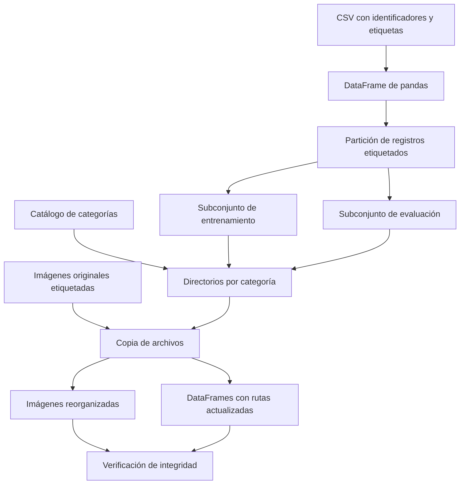

# Clase 7: Automatización de archivos, organización de datasets y programación modular en Python

> **Objetivo académico:** Comprender cómo automatizar la reorganización de archivos y sus metadatos para preparar conjuntos de datos de aprendizaje automático, y cómo estructurar estas operaciones mediante funciones, módulos, paquetes e importaciones explícitas en Python.

## 1. Contexto y marco conceptual

### Preparación de datos como problema de ingeniería

La sesión articula dos dimensiones complementarias: transformar la organización física de un dataset y organizar el código que realiza esa transformación. La primera exige conservar la correspondencia entre archivos y etiquetas; la segunda busca reutilización, claridad y separación de responsabilidades.

Un conjunto de datos puede distribuirse con una estructura distinta de la requerida por una herramienta de entrenamiento. Las imágenes pueden estar reunidas en un directorio y sus etiquetas en un CSV, mientras que determinados cargadores esperan subdirectorios por categoría. Reorganizar los archivos permite adaptar esa representación sin modificar necesariamente el contenido de las imágenes.

**Enriquecimiento conceptual:** La estructura por carpetas constituye una interfaz de entrada de ciertos cargadores de datos, no una exigencia universal del modelo matemático. Otros cargadores pueden utilizar directamente un manifiesto tabular de rutas y etiquetas. La elección depende de la biblioteca y de la arquitectura del procesamiento.

El caso central utiliza imágenes de problemas urbanos. Se mencionan categorías como ausencia de evento, árbol caído, incendio, inundación y mal estado del camino. La fuente establece que la etiqueta cero representa ausencia de evento; no proporciona de manera íntegra la correspondencia numérica de las demás categorías.

### Dos significados de datos de prueba

Es necesario distinguir los archivos originales del dataset y las particiones producidas durante el procesamiento:

| Elemento | Contenido descrito | Función |
| --- | --- | --- |
| Directorio original `train` | Imágenes con etiquetas disponibles en `train.csv` | Fuente para construir particiones supervisadas |
| Directorio original `test` | Imágenes identificadas en `test.csv`, sin etiquetas públicas en ese archivo | Entrada para obtener predicciones |
| Partición interna de entrenamiento | Una parte de los registros etiquetados | Ajustar el modelo |
| Partición interna de evaluación | Otra parte de esos registros, también etiquetada | Comparar predicciones con respuestas conocidas |

La reorganización explicada toma los registros de `train.csv` y produce dos nuevos subconjuntos. Por tanto, el nuevo subconjunto denominado `test` no debe confundirse con el directorio original que ya llevaba ese nombre.

**Enriquecimiento conceptual:** La ausencia de etiquetas caracteriza el archivo `test.csv` de este caso; no define a todos los conjuntos de prueba. Para calcular métricas supervisadas se necesitan etiquetas de referencia, disponibles para quien evalúa aunque puedan permanecer ocultas para quien genera las predicciones.

## 2. Fundamentos teóricos y arquitectura

### CSV, DataFrame y Series

CSV significa *comma-separated values*. Es un formato textual tabular en el que cada registro ocupa una fila y los campos se separan mediante un delimitador. En el ejemplo, `train.csv` relaciona un identificador de imagen con una etiqueta numérica mediante las columnas `image_id` y `label`.

Pandas permite cargar esa información mediante `pd.read_csv`. Su estructura `DataFrame` representa una tabla bidimensional con etiquetas en ambos ejes; una `Series` representa datos unidimensionales con índice. Seleccionar una columna suele producir una `Series`, y cada fila entregada por `iterrows()` también se representa mediante esa estructura.

El índice del DataFrame identifica registros dentro de la tabla, pero no tiene que coincidir con el nombre del archivo ni ser una secuencia consecutiva. Una partición puede conservar índices originales dispersos sin que exista un error.

Durante la sesión se describe un DataFrame con 15 223 registros y dos columnas iniciales. `info()` permite revisar tipos, cantidades de valores no nulos y uso de memoria. Esa inspección aporta información estructural, aunque no certifica que las etiquetas o las rutas sean correctas.

**Enriquecimiento conceptual:** El tipo `object` de pandas puede contener cadenas u otros objetos de Python; no equivale exclusivamente a texto. Asimismo, un valor no nulo puede seguir siendo inválido para el dominio: por ejemplo, una ruta inexistente o una etiqueta fuera del catálogo.

### Etiquetado y clasificación supervisada

Las etiquetas expresan la categoría atribuida a cada imagen. El etiquetado descrito supone intervención humana para identificar el contenido y registrar una respuesta de referencia. En una clasificación supervisada, el modelo utiliza ejemplos etiquetados para aprender relaciones y posteriormente asignar categorías a nuevas imágenes.

La correspondencia entre números y nombres forma parte de la semántica del dataset. Una lista permite recuperar el nombre de una categoría a partir de su posición, pero solo funciona si el orden coincide exactamente con la codificación de etiquetas.

**Enriquecimiento conceptual:** Un diccionario explícito entre identificadores y nombres reduce la dependencia de posiciones y admite códigos no consecutivos. El catálogo debe mantenerse estable entre preparación, entrenamiento e inferencia.

### Arquitectura del procesamiento



La función de reorganización recibe un subconjunto y una ruta de destino. Crea los directorios de categorías, recorre los registros, copia cada archivo al lugar correspondiente y actualiza su ruta en la tabla. Así produce dos resultados relacionados: una estructura física de archivos y un manifiesto de metadatos coherente con ella.

## 3. Implementación técnica y lógica de negocio

### Adquisición y lectura

La sesión retoma una descarga automatizada desde Kaggle en Colab: recuperación de credenciales desde el almacenamiento de secretos, configuración del acceso, descarga de un archivo comprimido, extracción y eliminación posterior del comprimido. La transcripción no permite reconstruir con precisión todos los comandos ni el identificador del dataset.

**Enriquecimiento conceptual:** Las credenciales deben mantenerse fuera del código compartido. La automatización de adquisición debe distinguir la configuración de acceso, los archivos originales y las salidas derivadas para facilitar la reproducción del procesamiento.

El punto de entrada tabular es:

```python
import pandas as pd

# La ruta se configura según la ubicación real del dataset.
dataset = pd.read_csv(csv_path)
dataset.info()
```

`pd` es el alias convencional de pandas. La lectura genera un DataFrame; `info()` ayuda a comprobar que se cargaron las columnas esperadas. `csv_path` representa una ruta de archivo existente, no una dirección proporcionada por la fuente.

### Partición con scikit-learn

`train_test_split`, del módulo `sklearn.model_selection`, divide estructuras compatibles en dos subconjuntos. La sesión contrasta esta operación con separar registros mediante rebanado: un corte directo puede generar dos partes, pero no garantiza una selección adecuada si los datos estaban ordenados por categoría u otra variable.

**Enriquecimiento conceptual:** El siguiente fragmento es una reconstrucción ilustrativa. El 20 % es compatible con los 3 045 registros de evaluación mencionados, pero la transcripción no conserva inequívocamente todos los argumentos originales. La semilla y la estratificación se añaden como decisiones de diseño explícitas.

```python
from sklearn.model_selection import train_test_split

train, evaluation = train_test_split(
    dataset,
    test_size=0.20,
    random_state=42,
    stratify=dataset["label"],
)

train = train.copy()
evaluation = evaluation.copy()
train["image_path"] = ""
evaluation["image_path"] = ""
```

`test_size` fija la fracción reservada; `random_state` permite repetir la selección bajo las mismas condiciones; `stratify` procura conservar las proporciones de etiquetas. La estratificación exige suficientes observaciones por clase y no sustituye el análisis de dependencias entre ejemplos.

Asignar una cadena vacía a una columna crea ese valor en todas sus filas. La sesión también muestra `np.nan`, disponible mediante `import numpy as np`, para representar valores faltantes.

**Enriquecimiento conceptual:** `""`, `None` y `np.nan` no son equivalentes en todas las operaciones de pandas. Una cadena vacía no se reconoce automáticamente como dato faltante en una columna ya construida. La representación elegida debe concordar con el tipo de columna y con las comprobaciones posteriores.

### Contrato de la función de reorganización

La función denominada `sort_subset` en la explicación organiza registros por categoría; no realiza simplemente una ordenación de filas. Sus responsabilidades son:

1. Preparar el directorio objetivo.
2. Crear un directorio por categoría y registrar su ruta en un diccionario.
3. Recorrer el DataFrame.
4. Recuperar nombre de imagen y etiqueta.
5. Construir rutas de origen y destino.
6. Copiar el archivo.
7. Guardar la ruta nueva en `image_path` y devolver el subconjunto actualizado.

Las operaciones relevantes pueden expresarse con el siguiente núcleo.

**Enriquecimiento conceptual:** Este código reconstruye las operaciones descritas; no es una transcripción literal ni se presenta como una ejecución verificada. Supone índices únicos, etiquetas presentes en `category_dirs`, nombres de archivo únicos dentro de cada destino y directorios de destino ya creados.

```python
import os
import shutil
from tqdm.auto import tqdm


def copy_subset(subset, source_dir, category_dirs):
    result = subset.copy()
    result["image_path"] = ""

    for index, sample in tqdm(
        result.iterrows(), total=len(result)
    ):
        image_id = sample["image_id"]
        label = sample["label"]
        source_path = os.path.join(source_dir, image_id)
        target_path = os.path.join(category_dirs[label], image_id)

        shutil.copy(source_path, target_path)
        result.at[index, "image_path"] = target_path

    return result.reset_index(drop=True)
```

`category_dirs` es un diccionario que asocia cada etiqueta con su directorio de destino. `iterrows()` entrega pares de índice y fila; `.at[index, "image_path"]` escribe una celda identificada por etiquetas. `.at` utiliza la etiqueta del índice, no necesariamente su posición numérica.

`os.path.join` construye rutas utilizando las convenciones del sistema operativo. `shutil.copy` copia el archivo y mantiene el original. En la sesión se muestra primero la concatenación con `/` y después su sustitución por `os.path.join`.

`reset_index(drop=True)` crea un índice consecutivo sin añadir el índice anterior como columna. Durante la demostración aparecen columnas de índices acumulados y un conflicto al reiniciar el índice repetidamente.

**Enriquecimiento conceptual:** Devolver el DataFrame expresa con claridad el resultado de la transformación, pero no impide por sí mismo modificar el objeto recibido. La copia explícita del ejemplo evita que la actualización de columnas se aplique directamente al DataFrame de entrada.

### Enumeración y observabilidad

`enumerate` combina cada elemento de un iterable con un contador. Puede utilizarse para construir la correspondencia entre códigos y carpetas cuando la codificación del dataset coincide con las posiciones de una lista.

**Enriquecimiento conceptual:** `enumerate` empieza en cero por defecto. Un contador desde uno requiere `enumerate(elementos, start=1)`. Confundir este origen desplaza todas las etiquetas y puede producir una organización semánticamente incorrecta aunque las copias se ejecuten sin errores.

`tqdm` muestra avance, velocidad y estimaciones temporales. Con `iterrows()` conviene proporcionar `total=len(subset)` para conocer el número esperado de registros. Sus estimaciones son variables porque dependen del ritmo observado; una barra completada no certifica la integridad del resultado.

### Modularización e importaciones

Un archivo `.py` es la forma habitual de definir un módulo propio. Separar operaciones de archivos, adquisición de datos, procesamiento e interacción permite reutilizar funciones y reducir la concentración de responsabilidades en un único archivo.

| Forma | Nombre disponible en el módulo consumidor | Implicación |
| --- | --- | --- |
| `import math` | `math` | Acceso explícito, por ejemplo `math.sin` |
| `from math import sin, pi` | `sin`, `pi` | Importación de nombres concretos |
| `import fibonacci as fibo` | `fibo` | Alias del módulo |
| `from fibonacci import fib as generar_fib` | `generar_fib` | Alias de un elemento concreto |
| `from modulo import *` | Nombres exportados por el módulo | Mayor riesgo de ocultamiento y menor trazabilidad |

Un espacio de nombres relaciona identificadores con objetos. Importar un módulo vincula su nombre en el espacio del consumidor; importar elementos concretos vincula esos elementos directamente.

**Enriquecimiento conceptual:** Una importación selectiva no implica que Python ejecute solamente el código de las funciones seleccionadas. La carga inicial ejecuta el código de nivel superior del módulo. Su ventaja principal es el control de nombres y la claridad de uso, no una reducción automática del coste de carga.

### Ejecución directa y reutilización

La condición `if __name__ == "__main__":` distingue la ejecución como programa principal de la importación ordinaria. El ejemplo de Fibonacci muestra además cómo recuperar argumentos de terminal mediante `sys.argv`.

**Enriquecimiento conceptual:** Este fragmento reconstruye el patrón explicado. Supone que `fib` ya está definida y acepta el entero indicado. Añade una validación mínima del argumento.

```python
import sys


def main():
    if len(sys.argv) != 2:
        raise SystemExit("Uso: python fibonacci.py LIMITE")
    try:
        limit = int(sys.argv[1])
    except ValueError:
        raise SystemExit("LIMITE debe ser un entero")
    fib(limit)


if __name__ == "__main__":
    main()
```

`sys.argv` es una lista de cadenas, no una función. La posición cero identifica el programa y la posición uno contiene el primer argumento. `__name__` es un atributo del módulo, no el nombre literal de su archivo. Al importar el módulo se ejecuta su nivel superior, pero no la rama protegida por esta condición.

### Paquetes y API pública

Un paquete agrupa módulos y puede contener subpaquetes. La sesión utiliza paquetes regulares con `__init__.py`, que puede estar vacío o definir inicialización y elementos públicos. Como ejemplo arquitectónico se separan entrenamiento, inferencia y métricas.

**Enriquecimiento conceptual:** En Python moderno también existen paquetes de espacio de nombres sin `__init__.py`. Asimismo, un módulo no tiene que corresponder siempre a un archivo `.py`: `math`, por ejemplo, suele ser una extensión compilada. Módulo, paquete y biblioteca son conceptos relacionados, pero no intercambiables.

Para un paquete con módulos `a.py` y `b.py`, las importaciones explícitas son:

```python
import mypackage.a
import mypackage.b

# Otra alternativa:
from mypackage import a, b
```

**Enriquecimiento conceptual:** `import mypackage` no garantiza por sí solo que sus submódulos `a` y `b` queden cargados. Para exponerlos desde la inicialización se pueden importar explícitamente en `__init__.py`:

```python
from . import a, b

__all__ = ["a", "b"]
```

Las importaciones relativas vinculan los submódulos al paquete. `__all__` define los nombres que participan en `from mypackage import *`; no ordena una importación recursiva automática con cada `import mypackage` ni sustituye las importaciones explícitas necesarias.

## 4. Análisis crítico de casos y auditoría práctica

### Integridad de la reorganización

La demostración utiliza `os.path.exists` para comprobar una ruta y `glob.glob` para contar archivos mediante patrones. En el origen se cuentan 15 223 imágenes; en el destino se recorren ambos subconjuntos y sus carpetas de categoría para comparar el total.

**Enriquecimiento conceptual:** Si cada imagen etiquetada debe copiarse exactamente una vez, la conservación de cardinalidad exige:

$$
N_{\mathrm{origen}} = N_{\mathrm{entrenamiento}} + N_{\mathrm{evaluacion}}
$$

Cada variable representa un número entero no negativo de imágenes. La igualdad supone particiones disjuntas, sin omisiones ni duplicaciones. Para los valores mencionados, 15 223 imágenes de origen y 3 045 de evaluación implican 12 178 de entrenamiento por diferencia; este último valor es una deducción, no una salida adicional observada.

La igualdad de cantidades es necesaria bajo esos supuestos, pero insuficiente para demostrar una copia correcta: una omisión y una duplicación pueden compensarse. Una auditoría más sólida contrasta identidades de archivos, disyunción entre particiones, existencia de cada ruta y correspondencia entre etiqueta y carpeta. Si interesa verificar igualdad de contenido, pueden compararse hashes.

`os.path.exists` confirma la existencia de una ruta; no demuestra que el archivo sea una imagen legible. Los patrones de `glob` también deben ajustarse a la profundidad real de las carpetas y a las extensiones presentes, entre ellas `.jpg` y `.jpeg`.

### Riesgos al regenerar directorios

La función explicada elimina el directorio objetivo si existe y después lo vuelve a crear, con la intención de reconstruir el resultado desde cero.

**Enriquecimiento conceptual:** Copiar dos veces al mismo nombre puede sobrescribir, no necesariamente duplicar archivos. El problema más general es conservar salidas obsoletas o mezclar ejecuciones. El borrado recursivo también implica riesgo de pérdida de datos si la ruta está mal configurada. Una alternativa consiste en generar la salida en un directorio nuevo, validarla y sustituir la versión anterior únicamente tras comprobarla.

### Validez de las particiones

La selección aleatoria resulta útil para datos aproximadamente independientes. Sin embargo, no evita por sí sola que imágenes duplicadas o relacionadas aparezcan en ambos subconjuntos.

**Enriquecimiento conceptual:** Si varias imágenes pertenecen al mismo paciente, vídeo o evento, la separación puede requerir grupos. Para información temporal puede ser necesario respetar el orden cronológico. La unidad de partición debe representar la independencia relevante para la generalización; una reorganización de carpetas no resuelve esta decisión estadística.

### Generalización a otros archivos y metadatos

La sesión extiende la motivación a grabaciones de audio organizadas por fecha y a vídeos de distintas duraciones. Las operaciones repetitivas de organización y procesamiento pueden automatizarse sin intervenir manualmente archivo por archivo. No se desarrolla una implementación de procesamiento audiovisual.

También se describe la relación entre imágenes médicas y metadatos tabulares: identificador, paciente, características o diagnóstico. El conocimiento técnico recuperable es la necesidad de mantener sincronizados el archivo y su registro descriptivo. Gestionar ese vínculo comprende operaciones de creación, lectura, actualización y eliminación, sin implicar necesariamente transformaciones sobre los píxeles.

**Enriquecimiento conceptual:** Archivo y metadatos pueden quedar inconsistentes si una operación se completa solo parcialmente. Conviene definir identificadores estables, validar referencias y prever recuperación ante fallos. La carga inicial de un catálogo tampoco debería sobrescribir inadvertidamente cambios persistidos.

### Colisiones de nombres

Hay dos problemas diferentes: ocultar nombres en el espacio del programa y resolver un módulo distinto del esperado. Usar `list` como variable oculta temporalmente el acceso al tipo incorporado mediante ese identificador. Nombrar un archivo como una biblioteca conocida puede interferir con la resolución de importaciones.

**Enriquecimiento conceptual:** `list`, `dict` y `set` son nombres incorporados, no palabras reservadas como `for`. Un alias ayuda a distinguir objetos ya importados, pero no garantiza que se haya localizado el módulo correcto: `import nombre as alias` resuelve primero `nombre`. La resolución depende de los mecanismos de importación y de las rutas de búsqueda; evitar nombres conflictivos es la prevención más clara.

## 5. Principios de diseño, buenas prácticas y anti-patrones

| Principio | Aplicación | Anti-patrón o límite |
| --- | --- | --- |
| Separación de responsabilidades | Funciones y módulos específicos para lectura, partición, copia y validación | Concentrar toda la lógica en un único archivo |
| Reutilización | Una función parametrizada para ambos subconjuntos | Duplicar el mismo procedimiento con pequeñas variaciones |
| Trazabilidad | Conservar identificador, etiqueta y ruta resultante | Mover archivos sin actualizar sus referencias |
| Portabilidad | Construir rutas con `os.path.join` | Depender de separadores concatenados manualmente |
| Importaciones explícitas | Módulos, nombres concretos y alias legibles | Importaciones con asterisco que ocultan procedencia |
| Nombres claros | Módulos en `snake_case` y nombres relacionados con su función | Reutilizar nombres de bibliotecas o tipos incorporados |
| Reproducibilidad | Entorno aislado y dependencias documentadas | Depender del estado accidental de una instalación |
| Observabilidad y auditoría | Barras de progreso y comprobaciones independientes | Interpretar que llegar al final certifica corrección |

La sesión retoma el uso de un entorno por proyecto, la instalación de dependencias y su registro en `requirements.txt`. También destaca la necesidad de explicar cómo reproducir el entorno.

**Enriquecimiento conceptual:** La reproducción depende además de versiones de Python, bibliotecas, sistema y datos. La abstracción de rutas facilita portabilidad, pero no elimina diferencias de permisos, sensibilidad a mayúsculas, almacenamiento o disponibilidad de archivos entre ejecución local y nube.

### Documentación y orientación a objetos

La revisión del código de pandas conecta el uso de una biblioteca con su implementación mediante clases, herencia, métodos y documentación. El DataFrame es una instancia de una clase que ofrece operaciones reutilizables; conocer su interfaz permite trabajar sin reproducir sus detalles internos.

Los *docstrings* describen clases y funciones y pueden alimentar herramientas de documentación. La sesión identifica una estructura que comprende descripción, parámetros, notas, referencias internas y ejemplos.

**Enriquecimiento conceptual:** Un docstring es una cadena situada como primera instrucción de un módulo, clase o función; las triples comillas son la convención habitual para escribirlo. Las comillas por sí solas no generan documentación web: se necesita una herramienta que interprete esa información. En una función que opera con archivos conviene documentar también efectos secundarios, política de sobrescritura y comportamiento ante errores.

### Rendimiento y alcance de la automatización

**Enriquecimiento conceptual:** Para un recorrido con una copia por registro, el trabajo de control crece linealmente con el número de archivos. El tiempo real depende especialmente del volumen total transferido, la latencia del almacenamiento y el coste de crear archivos. `iterrows()` es adecuado para explicar el flujo, aunque tiene sobrecoste frente a otras formas de iteración; optimizarlo solo será prioritario si ese coste resulta significativo frente a la entrada y salida.

La modularización debe perseguir alta cohesión dentro de cada componente y dependencias comprensibles entre componentes. Dividir en muchos archivos sin una responsabilidad clara no mejora por sí mismo la arquitectura.

## 6. Síntesis conceptual y profundización académica

La preparación del dataset transforma una representación física manteniendo una relación semántica: cada imagen debe seguir vinculada a la etiqueta correcta y a una ubicación verificable. Pandas proporciona la representación tabular, scikit-learn la operación de partición y las bibliotecas del sistema de archivos permiten materializar la nueva organización.

La calidad del proceso requiere distinguir tres niveles de corrección:

- **Estructural:** existen las columnas, carpetas y archivos esperados.
- **Semántico:** las etiquetas conservan su significado y las rutas identifican los archivos correspondientes.
- **Metodológico:** las particiones permiten una evaluación pertinente de la generalización.

La programación modular organiza ese procesamiento en componentes reutilizables. Los módulos encapsulan definiciones; los paquetes agrupan módulos; las importaciones establecen dependencias y nombres disponibles; la condición `__name__ == "__main__"` permite separar el uso como programa de la reutilización mediante importación.

Las líneas de profundización que se desprenden de la sesión son la definición de contratos entre archivos y metadatos, la recuperación ante fallos durante operaciones de copia, el diseño de interfaces públicas de paquetes y la documentación de entornos reproducibles. Estas dimensiones conectan la automatización cotidiana del científico de datos con la confiabilidad del software que la sostiene.
