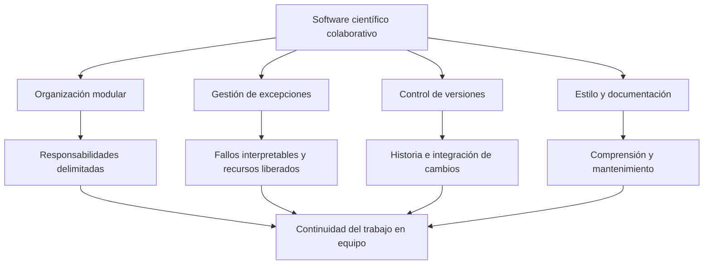
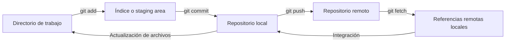

# Clase 8: Excepciones, control de versiones y documentación de proyectos Python

> **Objetivo académico:** Integrar modularización, gestión de excepciones, control de versiones con Git y documentación de proyectos Python para construir software científico comprensible, mantenible y apto para el trabajo colaborativo.

## 1. Contexto y marco conceptual

La sesión vincula la programación para ciencia de datos con prácticas de ingeniería de software. Un sistema que carga datos, administra registros o procesa imágenes necesita algo más que instrucciones que funcionen en una ejecución: requiere organización del código, tratamiento explícito de fallos, trazabilidad de cambios y documentación que permita su uso y mantenimiento por otras personas.

El hilo conductor es la colaboración. Cuando varias personas modifican un mismo producto de datos, aparecen problemas recurrentes: funcionalidades duplicadas, versiones difíciles de distinguir, cambios incompatibles y dependencias implícitas que solo comprende quien escribió el código. Git aborda la historia y la integración de cambios; PEP 8 reduce diferencias de estilo; la documentación comunica propósito, contratos y condiciones de uso; las excepciones delimitan las respuestas ante situaciones que impiden continuar una operación con normalidad.

### Módulos, paquetes y separación de responsabilidades

En la sesión se presenta un **módulo** como un archivo Python que reúne funciones, clases y variables. **Modularizar** consiste en distribuir un programa extenso entre unidades con responsabilidades reconocibles. Un **paquete** permite organizar módulos relacionados dentro de una estructura jerárquica.

Un gestor de imágenes y metadatos sirve como caso técnico: la lectura de archivos, las operaciones sobre registros y la interacción con el usuario son responsabilidades distintas. Pueden ubicarse en módulos separados, evitando que la interfaz contenga también toda la lógica de acceso a datos. Tkinter y PyQt se mencionan como alternativas para construir interfaces gráficas de escritorio.

**Enriquecimiento conceptual:** Un módulo no se limita necesariamente a un archivo `.py`; Python también admite módulos implementados mediante extensiones. Para el nivel de organización tratado en la sesión, el archivo `.py` es el caso relevante. Asimismo, un paquete no es simplemente cualquier carpeta: debe participar en el mecanismo de importación de Python. Los paquetes regulares suelen incluir `__init__.py`, mientras que los paquetes de espacio de nombres pueden prescindir de él.



## 2. Fundamentos teóricos y arquitectura

### 2.1. Excepciones y flujo de control

Una excepción interrumpe el flujo ordinario de ejecución y transfiere el control hacia un manejador compatible. La estructura presentada en la sesión comprende cuatro bloques:

| Bloque | Función | Condición de ejecución |
| --- | --- | --- |
| `try` | Contener la operación cuyo fallo se desea gestionar | Al entrar en la estructura |
| `except` | Responder a una excepción compatible | Si el bloque `try` lanza esa excepción |
| `else` | Ejecutar acciones posteriores al éxito | Si el `try` termina normalmente, sin excepción ni salida anticipada |
| `finally` | Realizar limpieza o cierre | Al abandonar la estructura durante el flujo ordinario del intérprete, exista o no una excepción |

**Enriquecimiento conceptual:** La rareza estadística no define una excepción. Una conversión inválida puede ser frecuente en una interfaz y seguir representándose mediante una excepción. Lo decisivo es que la operación no satisface las condiciones necesarias para producir su resultado normal.

Python organiza las excepciones mediante herencia. `BaseException` es la raíz de la jerarquía; `Exception` agrupa la mayoría de los fallos que una aplicación suele gestionar. `KeyboardInterrupt` deriva directamente de `BaseException`, por lo que no queda capturado por `except Exception`.

**Enriquecimiento conceptual:** Conviene distinguir entre una incompatibilidad de tipos y un valor inválido. `TypeError` suele indicar que una operación recibió un tipo inapropiado; `ValueError`, que el tipo es admisible pero el valor no permite completar la operación. Por ejemplo, `int("hola")` produce `ValueError`: recibe una cadena, pero su contenido no representa un entero.

La sesión también considera fallos aritméticos y de entrada/salida. `ZeroDivisionError` pertenece a la familia `ArithmeticError`. Para operaciones con archivos resulta pertinente `OSError`; en Python 3, `IOError` es un alias de `OSError`.

**Enriquecimiento conceptual:** Un `except:` sin tipo captura también interrupciones y señales de terminación representadas como excepciones. No equivale a `except Exception`. Su amplitud puede ocultar problemas que deberían propagarse. Además, `finally` no garantiza ejecución frente a una terminación forzada del proceso o una caída del sistema; su garantía corresponde al flujo de control gestionado por Python.

### 2.2. Git como sistema de control de versiones

Git permite conservar estados del proyecto, relacionarlos históricamente y coordinar cambios entre personas. En la sesión se emplea la analogía de una fotografía: un **commit** registra un estado que puede identificarse y recuperarse posteriormente.

**Enriquecimiento conceptual:** Un commit referencia una instantánea del contenido versionado y contiene metadatos, un mensaje y referencias a sus padres. La historia forma un grafo dirigido acíclico. La analogía fotográfica resulta útil, pero no significa que Git duplique físicamente todos los archivos en cada commit.

Los conceptos principales son:

- **Repositorio:** almacenamiento de objetos, referencias e historia del proyecto.
- **Commit:** registro de un estado versionado.
- **Rama:** línea de desarrollo que permite trabajar sobre una funcionalidad o corrección.
- **Integración o merge:** incorporación de una historia de desarrollo en otra.
- **Remoto:** repositorio accesible mediante una ubicación configurada, utilizado para intercambio y coordinación.

**Enriquecimiento conceptual:** Git es distribuido: los repositorios locales conservan historia y permiten crear commits sin conexión. El repositorio compartido funciona como centro de coordinación por acuerdo del equipo, no porque Git exija un servidor central.

### 2.3. Git, plataformas remotas e interfaces

Git es el sistema de control de versiones. GitHub, GitLab y Bitbucket proporcionan servicios para alojar repositorios y facilitar colaboración. GitHub Desktop es una aplicación gráfica que permite realizar operaciones de Git.

**Enriquecimiento conceptual:** Estos componentes no deben confundirse. Git puede instalarse y utilizarse sin GitHub Desktop ni una cuenta en una plataforma. Su disponibilidad en una distribución Linux depende de la instalación concreta. Los planes comerciales, las cuotas de almacenamiento y las condiciones de repositorios privados cambian; la comparación de la sesión no constituye una especificación vigente de esos servicios.

El alojamiento administrado delega infraestructura de red, disponibilidad y acceso al proveedor. Un servicio autogestionado, como una instalación propia de GitLab, exige administrar esos componentes. Su acceso puede resolverse mediante una red interna, una VPN o exposición controlada a Internet, según el entorno.

### 2.4. Estilo y documentación como interfaces de colaboración

PEP 8 proporciona recomendaciones de estilo para código Python. La sesión destaca que la coherencia facilita leer e integrar aportaciones de distintas personas. Herramientas como `pycodestyle` y Flake8 ayudan a detectar desviaciones, aunque no determinan por sí mismas la calidad del diseño.

La documentación atiende necesidades complementarias:

| Recurso | Necesidad principal |
| --- | --- |
| Comentarios | Explicar decisiones, restricciones o secciones del código |
| Docstrings | Describir módulos, clases, funciones y sus contratos |
| `README.md` | Presentar el proyecto y orientar su instalación y uso |
| Tutoriales y manuales | Guiar recorridos y operaciones de uso |
| Documentación generada | Publicar una referencia navegable de la API y del proyecto |

Los usuarios técnicos y no técnicos pueden consultar varios de estos recursos. La diferencia relevante es la información que necesitan para actuar, no una separación rígida entre públicos.

## 3. Implementación técnica y lógica de negocio

### 3.1. Conversión de entradas y recuperación controlada

La sesión utiliza la lectura de una edad para ilustrar la conversión de texto a entero y el tratamiento de `ValueError` dentro de un ciclo.

**Enriquecimiento conceptual:** El siguiente ejemplo reconstruye ese comportamiento; no reproduce literalmente el código mostrado en pantalla.

```python
def read_age():
    """Solicita una edad expresada como entero no negativo."""
    while True:
        try:
            age = int(input("Edad: "))
        except ValueError:
            print("Ingrese un número entero.")
        else:
            if age < 0:
                print("La edad no puede ser negativa.")
                continue
            return age
```

La conversión controla la validez de la representación; la condición posterior controla una regla del dominio: la edad, expresada en años enteros en este ejemplo, no puede ser negativa. Una cadena como `"hola"` incumple la primera condición; el entero `-3` supera la conversión, pero incumple la segunda. El retorno termina el ciclo cuando se obtiene un valor válido.

El bloque `try` se mantiene pequeño para evitar que otros errores de la función se interpreten equivocadamente como fallos de conversión.

### 3.2. Lectura de archivos y excepciones específicas

Otro ejemplo de la sesión combina apertura de un archivo, lectura de contenido, conversión a enteros y almacenamiento en una lista. Las etapas pueden fallar por motivos diferentes: acceso al archivo, codificación o contenido incompatible.

**Enriquecimiento conceptual:** La siguiente reconstrucción explicita el supuesto de un entero por línea y utiliza un gestor de contexto para cerrar el archivo.

```python
def read_integer_values(path):
    """Lee un entero por línea y propaga los fallos de lectura o conversión."""
    values = []
    with open(path, encoding="utf-8") as source:
        for line in source:
            values.append(int(line.strip()))
    return values


try:
    values = read_integer_values("values.txt")
except OSError as error:
    print(f"No se pudo acceder al archivo: {error}")
except UnicodeError as error:
    print(f"El archivo no pudo interpretarse como UTF-8: {error}")
except ValueError as error:
    print(f"Se encontró contenido que no representa un entero: {error}")
else:
    print(values)
```

El ejemplo supone que todas las líneas, incluidas las vacías si existieran, deben representar un entero. Una línea vacía produce `ValueError`; no se descarta silenciosamente. La función propaga los fallos y el código que la invoca decide cómo informarlos. `with` cierra el archivo incluso si falla una conversión.

La expresión `as error` vincula la excepción a un nombre local. Al incluirla en un mensaje se utiliza su representación textual, que puede aportar detalles del problema.

### 3.3. Excepciones del dominio

La sesión muestra la creación de una clase derivada de `Exception` y su lanzamiento con `raise`. Una excepción propia permite representar una condición significativa para la aplicación.

**Enriquecimiento conceptual:** Ejemplo de validación de metadatos inspirado en el caso de gestión de registros:

```python
class InvalidMetadataError(Exception):
    """Indica que un registro incumple una condición del dominio."""


def validate_patient_id(patient_id):
    if not isinstance(patient_id, str):
        raise TypeError("El identificador debe ser una cadena.")
    if not patient_id.strip():
        raise InvalidMetadataError("El identificador no puede estar vacío.")
```

La subclase hereda el comportamiento básico de `Exception`, incluida la posibilidad de recibir un mensaje. No necesita redefinir el constructor si no incorpora estado o comportamiento adicional.

### 3.4. Archivos delimitados y metadatos en pandas

El caso presentado utiliza un archivo de metadatos de pacientes separado por punto y coma. La lectura correcta depende de identificar el delimitador real, que puede diferir de la coma sugerida por el nombre CSV.

**Enriquecimiento conceptual:** Reconstrucción mínima del procedimiento:

```python
import pandas as pd

patient_data = pd.read_csv("patient_data.csv", sep=";")

for row_index, sample in patient_data.iterrows():
    gender = sample["gender"]
```

El ejemplo supone que el archivo existe y contiene una columna denominada exactamente `gender`. `iterrows()` devuelve pares formados por la etiqueta del índice y una serie con los valores de cada fila. Esa etiqueta no equivale necesariamente a una posición consecutiva ni a un identificador clínico.

Antes de interpretar variables como diagnóstico, es necesario conocer su codificación. Los valores `1` y `2` no permiten inferir por sí mismos categorías clínicas. La sesión reconoce que algunos campos son especializados; conservarlos como metadatos no autoriza a asignarles un significado no documentado.

**Enriquecimiento conceptual:** Para transformaciones masivas, las operaciones vectorizadas suelen ser preferibles a `iterrows()` por rendimiento y tratamiento de tipos. La iteración explícita sigue siendo comprensible cuando cada fila desencadena una operación individual de gestión.

### 3.5. Flujo local de Git

El flujo distingue tres espacios locales y un destino de intercambio:



El **directorio de trabajo** contiene los archivos editables. El **índice** prepara el contenido del próximo commit. El **repositorio local** conserva los commits. El **remoto** permite intercambiarlos con otras personas.

**Enriquecimiento conceptual:** El índice conserva una versión preparada del contenido. Si se edita un archivo después de ejecutar `git add`, esos cambios posteriores necesitan prepararse de nuevo para entrar en el próximo commit.

| Comando | Efecto principal | Precisión relevante |
| --- | --- | --- |
| `git init` | Inicializa un repositorio | No configura automáticamente un remoto |
| `git clone <URL>` | Crea una copia local de un repositorio | Habitualmente configura `origin` |
| `git add <archivo>` | Prepara cambios seleccionados | Permite delimitar el próximo commit |
| `git add .` | Prepara cambios bajo el directorio actual | Requiere revisar qué archivos se incluyen |
| `git commit -m "mensaje"` | Registra el contenido preparado | No lo publica en el remoto |
| `git remote add origin <URL>` | Registra un remoto llamado `origin` | El nombre es una convención |
| `git push` | Envía commits y actualiza referencias remotas | Requiere configuración y permisos apropiados |
| `git pull` | Obtiene cambios y los integra | Puede necesitar resolución de conflictos |
| `git status` | Informa del estado local | La comparación remota depende de la información disponible localmente |

**Enriquecimiento conceptual:** Secuencia para un proyecto local que se conecta a un remoto vacío, suponiendo Git instalado e identidad de autor configurada:

```bash
git init
git add .
git commit -m "Add metadata loading module"
git branch -M main
git remote add origin <URL_DEL_REPOSITORIO>
git push -u origin main
```

`<URL_DEL_REPOSITORIO>` es un marcador que debe sustituirse por una dirección real. `git branch -M main` renombra la rama actual; `main` y `master` son nombres de ramas, no tipos de repositorio. `-u` establece la relación de seguimiento para facilitar operaciones posteriores. Si el remoto ya contiene historia propia, esta secuencia requiere adaptar la integración inicial.

### 3.6. Ramas, integración y conflictos

Las ramas permiten desarrollar funcionalidades o correcciones sin incorporarlas inmediatamente a la línea principal. La transcripción mezcla algunas opciones de creación y eliminación; la secuencia correcta debe distinguirlas.

**Enriquecimiento conceptual:** Flujo explícito con `checkout`, el comando tratado en la sesión:

```bash
git checkout -b feature/metadata-validation
git add metadata.py
git commit -m "Validate required metadata fields"
git checkout main
git merge feature/metadata-validation
git branch -d feature/metadata-validation
```

`checkout -b` crea una rama y cambia a ella; `checkout main` cambia a una rama existente. `branch -d` solicita eliminar una rama y comprueba que esté integrada; `branch -D` fuerza la eliminación. Cambiar de rama no implica perder automáticamente los cambios: las modificaciones sin commit pueden acompañar el cambio o impedirlo si existe riesgo de sobrescritura. Los commits permanecen asociados a la historia correspondiente.

Un conflicto aparece cuando Git no puede resolver automáticamente una integración. La resolución exige comprender el comportamiento esperado: escoger una variante o combinar ambas, retirar los marcadores, revisar el resultado y registrar la resolución. Eliminar marcadores sin validar la lógica solo produce un archivo sintácticamente limpio, no una integración correcta.

### 3.7. Identidad y autenticación

La sesión plantea la coexistencia de cuentas personales y corporativas y menciona SSH para el acceso remoto.

**Enriquecimiento conceptual:** La identidad incorporada al commit y la credencial que autoriza un `push` son aspectos distintos. Es posible configurar por repositorio:

```bash
git config user.name "Nombre del autor"
git config user.email "correo_del_autor"
```

Estas opciones no seleccionan por sí solas una cuenta autenticada. El acceso depende de las claves SSH o de las credenciales utilizadas para HTTPS y de los permisos del remoto. SSH no es requisito para crear commits locales ni la única vía de sincronización.

### 3.8. Reglas de estilo y nomenclatura

Las recomendaciones desarrolladas en la sesión incluyen cuatro espacios por nivel de sangría, líneas de código de hasta 79 caracteres, separación legible de operadores y una instrucción por línea. Las listas extensas de argumentos deben distribuirse mediante alineación o sangría de continuación.

**Enriquecimiento conceptual:** Ejemplo de formato con continuación implícita entre paréntesis:

```python
def load_metadata(
        file_path,
        required_columns,
        delimiter=";",
):
    return pd.read_csv(file_path, sep=delimiter)
```

El signo `=` de un argumento predeterminado sin anotación se escribe sin espacios. Los operadores de asignación y comparación suelen rodearse de espacios. En expresiones aritméticas, el espaciado puede ayudar a distinguir prioridades, pero no existe una prohibición general de colocar espacios alrededor de una multiplicación.

| Elemento | Convención |
| --- | --- |
| Funciones, métodos, parámetros y variables | `snake_case` |
| Clases y excepciones | `CapWords` o PascalCase |
| Constantes por convención | `UPPER_SNAKE_CASE` |
| Módulos | Nombres cortos en minúscula; guiones bajos si mejoran la lectura |
| Paquetes | Nombres cortos en minúscula; se desaconsejan guiones bajos |

Los nombres deben comunicar intención. Los verbos ayudan a describir operaciones, y el plural puede señalar colecciones si se aplica consistentemente. Deben evitarse nombres de un solo carácter como `l`, `O` o `I`, por su semejanza visual con otros símbolos.

**Enriquecimiento conceptual:** El uso de `X` para una matriz de características y de minúsculas para vectores es una convención matemática frecuente en ciencia de datos, no una regla general de PEP 8 basada en la dimensión. Una lista puede contener estructuras anidadas y un conjunto no tiene por sí mismo una dimensión matricial. Tampoco escribir una variable en mayúsculas impide modificarla: Python no hace inmutables las constantes por su nombre.

La preferencia por identificadores en inglés se presenta como práctica de colaboración. Debe aplicarse con coherencia y considerando el vocabulario del dominio; no es una condición sintáctica de Python.

### 3.9. README, comentarios y docstrings

`README.md` utiliza Markdown para presentar el proyecto mediante encabezados, listas, enlaces, tablas y bloques de código. GitHub puede renderizarlo como documentación de entrada del repositorio. La sesión muestra también HTML integrado para formatos específicos.

**Enriquecimiento conceptual:** Markdown es un lenguaje de marcado ligero. Su compatibilidad con HTML depende del renderizador y de sus restricciones de seguridad; por ello, una presentación válida en GitHub no garantiza idéntico resultado en otros entornos.

Los comentarios con `#` pueden explicar una decisión o una sección, pero pierden valor cuando repiten lo evidente. Un **docstring** es una cadena situada como primera instrucción de un módulo, clase o función y constituye su documentación accesible mediante `__doc__`.

**Enriquecimiento conceptual:** No toda cadena entre comillas triples es un docstring. Su ubicación determina esa función. Una descripción breve de una línea puede ser suficiente para una operación sencilla; la extensión debe corresponder a la complejidad del contrato.

El formato mostrado en la sesión, con secciones como `Parameters`, `Returns`, `See Also` y `Examples`, corresponde al estilo NumPy. Un ejemplo ampliado es:

```python
def add_numbers(first, second):
    """Suma dos números reales.

    Parameters
    ----------
    first : int or float
        Primer sumando.
    second : int or float
        Segundo sumando.

    Returns
    -------
    int or float
        Resultado de la suma.

    Examples
    --------
    >>> add_numbers(2, 3)
    5
    """
    return first + second
```

**Enriquecimiento conceptual:** Este fragmento ilustra la estructura documental, no informa de una ejecución realizada. La descripción declara números reales como dominio previsto, pero el cuerpo no valida tipos: las restricciones documentadas y las restricciones efectivamente implementadas deben analizarse por separado.

Sphinx permite construir documentación navegable. La sesión menciona también Docutils y Pandoc.

**Enriquecimiento conceptual:** Estas herramientas no son equivalentes: Docutils procesa texto estructurado, Pandoc convierte formatos documentales y Sphinx organiza documentación y puede incorporar referencias de código. Para extraer docstrings con Sphinx se necesita configurar extensiones como `autodoc`, y para interpretar el estilo NumPy puede utilizarse `napoleon`. Ejecutar `sphinx-quickstart` y `make html` no basta por sí solo para documentar automáticamente todos los archivos Python: hay que configurar el proyecto e incluir las directivas correspondientes.

## 4. Análisis crítico de casos y auditoría práctica

### 4.1. Gestión de imágenes y metadatos

El caso de datos médicos permite identificar tres fronteras de validación: acceso físico al archivo, interpretación del formato y significado de los campos. Un archivo puede abrirse correctamente y, aun así, estar mal interpretado por un delimitador incorrecto. Una columna puede contener enteros válidos y, aun así, tener una codificación clínica desconocida.

**Enriquecimiento conceptual:** La auditoría técnica debe distinguir integridad estructural de validez semántica. Conviene verificar columnas esperadas, identificadores, valores ausentes y asociación entre imagen y registro. La disponibilidad de un dato no demuestra que su interpretación clínica sea correcta.

### 4.2. Notebooks y detención artificial

La sesión menciona el uso de `raise SyntaxError(...)` para detener una ejecución completa en una celda determinada.

**Enriquecimiento conceptual:** Aunque lanzar una excepción puede detener una ejecución, `SyntaxError` comunica un problema de sintaxis y resulta semánticamente inadecuado como punto de pausa deliberado. Además, el comportamiento de continuidad depende del ejecutor del notebook. Es preferible utilizar ejecución hasta una celda, selección de celdas o una estructura explícita de funciones. Una interrupción artificial permanente introduce ambigüedad entre una decisión operativa y un defecto real.

### 4.3. Colaboración e integración

La duplicación de funcionalidades y las carpetas con nombres como versiones supuestamente finales ilustran la ausencia de una historia común. Git permite identificar cambios, pero no sustituye la coordinación: dos personas aún pueden implementar lo mismo si no comparten decisiones.

**Enriquecimiento conceptual:** Un mensaje de commit descriptivo explica el cambio y facilita su revisión, pero no es su identificador único. Asimismo, `git status` compara con referencias remotas almacenadas localmente; no consulta necesariamente el estado actual del servidor. Para conocer cambios recientes es necesario actualizar esa información, por ejemplo mediante `git fetch`.

La recuperación de versiones también requiere precisión. Consultar un estado anterior, descartar modificaciones locales y crear un commit que revierta otro son operaciones distintas. No deben presentarse como una única acción intercambiable.

### 4.4. Detección de objetos y documentación de YOLO

El repositorio de YOLOv5 aparece como ejemplo de documentación que combina descripción, instalación, uso, integraciones y recursos. La explicación técnica distingue una imagen de las anotaciones de sus objetos: cada objeto requiere una categoría y una localización rectangular.

**Enriquecimiento conceptual:** Una representación geométrica posible es:

$$
b = (x_{\min}, y_{\min}, x_{\max}, y_{\max}, c).
$$

Aquí $b$ representa una anotación; las coordenadas horizontales $x$ y verticales $y$ se expresan en píxeles, y $c$ es una etiqueta categórica perteneciente al conjunto de clases. Para una imagen de ancho $W$ y alto $H$, ambos medidos en píxeles, se exige $0 \leq x_{\min} < x_{\max} \leq W$ y $0 \leq y_{\min} < y_{\max} \leq H$ si se usa la convención de bordes continuos.

Esta descripción no debe confundirse con el formato de texto habitual de YOLO, que utiliza categoría, centro y dimensiones normalizadas. La conversión es:

$$
x_c = \frac{x_{\min} + x_{\max}}{2W}, \qquad
y_c = \frac{y_{\min} + y_{\max}}{2H},
$$

$$
w = \frac{x_{\max} - x_{\min}}{W}, \qquad
h = \frac{y_{\max} - y_{\min}}{H}.
$$

$x_c$ e $y_c$ son coordenadas de centro sin unidad; $w$ y $h$ son proporciones del ancho y alto, también sin unidad. La normalización divide distancias en píxeles por la dimensión correspondiente de la imagen. Bajo los supuestos anteriores, los valores quedan dentro de $[0,1]$, con anchura y altura positivas. El orden y la convención exactos deben verificarse en el formato utilizado por el sistema.

La calidad del README puede facilitar la puesta en marcha, pero no demuestra compatibilidad universal ni permite estimar un tiempo de entrenamiento sin conocer datos, hardware y configuración. La sesión no aporta mediciones que sustenten tales garantías.

### 4.5. Segmentación de venas con imágenes infrarrojas

Un segundo caso presenta un dispositivo con Raspberry Pi, cámara, iluminación infrarroja, pantalla y alimentación portátil. El sistema adquiere imágenes y aplica un modelo de segmentación para diferenciar regiones como venas, brazo y fondo. La visualización combina la imagen de la escena con una máscara coloreada.

La fuente menciona varias arquitecturas y señala cualitativamente un mejor comportamiento de U-Net. No proporciona métricas, particiones de datos ni protocolos de comparación que permitan certificar esa superioridad.

**Enriquecimiento conceptual:** El contraste infrarrojo depende de la longitud de onda, la interacción óptica con los tejidos y la geometría de adquisición. No puede explicarse mediante una regla universal según la cual los líquidos impiden el paso de luz. La segmentación tampoco equivale a detección por cajas: asigna categorías a píxeles. Las variaciones visibles entre fotogramas sugieren analizar estabilidad temporal y consistencia de adquisición, sin que la demostración permita identificar una causa única.

El valor documental del caso reside en conectar una publicación con código, modelos y demostraciones. Una descripción visual convincente facilita la comprensión, pero no reemplaza evidencia cuantitativa ni validación del sistema.

### 4.6. Alcance de Docker

Docker aparece únicamente como referencia a despliegue de sistemas y servicios de inferencia; no se desarrolla una implementación de contenedores.

**Enriquecimiento conceptual:** Docker no exige una API REST ni se limita a servicios. Puede ejecutar procesos por lotes y herramientas locales. Cuando existe una API, esta pertenece a la aplicación contenida: el cliente solicita inferencia al servicio, no al contenedor como si Docker fuera el protocolo de negocio.

## 5. Principios de diseño, buenas prácticas y anti-patrones

| Principio | Buena práctica | Anti-patrón y consecuencia |
| --- | --- | --- |
| Cohesión modular | Agrupar operaciones relacionadas y separar responsabilidades | Concentrar interfaz, archivos y reglas en un script difícil de modificar |
| Manejo específico de errores | Capturar fallos esperados donde puede decidirse una respuesta | Usar capturas indiscriminadas que silencian defectos e interrupciones |
| Limpieza de recursos | Usar gestores de contexto o limpieza explícita | Mantener archivos abiertos cuando una operación falla |
| Contratos de datos | Validar estructura e interpretar códigos con documentación | Suponer que una carga exitosa implica significado correcto |
| Historia comprensible | Crear commits coherentes con mensajes informativos | Acumular cambios heterogéneos o mensajes sin contenido |
| Preparación consciente | Revisar archivos antes de `git add .` y antes del commit | Incorporar accidentalmente contenido ajeno al cambio |
| Integración semántica | Resolver conflictos comprendiendo las dos aportaciones | Elegir una versión solo para eliminar marcadores |
| Consistencia de estilo | Aplicar convenciones compartidas y herramientas de análisis | Mezclar criterios arbitrarios que dificultan la lectura |
| Documentación útil | Explicar propósito, parámetros, resultados y restricciones | Repetir literalmente cada instrucción o mantener descripciones obsoletas |
| Proporcionalidad | Ajustar la documentación a la complejidad del contrato | Exigir documentación extensa por la longitud física de una función |

**Enriquecimiento conceptual:** Una función larga no constituye por sí misma una señal de profesionalidad; puede revelar responsabilidades mezcladas. El nivel de documentación debe depender de la complejidad semántica, de los riesgos de uso incorrecto y de la estabilidad de su interfaz.

En proyectos de imágenes médicas, el control de versiones del código debe distinguirse del almacenamiento de datos sensibles. Git registra contenido e historia, por lo que una inclusión accidental puede persistir después de eliminar el archivo del directorio de trabajo. Las reglas de exclusión deben establecerse antes de preparar datos, credenciales o artefactos voluminosos.

**Enriquecimiento conceptual:** Las guías PEP no son una secuencia de manuales temáticos equivalentes. Son propuestas y documentos sobre aspectos del ecosistema Python, con alcances y estados diferentes. PEP 8 trata el estilo del código Python; las convenciones de docstrings se desarrollan específicamente en PEP 257. Debe evitarse atribuir a PEP 8 toda preferencia organizativa o matemática mencionada durante una sesión.

## 6. Síntesis conceptual y profundización académica

La clase articula cuatro dimensiones de la mantenibilidad: organizar responsabilidades, expresar fallos, conservar historia y comunicar contratos. Estas dimensiones se refuerzan entre sí. Un módulo con una responsabilidad clara facilita describir su interfaz; una excepción específica comunica qué contrato se incumplió; un commit coherente registra la evolución de esa interfaz; una documentación actualizada permite utilizarla después del cambio.

La distinción central es entre mecanismos y garantías. Capturar una excepción no garantiza recuperación correcta; guardar un commit no garantiza calidad del código; cumplir un estilo no garantiza buen diseño; publicar un README no garantiza reproducibilidad. Cada mecanismo aporta evidencia y estructura, pero necesita decisiones verificables sobre datos, comportamiento e integración.

**Enriquecimiento conceptual:** Como líneas de profundización, resulta pertinente relacionar cohesión y acoplamiento con el diseño modular; estudiar las excepciones como parte del contrato de una API; analizar las ramas como referencias sobre una historia distribuida; y comprender la documentación como un artefacto que evoluciona junto al código. En software científico, estas conexiones sostienen la continuidad entre una implementación individual y un producto que otras personas pueden comprender, revisar y mantener.
