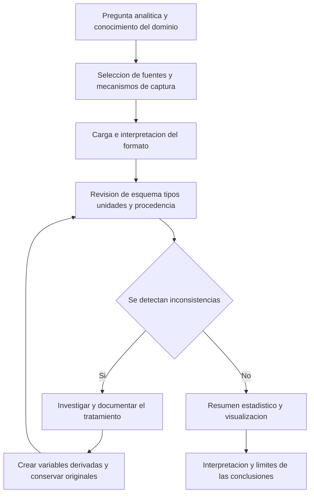

# Clase 2: Calidad y captura de datos: análisis exploratorio con Google Colab

> **Objetivo académico:** Evaluar la organización, calidad y procedencia de los datos; seleccionar mecanismos de captura adecuados e implementar un flujo inicial de carga, validación, transformación y análisis exploratorio mediante cuadernos de Google Colab.

## 1. Contexto y marco conceptual

La sesión conecta tres decisiones del trabajo analítico: qué datos se necesitan, cómo obtenerlos y cómo comprobar que su representación permite interpretaciones válidas. Disponer de un archivo y ejecutar una operación estadística no garantiza que el resultado describa correctamente el fenómeno estudiado. La confiabilidad del análisis depende también de las unidades, los formatos, la procedencia y las transformaciones aplicadas.

La herramienta debe ajustarse al problema. Las hojas de cálculo, como Excel y Google Sheets, pueden resolver análisis de conjuntos pequeños o medianos mediante operaciones básicas, estadística descriptiva y visualización. Cuando se necesitan transformaciones personalizadas, automatización o integración con otras fuentes, un entorno programable ofrece mayor flexibilidad. El volumen, la frecuencia de actualización, la complejidad y los conocimientos disponibles condicionan esa elección.

La organización de los datos constituye una primera dimensión de análisis:

| Organización | Característica principal | Ejemplos tratados | Implicación analítica |
| --- | --- | --- | --- |
| Estructurada | Esquema predefinido con campos y registros identificables | Tablas de bases de datos y hojas de cálculo organizadas como tablas | Facilita consultas, filtros y operaciones por columna |
| Semiestructurada | Organización mediante etiquetas, claves o jerarquías, con flexibilidad de esquema | XML y JSON | Requiere interpretar la estructura y, en ocasiones, convertirla a una representación tabular |
| No estructurada | El contenido no se presenta directamente como registros tabulares | Texto libre, comentarios, imágenes y audio | Exige extraer características o definir reglas de interpretación antes de ciertos análisis |

**Enriquecimiento conceptual:** La clasificación depende del contenido y su esquema, no únicamente del archivo o de la aplicación utilizada. Una hoja de cálculo con títulos dispersos y celdas combinadas puede carecer de una estructura analítica uniforme; un registro de eventos en JSON puede ser semiestructurado. Asimismo, una página web combina estructura documental con contenido que puede necesitar extracción y reorganización.

El flujo general desarrollado en la clase puede representarse así:



## 2. Fundamentos teóricos y arquitectura

### 2.1. Dimensiones de calidad de los datos

La sesión destaca organización, integridad, precisión, consistencia y confiabilidad. Estas dimensiones se relacionan, pero permiten identificar problemas diferentes.

| Dimensión | Pregunta de control | Riesgo ilustrado |
| --- | --- | --- |
| Organización | ¿Cómo se almacenan y recuperan los datos? | Interpretar incorrectamente el esquema de una fuente |
| Integridad | ¿Se preserva el contenido y su significado durante el procesamiento? | Alterar u omitir información mediante transformaciones injustificadas |
| Precisión | ¿La representación conserva el detalle necesario? | Perder pequeñas variaciones de temperatura al guardar solo enteros |
| Consistencia | ¿Se aplican formatos, unidades y reglas compatibles? | Mezclar metros con centímetros o comas con puntos decimales |
| Confiabilidad | ¿Se conoce y puede justificarse la procedencia? | Tratar datos simulados como observaciones de la realidad |

La integridad debe protegerse desde la recepción hasta el almacenamiento y el análisis. Corregir una representación puede ser necesario, pero hacerlo sin conocer el significado de los valores introduce el riesgo de sustituir observaciones por supuestos.

La precisión requerida depende del objetivo: un sensor orientado a detectar cambios pequeños necesita conservar una resolución compatible con esos cambios. Reducir decimales puede eliminar información relevante antes de comenzar el análisis.

**Enriquecimiento conceptual:** Conviene distinguir exactitud, precisión y resolución. La exactitud expresa cercanía a un valor de referencia; la precisión, repetibilidad de las mediciones; la resolución, el menor incremento distinguible o registrado. Conservar más decimales no demuestra por sí mismo mayor exactitud.

La consistencia exige uniformidad semántica y de representación. Dos valores pueden ser numéricos y, aun así, no ser comparables si utilizan unidades distintas. También pueden aparecer duplicados al consolidar varias fuentes, con el consiguiente cambio del peso de ciertas observaciones en los resultados.

**Enriquecimiento conceptual:** Dos filas con valores iguales no son necesariamente duplicados indebidos. La identificación requiere definir qué constituye una observación y qué claves o atributos permiten reconocerla.

La confiabilidad demanda conocer la fuente y distinguir observaciones, simulaciones y datos generados artificialmente. En la sesión se advierte que los datos sintéticos no deben asumirse como evidencia directa de hechos reales.

**Enriquecimiento conceptual:** Los datos sintéticos pueden contribuir al desarrollo y entrenamiento de modelos bajo condiciones justificadas. Su utilidad depende de la fidelidad de la generación, los sesgos introducidos y la validación con evidencia pertinente. Su origen debe permanecer explícito.

La calidad favorece decisiones, eficiencia operativa y confianza en los resultados. Sin embargo, no basta con datos adecuados para garantizar un buen modelo: también importan la formulación del problema, el método y la evaluación.

### 2.2. Arquitectura de Google Colab

Google Colab permite trabajar con cuadernos que combinan código, texto explicativo y resultados. La sesión lo presenta como un entorno que reduce la necesidad de instalar y configurar localmente las herramientas habituales de Python.

Deben distinguirse tres componentes:

- **Documento del cuaderno:** contiene las celdas de texto y código y puede conservar resultados guardados.
- **Entorno de ejecución:** proporciona el sistema operativo, el intérprete, la memoria, el disco temporal y las dependencias disponibles.
- **Fuentes y almacenamiento persistente:** contienen los archivos que se cargan o consultan, por ejemplo, mediante Google Drive o servicios externos.

Conectar el cuaderno habilita un entorno remoto con recursos asignados. Las variables, instalaciones adicionales y archivos almacenados únicamente en ese entorno pueden desaparecer al finalizarlo o reiniciarlo. Guardar el documento del cuaderno no equivale a conservar íntegramente el estado de la máquina.

Las celdas se pueden ejecutar de forma independiente, pero las dependencias entre ellas establecen un orden lógico. Una celda que usa `pd` requiere haber ejecutado antes la importación correspondiente. La posición visible de una celda no demuestra que su contenido ya esté definido en memoria.

La sesión menciona CPU, GPU y TPU, además de opciones gratuitas y de pago. La disponibilidad y los límites de uso condicionan su aplicación.

**Enriquecimiento conceptual:** CPU, GPU y TPU son arquitecturas apropiadas para cargas diferentes; no constituyen una escala universal de velocidad. Utilizar una GPU no acelera automáticamente las operaciones ordinarias de pandas. El beneficio depende del algoritmo, las bibliotecas utilizadas y el costo de transferir los datos.

Colab se relaciona con los cuadernos Jupyter y facilita integración con Drive, repositorios y otras fuentes. Los usos mencionados incluyen exploración de datos, prototipado, aprendizaje automático, procesamiento de lenguaje natural y visión computacional. En esta sesión se implementa análisis exploratorio, sin desarrollar modelos de aprendizaje automático.

## 3. Implementación técnica y lógica de negocio

### 3.1. Selección de mecanismos de captura

La captura puede partir de fuentes existentes o de la producción de nuevas observaciones. Cuando una pregunta exige datos muy localizados y no existe una fuente adecuada, los formularios permiten recopilar información directamente de la población de interés.

| Mecanismo | Herramientas identificables en la sesión | Función y criterio de selección |
| --- | --- | --- |
| Extracción web | Beautiful Soup, Scrapy, Web Scraper y Octoparse | Recuperar contenido de páginas; elegir según escala, personalización y necesidad de programación |
| Consumo de API | `requests` en Python y `httr` en R | Solicitar datos mediante interfaces ofrecidas por servicios |
| Exploración de API | Postman | Inspeccionar solicitudes y respuestas y comprender el funcionamiento de una interfaz |
| Formularios | Google Forms, Microsoft Forms y SurveyMonkey | Recopilar respuestas mediante instrumentos configurables |
| Analítica de eventos | Google Analytics y herramientas de instrumentación de aplicaciones | Registrar actividad y producir métricas sobre interacciones |
| Integración continua | Apache Kafka y conectores | Transportar eventos o integrar cambios y registros de distintas fuentes |
| Almacenamiento y consulta | Bases de datos | Organizar, conservar y recuperar información |
| Análisis tabular | Hojas de cálculo | Revisar, resumir y representar datos con herramientas disponibles |

Beautiful Soup se orienta al análisis de documentos HTML o XML; Scrapy ofrece un marco más amplio para rastreo y extracción. Las alternativas visuales reducen parte de la programación necesaria, aunque pueden imponer límites funcionales o costos.

**Enriquecimiento conceptual:** Beautiful Soup analiza el documento recibido; la obtención de ese documento constituye otro paso. Las API, por su parte, proporcionan una interfaz de acceso que puede requerir autenticación, paginación y manejo de errores. Una solicitud HTTP no garantiza que cualquier dato de un sitio esté disponible.

La discusión entre herramientas abiertas y comerciales debe considerar tanto el costo de licencia como el tiempo de implementación, el mantenimiento y la capacidad de personalización. La facilidad de uso no es una propiedad uniforme de todas las alternativas de pago.

### 3.2. Preparación del cuaderno

El laboratorio utiliza pandas para datos tabulares, NumPy para operaciones numéricas y Matplotlib para gráficos. Posteriormente incorpora Plotly para visualizaciones interactivas.

**Enriquecimiento conceptual:** El siguiente código reconstruye las operaciones descritas; no reproduce un archivo de cuaderno proporcionado ni constituye una ejecución verificada.

```python
import pandas as pd
import numpy as np
import matplotlib.pyplot as plt
```

`pd`, `np` y `plt` son alias convencionales. Un `DataFrame` de pandas representa una tabla con filas y columnas; NumPy proporciona arreglos y operaciones numéricas, y Matplotlib permite configurar representaciones gráficas.

**Enriquecimiento conceptual:** Un `DataFrame` puede contener texto u objetos, aunque organice los registros en forma tabular. El contenido no estructurado necesita una representación adecuada para cada operación; pandas no impone que todo el material de origen haya sido originalmente tabular.

### 3.3. Acceso y lectura de archivos

Se muestran tres alternativas: montar Google Drive con autorización, cargar archivos mediante las utilidades de Colab y arrastrarlos al explorador de archivos del entorno. Para conjuntos grandes también se plantea una descarga directa desde el servidor de origen al entorno remoto, evitando el paso intermedio por el equipo local.

La conveniencia de cada vía depende de tamaño, conectividad, permisos y persistencia. Los tamaños comentados en clase son orientativos, no límites técnicos universales.

**Enriquecimiento conceptual:** Ejemplo mínimo de carga local y lectura, con una ruta ilustrativa:

```python
from google.colab import files

archivos = files.upload()

ruta = "/content/datos.csv"
datos = pd.read_csv(ruta, sep=";", encoding="latin-1")
```

La ruta debe coincidir con un archivo realmente cargado. `sep=";"` indica que las columnas están separadas por punto y coma. `encoding="latin-1"` corresponde a la solución aplicada en la demostración después de que la lectura con UTF-8 fallara.

**Enriquecimiento conceptual:** Una codificación que permite leer el archivo no demuestra que todos sus caracteres hayan sido interpretados correctamente. Es necesario revisar tildes y otros caracteres y, cuando sea posible, consultar la codificación de origen.

El laboratorio también explora comandos del sistema mediante el prefijo `!`. La tentativa de tratar un archivo RAR con herramientas o argumentos inadecuados no concluye en una descompresión validada; finalmente se carga el CSV ya descomprimido. La enseñanza técnica es distinguir formatos y verificar las dependencias, sin convertir los intentos fallidos en un procedimiento recomendado.

### 3.4. Inspección inicial y tipos

**Enriquecimiento conceptual:** Las consultas descritas pueden organizarse así:

```python
len(datos)
datos.shape
datos.head(3)
datos.columns
datos.dtypes
```

`len(datos)` devuelve el número de filas; `shape`, el número de filas y columnas; `head(3)`, una vista de los tres primeros registros; `columns`, los nombres de las columnas, y `dtypes`, los tipos inferidos. La demostración trabaja con 29 registros y atributos de identificación, género, edad, peso, altura, conocimientos, habilidades y preferencias tecnológicas.

La edad y el peso se reconocen como enteros, mientras que la altura se representa con punto flotante. Otras columnas aparecen como `object`. Un campo esperado como numérico puede quedar como objeto si contiene letras, separadores incompatibles u otras representaciones mezcladas.

**Enriquecimiento conceptual:** El tipo informático y la naturaleza estadística de una variable son planos diferentes. Un peso guardado como entero sigue representando una magnitud conceptualmente continua. Además, `object` no implica exclusivamente texto: puede contener objetos o valores heterogéneos.

### 3.5. Normalización de unidades y conservación del original

El caso central consiste en una columna de altura declarada en metros que contiene valores como `1.82` junto con `180`, `172`, `161` y `164`. La interpretación planteada es una mezcla de metros y centímetros. La corrección se escribe en una columna nueva para conservar la información original.

**Enriquecimiento conceptual:** Reconstrucción de la regla condicional descrita:

```python
datos["altura_ajustada"] = datos["altura"].apply(
    lambda x: x / 100 if x > 10 else x
)
```

La expresión `lambda` define una función anónima; `apply` la aplica a los valores de la serie. El umbral de 10 identifica posibles alturas expresadas en centímetros dentro de este caso específico. No es una regla general para limpiar mediciones.

Si se confirma que un valor representa centímetros, la conversión a metros es:

$$
h_{\mathrm{m}}=\frac{h_{\mathrm{cm}}}{100}
$$

Aquí $h_{\mathrm{cm}}$ es una altura no negativa medida en centímetros y $h_{\mathrm{m}}$ la misma magnitud expresada en metros. Por ejemplo, $180\,\mathrm{cm}$ corresponden a $1.80\,\mathrm{m}$. La conversión solo está justificada cuando se conoce la unidad original; un valor grande también podría obedecer a otro error.

La normalización de comas y puntos decimales se menciona como otra necesidad posible. Antes de sustituir caracteres deben distinguirse separadores decimales y de miles, para evitar cambiar el significado de los valores.

### 3.6. Resumen estadístico y selección de subconjuntos

**Enriquecimiento conceptual:** Para alturas válidas $h_1,\ldots,h_n\in\mathbb{R}_{>0}$, expresadas todas en metros y con $n>1$, se pueden definir:

$$
\bar h=\frac{1}{n}\sum_{i=1}^{n}h_i
$$

La media $\bar h$ expresa la altura promedio en metros; $n$ es la cantidad de observaciones válidas incluidas. No describe por sí sola la dispersión ni garantiza representatividad de una población más amplia.

$$
R=\max_i h_i-\min_i h_i
$$

El rango $R$ mide la amplitud entre los extremos en metros y es sensible a valores atípicos.

$$
s^2=\frac{1}{n-1}\sum_{i=1}^{n}(h_i-\bar h)^2,
\qquad s=\sqrt{s^2}
$$

$s^2$ es la varianza muestral, en metros cuadrados, y $s$ la desviación estándar muestral, en metros. El denominador $n-1$ corresponde a la convención muestral habitual de pandas, que debe distinguirse de la varianza descriptiva calculada con denominador $n$.

```python
altura = datos["altura_ajustada"]

resumen = altura.agg(["count", "mean", "min", "max", "var", "std"])
rango = altura.max() - altura.min()

subconjunto = datos.loc[datos["altura_ajustada"] <= 1.65].copy()
```

El filtro conserva registros cuya altura ajustada es menor o igual a $1.65\,\mathrm{m}$. En la demostración se informa que ese subconjunto contiene tres personas. Sus estadísticas describen únicamente al grupo seleccionado.

### 3.7. Visualización e interpretación

Se presentan distribuciones de edad, conocimientos de Big Data y dominio de lenguajes de programación. Matplotlib permite configurar títulos, ejes y frecuencias; Plotly incorpora interacción, como acercamiento, información al pasar el cursor y selección de categorías mediante la leyenda.

La sesión muestra una distribución de edades segmentada por género y otra representación que relaciona lenguaje y habilidad de programación. La interacción facilita explorar segmentos sin generar un gráfico independiente para cada uno.

**Enriquecimiento conceptual:** Un histograma agrupa valores cuantitativos en intervalos. Para niveles de conocimiento o nombres de lenguajes corresponde una representación de frecuencias categóricas, normalmente mediante barras. Los niveles ordinales deben conservar un orden semántico explícito.

La eliminación de valores ausentes antes de una representación debe limitarse al propósito de esa operación y documentarse. Una respuesta categórica como «nulo», si significa ausencia de conocimientos, no equivale automáticamente a un dato faltante.

## 4. Análisis crítico de casos y auditoría práctica

### 4.1. Un archivo legible puede estar mal interpretado

En la demostración, omitir la codificación produce un error de lectura. Corregirla permite avanzar, pero omitir el separador adecuado conduce a una tabla de 29 filas y una sola columna. Esto evidencia que la ausencia de excepciones no certifica una carga correcta.

La revisión debe combinar ruta, codificación, separador, dimensiones, encabezados y contenido de muestra. Solo entonces resulta razonable empezar a calcular estadísticas.

### 4.2. Dependencias del estado del cuaderno

El error `NameError` asociado a `pd` se resuelve ejecutando la celda de importaciones. El problema corresponde al estado de la sesión, no al archivo de datos. Copiar un cuaderno conserva su código, pero no garantiza que las variables de una sesión anterior existan en el nuevo entorno.

**Enriquecimiento conceptual:** La reproducibilidad mejora cuando el cuaderno puede ejecutarse desde un entorno limpio siguiendo un único flujo principal. Las alternativas de carga deben estar claramente separadas para que una ejecución completa no active rutas incompatibles.

### 4.3. Altura media plausible frente a validez demostrada

La media inicial de altura se informa aproximadamente como $25.28\,\mathrm{m}$. Al revisar los registros se encuentran magnitudes compatibles con centímetros mezcladas con metros. Tras aplicar la conversión, la media comunicada es aproximadamente $1.73\,\mathrm{m}$.

**Enriquecimiento conceptual:** La media es sensible a estas inconsistencias. En un ejemplo ilustrativo de solo dos observaciones, mezclar `1.80` y `180` produce una media numérica de $90.90$ sin una unidad coherente; convertir previamente ambos valores a metros produce $1.80\,\mathrm{m}$. El cálculo puede ser aritméticamente correcto y semánticamente inválido.

Que el resultado corregido sea plausible aporta una comprobación, pero no prueba que cada transformación sea correcta. También deben verificarse las unidades de origen y los valores modificados.

La transcripción contiene inconsistencias en otras cifras: menciona distintas cantidades de columnas, un máximo de altura incompatible con el rango referido y una varianza que no coincide con la desviación estándar verbalizada. Por ello, estas cifras no se consolidan como resultados verificados. Si una desviación estándar fuera $0.061\,\mathrm{m}$, su varianza correspondiente sería aproximadamente $0.003721\,\mathrm{m}^2$, no $0.038\,\mathrm{m}^2$; esta relación es una comprobación matemática, no una recalculación del conjunto original.

### 4.4. Anomalías de sensores y decisiones de tratamiento

La sesión contrapone una conversión de unidades conocida con lecturas anómalas de sensores cuya causa no está identificada. La diferencia relevante es el fundamento disponible para intervenir.

**Enriquecimiento conceptual:** Una lectura extrema puede representar una falla o un evento real importante. Eliminarla automáticamente por estar fuera del rango habitual puede ocultar precisamente el fenómeno que se busca detectar. Conviene investigar, contrastar otras señales, marcar la observación y documentar la decisión. Si no se puede resolver la incertidumbre, comparar análisis con y sin esos registros permite estudiar su influencia.

### 4.5. Logs, eventos y monitoreo

Se comentan conectores de Kafka para integrar registros y cambios de bases de datos, y un caso de lectura periódica de logs para producir alertas sobre un servicio. El aporte conceptual es la transformación de datos operativos en señales accionables.

**Enriquecimiento conceptual:** Los logs no son siempre no estructurados: pueden tener campos fijos o formato JSON. Además, la ausencia de actividad registrada no demuestra por sí sola una caída. Un proceso ejecutado en el mismo servidor tampoco garantiza alertas ante la pérdida completa de esa máquina; el monitoreo externo permite cubrir parte de ese riesgo.

### 4.6. Alcance de la evidencia y privacidad

La demostración utiliza 29 registros reales del grupo. Las conclusiones sobre preferencias y habilidades describen ese conjunto observado; no se aporta un diseño de muestreo que permita extenderlas a una población mayor.

Se sustituyen nombres por etiquetas como «persona 1» para reducir exposición directa de identidad.

**Enriquecimiento conceptual:** Esa sustitución constituye seudonimización y no garantiza anonimato. La combinación de edad, ciudad, género u otros atributos puede permitir identificar personas. La protección también requiere limitar acceso y conservar únicamente los campos necesarios.

## 5. Principios de diseño, buenas prácticas y anti-patrones

| Principio | Buena práctica | Anti-patrón y consecuencia |
| --- | --- | --- |
| Adecuación de herramientas | Elegir según problema, escala y frecuencia | Adoptar infraestructura compleja sin necesidad operativa |
| Validación semántica | Revisar tipos, unidades, esquema y significado | Dar por correcta una tabla porque se cargó sin errores |
| Trazabilidad | Conservar originales y documentar columnas derivadas | Sobrescribir datos sin poder reconstruir el cambio |
| Conocimiento del dominio | Justificar conversiones mediante evidencia | Aplicar umbrales universales para corregir cualquier anomalía |
| Consistencia de integración | Definir formatos y criterios de duplicidad | Consolidar fuentes sin controlar repeticiones o incompatibilidades |
| Reproducibilidad | Explicitar dependencias y orden de ejecución | Depender de variables creadas fuera del flujo visible |
| Gestión del entorno | Registrar instalaciones y guardar resultados necesarios | Suponer que el disco temporal es persistente |
| Interpretación estadística | Informar unidades, población observada y datos válidos | Confundir plausibilidad con validación o descripción con generalización |
| Visualización | Elegir la representación según la variable | Tratar categorías nominales como intervalos continuos |
| Uso de IA | Revisar explicaciones y código antes de aceptarlos | Considerar la respuesta generada como evidencia de corrección |

Los cuadernos deben combinar bloques de código con explicaciones sobre propósito, entradas, decisiones y resultados. Un índice construido mediante encabezados facilita navegar y revisar el razonamiento. El código organizado por etapas permite localizar errores con más precisión que un bloque monolítico.

La asistencia de IA integrada puede explicar importaciones o sugerir implementaciones, pero sus respuestas son aproximaciones que requieren revisión. La interpretación final continúa dependiendo del conocimiento del dominio y de la evidencia disponible.

**Enriquecimiento conceptual:** Las condiciones del servicio, los permisos y la disponibilidad de aceleradores pueden cambiar. Conviene evitar que el diseño dependa de una cuota fija no verificada. También debe distinguirse el carácter abierto de tecnologías como Jupyter de las condiciones comerciales y de acceso del servicio alojado Colab.

## 6. Síntesis conceptual y profundización académica

El aprendizaje central consiste en reconocer que el análisis comienza antes del cálculo. Seleccionar fuentes, interpretar archivos, verificar unidades y revisar tipos determina qué significan las estadísticas posteriores. La inconsistencia de altura muestra que una media computada correctamente puede describir una representación defectuosa.

Google Colab facilita construir ese flujo al integrar ejecución remota, documentación y visualización. Su utilidad depende de comprender la separación entre documento, estado de ejecución y almacenamiento persistente. La ejecución por celdas aporta flexibilidad, pero exige controlar dependencias y conservar las decisiones de transformación.

La captura tampoco se reduce a una herramienta única. Formularios, extracción web, API, instrumentación de eventos y conectores responden a fuentes y frecuencias diferentes; las bases de datos conservan y organizan información, mientras que las bibliotecas analíticas permiten revisarla y sintetizarla.

**Enriquecimiento conceptual:** Una profundización coherente con esta sesión conecta tres formas de validación: sintáctica, para comprobar que el archivo puede interpretarse; estructural, para revisar columnas y tipos; y semántica, para evaluar si los valores corresponden al fenómeno. Las tres son necesarias para sostener conclusiones. La calidad no es una propiedad que se presupone por la reputación de la fuente: debe justificarse para el uso analítico concreto.
