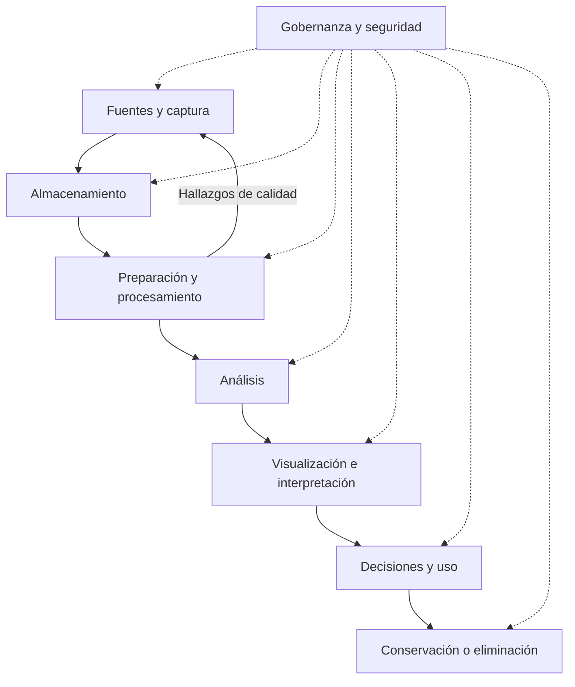

# Clase 3: Big data y datos abiertos: fundamentos, ciclo de vida y evaluación de fuentes

> **Objetivo académico:** Comprender el big data como un desafío de gestión y análisis condicionado por el volumen, la velocidad y la variedad; relacionar su ciclo de vida con la infraestructura y la gobernanza, y evaluar fuentes de datos abiertos según su accesibilidad, licencia, calidad y pertinencia analítica.

## 1. Contexto y marco conceptual

### De la abundancia digital a la información útil

La digitalización de actividades económicas, científicas y sociales multiplica los registros disponibles: transacciones, interacciones en redes sociales, mediciones de sensores, imágenes satelitales y registros administrativos. Esta abundancia abre oportunidades para investigar fenómenos y fundamentar decisiones, pero también exige resolver cómo capturar, almacenar, preparar e interpretar los datos.

El propósito del análisis no es acumular registros. Es producir información pertinente que permita describir un comportamiento, sustentar una explicación o apoyar una decisión. La utilidad depende de la relación entre los datos disponibles y la pregunta que se desea responder.

La sesión conecta dos dimensiones complementarias:

- **Big data:** dificultades técnicas y organizativas para gestionar conjuntos de datos que exceden las capacidades prácticas de soluciones convencionales en un contexto determinado.
- **Open data o datos abiertos:** condiciones de acceso, uso, reutilización y redistribución de los datos.

Un conjunto puede ser masivo y cerrado, pequeño y abierto, o reunir ambas propiedades. El tamaño no determina su apertura y una descarga pública no demuestra, por sí sola, que exista permiso de reutilización.

### Evolución tecnológica: una lectura por capacidades

La exposición organiza la evolución mediante varios procesos: desarrollo de la computación, ampliación de las capacidades de memoria y almacenamiento, bases de datos relacionales, expansión de la web, minería de datos, procesamiento distribuido y servicios en la nube. En conjunto, estos procesos explican por qué cambian las posibilidades de gestionar y analizar información.

| Proceso tecnológico | Aporte conceptual al manejo de datos |
| --- | --- |
| Computación y gestión de memoria | Amplían la capacidad de representar y procesar información |
| Bases de datos relacionales | Permiten organizar datos estructurados y consultarlos sistemáticamente |
| Internet y web | Expanden la producción, circulación y diversidad de contenidos digitales |
| Minería de datos | Orienta el análisis hacia patrones y relaciones en conjuntos extensos |
| Almacenamiento y procesamiento distribuidos | Reparten datos y trabajo entre varios equipos |
| Computación en la nube | Facilita consumir capacidades de infraestructura como servicios |
| Inteligencia artificial | Amplía las posibilidades de clasificación, predicción y automatización analítica |

**Enriquecimiento conceptual:** Esta secuencia debe entenderse como una historia de capacidades relacionadas, no como una cronología certificada del término big data. La transcripción mezcla antecedentes de la computación con fechas de aparición de tecnologías y del propio concepto. También contiene referencias inconsistentes a Hadoop, la web y Facebook; no se adoptan esas fechas como hitos comprobados. Hadoop debe describirse como un ecosistema de software para almacenamiento y procesamiento distribuidos, no simplemente como una API.

La idea histórica central sí resulta válida para el argumento de la clase: una cantidad de datos difícil de gestionar en una época puede resultar ordinaria después. Sin embargo, la mejora tecnológica también estimula nuevas fuentes, mayores resoluciones y nuevas demandas de análisis.

## 2. Fundamentos teóricos y arquitectura

### Definición contextual de big data

Las definiciones recogidas en la sesión coinciden en señalar datos demasiado grandes o complejos para ser tratados eficazmente con herramientas tradicionales. La dificultad puede afectar la captura, el almacenamiento, la administración o el procesamiento.

No existe en la exposición un umbral universal de bytes que separe datos y big data. La evaluación depende de los recursos, los formatos, los tiempos de respuesta y la operación requerida. Superar las posibilidades de una hoja de cálculo indica que conviene cambiar de herramienta, pero no basta para concluir que sea necesaria una arquitectura distribuida.

**Enriquecimiento conceptual:** Un diagnóstico técnico debe considerar al menos el volumen que realmente se lee, la memoria necesaria para la operación, el tiempo admisible, la tasa de llegada de registros y el costo. Un archivo extenso puede analizarse por fragmentos en un solo equipo; una corriente de registros pequeños puede exigir una arquitectura compleja si debe responder con muy baja latencia.

### Las tres V y su ampliación

| Dimensión | Definición | Desafío asociado |
| --- | --- | --- |
| Volumen | Magnitud de los datos almacenados o tratados | Capacidad de almacenamiento, memoria, transferencia y procesamiento |
| Velocidad | Rapidez con que se generan, llegan o modifican los datos | Ingesta oportuna y producción de resultados dentro del tiempo requerido |
| Variedad | Diversidad de estructuras, formatos y significados | Integración e interpretación coherente de fuentes heterogéneas |
| Veracidad | Grado de confiabilidad de los registros respecto del fenómeno representado | Identificación de errores, sesgos y fallos de medición |
| Valor | Utilidad de los datos y de sus resultados para una finalidad | Justificación de la inversión y pertinencia de la información obtenida |
| Visibilidad | Conocimiento de cómo se generan, almacenan, procesan y administran los datos | Transparencia operativa y seguimiento del tratamiento |

La sesión presenta volumen, velocidad y variedad como las tres dimensiones principales y añade veracidad, valor y visibilidad. Esta ampliación es un marco utilizado en la exposición, no una lista universal y cerrada.

Los formatos estructurados presentan una organización explícita de campos y registros; los semiestructurados incorporan una organización flexible; los no estructurados requieren técnicas específicas para extraer representaciones analíticas. La variedad también implica diferencias semánticas entre fuentes aparentemente similares.

**Enriquecimiento conceptual:** Las V son dimensiones de caracterización, no condiciones que necesariamente deban alcanzar simultáneamente un nivel elevado. Un archivo histórico estático puede plantear un problema de big data por su volumen y complejidad, aunque no reciba actualizaciones. Por ello, la distinción de la sesión entre dataset masivo estático y big data debe tomarse como una orientación pedagógica, no como una exclusión general.

El ejemplo del sensor de temperatura muestra la importancia de la veracidad: un fallo puede producir registros que el sistema ingiere correctamente, pero que ya no representan de forma confiable la magnitud medida. La corrección del formato no garantiza la validez de la medición.

### Infraestructura local, clústeres y nube

La conversación enfatiza las limitaciones del hardware y propone distribuir el almacenamiento entre varias máquinas. Esta estrategia requiere software que coordine dónde se guardan los datos y cómo se ejecutan las operaciones.

| Alternativa | Ventaja principal | Límite o responsabilidad |
| --- | --- | --- |
| Equipo local | Control directo y menor complejidad inicial | Capacidad limitada de memoria, disco y cómputo |
| Clúster propio | Reparto de almacenamiento y procesamiento | Configuración, mantenimiento, red y coordinación de fallos |
| Servicio en la nube | Acceso a capacidades sin adquirir toda la infraestructura | Costos, cuotas, permisos y dependencia del servicio |
| Plataforma especializada | Datos y herramientas próximos al dominio de aplicación | Restricciones de catálogo, operación y condiciones de uso |

Hadoop aparece como referencia para el trabajo distribuido. MapReduce se introduce como modelo que permite repartir trabajo y combinar resultados. Spark se menciona como otra herramienta del ecosistema de procesamiento de grandes conjuntos de datos.

**Enriquecimiento conceptual:** En MapReduce, la fase de mapeo transforma registros en resultados intermedios; estos se agrupan por clave y la reducción combina los valores correspondientes. El beneficio depende de que el problema admita esa descomposición. La comunicación entre nodos y la distribución desigual del trabajo pueden limitar el rendimiento.

La infraestructura es una condición necesaria, pero no explica por sí sola la dificultad. También importan la representación de los datos, los algoritmos, la red, la calidad y los requisitos de respuesta. La nube desplaza responsabilidades operativas; no elimina la necesidad de diseñar ni de controlar costos.

## 3. Implementación técnica y lógica de negocio

### Ciclo de vida de los datos

La sesión propone un marco que va desde la creación o captura hasta la eliminación. Su implementación debe responder al valor, la sensibilidad y las necesidades de uso de cada conjunto.

**Enriquecimiento conceptual:** Las conexiones de retroalimentación y la ubicación transversal de la gobernanza explicitan una consecuencia del contenido de la sesión: los errores descubiertos durante la preparación pueden exigir revisar la captura, y la seguridad debe acompañar todas las etapas.

| Etapa | Operación central | Criterio de control |
| --- | --- | --- |
| Captura o recolección | Obtener registros propios o de terceros | Procedencia, cobertura y pertinencia |
| Almacenamiento | Conservar datos de forma accesible y segura | Capacidad, permisos y disponibilidad |
| Preparación | Limpiar, transformar, corregir y tratar duplicados | Coherencia, trazabilidad y reglas explícitas |
| Procesamiento | Ejecutar operaciones sobre los registros | Corrección, recursos y reproducibilidad |
| Análisis | Extraer información mediante técnicas adecuadas | Correspondencia con la pregunta analítica |
| Visualización | Representar resultados mediante tablas, gráficos o paneles | Claridad y fidelidad al fenómeno |
| Conservación o eliminación | Determinar el destino posterior de los datos | Valor, sensibilidad y cumplimiento de políticas |

Los data lakes y data warehouses se mencionan como alternativas de almacenamiento. Su elección depende de las características de los datos y de las consultas previstas.

**Enriquecimiento conceptual:** Un data lake permite conservar datos heterogéneos con distintos grados de preparación; un data warehouse organiza datos integrados para consultas analíticas bajo modelos definidos. Ninguna opción garantiza calidad o escalabilidad únicamente por su nombre: ambas requieren arquitectura y gobernanza.

### PySpark y entornos de cuadernos

La sesión menciona PySpark como vía de acceso a Spark desde Python en un entorno de cuadernos como Google Colab. No contiene código ejecutado ni una implementación distribuida que permita verificar resultados de rendimiento.

**Enriquecimiento conceptual:** Instalar PySpark no crea automáticamente un clúster multinodo. Spark puede funcionar en modo local dentro de la máquina del cuaderno o conectarse a infraestructura distribuida. La memoria y el almacenamiento disponibles dependen del entorno y de sus condiciones de servicio; no debe interpretarse una capacidad mencionada oralmente como límite universal de Spark o de Colab.

### Datos abiertos: condiciones de reutilización

La exposición caracteriza los datos abiertos por su disponibilidad digital, accesibilidad, reutilización, redistribución y licencia abierta. También destaca la calidad, la actualización y la procedencia como condiciones importantes para su aprovechamiento.

**Enriquecimiento conceptual:** Conviene distinguir tres planos:

- **Acceso técnico:** posibilidad de localizar, consultar o descargar los datos.
- **Permiso jurídico:** autorización para usarlos, modificarlos y redistribuirlos conforme a su licencia.
- **Aptitud analítica:** adecuación de su calidad, documentación y cobertura al uso previsto.

Estos planos no son equivalentes. Un archivo descargable puede tener restricciones de uso; un conjunto con licencia abierta puede contener errores. Una licencia abierta puede establecer condiciones como atribución o conservación de determinados términos: apertura no equivale a ausencia absoluta de obligaciones.

La sesión admite costos mínimos de distribución o mantenimiento dentro de su explicación de accesibilidad. Esto no permite asumir que cualquier servicio de pago sea abierto. Es necesario revisar por separado las condiciones de acceso y los derechos de reutilización. Del mismo modo, un registro de usuario no prueba ni descarta por sí solo la apertura del conjunto.

Los beneficios descritos incluyen transparencia y rendición de cuentas, colaboración científica, innovación, productividad y decisiones fundamentadas en evidencias. Su materialización exige que los datos puedan encontrarse, interpretarse y reutilizarse efectivamente.

### Fuentes y repositorios mencionados

| Familia de fuentes | Ejemplos de la sesión | Uso o precaución principal |
| --- | --- | --- |
| Portales gubernamentales | Data.gov y portales de la Unión Europea, México y Bolivia | Revisar organismo productor, alcance territorial y licencia |
| Organismos internacionales | Banco Mundial, OMS y UNESCO | Distinguir indicadores, unidades, métodos y cobertura |
| Repositorios académicos | Dataverse, Zenodo y Open Science Framework | Consultar documentación, versiones y condiciones de reutilización |
| Plataformas privadas | Kaggle y servicios de datos de Google | Revisar las condiciones de cada conjunto, no solo de la plataforma |
| Fuentes ambientales y geoespaciales | NASA y Google Earth Engine | Identificar resolución, cobertura temporal y tratamiento previo |
| Fuentes estadísticas nacionales | Instituto Nacional de Estadística de Bolivia | Distinguir bases descargables, consultas y resultados agregados |

**Enriquecimiento conceptual:** Banco Mundial, OMS y UNESCO corresponden a organismos internacionales intergubernamentales; agruparlos simplemente como organizaciones no gubernamentales sería impreciso. Además, los nombres de algunas plataformas aparecen deformados por la transcripción; se normalizan cuando su identificación es clara, sin reconstruir direcciones web incompletas.

## 4. Análisis crítico de casos y auditoría práctica

### Capacidad de almacenamiento y consistencia de unidades

La sesión utiliza discos de 16 TB y conjuntos de 500 TB para ilustrar el paso del almacenamiento local al distribuido. El razonamiento es útil, pero algunas equivalencias orales son inconsistentes.

**Enriquecimiento conceptual:** Usando unidades decimales, cada salto entre TB, PB, EB y ZB multiplica por mil. Cuatro discos de 16 TB proporcionarían, nominalmente:

$$
C = n d = 4 \times 16\,\mathrm{TB} = 64\,\mathrm{TB} = 0.064\,\mathrm{PB}.
$$

Aquí $C$ es la capacidad bruta nominal, $n$ es el número entero positivo de discos y $d$ es la capacidad nominal por disco. La expresión supone suma directa de capacidades, sin redundancia ni espacio reservado. Por tanto, 64 TB no equivalen a 0.5 PB. Diez equipos con esa configuración sumarían 640 TB brutos, pero esa cifra no representa capacidad útil garantizada.

Las estimaciones de datos globales mencionadas en la exposición mezclan unidades y no incluyen una referencia verificable ni una definición uniforme de qué se contabiliza. Su función en la clase es ilustrar la expansión de los datos; no permiten demostrar una tasa de crecimiento ni sostener una serie histórica precisa.

### Imágenes satelitales y procesamiento próximo a los datos

El caso geoespacial considera, de forma ilustrativa, 120 imágenes por año, 40 años y un tamaño aproximado de 1 GB por imagen. Bajo esos supuestos:

$$
N = a i = 40 \times 120 = 4800\;\text{imágenes},
$$

$$
S = N s = 4800 \times 1\,\mathrm{GB} = 4.8\,\mathrm{TB}.
$$

$N$ es la cantidad total de imágenes; $a$ es la duración del período, expresada en años; $i$ es la cantidad supuesta de imágenes por año; $S$ es el almacenamiento nominal total y $s$ es el tamaño supuesto por imagen. La conversión utiliza unidades decimales. El cálculo no incluye archivos auxiliares, copias ni productos derivados y no establece una regla general de cobertura satelital de Bolivia.

La exposición también supone un día de trabajo por imagen para representar un flujo convencional de descarga, preprocesamiento y clasificación. De allí obtiene 4800 días, equivalentes aproximadamente a 13.15 años si se trabaja todos los días del año. La comparación con un procesamiento de pocos meses en la nube es ilustrativa: no se documentan operaciones, infraestructura ni controles suficientes para tratarla como medición de rendimiento.

Google Earth Engine ejemplifica la ventaja de disponer de catálogos y procesamiento en una misma plataforma.

**Enriquecimiento conceptual:** Acercar el cómputo al lugar donde residen los datos puede evitar transferencias extensas y simplificar el análisis. Sin embargo, visualizar rápidamente una colección no equivale a procesarla exhaustivamente ni a validar un producto cartográfico. La validez depende también del preprocesamiento, del método de clasificación y de la evaluación de resultados.

### Vehículos eléctricos: alcance antes que cantidad

En Data.gov se explora un conjunto de vehículos eléctricos de batería e híbridos enchufables registrados en el estado de Washington. La precisión territorial es decisiva: los registros no representan automáticamente todos los vehículos de Estados Unidos.

Durante la sesión se reportan aproximadamente 257 mil registros y 17 columnas. Estas cifras describen la versión observada, no un tamaño permanente del conjunto.

La revisión metodológica debe comprobar:

- Qué representa cada fila y qué tipos de vehículos incluye.
- Cuál es la cobertura territorial y temporal.
- Qué significan las columnas y qué valores ausentes o duplicados existen.
- Qué fecha corresponde a creación, actualización o período de referencia.
- Qué licencia autoriza el uso y la redistribución.

La discusión del ETL subraya que descargar no equivale a disponer de una base preparada para el análisis. Incluso los registros de sistemas organizados necesitan controles de integridad, tipos y coherencia.

### Raw data y open data: dimensiones independientes

La respuesta oral a esta distinción vincula los datos brutos con formatos específicos y documentación incierta. Esa asociación necesita precisión.

**Enriquecimiento conceptual:** Raw data significa datos brutos respecto de un proceso de transformación. Open data describe las condiciones de apertura. Los datos brutos pueden estar bien documentados, tener formatos interoperables y publicarse con licencia abierta. También pueden existir datos muy procesados que permanezcan cerrados. Ni la procedencia incierta ni un formato propietario definen por sí mismos los datos brutos.

### Kaggle: datos y código como recursos distintos

La exploración muestra fichas de conjuntos, previsualizaciones, atributos, estadísticas resumidas y cuadernos compartidos por la comunidad. El ejemplo trata sobre detección de fraude en tarjetas de crédito.

Las cifras de tamaño y cantidad de registros se enuncian con vacilaciones; no permiten identificar inequívocamente la versión del conjunto. Asimismo, la previsualización puede mostrar solo una fracción de los registros.

**Enriquecimiento conceptual:** Un cuaderno popular ofrece un punto de partida, pero sus votos no certifican corrección. Antes de reutilizarlo conviene revisar sus dependencias, las transformaciones y el significado de los atributos. En detección de fraude también resulta relevante comprobar el desequilibrio entre clases y la separación de datos para evitar conclusiones engañosas. Estas precauciones amplían el caso; no describen verificaciones realizadas durante la sesión.

### Indicadores demográficos y visualización multivariable

La exposición comenta un gráfico de burbujas con esperanza de vida, fecundidad y población, desglosadas por país. Su interés está en representar varias variables simultáneamente y permitir comparaciones exploratorias.

**Enriquecimiento conceptual:** Los ejes pueden representar esperanza de vida y fecundidad; el área de la burbuja puede codificar población. La interpretación requiere conocer el indicador exacto, sus unidades y el año de referencia. Una asociación visual entre menor fecundidad y mayor esperanza de vida no establece causalidad.

La navegación también muestra la importancia de leer el nombre completo del indicador: una medida de mortalidad infantil no puede interpretarse como mortalidad general. Las cifras nacionales comentadas carecen en la transcripción de metadatos suficientes para presentarlas como estimaciones actuales comparables.

### Datos de Bolivia: catálogos, cartografía y censos

La sesión contrasta un catálogo nacional relativamente pequeño con un catálogo geoespacial más amplio. Se observan aproximadamente 43 conjuntos en el primero y 1974 recursos en el segundo. Son conteos de interfaces consultadas, no una medida de toda la disponibilidad de datos del país.

**Enriquecimiento conceptual:** Comparar cantidades exige saber qué cuenta cada catálogo: conjunto, capa, servicio, archivo o versión. Un recurso geoespacial incorpora localización y puede contener atributos tabulares; ambas formas no constituyen categorías excluyentes.

El INE se presenta mediante dos vías: descarga de bases y consultas de estadísticas agregadas. La segunda permite obtener distribuciones sin transferir toda la base.

Los ejemplos del censo de 2012 distinguen resultados del municipio de La Paz y resultados nacionales. Mantener esa separación evita generalizar una composición municipal al conjunto del país. La comparación posterior con 2024 utiliza totales redondeados de alrededor de 10 y 11.3 millones de habitantes; no constituye una estimación demográfica precisa ni una proyección validada.

**Enriquecimiento conceptual:** Una comparación intercensal requiere cifras oficiales exactas, cobertura y definiciones compatibles. La consulta agregada facilita el acceso, pero también debe registrar filtros, ámbito geográfico y período para que el resultado pueda interpretarse correctamente.

## 5. Principios de diseño, buenas prácticas y anti-patrones

### Diseñar a partir de la necesidad analítica

La selección de herramientas debe partir de la pregunta, los datos y las restricciones. Contar registros o medir bytes ayuda a dimensionar, pero no sustituye evaluar operaciones, memoria, latencia y costos.

| Buena práctica | Justificación | Anti-patrón asociado |
| --- | --- | --- |
| Definir la pregunta y la unidad de análisis | Permite determinar qué registros son pertinentes | Acumular datos sin finalidad explícita |
| Revisar procedencia, licencia y documentación | Sustenta interpretación y reutilización | Considerar abierto todo archivo descargable |
| Registrar versiones, períodos y filtros | Facilita comparar y reproducir resultados | Mezclar datos de distintas fechas sin advertirlo |
| Comprobar tipos, duplicados y rangos | Reduce errores de lectura y de cálculo | Confiar solo en la apariencia de una tabla |
| Justificar correcciones y exclusiones | Conserva trazabilidad y significado | Eliminar automáticamente valores inusuales |
| Evaluar capacidad útil y costos completos | Evita dimensionamientos insuficientes | Confundir almacenamiento bruto con disponible |
| Incorporar seguridad en todo el ciclo | Protege datos y regula su conservación | Añadir controles solo al publicar |
| Separar resultados observados de expectativas | Mantiene rigor en las conclusiones | Convertir promesas de rapidez en evidencia |

### Preparación y reglas de negocio

La sesión incluye conocimientos generales sobre fechas, agregación y valores negativos en registros comerciales. Para obtener resultados temporales coherentes es necesario interpretar correctamente el formato de fecha antes de agrupar. Un formato ambiguo puede asignar registros al mes equivocado sin producir un error visible.

**Enriquecimiento conceptual:** Al agrupar por mes conviene conservar también el año si el conjunto abarca varios períodos anuales. Asimismo, un importe negativo puede representar una devolución válida. Excluirlo o mantenerlo depende de si se desea medir ventas antes de devoluciones o un resultado neto. La decisión debe documentarse como regla de negocio; no debe confundirse con una limpieza automática de errores.

### Visualización e interpretación

| Propósito | Representación pertinente | Precaución |
| --- | --- | --- |
| Mostrar evolución temporal | Gráfico de líneas | Ordenar fechas y explicitar intervalos |
| Comparar cantidades entre categorías | Barras | Mantener unidades y categorías comparables |
| Describir una distribución numérica | Histograma | Justificar intervalos y revisar su efecto |
| Explorar dos variables cuantitativas | Dispersión | Evitar inferencias causales automáticas |
| Resumir dispersión y posibles valores atípicos | Diagrama de cajas | Investigar antes de excluir observaciones |
| Comparar indicadores territoriales | Mapa | Diferenciar valores absolutos y tasas |

**Enriquecimiento conceptual:** Un histograma agrupa una variable numérica en intervalos; un gráfico de barras compara categorías. No son equivalentes. Del mismo modo, media, mediana, mínimo y máximo son estadísticos descriptivos: su cálculo no exige por sí mismo un modelo paramétrico ni una distribución normal.

Los valores señalados como atípicos por un diagrama de cajas pueden ser errores o hechos válidos poco frecuentes. Su detección inicia una revisión; no autoriza automáticamente su eliminación. Una gráfica pertinente ayuda a interpretar, pero la corrección de la conclusión depende además de la calidad de los datos y del alcance del análisis.

### Inteligencia artificial como apoyo analítico

La discusión vincula inteligencia artificial y big data con automatización, reducción de tiempos y nuevas posibilidades de modelamiento. Se trata de perspectivas de aplicación, no de resultados demostrados en la sesión.

**Enriquecimiento conceptual:** La automatización puede acelerar programación y análisis, pero no resuelve por sí sola la calidad, la pertinencia ni la validez de las inferencias. Si se generan datos sintéticos o se amplía un conjunto, debe identificarse su origen y separarse de las observaciones cuando el objetivo analítico lo requiera.

## 6. Síntesis conceptual y profundización académica

El big data se comprende mejor como una relación entre características de los datos, operaciones requeridas y capacidades disponibles. El volumen importa, pero no ofrece por sí solo un criterio universal. Velocidad y variedad amplían el desafío, mientras que veracidad, valor y visibilidad orientan su gestión responsable.

La infraestructura distribuida y los servicios especializados pueden reducir las barreras de almacenamiento y procesamiento. Su disponibilidad desplaza parte del esfuerzo hacia decisiones de mayor contenido analítico: formular preguntas pertinentes, seleccionar indicadores, revisar supuestos e interpretar resultados. Ese desplazamiento no elimina la necesidad de ingeniería ni gobernanza.

Los datos abiertos aportan una dimensión complementaria. Su potencial científico, económico y social depende de combinar acceso efectivo, permiso de reutilización y documentación suficiente. Una plataforma reconocida facilita localizar recursos, pero no sustituye revisar cada conjunto ni garantiza que resulte adecuado para cualquier análisis.

Los casos de la sesión muestran tres controles transversales: verificar unidades antes de dimensionar, delimitar la población antes de generalizar y leer metadatos antes de comparar. Tanto una descarga de vehículos como una consulta censal o una colección satelital requieren conectar el dato con su proceso de producción.

**Enriquecimiento conceptual:** Las líneas de profundización que se desprenden de esta clase son la evaluación de arquitecturas locales frente a distribuidas, la trazabilidad de transformaciones, la interoperabilidad de catálogos, el análisis de calidad y las condiciones de comparabilidad entre indicadores. Todas convergen en una pregunta: bajo qué supuestos y con qué límites un resultado puede utilizarse como evidencia.
