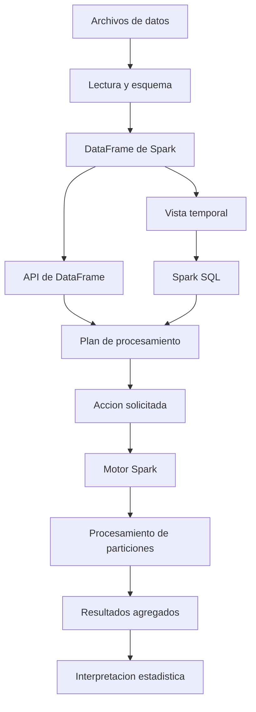

# Clase 4: Procesamiento exploratorio con Apache Spark, PySpark y Spark SQL

> **Objetivo académico:** Comprender la arquitectura básica de Apache Spark y su interfaz PySpark, distinguir RDD y DataFrame y construir un flujo de exploración de datos mediante consultas SQL y operaciones tabulares, evaluando tanto sus costes de ejecución como los límites de la interpretación estadística.

## 1. Contexto y marco conceptual

La sesión conecta el ciclo de vida de los datos con herramientas de procesamiento capaces de abordar conjuntos de mayor volumen, variedad y velocidad de generación. El tratamiento con Spark se sitúa dentro de ese ciclo: permite leer, transformar, resumir y analizar datos; no sustituye por sí mismo las decisiones sobre adquisición, calidad, almacenamiento, conservación o eliminación.

La selección de herramientas debe responder a las características del problema. Una hoja de cálculo puede ser suficiente para ciertos análisis; pandas resulta adecuado para muchos conjuntos que caben en la memoria de una máquina; Spark incorpora capacidades de procesamiento paralelo y distribuido. El número de registros, de forma aislada, no determina la herramienta apropiada: también importan el tamaño de cada registro, las operaciones solicitadas y los recursos disponibles.

El caso desarrollado utiliza un conjunto de datos sobre indicadores de salud y enfermedades cardíacas obtenido de Kaggle. En la sesión se identifican versiones correspondientes a 2020 y 2022 y archivos con y sin valores faltantes. La exploración se centra en la versión de 2022 denominada `with_nans`, con alrededor de 445 000 registros y 40 variables, según las cifras comunicadas durante la demostración.

Entre los atributos mencionados aparecen estado territorial, sexo, salud general autopercibida, días de salud física y mental y categorías de edad. El tamaño permite introducir Spark sin que constituya, por sí mismo, evidencia de una necesidad de infraestructura distribuida. La finalidad del caso es comprender la forma de trabajo y la transición desde datos tabulares hacia resúmenes interpretables.

**Enriquecimiento conceptual:** Que un dataset esté disponible en Kaggle no demuestra que cumpla todos los requisitos de datos abiertos. La reutilización requiere revisar licencia, procedencia, documentación y restricciones de uso. La disponibilidad técnica y la apertura jurídica son propiedades diferentes.

## 2. Fundamentos teóricos y arquitectura

### Apache Spark y PySpark

Apache Spark es un motor de procesamiento de datos de código abierto que puede trabajar en una máquina o en un conjunto de máquinas. PySpark es su API para Python: permite expresar operaciones sobre Spark desde ese lenguaje. Aunque en la exposición se presenta como una capa facilitadora, conviene identificarla como una interfaz del propio ecosistema Spark, no como un motor independiente.

La sesión sitúa varias capacidades dentro de este ecosistema:

| Componente o enfoque | Finalidad conceptual | Alcance en la fuente |
| --- | --- | --- |
| RDD | Transformaciones sobre colecciones particionadas mediante programación funcional | Introducción y comparación |
| DataFrame y Spark SQL | Procesamiento estructurado mediante columnas, expresiones y consultas SQL | Desarrollo práctico principal |
| Procesamiento de flujos | Tratamiento de datos que llegan continuamente, como eventos de redes sociales | Mención introductoria |
| MLlib | Aprendizaje automático sobre datos procesados con Spark | Mención introductoria |
| Procesamiento de grafos | Análisis de relaciones y estructuras de red | Mención introductoria |
| Integración con sistemas externos | Acceso a fuentes de datos y conexión con otros sistemas | Mención general |

**Enriquecimiento conceptual:** La expresión oral «Spark Graph» no identifica inequívocamente una API concreta. GraphX pertenece al ecosistema de Spark, pero no debe suponerse que todas sus operaciones tengan una interfaz nativa equivalente en PySpark. Asimismo, la referencia incierta a «Graph SQL» debe distinguirse de Spark SQL, que sí es la interfaz pertinente para las consultas tabulares desarrolladas.

### RDD: colecciones particionadas y operaciones funcionales

Un RDD, *Resilient Distributed Dataset*, representa una colección de elementos particionada para su procesamiento paralelo. La sesión destaca operaciones como `map` y `filter`, junto con acciones como `count`, `collect` y `saveAsTextFile`.

**Enriquecimiento conceptual:** Los RDD son inmutables: una transformación produce un nuevo RDD. Su resiliencia se relaciona con el linaje de operaciones, que permite reconstruir particiones perdidas bajo las condiciones de funcionamiento de Spark. Un RDD no exige que los archivos originales estén ubicados en múltiples equipos; también puede construirse desde una fuente local o una colección en memoria.

La distinción entre transformaciones y acciones es fundamental:

- Una transformación describe una nueva colección o relación de datos; por ejemplo, filtrar registros o transformar cada elemento.
- Una acción solicita un resultado, una escritura o una materialización que requiere ejecutar el trabajo correspondiente.

`reduce` es una acción en la API de RDD; no debe confundirse con `reduceByKey`, que es una transformación sobre pares clave-valor.

### DataFrame: estructura y optimización

Un DataFrame de Spark organiza datos en columnas con un esquema. Ofrece operaciones de selección, filtrado, agregación y ordenamiento, así como acceso mediante Spark SQL. La sesión lo relaciona con la representación tabular utilizada en pandas y bases de datos.

**Enriquecimiento conceptual:** La semejanza de representación no implica igualdad de ejecución. Un DataFrame de pandas suele procesarse en un único proceso y dentro de la memoria disponible; uno de Spark puede ejecutarse sobre particiones distribuidas. Además, los DataFrames de Spark también son distribuidos: la distribución no es una propiedad exclusiva de los RDD.

| Criterio | RDD | DataFrame de Spark |
| --- | --- | --- |
| Abstracción | Elementos y funciones sobre colecciones | Columnas, esquema y expresiones |
| Estilo de operación | Programación funcional explícita | API tabular y SQL |
| Información disponible para optimizar | Menor visibilidad sobre la semántica de funciones arbitrarias | Mayor visibilidad sobre columnas, filtros y agregaciones |
| Uso razonable | Transformaciones específicas difíciles de expresar con operaciones estructuradas | Análisis estructurado y semiestructurado representable mediante esquema |
| Responsabilidad de diseño | Mayor control explícito sobre ciertas operaciones | El motor optimiza planes, pero siguen siendo necesarias decisiones de diseño |

**Enriquecimiento conceptual:** La regla «datos no estructurados implican RDD» es una simplificación. Un texto puede representarse como una columna de un DataFrame; JSON puede convertirse en columnas y estructuras anidadas. La elección depende de las operaciones necesarias, no únicamente del formato de origen. La analogía de RDD con ensamblador utilizada en la sesión sirve para señalar un menor nivel de abstracción relativo, pero no constituye una equivalencia técnica.

### Arquitectura conceptual del flujo

**Enriquecimiento conceptual:** El siguiente diagrama explicita la separación entre la interfaz de análisis y el entorno de ejecución. En una configuración local, los recursos de ejecución pertenecen a una misma máquina.



## 3. Implementación técnica y lógica de negocio

### Entorno de ejecución y dependencias

La demostración utiliza Google Colab para disponer de un entorno remoto sin configurar íntegramente una máquina local. Se inspeccionan el sistema operativo y Python; en ese entorno concreto se mencionan Ubuntu 22.04 y Python 3.11.13. También se observan aproximadamente 12,7 GB de RAM y 107 GB de almacenamiento. Estas cifras describen la sesión y no son garantías permanentes del servicio.

Se instalan PySpark y `findspark`, se importan las dependencias y se prepara una `SparkSession`. La exposición también menciona pandas y Matplotlib para posibles etapas posteriores de representación gráfica.

**Enriquecimiento conceptual:** `findspark` ayuda a localizar una instalación de Spark y preparar su acceso desde Python en determinados entornos; no garantiza resolver toda incompatibilidad de dependencias. Según la instalación, puede no ser necesario. La compatibilidad entre Python, Java y Spark debe comprobarse para las versiones utilizadas. Colab reduce parte de la configuración local, pero no elimina conflictos ni asegura que todos los entornos sean idénticos.

### Incorporación de archivos y revisión inicial

El flujo observado comprende la carga de un archivo ZIP, su descompresión, la inspección de carpetas y tamaños y la selección del CSV correspondiente. Se distingue entre la transferencia desde la conexión del usuario y la descarga de dependencias desde el entorno remoto: ambas operaciones pueden tener velocidades diferentes.

Los archivos comprimidos y descomprimidos tienen tamaños distintos; además, el tamaño en disco no equivale directamente al consumo de memoria durante el análisis. En la sesión se mencionan archivos de aproximadamente 79 MB y 139 MB para variantes de 2022, sin que esos valores permitan deducir por sí solos su coste completo de procesamiento.

**Enriquecimiento conceptual:** `with_nans` indica una variante con valores faltantes y `no_nans` una variante sin ellos según la nomenclatura presentada. La exposición invierte esta interpretación en un pasaje; por tanto, el contenido efectivo debe verificarse mediante documentación y recuentos de nulos. Un nombre de archivo tampoco informa del procedimiento usado para eliminar o imputar datos.

### Inicialización y lectura

La fuente describe las operaciones, pero no conserva literalmente las celdas del notebook. El código siguiente reconstruye una secuencia mínima equivalente.

**Enriquecimiento conceptual:** Ejemplo didáctico no ejecutado. La ruta debe corresponder al archivo disponible y los nombres de columnas deben verificarse en su esquema.

```python
from pyspark.sql import SparkSession

spark = (
    SparkSession.builder
    .appName("ExploracionSalud")
    .getOrCreate()
)

ruta_csv = "/content/2022/heart_2022_with_nans.csv"

df = (
    spark.read
    .option("header", True)
    .option("inferSchema", True)
    .csv(ruta_csv)
)

df.printSchema()
numero_filas = df.count()
numero_columnas = len(df.columns)
df.show(20)
```

`SparkSession` es el punto de entrada para estas operaciones estructuradas. `header` indica que la primera fila contiene nombres de columnas; `inferSchema` solicita inferir tipos. `printSchema()` muestra la estructura, `count()` obtiene la cantidad de filas y `show(20)` presenta una muestra limitada.

**Enriquecimiento conceptual:** Spark utiliza evaluación diferida para muchas operaciones, pero esto no significa que toda lectura sea completamente inactiva: la inferencia de esquema puede requerir leer datos antes de una acción posterior. Para procesos estables, un esquema explícito facilita controlar tipos y evitar inferencias costosas o inconsistentes. Sin un ordenamiento explícito, las filas mostradas no constituyen una muestra aleatoria ni tienen un orden garantizado.

Durante la demostración aparece un error porque `SparkSession` no había sido definido al ejecutar una celda. El episodio ilustra una dependencia real de los notebooks: el estado del intérprete depende de qué celdas se ejecutaron y en qué secuencia.

### Exploración del esquema y estadísticas descriptivas

La revisión inicial identifica 40 columnas y alrededor de 445 000 filas. Se consulta el esquema, se listan atributos y se revisa un archivo descriptivo de variables. La documentación es necesaria para interpretar qué representa cada campo, no solamente su tipo técnico.

`describe()` permite obtener estadísticas como conteo, media, desviación estándar, mínimo y máximo en las columnas compatibles. La sesión advierte que resumir numerosas variables sobre un conjunto grande puede resultar costoso.

**Enriquecimiento conceptual:** Estas son estadísticas descriptivas; no constituyen por sí mismas inferencia paramétrica. En columnas de texto, mínimo y máximo pueden reflejar orden lexicográfico, como ocurre con nombres de estados, sin expresar magnitudes territoriales ni sanitarias. El conteo de una columna en un resumen puede excluir nulos y diferir del total de filas. Además, construir el DataFrame de un resumen y solicitar su visualización son pasos distintos dentro de la ejecución diferida.

### Consultas mediante Spark SQL

Para consultar el DataFrame con SQL se registra una vista temporal. Esta proporciona un nombre dentro de la sesión; no implica crear automáticamente una tabla persistente ni duplicar físicamente todos los datos.

**Enriquecimiento conceptual:** Reconstrucción didáctica de las consultas descritas:

```python
df.createOrReplaceTempView("heart_disease")

por_sexo = spark.sql("""
    SELECT Sex, COUNT(*) AS n
    FROM heart_disease
    GROUP BY Sex
    ORDER BY n DESC
""")
por_sexo.show()

por_edad = spark.sql("""
    SELECT AgeCategory, COUNT(*) AS n
    FROM heart_disease
    GROUP BY AgeCategory
    ORDER BY n DESC
""")
por_edad.show()

por_salud = spark.sql("""
    SELECT GeneralHealth, COUNT(*) AS n
    FROM heart_disease
    GROUP BY GeneralHealth
    ORDER BY n DESC
""")
por_salud.show()
```

Cada consulta transforma registros individuales en una distribución de frecuencias por categoría. `COUNT(*)` cuenta filas de cada grupo, incluidas aquellas agrupadas bajo una categoría nula si existen. La transcripción comunica aproximadamente 235 000 registros femeninos y 209 000 masculinos; son cifras redondeadas y no permiten establecer una reconciliación exacta del total.

### Operaciones mediante la API de DataFrame

La sesión utiliza también selección de columnas y extracción de valores únicos. Las categorías de edad ya están almacenadas en el dataset: `show()` no las construye ni crea intervalos automáticamente.

**Enriquecimiento conceptual:** Ejemplo equivalente y reutilización del resultado agregado:

```python
from pyspark.sql import functions as F

categorias = df.select("AgeCategory").distinct()
categorias.show()

agrupado = df.groupBy("AgeCategory").count()
ordenado = agrupado.orderBy(F.desc("count"))
ordenado.show()

# El resultado de SQL tambien es un DataFrame de Spark.
reordenado = por_edad.orderBy("AgeCategory")
reordenado.show()

# Puede registrarse de nuevo para continuar mediante SQL.
por_edad.createOrReplaceTempView("resumen_edades")
spark.sql("""
    SELECT AgeCategory, n
    FROM resumen_edades
    ORDER BY n DESC
""").show()
```

El resultado de `spark.sql()` es un DataFrame de Spark. Por ello, SQL y la API tabular pueden combinarse sin tratarlos como caminos incompatibles. Esta precisión resuelve la duda planteada en la sesión sobre ordenar un resultado ya obtenido.

**Enriquecimiento conceptual:** Guardar un DataFrame en una variable conserva una referencia a su plan, no garantiza que el resultado esté materializado en memoria. Acciones posteriores pueden recalcular operaciones si no existe persistencia apropiada. Asimismo, ordenar etiquetas textuales de edad puede producir un orden distinto del cronológico; cuando ese orden sea relevante, debe definirse una clave numérica a partir de categorías documentadas.

## 4. Análisis crítico de casos y auditoría práctica

### Frecuencia de una edad frente a frecuencia de enfermedad

La sesión ordena los grupos de edad por número de registros e identifica el intervalo de 65 a 69 años como el más numeroso. A partir de ello se discuten posibles explicaciones sanitarias y demográficas.

La consulta presentada agrupa todos los registros por edad; no se documenta un filtro previo por enfermedad cardíaca. Por tanto, su resultado describe la composición etaria del dataset. No demuestra que el grupo más frecuente tenga mayor probabilidad de enfermedad ni que todas las personas incluidas estén enfermas.

**Enriquecimiento conceptual:** Para separar ambas preguntas, sean $A$ la categoría de edad de una persona y $D$ un indicador binario del evento de salud definido por el diccionario, con $D=1$ cuando el evento está presente y $D=0$ cuando está ausente. Para una categoría $a$, el conteo observado es:

$$
n_a = \#\{i : A_i=a\}
$$

Aquí $i$ identifica un registro y $n_a$ es un número de personas o registros, según la unidad efectiva de observación. Esta frecuencia no incluye información sobre $D$.

Si se dispone de un indicador válido y se consideran únicamente registros con información utilizable, la proporción observada de casos en el grupo es:

$$
\widehat{p}_a = \frac{n_{a,1}}{n_{a,0}+n_{a,1}}
$$

$n_{a,1}$ cuenta los registros del grupo $a$ con el evento y $n_{a,0}$ aquellos sin el evento; el denominador debe ser mayor que cero. La proporción es adimensional y puede expresarse como porcentaje. No mide automáticamente incidencia, riesgo futuro ni prevalencia poblacional representativa.

**Enriquecimiento conceptual:** Ejemplo hipotético, ajeno a los resultados del dataset: un grupo con 100 casos entre 1 000 personas tiene una proporción de $100/1000=0{,}10$; otro con 80 casos entre 200 personas tiene $80/200=0{,}40$. El primero reúne más casos absolutos, pero el segundo presenta mayor proporción. Comparar únicamente conteos confunde tamaño del grupo con frecuencia relativa del evento.

### Menor presencia de edades avanzadas

Se propone que la disminución del número de registros por encima del grupo más numeroso podría deberse a mortalidad y supervivencia. Es una hipótesis posible, pero la distribución observada también puede depender del diseño muestral, la participación, la cobertura y la estructura demográfica de la población de origen.

**Enriquecimiento conceptual:** No puede estimarse una esperanza de vida de aproximadamente 70 años a partir de esta tabla de frecuencias. La esperanza de vida requiere información demográfica y métodos específicos. Una distribución transversal de participantes no identifica por sí sola el patrón de supervivencia de una población.

### Categorías jóvenes y composición de la muestra

La presencia de más registros entre 18 y 24 años que entre 25 y 29 motiva preguntas sobre el origen y las características de las personas registradas. La necesidad de contexto es pertinente, pero esta diferencia tampoco demuestra peor salud en el primer grupo.

**Enriquecimiento conceptual:** Los intervalos tienen amplitudes diferentes: 18–24 incluye siete edades enteras y 25–29 incluye cinco. Incluso sin otras diferencias, comparar sus conteos exige atender a esa amplitud. También deben considerarse el esquema de muestreo y los denominadores poblacionales antes de interpretar diferencias sanitarias.

### Salud general autopercibida

La distribución de `GeneralHealth` indica cómo las personas califican su salud general. En la exposición, la categoría más frecuente se describe como «muy buena», seguida de otras categorías de valoración.

**Enriquecimiento conceptual:** Una respuesta de salud general desfavorable no equivale a un diagnóstico cardíaco ni identifica su gravedad. Puede reflejar distintas dimensiones de salud y condiciones de percepción o respuesta. La relación con una enfermedad específica debe analizarse mediante variables pertinentes, manteniendo la distinción entre asociación y causalidad.

### Procedencia y valores faltantes

La fuente ubica el conjunto en Estados Unidos y menciona una referencia al CDC, pero no establece con precisión su institución productora, marco de muestreo o diccionario completo. La posibilidad de un origen hospitalario se formula de manera incierta y no debe convertirse en un hecho.

**Enriquecimiento conceptual:** Antes de generalizar resultados conviene verificar la unidad de observación, los criterios de inclusión, posibles duplicados, valores faltantes y la existencia de ponderaciones muestrales. Si el diseño requiere pesos, las frecuencias simples describen los registros disponibles, pero pueden diferir de las estimaciones poblacionales apropiadas. No se documenta el uso de ponderaciones en esta sesión.

## 5. Principios de diseño, buenas prácticas y anti-patrones

| Principio | Aplicación al caso | Anti-patrón que evita |
| --- | --- | --- |
| Elegir herramientas según la carga | Valorar memoria, volumen y operaciones antes de distribuir | Suponer que Spark siempre será más rápido |
| Documentar entorno y dependencias | Registrar versiones y ejecutar el notebook en secuencia reproducible | Depender de un estado de sesión oculto |
| Revisar esquema y diccionario | Distinguir categorías, tipos y significado sanitario | Interpretar columnas solamente por su nombre |
| Auditar valores faltantes | Comprobar el contenido de cada variante del archivo | Asumir que el nombre demuestra ausencia de nulos |
| Agregar según una pregunta definida | Separar composición de muestra y proporción de enfermedad | Equiparar mayor conteo con mayor riesgo |
| Seleccionar las columnas necesarias | Resumir variables relevantes | Solicitar estadísticas indiscriminadas y costosas |
| Mantener el procesamiento en Spark | Reducir datos antes de transferirlos al proceso local | Recuperar todo el dataset sin estimar memoria |
| Verificar el orden de categorías | Usar una clave cronológica documentada cuando corresponda | Confundir orden alfabético con orden etario |

**Enriquecimiento conceptual:** `collect()` recupera todos los elementos solicitados al proceso controlador. Puede anular la ventaja de mantener datos repartidos y agotar su memoria. Para inspeccionar datos deben preferirse resultados acotados; para visualizarlos en herramientas locales resulta razonable transferir primero agregados pequeños y relevantes.

La optimización automática de DataFrames reduce trabajo manual, pero no elimina la responsabilidad de comprender el coste de una consulta. Agrupaciones y ordenamientos pueden requerir intercambio de datos entre particiones; el volumen transferido y la distribución de las claves influyen en el rendimiento.

**Enriquecimiento conceptual:** El plan puede revisarse con `explain()` y la persistencia puede evaluarse cuando un mismo resultado costoso se reutiliza. Persistir indiscriminadamente también consume recursos. La decisión requiere observar reutilización, memoria y coste de recomputación; no se presentan mediciones de estas alternativas en la fuente.

El hecho de que una consulta mantenga la misma sintaxis al crecer el dataset no implica que conserve su duración. La cantidad de datos, el ancho de filas, la distribución de grupos y los recursos de ejecución modifican el coste. Por ello, la sesión constituye una introducción funcional, no una comparación experimental de escalabilidad.

## 6. Síntesis conceptual y profundización académica

El flujo desarrollado conecta cinco decisiones: identificar la fuente y su significado, preparar el entorno, representar los datos con un esquema, obtener resúmenes y evaluar qué conclusiones permiten esos resúmenes. Spark aporta infraestructura de procesamiento; la validez de la interpretación sigue dependiendo del diseño del análisis.

RDD y DataFrame ofrecen niveles diferentes de abstracción sobre datos particionados. Los RDD permiten expresar transformaciones funcionales específicas; los DataFrames facilitan operaciones estructuradas y ofrecen información al motor para optimizar consultas. Spark SQL y la API de DataFrame son interfaces complementarias, y sus resultados pueden seguir transformándose.

En el caso sanitario, agrupar por sexo, edad o salud autopercibida produce descripciones útiles del conjunto disponible. Para pasar de esas descripciones a afirmaciones sobre enfermedad hacen falta una definición del evento, denominadores apropiados y conocimiento de la procedencia de los registros. La coherencia aparente con conocimientos generales no sustituye esa verificación.

**Enriquecimiento conceptual:** La profundización natural comprende la evaluación diferida y los planes de ejecución, el efecto de particiones e intercambios de datos, la interoperabilidad entre SQL y DataFrames y los sesgos derivados de selección y datos faltantes. En análisis sanitario, también resulta central diferenciar frecuencia muestral, proporción de casos, predicción y explicación causal.

La fuente disponible no desarrolla la etapa gráfica ni implementa modelos de aprendizaje automático. Esas capacidades se mencionan como posibilidades del ecosistema, sin resultados técnicos que permitan documentar su ejecución.
