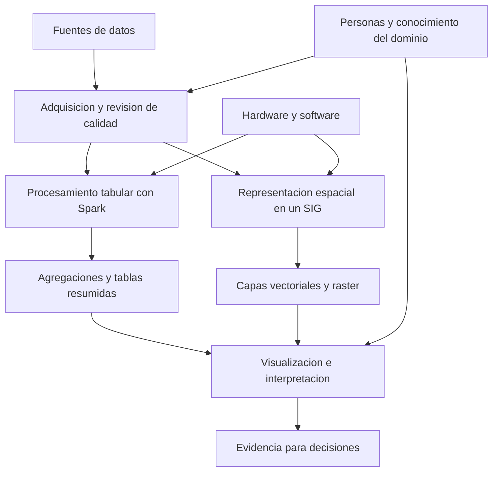

# Clase 5: Procesamiento escalable con Spark, perfiles profesionales y fundamentos de datos geoespaciales

> **Objetivo académico:** Comprender el procesamiento de grandes conjuntos de datos mediante Apache Spark, evaluar sus resultados con criterios de integridad e interpretación, distinguir responsabilidades profesionales en ciencia de datos e introducir los sistemas de información geográfica y sus modelos vectorial y ráster.

## 1. Contexto y marco conceptual

La sesión articula tres dimensiones del trabajo con datos: la capacidad computacional para procesarlos, las competencias profesionales para interpretarlos y las formas de representar fenómenos territoriales. El hilo conductor es convertir datos en evidencia útil para la toma de decisiones, conservando la trazabilidad entre fuente, procesamiento, síntesis e interpretación.

### Del dato disponible a la evidencia

El recorrido conceptual comprende adquisición, revisión de calidad, transformación, agregación, visualización e interpretación. La disponibilidad de una herramienta no sustituye la formulación de una pregunta pertinente ni el conocimiento del dominio. Una gráfica constituye una representación de resultados; su significado depende de qué se contó, cómo se definieron las categorías y qué cobertura tiene la fuente.

En datos públicos, como los registros censales, identificar el organismo productor y la procedencia del conjunto es parte del análisis. La comparación entre países requiere distinguir disponibilidad de datos y comparabilidad estadística.

**Enriquecimiento conceptual:** Antes de comparar distribuciones poblacionales deben revisarse el año de referencia, la población efectivamente cubierta, las definiciones de las variables y la existencia de categorías no informadas. Una diferencia observada puede responder a cambios metodológicos o temporales, además de diferencias demográficas.

### Big data como problema de procesamiento

La sesión retoma las tres dimensiones habituales:

- **Volumen:** cantidad de registros y espacio ocupado.
- **Variedad:** diversidad de estructuras, formatos y fuentes.
- **Velocidad:** ritmo de generación y necesidad de actualización o procesamiento.

El caso central corresponde a un conjunto histórico de vuelos comerciales de Estados Unidos, presentado con una cobertura aproximada desde octubre de 1987 hasta abril de 2008. La descripción inicial menciona unos 120 millones de registros; durante la ejecución se comunica un conteo del orden de 123 millones. Se mencionan aproximadamente 1,6 GB comprimidos y alrededor de 12 GB descomprimidos. Estas magnitudes contextualizan el procesamiento, pero la transcripción no permite establecer un conteo exacto fiable.

**Enriquecimiento conceptual:** Las tres dimensiones son criterios descriptivos, no condiciones que deban alcanzar simultáneamente un umbral universal. Un archivo tabular histórico puede plantear un problema de escala aun con poca variedad y sin ingestión en tiempo real. Su clasificación depende también de los recursos disponibles y del tiempo de respuesta requerido.

### De datos tabulares a datos espaciales

La segunda transición incorpora la localización como parte explícita del dato. Además de preguntar qué ocurrió y cuándo, interesa dónde ocurrió, cómo se distribuye y qué relaciones mantiene con otros elementos del territorio.

Los ejemplos incluyen rutas de transporte público, seguimiento de vehículos, servicios de entrega, navegación, imágenes históricas, cambios de cobertura vegetal e incendios. El objetivo analítico permanece: organizar evidencia para comprender un fenómeno y apoyar decisiones.

## 2. Fundamentos teóricos y arquitectura

### Apache Spark y su entorno de ejecución

Spark es el motor de procesamiento; PySpark permite utilizarlo desde Python. La sesión muestra una preparación más explícita del entorno que en ejemplos anteriores: instalación de Java, descarga y descompresión de Spark, configuración de variables de entorno, utilización de `findspark` y creación de una `SparkSession`.

| Componente | Función en el entorno mostrado | Consideración técnica |
| --- | --- | --- |
| Java/JDK | Proporcionar el entorno requerido para ejecutar Spark sobre la JVM | La versión debe ser compatible con la distribución de Spark |
| Apache Spark | Planificar y ejecutar el procesamiento | Puede funcionar en una máquina o sobre infraestructura distribuida |
| PySpark | Exponer las interfaces de Spark a Python | Debe corresponder a una instalación compatible |
| `findspark` | Facilitar que Python localice una instalación de Spark | Su necesidad depende del modo de instalación |
| `JAVA_HOME` y `SPARK_HOME` | Señalar las ubicaciones de Java y Spark | Una ruta incorrecta impide resolver dependencias |
| `SparkSession` | Proporcionar el punto de entrada al trabajo con DataFrames | Debe existir antes de ejecutar las operaciones correspondientes |
| Spark UI | Observar ejecución, etapas, almacenamiento y configuración | Es una interfaz de monitoreo, no un editor de código |

Google Colab proporciona un entorno Linux en el que se realizan estas operaciones. La secuencia se aproxima a una instalación local, aunque el acceso al puerto de la interfaz y la persistencia de archivos dependen del entorno alojado.

**Enriquecimiento conceptual:** Instalar Spark dentro de una máquina de Colab no demuestra que se esté usando un clúster de varias máquinas. El paralelismo local y la distribución entre nodos son configuraciones distintas. La transcripción no documenta una arquitectura multinodo.

### Planificación, ejecución y recursos

La explicación de clase destaca que el conjunto completo no necesita permanecer simultáneamente en la memoria disponible. Esto permite trabajar con un archivo mayor que la RAM libre, procesándolo por partes.

**Enriquecimiento conceptual:** Spark sí utiliza memoria para procesar particiones, mantener estructuras intermedias, realizar agregaciones y almacenar datos persistidos. También puede utilizar disco para lecturas, escrituras y desbordamientos de memoria. Por tanto, la interpretación precisa es que no exige cargar todo el archivo a la vez; no que prescinda de RAM.

En términos de ejecución:

- Una transformación, como `groupBy`, construye parte del plan de cálculo.
- Una acción, como `count`, solicita un resultado y desencadena el procesamiento necesario.
- La inferencia de esquema al leer CSV puede requerir recorridos adicionales de los datos.
- Mostrar algunas filas no equivale a materializar todo el DataFrame en el controlador.

**Enriquecimiento conceptual:** Spark organiza el trabajo en trabajos de ejecución, etapas y tareas sobre particiones. Las redistribuciones de datos, o *shuffles*, pueden separar etapas y añadir costos de comunicación, memoria y disco. El número de tareas observado no equivale al número de filas ni al número de operaciones escritas en el cuaderno.

El rendimiento depende de CPU, memoria, almacenamiento, particionado, formato de archivo y características de las operaciones. En un clúster también intervienen la red y la distribución entre nodos. La observación de una RAM relativamente estable y tiempos de varios minutos es compatible con procesamiento por particiones, pero no identifica por sí sola el recurso limitante.

### Sistemas de información geográfica

Un sistema de información geográfica, SIG o GIS, integra componentes para capturar, almacenar, administrar, transformar, analizar y representar información con referencia espacial.

La sesión identifica cuatro componentes:

1. **Hardware:** equipos y dispositivos que permiten capturar, almacenar y procesar.
2. **Software:** programas, bibliotecas y herramientas especializadas.
3. **Datos:** geometrías, imágenes y atributos temáticos.
4. **Personas:** quienes producen, mantienen, analizan e interpretan la información.

El SIG es el conjunto articulado de estos componentes. Reducirlo a una aplicación omite las condiciones de producción, calidad e interpretación de los datos.



### Modelos vectorial y ráster

El mundo real se representa mediante abstracciones adecuadas a la pregunta analítica.

| Aspecto | Modelo vectorial | Modelo ráster |
| --- | --- | --- |
| Unidad de representación | Objetos con geometría y atributos | Celdas organizadas en filas y columnas |
| Geometrías o estructura | Puntos, líneas y polígonos | Matriz georreferenciada |
| Uso frecuente | Entidades discretas: estaciones, vías, edificios y límites | Superficies e imágenes: elevación, temperatura y cobertura |
| Atributos | Propiedades asociadas a cada entidad | Valores por celda y, cuando corresponde, por banda |
| Formatos mencionados | Shapefile, KML, GML y DXF; también se alude a JSON | TIFF, GeoTIFF, JPEG, IMG y formatos de cuadrícula |

**Enriquecimiento conceptual:** Para datos geográficos estructurados como JSON, un formato específico es GeoJSON; un JSON genérico no garantiza geometrías ni convenciones espaciales. Asimismo, JPEG o TIFF no implican por sí mismos una georreferenciación completa. GeoTIFF permite incorporar información espacial en el archivo.

La elección de una geometría depende de la escala y del propósito. Una ciudad puede representarse como punto en un mapa nacional y como polígono en un análisis urbano. No existe una correspondencia obligatoria y universal entre objeto real y geometría.

**Enriquecimiento conceptual:** Tanto el vector como el ráster permiten representación y análisis. El análisis de redes y las intersecciones son ejemplos vectoriales; el cálculo sobre superficies es un ejemplo ráster. La distinción operativa principal es la organización mediante objetos o celdas, no una separación entre representar y analizar.

## 3. Implementación técnica y lógica de negocio

### Flujo del análisis de vuelos

La demostración sigue una secuencia reconocible:

1. Preparar dependencias e iniciar Spark.
2. Habilitar la interfaz de monitoreo.
3. Descargar y descomprimir el conjunto mediante KaggleHub.
4. Localizar el archivo principal y una tabla auxiliar de aerolíneas.
5. Leer el CSV y determinar su esquema.
6. Contar registros y mostrar una muestra.
7. Agrupar por año y contar vuelos registrados.
8. Ordenar el resultado y convertir el resumen a pandas.
9. Representar la distribución con Matplotlib y Plotly.
10. Contrastar el total agregado con el conteo original.

Mover el archivo descargado a otro directorio es una comodidad de navegación. La alternativa es utilizar directamente la ruta devuelta por la descarga. La condición técnica es que la ruta empleada en la lectura corresponda al archivo existente.

La tabla auxiliar de aerolíneas permite interpretar códigos mediante denominaciones. La sesión contempla su utilidad, pero no documenta una unión ejecutada con el archivo principal.

### Lectura y agregación

La transcripción describe las operaciones, pero no contiene íntegramente las celdas del cuaderno. El siguiente código reconstruye el procedimiento sin afirmar una ejecución adicional.

**Enriquecimiento conceptual:** Ejemplo ilustrativo en PySpark. Se supone una sesión `spark` activa, una ruta válida y un CSV con encabezado que incluya `Year`. La inferencia de tipos facilita la exploración inicial; un esquema explícito y validado ofrece mayor control en procesos repetidos.

```python
from pyspark.sql import functions as F

vuelos = (
    spark.read
    .option("header", True)
    .option("inferSchema", True)
    .csv(ruta_csv)
)

vuelos.printSchema()
vuelos.show(20, truncate=False)
total_registros = vuelos.count()

resumen_anual = (
    vuelos.groupBy("Year")
    .agg(F.count(F.lit(1)).alias("numero_registros"))
    .orderBy("Year")
)

resumen_pd = resumen_anual.toPandas()
assert int(resumen_pd["numero_registros"].sum()) == total_registros
```

`ruta_csv` representa la ubicación del archivo. `count` sobre una constante cuenta filas, incluso cuando otros atributos presentan valores nulos. `groupBy` produce una categoría para cada valor de `Year`; si existen años nulos, deben revisarse explícitamente antes de interpretar la distribución temporal.

La conversión a pandas se realiza sobre el resumen anual. Su volumen es pequeño respecto del archivo original y permite trabajar localmente con las bibliotecas de visualización.

**Enriquecimiento conceptual:** `toPandas()` reúne el resultado en la memoria del proceso controlador. Aplicarlo a los registros originales puede agotar esa memoria. La seguridad de la conversión depende del tamaño del resultado y de sus tipos de datos, no del hecho de que Spark haya podido procesar la fuente.

### Conservación del conteo

La comprobación utilizada en clase contrasta el total original con la suma de los grupos anuales.

**Enriquecimiento conceptual:** Sea $D$ el conjunto de filas procesadas, $N=|D|$ su cardinalidad y $Y$ el conjunto de categorías anuales observadas, incluida una categoría nula si existe. Para cada $y\in Y$, se define el conteo:

$$
n_y=\sum_{r\in D}\mathbf{1}\{\operatorname{Year}(r)=y\}
$$

Aquí $r$ es una fila, $\operatorname{Year}(r)$ su categoría anual y $\mathbf{1}$ una función indicadora que vale uno si la condición se cumple y cero en caso contrario. Si cada fila pertenece a exactamente un grupo y no hay filtrado entre ambos cálculos:

$$
\sum_{y\in Y}n_y=N
$$

La igualdad se obtiene porque cada fila aporta una sola unidad al total agregado. Permite detectar pérdida de filas entre el conjunto procesado y su resumen; no acredita la integridad de la fuente anterior a la lectura, la ausencia de duplicados ni la corrección de los atributos.

### Visualización y ejecución repetida

Matplotlib se utiliza para una representación estática y Plotly para una visualización interactiva que facilita consultar los valores de cada año. La interactividad ayuda a explorar, pero no modifica las propiedades estadísticas del resumen.

**Enriquecimiento conceptual:** Mostrar un agregado y convertirlo después a pandas pueden disparar cálculos repetidos si el resultado no está persistido. Las ejecuciones posteriores no son necesariamente más rápidas por disponer de un supuesto mapeo permanente. La caché del sistema, la reutilización de resultados o las diferencias del plan pueden influir; deben comprobarse con métricas. Conviene materializar y reutilizar el resumen cuando tenga sentido, considerando el costo y los recursos de persistencia.

### Implementación geoespacial presentada

El componente espacial consiste en exploración visual y conceptual: navegación en Google Earth Pro, comparación de imágenes históricas, consulta de Street View e introducción a QGIS. No se documentan cálculos de superficies, clasificación de imágenes ni procesamiento geoespacial mediante código.

QGIS se presenta como software libre para trabajar con datos espaciales y disponible en distintos sistemas operativos. También se menciona la posibilidad de utilizar contenedores y de procesar datos espaciales desde Python.

**Enriquecimiento conceptual:** Software libre significa que existe una licencia que concede libertades de uso, estudio, modificación y distribución. No significa ausencia de licencia. La ejecución de una aplicación gráfica en un contenedor requiere además resolver visualización y acceso a archivos; no equivale automáticamente a una instalación de escritorio.

## 4. Análisis crítico de casos y auditoría práctica

### Distribución anual de vuelos

El gráfico permite reconocer crecimiento general, diferencias entre años y un máximo observado en 2007, descrito en la sesión como aproximadamente 7,4 millones de registros. También se comenta una disminución alrededor de 2002 y un valor bajo en 2008.

La interpretación exige separar observación, hipótesis y evidencia adicional:

| Observación | Interpretación planteada | Límite de la evidencia |
| --- | --- | --- |
| Cambio en los conteos alrededor de 2002 | Posible relación con los atentados del 11 de septiembre de 2001 y sus efectos sobre la aviación | El agregado anual no demuestra causalidad |
| Mayor conteo en 2007 | Mayor cantidad de operaciones o registros dentro del conjunto analizado | No demuestra mayor proporción de retrasos |
| Menor conteo en 2008 | Posible cobertura parcial del año | Debe verificarse la cobertura temporal real del archivo |

La referencia histórica pertinente es 2001; la mención oral aislada a 2021 es inconsistente con el propio intercambio y el período analizado.

**Enriquecimiento conceptual:** Una base sobre puntualidad puede incluir vuelos puntuales, adelantados, retrasados y cancelados. El nombre temático del conjunto no autoriza a tratar todas sus filas como vuelos retrasados. Para estudiar impuntualidad deben definirse la variable de retraso, sus unidades, el umbral y el tratamiento de cancelaciones y datos faltantes.

La cobertura parcial de los extremos temporales también importa. Si el período comienza en octubre de 1987 y termina en abril de 2008, comparar los conteos brutos de esos años con años completos introduce una diferencia de exposición.

**Enriquecimiento conceptual:** Para comparar actividad puede restringirse el análisis a meses comunes o calcularse una tasa sobre unidades temporales efectivamente cubiertas. Esta decisión no corrige por sí sola estacionalidad, cambios del sistema de registro ni diferencias de cobertura.

### Catálogo de aerolíneas y cobertura efectiva

Se plantea explorar una aerolínea boliviana a partir de su posible presencia en el catálogo auxiliar. La idea ilustra el interés de combinar tablas de referencia y registros operativos.

**Enriquecimiento conceptual:** Que una aerolínea aparezca en un catálogo no demuestra que tenga vuelos en la tabla principal. Deben verificarse su código, la correspondencia entre tablas, el período de actividad y la cobertura geográfica del archivo. Una denominación en la referencia no basta para afirmar que el conjunto incluye operaciones internacionales concretas.

### Monitoreo e integridad

En la demostración, la Spark UI permite observar etapas, tareas completadas, duración y volumen de entrada. Se comunica una lectura inicial de alrededor de nueve minutos en un entorno y tiempos menores en otro. Son observaciones situadas, no un estudio comparativo controlado.

Una discrepancia entre un estado aparentemente incompleto en la interfaz y la disponibilidad del gráfico se revisa comparando la suma del resumen con el conteo previo. Ambos resultados coinciden según el intercambio.

**Enriquecimiento conceptual:** Esa coincidencia respalda la conservación del conteo en el resumen, pero no identifica la causa del estado mostrado por la interfaz. Una revisión completa distinguiría trabajos activos, finalizados o cancelados y contrastaría registros de ejecución. No corresponde atribuir la discrepancia a una desconexión sin evidencia adicional.

### Exploración visual del territorio

Google Earth Pro se utiliza para recorrer ciudades de Brasil, India y Bolivia, consultar posición y elevación, observar detalles urbanos y comparar registros de diferentes fechas. También se exploran imágenes históricas en una zona fronteriza entre Bolivia y Brasil, donde se describen apertura de caminos y transformación de áreas con vegetación.

Estos casos muestran el valor del análisis multitemporal: la sucesión de imágenes permite formular hipótesis sobre expansión de actividades y cambios del paisaje. La sesión no produce mediciones cuantitativas del cambio ni verifica sus causas.

**Enriquecimiento conceptual:** Las imágenes orbitales o aéreas y las panorámicas de Street View son fuentes distintas. La vista a nivel de calle procede de fotografías panorámicas terrestres; no representa una ampliación ilimitada de la imagen satelital. Sus coberturas y fechas pueden diferir.

**Enriquecimiento conceptual:** Aumentar el zoom no crea resolución espacial nueva. El detalle identificable está limitado por la imagen de origen. Comparar fechas requiere revisar resolución, nubosidad, estación del año y alineación espacial. Una apariencia diferente puede reflejar cambios reales o diferencias de adquisición.

La sesión destaca que algunas vistas de Bolivia corresponden a 2015. Este ejemplo ilustra que la accesibilidad actual de un servicio no implica actualidad de su contenido. Para una decisión territorial debe consultarse la fecha de adquisición pertinente.

### Aplicaciones operativas y ambientales

Se comentan rutas de transporte público en Santa Cruz, seguimiento de vehículos, plataformas de entrega, navegación con reportes colaborativos y geoportales ambientales. Una aplicación de transporte puede reunir una base relativamente estable de rutas y posiciones cambiantes de vehículos; ambos tipos de información cumplen funciones diferentes.

En los servicios de navegación, los reportes sobre congestión o interrupciones aportan información contextual. En las plataformas ambientales, la localización y la temporalidad permiten explorar incendios, deforestación y riesgo.

La transcripción no verifica la implementación actual de las iniciativas locales ni identifica con certeza la adscripción institucional de todas las plataformas mencionadas. Se conservan como ejemplos de usos posibles, sin afirmar su vigencia operativa.

**Enriquecimiento conceptual:** Una detección térmica, un incendio confirmado, una superficie quemada y una estimación de riesgo son productos distintos. Su interpretación requiere conocer la definición, resolución y fecha de cada capa.

## 5. Principios de diseño, buenas prácticas y anti-patrones

### Procesamiento y calidad

| Buena práctica | Justificación | Anti-patrón asociado |
| --- | --- | --- |
| Definir la pregunta antes de procesar | Reduce recorridos innecesarios y agregaciones irrelevantes | Ejecutar operaciones costosas sin precisar el resultado buscado |
| Revisar esquema y significado de variables | Evita conteos y comparaciones semánticamente incorrectos | Interpretar nombres de campos sin consultar sus definiciones |
| Agregar antes de convertir a pandas | Mantiene pequeño el resultado reunido en memoria | Llevar el conjunto completo al controlador |
| Verificar totales y categorías nulas | Detecta discrepancias entre pasos | Dar por íntegro un resultado porque el gráfico se renderiza |
| Registrar cobertura temporal y unidades | Hace interpretables las comparaciones | Comparar años incompletos con años completos |
| Consultar métricas de ejecución | Permite identificar operaciones costosas | Atribuir toda demora al disco o toda mejora a una caché implícita |
| Documentar código y decisiones | Facilita revisión, mantenimiento y reproducción | Compartir secuencias de celdas sin contexto ni dependencias claras |

**Enriquecimiento conceptual:** Para consultas repetidas sobre CSV voluminosos puede resultar útil evaluar formatos columnares y esquemas explícitos. La elección debe considerar frecuencia de uso, costo de conversión y patrones de consulta; no se presenta como una optimización ejecutada en esta sesión.

### Diseño de información espacial

La selección entre vector y ráster debe responder a la entidad o fenómeno estudiado, la escala, la resolución y la operación requerida. Ambos pueden coexistir en un mismo SIG.

**Enriquecimiento conceptual:** Toda integración espacial necesita verificar el sistema de referencia de coordenadas. Superponer capas visualmente no garantiza que sus coordenadas sean compatibles ni que distancias o áreas estén expresadas en unidades adecuadas. La geometría sin referencia espacial suficiente puede inducir ubicaciones o medidas incorrectas.

La calidad cartográfica exige además conocer procedencia, fecha, precisión y significado de los atributos. Una imagen detallada puede seguir siendo antigua; una capa oficial puede tener una escala inadecuada para una decisión local.

**Enriquecimiento conceptual:** La consulta gratuita de un visor no equivale a datos abiertos. La apertura depende de condiciones de acceso, reutilización y redistribución. Deben distinguirse servicio visual accesible, archivo descargable y licencia de reutilización.

### Responsabilidades profesionales

La sesión distingue analista, ingeniero y científico de datos, aunque algunas descripciones se asignan de forma variable durante el intercambio. El siguiente cuadro organiza las responsabilidades desarrolladas sin suponer fronteras rígidas.

| Perfil | Foco principal | Capacidades destacadas |
| --- | --- | --- |
| Analista de datos | Comprender resultados y responder preguntas del dominio | Limpieza, estadística, análisis exploratorio, visualización y comunicación |
| Ingeniero de datos | Habilitar adquisición, almacenamiento y procesamiento fiables | Programación, bases de datos, infraestructura, flujos y herramientas de escala |
| Científico de datos | Formular y evaluar explicaciones o modelos | Estadística, programación, aprendizaje automático e interpretación |

**Enriquecimiento conceptual:** Los perfiles se solapan y dependen de la organización. La arquitectura distribuida suele vincularse fuertemente con ingeniería; la creación y evaluación de modelos, con ciencia de datos. El monitoreo de modelos en operación puede ser compartido con otros roles. Ninguna capacidad aislada determina un perfil completo.

Se contempla el análisis de datos como una posible vía de entrada, condicionada por intereses y experiencia. No constituye una secuencia profesional obligatoria ni implica que el análisis sea una actividad de baja exigencia.

### Competencias transversales

Las habilidades no técnicas destacadas son pensamiento crítico, comunicación efectiva, resolución proactiva de problemas, curiosidad intelectual y comprensión del negocio. Su función es vincular los resultados computacionales con preguntas relevantes y decisiones comprensibles.

Las habilidades técnicas incluyen preparar datos, utilizar plataformas analíticas, escribir código eficiente y mantenible, aplicar matemáticas y estadística, y aprovechar aprendizaje automático e inteligencia artificial cuando resulte pertinente.

La comunicación efectiva abarca la selección de gráficos y la claridad de las conclusiones. La comprensión del negocio permite decidir qué métrica responde a la necesidad real. El pensamiento crítico exige preguntar de dónde vienen los datos y qué afirmaciones permiten sostener.

**Enriquecimiento conceptual:** La familiaridad con herramientas de inteligencia artificial debe acompañarse de verificación de resultados y trazabilidad. La producción automática de textos o informes no garantiza corrección de hechos, fuentes o inferencias.

## 6. Síntesis conceptual y profundización académica

La sesión vincula escalabilidad computacional, interpretación y representación espacial. Spark permite procesar un conjunto de vuelos mayor que la memoria libre sin exigir su carga íntegra simultánea. La agregación por año reduce la información a un resultado manejable, que puede convertirse a pandas y visualizarse. Esa reducción facilita el análisis, pero no elimina la necesidad de revisar cobertura, significado de los registros y límites de inferencia.

El caso de vuelos establece tres distinciones esenciales: contar operaciones no equivale a medir impuntualidad; observar una variación temporal no demuestra su causa; y conservar el total entre pasos no certifica toda la calidad del conjunto. La infraestructura aporta capacidad de cálculo, mientras que la validez de la conclusión depende del diseño del análisis.

La introducción geoespacial amplía las preguntas mediante localización y relaciones territoriales. Los SIG integran datos, personas, hardware y software para organizar capas y producir evidencia. Los modelos vectorial y ráster son representaciones complementarias, cuya elección depende del fenómeno, la escala y las operaciones previstas.

Los perfiles profesionales distribuyen responsabilidades dentro de ese proceso: ingeniería habilita flujos fiables; análisis transforma resultados en comprensión; ciencia de datos incorpora formulación y evaluación de modelos. Su articulación requiere competencias compartidas de calidad, documentación, estadística y comunicación.

**Enriquecimiento conceptual:** Las líneas de profundización que conectan directamente con la sesión son la ejecución diferida y la reutilización de resultados en Spark; la relación entre conteos, tasas y exposición temporal; la calidad de uniones con catálogos auxiliares; los sistemas de referencia y la resolución espacial; y la validación de cambios territoriales mediante fuentes comparables. En todos estos ámbitos, el criterio común es mantener explícita la relación entre dato observado, transformación realizada y afirmación defendible.
