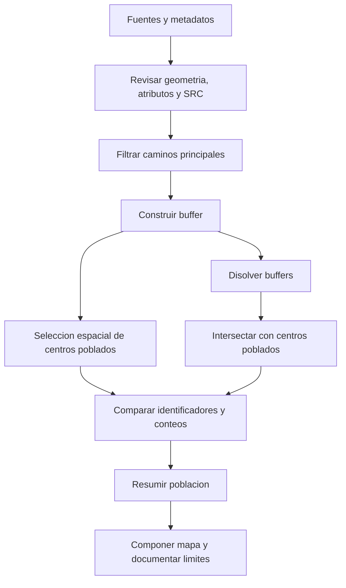

# Clase 7: Sistemas de referencia, geoprocesamiento y comunicación cartográfica en QGIS

> **Objetivo académico:** Comprender cómo los sistemas de referencia condicionan las operaciones espaciales, construir y auditar un análisis de proximidad entre caminos y centros poblados, y comunicar resultados mediante estadísticas y composiciones cartográficas en QGIS.

## 1. Contexto y marco conceptual

### De los datos espaciales a la evidencia territorial

La sesión desarrolla un ciclo de análisis geográfico: reconocer el sistema de referencia de las capas, delimitar objetos mediante atributos, aplicar operaciones espaciales, verificar la unidad de conteo, resumir sus características y producir una representación cartográfica. La finalidad es convertir datos georreferenciados en evidencia útil para decisiones sobre territorio, infraestructura y población.

Una entidad espacial o *feature* vincula una geometría con atributos descriptivos. En el caso trabajado, los caminos se representan mediante líneas y los centros poblados mediante puntos. Sus tablas contienen variables como el tipo de vía, el nombre del departamento y la población registrada en 2001. Los límites municipales y departamentales aportan polígonos de referencia.

La tabla de atributos permite ordenar, filtrar y resumir registros como en otros entornos de análisis de datos. La geometría añade relaciones que requieren procedimientos especializados: proximidad, intersección, contención y superposición. QGIS ofrece estos algoritmos sin que el analista tenga que implementarlos desde cero.

**Enriquecimiento conceptual:** Una capa es la representación de un conjunto de datos dentro del proyecto. Duplicarla en QGIS puede crear otra configuración de visualización y filtrado que continúa apuntando a la misma fuente; no implica duplicar físicamente sus datos. Asimismo, un centro poblado no equivale a un municipio: el primero es la entidad puntual del caso; el segundo, una unidad administrativa territorial.

### Consulta espacial de información meteorológica

La introducción utiliza Windy para ilustrar la consulta por ubicación de temperatura, precipitación, velocidad y dirección del viento, rachas y productos satelitales. Seleccionar una coordenada permite consultar información incluso donde no existe una localidad reconocida por los buscadores habituales. Se plantea su utilidad para planificar trabajo de campo.

La comparación entre ubicaciones cercanas muestra que el valor consultado puede variar espacialmente. El ejemplo también incorpora la dimensión temporal: una ubicación presenta una secuencia de valores pronosticados, no una única observación permanente.

**Enriquecimiento conceptual:** Consultar un punto del mapa no garantiza una medición realizada exactamente en ese lugar. El resultado puede proceder de un modelo sobre una malla y de un procedimiento de interpolación. Deben distinguirse observación, pronóstico y producto derivado, así como su resolución y horizonte temporal. La fuente no permite fijar una frecuencia general de actualización de los productos satelitales mencionados.

### Fuentes y adecuación de los datos

Se presentan GeoBolivia y el Centro Digital de Recursos Naturales como fuentes de información espacial. GeoBolivia permite localizar productos de instituciones públicas; el segundo repositorio se utiliza por la estabilidad de los archivos y de sus atributos en el caso demostrado.

**Enriquecimiento conceptual:** La procedencia institucional facilita la trazabilidad, pero no sustituye la revisión de fecha, cobertura, escala, definición de variables y calidad geométrica. Un archivo estable y antiguo puede servir para comprender un procedimiento sin describir adecuadamente la situación territorial actual.

## 2. Fundamentos teóricos y arquitectura

### Referencia geográfica y proyección cartográfica

Representar una superficie terrestre curva en un plano introduce distorsiones. La analogía de desplegar la cáscara de una naranja permite comprender por qué no es posible trasladar toda la superficie a un plano conservando simultáneamente todas sus propiedades geométricas.

La sesión identifica efectos sobre áreas, formas y distancias. La elección del sistema debe responder a la extensión del área de estudio, la localización, las propiedades que interesa preservar y el uso analítico del resultado.

**Enriquecimiento conceptual:** Conviene distinguir tres conceptos que aparecen parcialmente superpuestos en el discurso:

| Concepto | Función | Precisión necesaria |
| --- | --- | --- |
| Datum o marco de referencia geodésico | Establece la referencia para posicionar coordenadas respecto de la Tierra | No es sinónimo de proyección |
| Sistema de referencia de coordenadas, SRC | Define cómo se expresan e interpretan las coordenadas | Incluye referencia geodésica, ejes y unidades; puede ser geográfico o proyectado |
| Proyección cartográfica | Transforma posiciones de una superficie de referencia a coordenadas planas | Distribuye las distorsiones según sus propiedades y parámetros |

Un SRC geográfico expresa posiciones mediante coordenadas angulares, normalmente longitud y latitud en grados. Un SRC proyectado expresa posiciones sobre un plano, frecuentemente en metros. Los grados decimales y los grados, minutos y segundos son formatos de representación angular; cambiar de formato no cambia por sí mismo el SRC.

**Enriquecimiento conceptual:** En una representación habitual de SIG se usa $x=\lambda$ y $y=\varphi$, donde $\lambda$ es la longitud y $\varphi$ la latitud, ambas angulares. Debe comprobarse el orden de ejes exigido por cada herramienta o servicio: no todas las interfaces presentan las coordenadas en el mismo orden.

### Familias de proyecciones y UTM

Se introducen las familias cilíndrica, cónica y azimutal como formas de organizar la representación plana. La explicación geométrica es una aproximación conceptual a las superficies de proyección.

El sistema UTM, Universal Transversa de Mercator, divide el territorio en zonas longitudinales. La sesión sitúa Bolivia en las zonas 19, 20 y 21 y utiliza códigos EPSG para identificar sistemas concretos.

**Enriquecimiento conceptual:** UTM es un sistema de proyecciones, no un datum. Sus 60 zonas tienen una anchura nominal de 6 grados de longitud y utilizan la proyección transversa de Mercator. Elegir una zona requiere considerar la ubicación y extensión del análisis; una sola zona no debe asumirse automáticamente adecuada para todo un país que atraviesa varias.

| Identificador | Interpretación correcta | Unidades |
| --- | --- | --- |
| EPSG:4326 | SRC geográfico WGS 84 | Grados |
| EPSG:32720 | WGS 84 / UTM zona 20S | Metros |

**Enriquecimiento conceptual:** El código EPSG identifica una definición registrada completa. EPSG corresponde históricamente a *European Petroleum Survey Group*. Para EPSG:32720, la interpretación pertinente incluye WGS 84, zona 20 y hemisferio sur; sus primeros dígitos no constituyen por sí solos un supuesto «datum UTM».

### Geoprocesos y teoría de conjuntos

Los geoprocesos transforman datos espaciales o establecen relaciones entre sus entidades. Parte de su lógica puede comprenderse mediante operaciones de conjuntos.

| Operación | Propósito | Efecto relevante |
| --- | --- | --- |
| Recorte | Restringir datos a un área de interés | Reduce la extensión espacial conservada |
| Buffer | Construir una zona alrededor de una geometría según una distancia | Genera polígonos de proximidad |
| Intersección | Obtener coincidencias espaciales entre capas | Puede transferir atributos de ambas entradas |
| Disolución | Unificar geometrías, con o sin agrupación por atributos | Elimina divisiones internas dentro de cada grupo |
| Combinación de capas | Integrar entidades compatibles en una salida | Reúne registros de varias fuentes |
| Reclasificación | Reasignar valores a categorías | Es especialmente habitual en análisis ráster |
| Superposición | Relacionar geometrías y atributos de varias capas | Permite integrar información territorial |

**Enriquecimiento conceptual:** Debe distinguirse la combinación de capas de la unión espacial. Combinar capas suele concatenar entidades; una unión de polígonos como operación de superposición particiona el espacio según sus coincidencias y conserva atributos de las entradas. La sesión utiliza «unión» para ambos sentidos, por lo que es necesario identificar el algoritmo concreto antes de ejecutarlo.

Los modelos de procesamiento encadenan operaciones como un algoritmo: entradas, parámetros, pasos y salidas. Permiten repetir análisis y reducir intervenciones manuales, siempre que el flujo incorpore controles de validez.



## 3. Implementación técnica y lógica de negocio

### Delimitación de caminos principales

El caso busca identificar centros poblados situados hasta aproximadamente 2 km de caminos principales. El procedimiento comienza con una condición sobre el atributo de tipo de vía.

La clasificación explicada asocia el valor 1 con caminos principales, el 2 con secundarios y el 3 con sendas. Durante la exploración del archivo se observan valores que no coinciden plenamente con esa descripción; por ello, la presencia efectiva de cada categoría debe comprobarse en los datos.

En QGIS se duplica la capa para conservar una visualización independiente y se abre el constructor de consultas mediante la opción de filtrado. La condición utilizada es «campo de tipo de vía igual a 1».

**Enriquecimiento conceptual:** Si el campo real se llamara `TIPO_VIA` y fuera numérico, una expresión representativa sería:

```sql
"TIPO_VIA" = 1
```

El nombre es ilustrativo: la transcripción no permite fijar su grafía exacta. La expresión es una condición de filtrado, no una consulta SQL completa. Una condición sintácticamente válida puede producir cero registros cuando el valor solicitado no existe; ese resultado debe distinguirse de un error de sintaxis.

### Construcción del buffer

La demostración accede a **Vectorial → Herramientas de geoproceso → Buffer** y utiliza como entrada los caminos filtrados. La capa está en EPSG:4326, de modo que el parámetro de distancia se expresa en grados. Se introduce aproximadamente `0.01801802` como conversión de 2 km y se guarda una nueva capa de salida.

También se modifican opciones de terminación de líneas. El discurso alterna entre terminación plana y cuadrada, por lo que no permite establecer inequívocamente cuál quedó aplicada.

**Enriquecimiento conceptual:** La conversión empleada procede de la aproximación de 111 km por grado:

$$
\Delta\theta \approx \frac{d}{111}\approx 0.018018\text{ grados},\qquad d=2\text{ km}.
$$

Aquí $d$ es la distancia pretendida en kilómetros y $\Delta\theta$ el desplazamiento angular aproximado en grados. El factor 111 tiene unidades de kilómetros por grado. Esta aproximación no convierte un buffer angular en una zona de distancia terrestre uniforme.

**Enriquecimiento conceptual:** En una aproximación esférica, la longitud de un grado de longitud depende de la latitud:

$$
L_{\lambda}(\varphi)\approx 111\cos(\varphi)\text{ km por grado}.
$$

La variable $\varphi$ es la latitud; al evaluar el coseno debe usarse la unidad angular que requiera la herramienta matemática. La expresión aproxima una distancia local sobre un paralelo y no constituye una transformación geodésica completa. Explica por qué un mismo incremento angular representa distancias diferentes según la dirección y la ubicación.

La alternativa para un análisis métrico local consiste en reproyectar los datos a un SRC apropiado y ejecutar el buffer con una distancia de 2000 m. Para extensiones amplias puede requerirse otra estrategia de proyección o un procedimiento geodésico adecuado.

**Enriquecimiento conceptual:** Reproyectar transforma coordenadas. Asignar un SRC solo modifica su interpretación declarada. Cambiar el SRC del proyecto para visualizar capas conjuntamente tampoco garantiza que el algoritmo utilice metros: deben revisarse la capa de entrada, el algoritmo y sus unidades.

La sesión verifica visualmente el ancho mediante la herramienta de medición y obtiene en un lugar unos 1987 m, próximos a 2 km. Es una comprobación local de plausibilidad.

**Enriquecimiento conceptual:** La terminación plana corta el buffer al final de la línea; la cuadrada prolonga su extremo; la redonda aproxima la vecindad radial del extremo. Esta elección afecta la inclusión de puntos próximos a las terminaciones y debe corresponder a la definición de proximidad adoptada.

### Intersección, selección espacial y disolución

Se aplican dos vías al mismo problema:

1. **Intersección:** centros poblados como entrada y buffers de caminos como superposición. Produce una nueva capa con 4409 registros.
2. **Selección por localización:** sobre la capa original de centros poblados se seleccionan los que intersectan los buffers. Produce 3416 entidades seleccionadas dentro de un total reportado de 28749.

La diferencia desencadena la revisión del resultado. Un centro poblado puede intersectar varios buffers de tramos distintos. La intersección genera registros correspondientes a esas coincidencias, mientras que la selección mantiene una única entidad original seleccionada.

Para corregir la multiplicación, se disuelven todos los buffers sin elegir un campo de agrupación. La sesión reporta que las 496 entidades iniciales pasan a una sola entidad y que una nueva intersección devuelve 3416 registros, coincidentes con la selección espacial.

**Enriquecimiento conceptual:** Una entidad disuelta puede tener geometría multiparte. «Una entidad» no implica una única región continua. Para conservar los centros poblados sin transferir atributos de cada tramo, la selección espacial o su extracción suelen expresar directamente la pregunta analítica.

### Estadística de los centros poblados seleccionados

El atributo `POP 2001` se utiliza para ordenar registros de menor a mayor y de mayor a menor población. La sesión identifica Cañón de la Olla y El Torno entre los menores valores, pero cuestiona expresamente la calidad de esos registros. Entre los mayores aparecen Santa Cruz y La Paz, con cifras verbales aproximadas de 1113000 y 789000 habitantes, respectivamente. La precisión completa de estos valores no puede reconstruirse con seguridad a partir del discurso.

Para calcular agregados se muestran dos caminos: copiar los registros a Excel y utilizar el panel de resumen estadístico de QGIS. En Excel se construye además una tabla dinámica con departamento como agrupación y población como suma, seguida de un gráfico de barras.

| Magnitud | Valor reportado | Alcance |
| --- | --- | --- |
| Centros poblados de la capa original | 28749 | Universo del archivo usado |
| Registros tras la primera intersección | 4409 | Incluyen multiplicidad por solapamiento |
| Centros poblados seleccionados | 3416 | Entidades originales que satisfacen la relación espacial |
| Registros tras disolver e intersectar | 3416 | Coinciden con la selección espacial |
| Población acumulada | 5320708 | Valor repetido en el resumen de Excel |
| Media de población | Aproximadamente 1557.58 | Habitantes por centro poblado seleccionado |

En un pasaje se pronuncia 3406 como recuento y en otro 5320308 como total. Se conservan como referencias principales 3416 y 5320708 porque el primer valor se confirma mediante dos procedimientos y el segundo se repite durante el resumen. El panel de QGIS se describe con un total redondeado en notación científica; esa visualización no resuelve por sí sola la discrepancia entre totales exactos.

**Enriquecimiento conceptual:** La media mencionada es aritméticamente compatible con los valores principales:

$$
\bar p=\frac{\sum_{i=1}^{n}p_i}{n}=\frac{5320708}{3416}\approx 1557.58.
$$

Aquí $n=3416$ es el número de centros poblados considerados y $p_i$ su población registrada, en habitantes. La fórmula supone que los valores son numéricos válidos y que cada centro se incluye una sola vez. Si existen valores nulos, debe precisarse si el denominador corresponde a todas las entidades o únicamente a las observaciones válidas. La unidad del resultado es habitantes por centro poblado; no es densidad territorial.

Se menciona también SQL como alternativa para agregar datos, sin desarrollar una consulta completa verificable. El intento de reproducir el gráfico mediante el complemento Data Plotly queda sin una configuración satisfactoria de la agregación.

### Composición cartográfica

La segunda aplicación utiliza una capa de resultados electorales previamente procesada, límites departamentales y municipales, y un mapa base. Se aplica simbología categorizada al campo que representa la organización ganadora por mesa. La grafía del campo no queda inequívocamente establecida en la transcripción.

El flujo de composición incluye:

1. Preparar la simbología, los nombres de las capas y su orden de dibujo en el proyecto.
2. Crear una composición de impresión desde el menú **Proyecto**.
3. Organizar el espacio con guías y reservar zonas para mapa, leyenda y metadatos.
4. Añadir el elemento mapa y ajustar su extensión.
5. Incorporar orientación, barra de escala y leyenda.
6. Configurar cuadrículas y anotaciones de coordenadas desde las propiedades del mapa.
7. Añadir título, procedencia, autoría y SRC.
8. Exportar una imagen o un documento y revisar el resultado.

Durante la demostración se ajustan tamaño y opacidad de los símbolos para reducir la superposición. Las cuadrículas se configuran con intervalos angulares de 3 o 4 grados y se cambia la orientación del texto lateral para evitar interferencias con el diseño. Se muestran exportaciones a PNG y PDF, incluida una opción de georreferenciación en la segunda.

## 4. Análisis crítico de casos y auditoría práctica

### La unidad de conteo explica la discrepancia

El hallazgo metodológico principal es que contar filas de una salida espacial no siempre equivale a contar entidades originales. Al seleccionar visualmente una ubicación de la primera intersección, la tabla revela varios registros de la misma comunidad, coincidentes en el mapa.

**Enriquecimiento conceptual:** Sean $P=\{p_1,\ldots,p_n\}$ los puntos originales y $B_1,\ldots,B_m$ los polígonos buffer. Definamos la multiplicidad de coincidencia:

$$
k_i=\sum_{j=1}^{m}\mathbf{1}[p_i\in B_j].
$$

El indicador $\mathbf{1}$ vale 1 cuando el punto pertenece al polígono y 0 en caso contrario. La expresión presupone geometrías válidas y una convención consistente sobre el borde. El número de pares punto-buffer y el número de puntos alcanzados son:

$$
N_{\mathrm{pares}}=\sum_{i=1}^{n}k_i,
\qquad
N_{\mathrm{puntos}}=\sum_{i=1}^{n}\mathbf{1}[k_i>0].
$$

Un punto presente en tres buffers aporta tres coincidencias, pero una sola entidad original. En la sesión, las salidas de 4409 y 3416 ilustran esa diferencia de granularidad. La primera puede ser válida para estudiar relaciones entre puntos y tramos; resulta inadecuada para contar centros poblados únicos sin control adicional.

La disolución construye la cobertura conjunta de los buffers. El acuerdo posterior de conteos es evidencia favorable a la corrección, aunque una auditoría más fuerte compararía los identificadores originales incluidos por cada procedimiento.

### Proximidad geométrica y población potencialmente vinculada

El caso clasifica centros poblados por la posición de su punto y suma después toda su población registrada.

**Enriquecimiento conceptual:** El resultado describe población atribuida a centros cuyo punto representativo intersecta el buffer. No demuestra que cada habitante resida físicamente dentro de la franja ni que tenga acceso efectivo a la carretera. El punto puede representar una localidad extensa; además, ríos, relieve, conexiones viales y restricciones de tránsito pueden modificar la accesibilidad. Distancia geométrica, distancia por red y tiempo de viaje responden a preguntas diferentes.

### Calidad temporal, valores extremos y nulos

El campo de población corresponde a 2001. La fuente reconoce que es antiguo y expresa dudas sobre algunos valores mínimos.

**Enriquecimiento conceptual:** Un mínimo de la tabla es inicialmente una propiedad del archivo, no una conclusión demográfica. Antes de interpretarlo deben revisarse valores nulos, ceros, posibles códigos de ausencia, duplicados y correspondencia entre nombre y ubicación. Tampoco debe suponerse que datos de población, caminos y límites representan el mismo momento histórico. El uso conjunto requiere declarar sus desfases temporales.

### Rendimiento de geometrías disueltas

La intersección inicial se ejecuta rápidamente, mientras que la operación posterior a la disolución tarda considerablemente más. La sesión relaciona esa demora con la complejidad de la nueva geometría.

**Enriquecimiento conceptual:** Reducir el número de filas no garantiza reducir el coste espacial. Una geometría multiparte puede reunir muchos vértices y exigir pruebas geométricas costosas. El rendimiento también depende de índices espaciales, validez, extensión, formato y algoritmo. La observación permite reconocer un problema práctico, pero no establecer una complejidad computacional exacta.

### Agregación gráfica y semántica electoral

El intento con Data Plotly muestra que elegir ejes no sustituye la agregación. Para representar población por departamento debe obtenerse la suma de población de cada departamento; contar registros representa otra variable. Un histograma se orienta a distribuciones por intervalos, mientras que una comparación entre departamentos se comunica mediante barras por categoría.

**Enriquecimiento conceptual:** El mapa electoral representa una categoría ganadora por mesa según los datos disponibles. La cantidad de símbolos de un color no equivale automáticamente a cantidad de votos, porcentaje electoral o superficie de apoyo. Si varias mesas comparten recinto o coordenadas, los puntos se superponen y el orden de dibujo puede ocultar categorías. La transparencia ayuda a percibir acumulaciones, pero no elimina el problema semántico ni garantiza que todas las mesas sean visibles.

## 5. Principios de diseño, buenas prácticas y anti-patrones

### Control del análisis espacial

- Definir primero qué se cuenta: entidades originales, coincidencias entre capas o habitantes asociados.
- Revisar geometría, SRC, unidades, atributos y valores disponibles antes de ejecutar geoprocesos.
- Utilizar una estrategia métrica adecuada cuando la pregunta está expresada en metros o kilómetros.
- Conservar identificadores de origen para verificar duplicaciones y comparar salidas.
- Documentar el predicado espacial y el tratamiento de puntos sobre el borde.
- Separar datos originales, resultados intermedios y salidas finales con nombres descriptivos y versiones comprensibles.
- Mantener explícito el universo de cálculo: totalidad de registros, subconjunto filtrado o entidades seleccionadas.

**Enriquecimiento conceptual:** Para puntos y polígonos, `intersecta` incluye el contacto con el borde; `está dentro` puede excluirlo. Esta diferencia afecta la inclusión de casos limítrofes. Igualmente, los algoritmos pueden ofrecer procesar solo entidades seleccionadas: una selección residual puede cambiar inadvertidamente el universo analizado.

Los principales anti-patrones observados son tratar grados como distancias uniformes, aceptar el primer conteo sin revisar multiplicidad, sumar población sobre filas repetidas y atribuir actualidad a un campo histórico.

### Formatos y persistencia

La sesión propone cambiar el formato de salida ante un problema de escritura y revisar la ubicación de almacenamiento. Son alternativas de diagnóstico, pero no se establece la causa del error.

**Enriquecimiento conceptual:** GeoPackage es un contenedor basado en SQLite que puede almacenar varias capas y tablas; no es un archivo ZIP del proyecto. Un proyecto QGIS y un GeoPackage cumplen funciones distintas. Shapefile, por su parte, requiere varios archivos asociados y presenta restricciones de atributos y nombres. Cambiar a Shapefile no es una solución universal a fallos de escritura. Conviene revisar el mensaje concreto, la ruta, permisos, bloqueos y compatibilidad de campos. Los espacios en rutas no constituyen por sí mismos un error general de QGIS.

### Legibilidad y trazabilidad del mapa

| Componente | Función analítica o comunicativa |
| --- | --- |
| Área del mapa | Define la extensión y el contenido territorial visible |
| Título | Expresa el fenómeno y la unidad representada |
| Leyenda | Relaciona símbolos, categorías y capas |
| Barra de escala | Permite interpretar distancias en el diseño final |
| Orientación | Aclara la dirección de referencia |
| Cuadrícula y coordenadas | Facilitan localizar posiciones e interpretar el SRC |
| Fuente y referencia temporal | Identifican procedencia y vigencia de los datos |
| Autoría y SRC | Aportan responsabilidad y reproducibilidad |

En el mapa electoral, un título preciso debe indicar que se representa la organización ganadora por mesa. La leyenda debe describir las categorías sin introducir nombres internos de archivos ni capas irrelevantes. Las líneas administrativas y el mapa base deben aportar contexto sin competir con los símbolos temáticos.

**Enriquecimiento conceptual:** La barra de escala debe estar vinculada al elemento mapa correspondiente y revisarse después de modificar su extensión. Para una escala nominal $1:M$:

$$
d_t=M\,d_m.
$$

Aquí $M>0$ es el denominador adimensional, $d_m$ la distancia medida en el mapa y $d_t$ la distancia equivalente en terreno, expresadas en la misma unidad. La relación describe la escala nominal; su precisión local depende de la proyección y se altera si se redimensiona una imagen sin preservar una referencia gráfica adecuada. Una barra de escala incluida en la imagen conserva su proporción al redimensionarse junto con ella.

**Enriquecimiento conceptual:** Los componentes cartográficos deben seleccionarse según el uso y la audiencia. La sesión los presenta como conjunto básico para la composición realizada; no todos son universalmente obligatorios en cualquier visualización geográfica. También deben conservarse las atribuciones requeridas por las fuentes y el mapa base.

## 6. Síntesis conceptual y profundización académica

El análisis desarrollado muestra que un resultado espacial depende de cuatro decisiones encadenadas: cómo se referencian las coordenadas, qué relación espacial se calcula, cuál es la unidad estadística y cómo se comunica la salida.

La discrepancia entre 4409 registros y 3416 centros poblados demuestra que una operación puede ejecutarse correctamente y, aun así, responder a una pregunta diferente de la pretendida. La intersección conserva coincidencias; la selección mantiene entidades originales. La disolución permite eliminar multiplicidad por superposición, aunque puede introducir un coste geométrico mayor.

La síntesis estadística requiere controlar esa granularidad antes de sumar o promediar. El total y la media reportados corresponden a población registrada en centros seleccionados mediante un criterio geométrico aproximado. Su interpretación queda limitada por la fecha del atributo, la calidad de los registros y la representación puntual de las localidades.

La composición cartográfica completa la cadena de análisis. Proyección, leyenda, escala, título y fuentes permiten que otra persona comprenda qué se representa. En el caso electoral, distinguir categorías ganadoras por mesa de magnitudes de votos es tan importante como resolver la superposición visual.

**Enriquecimiento conceptual:** Las líneas de profundización pertinentes son el análisis de distancias geodésicas y por redes, los predicados topológicos, las relaciones de uno a muchos en cruces espaciales, la propagación de errores entre operaciones y la representación de múltiples registros en una misma ubicación. Estas conexiones permiten pasar del manejo de herramientas a un diseño analítico reproducible y críticamente interpretable.
