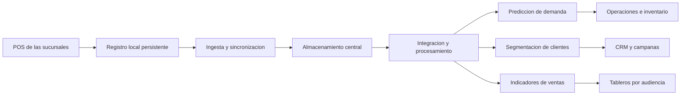

# Clase 2: Infraestructura cloud para Big Data: capas funcionales y patrones Lambda, Kappa y Medallion

> **Objetivo académico:** Distinguir modelos de servicio cloud, capas funcionales y patrones de procesamiento de datos para justificar arquitecturas escalables, considerando continuidad operativa, calidad de datos, costos y límites frente a problemas de capacidad transaccional.

## 1. Contexto y marco conceptual

La sesión articula dos niveles de discusión: la modernización cloud de una cadena de supermercados y la organización de una infraestructura para analizar datos masivos. El argumento conductor es que disponer de tecnologías adecuadas no garantiza una solución eficaz: también deben definirse sus responsabilidades, relaciones y condiciones de operación.

El caso de la cadena Favorita considera veinte sucursales con infraestructura local descrita como obsoleta y cuatro problemas: inventario ineficiente, marketing no personalizado, análisis lento de ventas y debilidades de seguridad. Las propuestas combinan servicios cloud con operaciones locales, especialmente en los puntos de venta o POS. Se discute también si un negocio concentrado en comercializar productos debería privilegiar aplicaciones SaaS para reducir la administración tecnológica propia.

El segundo caso, Megamarket, es una situación hipotética de lanzamiento de comercio electrónico durante Black Friday. El relato menciona aproximadamente 3000 usuarios simultáneos, una caída a los quince minutos y oportunidades de venta estimadas en 200000 bolivianos. Estas cifras contextualizan el ejemplo; no constituyen mediciones verificadas ni resultados de una implementación.

La explicación inicial atribuye la crisis a una entrada de datos concentrada, almacenamiento de capacidad fija, ausencia de prioridades de procesamiento y falta de acceso a los tableros. El debate posterior introduce una distinción esencial: mejorar la arquitectura analítica no demuestra, por sí mismo, que el sistema de ventas pueda responder a un pico de solicitudes.

### Tres dimensiones que deben distinguirse

| Dimensión | Pregunta que responde | Ejemplos de la sesión |
|---|---|---|
| Modelo de servicio | ¿Qué capacidades administra el proveedor y cuáles conserva la organización? | IaaS, PaaS y SaaS |
| Capa funcional | ¿Qué responsabilidad cumple un componente en el recorrido del dato? | Ingesta, almacenamiento, procesamiento y visualización |
| Patrón arquitectónico | ¿Cómo se organizan los flujos y las transformaciones? | Lambda, Kappa y Medallion |

**Enriquecimiento conceptual:** una cuarta dimensión es el despliegue: local, cloud o híbrido. Combinar IaaS, PaaS y SaaS no basta para denominar híbrida una arquitectura; en los casos discutidos, esa denominación se justifica por integrar operaciones locales y servicios cloud. Estas dimensiones son complementarias y no deben utilizarse como clasificaciones equivalentes.

## 2. Fundamentos teóricos y arquitectura

### 2.1. Modelos de servicio y operación local

**IaaS, infraestructura como servicio**, proporciona recursos de cómputo, almacenamiento y red con un grado importante de control para el cliente. En las propuestas se vincula con máquinas virtuales, servidores de aplicaciones y capacidad ajustable durante campañas comerciales.

**PaaS, plataforma como servicio**, desplaza parte de la operación técnica hacia el proveedor. Se asocia con integración de datos, ETL, procesamiento de eventos, analítica y entrenamiento de modelos. Su valor consiste en concentrar esfuerzo en la lógica de datos y negocio, reduciendo la administración de infraestructura subyacente.

**SaaS, software como servicio**, ofrece aplicaciones consumidas por la organización, como CRM y herramientas de inteligencia de negocios. Favorece una adopción rápida y reduce la necesidad de desarrollar y mantener aplicaciones equivalentes.

La **operación local u on-premises** se propone para registrar ventas con baja latencia y conservar continuidad cuando falla la conectividad. Después se sincronizan los registros con los sistemas centrales.

**Enriquecimiento conceptual:** una base de datos ejecutada en una máquina virtual pertenece a una solución sobre IaaS; una base de datos administrada puede corresponder a otra categoría de servicio según las responsabilidades transferidas. Asimismo, las actualizaciones del sistema operativo invitado en IaaS no deben suponerse automáticamente a cargo del proveedor. La clasificación exige revisar el servicio concreto, no únicamente su finalidad.

### 2.2. Cuatro capas funcionales

La clase propone cuatro capas como marco de referencia para organizar la arquitectura de Big Data:

| Capa | Responsabilidad | Decisión central |
|---|---|---|
| Ingesta | Capturar y transportar datos desde múltiples fuentes | Cómo admitir el volumen de entrada y manejar variaciones de carga |
| Almacenamiento | Proporcionar persistencia duradera y acceso adecuado | Dónde conservar los datos y cómo recuperarlos eficientemente |
| Procesamiento | Transformar datos brutos en información útil | Qué operaciones ejecutar y con qué urgencia |
| Visualización | Comunicar resultados a diferentes audiencias | Qué información necesita cada usuario para decidir |

La separación permite especialización tecnológica, escalamiento independiente, mantenimiento localizado y reutilización. Un cambio en una herramienta de procesamiento no debería obligar a reconstruir todos los mecanismos de captura y consumo.

**Enriquecimiento conceptual:** estas capas son una abstracción lógica útil, no una ley universal que obligue a desplegar cuatro sistemas físicos distintos. Un servicio puede cubrir varias responsabilidades. La independencia entre capas depende de contratos e interfaces adecuados; separarlas en un dibujo no elimina sus dependencias.

La visualización debe ajustarse al público. La dirección necesita indicadores sintéticos; los mandos intermedios requieren desagregaciones y contexto causal; las operaciones necesitan registros detallados y trazabilidad. El resumen ejecutivo debe conservar significado y permitir profundizar cuando una decisión lo requiera.

### 2.3. Lambda: procesamiento histórico y de baja latencia

Lambda combina dos rutas de procesamiento:

- **Ruta por lotes:** opera sobre datos históricos y produce vistas calculadas a partir de conjuntos amplios.
- **Ruta de velocidad:** procesa eventos recientes para reducir la espera hasta disponer de información actualizada.
- **Capa de servicio:** expone resultados de ambas rutas para su consulta.

Su atractivo es atender necesidades históricas y de actualidad dentro de una misma solución. Su costo es mantener dos caminos de procesamiento, potencialmente con lógica duplicada y mecanismos de conciliación.

**Enriquecimiento conceptual:** la tolerancia a fallos y la escalabilidad requieren mecanismos concretos de persistencia, recuperación y distribución. Tampoco la duplicación de datos es inevitable: el desafío consiste en evitar dobles conteos y reconciliar las vistas cuando el procesamiento histórico incorpora eventos antes atendidos por la ruta rápida.

### 2.4. Kappa: unificación del procesamiento como flujo

Kappa utiliza una ruta de procesamiento de eventos y un registro persistente que permite reproducirlos. En lugar de mantener una implementación separada por lotes, el reprocesamiento histórico puede realizarse volviendo a consumir los eventos retenidos.

Sus beneficios potenciales son una lógica más uniforme, menor duplicación de implementaciones y una organización apropiada para datos que nacen como eventos continuos. Sus dificultades incluyen el costo de reproducir historiales extensos, la operación del registro y la administración del estado del procesamiento.

**Enriquecimiento conceptual:** Kappa no implica que todo reprocesamiento deba abarcar necesariamente todos los datos; el alcance depende de la retención, las posiciones de lectura y la transformación requerida. Tampoco supone menor precisión por definición. El procesamiento con estado es posible, aunque exige resolver persistencia, recuperación, orden y eventos tardíos. Estas condiciones explican mejor sus límites que una oposición absoluta entre rapidez y exactitud.

### 2.5. Medallion: refinamiento progresivo de calidad

Medallion organiza los datos en niveles de transformación:

| Nivel | Contenido | Finalidad |
|---|---|---|
| Bronce | Datos originales o con transformación mínima | Conservar evidencia de entrada y permitir reconstrucciones |
| Plata | Datos depurados, estandarizados y validados | Proporcionar información consistente y reutilizable |
| Oro | Conjuntos preparados para necesidades de negocio | Facilitar indicadores, análisis e informes específicos |

La progresión hace explícita la diferencia entre recibir datos y disponer de información confiable para decidir. Sus beneficios incluyen modularidad, descubrimiento de datos y trazabilidad del refinamiento. Sus costos pueden incluir más almacenamiento, transformaciones, coordinación y mantenimiento.

**Enriquecimiento conceptual:** Medallion aborda principalmente el grado de refinamiento; Lambda y Kappa abordan principalmente la organización del procesamiento temporal. Por ello no son alternativas necesariamente excluyentes: una solución puede organizar datos en bronce, plata y oro y utilizar procesamiento por lotes, streaming o una combinación. La calidad no aparece por el nombre del nivel, sino por reglas verificables.

## 3. Implementación técnica y lógica de negocio

La fuente desarrolla diseños conceptuales. No contiene código, configuraciones, pruebas ejecutadas ni métricas que permitan afirmar que una arquitectura concreta fue implementada o validada.

### 3.1. Flujo propuesto para la cadena de supermercados

El recorrido general parte de los POS locales, integra ventas e información de clientes, procesa los datos y los entrega a aplicaciones de negocio.

El diagrama sintetiza las relaciones descritas; no representa una topología desplegada. La operación desconectada requiere que el registro local permanezca disponible antes de enviar información al sistema central.

| Problema | Mecanismo planteado | Condición para producir valor |
|---|---|---|
| Exceso o falta de inventario | Consolidación de ventas y predicción de demanda por sucursal | Registros confiables de productos, existencias y movimientos |
| Marketing genérico | Segmentación y campañas mediante CRM | Identificación consistente de clientes y uso autorizado de sus datos |
| Análisis lento de ventas | Capacidad ajustable y procesamiento oportuno | Dimensionamiento del flujo completo y separación de cargas |
| Seguridad débil | Cifrado, control de acceso y monitoreo | Configuración, responsabilidades y seguimiento continuo |

Las propuestas también mencionan recomendaciones personalizadas, asistentes conversacionales y listas de compra generadas a partir de una intención y un presupuesto.

**Enriquecimiento conceptual:** la predicción de demanda es una tarea predictiva que no requiere necesariamente IA generativa. Esta última puede ayudar a producir explicaciones, recetas o listas de compra, pero sus resultados deben contrastarse con catálogo, precios, disponibilidad y restricciones del usuario. Generar contenido plausible no equivale a estimar correctamente una demanda futura.

### 3.2. Continuidad local y sincronización

Conservar los POS locales permite seguir registrando ventas durante una interrupción de conectividad. No obstante, afirmar que los datos se actualizarán después deja pendientes aspectos relevantes del diseño.

**Enriquecimiento conceptual:** la sincronización necesita identificadores únicos de transacción, reintentos seguros, reglas de conciliación y tratamiento de conflictos. Un envío repetido no debería duplicar una venta. Además, la continuidad ante una falla de internet no garantiza continuidad ante un corte eléctrico: esta última requiere medidas adicionales. Durante la desconexión puede existir desfase entre existencias locales y centrales, por lo que debe definirse qué operaciones siguen siendo seguras.

### 3.3. Migración progresiva y costos

Una propuesta organiza la modernización en tres etapas conceptuales: estabilizar operaciones y seguridad, aprovechar los datos para personalización y analítica, e incorporar capacidades avanzadas de IA. La lógica es reducir riesgo y dependencias simultáneas. Una secuencia de migración, sin embargo, debe acompañarse de una arquitectura que explique cómo intercambian información sus componentes.

El pago por uso puede evitar compras anticipadas de capacidad, pero exige presupuestos, alertas y personal con competencias cloud, de datos y seguridad. La sesión menciona apoyo especializado inicial y capacitación interna.

**Enriquecimiento conceptual:** no existe una unidad de facturación universal para PaaS ni una garantía de ahorro por adoptar SaaS o IaaS. El costo depende del servicio, consumo, licencias, almacenamiento, transferencias y operación. Sin mediciones comparables, las afirmaciones económicas de las propuestas son hipótesis de viabilidad.

## 4. Análisis crítico de casos y auditoría práctica

### 4.1. Megamarket: capacidad transaccional y arquitectura analítica

El rediseño planteado incorpora entradas distribuidas, almacenamiento ajustado a distintas necesidades, procesamiento según urgencia y tableros especializados. La sesión selecciona Lambda para combinar información reciente e histórica.

La objeción técnica central señala que el síntoma principal es la incapacidad de responder a solicitudes de clientes. Se mencionan escalamiento de servidores, caché y replicación de bases de datos como mecanismos posibles para atender esa dimensión. La respuesta docente reconoce el carácter ilustrativo del caso y la necesidad de contar con mejores insumos para decidir.

| Problema observado | Evidencia adicional necesaria | Alcance de una solución analítica |
|---|---|---|
| Caída del sitio | Latencias, errores, saturación y dependencias | No demuestra recuperación del servicio de ventas |
| Cuello de botella de entrada | Capacidad de recepción y tasas de llegada | Una ingesta desacoplada puede aliviar cargas de datos |
| Base de datos saturada | Consultas, conexiones, bloqueos y patrón de lectura/escritura | Separar analítica puede reducir interferencias |
| Tableros inaccesibles | Dependencia respecto del sistema transaccional | Vistas de consulta independientes pueden mejorar su disponibilidad |

**Enriquecimiento conceptual:** conviene distinguir el procesamiento transaccional, que confirma operaciones como pagos y pedidos, del procesamiento analítico, que produce indicadores y patrones. Desacoplarlos puede proteger las ventas frente a consultas pesadas, pero no elimina automáticamente todos los cuellos de botella. La replicación orientada a lectura no resuelve por sí sola la saturación de escrituras; la caché tampoco debe comprometer la corrección de pagos o inventario.

**Enriquecimiento conceptual:** un criterio mínimo de capacidad permite precisar el debate. Sea $\lambda$ la tasa media de llegada de solicitudes, en solicitudes por segundo; $\mu$ la capacidad media de atención de cada instancia, en las mismas unidades; y $k \in \mathbb{N}^{+}$ el número de instancias equivalentes. Bajo el supuesto idealizado de reparto equilibrado y ausencia de otro cuello de botella, la utilización aproximada es:

$$
\rho = \frac{\lambda}{k\mu}
$$

Para que una cola no crezca indefinidamente bajo demanda sostenida se requiere $\rho < 1$. La expresión es adimensional y no garantiza una latencia aceptable: omite variabilidad, ráfagas, contención y dependencias compartidas. Si aumenta la llegada sin aumentar la capacidad efectiva, reorganizar los datos no cambia necesariamente esa relación. El aporte arquitectónico debe explicar qué trabajo elimina, desacopla o distribuye.

### 4.2. Evaluación de las propuestas para Favorita

La discusión sobre privilegiar SaaS es pertinente porque obliga a justificar qué capacidades tecnológicas debe operar una empresa comercial. Mantener control técnico solo produce valor si responde a integración, continuidad, personalización o restricciones concretas.

**Enriquecimiento conceptual:** el número de sucursales no basta para aceptar o descartar IaaS, ni para concluir que existe una carga de Big Data. Se necesitan tasas de transacciones, volumen retenido, variedad, latencia objetivo, crecimiento y capacidades del equipo. Igualmente, alojar datos localmente no demuestra mayor seguridad, y migrarlos a cloud tampoco demuestra que estén protegidos.

La revisión de tecnologías debe separar funciones de marcas comerciales. En la transcripción aparecen nombres de productos y categorías de manera imprecisa; no existe información suficiente para reconstruir una lista exacta de servicios ni una arquitectura específica por proveedor.

### 4.3. Criterios para seleccionar patrones

| Criterio | Lambda | Kappa | Medallion |
|---|---|---|---|
| Problema organizador | Combinar procesamiento histórico y reciente | Unificar procesamiento mediante eventos reproducibles | Refinar datos hasta hacerlos aptos para negocio |
| Fortaleza | Rutas diferenciadas según necesidad | Menor duplicación de lógica entre rutas | Calidad y reutilización explícitas |
| Costo o dificultad | Conciliar resultados y mantener dos caminos | Retención, reproducción y estado | Transformaciones, almacenamiento y reglas entre niveles |
| Pregunta decisiva | ¿Se justifican rutas independientes? | ¿Puede reconstruirse lo necesario desde eventos? | ¿Qué evidencia permite promover datos de nivel? |

Los sectores citados en clase —finanzas, salud, detección de fraude e internet de las cosas— son referencias orientativas. No determinan por sí solos el patrón apropiado. Tampoco basta con asociar equipos pequeños a Kappa o presupuestos altos a Lambda: la decisión depende de las obligaciones del sistema y de la capacidad real para operarlo.

## 5. Principios de diseño, buenas prácticas y anti-patrones

1. **Definir el problema antes de seleccionar herramientas.** Distinguir indisponibilidad de ventas, demora analítica, mala calidad de datos y exposición de información evita soluciones dirigidas al síntoma equivocado.
2. **Separar responsabilidades con interfaces explícitas.** Las capas ayudan cuando se conocen sus entradas, salidas, dependencias y condiciones de fallo.
3. **Escalar el cuello de botella efectivo.** Aumentar capacidad de una capa no garantiza mejora si otra limita el flujo.
4. **Justificar la urgencia del dato.** No todo indicador necesita actualización inmediata. Diferenciar necesidades temporales evita costos y competencia innecesaria por recursos.
5. **Diseñar la continuidad completa.** La operación local debe incluir persistencia y conciliación; la operación cloud debe considerar fallos de conectividad y dependencias del proveedor.
6. **Verificar calidad y seguridad.** Cifrado, identidad, permisos y monitoreo requieren decisiones operativas. Los niveles Medallion necesitan criterios concretos de aceptación de datos.
7. **Evaluar el costo total.** El pago por uso debe analizarse junto con licencias, integración, personal y mantenimiento.
8. **Mantener trazabilidad entre requisito y componente.** Cada servicio debe responder a una necesidad identificada y aportar una responsabilidad comprensible.

**Enriquecimiento conceptual:** son anti-patrones relevantes acumular tecnologías sin explicar sus relaciones, tratar la nube como garantía automática de seguridad o ahorro, elegir un patrón por popularidad y presentar una mejora analítica como prueba de resiliencia transaccional. También lo es incorporar IA generativa antes de disponer de datos confiables y restricciones de negocio verificables.

## 6. Síntesis conceptual y profundización académica

La contribución principal de la sesión es distinguir capacidades y organización. Las capas de ingesta, almacenamiento, procesamiento y visualización describen responsabilidades; los patrones establecen maneras de organizar el tratamiento de los datos; los modelos IaaS, PaaS y SaaS distribuyen responsabilidades operativas entre cliente y proveedor.

Lambda combina rutas histórica y rápida, Kappa unifica el procesamiento alrededor de eventos y Medallion hace visible el refinamiento de calidad. Su utilidad depende de requisitos y mecanismos concretos, no de una superioridad general. Medallion puede complementar decisiones temporales de procesamiento.

El debate sobre Megamarket aporta el límite más importante: una arquitectura de datos bien organizada puede mejorar aislamiento, información y aprovechamiento de recursos, pero la disponibilidad del comercio electrónico requiere demostrar capacidad efectiva en el recorrido transaccional. Los casos expuestos permanecen en el nivel conceptual y no permiten afirmar mejoras medidas.

**Enriquecimiento conceptual:** las líneas de profundización que conectan los temas son consistencia durante desconexiones, recuperación mediante reproducción de eventos, aislamiento entre cargas transaccionales y analíticas, contratos de calidad y evaluación conjunta de costo, latencia y confiabilidad. Estas conexiones permiten convertir un diagrama de componentes en una justificación arquitectónica verificable.
