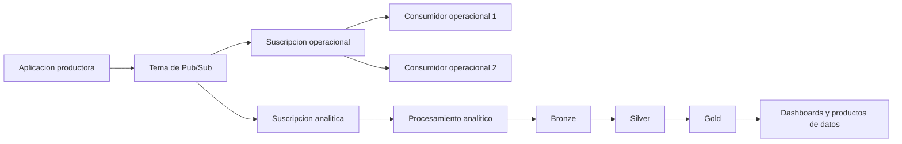

# Clase 3: Arquitecturas de datos e ingesta asíncrona con Google Cloud Pub/Sub

> **Objetivo académico:** Relacionar los requisitos de una plataforma de entretenimiento digital con sus capas y patrones de datos, comprender la publicación y suscripción mediante Google Cloud Pub/Sub y evaluar sus implicaciones de confirmación, aislamiento, escalabilidad y operación.

## 1. Contexto y marco conceptual

La sesión articula dos ejes: el análisis de alternativas arquitectónicas para una plataforma de video denominada Latinflix y una demostración de ingesta de mensajes con Google Cloud Pub/Sub. El vínculo entre ambos es la necesidad de captar eventos de uso y transformarlos en información oportuna para recomendaciones, seguimiento operacional y decisiones de negocio.

El caso reúne problemas relacionados, pero técnicamente distintos:

- **Latencia de recomendaciones:** respuestas superiores a cinco segundos y propuestas de reducción hacia valores inferiores a uno o dos segundos.
- **Estabilidad bajo demanda variable:** interrupciones y buffering durante estrenos o incrementos de audiencia.
- **Demora analítica:** información disponible con retrasos del orden de 24 a 48 horas.
- **Operación reactiva:** escalado manual, alertas tardías y capacidad dimensionada para picos esporádicos.
- **Personalización insuficiente:** dificultad para combinar preferencias históricas con señales recientes de comportamiento.

En las intervenciones se menciona una disminución del 15 % en indicadores de experiencia o consumo, pero su denominación cambia entre tiempo de visualización y satisfacción. Por ello, se conserva como señal de deterioro descrita en el caso, sin tratar ambos indicadores como equivalentes ni atribuirles causalidad demostrada.

Los eventos considerados incluyen inicios de sesión, búsquedas, clics, valoraciones e interacciones con contenido. En distintas propuestas aparece un volumen de referencia de dos terabytes diarios de registros. Las cifras de concurrencia, presupuesto y disponibilidad varían ampliamente entre alternativas y constituyen supuestos de diseño, no mediciones de una infraestructura desplegada.

**Enriquecimiento conceptual:** Conviene separar el **plano de entrega audiovisual**, responsable de distribuir segmentos de video, del **plano de eventos y analítica**, responsable de registrar interacciones, actualizar información y alimentar decisiones. Una recomendación más rápida no demuestra una reducción del buffering: este último también depende de distribución de contenido, conectividad, capacidad de origen y comportamiento del reproductor.

## 2. Fundamentos teóricos y arquitectura

### 2.1. Cuatro capas funcionales

La organización recurrente de las propuestas comprende ingesta, almacenamiento, procesamiento y visualización o consumo.

| Capa | Responsabilidad | Aplicación al caso |
|---|---|---|
| Ingesta | Recibir datos desde sus fuentes y desacoplar su llegada del tratamiento posterior | Captura de eventos de aplicaciones, sitios web y dispositivos |
| Almacenamiento | Conservar datos crudos, históricos y resultados con distintos patrones de acceso | Data lake, almacén analítico y datos de consulta operacional |
| Procesamiento | Transformar, depurar, agregar y derivar información | Actualización de señales de usuario, análisis histórico y preparación de datos |
| Visualización y consumo | Entregar resultados a personas o aplicaciones | Dashboards, API de recomendaciones y alertas |

Estas capas describen responsabilidades y no obligan a que cada producto pertenezca exclusivamente a una de ellas. Por ejemplo, S3 puede recibir archivos durante la ingesta y conservarlos como almacenamiento persistente.

**Enriquecimiento conceptual:** En un flujo continuo, el procesamiento puede comenzar antes de que los datos lleguen a su almacenamiento analítico definitivo. Por tanto, las cuatro capas no deben interpretarse como una secuencia rígida que exige almacenar todo antes de procesar cualquier evento.

### 2.2. Lambda, Kappa y Medallion

La sesión compara arquitecturas Lambda y Kappa, y propone combinarlas con una organización Medallion.

| Patrón | Idea central | Justificación discutida | Límite que debe evaluarse |
|---|---|---|---|
| Lambda | Separar tratamiento por lotes y tratamiento de baja latencia | Combinar análisis histórico profundo con señales recientes | Coordinación entre rutas y posible duplicación de lógica |
| Kappa | Concentrar el tratamiento en una ruta de procesamiento de eventos | Simplificar la arquitectura y atender información continua | Capacidad de conservar y reprocesar el historial necesario |
| Medallion | Organizar los datos por niveles progresivos de preparación | Separar registros originales, datos depurados y productos de consumo | Necesidad de reglas explícitas de calidad y transformación |

En Medallion, **Bronze** conserva datos cercanos a su forma de origen; **Silver** reúne datos depurados y estandarizados; **Gold** contiene estructuras orientadas al consumo analítico o de negocio.

**Enriquecimiento conceptual:** Lambda y Kappa abordan principalmente la organización del procesamiento; Medallion aborda estados de preparación de los datos. Son dimensiones distintas y pueden combinarse. Medallion no proporciona por sí mismo autoescalado, y una ruta Kappa no elimina necesariamente el análisis histórico: puede reprocesar eventos si estos se conservan y la infraestructura lo permite. Tampoco existe una garantía general de que Kappa sea más rápida que Lambda por tener menos rutas.

Debe distinguirse, además, la **arquitectura Lambda** del servicio **AWS Lambda**. La primera es un patrón; el segundo ejecuta funciones y puede formar parte de arquitecturas diversas.

### 2.3. Publicación y suscripción

Pub/Sub implementa un patrón de mensajería asíncrona en el que el productor no envía mensajes directamente a cada receptor. Publica en un **tema o topic**, y los consumidores acceden a los mensajes mediante **suscripciones** asociadas al tema.

- **Publisher:** aplicación que produce y publica mensajes.
- **Topic:** recurso al que se dirige la publicación.
- **Subscription:** recurso asociado a un tema que mantiene el estado de entrega correspondiente.
- **Subscriber:** aplicación o proceso que recibe y trata mensajes de una suscripción.
- **Schema:** definición de estructura que puede utilizarse para controlar el formato de los mensajes.
- **ACK:** confirmación que informa al servicio de que una entrega se ha atendido.

El desacoplamiento permite modificar consumidores sin exigir que el productor conozca su ubicación o identidad.

**Enriquecimiento conceptual:** Una suscripción y una aplicación suscriptora son entidades diferentes. Varias suscripciones permiten distribuir el mismo evento a funciones independientes; varios consumidores sobre una misma suscripción permiten repartir trabajo. Crear una suscripción por consumidor cambia la semántica: replica el flujo entre suscripciones en lugar de limitarse a aumentar capacidad de procesamiento.



El diagrama es un **enriquecimiento conceptual** que integra los componentes tratados: las ramas operacional y analítica reciben el evento de forma independiente; los consumidores operacionales comparten una suscripción.

## 3. Implementación técnica y lógica de negocio

### 3.1. Correspondencia entre servicios y responsabilidades

Las propuestas se concentran en AWS; la demostración de mensajería utiliza Google Cloud. No se presenta una implantación integral del caso, sino diseños y una prueba de publicación y extracción de mensajes.

| Responsabilidad | Tecnologías identificables en la sesión | Función relevante |
|---|---|---|
| Captura y transporte de eventos | Amazon Kinesis, Apache Kafka, Google Cloud Pub/Sub | Ingesta y distribución de eventos |
| Almacenamiento de objetos | Amazon S3 | Datos originales, archivos e históricos |
| Preparación e integración | AWS Glue | Transformación e integración de datos |
| Procesamiento distribuido | Amazon EMR, Apache Spark | Tratamiento por lotes y análisis histórico |
| Procesamiento continuo | Apache Flink, Spark Streaming | Transformaciones sobre flujos |
| Acceso operacional | Amazon DynamoDB, Apache Cassandra, Redis | Consulta de estado, resultados o caché según el diseño |
| Analítica estructurada | Amazon Redshift, Amazon Athena | Consultas analíticas sobre datos preparados o almacenados |
| Consumo y operación | Amazon QuickSight, Amazon CloudWatch, API Gateway | Dashboards, métricas, registros y exposición de servicios |
| Distribución audiovisual | Amazon CloudFront | Entrega de contenido mediante CDN |

**Enriquecimiento conceptual:** Una base de datos o una caché no sustituye a un motor de procesamiento de eventos. DynamoDB y Redis pueden conservar resultados para responder rápidamente, pero debe identificarse qué componente calcula esos resultados. Asimismo, Athena es un servicio de consulta y Glue no equivale a un almacenamiento de objetos. Estas distinciones evitan diagramas que asignen capacidades por asociación de nombres.

### 3.2. Flujo demostrado desde la consola

El procedimiento mostrado comprende la selección de un proyecto de Google Cloud, la habilitación de Pub/Sub, la creación o selección de un tema y la creación de una suscripción asociada. La asociación al tema es esencial: el identificador de la suscripción no determina por sí solo de qué flujo recibirá mensajes.

Después se publica un mensaje de texto en el tema y se consulta una suscripción mediante extracción. La demostración muestra que el mensaje publicado puede recuperarse desde la suscripción, verificando el recorrido básico del productor al consumidor.

El identificador del proyecto distingue el ámbito de recursos utilizado por la consola, la CLI y los programas. En la sesión también se recupera un identificador de mensaje como confirmación de publicación.

**Enriquecimiento conceptual:** La aceptación de una publicación y su identificador no demuestran que un consumidor haya completado su lógica de negocio. Publicación aceptada, mensaje entregado y efecto de negocio confirmado son hitos distintos.

### 3.3. Operación mediante línea de comandos

La transcripción describe publicación y extracción con `gcloud`, aunque el reconocimiento de voz no conserva íntegramente su sintaxis.

**Enriquecimiento conceptual:** La siguiente reconstrucción expresa las operaciones descritas mediante nombres genéricos; no reproduce una ejecución adicional ni resultados verificados:

```bash
gcloud pubsub topics publish TEMA --message="Mensaje de prueba" --project=PROYECTO

gcloud pubsub subscriptions pull SUSCRIPCION --auto-ack --project=PROYECTO
```

`TEMA`, `SUSCRIPCION` y `PROYECTO` representan los identificadores de los recursos y del proyecto. El primer comando publica texto; el segundo solicita mensajes de una suscripción y confirma automáticamente los recuperados.

**Enriquecimiento conceptual:** `--auto-ack` facilita una comprobación interactiva, pero no representa por sí solo una estrategia segura de procesamiento de negocio. Si la confirmación precede a la escritura del resultado y el consumidor falla, la entrega ya puede haber quedado confirmada.

### 3.4. Generación recurrente y consumo separado

La demostración utiliza un script de Python que lee registros de un archivo y publica mensajes de forma recurrente. El programa recibe el identificador del proyecto y un parámetro de velocidad de envío. Se menciona una adaptación del script por incompatibilidades de versiones, pero no se aporta su contenido completo; no es posible reconstruir de manera fiel sus bibliotecas, interfaz exacta ni manejo de errores.

Para mostrar producción y consumo concurrentes se emplean terminales separadas. Inicialmente se utiliza una máquina virtual de Compute Engine con acceso SSH; posteriormente se muestra que los comandos también pueden ejecutarse desde Cloud Shell. Se menciona asimismo una CLI instalada localmente.

**Enriquecimiento conceptual:** Una máquina virtual dedicada no es un requisito del patrón Pub/Sub ni de la CLI. El entorno debe disponer de autenticación, permisos y herramientas adecuados. Cloud Shell proporciona un entorno administrado; su disponibilidad no implica que todos los recursos invocados sean gratuitos. Las condiciones de facturación observadas en una cuenta no deben generalizarse como propiedad de la mensajería.

### 3.5. Ciclo del mensaje y confirmación

La explicación de la sesión distingue cinco momentos: publicación en el tema, persistencia administrada, disponibilidad para las suscripciones, entrega al consumidor y confirmación mediante ACK. La persistencia permite reintentar entregas cuando no existe confirmación.

**Enriquecimiento conceptual:** El ACK debe interpretarse en el ámbito de una suscripción y de la entrega correspondiente. Confirmar en una suscripción no confirma las entregas de otras suscripciones del mismo tema. Dentro de una suscripción compartida no se requiere que cada trabajador confirme una copia del mismo mensaje.

La afirmación de que el mensaje se elimina globalmente cuando cualquier receptor confirma es una simplificación inadecuada. La conservación también depende de las políticas de retención y de las opciones del servicio. La sesión no identifica la tecnología interna de persistencia; no corresponde describirla como una base de datos concreta.

## 4. Análisis crítico de casos y auditoría práctica

### 4.1. Recomendaciones y análisis histórico en Latinflix

Las propuestas convergen en combinar señales recientes con históricos, pero difieren en la precisión con la que asignan operaciones a cada ruta. Una selección de Lambda resulta incompleta si únicamente enumera servicios y no especifica qué calcula la ruta rápida, qué recalcula la ruta por lotes y cómo se consumen los resultados.

**Enriquecimiento conceptual:** Una distribución coherente podría actualizar señales recientes de navegación en la ruta continua y preparar agregados históricos o datos de entrenamiento en la ruta por lotes. El servicio de recomendaciones consultaría resultados preparados. Esta es una alternativa explicativa, no una implementación validada en la sesión.

La exclusión de Kappa por requerir históricos no es una justificación suficiente. La decisión exige evaluar retención, reproducción de eventos, coste de reprocesamiento y compatibilidad de los cálculos con una ruta continua. Del mismo modo, la elección de Medallion exige definir controles que transformen Bronze en Silver y Silver en Gold; los nombres de las capas no garantizan calidad.

### 4.2. Auditoría de requisitos y magnitudes

Las alternativas presentan presupuestos, concurrencias y disponibilidades muy diferentes sin un modelo común de costes o carga. Tampoco se documentan pruebas de rendimiento. Por ello, los objetivos de latencia, ahorro o disponibilidad deben leerse como aspiraciones de diseño.

**Enriquecimiento conceptual:** Deben distinguirse usuarios registrados, usuarios activos, sesiones concurrentes y solicitudes por segundo. Una población de millones de cuentas no determina por sí sola la carga instantánea. También conviene separar presupuesto de distribución de video, almacenamiento y procesamiento analítico: sus factores de coste son distintos.

En una intervención aparecen percentiles de latencia cuyas cifras son ambiguas y parecen inconsistentes. No se adoptan esos valores. Para una misma variable y población, los percentiles deben conservar su orden:

$$
Q_{0.95}(L) \leq Q_{0.99}(L)
$$

**Enriquecimiento conceptual:** Aquí $L \geq 0$ es la latencia de una operación, medida en una unidad común, y $Q_p(L)$ es su cuantil de orden $p$, con $p \in (0,1)$. La relación se deduce de que un cuantil de mayor orden no puede ser menor para la misma distribución. No permite comparar operaciones distintas ni ventanas de observación incompatibles.

### 4.3. Comercio electrónico y distribución de eventos

El ejemplo de comercio electrónico muestra cómo un evento asociado a una compra puede activar procesamiento de pago, actualización de inventario, correo de confirmación y registro analítico. El valor del patrón consiste en permitir reacciones independientes sin que el productor conozca a todos los consumidores.

**Enriquecimiento conceptual:** El nombre del evento debe precisar el hecho ocurrido. `CompraIniciada`, `PagoConfirmado` y `CompraCompletada` representan estados distintos. Si el pago todavía no se ha realizado, denominar el evento «compra completada» puede inducir inconsistencias. La mensajería distribuye hechos; no resuelve automáticamente el orden de las transacciones de negocio.

### 4.4. Eventos de aplicación frente a extracción desde datos consolidados

El debate contrapone aprovechar eventos ya emitidos por una aplicación y construir procesos analíticos separados sobre información consolidada. El caso relatado incluye eventos de carrito e inventario y procesos ETL que consultan bases de datos.

| Alternativa | Información disponible | Ventaja | Riesgo principal |
|---|---|---|---|
| Consumo de eventos de aplicación | Acciones y transiciones explícitas del dominio | Baja demora y contexto de negocio | Dependencia de contratos de eventos y de su evolución |
| ETL sobre datos consolidados | Estado persistido disponible al extraer | Acceso a información consolidada | Demora, carga de lectura y pérdida de transiciones intermedias |
| Captura de cambios de datos | Modificaciones persistidas | Alimentación incremental sin consultas completas repetidas | Necesidad de interpretar cambios y reconstruir significado de negocio |

La tercera alternativa se incorpora como **enriquecimiento conceptual** para precisar la posibilidad de alimentar sistemas analíticos desde cambios persistidos. La descripción oral no permite concluir que el caso utilizara una implementación específica de captura de cambios ni una arquitectura formal determinada.

### 4.5. ACK tardío, consumidores lentos y aislamiento

La discusión plantea que un consumidor analítico lento puede retrasar confirmaciones, acumular mensajes y elevar costes. La respuesta no puede reducirse a esperar el ACK de cualquier receptor: primero debe precisarse si los consumidores comparten una suscripción o pertenecen a ramas independientes.

**Enriquecimiento conceptual:** Para funciones distintas —por ejemplo, actualizar inventario y calcular indicadores— convienen suscripciones independientes. Así, el progreso de la rama analítica no sustituye la confirmación de la rama operacional. Este aislamiento lógico no elimina límites o recursos compartidos del proyecto.

Si el consumidor confirma después de completar su efecto durable, un fallo previo puede producir una nueva entrega. Si confirma antes, un fallo posterior puede dejar el efecto sin completar. De ahí la necesidad de procesamiento idempotente: recibir nuevamente un evento no debe duplicar indebidamente sus efectos.

Una aproximación elemental permite analizar la acumulación:

$$
\frac{dB(t)}{dt} \approx \lambda - n\mu
$$

**Enriquecimiento conceptual:** $B(t) \geq 0$ es la cantidad de mensajes pendientes en el instante $t$, medido en segundos; $\lambda \geq 0$ es la tasa de llegada en mensajes por segundo; $n$ es el número entero positivo de consumidores equivalentes, y $\mu \geq 0$ es la capacidad media de cada consumidor en mensajes por segundo. La expresión supone tasas aproximadamente constantes, reparto eficaz y ausencia de cuellos de botella compartidos; se aplica mientras exista trabajo pendiente.

Si $\lambda > n\mu$, el atraso tiende a crecer. Aumentar $n$ puede ayudar, pero deja de ser suficiente cuando el límite está en una base de datos, una API externa o una operación serial. Un ACK tardío tampoco implica que el servicio cree automáticamente nuevas instancias: el escalado requiere una política y métricas apropiadas.

### 4.6. Pub/Sub, Kafka y SNS con SQS

La comparación surge explícitamente, pero la respuesta de la sesión permanece en criterios generales de volumen, contexto y recursos disponibles. No se demuestra superioridad de Pub/Sub sobre las alternativas.

**Enriquecimiento conceptual:** La evaluación debe considerar modelo de consumo, retención, reproducción, orden, confirmaciones, integración, costes y responsabilidad operacional. Pub/Sub ofrece mensajería administrada mediante temas y suscripciones; Kafka organiza flujos en un registro particionado y puede operarse de forma propia o administrada; SNS combinado con SQS permite distribución a colas con consumo independiente. Las tres opciones pueden participar en soluciones de gran escala. El volumen, por sí solo, no decide la selección.

## 5. Principios de diseño, buenas prácticas y anti-patrones

1. **Vincular cada decisión con una operación concreta.** Una arquitectura debe explicar qué evento entra, qué transformación ocurre, dónde queda el resultado y quién lo consume.
2. **Separar objetivos de evidencia.** Una latencia deseada o un porcentaje de ahorro requieren medición o estimación sustentada antes de presentarse como resultado.
3. **Distinguir transporte, procesamiento y consulta.** Un broker mueve mensajes; un motor ejecuta transformaciones; una base conserva estado o resultados. Su combinación no hace intercambiables sus funciones.
4. **Definir la semántica de suscripciones.** Usar ramas independientes para responsabilidades distintas y consumidores compartidos cuando se busca repartir trabajo de una misma función.
5. **Relacionar ACK con procesamiento durable.** La confirmación debe responder a una política explícita de fallos y recuperación, acompañada de idempotencia cuando puedan existir entregas repetidas.
6. **Controlar la acumulación.** Observar tasa de llegada, capacidad de procesamiento, antigüedad de pendientes, fallos y dependencias externas antes de aumentar consumidores.
7. **Especificar calidad de datos.** Medallion necesita criterios verificables de validez, estandarización y preparación para consumo.
8. **Evaluar el coste total.** Servicios administrados reducen ciertas responsabilidades de operación, pero no garantizan menor coste económico en cualquier escenario.

Los puntos relativos a durabilidad, idempotencia y control detallado de acumulación constituyen **enriquecimiento conceptual** del debate sobre consumidores lentos.

Son anti-patrones identificables en el análisis: seleccionar herramientas por popularidad sin delimitar funciones; atribuir al procesamiento analítico la solución completa del buffering; descartar Kappa únicamente por existir históricos; confundir suscripciones con instancias consumidoras; y asumir que un ACK elimina el mensaje para todos los receptores.

**Enriquecimiento conceptual:** También debe diferenciarse un **SLI**, indicador observado del servicio, de un **SLO**, objetivo de ese indicador, y de un **SLA**, compromiso contractual. Una cifra de disponibilidad en una propuesta no constituye automáticamente un SLA ni garantiza la disponibilidad del recorrido completo entre servicios.

## 6. Síntesis conceptual y profundización académica

La sesión conecta la arquitectura de datos con una operación elemental pero decisiva: publicar un evento y permitir que aplicaciones desacopladas lo consuman. Las cuatro capas proporcionan un mapa de responsabilidades; Lambda y Kappa organizan rutas de procesamiento; Medallion distingue niveles de preparación; Pub/Sub ofrece el mecanismo de intercambio asíncrono utilizado en la demostración.

La prueba con consola y CLI evidencia el recorrido básico de un mensaje, pero no verifica capacidad masiva, disponibilidad, coste total ni comportamiento ante fallos. El generador recurrente amplía la observación del flujo sin constituir, por sí mismo, una prueba de carga controlada.

El principal resultado del análisis crítico es que la escalabilidad depende tanto de la semántica como de la capacidad: hay que distinguir suscripción de consumidor, publicación de procesamiento y confirmación local de finalización global. Sin estas distinciones, aumentar instancias o combinar productos puede multiplicar trabajo, ocultar errores o incrementar costes.

**Enriquecimiento conceptual:** Las líneas de profundización que se desprenden del debate son la reproducción de históricos en arquitecturas continuas, la consistencia entre escritura de negocio y publicación de eventos, los efectos idempotentes, la evolución de contratos de mensajes y el aislamiento entre cargas operacionales y analíticas. Estas cuestiones permiten pasar de una demostración funcional de mensajería a una arquitectura justificable y recuperable ante fallos.
