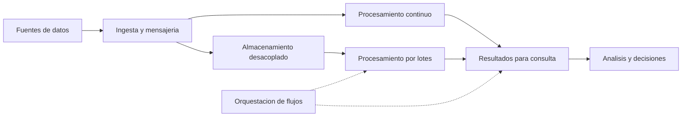
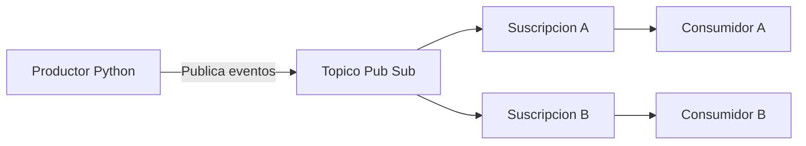

# Clase 4: Arquitectura cloud para big data: almacenamiento, procesamiento y mensajería

> **Objetivo académico:** Analizar la separación entre almacenamiento y cómputo en arquitecturas cloud para big data, distinguir los modelos de procesamiento y relacionarlos con experiencias de publicación y consumo de mensajes, criterios de seguridad y decisiones de diseño.

## 1. Contexto y marco conceptual

La sesión articula dos planos: las experiencias técnicas con mensajería de Google Cloud Pub/Sub y una revisión de los fundamentos de almacenamiento y procesamiento de big data en la nube. La conexión central es que producir o recibir datos constituye solo una parte del sistema: también deben resolverse su persistencia, transformación, acceso, seguridad y aprovechamiento para decisiones.

Big data designa conjuntos de datos cuyo volumen, velocidad o complejidad dificultan su procesamiento eficiente mediante los recursos y procedimientos tradicionales disponibles. No equivale únicamente a disponer de muchos registros: el problema surge de la relación entre las características de los datos, las capacidades de la infraestructura y los tiempos de respuesta requeridos.

### Las cinco V como dimensiones de diseño

| Dimensión | Significado | Implicación arquitectónica |
| --- | --- | --- |
| Volumen | Cantidad de datos acumulados y en crecimiento. | Dimensionar almacenamiento y capacidad de procesamiento. |
| Velocidad | Ritmo de generación, llegada y procesamiento. | Ajustar la ingestión y el análisis a la oportunidad de la decisión. |
| Variedad | Diversidad de estructuras, formatos y fuentes. | Admitir datos estructurados, semiestructurados y no estructurados. |
| Veracidad | Calidad y fiabilidad de los datos. | Incorporar controles a lo largo del flujo, desde la captura hasta el consumo. |
| Valor | Capacidad de convertir datos en información útil. | Vincular la arquitectura con decisiones, necesidades y resultados verificables. |

La variedad incluye registros operacionales, documentos JSON, logs, imágenes, videos y otras fuentes que no comparten necesariamente una estructura tabular. No se reduce a presentar un mismo reporte en distintos formatos.

La sesión propone dos perspectivas del valor: para la organización, la contribución a sus ingresos; para las personas, la resolución de problemas y la mejora de su calidad de vida. Son perspectivas orientadoras, no definiciones universales.

**Enriquecimiento conceptual:** El valor organizacional también puede expresarse mediante reducción de costes, disminución de riesgos o continuidad del servicio. La utilidad de los datos depende del contexto: un reporte correcto que llega después del momento de decisión puede aportar poco valor operativo.

La nube aparece como una alternativa ante el coste, la rigidez y la complejidad de administrar infraestructura local. Su atractivo consiste en acceder a recursos elásticos y servicios gestionados, con menor necesidad de operar directamente determinados componentes. Esta conveniencia debe evaluarse según la carga de trabajo y las capacidades de la organización.

## 2. Fundamentos teóricos y arquitectura

### Separación de almacenamiento y cómputo

Un problema destacado es el acoplamiento entre la capacidad de almacenar datos y la capacidad de procesarlos. Cuando ambos recursos dependen de los mismos equipos, ampliar uno puede exigir adquirir también el otro, aunque no sea necesario.

La separación por capas permite conservar los datos en un servicio de almacenamiento y asignar recursos de procesamiento de acuerdo con la demanda. Así, el crecimiento del histórico no obliga a mantener permanentemente una capacidad de cómputo equivalente a la necesaria para los periodos de mayor actividad.

El diagrama integra las relaciones discutidas: la ingesta recibe datos; el almacenamiento conserva información; el cómputo transforma datos; y la orquestación coordina dependencias. Es un esquema conceptual, no una implementación desplegada ni una exigencia de utilizar todas las rutas simultáneamente.

**Enriquecimiento conceptual:** El desacoplamiento introduce también dependencias de red y posibles costes de transferencia. Escalar cada capa de forma independiente exige considerar el movimiento de datos, la concurrencia y los límites del servicio. La expresión «escalabilidad ilimitada» debe interpretarse como una capacidad amplia de crecimiento, sujeta a cuotas, presupuesto y restricciones técnicas.

### Almacenamiento de objetos y data lakes

La sesión relaciona el almacenamiento de objetos con los data lakes, especialmente para logs, imágenes, videos y archivos. Destaca el enfoque *schema-on-read*: la estructura necesaria para interpretar los datos se aplica al consultarlos, en lugar de exigir una única estructura rígida para toda la información al ingresar.

**Enriquecimiento conceptual:** Un data lake es una organización de datos y capacidades de acceso; el almacenamiento de objetos puede ser su soporte. Ambos términos no son sinónimos. Un data lake también puede contener datos estructurados. Además, *schema-on-read* no elimina la necesidad de metadatos, controles de calidad o conocimiento del formato: desplaza parte de la interpretación hacia el consumo.

### Bases de datos NoSQL

Las bases NoSQL se presentan como alternativas para cargas que requieren flexibilidad de esquema, distribución y manejo de datos diversos. La sesión menciona modelos de clave-valor, documentales, columnares y de grafos.

| Modelo | Organización conceptual | Criterio de selección |
| --- | --- | --- |
| Clave-valor | Asociación entre una clave y un valor. | Acceso predominante mediante identificadores conocidos. |
| Documental | Documentos con campos y estructuras anidadas. | Recuperación de entidades y flexibilidad de sus atributos. |
| Familias de columnas | Datos organizados mediante claves y agrupaciones de columnas. | Patrones de acceso y distribución previstos. |
| Grafos | Nodos y relaciones. | Navegación y análisis de conexiones entre entidades. |

**Enriquecimiento conceptual:** La distinción entre familias de columnas y almacenamiento columnar analítico evita reunir bajo una sola etiqueta tecnologías con propósitos diferentes. Tampoco puede afirmarse que NoSQL sea siempre más rápido que SQL: el rendimiento depende del modelo, las consultas, los índices, la distribución y las garantías requeridas.

### Procesamiento por lotes y streaming

| Aspecto | Por lotes | Streaming |
| --- | --- | --- |
| Unidad de trabajo | Conjunto delimitado de datos. | Flujo de eventos que continúa llegando. |
| Ejecución | Tiene un alcance de datos y una finalización identificables. | Procesa de forma continua o incremental. |
| Oportunidad | Adecuado cuando puede esperarse a reunir y procesar datos. | Adecuado cuando se requiere reaccionar con baja latencia. |
| Ejemplo de la sesión | Informes diarios. | Detección de posibles fraudes en transacciones. |

La elección depende de cuánto puede esperar la decisión, de la complejidad del análisis y del coste operativo. Streaming no equivale automáticamente a tiempo real estricto.

**Enriquecimiento conceptual:** Si $L$ es la latencia transcurrida entre la ocurrencia de un evento y la disponibilidad de su resultado, medida en segundos, un requisito operativo puede expresarse como:

$$
L \leq L_{\max}
$$

Aquí, $L_{\max} > 0$ es la latencia máxima admisible, también en segundos, definida por el caso de uso. La expresión supone que ambos tiempos se miden con un criterio consistente. Permite traducir «información oportuna» a una condición verificable, pero no determina por sí sola la tecnología ni garantiza su cumplimiento bajo fallos o sobrecarga. La sesión no aporta un valor numérico para este límite.

En el intercambio sobre el material introductorio se alude a la complejidad de Lambda y a una propuesta alternativa asociada a Jay Kreps. La transcripción no desarrolla sus componentes ni ofrece base suficiente para reconstruir una comparación detallada entre arquitecturas.

## 3. Implementación técnica y lógica de negocio

### Flujo de publicación y consumo en Pub/Sub

Las experiencias descritas comparten la siguiente secuencia técnica: preparar el entorno, configurar el proyecto y la identidad, crear un tópico, asociarle una suscripción, publicar mensajes y comprobar su recepción. Posteriormente se ejecuta un script Python que simula datos de sensores.

Un **tópico** identifica el recurso al que se publican mensajes. Una **suscripción** vincula el consumo con ese tópico. El productor y el consumidor pueden ejecutarse en entornos diferentes.

**Enriquecimiento conceptual:** Suscripciones distintas permiten que consumidores diferentes mantengan estados de consumo separados. Varios consumidores que comparten una misma suscripción pueden distribuirse el trabajo; esto es distinto de entregar cada mensaje a cada consumidor mediante suscripciones independientes.

La publicación de prueba devolvió un identificador de mensaje, mientras que la comprobación posterior permitió observar datos recibidos por una suscripción. Son evidencias de etapas diferentes: aceptar una publicación no demuestra, por sí solo, que un consumidor haya terminado de procesarla.

### Tres entornos de ejecución

| Modalidad | Componentes descritos | Alcance de la experiencia |
| --- | --- | --- |
| Máquina virtual en Google Cloud | Instancia, acceso SSH, Git, repositorio, Python y configuración de acceso a servicios. | Productor o consumidor ejecutado en infraestructura remota y conectado al servicio cloud. |
| Máquina local conectada a Google Cloud | Google Cloud CLI, autenticación, proyecto configurado y script local. | Publicación desde el equipo personal hacia Pub/Sub remoto; lectura mediante Cloud Shell. |
| Emulador local de Pub/Sub | SDK, emulador, Python, biblioteca cliente y variables de entorno. | Publicación y recepción dentro de un entorno local de emulación. |

La ejecución local conectada al servicio remoto y la emulación local representan situaciones distintas. En el primer caso, el destino sigue siendo Google Cloud; en el segundo, la biblioteca se dirige al servidor emulado.

Cloud Shell se utilizó como terminal de consumo con herramientas disponibles para interactuar con los recursos del proyecto seleccionado. No debe confundirse con el acceso SSH a una instancia de Compute Engine creada para el flujo.

### Configuración del proyecto y del tópico

En las experiencias se configuró el identificador del proyecto mediante variables de entorno y ajustes de la CLI. El propósito era evitar que los comandos o el script operaran sobre recursos de otro proyecto.

También fue necesario modificar el nombre del tópico incorporado en el script de sensores para que coincidiera con el recurso creado. La discrepancia entre el nombre esperado por el código y el recurso real constituye un fallo de configuración, aunque la conectividad y las credenciales sean correctas.

**Enriquecimiento conceptual:** El proyecto activo de la CLI y las credenciales utilizadas por una biblioteca cliente no deben suponerse idénticos. Conviene verificar por separado el proyecto de destino, la identidad efectiva y el mecanismo de autenticación de cada proceso. Parametrizar el proyecto y el tópico mediante argumentos o variables evita modificar el código fuente para cada entorno.

La transcripción no incluye el contenido literal completo de los comandos ni del script. Por ello, se conserva la secuencia y su lógica sin reconstruir código como si hubiera sido mostrado íntegramente.

### Autorización y acceso desde máquinas virtuales

Se describieron errores al crear tópicos y suscripciones. Algunas personas los resolvieron ampliando permisos; otra identificó restricciones en la configuración de acceso a APIs de la instancia y modificó esa configuración con la máquina detenida.

**Enriquecimiento conceptual:** Estas observaciones deben distinguir cuatro planos:

- **Autenticación:** determina qué identidad presenta el proceso.
- **Autorización IAM:** establece qué acciones puede realizar esa identidad sobre los recursos.
- **Habilitación del servicio:** permite utilizar la API correspondiente en el proyecto.
- **Ámbitos de acceso de la instancia:** pueden restringir llamadas realizadas con las credenciales asociadas a la máquina virtual.

Modificar ámbitos de acceso no concede por sí mismo roles IAM, y habilitar una API tampoco otorga permisos sobre sus recursos. La solución debe corresponder al error observado. El uso de permisos de propietario o administrador puede desbloquear una prueba, pero concede capacidades más amplias que las necesarias para publicar o consumir mensajes.

## 4. Análisis crítico de casos y auditoría práctica

### Mensajes publicados antes de crear la suscripción

Una experiencia mostró que, después de publicar un mensaje y crear posteriormente la suscripción, la lectura no devolvía ese mensaje. Al publicar de nuevo con la suscripción ya existente, la recepción fue posible.

La observación permite distinguir un tópico de una suscripción preparada para recibir eventos. No debe suponerse que crear una suscripción reconstruye automáticamente todo el historial anterior.

**Enriquecimiento conceptual:** Las posibilidades de recuperar mensajes anteriores dependen de mecanismos de retención y reproducción configurados en el servicio. La experiencia descrita no documenta tales mecanismos; por ello, no sustenta una prohibición absoluta de recuperar mensajes históricos. Para comprobar el flujo básico, crear primero la suscripción y publicar después elimina esta ambigüedad temporal.

### Compatibilidad de dependencias

Otra experiencia reportó que una versión anterior de una dependencia permitió ejecutar un script que fallaba con una versión más reciente. La biblioteca exacta y su versión no quedan identificadas de manera fiable.

**Enriquecimiento conceptual:** Reducir una versión puede confirmar un problema de compatibilidad, pero no constituye una solución general. La revisión debe identificar la API modificada, documentar las dependencias y determinar si conviene adaptar el código o fijar temporalmente una versión compatible. No hay evidencia para recomendar un número de versión concreto.

### Ejecución local, permisos y costes

La alternativa con CLI local evitó administrar una máquina virtual adicional. Sin embargo, el hecho de ejecutar el productor en un equipo personal no elimina las políticas del servicio remoto.

**Enriquecimiento conceptual:** La autenticación, la autorización y los requisitos de facturación del proyecto siguen siendo aplicables al uso cloud. Del mismo modo, detener una máquina virtual no garantiza un coste total nulo: pueden persistir discos, almacenamiento u otros recursos facturables. El control económico requiere revisar los recursos y servicios efectivamente utilizados, además de detener procesos.

La emulación local permitió observar envío y recepción sin depender de una instancia cloud para esa interacción. Su alcance es la validación funcional local.

**Enriquecimiento conceptual:** Un emulador no certifica comportamiento de producción, políticas IAM, escalabilidad ni condiciones reales de facturación. Es útil para aislar la lógica de mensajería, pero sus resultados deben interpretarse dentro de ese alcance.

### Caso técnico: comercio electrónico de ropa y accesorios

El caso Fashion Cantuta describe una empresa con operación nacional, crecimiento de datos procedentes de múltiples fuentes y limitaciones de infraestructura local. Sus necesidades incluyen almacenamiento y procesamiento eficientes, escalabilidad, seguridad, información oportuna, mejora de la experiencia del cliente y optimización operativa.

La transcripción no enumera de forma completa las fuentes ni los cuatro problemas específicos mencionados. Tampoco presenta una arquitectura final validada o una comparación cuantitativa entre proveedores.

Aun con ese límite, el caso permite establecer criterios de análisis:

| Necesidad | Revisión arquitectónica pertinente |
| --- | --- |
| Aumento de datos | Capacidad de almacenamiento y crecimiento independiente del cómputo. |
| Información oportuna | Latencia requerida y elección entre lotes, streaming o coexistencia de ambos. |
| Diversidad de fuentes | Formatos, modelos de datos y mecanismos de integración. |
| Seguridad | Identidades, permisos y restricciones de acceso. |
| Coste sostenible | Consumo de recursos y adecuación del servicio a la carga. |
| Integración de herramientas | Compatibilidad entre componentes y capacidades técnicas del equipo. |

**Enriquecimiento conceptual:** Compartir proveedor puede simplificar ciertas integraciones, pero no garantiza una arquitectura coherente. Deben verificarse interfaces, formatos, identidades, ubicación de recursos y límites operativos. Una lista de productos no explica cómo circulan los datos ni cómo se recupera el sistema ante un fallo.

## 5. Principios de diseño, buenas prácticas y anti-patrones

### Seleccionar servicios según la carga

La sesión identifica escalabilidad, rendimiento, seguridad, coste y experiencia del equipo como factores de selección. La disponibilidad de un producto no demuestra que sea necesario: el servicio debe resolver un requisito concreto.

**Enriquecimiento conceptual:** La elasticidad es la capacidad de ajustar recursos a variaciones de demanda; la escalabilidad expresa la capacidad de aumentar el trabajo soportado al ampliar recursos. Una arquitectura puede escalar sin hacerlo automáticamente. Los servicios serverless reducen tareas de administración, pero mantienen límites y necesidades de configuración y observación.

### Diferenciar almacenamiento y modelo de acceso

El almacenamiento de objetos favorece la conservación flexible de archivos y grandes conjuntos de datos. Una base NoSQL responde a patrones de acceso propios de su modelo. No deben tratarse como sustitutos universales.

En la discusión se destacó que un uso intensivo de relaciones podía perjudicar determinadas soluciones documentales. Esto orienta a revisar el modelo según las consultas predominantes.

**Enriquecimiento conceptual:** Evitar relaciones en toda base NoSQL sería una generalización incorrecta, especialmente en modelos de grafos. La decisión consiste en determinar dónde se resuelven las relaciones, con qué frecuencia y a qué coste, y qué garantías de consistencia necesita la aplicación.

### Distinguir herramientas de procesamiento y coordinación

La sesión menciona Hadoop como referencia del procesamiento distribuido, Spark como motor para distintas cargas y ETL como proceso de extracción, transformación y carga previo al análisis.

**Enriquecimiento conceptual:** Hadoop es un ecosistema con componentes de almacenamiento y procesamiento. Spark es un motor de procesamiento distribuido. ETL es un patrón de preparación de datos, no una herramienta equivalente a los anteriores. Distribuir una operación tampoco asegura aceleración: la coordinación y la transferencia de datos pueden dominar el tiempo de ejecución en cargas pequeñas.

La orquestación coordina flujos complejos y dependencias entre servicios. Los contenedores empaquetan aplicaciones y dependencias para facilitar su ejecución portable y aislada. Airflow y Kubernetes aparecen como referencias de coordinación.

**Enriquecimiento conceptual:** Airflow coordina flujos de tareas; Kubernetes administra cargas contenerizadas. Pueden complementarse, pero actúan sobre niveles diferentes. El empaquetado en contenedores mejora la reproducibilidad del entorno, aunque no garantiza por sí solo un flujo de datos correcto o resiliente.

### Antipatrones identificados

| Antipatrón | Problema que introduce | Orientación de diseño |
| --- | --- | --- |
| Conceder permisos administrativos ante cualquier error | Amplía innecesariamente las capacidades de la identidad. | Diagnosticar el plano del fallo y aplicar mínimo privilegio. |
| Incrustar proyecto y tópico en el código | Facilita errores al cambiar de entorno. | Separar configuración y lógica del productor. |
| Publicar antes de preparar el consumo y asumir recuperación histórica | Confunde disponibilidad actual con retención del pasado. | Verificar orden de creación y políticas de retención. |
| Suponer que NoSQL siempre ofrece mayor velocidad | Omite el patrón de consulta y el modelo de datos. | Evaluar la carga y las garantías necesarias. |
| Equiparar emulación con validación cloud completa | Extrapola resultados locales a condiciones no observadas. | Delimitar el alcance de cada entorno. |
| Asumir que la nube siempre reduce costes | Omite consumo persistente y costes operativos. | Revisar el conjunto de recursos utilizados. |
| Confundir redundancia con protección completa | Deja sin considerar errores lógicos o eliminación de datos. | Distinguir objetivos de durabilidad y recuperación. |

**Enriquecimiento conceptual:** La redundancia reduce determinados riesgos de pérdida por fallos físicos, pero no reemplaza por sí sola políticas de recuperación o conservación de versiones. Asimismo, la fiabilidad del almacenamiento no convierte automáticamente datos incorrectos en datos veraces.

## 6. Síntesis conceptual y profundización académica

La arquitectura cloud para big data integra decisiones sobre características de los datos, oportunidad del análisis y operación de los servicios. Las cinco V ayudan a describir el problema; la separación entre almacenamiento y cómputo permite ajustar capacidades; y los modelos por lotes y streaming responden a necesidades temporales diferentes.

Las experiencias con Pub/Sub muestran que un flujo de datos depende de condiciones concretas: proyecto correcto, identidad efectiva, acceso autorizado, nombres de recursos coherentes y una suscripción preparada para recibir los mensajes. La ejecución en una máquina virtual, la conexión desde un equipo local y la emulación local ofrecen entornos distintos para estudiar ese flujo.

La selección de tecnologías requiere justificar sus relaciones. Hadoop, Spark, ETL, almacenamiento de objetos, NoSQL, herramientas de orquestación y contenedores no ocupan el mismo nivel conceptual ni resuelven el mismo problema. Su combinación debe derivarse de las necesidades del sistema.

**Enriquecimiento conceptual:** La relación entre corrección funcional y adecuación arquitectónica ofrece una línea central de profundización. Recibir un mensaje demuestra una interacción concreta, mientras que sostener un servicio exige además comprender latencia, capacidad, recuperación, seguridad y coste. De forma análoga, almacenar todos los datos disponibles no garantiza producir información útil: el valor aparece cuando datos confiables y oportunos respaldan decisiones pertinentes.

La evidencia de esta sesión permite formular criterios de diseño y revisar experiencias técnicas, pero no establecer un proveedor ganador, una capacidad máxima ni resultados de rendimiento. Esas conclusiones requerirían cargas caracterizadas, requisitos explícitos y mediciones que no están presentes en la fuente.
