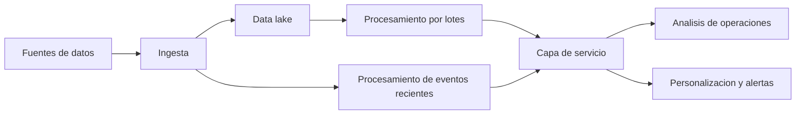
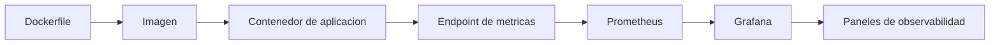

# Clase 5: Diseño de arquitecturas Big Data en la nube, validación y observabilidad

> **Objetivo académico:** Relacionar el diagnóstico de necesidades de datos con el diseño de una arquitectura cloud de almacenamiento y procesamiento, evaluar sus supuestos de validación y comprender la función de los contenedores, Kubernetes y la observabilidad en la operación de sistemas distribuidos.

## 1. Contexto y marco conceptual

### Del problema de negocio a la decisión tecnológica

La sesión desarrolla un caso de comercio electrónico de ropa y accesorios, denominado Fashion Cantuta, para analizar cómo justificar y estructurar una arquitectura Big Data en la nube. El problema central es el procesamiento lento y desactualizado de datos, con efectos sobre la gestión de operaciones y la experiencia del cliente. La propuesta es arquitectónica y teórica: no se presenta una implementación desplegada ni evidencia experimental de mejoras.

La adopción de Big Data debe responder a necesidades identificables. La sesión destaca cuatro condiciones: necesidad de análisis más profundos, oportunidad de procesamiento cercana al momento de generación, diversidad de formatos y un volumen que la infraestructura disponible no pueda gestionar eficientemente. La tecnología adquiere sentido cuando resuelve una restricción concreta y produce valor para el negocio.

Las principales fuentes consideradas son:

| Fuente | Datos representativos | Utilidad potencial |
|---|---|---|
| Sitio web y aplicación | Visitas, clics, búsquedas, pedidos, perfiles e historial de compras | Comprender navegación, preferencias y conversión |
| Redes sociales | Comentarios, mensajes, fotografías y videos | Analizar percepción y contenido generado por clientes |
| Operaciones | Inventario, proveedores, estados de pedidos y seguimiento de envíos | Coordinar existencias, abastecimiento y logística |
| Infraestructura tecnológica | Registros de errores, rendimiento y seguridad | Detectar fallos y analizar comportamiento del sistema |

La combinación de estas fuentes permite ampliar la visión del cliente y de las operaciones. Sin integración, una empresa puede conocer las compras realizadas y desconocer las búsquedas abandonadas, los comentarios o las dificultades de navegación que precedieron a esas compras.

### Lentitud, desactualización y disponibilidad

El procesamiento lento describe el tiempo requerido para transformar datos en resultados utilizables. La desactualización describe la antigüedad de la información que sustenta una decisión. Son dimensiones relacionadas, pero diferentes: una consulta rápida sobre datos cargados el día anterior puede devolver información desactualizada.

La alta disponibilidad tampoco garantiza rapidez analítica. Mantener un servicio accesible evita interrupciones, mientras que acelerar consultas masivas exige revisar particionamiento, paralelismo, algoritmos y recursos de cómputo.

**Enriquecimiento conceptual:** La utilidad temporal depende del caso de uso. Una alerta de fraude necesita llegar antes de que la intervención pierda efecto; un análisis histórico puede admitir una actualización diaria. Por ello, «tiempo real» debe traducirse en una latencia objetivo y una frontera de medición, en lugar de utilizarse como una propiedad genérica.

### Coherencia de una propuesta de investigación

La sesión relaciona título, formulación del problema y objetivo general. El título delimita la propuesta, el problema expresa la dificultad que se pretende resolver y el objetivo declara la acción que se realizará sobre ella. La correspondencia conceptual entre estos elementos es más importante que su redacción aislada.

En el caso se propone diseñar una arquitectura Big Data cloud para mejorar el procesamiento de datos en operaciones y experiencia del cliente. Los objetivos específicos recorren cuatro movimientos: diagnosticar las restricciones actuales, evaluar servicios cloud, diseñar una arquitectura de referencia y explicar su contribución a los problemas identificados.

Se discute si el objetivo general explicita suficientemente el qué, el para qué y el cómo, así como el objeto de estudio y el campo de acción. La identificación inicial de la arquitectura como objeto de estudio es cuestionada porque no queda clara su relación con un campo de acción más acotado. El intercambio no concluye con una formulación definitiva.

**Enriquecimiento conceptual:** Conviene distinguir el fenómeno investigado, el ámbito delimitado donde se observa y el artefacto diseñado para intervenir sobre él. Una arquitectura propuesta no debe confundirse automáticamente con el objeto de estudio. Asimismo, una mejora declarada requiere indicadores y evidencia: la coherencia verbal entre título y objetivo no demuestra efectividad.

## 2. Fundamentos teóricos y arquitectura

### Las cinco V como marco de diagnóstico

Las cinco V organizan la relación entre características de los datos, restricciones técnicas y resultados esperados. Su función es orientar decisiones, sin constituir por sí mismas una prueba de que una solución distribuida sea necesaria.

| Dimensión | Definición | Indicadores pertinentes | Consecuencia arquitectónica posible |
|---|---|---|---|
| Volumen | Cantidad de datos almacenados y generados | Bytes acumulados, registros y crecimiento por período | Almacenamiento escalable, particionamiento y procesamiento distribuido |
| Velocidad | Ritmo de generación y urgencia de procesamiento | Eventos por segundo y latencia de resultados | Ingesta continua y procesamiento de flujos |
| Variedad | Diversidad de fuentes, estructuras y formatos | Inventario de fuentes y formatos | Integración flexible y almacenamiento de datos heterogéneos |
| Veracidad | Calidad, consistencia y fiabilidad | Nulos, duplicados, formatos inválidos e inconsistencias | Validación, normalización y control de calidad |
| Valor | Beneficio obtenido mediante el uso de datos | Reducción de pérdidas, eficiencia, ingresos y satisfacción | Priorización de casos de uso y evaluación de beneficios |

La velocidad combina dos mediciones diferentes: la tasa de llegada indica cuántos eventos ingresan por unidad de tiempo, mientras que la latencia indica cuánto tarda un evento o una consulta en producir un resultado. Un sistema puede sostener una alta tasa de procesamiento y, aun así, acumular retraso.

El valor conecta las otras dimensiones con las necesidades de la organización. Almacenar más datos o procesarlos más rápido solo justifica su costo si permite decisiones o servicios útiles. La sesión vincula este valor con la reducción del fraude, la personalización y la eficiencia operativa.

### Data lake y data warehouse

El data lake se presenta como un repositorio que conserva datos de diversos tipos, incluidos sus formatos originales, para permitir usos analíticos posteriores. El data warehouse organiza datos preparados y estructurados para consulta y análisis de negocio. Una relación posible consiste en ingerir datos al lake, transformarlos y publicar conjuntos depurados en el warehouse.

**Enriquecimiento conceptual:** Un data lake es una arquitectura de almacenamiento y gestión; un servicio de objetos puede constituir su base, pero no aporta por sí solo catálogo, calidad, trazabilidad o control de acceso. Tampoco equivale a ausencia de esquema: la interpretación posterior sigue necesitando estructura y significado.

Las afirmaciones de que las bases relacionales no pueden almacenar datos no estructurados deben entenderse como una simplificación. Muchas permiten objetos binarios o formatos semiestructurados. La decisión requiere evaluar eficiencia, consultas, costo y operación, además de la posibilidad de guardar el dato.

### Separación de almacenamiento y cómputo

La capa de almacenamiento conserva datos de manera persistente. La capa de procesamiento ejecuta limpieza, transformación, agregación, consultas y, cuando corresponde, algoritmos de aprendizaje automático. Separarlas permite ajustar capacidad y recursos de cómputo con cierta independencia.

Esta separación favorece cargas intermitentes: los datos permanecen disponibles aunque termine un proceso de transformación. No implica que todos los servicios puedan apagarse sin consecuencias; un flujo continuo o una aplicación con requisitos de respuesta permanente requiere recursos operativos disponibles.

**Enriquecimiento conceptual:** El almacenamiento cloud tiene cuotas, límites operativos y costos. Su elasticidad no debe describirse como capacidad literalmente ilimitada. Tampoco puede asegurarse una reducción de costos sin considerar acceso a datos, operaciones, transferencia, retención y cómputo.

### Patrones Lambda y Kappa

Lambda combina una ruta de procesamiento por lotes y una ruta de baja latencia. La primera calcula resultados sobre datos históricos; la segunda atiende eventos recientes. Una capa de servicio integra los resultados disponibles para las aplicaciones.

Kappa concentra el procesamiento en una ruta de streaming. Los resultados históricos pueden reconstruirse mediante reproducción de eventos retenidos, siempre que exista información suficiente y un mecanismo de reprocesamiento adecuado.

| Aspecto | Lambda | Kappa |
|---|---|---|
| Organización | Rutas batch y streaming | Una ruta lógica de procesamiento de eventos |
| Histórico | Reprocesamiento por lotes | Reproducción del historial de eventos |
| Ventaja principal | Adaptación a cargas históricas y urgentes diferentes | Menor duplicación de rutas de transformación |
| Dificultad principal | Consistencia y mantenimiento entre rutas | Retención, reconstrucción de estado y costo de reproducción |

**Enriquecimiento conceptual:** Ningún patrón garantiza precisión por su nombre. Los resultados dependen de reglas de transformación, calidad de datos y tratamiento de eventos tardíos, duplicados o fuera de orden. Kappa no obliga a releer siempre todo el historial: el alcance depende del resultado que se necesite reconstruir y del estado conservado.



El diagrama representa el patrón Lambda discutido. Expresa relaciones funcionales, sin completar servicios cloud que no quedaron identificados en la fuente.

## 3. Implementación técnica y lógica de negocio

### Diagnóstico cuantificado del caso

La exposición utiliza cifras ilustrativas para convertir problemas generales en indicadores. Se mencionan un histórico de 2.5 PB, un crecimiento anual de 1.5 PB, reportes de aproximadamente cuatro horas y detección de fraude después de 24 horas. También se introduce un 15 % de valores nulos en campos clave y una tasa de clic del 0.5 % para recomendaciones estáticas.

Estas cantidades son referencias del escenario, no resultados obtenidos mediante una medición documentada. Existe, además, una discrepancia entre PB y TB al volver a mencionar el volumen acumulado. Las estimaciones diarias por fuente tampoco se reconcilian con la proyección anual.

El procedimiento técnico que se describe comprende inventariar bases transaccionales, registros web y datos históricos; medir tiempos de consulta y detección; identificar formatos; revisar nulos, duplicados y consistencia; y relacionar las restricciones con consecuencias de negocio. No se muestran registros de ejecución ni resultados verificables de pruebas de carga.

**Enriquecimiento conceptual:** Para distinguir procesamiento y frescura pueden definirse:

$$
L = t_r - t_i
$$

Aquí $L \geq 0$ es la latencia de procesamiento, expresada en segundos; $t_i$ es el instante de ingreso del evento al sistema y $t_r$ el instante en que su resultado queda disponible. Los instantes deben usar una referencia temporal comparable. Esta definición no incluye demoras anteriores al ingreso.

$$
A = t_d - t_e
$$

Aquí $A \geq 0$ es la antigüedad del dato al utilizarse, en segundos; $t_e$ es el instante del evento y $t_d$ el instante de la decisión. La expresión supone que se conoce el evento relevante para esa decisión. En informes agregados debe definirse qué evento, ventana o marca temporal representa su frescura.

### Selección de plataforma cloud

La comparación considera escalabilidad, rendimiento o latencia, seguridad y optimización de costos. Cada criterio se vincula con una necesidad: absorber picos, acortar tiempos de análisis, proteger información sensible y reducir capacidad ociosa.

| Criterio | Aspectos propuestos para su evaluación | Precaución interpretativa |
|---|---|---|
| Escalabilidad | Respuesta a cargas elevadas y reducción posterior de recursos | La elasticidad depende del servicio y su configuración |
| Latencia | Ingesta y consultas; objetivo ilustrativo inferior a 500 ms por evento | Debe definirse si la medición es parcial o de extremo a extremo |
| Seguridad | Certificaciones, cifrado y capacidades nativas | La certificación del proveedor no sustituye la configuración del sistema |
| Costos | Comparación del costo total de propiedad durante tres años | El pago por uso no garantiza un menor costo total |

La exposición elige Google Cloud Platform mediante una comparación simplificada de ventajas y cumplimiento. La elección se sostiene en su oferta de servicios gestionados y automatización. No se proporciona una matriz completa reproducible, una ponderación ni mediciones que permitan afirmar superioridad general frente a otros proveedores.

### Correspondencia entre requisitos y servicios

La arquitectura seleccionada adopta Lambda y enfatiza almacenamiento y procesamiento:

| Necesidad | Componente mencionado | Función propuesta |
|---|---|---|
| Conservar datos heterogéneos | Google Cloud Storage | Base del data lake y almacenamiento en formato original |
| Procesar datos históricos | Google Cloud Dataproc | Ejecutar cargas de Spark o Hadoop en un entorno gestionado |
| Analizar eventos recientes | Ruta de streaming de Lambda | Atender detección oportuna de fraude y personalización |
| Disponibilizar resultados | Capa de servicio conceptual | Entregar resultados a aplicaciones y análisis de negocio |

La fuente no identifica inequívocamente el servicio de streaming ni todos los componentes de ingesta, consulta y servicio. La arquitectura debe leerse como una propuesta funcional parcial, sin completar esas ausencias por inferencia.

La lógica de negocio diferencia dos necesidades. El análisis histórico admite procesamiento por lotes para tendencias e informes consolidados. La detección de fraude y las recomendaciones durante la navegación requieren resultados oportunos, capaces de modificar una acción todavía en curso.

### Contenedores: Dockerfile, imagen y ejecución

La segunda parte aborda la estandarización del entorno de ejecución. Los contenedores permiten empaquetar aplicaciones y dependencias para reducir diferencias entre equipos y ambientes. La analogía con el transporte de mercancías enfatiza la estandarización de la unidad que se mueve y opera.

El proceso conceptual es:

1. El Dockerfile describe instrucciones para construir una imagen.
2. La imagen contiene los componentes necesarios para ejecutar una aplicación.
3. El contenedor es una instancia de ejecución creada a partir de una imagen.

La comparación con una clase y sus instancias ayuda a distinguir plantilla y ejecución. Una misma imagen puede originar varias instancias.

**Enriquecimiento conceptual:** La portabilidad depende de una plataforma compatible, arquitectura de CPU, configuración, permisos y dependencias externas. Los contenedores comparten el kernel del entorno anfitrión; no equivalen a máquinas virtuales con un sistema operativo completo independiente. Empaquetar bibliotecas reduce diferencias, pero no elimina incompatibilidades ni vulnerabilidades.

Docker Compose describe aplicaciones con varios servicios, por ejemplo frontend, backend, base de datos y proxy. Permite declarar imágenes o construcciones, redes, volúmenes y relaciones de configuración. Su función no debe confundirse con la programación de cargas sobre un clúster distribuido.

### Kubernetes y organización del clúster

Kubernetes se introduce como plataforma de código abierto para automatizar despliegue, escalado y gestión de aplicaciones en contenedores. La sesión distingue el plano de control y los nodos trabajadores.

En el modelo presentado, un clúster agrupa nodos; los nodos alojan pods y los pods contienen uno o varios contenedores. El plano de control coordina el sistema y los trabajadores ejecutan cargas.

**Enriquecimiento conceptual:** Esta jerarquía corresponde a Kubernetes y no a todos los clústeres Big Data. En términos generales, un clúster es un conjunto coordinado de recursos. En Kubernetes, el pod es la unidad mínima de despliegue; varios contenedores de un mismo pod comparten contexto de red y pueden compartir volúmenes. El plano de control puede distribuirse entre varios nodos para mejorar su disponibilidad.

### Prometheus y Grafana

La sesión describe una aplicación Python que expone métricas sintéticas, entre ellas un contador denominado de forma aproximada `http_requests_total`. Prometheus recopila métricas a intervalos regulares y Grafana consulta la fuente para construir paneles y facilitar su análisis.



Las flechas entre el endpoint y Prometheus expresan el flujo de datos: Prometheus inicia normalmente la consulta periódica. Grafana consulta Prometheus para visualizar los resultados. La transcripción no incluye el contenido completo de los archivos de aplicación o configuración, por lo que no corresponde reconstruir un despliegue como si hubiera sido mostrado íntegramente.

**Enriquecimiento conceptual:** Un contador de solicitudes acumula eventos; para observar actividad por segundo interesa su tasa de cambio. Una consulta ilustrativa en PromQL sería:

```promql
rate(http_requests_total[5m])
```

La expresión estima la tasa media por segundo de cada serie durante los últimos cinco minutos y contempla reinicios del contador. Supone que la métrica existe con ese nombre, es un contador y dispone de muestras suficientes. El resultado se expresa en solicitudes por segundo; no es el total acumulado ni una medida de latencia.

## 4. Análisis crítico de casos y auditoría práctica

### Reconstrucción causal del problema

La exposición relaciona una infraestructura monolítica local, ausencia de capacidades de streaming y gestión ineficiente de datos heterogéneos con decisiones lentas, pérdidas por fraude, personalización limitada y dificultad para escalar.

**Enriquecimiento conceptual:** Estas relaciones constituyen hipótesis de diagnóstico. Una infraestructura local no es necesariamente monolítica, y un sistema monolítico no es necesariamente incapaz de procesar a tiempo. Para sostener la relación causal se necesitan mediciones de recursos, consultas, esperas, acceso a almacenamiento y procesos organizacionales.

La auditoría debe separar síntomas y causas. Un informe tardío puede deberse al tiempo de consulta, a una carga programada con poca frecuencia o a una validación manual posterior. Migrar el cómputo sin identificar la demora dominante puede conservar el problema.

### Fiabilidad de los datos de referencia

Las cifras utilizadas no forman una línea base experimental coherente y documentada. Además de la discrepancia PB/TB, la clasificación porcentual de formatos distribuye los datos entre estructurados y semiestructurados, aunque el mismo caso incluye imágenes, videos y texto libre. Por ello, no debe interpretarse como un inventario completo.

La exposición también incluye cifras de empresas y tendencias de mercado sin referencias verificables disponibles en la transcripción. Sirven para comprender la estrategia argumentativa de contextualización, pero no se adoptan como evidencia empírica de estos apuntes.

**Enriquecimiento conceptual:** Una auditoría de volumen debe diferenciar datos diarios, histórico acumulado, copias, réplicas y derivados. Sin esta separación, pueden compararse magnitudes incompatibles o sobredimensionarse los recursos.

### Validar el diseño y validar los efectos

La discusión distingue dos niveles:

- **Validación de la propuesta:** revisión por expertos para evaluar coherencia, viabilidad y adecuación a los requisitos.
- **Validación de resultados:** observación de si la solución cambia los indicadores relevantes bajo condiciones comparables.

La revisión de expertos puede detectar decisiones insuficientes o supuestos incorrectos. Su alcance no equivale a demostrar una reducción de latencia, costo o pérdidas: esas conclusiones requieren evidencia del funcionamiento y, para efectos de negocio, una comparación que controle explicaciones alternativas.

El debate resalta el problema de comparar períodos diferentes. Un sistema observado durante Black Friday enfrenta patrones de tráfico, mezcla de productos y comportamiento de clientes distintos de un período ordinario. Igualar únicamente la cantidad de registros no garantiza equivalencia.

**Enriquecimiento conceptual:** La evaluación debe distinguir rendimiento técnico y efecto de negocio. Para rendimiento puede reproducirse una carga fijada en ambos sistemas, manteniendo datos, distribución de eventos, consultas y condiciones relevantes. Para ventas o fraude, la reproducción técnica no demuestra por sí sola el efecto sobre decisiones reales; se necesita un diseño de comparación adecuado al contexto.

Un protocolo técnico puede precisar:

1. La línea base, la alternativa y el indicador que se compara.
2. El conjunto de datos y sus características, incluidos formatos, tamaños y claves.
3. El patrón de llegada, concurrencia, consultas y picos de carga.
4. Los recursos disponibles y el criterio de comparación, por ejemplo igual presupuesto o igual latencia objetivo.
5. Las condiciones de caché, calentamiento y repetición de mediciones.
6. Los límites de generalización y las fuentes de variabilidad que persisten.

**Enriquecimiento conceptual:** Una medida relativa de reducción de latencia es:

$$
R_L = \frac{L_0 - L_1}{L_0} \times 100\%
$$

Aquí $L_0 > 0$ es la latencia de referencia y $L_1 \geq 0$ la latencia de la alternativa, ambas en la misma unidad y obtenidas mediante la misma definición estadística y condiciones comparables. Un valor positivo indica reducción; uno negativo, aumento. La expresión no prueba causalidad y no debe mezclar, por ejemplo, una media con un percentil.

Para evaluar detección de fraude no basta con medir rapidez: también importan falsos positivos y fraudes no detectados. En recomendaciones, una tasa de clic no equivale a conversión de compra. La primera describe interacción con una recomendación; la segunda requiere definir qué acción comercial se considera conversión.

### Auditoría de observabilidad

El ejemplo de métricas sintéticas permite comprender el recorrido aplicación–Prometheus–Grafana, pero no representa evidencia del rendimiento de un sistema real. Un panel muestra lo instrumentado y disponible; no demuestra por sí mismo corrección del servicio.

**Enriquecimiento conceptual:** Prometheus se orienta a métricas y series temporales. Los registros textuales de eventos requieren mecanismos específicos de logging; no deben confundirse con los contadores o indicadores numéricos consultados en los paneles.

## 5. Principios de diseño, buenas prácticas y anti-patrones

### Trazabilidad entre necesidad, decisión y evidencia

Una decisión arquitectónica debe poder relacionarse con un problema y un criterio de evaluación. En este caso: la heterogeneidad justifica revisar almacenamiento e integración; la antigüedad de la información orienta la frecuencia de actualización; la oportunidad de una intervención determina la latencia; y la variabilidad de carga orienta el escalado.

| Buena práctica | Fundamento | Anti-patrón asociado |
|---|---|---|
| Definir indicadores antes de elegir servicios | Permite evaluar si la solución atiende el problema | Adoptar una plataforma por popularidad |
| Separar datos ilustrativos de mediciones | Preserva la validez de las conclusiones | Presentar supuestos como resultados observados |
| Comparar proveedores con cargas y criterios explícitos | Hace revisable la selección | Generalizar superioridad desde una tabla incompleta |
| Diseñar calidad y gobierno junto al almacenamiento | Conserva significado, fiabilidad y acceso controlado | Acumular archivos sin catálogo ni trazabilidad |
| Evaluar latencia y calidad del resultado | Evita acelerar decisiones incorrectas | Optimizar únicamente tiempo de respuesta |
| Utilizar condiciones comparables | Reduce explicaciones alternativas | Comparar períodos con distinta estacionalidad sin control |
| Instrumentar indicadores relevantes | Vincula operación con necesidades del servicio | Construir paneles sin preguntas operativas claras |

### Escalamiento y tolerancia a fallos

El escalamiento vertical aumenta la capacidad de un recurso; el horizontal incorpora recursos adicionales. La sesión vincula la distribución con mayor disponibilidad y continuidad ante fallos.

**Enriquecimiento conceptual:** Agregar nodos no genera tolerancia a fallos automáticamente. Se necesitan mecanismos de replicación, recuperación, redistribución de carga y manejo del estado. Del mismo modo, una consulta solo se acelera mediante más recursos si su ejecución puede distribuirse y la coordinación no domina el tiempo total.

La contenerización y el escalamiento también resuelven problemas distintos. Un contenedor estandariza la ejecución; Kubernetes coordina cargas. La aplicación y los datos deben permitir repartir trabajo y recuperar estado. Replicar componentes sin diseñar persistencia o consistencia puede generar errores en lugar de disponibilidad.

### Seguridad y costos como propiedades del diseño

La seguridad debe contemplar datos de clientes y transacciones. La sesión menciona certificaciones y cifrado como criterios de selección.

**Enriquecimiento conceptual:** El diseño debe añadir controles de identidad, privilegios mínimos, gestión de secretos y separación de entornos. Las capacidades del proveedor requieren configuración y responsabilidades operativas concretas.

La separación de almacenamiento y cómputo puede reducir recursos ociosos. Sin embargo, el costo total también incluye almacenamiento persistente, transferencias, operaciones, observabilidad y mantenimiento. Los servicios gestionados reducen ciertas tareas de infraestructura, pero conservan responsabilidades de configuración, supervisión y control del gasto.

### Reproducibilidad y operación

**Enriquecimiento conceptual:** Para contenerización y observabilidad conviene fijar versiones de imágenes, separar configuración y secretos del artefacto, conservar datos persistentes fuera del ciclo de vida del contenedor y definir etiquetas de métricas con cardinalidad controlada. Identificadores individuales de usuarios o transacciones como etiquetas pueden multiplicar las series y elevar costos de almacenamiento y consulta.

En Lambda, mantener definiciones compartidas entre batch y streaming reduce discrepancias. La decisión de adoptar dos rutas debe justificarse por necesidades diferentes, pues introduce costos adicionales de desarrollo, reconciliación y operación.

## 6. Síntesis conceptual y profundización académica

La clase presenta una cadena de razonamiento que parte del problema de negocio, organiza el diagnóstico mediante las cinco V, compara plataformas y propone una arquitectura cloud. La calidad de esa cadena depende de la trazabilidad entre restricciones, decisiones y evidencia.

La solución ilustrativa selecciona GCP, Google Cloud Storage y Dataproc dentro de un patrón Lambda. Su alcance es de diseño: la sesión no demuestra mejoras de rendimiento ni especifica todos los servicios necesarios para materializar la arquitectura. La elección conserva valor como ejemplo de razonamiento arquitectónico, siempre que se mantenga explícita esa frontera.

El debate metodológico aporta una distinción central: una propuesta puede ser coherente y viable sin que sus efectos estén demostrados. La validación por expertos y la evaluación empírica responden a preguntas diferentes. Para comparar resultados se deben controlar las características de los datos, la carga, la temporalidad y las condiciones de operación.

La segunda parte conecta arquitectura con operación: Dockerfile, imagen y contenedor explican la estandarización de ejecución; Compose organiza servicios; Kubernetes coordina cargas distribuidas; Prometheus recopila métricas y Grafana facilita su interpretación. Cada herramienta ocupa un nivel distinto y ninguna sustituye la necesidad de diseñar correctamente el comportamiento de la aplicación y los datos.

**Enriquecimiento conceptual:** Las líneas de profundización derivadas de la sesión son el tratamiento de eventos tardíos y duplicados, la consistencia entre rutas de procesamiento, el gobierno del data lake, el diseño de comparaciones reproducibles y la relación entre indicadores técnicos y resultados de negocio. Estas conexiones permiten pasar de una arquitectura plausible a una solución evaluable y operable.
