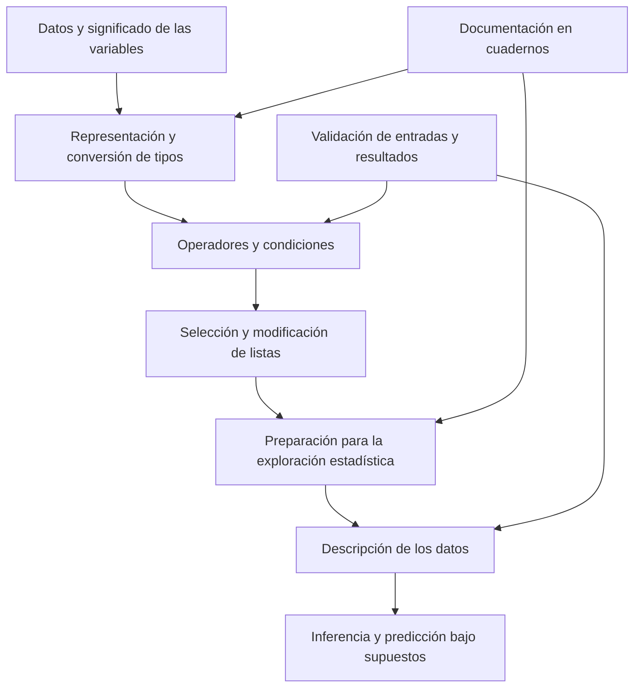

# Clase 2: Fundamentos de Python para el análisis estadístico: tipos, operadores, condicionales y listas

> **Objetivo académico:** Comprender y aplicar los tipos de datos, las conversiones, los operadores, el control condicional y las listas de Python como fundamentos para preparar datos y desarrollar análisis estadísticos reproducibles.

## 1. Contexto y marco conceptual

La sesión introduce las herramientas de programación necesarias para abordar posteriormente la exploración y el análisis estadístico de datos. El recorrido conceptual vincula la exploración y la descripción con el estudio de relaciones, diferencias, explicaciones y predicciones. La preparación de los datos aparece como condición para que los resultados analíticos sean interpretables y los modelos de inteligencia artificial reciban entradas adecuadas.

**Enriquecimiento conceptual:** La estadística descriptiva resume los datos observados; la inferencia utiliza información muestral y supuestos para formular conclusiones sobre una población o un proceso. La predicción estima resultados desconocidos y requiere evaluar su capacidad de generalización. Estas actividades se relacionan, pero una descripción o una asociación no justifican por sí mismas una explicación causal ni un pronóstico fiable. Asimismo, la inteligencia artificial comprende aplicaciones que exceden la predicción mediante regresión.

El eje efectivo de esta clase es introductorio y computacional: todavía no se desarrolla un análisis exploratorio con un conjunto de datos ni se ajusta un modelo estadístico. Se construye la base para hacerlo mediante ejemplos de variables, operaciones financieras, condiciones y colecciones.

### Entornos de trabajo y organización del análisis

Se presentan JupyterLab, Visual Studio Code y Google Colab como alternativas para trabajar con Python. Colab permite combinar celdas de código y texto, ejecutar cálculos y documentar su interpretación en un mismo cuaderno. Esta combinación facilita una narrativa analítica: el lector puede seguir el problema, el procedimiento y su significado.

**Enriquecimiento conceptual:** Un archivo `.ipynb` almacena un cuaderno con celdas, metadatos y, eventualmente, salidas; un archivo `.py` contiene código fuente de Python. La diferencia no consiste en que un script carezca de estructura, sino en cómo se organiza y conserva el documento computacional. En un cuaderno, el orden de ejecución puede diferir del orden visual de las celdas y alterar los resultados.

Las bibliotecas amplían las capacidades del lenguaje y permiten reutilizar herramientas matemáticas, estadísticas y de visualización. Pandas se menciona como parte del entorno de análisis posterior, sin una implementación concreta en esta sesión. También se comenta el apoyo de asistentes de inteligencia artificial integrados en el entorno de programación.

**Enriquecimiento conceptual:** La disponibilidad de bibliotecas o código generado no sustituye la selección del método, la revisión de supuestos y la comprobación de resultados. Python puede cubrir funciones de análisis y visualización presentes en herramientas de inteligencia de negocios; la conveniencia de sustituirlas depende también de las necesidades de distribución, mantenimiento e interacción de los usuarios.



## 2. Fundamentos teóricos y arquitectura

### Tipos de datos y significado analítico

Los tipos determinan las operaciones disponibles y la forma en que Python interpreta los valores.

| Tipo | Significado | Ejemplo | Implicación para el análisis |
| --- | --- | --- | --- |
| `int` | Número entero | `10`, `-10` | Representa conteos y otras cantidades enteras. |
| `float` | Número de punto flotante | `2.5`, `4.0` | Permite representar cantidades con parte fraccionaria. |
| `str` | Cadena de caracteres | `"20"`, `"cadena"` | Un contenido con apariencia numérica puede seguir siendo texto. |
| `bool` | Valor lógico | `True`, `False` | Representa condiciones y decisiones binarias. |

Las comillas delimitan cadenas: `"20"` y `20` tienen representaciones y comportamientos diferentes. Del mismo modo, `"True"` es texto, mientras que `True` es un valor booleano. La función `type()` permite consultar el tipo de un objeto.

**Enriquecimiento conceptual:** El tipo computacional no determina la escala de medición estadística. Un identificador almacenado como entero no adquiere por ello un promedio significativo. Antes de calcular un resumen deben revisarse tanto la representación como el significado de la variable. La adecuación de tipos tampoco equivale a una normalización estadística: convertir texto en número es una operación distinta de estandarizar o reescalar valores.

### Variables, asignación e identidad

La clase utiliza asignaciones como `a = 10` y `c = a`. Una asignación vincula un nombre con un objeto; reasignar el nombre modifica esa vinculación. Esto explica por qué reutilizar una variable puede reemplazar un valor que se esperaba conservar.

Los identificadores pueden comenzar con una letra o un guion bajo y continuar con letras, números o guiones bajos. No admiten espacios ni signos como guiones medios. Se distinguen las mayúsculas de las minúsculas.

**Enriquecimiento conceptual:** Las palabras clave, como `if`, `else`, `and` y `or`, forman parte de la sintaxis y no pueden emplearse como nombres de variables. Funciones incorporadas como `type`, `print` y `len` no son palabras clave, aunque conviene evitar usarlas como nombres propios porque se ocultaría su función original. Un espacio en un identificador produce un problema de sintaxis; no convierte automáticamente el texto en una función.

La función `id()` se presenta para observar la identidad de un objeto. **Enriquecimiento conceptual:** Su resultado debe interpretarse como un identificador de identidad durante la vida del objeto, sin asumir que constituye una dirección de memoria portable o un identificador persistente de los datos.

### Operadores aritméticos y de asignación

| Operador | Función | Ejemplo y resultado |
| --- | --- | --- |
| `+` | Suma numérica | `5 + 3` produce `8`. |
| `-` | Resta | `5 - 3` produce `2`. |
| `*` | Multiplicación | `5 * 3` produce `15`. |
| `/` | División | `5 / 2` produce `2.5`. |
| `%` | Residuo de la división | `5 % 3` produce `2`. |
| `**` | Potenciación | `7 ** 2` produce `49`. |
| `//` | División con redondeo hacia abajo | `5 // 3` produce `1`; `-5 // 3` produce `-2`. |

El símbolo `%` no introduce automáticamente un porcentaje. Una tasa expresada como `7.01` por ciento se transforma a proporción mediante `7.01 / 100`.

**Enriquecimiento conceptual:** La división `//` redondea el cociente hacia menos infinito. Por ello, con números negativos no equivale a eliminar la parte decimal hacia cero. En cambio, `int(-1.7)` produce `-1`, pues la conversión a entero trunca hacia cero.

Los operadores de asignación aumentada incluyen `+=`, `-=`, `*=`, `/=`, `%=`, `**=` y `//=`. Para una variable numérica, `a += 1` actualiza su valor de manera equivalente a `a = a + 1`. El resultado depende del valor previo, por lo que la secuencia de ejecución es parte del significado del cálculo.

### Comparaciones, lógica y decisiones

Se distinguen la asignación `=` y la comparación de igualdad `==`. Las comparaciones `<`, `>`, `<=`, `>=`, `==` y `!=` permiten construir condiciones.

| Condición P | Condición Q | `P and Q` | `P or Q` | `not P` |
| --- | --- | --- | --- | --- |
| `True` | `True` | `True` | `True` | `False` |
| `True` | `False` | `False` | `True` | `False` |
| `False` | `True` | `False` | `True` | `True` |
| `False` | `False` | `False` | `False` | `True` |

Para condiciones booleanas, `and` exige que ambas sean verdaderas; `or` requiere al menos una verdadera; `not` invierte el valor lógico. Así, `(5 < 2) and (5 > 3)` es falso, `(5 < 2) or (5 > 3)` es verdadero y `not (5 < 2)` es verdadero. Los paréntesis ayudan a expresar la agrupación prevista.

Un bloque `if` ejecuta su cuerpo cuando la condición es verdadera. Si existe un `else`, su cuerpo se ejecuta cuando la condición es falsa. Si no existe `else`, una condición falsa simplemente omite el cuerpo del `if` y el programa continúa con la siguiente instrucción externa al bloque.

### Listas, tuplas y mutabilidad

Una lista es una colección ordenada, mutable y redimensionable. Puede contener objetos de distintos tipos, elementos repetidos e incluso otras listas. Ordenada significa que conserva una secuencia de posiciones; no significa que sus elementos se ordenen automáticamente por valor.

**Enriquecimiento conceptual:** Los corchetes construyen listas, las comillas delimitan cadenas y una tupla puede escribirse como `(3, 4, 5)`. Las tuplas son inmutables respecto de sus posiciones: no admiten sustituir un elemento mediante asignación indexada. Para colecciones vacías, `[]` o `list()` producen listas, `()` produce una tupla y `{}` produce un diccionario. Es incorrecto identificar estas estructuras únicamente como variantes de listas.

La sesión relaciona las colecciones anidadas con representaciones de imágenes. **Enriquecimiento conceptual:** Los píxeles pueden organizarse en arreglos multidimensionales; una lista de listas ilustra esa organización, aunque el procesamiento numérico de imágenes suele requerir estructuras especializadas. Invertir una lista con `reverse()` no equivale a transponer una matriz.

## 3. Implementación técnica y lógica de negocio

Los siguientes fragmentos reconstruyen ejemplos mínimos a partir de las operaciones descritas. **Enriquecimiento conceptual:** La sintaxis se organiza y corrige para explicitar su comportamiento; no se presenta como copia literal de los cuadernos ni como código ejecutado durante esta transformación.

### Inspección y conversión de tipos

```python
entero = 4
decimal = 4.7
texto_numerico = "20"
condicion = True

print(type(entero))
print(float(entero))
print(int(decimal))
print(int(texto_numerico))
print(int(condicion))
```

`type(entero)` identifica un `int`. Las conversiones ilustradas producen `4.0`, `4`, `20` y `1`, respectivamente. La conversión de `4.7` a `4` descarta la parte fraccionaria: no realiza un redondeo al entero más cercano. Para `False`, la conversión a entero produce `0`.

**Enriquecimiento conceptual:** `int()` requiere una representación compatible: `int("20")` es válido, pero `int("20.5")` genera `ValueError`. La función `input()` devuelve una cadena; Python no convierte automáticamente una entrada de teclado en número. Cuando corresponde, se utiliza `float(input(...))` o `int(input(...))`, acompañado de validación.

### Caso financiero: interés simple

El ejemplo utiliza un capital inicial de 1000 unidades monetarias, una tasa anual de 7.01 % y un plazo de dos años. El interés simple supone que los intereses se calculan siempre sobre el capital inicial y no se capitalizan.

$$
I = P r t
$$

Aquí, $I$ es el interés ganado, medido en unidades monetarias; $P \geq 0$ es el capital inicial, en la misma unidad; $r = 0.0701$ es la tasa anual expresada como proporción por año; y $t = 2$ es el tiempo en años. El modelo supone una tasa constante y unidades temporales compatibles, sin aportes, retiros, comisiones ni impuestos.

El monto final $M$, también en unidades monetarias, incluye el capital y el interés:

$$
M = P + I = P(1 + rt)
$$

Con los datos del caso:

$$
I = 1000(0.0701)(2) = 140.20
$$

$$
M = 1000 + 140.20 = 1140.20
$$

La distinción entre interés y monto resuelve una ambigüedad de la exposición oral: 140.20 corresponde a la ganancia; 1140.20 corresponde al saldo final.

```python
capital = 1000.0
tasa_anual = 7.01 / 100
anios = 2

interes = capital * tasa_anual * anios
monto_final = capital + interes

print(f"Interés ganado: {interes:.2f}")
print(f"Monto final: {monto_final:.2f}")
```

Las variables separan las entradas del cálculo y de su presentación. El formato `:.2f` muestra dos decimales, sin modificar el modelo financiero. La misma lógica puede recibir datos mediante teclado, siempre que se conviertan y validen.

**Enriquecimiento conceptual:** Aunque el caso usa un número entero de años, el interés simple admite plazos fraccionarios cuando la convención temporal está definida. Además, `float` es suficiente para esta ilustración, pero sus aproximaciones binarias pueden requerir una política explícita de precisión y redondeo en aplicaciones monetarias.

### Control condicional

```python
valor = 5

if valor > 10:
    print("La condición es verdadera")
else:
    print("La condición es falsa")

print("Continúa el programa")
```

La comparación es falsa y se selecciona el cuerpo de `else`. La última instrucción queda fuera de ambos cuerpos y continúa el flujo ordinario del programa. Los dos puntos y la indentación delimitan la estructura; `else` debe alinearse con el `if` correspondiente.

**Enriquecimiento conceptual:** Dos ramas distintas pueden tener diferente profundidad de sangrado en sus cuerpos y aun ser válidas si cada bloque mantiene una estructura consistente. Esto permite entender por qué una diferencia visual aislada no demuestra un error de sintaxis. Se recomienda utilizar cuatro espacios por nivel y evitar mezclar tabuladores y espacios.

### Acceso a listas y selección de segmentos

El siguiente ejemplo conserva la secuencia de frutas descrita en la sesión:

```python
frutas = [
    "mandarina", "manzana", "pera", "plátano",
    "kiwi", "manzana", "plátano"
]

print(frutas[2])
print(frutas[-1])
print(frutas[-2])
print(frutas[2:6])
print([frutas[0], frutas[5], frutas[2]])
```

`frutas[2]` selecciona el tercer elemento, `"pera"`; `frutas[-1]`, el último, `"plátano"`; y `frutas[-2]`, el penúltimo, `"manzana"`. La última expresión construye una lista con tres posiciones específicas, en el orden solicitado.

**Enriquecimiento conceptual:** En un segmento `lista[inicio:fin]`, el límite inicial se incluye y el final se excluye. Por ello, `frutas[2:6]` contiene los índices 2, 3, 4 y 5: `"pera"`, `"plátano"`, `"kiwi"` y `"manzana"`. No incluye el elemento del índice 6. La expresión `mi_lista(2)` intentaría llamar a la lista como función; no accede a una posición ni construye una tupla.

### Funciones y métodos de listas

| Operación | Comportamiento preciso |
| --- | --- |
| `len(lista)` | Devuelve la cantidad total de elementos. |
| `lista.count(valor)` | Cuenta las apariciones de un valor. |
| `lista.index(valor)` | Devuelve el índice de la primera coincidencia. |
| `lista.index(valor, inicio)` | Busca la primera coincidencia desde el índice indicado. |
| `lista.reverse()` | Invierte el orden de la lista existente. |
| `lista.sort()` | Ordena la lista existente; por defecto, en orden ascendente. |
| `lista.append(valor)` | Añade un objeto al final. |
| `lista.pop()` | Retira y devuelve el último elemento. |
| `lista.insert(indice, valor)` | Inserta un elemento en la posición indicada y desplaza los posteriores. |
| `lista.remove(valor)` | Retira la primera aparición del valor indicado. |

En la secuencia anterior, `len(frutas)` devuelve `7`, `frutas.count("manzana")` devuelve `2` y `frutas.index("manzana")` devuelve `1`. **Enriquecimiento conceptual:** `frutas.index("manzana", 2)` devuelve `5`, porque comienza a buscar desde el índice 2; el segundo argumento no inserta ni reubica la fruta.

**Enriquecimiento conceptual:** `pop(indice)` también permite retirar y devolver una posición específica. En cambio, `remove(valor)` busca por valor: si recibe un número, busca ese número como elemento y no lo interpreta como índice. `index()` y `remove()` generan `ValueError` si el valor no existe; un acceso indexado inválido o un `pop()` sobre una lista vacía genera `IndexError`.

## 4. Análisis crítico de casos y auditoría práctica

### Coherencia entre representación y resultado

El caso financiero muestra que distintas interfaces —valores escritos en el código o entradas por teclado— pueden implementar el mismo modelo. La coincidencia del cálculo exige preservar la tasa como proporción, la unidad temporal y la separación entre capital, interés y monto. Un mensaje de salida ambiguo puede comunicar una ganancia como si fuera el saldo final, aunque la multiplicación esté correctamente programada.

**Enriquecimiento conceptual:** La rentabilidad del ejemplo no basta para valorar un producto financiero real. Esa interpretación requeriría considerar, entre otros aspectos, riesgo, inflación, liquidez y costos. El ejemplo demuestra una operación de interés simple, sin establecer la conveniencia de una inversión concreta.

### Igualdad textual y calidad de categorías

La sesión identifica que `count("platano")` puede devolver cero aunque existan elementos escritos como `"plátano"`. Las tildes, las mayúsculas y otras diferencias de escritura forman parte de la comparación textual.

**Enriquecimiento conceptual:** `count()` obtiene una frecuencia, no una cantidad de categorías distintas. Antes de agrupar o contar, puede ser necesario armonizar espacios, capitalización o codificación según reglas del dominio. Esta limpieza debe conservar diferencias semánticas relevantes: eliminar tildes o fusionar etiquetas sin criterio puede introducir errores.

### Mutación, reasignación y referencias compartidas

La sustitución de un elemento de una lista es válida; la sustitución de una posición de una tupla no lo es. La clase también muestra una asignación encadenada de una misma lista a varios nombres.

**Enriquecimiento conceptual:** La asignación encadenada comparte el objeto; no crea copias independientes:

```python
a = b = [3, 4, 5]
a[0] = 10
print(b)
```

El cambio también es visible desde `b`, cuyo contenido pasa a ser `[10, 4, 5]`. La explicación es la referencia compartida. Para esta lista de enteros, `b = a.copy()` permitiría modificar las posiciones de una copia independiente. En listas anidadas, una copia superficial todavía comparte los objetos interiores.

### Orden, posición y valores repetidos

`index()` busca la posición de un valor; `lista[indice]` recupera el valor de una posición. Invertir estas direcciones de consulta cambia el significado de la operación. Cuando hay repeticiones, la búsqueda inicial devuelve solo la primera coincidencia, mientras que el parámetro de inicio puede permitir localizar otra posterior.

Ordenar e invertir conservan los elementos y sus multiplicidades. Si una lista tiene dos apariciones de un número, `sort()` no elimina ninguna. **Enriquecimiento conceptual:** Ordenar una lista heterogénea no siempre es posible: números y cadenas no tienen necesariamente un orden común en Python. En cadenas, el orden predeterminado tampoco garantiza una clasificación lingüística propia del español.

### Alcance de las cinco V

Se mencionan volumen, velocidad, variedad, veracidad y valor como dimensiones del trabajo con grandes datos. El vínculo con la clase es la necesidad de representar, localizar y preparar información antes de resumirla o modelarla.

**Enriquecimiento conceptual:** Volumen, velocidad y variedad no garantizan veracidad ni valor. Estos últimos requieren controles de calidad, pertinencia de las fuentes y relación con el problema. Un `DataFrame` tampoco implica por sí mismo un escenario de grandes datos: el tamaño, los recursos y las restricciones de procesamiento deben evaluarse.

## 5. Principios de diseño, buenas prácticas y anti-patrones

- **Verificar representación y significado.** Confirmar si un valor es texto, entero, decimal o booleano y determinar si la operación propuesta tiene sentido para la variable estadística.
- **Separar entradas, cálculo y comunicación.** En el caso financiero, distinguir capital, tasa, tiempo, interés y monto reduce errores de interpretación y facilita reutilizar la lógica.
- **Documentar unidades y supuestos.** Una tasa anual necesita un plazo expresado en años o una conversión explícita. El interés simple supone ausencia de capitalización.
- **Usar nombres informativos.** `capital`, `tasa_anual` y `monto_final` hacen visible la función de cada valor. Reutilizar nombres breves sin control puede ocultar cambios de tipo o sobrescribir datos necesarios.
- **Expresar claramente las condiciones.** Diferenciar `=` de `==`, revisar la tabla de verdad y mantener una indentación consistente permite auditar la selección de ramas.
- **Distinguir selección de modificación.** Indexar recupera información; insertar, retirar, ordenar e invertir modifican una colección. Estas operaciones deben responder al propósito del análisis.

**Enriquecimiento conceptual:** Conviene evitar los siguientes anti-patrones:

| Anti-patrón | Consecuencia | Criterio de prevención |
| --- | --- | --- |
| Confundir porcentaje con proporción | Escala incorrecta en el cálculo financiero. | Convertir una vez y documentar la representación. |
| Tratar `remove()` como eliminación por índice | Se elimina un valor distinto o se genera un error. | Usar `pop(indice)` para retirar por posición. |
| Considerar inclusivo el límite final de un segmento | Se interpreta incorrectamente la selección. | Revisar los índices efectivamente incluidos. |
| Suponer que una asignación crea una copia | Una modificación se propaga a otros nombres. | Comprobar referencias y copiar cuando corresponda. |
| Asignar `lista = lista.sort()` | El nombre queda vinculado a `None`. | Usar `sort()` como mutación o `sorted()` para obtener otra lista. |
| Confiar en resultados de celdas ejecutadas fuera de orden | El análisis depende de un estado difícil de reconstruir. | Ejecutar el cuaderno desde un estado limpio y en secuencia. |

**Enriquecimiento conceptual:** En listas de Python, el acceso por índice tiene costo constante, mientras que buscar un valor con `index()` o contarlo con `count()` puede recorrer toda la colección. Insertar o retirar en posiciones intermedias puede desplazar elementos. Esta diferencia adquiere relevancia al pasar de ejemplos pequeños a procesamiento de mayor volumen; la estructura de datos debe elegirse según las operaciones requeridas.

El uso de asistentes de inteligencia artificial resulta útil como apoyo para explicar o construir código. **Enriquecimiento conceptual:** Su salida debe someterse a revisión sintáctica, conceptual y numérica. Un programa que se ejecuta puede seguir calculando una cantidad distinta de la que se pretende comunicar.

## 6. Síntesis conceptual y profundización académica

La clase establece una cadena de dependencias: la representación determina las operaciones posibles; los operadores construyen cálculos y condiciones; el control de flujo selecciona acciones; y las listas organizan colecciones sobre las que se recuperan o modifican valores. Estas decisiones constituyen la base computacional de la preparación de datos.

El caso del interés simple muestra que la corrección exige concordancia entre código, modelo y lenguaje: calcular 140.20 de interés no equivale a obtener ese valor como saldo final. Los ejemplos de frutas muestran que la posición, la igualdad textual, la repetición y la mutabilidad tienen efectos directos en las selecciones y frecuencias.

La sesión prepara el tránsito hacia la exploración estadística, sin desarrollar todavía medidas descriptivas sobre datos reales ni procedimientos inferenciales. **Enriquecimiento conceptual:** Una profundización coherente puede conectar estos fundamentos con tres cuestiones: la correspondencia entre tipos computacionales y escalas de medición, la reproducibilidad del estado de un cuaderno y la elección de estructuras de datos según su costo y comportamiento. Su integración permite evaluar tanto si un cálculo está correctamente programado como si responde al problema analítico.
