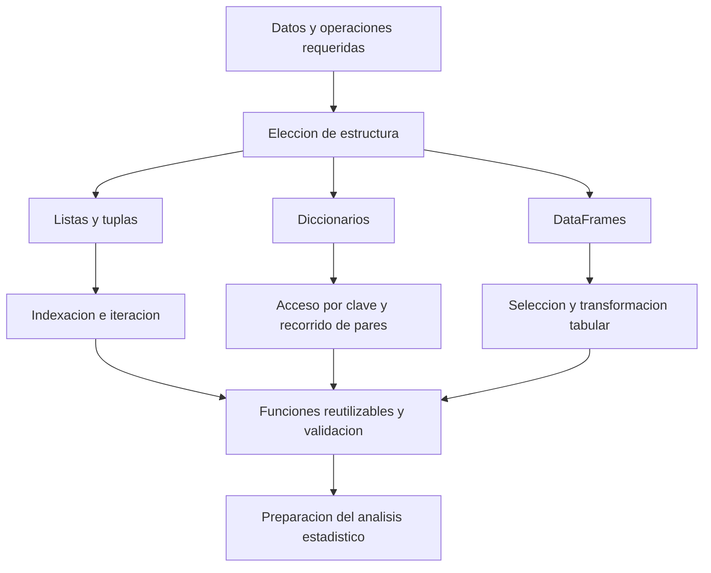

# Clase 3: Estructuras de datos, control de flujo y funciones de Python para el análisis estadístico

> **Objetivo académico:** Comprender cómo las estructuras de datos, los bucles, las comprensiones y las funciones de Python permiten organizar y transformar información, y situar pandas y NumPy como herramientas de preparación para el análisis estadístico reproducible.

## 1. Contexto y marco conceptual

La sesión consolida fundamentos de programación necesarios para trabajar posteriormente con datos estadísticos y modelos de aprendizaje automático. Su recorrido articula listas y referencias, estructuras anidadas, iteración, diccionarios, tuplas, sintaxis pythónica y funciones; finalmente introduce las capacidades de pandas y NumPy. La exposición se concentra en fundamentos computacionales: no desarrolla todavía un análisis estadístico completo sobre un conjunto de datos.

El problema transversal es representar información de manera que pueda recuperarse, transformarse y validarse con claridad. Una lista permite conservar una secuencia; un diccionario relaciona claves con valores; una tupla fija una estructura secuencial; un DataFrame representa datos tabulares con etiquetas. La estructura elegida condiciona las operaciones disponibles y los errores que conviene prevenir.

La analogía de una biblioteca ilustra este problema: recorrer todos los libros permite encontrar un título, pero organizar la información mediante categorías o identificadores facilita búsquedas posteriores. La organización inicial supone un esfuerzo que puede compensarse cuando las consultas son frecuentes.

**Enriquecimiento conceptual:** Una lista conserva un orden de posiciones, pero no está necesariamente ordenada por un criterio como título, fecha o magnitud. Asimismo, agrupar libros por género reduce el espacio de búsqueda, aunque todavía puede exigir recorrer los títulos de ese género. El acceso directo por título requeriría una asociación explícita entre ese título y su registro.



**Enriquecimiento conceptual:** La selección de estructuras no sigue una progresión obligatoria de lista a diccionario y después a DataFrame conforme crece el volumen. Depende también de la semántica de los datos, del patrón de acceso, de los tipos y de la memoria disponible.

## 2. Fundamentos teóricos y arquitectura

### 2.1. Listas, referencias y copias

Una lista es una secuencia mutable: permite sustituir elementos, incorporar otros y modificar su organización. Los métodos mencionados incluyen `count`, `index`, `reverse`, `sort`, `pop` y `copy`. Por su parte, `len` y `sum` son funciones integradas que reciben objetos como argumentos.

| Operación | Significado | Precaución |
| --- | --- | --- |
| `len(a)` | Número de elementos del nivel exterior | No cuenta recursivamente elementos de sublistas |
| `sum(a)` | Suma de elementos compatibles | No se limita a enteros ni sustituye a un conteo |
| `a.count(x)` | Número de apariciones de `x` | Cuenta coincidencias, no valores distintos |
| `a.index(x)` | Posición de la primera coincidencia | Produce `ValueError` si no encuentra el valor |
| `a.reverse()` | Invierte la lista existente | Modifica la lista y devuelve `None` |
| `a.sort()` | Ordena la lista existente | Requiere elementos comparables o una clave adecuada |
| `a.pop(i)` | Retira y devuelve el elemento de posición `i` | Modifica la lista |
| `a.copy()` | Construye una copia superficial | Conserva referencias a objetos internos |

La distinción central de la sesión es que `b = a` no copia una lista: vincula ambos nombres al mismo objeto. Si se modifica ese objeto mediante cualquiera de los nombres, el cambio resulta visible desde el otro. En cambio, `b = a.copy()` crea un contenedor exterior diferente.

**Enriquecimiento conceptual:** Debe distinguirse mutación de reasignación. `a[0] = 70` modifica el objeto compartido; `a = [70]` vincula el nombre `a` a otra lista y no cambia el objeto al que sigue apuntando `b`.

### 2.2. Listas anidadas e indexación

Una lista puede contener otras listas. Para acceder a un elemento interno se encadenan índices: `a[i][j]` selecciona primero la sublista de posición `i` y después su elemento de posición `j`. Los índices comienzan en cero.

Para `a = [[3, 5, 7], [10, 20, 30], [2, 4, 6]]`:

- `a[0]` es `[3, 5, 7]`.
- `a[1]` es `[10, 20, 30]`, la segunda sublista.
- `a[1][1]` es `20`.
- `a[2][1]` es `4`.
- `a[2][2]` es `6`.

**Enriquecimiento conceptual:** Una lista anidada no es automáticamente una matriz numérica. Puede contener filas de distinta longitud o tipos heterogéneos. El anidamiento está sujeto a límites prácticos de memoria y procesamiento.

### 2.3. Iterables, `range` y bucles

Un iterable es un objeto cuyos elementos pueden recorrerse. El bucle `for elemento in iterable` ejecuta su cuerpo una vez por cada elemento disponible. `in` forma parte de esa sintaxis; no constituye por sí mismo otro bucle.

`range(inicio, fin, paso)` representa una progresión de enteros que excluye el extremo `fin`. Con un único argumento, el inicio es cero y el paso es uno: `range(10)` recorre del cero al nueve. El paso no puede ser cero y puede ser negativo si se desea un recorrido descendente.

**Enriquecimiento conceptual:** `range` no construye una lista materializada de todos sus elementos. Para obtenerla explícitamente se utiliza `list(range(...))`.

El bucle `while condicion` evalúa la condición antes de cada iteración y continúa mientras sea verdadera. Para terminar, el estado debe evolucionar hacia una condición falsa o debe existir una salida explícita. La actualización del estado es, por tanto, parte esencial de su diseño.

### 2.4. Diccionarios y tuplas

Un diccionario es un mapeo mutable de claves únicas a valores. La sesión utiliza ejemplos de países asociados con ciudades, frutas asociadas con cantidades y números asociados con valores de distintos tipos.

**Enriquecimiento conceptual:** Las claves deben ser hashables: objetos con un hash estable y una relación de igualdad compatible. Las cadenas y los enteros son ejemplos habituales; una lista no puede emplearse como clave. Un diccionario admite añadir o eliminar claves y reemplazar valores. Por ello, afirmar que las claves «no se pueden cambiar» confunde los requisitos del objeto utilizado como clave con las operaciones permitidas sobre el diccionario.

Los valores pueden pertenecer a tipos mutables o inmutables. Reemplazar el valor asociado a una clave no significa que el objeto anterior fuera mutable. Los diccionarios de Python moderno conservan el orden de inserción, que no equivale a una clasificación alfabética o numérica.

| Método | Elementos que permite recorrer |
| --- | --- |
| `d.items()` | Pares de clave y valor |
| `d.keys()` | Claves |
| `d.values()` | Valores |

**Enriquecimiento conceptual:** Estos métodos devuelven vistas del diccionario, no listas independientes. Si se necesita una lista materializada, se convierte explícitamente, por ejemplo con `list(d.items())`.

Una tupla es una secuencia inmutable. No permite sustituir sus posiciones ni añadir elementos al mismo objeto. La concatenación con `+` produce una nueva tupla.

**Enriquecimiento conceptual:** La inmutabilidad de la tupla no obliga a que todos sus elementos sean inmutables: puede contener una lista que sí admita cambios internos. La coma define la tupla; para un único elemento se escribe, por ejemplo, `(3,)`.

### 2.5. Funciones y alcance de nombres

Una función encapsula una operación reutilizable. Su interfaz establece los parámetros de entrada y el resultado que devuelve. En Python se define mediante `def`, y `return` entrega un valor al código que la invoca. Mostrar información con `print` y devolverla mediante `return` son operaciones distintas.

La omisión de argumentos obligatorios provoca un `TypeError`. El mensaje permite identificar qué parámetros faltan; no debe interpretarse como un fallo de la operación matemática si la llamada ni siquiera satisface la interfaz requerida.

**Enriquecimiento conceptual:** La búsqueda ordinaria de nombres sigue la regla LEGB: ámbito local, ámbitos envolventes de funciones anidadas, ámbito global del módulo e integrados. Una variable global no está disponible universalmente en todos los módulos. Además, llamar a `range` dentro de una función no convierte la lista resultante en un nombre integrado: el carácter integrado corresponde al nombre `range`.

## 3. Implementación técnica y lógica de negocio

Los ejemplos siguientes reconstruyen las operaciones descritas con sintaxis explícita. No representan nuevas ejecuciones ni resultados empíricos. Las extensiones y correcciones se identifican como enriquecimiento conceptual.

### 3.1. Comportamiento de alias y copias

```python
a = [10, 20, 30, 40]
b = a
a[0] = 70
# a y b hacen referencia a [70, 20, 30, 40]

a = [10, 20, 30, 40]
b = a.copy()
a[0] = 70
b[0] = -55
# a: [70, 20, 30, 40]
# b: [-55, 20, 30, 40]
```

El primer caso reproduce la modificación compartida observada en la sesión. En el segundo, las sustituciones ocurren en contenedores diferentes.

**Enriquecimiento conceptual:** La independencia de una copia superficial no se extiende automáticamente a las sublistas.

```python
a = [[3, 5, 7], [10, 20, 30]]
b = a.copy()
b[0][0] = 99
# a[0][0] tambien pasa a ser 99
```

La lista exterior se copió, pero ambas listas exteriores conservan una referencia a la misma primera sublista. Cuando se requiere copiar recursivamente una estructura anidada, puede considerarse `copy.deepcopy`, evaluando su costo y si compartir determinados objetos era parte del diseño.

### 3.2. Recorridos y condiciones de terminación

```python
valores = [3, 6, 7]
for valor in valores:
    print(valor)

multiplos = [10 * valor for valor in range(10)]

contador = 7
while contador > 2:
    contador -= 1
    print(contador)
```

El primer bucle recorre elementos existentes. La comprensión construye diez múltiplos, desde cero hasta noventa. En el `while`, la actualización precede a la impresión: se muestran `6, 5, 4, 3, 2`, y después la condición deja de cumplirse. El orden entre actualizar e imprimir modifica la salida.

La sesión combina también `while` con longitud y suma:

```python
texto = "ABC"
while len(texto) < 10:
    texto += "A"

valores = [5, 7, 9]
while sum(valores) < 50:
    valores.append(5)
```

En el primer caso, cada iteración incrementa la longitud hasta diez caracteres. En el segundo, la suma inicial es 21 y cada incorporación añade cinco unidades.

**Enriquecimiento conceptual:** La condición se comprueba antes de añadir el siguiente elemento. Por ello, la suma puede superar el umbral: después de seis incorporaciones alcanza 51 y el bucle termina en la evaluación siguiente. Para garantizar un máximo de 50, habría que comprobar la suma proyectada antes de modificar la lista.

Un `while True` sin una salida alcanzable no termina por sí mismo. Su uso exige un mecanismo deliberado de interrupción; imprimir indefinidamente puede saturar la salida de un notebook.

### 3.3. Diccionarios: acceso, actualización y recorrido

```python
ciudades = {
    "Peru": ["Lima", "Cusco"],
    "Ecuador": ["Quito", "Guayaquil"],
    "Colombia": ["Bogota", "Barranquilla"],
}

ciudades["Bolivia"] = ["La Paz", "Sucre", "Santa Cruz"]
ciudades["Venezuela"] = ["Caracas"]
ciudades["Peru"].append("Arequipa")
del ciudades["Colombia"]

for pais, localidades in ciudades.items():
    print(pais, localidades)
```

El diccionario proporciona acceso por país y las listas almacenan las localidades de cada país. Añadir una clave nueva, modificar una lista interna y eliminar una asociación son operaciones distintas. Se utiliza una estructura homogénea de listas para evitar que unos países contengan cadenas y otros listas.

**Enriquecimiento conceptual:** Si se almacenan ciudades en una única cadena, concatenar texto no crea registros independientes de ciudad. Una lista es más adecuada cuando se necesita recorrer, contar o añadir localidades individualmente. Asimismo, recorrer `items()` no cuenta elementos por sí mismo: `len(ciudades)` cuenta asociaciones y `sum(len(v) for v in ciudades.values())` cuenta las localidades, bajo el supuesto de que todos los valores sean listas de localidades.

La sesión muestra un intento fallido de sumar diccionarios y termina agrupándolos en una lista. Estas operaciones deben distinguirse:

```python
d1 = {"a": 1}
d2 = {"b": 2}
coleccion = [d1, d2]
```

`coleccion` contiene dos diccionarios; no es un diccionario fusionado.

**Enriquecimiento conceptual:** En Python 3.9 o posterior, `fusion = d1 | d2` crea un diccionario combinado. Si una clave aparece en ambos, prevalece el valor del operando derecho. Otra opción es copiar el primero y aplicar `update` con el segundo. El operador `+` no fusiona diccionarios.

### 3.4. Comprensiones de listas y diccionarios

Una comprensión expresa la construcción de una colección mediante una transformación y, opcionalmente, un filtro. La sesión compara esta forma con un bucle que añade elementos mediante `append`.

```python
valores = [1, 2, 3, 4]
cuadrados = [valor ** 2 for valor in valores]
```

**Enriquecimiento conceptual:** Para ilustrar el filtro descrito, se utiliza una lista explícita de ejemplo:

```python
datos = [0.50, 0.79, 0.80, 0.90, 0.95]
seleccion = [valor for valor in datos if valor > 0.79]
escalados = [100 * valor for valor in datos]
etiquetas = ["alto" if valor > 0.79 else "bajo" for valor in datos]
```

El filtro excluye valores que no cumplen la condición y conserva el orden relativo. El condicional situado antes de `for` transforma cada elemento mediante dos alternativas; no elimina elementos. El umbral estricto `> 0.79` excluye el propio valor `0.79`.

La comprensión de diccionarios conserva explícitamente la asociación entre clave y valor:

```python
seleccionados = {
    modelo: puntuacion
    for modelo, puntuacion in resultados.items()
    if puntuacion > 0.69
}
```

Se presupone que `resultados` ya existe y asocia identificadores de modelos con puntuaciones numéricas comparables. La sesión utiliza el término «precisión», pero no especifica la definición de la métrica ni su procedimiento de estimación.

### 3.5. Funciones reutilizables

La motivación principal para definir funciones es generalizar operaciones y evitar repetir fórmulas. El promedio deja de depender de tres valores escritos manualmente cuando utiliza la suma y la longitud de una colección.

**Enriquecimiento conceptual:** Esta implementación explicita el tratamiento de una colección vacía y evita confundir el promedio con `min`, que devuelve el mínimo:

```python
def promedio(valores):
    if len(valores) == 0:
        raise ValueError("El promedio requiere datos")
    return sum(valores) / len(valores)
```

Para una secuencia finita no vacía de números reales, la media aritmética es:

$$
\bar{x} = \frac{1}{n}\sum_{i=1}^{n}x_i
$$

Aquí $n \in \mathbb{N}$, con $n \geq 1$, es el número de observaciones; $x_i \in \mathbb{R}$ es la observación de posición $i$, y $\bar{x}$ conserva la unidad de los datos. La expresión presupone valores numéricos válidos y asigna igual peso a cada observación. No establece por sí sola que la media sea representativa: valores extremos o asimetrías pueden limitar su interpretación.

### 3.6. pandas y NumPy: alcance introductorio

pandas se presenta como herramienta para leer datos, trabajar con filas y columnas, indexar, agrupar e integrar fuentes. NumPy se introduce como base para operaciones numéricas sobre arreglos. La analogía de pandas con una hoja de cálculo ayuda a reconocer su carácter tabular, aunque no describe todas sus diferencias.

**Enriquecimiento conceptual:** Un `DataFrame` es una estructura bidimensional con índices y columnas etiquetadas; una `Series` es un objeto unidimensional etiquetado. Las columnas de un DataFrame pueden tener tipos diferentes.

| Propósito | API precisa de pandas | Interpretación |
| --- | --- | --- |
| Leer fuentes | `pd.read_csv`, `pd.read_excel`, `pd.read_json` | Funciones específicas según el formato |
| Inspeccionar extremos | `df.head()`, `df.tail()` | Primeras y últimas filas |
| Consultar estructura | `df.columns`, `df.shape` | Etiquetas de columnas y dimensiones |
| Seleccionar por etiquetas | `df.loc[...]` | Acceso mediante etiquetas y condiciones |
| Gestionar el índice | `set_index`, `reset_index` | Reorganización de etiquetas de fila |
| Contar observaciones válidas | `df.count()` | Recuento de valores no ausentes |
| Identificar ausencias | `isnull`, `notnull` | Máscaras de ausencia o presencia |
| Filtrar texto | `.str.contains`, `.str.startswith`, `.str.endswith` | Operaciones sobre cadenas |
| Extraer componentes temporales | `.dt.day`, `.dt.month`, `.dt.dayofweek` | Requieren datos de tipo temporal |
| Agrupar | `groupby` | Separación por grupos para operaciones posteriores |
| Combinar estructuras | `pd.concat`, `merge`, `join` | Concatenación o asociación por claves e índices |

**Enriquecimiento conceptual:** La tabla normaliza nombres fonéticamente deformados en la transcripción. `shape` devuelve una tupla con número de filas y columnas; `columns` contiene etiquetas, y ambas son propiedades. `head` y `tail` ayudan a inspeccionar, pero no son visualizaciones gráficas ni verifican la calidad de todo el conjunto. No se reconstruye una ejecución tabular porque la fuente no proporciona un dataset ni una secuencia completa de procesamiento.

## 4. Análisis crítico de casos y auditoría práctica

### 4.1. Planificación de cantidades discretas

El caso de reparto de pizzas conecta variables, operaciones aritméticas, listas de sabores y presentación de resultados. La demanda total se obtiene multiplicando el número de personas por el consumo previsto; después debe convertirse en una cantidad de pizzas que cubra esa demanda.

**Enriquecimiento conceptual:** Si $g \in \mathbb{N}_0$ es el número de personas, $r \in \mathbb{R}_{\geq 0}$ es el consumo previsto en rebanadas por persona y $s \in \mathbb{N}_{>0}$ es la cantidad de rebanadas por pizza, entonces:

$$
R = gr, \qquad P = \left\lceil \frac{R}{s} \right\rceil
$$

$R$ representa la demanda en rebanadas y $P \in \mathbb{N}_0$ el número mínimo de pizzas completas. La derivación parte de exigir $Ps \geq R$; al dividir por $s > 0$, resulta $P \geq R/s$. El menor entero que cumple esa desigualdad es el techo del cociente. Se supone que todas las pizzas tienen el mismo rendimiento y que las rebanadas son intercambiables para cubrir la demanda.

Para diez personas, tres rebanadas por persona y ocho rebanadas por pizza, $R=30$ y $P=\lceil30/8\rceil=4$. Este resultado cubre la demanda con una capacidad de 32 rebanadas.

La expresión `R // s + 1`, utilizada en la sesión, funciona cuando el cociente no es entero, pero añade una pizza innecesaria si la división es exacta. Por ejemplo, con 16 rebanadas y ocho por pizza devolvería tres en lugar de dos. Tampoco devuelve cero ante demanda nula.

**Enriquecimiento conceptual:** Una implementación directa es `math.ceil(R / s)`, validando que `s` sea positivo. Cuando `R` y `s` son enteros no negativos, con `s > 0`, también puede utilizarse `(R + s - 1) // s` para evitar la división flotante.

Dividir las pizzas entre sabores puede producir una cantidad fraccionaria. Su validez depende de la regla de negocio: es admisible si se permiten porciones de pizza con sabores diferentes; si cada pizza debe ser de un único sabor, la asignación requiere enteros y una política para distribuir el resto. El número de sabores conviene obtenerlo mediante `len(sabores)` y debe ser mayor que cero antes de dividir.

### 4.2. Búsquedas y organización de información

La clasificación de libros muestra la utilidad de diseñar claves de acceso. Sin embargo, disponer de un diccionario de géneros no garantiza encontrar directamente un título: el acceso depende de qué información se utiliza como clave y qué estructura contiene el valor.

**Enriquecimiento conceptual:** La búsqueda secuencial en una lista de $n$ elementos tiene costo de peor caso $O(n)$. Una consulta por clave en un diccionario tiene costo promedio esperado $O(1)$ bajo supuestos habituales de hashing y comparaciones de costo acotado, aunque no es una garantía absoluta de peor caso. Si el valor recuperado es otra lista, buscar dentro de ella añade su propio costo.

### 4.3. Transformar datos no equivale a estimar una regresión

La sesión introduce un ejemplo polinómico para ilustrar transformaciones y comprensión de listas, pero la expresión y sus coeficientes no quedan inequívocamente registrados. No corresponde reconstruir resultados numéricos ni afirmar que se ajustó un modelo.

**Enriquecimiento conceptual:** Un polinomio puede escribirse como:

$$
f(x) = \sum_{k=0}^{d}\beta_k x^k
$$

Aquí $d \in \mathbb{N}_0$ es el grado; $x \in \mathbb{R}$ es la variable de entrada, y $\beta_k \in \mathbb{R}$ son coeficientes. Si $x$ tiene unidades físicas, cada coeficiente debe tener las unidades que permitan sumar términos compatibles con la salida. Un polinomio de grado mayor que uno no es lineal en $x$, pero sí es lineal en los coeficientes. Por tanto, puede formar parte de una regresión lineal en parámetros. Calcular cuadrados o evaluar un polinomio con coeficientes dados no equivale a estimarlos a partir de observaciones.

### 4.4. Selección de modelos mediante un umbral

Filtrar un diccionario de puntuaciones permite seleccionar registros de forma programática. La operación es correcta como manipulación de datos, pero su interpretación estadística exige conocer qué representa cada puntuación.

**Enriquecimiento conceptual:** Un umbral común solo permite una comparación defendible si las métricas, las particiones de evaluación y las condiciones de medición son comparables. La palabra «precisión» puede designar métricas diferentes; tampoco una puntuación puntual permite inferir incertidumbre o generalización. El filtro no sustituye la evaluación crítica de los modelos.

### 4.5. Hojas de cálculo, pandas y escalabilidad

La exposición destaca las ventajas del código para automatizar transformaciones, mantener versiones y repetir análisis. También señala dificultades de las hojas de cálculo ante procesos complejos o conjuntos voluminosos.

**Enriquecimiento conceptual:** Estas ventajas no justifican calificar universalmente a Excel como incompatible con la ciencia de datos ni afirmar que Python sustituye todas las herramientas de inteligencia de negocios. La selección depende de automatización, colaboración, presentación, auditoría y volumen. pandas trabaja principalmente en memoria y no convierte por sí mismo un proceso en análisis distribuido. Spark corresponde a otra arquitectura de procesamiento, mencionada en la conversación pero no desarrollada técnicamente.

## 5. Principios de diseño, buenas prácticas y anti-patrones

1. **Elegir estructuras por su significado y operaciones.** Utilizar listas para secuencias mutables, tuplas para posiciones estables, diccionarios para asociaciones por clave y DataFrames para datos tabulares. El volumen es un criterio adicional, no una regla única.

2. **Distinguir identidad, copia y reasignación.** La igualdad del contenido no demuestra independencia. En estructuras anidadas, documentar si se comparten objetos internos y qué profundidad de copia requiere el proceso.

3. **Explicitar límites y terminación.** En `range`, revisar la exclusión del extremo final; en `while`, identificar qué cambio hace falsa la condición. Verificar también si un umbral se aplica antes o después de actualizar el estado.

4. **Priorizar claridad sobre brevedad.** Una comprensión sencilla puede expresar una transformación con precisión. Las comprensiones con demasiados niveles o efectos secundarios dificultan el análisis. La sintaxis pythónica no consiste en reducir toda solución a una línea.

5. **Diseñar funciones con contratos comprensibles.** Definir parámetros, tipos esperados, valores admisibles y resultados. Separar cálculo, presentación e ingreso de datos facilita reutilizar el código y localizar errores.

6. **Mantener consistencia en los valores asociados.** Si cada país contiene localidades, utilizar el mismo tipo de colección en todos los casos. Evitar mezclar cadenas y listas cuando el procesamiento posterior presupone una interfaz común.

7. **Validar reglas de negocio en los bordes.** Revisar demanda cero, división exacta, número de sabores nulo y cantidades indivisibles. Un resultado correcto en un caso no demuestra que la fórmula cubra todos los dominios previstos.

8. **Auditar la estructura antes de resumir los datos.** Tipos, ausencias, duplicados, unidades y claves de combinación condicionan cualquier media o agrupación posterior. Tener datos «limpios» no significa necesariamente que estén normalizados o sigan una distribución normal.

**Enriquecimiento conceptual:** Los bucles anidados que recorren todas las combinaciones de dos colecciones de tamaños $n$ y $m$ realizan $nm$ iteraciones, con costo $O(nm)$ si el cuerpo tiene costo constante. Del mismo modo, recalcular `sum(lista)` en cada iteración vuelve a recorrer la lista; si esta crece, mantener un acumulador puede reducir trabajo repetido, siempre que se preserve su consistencia.

### Funciones integradas: precisiones operativas

| Función | Comportamiento correcto |
| --- | --- |
| `input()` | Lee una entrada y devuelve una cadena; los números requieren conversión |
| `id(objeto)` | Devuelve un identificador único durante la vida del objeto; su interpretación como dirección depende de la implementación |
| `abs(x)` | Devuelve el valor absoluto de un número compatible |
| `all(iterable)` | Devuelve `True` si todos los elementos tienen valor de verdad verdadero |
| `any(iterable)` | Devuelve `True` si al menos un elemento tiene valor de verdad verdadero |
| `print(...)` | Escribe representaciones de objetos en la salida |
| `bin(entero)` | Devuelve una cadena con representación binaria |
| `bool(objeto)` | Evalúa el valor de verdad del objeto |
| `chr(entero)` | Devuelve el carácter correspondiente a un punto de código Unicode válido |

**Enriquecimiento conceptual:** `all([])` devuelve `True` y `any([])` devuelve `False`. La diferencia importa al validar colecciones vacías. Además, definir funciones con nombres como `min`, `sum` o `list` oculta temporalmente los nombres integrados y puede provocar errores difíciles de reconocer.

**Enriquecimiento conceptual:** Las bibliotecas de terceros no necesitan una aprobación central de Python para existir, distribuirse o instalarse. Publicar una función tampoco la convierte automáticamente en parte de una biblioteca ni garantiza remuneración. Al utilizar herramientas de IA para generar código, deben revisarse la API, los argumentos, los supuestos y los resultados; copiar código no reemplaza su comprensión.

## 6. Síntesis conceptual y profundización académica

La contribución principal de la sesión es construir una base de programación para el análisis de datos. Las estructuras representan información; los bucles y las comprensiones la recorren y transforman; las funciones encapsulan operaciones reutilizables; pandas y NumPy amplían esas capacidades hacia el trabajo tabular y numérico.

Tres distinciones articulan esa base. Primero, compartir una referencia no equivale a copiar un objeto. Segundo, transformar una colección no valida automáticamente la regla de negocio ni la interpretación estadística. Tercero, utilizar una biblioteca potente no elimina los límites de memoria, la necesidad de verificar tipos o el riesgo de combinar datos incorrectamente.

La media aparece como ejemplo de generalización mediante funciones. La varianza y la desviación estándar se mencionan, pero no se desarrollan en la fuente; no se presentan aquí como contenido demostrado. La introducción a pandas establece un vocabulario de lectura, inspección, selección, agrupación y combinación, sin constituir todavía un flujo ejecutado de análisis exploratorio.

**Enriquecimiento conceptual:** Las líneas de profundización que se desprenden de la clase incluyen la relación entre mutabilidad y reproducibilidad, el costo de las operaciones sobre colecciones, los contratos de funciones y la propagación de errores de datos hacia resúmenes estadísticos. En el trabajo tabular, merece especial atención la cardinalidad de las uniones: combinar fuentes por una clave duplicada puede multiplicar filas y alterar agregaciones aunque el código se ejecute sin errores.

Un proceso analítico defendible exige conectar cuatro niveles: representación de datos, operación computacional, regla de negocio e interpretación estadística. La corrección sintáctica es necesaria, pero la calidad del análisis depende de que esos niveles sean coherentes entre sí.
