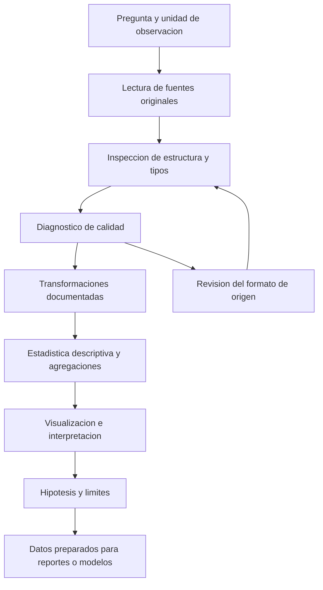

# Clase 4: Análisis exploratorio con Pandas: calidad de datos, agregaciones y visualización de películas

> **Objetivo académico:** Comprender y estructurar un análisis exploratorio de datos con Pandas, desde la lectura y depuración de tablas hasta la construcción de indicadores y visualizaciones, distinguiendo resultados descriptivos, hipótesis y conclusiones que requieren evidencia adicional.

## 1. Contexto y marco conceptual

La sesión utiliza información sobre películas y sus repartos para introducir el análisis exploratorio de datos, denominado EDA por *Exploratory Data Analysis*. Su propósito es comprender la estructura, calidad, distribución y relaciones de las variables antes de producir reportes o alimentar modelos de aprendizaje automático.

Pandas se presenta mediante una analogía con una hoja de cálculo: organiza información en filas y columnas y permite realizar transformaciones programables. La ventaja metodológica es que la lectura, limpieza y agregación pueden expresarse como una secuencia reproducible de operaciones.

**Enriquecimiento conceptual:** Pandas y Excel tienen ámbitos de aplicación diferentes. Excel resulta útil para exploración interactiva y comunicación tabular; Pandas facilita automatización, trazabilidad y transformaciones repetibles. Pandas trabaja principalmente en memoria y no constituye por sí solo una solución distribuida de big data. La elección depende del volumen, los recursos disponibles y el flujo analítico.

La clase conecta este proceso con dos problemas estadísticos generales:

- **Población y muestra:** una muestra permite estudiar características de una población, pero requiere definir qué unidades se observan y qué población se pretende representar.
- **Predicción multivariable:** estimar el precio de un departamento únicamente por su número de dormitorios omite factores relevantes. Superficie construida, ubicación y antigüedad ilustran variables explicativas; el precio constituye la variable objetivo.

**Enriquecimiento conceptual:** El tamaño de una muestra no garantiza representatividad. También importan el marco de selección, la cobertura, la no respuesta y el diseño muestral. Asimismo, identificar variables plausibles para un precio no demuestra que permitan una predicción precisa: hace falta estimar y validar el modelo.

El caso principal emplea dos tablas:

| Tabla | Contenido descrito | Unidad de observación que debe verificarse |
|---|---|---|
| `titles` | Título, año, rating y número de votos | Registro de película |
| `cast` | Información de películas y nombres de integrantes del reparto | Asociación entre película y actor |

La transcripción informa finalmente 213 665 filas y cuatro columnas para `titles`. Esa cifra procede de la lectura de `shape` durante la demostración; no se verificó directamente contra el archivo. La cobertura temporal tampoco queda completamente documentada: inicialmente se menciona 1980, pero posteriormente se analizan registros de la década de 1970 y se señala un corte alrededor de 2020.

## 2. Fundamentos teóricos y arquitectura

### DataFrame, Series e índices

Un `DataFrame` es una estructura tabular bidimensional con etiquetas de filas y columnas. Una `Series` es una estructura unidimensional etiquetada. Seleccionar una columna con `df['votes']` produce una `Series`; seleccionarla con `df[['votes']]` conserva un `DataFrame`.

**Enriquecimiento conceptual:** Conviene distinguir tres aspectos que aparecen próximos en la explicación oral:

| Aspecto | Consulta | Interpretación |
|---|---|---|
| Clase del objeto | `type(df)` o `type(df['votes'])` | Distingue `DataFrame` de `Series` |
| Tipo de almacenamiento | `df.dtypes` o `df['votes'].dtype` | Informa tipos como entero, flotante o texto |
| Significado estadístico | Diccionario de variables | Distingue identificadores, categorías, conteos y mediciones |

Que `df.columns` muestre un índice de tipo `object` no significa que todas las columnas contengan texto: describe las etiquetas del índice de columnas. Para conocer los tipos de los datos se utiliza `dtypes` o `info()`.

La indexación distingue **posición** y **etiqueta**. `iloc` accede por posición; `loc`, por etiqueta. Ambas coinciden en algunos índices iniciales, pero pueden diferir después de filtrar u ordenar.

### Tipos de variables y significado de los indicadores

El año expresa una ubicación temporal; los votos representan un conteo; el rating es una puntuación cuya escala se describe en la clase como de 1 a 10. El título y el nombre del actor son variables textuales.

**Enriquecimiento conceptual:** Votos es una variable cuantitativa discreta, aunque su interpretación social pueda relacionarse con popularidad. El rating no debe identificarse con ingresos, calidad objetiva o una evaluación profesional sin consultar su definición en la fuente. La transcripción formula posibilidades sobre su origen, pero no documenta su mecanismo de cálculo.

### Flujo metodológico del EDA



La arquitectura distingue la fuente original, la representación en memoria y una eventual versión transformada. La sesión insiste en preservar los archivos originales para evitar que una modificación impida reconstruir el proceso.

**Enriquecimiento conceptual:** Limpieza, transformación y estandarización no son sinónimos. La limpieza corrige problemas identificados; la transformación crea representaciones como la década; la estandarización modifica una escala según una regla explícita. Ninguna de estas operaciones garantiza por sí sola que los datos sean adecuados para un modelo.

## 3. Implementación técnica y lógica de negocio

Los siguientes fragmentos son **Enriquecimiento conceptual:** reconstrucciones de las operaciones descritas, con sintaxis de Pandas explícita. No constituyen una transcripción literal del notebook ni una ejecución verificada. Se adoptan las columnas `title`, `year`, `rating`, `votes` y `name`; deben contrastarse con los encabezados reales.

### Lectura e inspección inicial

```python
import pandas as pd
import numpy as np
import matplotlib.pyplot as plt

pelis_original = pd.read_csv('/content/titles.csv')
cast_original = pd.read_csv('/content/cast.csv', sep='|')

pelis = pelis_original.copy()
cast = cast_original.copy()

pelis.head(10)
pelis.tail(20)
pelis.shape
pelis.columns
pelis.dtypes
pelis.info()
```

`pd.read_csv` interpreta un archivo delimitado. En la demostración, `cast` requiere una barra vertical como separador; `sep` y `delimiter` permiten indicar ese formato. Seleccionar el separador correcto es una decisión de lectura, previa a corregir los valores internos de cada columna. Para archivos Excel corresponde `pd.read_excel`; la extensión no se utiliza como nombre de función.

| Operación | Uso y límite |
|---|---|
| `head(n)` | Inspecciona las primeras filas; no constituye una muestra aleatoria |
| `tail(n)` | Inspecciona las últimas filas; no calcula el tamaño de la tabla |
| `shape` | Devuelve la tupla de dimensiones: filas y columnas |
| `shape[0]` y `shape[1]` | Devuelven número de filas y número de columnas, respectivamente |
| `columns` | Informa los nombres de las columnas |
| `info()` | Resume tipos, valores no nulos y uso de memoria |
| `copy()` | Crea una copia para separar transformaciones del objeto de partida |

El índice final 213 664 sería compatible con 213 665 filas si el índice comenzara en cero y fuera consecutivo. Esa relación no se puede generalizar a cualquier índice.

Para cambiar encabezados puede asignarse una lista completa o utilizarse `rename`. La primera alternativa exige respetar exactamente el número y orden de las columnas; la segunda permite indicar cambios particulares.

```python
pelis_es = pelis.rename(columns={
    'title': 'titulo',
    'year': 'anio',
    'votes': 'votos'
})

votos = pelis['votes']
votos_ordenados = votos.sort_values(ascending=False)
fila_por_posicion = pelis.iloc[26541]
```

`sort_values` ordena por valores, de forma ascendente por defecto. `sort_index` ordena las etiquetas del índice. Ninguno sustituye al otro.

### Depuración de votos y revisión de tipos

La tabla de reparto presenta signos adicionales al final de algunos valores de votos y años representados como flotantes. La clase describe la eliminación de esos signos antes de operar numéricamente.

```python
votos_texto = cast['votes'].astype('string').str.strip()
votos_limpios = votos_texto.str.replace(';', '', regex=False)
votos_numericos = pd.to_numeric(votos_limpios, errors='coerce')

fallos_conversion = votos_texto.notna() & votos_numericos.isna()
registros_a_revisar = cast.loc[fallos_conversion]

cast['votes'] = votos_numericos
cast['year'] = pd.to_numeric(cast['year'], errors='coerce')
cast['rating'] = pd.to_numeric(cast['rating'], errors='coerce')
```

La sustitución del punto y coma presupone haber confirmado que es un residuo del formato. Otros signos necesitan un diagnóstico propio: una coma podría representar separación de miles o separación decimal. `errors='coerce'` convierte entradas no interpretables en valores ausentes; por ello se conserva una máscara para revisar la pérdida de información.

Que un año aparezca como `1984.0` no demuestra que sea incorrecto. Deben revisarse ausencias y valores fraccionarios antes de convertirlo a un entero que admita nulos. Multiplicar el rating por 100 cambia su escala y mantiene posibles errores de origen; no es una operación de limpieza por sí misma.

### Filtros de texto y condiciones numéricas

```python
mascara_saga = pelis['title'].str.contains(
    'Karate Kid', case=False, na=False, regex=False
)
saga = pelis.loc[mascara_saga]

rating_alto = pelis.loc[pelis['rating'] >= 9.5]

seleccion = pelis.loc[
    (pelis['rating'] > 9)
    & (pelis['year'] >= 2014)
    & (pelis['votes'] > 100)
]

seleccion_con_mas_votos = pelis.loc[
    (pelis['rating'] > 9.5)
    & (pelis['votes'] > 10000)
]
```

Las condiciones combinadas emplean `&` y paréntesis alrededor de cada comparación. Los umbrales expresan una regla de selección; no establecen una definición universal de buena película. Una búsqueda textual recupera coincidencias y necesita revisión para confirmar que pertenecen a la misma saga.

### Creación de décadas y conteos

La década se obtiene mediante división entera:

$$
d(y)=10\left\lfloor\frac{y}{10}\right\rfloor
$$

Aquí $y$ es un año entero de calendario y $d(y)$ es el año inicial de su década. Para años positivos, 1984 se asigna a 1980 y 2019 a 2010. El operador piso redondea hacia abajo; una división ordinaria seguida de multiplicación por diez devolvería el año original.

```python
pelis['decade'] = (pelis['year'] // 10) * 10
conteo_decadas = pelis['decade'].value_counts().sort_index()

cast['decade'] = (cast['year'] // 10) * 10
cast_sin_anio = cast.drop(columns=['year'])
```

`value_counts` cuenta registros por categoría; `sort_index` organiza cronológicamente las décadas. Eliminar el año con `drop` demuestra una operación sobre columnas, pero reduce la resolución temporal disponible. Es preferible conservarlo en la tabla de trabajo cuando siga siendo útil.

### Agregaciones y rankings

```python
votos_por_actor = cast.groupby('name')['votes'].sum(min_count=1)
top_actores = votos_por_actor.sort_values(ascending=False).head(10)

top_rating = pelis.sort_values('rating', ascending=False).head(10)

con_rating = pelis.dropna(subset=['decade', 'rating'])
indices_maximos = con_rating.groupby('decade')['rating'].idxmax()
mejor_por_decada = con_rating.loc[indices_maximos]

repartos = cast.groupby(['title', 'year'])['name'].nunique()
mayores_repartos = repartos.sort_values(ascending=False).head(10)
```

La suma por actor agrega los votos de los registros de películas vinculados con su nombre. `min_count=1` evita presentar como cero un grupo sin ningún voto válido. El ranking por rating requiere orden descendente para situar primero las puntuaciones mayores.

`idxmax` devuelve la etiqueta correspondiente al primer máximo de cada grupo. Esta selección presupone un índice único; cuando existen empates, devuelve un solo registro. `nunique` cuenta nombres distintos por película y año: reduce el efecto de repeticiones exactas del nombre, pero no resuelve homónimos ni variantes ortográficas.

### Índices y exportación

```python
pelis_indexadas = pelis.set_index('title')
fila_posicional = pelis_indexadas.iloc[2]
pelis_restauradas = pelis_indexadas.reset_index()

pelis.to_csv('/content/titles_v2.csv', index=False)
```

Tras `set_index`, la consulta por un título se realiza con `loc`; `iloc` sigue aceptando posiciones. `reset_index` devuelve el índice a columnas. La exportación a un archivo nuevo conserva la fuente y registra una versión transformada; `index=False` evita añadir el índice como columna al CSV.

### Visualización

```python
fig, ax = plt.subplots()
conteo_decadas.plot.bar(ax=ax)
ax.set_xlabel('Decada')
ax.set_ylabel('Registros de peliculas')
ax.set_title('Peliculas registradas por decada')
plt.tight_layout()
plt.show()
```

Se reconstruye un gráfico de barras porque se comparan conteos de categorías temporales. Un histograma representa frecuencias en intervalos de una variable numérica y requiere definir esos intervalos. Pandas ofrece métodos de trazado apoyados en Matplotlib; `plt` es el alias convencional de `matplotlib.pyplot`. NumPy se incorpora como biblioteca de cálculo numérico, aunque la transcripción no permite identificar con precisión todas las importaciones auxiliares del notebook.

## 4. Análisis crítico de casos y auditoría práctica

### Rating, votos y evidencia de asociación

La sesión compara películas con rating elevado y pocos votos, además de sagas como *Karate Kid* y *Back to the Future*. Estas observaciones muestran que una puntuación elevada puede coexistir con cantidades de votos muy diferentes. No bastan para concluir que existe o no existe correlación en toda la tabla.

**Enriquecimiento conceptual:** La correlación lineal de Pearson entre rating y votos puede expresarse como:

$$
r=\frac{\sum_{i=1}^{n}(x_i-\bar{x})(v_i-\bar{v})}{\sqrt{\sum_{i=1}^{n}(x_i-\bar{x})^2}\sqrt{\sum_{i=1}^{n}(v_i-\bar{v})^2}}
$$

Aquí $n\geq2$ es el número de películas con ambos valores disponibles, $x_i$ su rating y $v_i$ su número de votos; $\bar{x}$ y $\bar{v}$ son las medias respectivas. El coeficiente es adimensional y pertenece a $[-1,1]$ cuando ambas variables tienen variación. Resume asociación lineal y no demuestra causalidad. La fuerte asimetría de los votos y los valores extremos justifican revisar también la dispersión y una asociación por rangos, sin asumir que sus resultados coincidirán.

Un rating basado en pocos votos puede ser más inestable que otro basado en muchas observaciones, si efectivamente procede de valoraciones individuales. Cuantificar esa incertidumbre exigiría conocer el mecanismo de puntuación y la distribución de las valoraciones; el CSV descrito no proporciona esa información.

### Votos agregados por actor

En la demostración se identifica a Brad Pitt como líder del agregado y se menciona una magnitud cercana a 15 millones. También aparece una discrepancia con otro cálculo que sitúa primero a Tom Hanks. Sin los datos y el código completo no corresponde fijar un ranking definitivo.

**Enriquecimiento conceptual:** Este indicador representa votos acumulados de películas asociadas con cada actor. No mide votos emitidos directamente a favor del actor ni personas únicas. Una misma película aporta sus votos a varios integrantes del reparto. El agregado mezcla cantidad de películas, exposición y volumen de participación de sus públicos.

La revisión de una discrepancia debe contrastar archivos de entrada, tipos, signos residuales, nulos, duplicados, criterios de agrupación y ordenamiento. La popularidad de un actor como explicación de los votos es una hipótesis interpretativa, no un efecto causal demostrado por la suma.

### Evolución por década y cobertura temporal

La visualización presentada muestra más registros en décadas recientes, especialmente en la de 2010. En el diálogo se propone el streaming como explicación del crecimiento.

**Enriquecimiento conceptual:** El gráfico describe películas registradas en el conjunto de datos. Para atribuir el crecimiento al streaming habría que estudiar cobertura histórica, cambios de catalogación, producción y distribución, entre otros factores. Un conteo agregado no identifica por sí solo la causa.

La década de 2020 está incompleta según el corte descrito. Su menor conteo no permite inferir una caída equivalente de producción o consumo. Tampoco está justificada una proyección lineal únicamente por observar el gráfico. Una comparación temporal necesita períodos con exposición comparable y cobertura documentada.

### Mejores películas, sagas y tamaños de reparto

| Resultado buscado | Lectura válida | Riesgo que debe controlarse |
|---|---|---|
| Diez ratings más altos | Registros con mayor puntuación almacenada | Empates y puntuaciones con pocos votos |
| Máximo por década | Un registro de puntuación máxima por grupo | `idxmax` selecciona el primer empate |
| Comparación de una saga | Diferencias entre coincidencias revisadas | Falsas coincidencias y exclusión de títulos alternativos |
| Mayor reparto | Mayor número de nombres distintos registrados | Cobertura parcial del reparto y ausencia de identificadores estables |

La clase menciona 84 integrantes para una película titulada *Mother* de 2009. Es un resultado narrado y no verificado. Además, los nombres registrados en `cast` no equivalen necesariamente a protagonistas: esa categoría requiere una definición que no se aporta.

En uno de los filtros se anuncia una condición temporal desde 2014, pero se menciona después una película de 2009. Esa inconsistencia impide considerar verificada la salida particular y refuerza la necesidad de revisar predicado y resultado conjuntamente. La comparación final de películas favoritas también contiene rectificaciones orales; su aporte metodológico es ilustrar una selección personalizada, no establecer un orden confirmado.

### Comunicación de resultados

La sesión propone acompañar gráficos con contexto narrativo para facilitar su interpretación por públicos de distintas disciplinas. El valor del data storytelling reside en conectar pregunta, evidencia y conclusión.

**Enriquecimiento conceptual:** Agregar una imagen puede ayudar a recordar el caso, pero no sustituye una explicación verificable. Un gráfico debe explicitar medida, unidad, escala y período. Si los votos se presentan en millones, la transformación del eje debe ser consistente. Rating y votos tienen escalas diferentes y conviene compararlos en paneles separados o con ejes claramente identificados.

Las preferencias expresadas sobre Python, Power BI, Tableau y Looker Studio corresponden a apreciaciones prácticas. La elección depende de necesidades de automatización, interactividad, colaboración, despliegue y recursos; no se deriva una superioridad universal de la demostración.

## 5. Principios de diseño, buenas prácticas y anti-patrones

| Principio | Aplicación | Anti-patrón |
|---|---|---|
| Preservar la fuente | Transformar copias y exportar una versión distinta | Sobrescribir el único archivo original |
| Definir la granularidad | Diferenciar película de asociación película-actor | Contar filas de reparto como películas |
| Validar el formato de lectura | Confirmar separador y encabezados | Corregir valores antes de interpretar bien el archivo |
| Revisar tipos y significado | Combinar `dtypes`, rangos y diccionario de variables | Considerar válido todo lo que sea numérico |
| Registrar pérdidas | Contabilizar fallos de conversión y ausencias | Convertir a nulos sin revisar los registros afectados |
| Mantener precisión temporal | Conservar año y añadir década | Eliminar el año antes de concluir que ya no se necesita |
| Explicitar las métricas | Nombrar votos de películas asociados con un actor | Presentarlos como votos personales del actor |
| Hacer comparables los grupos | Documentar cortes y períodos incompletos | Comparar una década parcial con décadas completas |
| Separar observación e hipótesis | Presentar explicaciones causales como hipótesis | Atribuir cambios al streaming solo por un gráfico |
| Comunicar incertidumbre | Mostrar cobertura, empates y definición de variables | Equiparar un ranking con calidad objetiva |

**Enriquecimiento conceptual:** Examinar solo `head()` después de limpiar no valida toda la tabla. También deben revisarse nulos, duplicados, rangos imposibles y tasas de conversión. Los valores atípicos requieren evaluación: pueden representar errores, pero también observaciones legítimas e informativas. Su detección no obliga a eliminarlos.

Si se relacionan `titles` y `cast`, la clave debe identificar inequívocamente una película. Título y año constituyen una aproximación que debe comprobarse; un identificador estable es preferible cuando existe. La cardinalidad esperada es una película con múltiples asociaciones de reparto. Una unión sin validación puede multiplicar filas y distorsionar las sumas.

La reproducibilidad también exige nombres consistentes. La sesión alterna `df`, `df2`, `df3`, `pelis` y `cast`; nombres ligados al significado y una secuencia de transformaciones explícita reducen confusiones entre objetos.

## 6. Síntesis conceptual y profundización académica

La contribución central de la sesión consiste en vincular operaciones de Pandas con preguntas analíticas: inspeccionar estructura, interpretar variables, corregir formato, filtrar registros, derivar décadas, agregar información y comunicar hallazgos. El EDA produce conocimiento sobre los datos y sus límites, además de preparar una tabla para usos posteriores.

La clase introduce las medidas descriptivas que permiten ampliar esta revisión:

| Medida o resumen | Operación en Pandas | Interpretación |
|---|---|---|
| Media | `mean()` | Promedio aritmético; sensible a extremos |
| Mediana | `median()` | Valor central de los datos ordenados |
| Moda | `mode()` | Valores de mayor frecuencia; puede haber varios |
| Mínimo y máximo | `min()`, `max()` | Extremos observados |
| Cuantiles | `quantile()` | Posiciones relativas en la distribución |
| Varianza | `var()` | Dispersión cuadrática respecto de la media |
| Desviación estándar | `std()` | Dispersión en las unidades de la variable |
| Resumen numérico | `describe()` | Conteo válido, media, desviación, extremos y cuartiles |

**Enriquecimiento conceptual:** Se precisa la sintaxis frente a las aproximaciones fonéticas de la transcripción: `mean()` calcula la media y `min()` el mínimo. Para columnas numéricas, `describe()` incluye por defecto los cuantiles 25 %, 50 % y 75 %; el 50 % corresponde a la mediana. No incluye la moda por defecto. `count` cuenta valores no ausentes, por lo que puede diferir del número de filas.

**Enriquecimiento conceptual:** Para $n\geq2$ observaciones numéricas válidas $x_1,\ldots,x_n$, la media y la varianza muestral se expresan como:

$$
\bar{x}=\frac{1}{n}\sum_{i=1}^{n}x_i
$$

$$
s^2=\frac{1}{n-1}\sum_{i=1}^{n}(x_i-\bar{x})^2,\qquad s=\sqrt{s^2}
$$

Aquí $n$ es el número de observaciones válidas, $\bar{x}$ es la media, $s^2$ la varianza muestral y $s$ la desviación estándar muestral. La media y la desviación conservan las unidades de $x_i$; la varianza tiene unidades al cuadrado. Pandas utiliza por defecto el denominador $n-1$ en `var()` y `std()`; NumPy utiliza por defecto $n$ en sus funciones equivalentes, salvo que se configure `ddof`. Esa diferencia debe controlarse al comparar resultados entre bibliotecas. Interpretar la varianza muestral como estimador insesgado de una varianza poblacional requiere supuestos de muestreo apropiados y varianza finita.

El caso de la calidad del vino se menciona como posible aplicación de estas ideas a variables fisicoquímicas y una valoración de calidad. La fuente no desarrolla sus datos ni resultados, por lo que no permite afirmar qué propiedades predominan o cómo se relacionan con la calidad.

Como profundización conceptual, los casos tratados conectan con selección de variables, incertidumbre de puntuaciones, sesgos de cobertura y validación predictiva. **Enriquecimiento conceptual:** Si el EDA forma parte de un flujo de aprendizaje automático, los parámetros aprendidos del preprocesamiento deben estimarse con los datos de entrenamiento para evitar fuga de información. La calidad de un modelo depende tanto de la coherencia de ese procedimiento como de la calidad del archivo de entrada.
