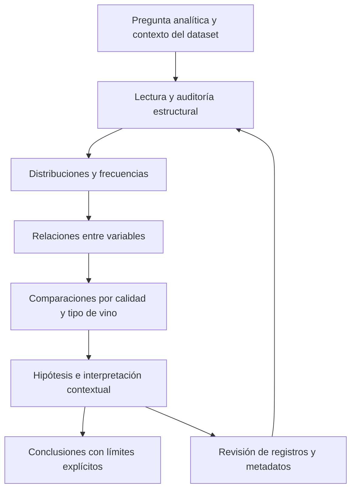

# Clase 5: Estandarización y análisis exploratorio de la calidad del vino con Python

> **Objetivo académico:** Comprender la estandarización y su transformación inversa, y desarrollar un análisis exploratorio reproducible que relacione atributos fisicoquímicos con la calidad del vino mediante estadísticas descriptivas, filtros y visualizaciones, distinguiendo observaciones, hipótesis y conclusiones respaldadas.

## 1. Contexto y marco conceptual

La sesión conecta dos niveles del análisis estadístico: el cálculo explícito de medidas básicas y su aplicación mediante bibliotecas de Python. Primero se revisan la media, la desviación estándar, la estandarización y la recuperación de los valores originales. Después se utiliza un conjunto de datos de vinos para mostrar cómo las funciones de pandas y las visualizaciones de Seaborn y Matplotlib permiten formular y contrastar preguntas exploratorias.

El propósito metodológico es comprender qué calculan las bibliotecas e interpretar sus resultados. Una tabla descriptiva o una gráfica constituye evidencia parcial: su significado depende del tipo de variable, de la composición de la muestra y de la pregunta analítica.

### 1.1. Unidad de observación y variables

En el caso presentado, cada fila representa un registro de vino. La transcripción informa de 1000 registros y 13 variables analíticas después de retirar una columna redundante de numeración. Entre ellas aparecen acidez fija, acidez volátil, ácido cítrico, azúcar residual, cloruros, medidas de dióxido de azufre, densidad, pH, sulfatos, alcohol, calidad y tipo de vino.

| Componente | Papel en el análisis | Precaución conceptual |
|---|---|---|
| `quality` | Variable de respuesta o resultado de interés | Sus puntuaciones están ordenadas; no se documenta que las distancias entre niveles sean equivalentes |
| Atributos fisicoquímicos | Variables explicativas o posibles predictoras | Su asociación con la calidad no demuestra causalidad |
| `red` | Indicador binario del tipo de vino | En la sesión se interpreta 0 como blanco y 1 como tinto |
| Numeración exportada | Identificador o índice potencialmente redundante | Debe comprobarse su función antes de eliminarla |

**Enriquecimiento conceptual:** En el discurso se emplea ocasionalmente «columna predictora» para referirse a `quality`. Conviene corregir esa terminología: si se busca explicar o predecir la calidad, esta es la variable objetivo; las demás variables son candidatas a predictoras. Un análisis exploratorio tampoco exige siempre una variable objetivo: puede estudiar distribuciones y relaciones sin formular un problema supervisado.

### 1.2. Preguntas que organizan la exploración

Las preguntas técnicas de la sesión incluyen cuántos registros y variables existen, qué tipos de datos se utilizan, si hay valores ausentes, cuáles son los niveles observados de calidad, cómo se distribuyen las frecuencias y qué asociaciones aparecen entre alcohol, acidez, pH, densidad y tipo de vino.

La comparación entre vinos blancos y tintos se plantea como hilo conductor. Sin embargo, debe traducirse en una pregunta medible: por ejemplo, comparar la distribución de `quality` entre tipos. La expresión «mejor vino» necesita un criterio explícito y no puede equipararse automáticamente con mayor alcohol, mayor coste de producción o preferencia personal.



## 2. Fundamentos teóricos y arquitectura

### 2.1. Media, varianza y desviación estándar

La revisión inicial utiliza listas numéricas y funciones reutilizables para calcular medidas descriptivas y transformar los datos.

**Enriquecimiento conceptual:** Para precisar las fórmulas mencionadas oralmente, sea una colección no vacía de valores reales $x_1,\ldots,x_n$, con $n\geq 1$. Su media es:

$$
\bar{x}=\frac{1}{n}\sum_{i=1}^{n}x_i.
$$

Aquí $i$ identifica una observación y $\bar{x}$ conserva la unidad de la variable original. La varianza descriptiva con divisor $n$ y su desviación estándar son:

$$
v_n=\frac{1}{n}\sum_{i=1}^{n}(x_i-\bar{x})^2,
\qquad
s_n=\sqrt{v_n}.
$$

La varianza tiene unidades al cuadrado; la desviación estándar tiene las mismas unidades que los datos. Por tanto, la desviación estándar es la raíz cuadrada de la varianza. Elevar la desviación estándar al cuadrado recupera la varianza, no al revés.

En la sesión también se describe el cálculo a partir del promedio de los cuadrados:

$$
v_n=\frac{1}{n}\sum_{i=1}^{n}x_i^2-\bar{x}^{\,2}.
$$

Esta identidad se obtiene expandiendo los cuadrados:

$$
\sum_{i=1}^{n}(x_i-\bar{x})^2
=\sum_{i=1}^{n}x_i^2-2\bar{x}\sum_{i=1}^{n}x_i+n\bar{x}^{\,2}
=\sum_{i=1}^{n}x_i^2-n\bar{x}^{\,2}.
$$

La última igualdad utiliza $\sum_i x_i=n\bar{x}$. Aunque ambas expresiones son equivalentes en aritmética exacta, restar cantidades grandes y cercanas puede producir pérdida de precisión numérica. Para implementación general conviene recurrir a rutinas estadísticas probadas.

Si se utiliza una muestra para estimar la varianza de una población bajo el modelo habitual de observaciones independientes e idénticamente distribuidas, con varianza finita y $n>1$, se emplea el divisor $n-1$:

$$
s^2=\frac{1}{n-1}\sum_{i=1}^{n}(x_i-\bar{x})^2.
$$

Esta distinción importa al comparar resultados: pandas utiliza por defecto el divisor $n-1$ en `Series.std()` y en la desviación estándar de `describe()`, mientras que NumPy utiliza por defecto el divisor $n$ en `np.std()`.

### 2.2. Estandarización y transformación inversa

La estandarización resta la media y divide por la desviación estándar. Su inversa recibe los valores ya estandarizados y los parámetros empleados en la transformación inicial.

**Enriquecimiento conceptual:** Si se usa $s_n>0$, el valor estandarizado de la observación $i$ es:

$$
z_i=\frac{x_i-\bar{x}}{s_n}.
$$

El número $z_i$ es adimensional: expresa cuántas desviaciones estándar separan a $x_i$ de la media. Los valores negativos están por debajo de ella y los positivos por encima. La transformación no puede aplicarse mediante esta fórmula si todos los valores son iguales, porque entonces $s_n=0$.

Despejando el valor original:

$$
x_i=z_i s_n+\bar{x}.
$$

La recuperación requiere conservar la media y la desviación estándar originales. Recalcular estos parámetros sobre los valores transformados o combinar los parámetros de una lista con los datos de otra invalida la operación inversa.

Con la misma convención de divisor $n$, los datos transformados tienen media cero y varianza uno en aritmética exacta. Esto no implica que sigan una distribución normal ni elimina observaciones extremas.

**Enriquecimiento conceptual — ejemplo trabajado:** Para los valores adimensionales $1,2,3$, la media es $2$, la varianza descriptiva es $2/3$ y la desviación estándar es $\sqrt{2/3}$. El valor original $3$ se transforma en $1/\sqrt{2/3}$. Al multiplicarlo por $\sqrt{2/3}$ y sumar $2$, se recupera $3$. El ejemplo ilustra la inversión algebraica; no corresponde a resultados del dataset de vinos.

### 2.3. Cuantiles y frecuencias

`describe()` permite revisar conteo, media, desviación estándar, mínimo, máximo y percentiles 25, 50 y 75. Estos últimos son los cuartiles primero, segundo y tercero; el percentil 50 corresponde a la mediana.

**Enriquecimiento conceptual:** Los percentiles son posiciones relativas en datos ordenados. Los cuartiles delimitan aproximadamente cuatro grupos por número de observaciones, no cuatro intervalos de igual amplitud numérica. En muestras finitas, el valor concreto puede depender del método de interpolación.

Una variable binaria equilibrada puede tener mediana 0.5 aunque ninguna observación adopte ese valor: con un número par de registros, la mediana convencional promedia los dos valores centrales. Este resultado es compatible con una columna formada exclusivamente por ceros y unos.

La cardinalidad y la frecuencia responden preguntas distintas: `nunique()` cuenta valores diferentes; `value_counts()` cuenta cuántas veces aparece cada uno. Para conocer las categorías exactas se necesita además inspeccionar `unique()` o los índices de la tabla de frecuencias.

### 2.4. Bibliotecas y organización del análisis

Pandas organiza los datos en un `DataFrame` y proporciona selección, agrupación y resumen. NumPy aporta cálculo numérico sobre arreglos. Seaborn facilita gráficos estadísticos a partir de tablas, mientras que Matplotlib permite ajustar ejes, etiquetas y exportación de figuras.

La arquitectura del análisis puede entenderse como una secuencia de carga, auditoría, transformación, resumen, visualización e interpretación. Cada etapa depende de decisiones documentadas en la anterior.

## 3. Implementación técnica y lógica de negocio

La fuente describe operaciones reales en un notebook, pero no proporciona todas las celdas ni el archivo de datos. Los siguientes fragmentos son **Enriquecimiento conceptual:** reconstrucciones ilustrativas de esas operaciones. No se presentan como código literal ni como ejecuciones verificadas.

### 3.1. Funciones reutilizables y conservación de parámetros

La revisión inicial muestra que encapsular la estandarización evita duplicar código. También revela un problema de manejo del estado: una llamada que reutiliza la lista equivocada puede generar resultados aparentemente coherentes para un conjunto de datos distinto.

```python
import numpy as np


def estandarizar(datos):
    x = np.asarray(datos, dtype=float)
    if x.ndim != 1 or x.size == 0:
        raise ValueError("Se requiere un vector no vacío")
    if not np.isfinite(x).all():
        raise ValueError("Se requieren valores finitos")

    media = x.mean()
    desviacion = x.std(ddof=0)
    if desviacion == 0:
        raise ValueError("La desviación estándar debe ser positiva")

    return (x - media) / desviacion, media, desviacion


def desestandarizar(z, media, desviacion):
    return np.asarray(z, dtype=float) * desviacion + media
```

La función devuelve conjuntamente los valores transformados y sus parámetros. El argumento `ddof=0` explicita el divisor $n$. Para verificar la inversión puede compararse la recuperación con los datos iniciales mediante una tolerancia numérica:

```python
z, media, desviacion = estandarizar(datos)
recuperados = desestandarizar(z, media, desviacion)
coinciden = np.allclose(recuperados, datos)
```

`coinciden` sería el resultado de una comprobación si se ejecutara el código; aquí no se informa de un resultado observado. El redondeo debe reservarse para presentación cuando no sea parte de la definición del dato, porque puede ocultar diferencias o introducir pérdida de información.

### 3.2. Lectura y auditoría estructural

```python
import pandas as pd

vinos = pd.read_csv("wines.csv")

vinos.head()
vinos.tail()
len(vinos)
vinos.shape
vinos.info()
vinos.describe()
```

`head()` y `tail()` permiten inspeccionar registros iniciales y finales; `len()` devuelve el número de filas y `shape` devuelve filas y columnas. `info()` muestra tipos y cantidades no nulas, mientras que `describe()` resume las columnas numéricas.

**Enriquecimiento conceptual:** Un índice final de 999 permite inferir 1000 filas únicamente si comienza en cero y es consecutivo. La comprobación directa corresponde a `len()` o `shape[0]`. Del mismo modo, una columna aparentemente redundante debe eliminarse por su nombre y función comprobados, sin asumir que toda primera columna es prescindible.

La transcripción informa de 1000 valores no nulos por variable, con valores decimales en los atributos fisicoquímicos y enteros en `quality` y `red`. La ausencia de nulos facilita el cálculo, pero no certifica ausencia de duplicados, valores imposibles o errores de unidad.

```python
faltantes = vinos.isna().sum()
cardinalidades = vinos.nunique()
frecuencia_tipo = vinos["red"].value_counts(dropna=False)
frecuencia_calidad = vinos["quality"].value_counts().sort_index()
niveles_calidad = sorted(vinos["quality"].dropna().unique())
mediana_azucar = vinos["residual sugar"].median()
```

Los nombres de columna deben ajustarse al CSV real. `sort_index()` ordena las frecuencias por puntuación de calidad; el comportamiento predeterminado de `value_counts()` las ordena por frecuencia descendente.

### 3.3. Filtrado, agrupación y comparación

En la sesión se construyen dos subconjuntos: vinos tintos y vinos con puntuación de calidad al menos siete.

```python
tintos = vinos.loc[vinos["red"] == 1].copy()
blancos = vinos.loc[vinos["red"] == 0].copy()
calidad_alta = vinos.loc[vinos["quality"] >= 7].copy()

resumen_alcohol = (
    vinos.groupby(["red", "quality"])["alcohol"]
    .agg(["count", "mean", "median", "std"])
)

proporciones_calidad = pd.crosstab(
    vinos["red"], vinos["quality"], normalize="index"
)
```

**Enriquecimiento conceptual:** La agrupación calcula directamente medias y medianas por tipo y calidad. Es necesaria porque un boxplot convencional no muestra por defecto la media. La tabla normalizada por fila permite comparar la composición de cada tipo de vino, haciendo explícito el denominador.

La etiqueta «calidad alta» representa aquí una definición operativa basada en las puntuaciones 7 y 8. No demuestra que esos vinos pertenezcan a una categoría comercial premium.

### 3.4. Visualización y exportación

```python
import matplotlib.pyplot as plt
import seaborn as sns

fig, ax = plt.subplots()
sns.boxplot(data=vinos, x="quality", y="alcohol", ax=ax)
ax.set_title("Distribución de alcohol por calidad")
fig.tight_layout()
fig.savefig("alcohol_por_calidad.svg", bbox_inches="tight")
```

El eje horizontal separa las puntuaciones de calidad; el vertical representa los valores de alcohol registrados. La unidad debe incorporarse cuando se confirme en los metadatos. La exportación conserva la figura como artefacto reutilizable.

Otras operaciones descritas pueden representarse así:

```python
sns.scatterplot(
    data=vinos, x="fixed acidity", y="pH", alpha=0.5, s=25
)

sns.violinplot(
    data=vinos, x="quality", y="fixed acidity", cut=0
)

sns.histplot(data=calidad_alta, x="citric acid", bins="auto")

sns.scatterplot(
    data=vinos, x="volatile acidity", y="density", hue="red"
)

correlaciones = vinos.select_dtypes(include="number").corr()
```

En la dispersión, `alpha` controla transparencia y `s` el tamaño de los marcadores. En el violín, `cut=0` limita la extensión dibujada de la densidad al rango observado. El histograma depende de la partición en intervalos. La correlación de pandas es de Pearson por defecto y resume asociación lineal entre pares de columnas numéricas.

## 4. Análisis crítico de casos y auditoría práctica

### 4.1. Resultados descriptivos comunicados

| Resultado | Valor informado | Alcance interpretativo |
|---|---:|---|
| Registros | 1000 | Tamaño del archivo analizado |
| Variables analíticas | 13 | Estructura informada tras retirar la numeración redundante |
| Vinos blancos y tintos | 500 de cada tipo | Equilibrio de la muestra por tipo |
| Calidad mínima y máxima observadas | 3 y 8 | Rango observado, no definición de la escala completa |
| Niveles distintos de calidad | 6 | Compatible con puntuaciones enteras de 3 a 8 |
| Calidad 3 | 3 registros | Grupo muy pequeño |
| Calidad 4 | 31 registros | Grupo pequeño frente a los niveles centrales |
| Calidad 5 | 345 registros | Concentración importante de observaciones |
| Calidad 6 | 432 registros | Nivel más frecuente |
| Calidad 8 | 23 registros | Pocos casos en el extremo superior |
| Mediana de azúcar residual | 2.4 | Unidad no verificada |
| Alcohol mínimo y máximo | 8.5 y 14 | Unidad no verificada |

La frecuencia de calidad 7 se menciona de manera inconsistente: aparecen 166 y, posteriormente, 133. Ninguna completa 1000 registros junto con todas las demás frecuencias anteriores. Por ello no se reconstruye una distribución total ni una cantidad exacta para el subconjunto de calidad alta.

**Enriquecimiento conceptual:** Las cifras informadas para calidades 5 y 6 suman 777 registros, equivalentes al 77.7 % del tamaño declarado. Es un cálculo derivado de dos frecuencias explícitas, no una validación del CSV. La concentración en niveles centrales tampoco permite clasificar automáticamente esos vinos como buenos o malos sin una definición externa del criterio.

### 4.2. Interpretación correcta del boxplot

La clase utiliza diagramas de caja para relacionar alcohol y acidez fija con la puntuación de calidad. Varias explicaciones orales confunden media, mediana, cuartiles y extremos.

**Enriquecimiento conceptual — precisión estadística:** En un boxplot convencional, la caja abarca del primer cuartil $Q_1$ al tercero $Q_3$ y contiene aproximadamente el 50 % central de las observaciones. La línea interior representa la mediana. La caja no contiene necesariamente todos los registros del grupo.

El rango intercuartílico es:

$$
IQR=Q_3-Q_1.
$$

Aquí $Q_1$, $Q_3$ e $IQR$ tienen la unidad de la variable representada. En la configuración habitual, los límites de referencia son:

$$
L=Q_1-1.5\,IQR,
\qquad
U=Q_3+1.5\,IQR.
$$

Los bigotes alcanzan las observaciones más extremas dentro de esos límites. Los puntos exteriores se señalan como posibles valores atípicos. Los bigotes no son necesariamente el mínimo y el máximo absolutos, y la configuración concreta debe comprobarse en el código.

Una observación exterior puede ser válida, errónea o provenir de otra subpoblación. Su posición no determina por sí sola cuál de esas explicaciones es correcta. Además, varios puntos pueden superponerse: contar marcadores visibles no garantiza contar todos los registros atípicos.

### 4.3. Alcohol y calidad: asociación frente a regla universal

La lectura de los gráficos sugiere distribuciones de alcohol diferentes entre niveles de calidad. Sin embargo, durante la sesión se proponen umbrales que convertirían ciertas concentraciones visuales en reglas para clasificar vinos.

**Enriquecimiento conceptual — evaluación crítica:** La superposición entre distribuciones impide concluir que una concentración de alcohol determine la puntuación. Un vino con alcohol elevado y calidad moderada no está necesariamente mal clasificado: la calidad puede relacionarse con múltiples atributos y con criterios sensoriales no documentados.

Tampoco puede afirmarse que superar un umbral próximo a 13 implique universalmente mala calidad. El gráfico describe los grupos observados, no valida una frontera predictiva ni una regla enológica. Los grupos de 3 y 23 registros requieren especial cautela por su reducido tamaño.

### 4.4. Acidez fija, pH y definición fisicoquímica

La dispersión entre acidez fija y pH se interpreta inicialmente como una relación inversa: valores mayores de acidez fija se asocian visualmente con pH menor. Más adelante, el discurso describe una relación directa, en contradicción con esa interpretación.

**Enriquecimiento conceptual:** Se conserva como hipótesis exploratoria la asociación inversa descrita inicialmente, pero no se informa una magnitud ni una significación estadística inexistentes en la fuente. La dirección debe verificarse con los datos y la gráfica originales. Una nube de puntos muestra relaciones posibles; no prueba que una variable cause la otra.

El pH expresa logarítmicamente la actividad de los iones hidrógeno; no es una medida directa de dulzor ni una concentración total de ácidos. La acidez fija y el pH están relacionados, pero no son magnitudes intercambiables. Asimismo, la densidad es masa por unidad de volumen y no equivale a la viscosidad, que describe la resistencia al flujo.

La sesión menciona un máximo de 131 para una medida de dióxido de azufre, pero no identifica inequívocamente la columna. Ese valor no permite reconstruir con fiabilidad qué atributo se resumió.

### 4.5. Valores atípicos y gráficos de violín

Se propone un gráfico de violín para facilitar la lectura cuando el boxplot presenta numerosos puntos exteriores.

**Enriquecimiento conceptual:** Un violín representa una estimación suavizada de la densidad. Su anchura local indica mayor o menor densidad estimada, según la normalización utilizada. Cambiar de boxplot a violín no elimina valores atípicos, no corrige errores y no demuestra que todos los datos sigan una misma distribución.

El ancho de banda del suavizado puede ocultar o introducir detalles visuales. Además, algunas configuraciones prolongan las colas más allá de los valores observados. En un grupo de solo tres registros, una densidad suavizada ofrece una impresión de continuidad difícil de justificar; mostrar las observaciones individuales resulta más informativo.

### 4.6. Comparación entre tipos de vino

La sesión anticipa una superioridad general del vino blanco y busca contrastarla con alcohol, acidez y otros atributos. También presenta explicaciones sobre cultivo, costes y prestigio.

**Enriquecimiento conceptual — evaluación crítica:** Esas explicaciones no están documentadas en las variables descritas. El archivo no permite verificar rendimientos agrícolas, costes de producción, rentabilidad ni prestigio. Tampoco basta comparar una caja del subconjunto tinto con la caja del conjunto completo para establecer una diferencia general entre tipos.

Una comparación defendible requiere examinar directamente las distribuciones de calidad de blancos y tintos, las proporciones por puntuación, los tamaños de los subgrupos y posibles factores de confusión. Que existan 500 registros de cada tipo no garantiza representatividad del mercado o de una producción real. La distribución conjunta puede cambiar al estratificar por tipo y calidad.

El histograma de ácido cítrico de los vinos con `quality >= 7` describe únicamente ese subconjunto. Sin compararlo con los niveles inferiores, no demuestra que tengan más ácido cítrico ni que ese atributo produzca alta calidad.

### 4.7. Relaciones adicionales y límites de la evidencia

Se presentan observaciones cualitativas sobre acidez volátil, densidad y dióxido de azufre, además de una matriz de correlaciones y una dispersión coloreada por tipo. No se transcriben coeficientes suficientes para jerarquizar rigurosamente esos factores ni para confirmar un corte exacto entre blancos y tintos.

**Enriquecimiento conceptual:** La correlación de Pearson resume asociación lineal, es sensible a observaciones extremas y no identifica causalidad. Aplicarla a una puntuación ordinal de calidad es una aproximación cuya interpretación debe explicitarse; una correlación por rangos, como Spearman, puede complementar el análisis. Ninguno de estos coeficientes sustituye la inspección gráfica ni el contexto.

## 5. Principios de diseño, buenas prácticas y anti-patrones

### 5.1. Auditoría antes de interpretación

La inspección de tamaño, tipos, categorías y ausencias debe preceder a los resúmenes. Una tabla sin nulos todavía puede contener inconsistencias, duplicados o valores físicamente imposibles.

**Enriquecimiento conceptual:** Sustituir automáticamente los valores ausentes por cero es un anti-patrón cuando cero representa una medición real. Puede sesgar medias, dispersiones y correlaciones. La estrategia debe justificarse por el significado de la variable y el mecanismo de ausencia. Pandas suele excluir los ausentes al calcular medias; por ello el número de valores válidos puede diferir entre columnas.

### 5.2. Definiciones y metadatos explícitos

Los mínimos y máximos observados no definen la escala teórica de una variable. Encontrar calidades de 3 a 8 no permite afirmar que ese sea el rango completo del instrumento de puntuación. Del mismo modo, las unidades de alcohol, azúcar, densidad y acidez deben verificarse en el diccionario de datos, sin deducirlas de cifras o nombres.

Kaggle se presenta como comunidad y repositorio de datasets, notebooks y modelos de distintas áreas. Sus fichas pueden aportar contexto, descripción de columnas y vistas previas. El ejemplo de datos históricos de criptomonedas incluye atributos como apertura, máximo, mínimo, cierre y volumen.

**Enriquecimiento conceptual:** La presencia en Kaggle no garantiza limpieza, normalización, representatividad ni documentación suficiente. La selección de una fuente debe considerar procedencia, licencia, versión, método de recopilación y diccionario de variables. No se proporciona en la transcripción un enlace inequívoco al dataset de vinos.

### 5.3. Selección de visualizaciones por pregunta

| Pregunta | Representación apropiada | Limitación principal |
|---|---|---|
| ¿Cuántos casos hay por puntuación? | Tabla de frecuencias o barras | Los conteos requieren un denominador para comparar grupos |
| ¿Cómo se distribuye una variable continua? | Histograma | La apariencia depende de los intervalos |
| ¿Cómo varía una distribución entre grupos? | Boxplot | Resume y puede ocultar estructura interna |
| ¿Qué forma tiene la distribución? | Violín | Depende del suavizado y del tamaño muestral |
| ¿Cómo se relacionan dos medidas? | Dispersión | La superposición puede ocultar densidad y subgrupos |
| ¿Qué asociaciones lineales aparecen entre columnas? | Matriz de correlación | Puede ocultar relaciones no lineales o confundidas |

No conviene cambiar de gráfico para hacer desaparecer observaciones incómodas. La visualización debe revelar la estructura relevante y documentar sus convenciones.

### 5.4. Reproducibilidad y control del estado

Las transformaciones deben conservar sus parámetros y evitar sobrescribir datos crudos sin trazabilidad. En un notebook, el orden de ejecución puede dejar variables antiguas y producir resultados que no corresponden al código visible.

**Enriquecimiento conceptual:** Una comprobación de inversión de la estandarización debe utilizar los mismos datos, media y desviación estándar. Cuando se construye un sistema predictivo, estos parámetros se estiman con el conjunto de entrenamiento y se reutilizan después; calcularlos con toda la información produciría fuga de datos. Esta extensión conecta el cálculo descriptivo con el uso posterior en aprendizaje automático, sin implicar que se haya entrenado un modelo en la sesión.

### 5.5. Comunicación analítica e interpretación asistida

El enfoque de data storytelling conecta pregunta, procedimiento, evidencia e interpretación. Cada gráfica necesita indicar qué muestra, qué comparación permite y qué conclusión excedería su alcance.

La sesión menciona asistentes de inteligencia artificial como apoyo para interpretar visualizaciones. **Enriquecimiento conceptual:** Sus explicaciones deben contrastarse con ejes, leyendas, parámetros y datos originales. Una interpretación fluida puede confundir media y mediana o atribuir causalidad a una asociación. La validación estadística sigue siendo responsabilidad de quien realiza el análisis.

Buscar únicamente evidencia que confirme una idea inicial —por ejemplo, que un tipo de vino es superior— introduce sesgo de confirmación. Conviene formular hipótesis alternativas y registrar resultados que contradigan la expectativa.

## 6. Síntesis conceptual y profundización académica

La clase muestra cómo pasar del cálculo manual de medidas descriptivas a un flujo de exploración con Python. La estandarización transforma unidades en distancias relativas respecto de la media, y su inversión exige conservar los parámetros originales. Las funciones de inspección y resumen permiten conocer la estructura del archivo antes de analizar relaciones.

El caso de vinos ilustra una muestra equilibrada por tipo, pero concentrada en puntuaciones centrales de calidad. Los filtros permiten estudiar subgrupos, aunque cada selección cambia la población sobre la que se interpreta un resultado. Las discrepancias de frecuencias y la ausencia del archivo original limitan la reconstrucción cuantitativa completa.

La conclusión metodológica principal es distinguir tres niveles: una observación descriptiva informa qué aparece en la muestra; una hipótesis propone una explicación o relación por verificar; una conclusión general requiere evidencia adicional sobre incertidumbre, representatividad y mecanismos. Los gráficos presentados permiten formular hipótesis sobre alcohol, acidez y calidad, pero no establecen umbrales universales ni una superioridad general de vinos blancos o tintos.

**Enriquecimiento conceptual:** Las líneas de profundización coherentes con la sesión incluyen cuantificar incertidumbre en comparaciones entre grupos, estudiar asociaciones condicionadas por tipo de vino, analizar la naturaleza ordinal de `quality` y revisar la sensibilidad a observaciones extremas. Antes de construir modelos predictivos, deben resolverse las definiciones de variables, unidades y procedencia, así como la consistencia de las frecuencias. El avance hacia análisis multivariable debe responder a esas preguntas y conservar la separación entre descripción, predicción y explicación causal.
