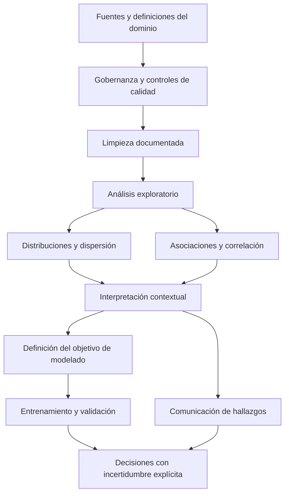

# Clase 7: Análisis exploratorio, correlación y medidas de dispersión

> **Objetivo académico:** Integrar la gobernanza y el análisis exploratorio de datos con la interpretación de correlaciones y medidas de dispersión, distinguiendo patrones descriptivos, hipótesis explicativas y decisiones de modelado sustentadas en evidencia.

## 1. Contexto y marco conceptual

### 1.1. La calidad de los datos como condición del análisis

La sesión conecta la gobernanza de datos con una dificultad recurrente de la analítica empresarial: disponer de muchos registros no garantiza contar con información coherente para tomar decisiones. Fuentes acumuladas sin estructura, criterios compartidos ni almacenamiento adecuado pueden producir inconsistencias cada vez que se realizan cruces, filtros o agregaciones. La limpieza reiterada consume tiempo y retrasa la construcción de reportes y tableros útiles.

La gobernanza busca establecer condiciones de confianza en los datos. En este marco, la estadística permite detectar distribuciones inusuales, valores incompatibles y relaciones que requieren revisión, pero sus resultados dependen de la calidad de las fuentes.

**Enriquecimiento conceptual:** La gobernanza comprende responsabilidades, definiciones, acceso, trazabilidad y controles de calidad; no se reduce a aplicar herramientas estadísticas. También conviene distinguir confidencialidad, relacionada con el acceso autorizado, de confiabilidad, relacionada con la exactitud y consistencia de la información.

### 1.2. El análisis exploratorio como articulación entre datos y decisiones

Los casos desarrollados abarcan supervivencia en el Titanic, accidentes de tránsito, transacciones financieras y rendimiento futbolístico. Sus dominios son distintos, pero comparten una secuencia analítica:

1. Identificar qué representa cada registro y qué significan las variables.
2. Revisar estructura, tipos, faltantes e inconsistencias.
3. Describir distribuciones y asociaciones mediante estadísticas y gráficos.
4. Formular interpretaciones compatibles con el alcance de los datos.
5. Comunicar hallazgos y, cuando corresponda, preparar un modelo predictivo.

El análisis exploratorio de datos, o EDA, permite comprender una fuente antes de modelarla. En la sesión se emplean notebooks de Python para combinar texto, cálculos y visualizaciones, y se destaca el valor del storytelling para comunicar resultados con una secuencia comprensible.

**Enriquecimiento conceptual:** La publicación de un conjunto de datos en un repositorio no garantiza que esté limpio, normalizado o libre de sesgos. La calidad debe comprobarse incluso en fuentes utilizadas habitualmente para aprendizaje automático.



## 2. Fundamentos teóricos y arquitectura

### 2.1. Correlación: dirección y fuerza de asociación

La correlación resume determinados aspectos de la asociación entre dos variables. Su interpretación exige identificar qué relación mide cada coeficiente. En los coeficientes estudiados, los valores pertenecen al intervalo $[-1,1]$: el signo indica dirección y la magnitud expresa fuerza según el criterio correspondiente.

- Una asociación positiva indica que valores mayores de una variable tienden a acompañarse de valores mayores de la otra.
- Una asociación negativa indica que valores mayores de una variable tienden a acompañarse de valores menores de la otra.
- Un valor próximo a cero indica poca asociación del tipo medido; no descarta cualquier relación posible.

**Enriquecimiento conceptual:** La correlación es simétrica: intercambiar las variables no cambia el coeficiente. Por sí sola no establece cuál es independiente, cuál es dependiente ni cuál causa a la otra. Además, concentración de puntos y correlación son propiedades distintas: una nube compacta puede carecer de una dirección de asociación clara.

### 2.2. Correlación de Pearson

Pearson cuantifica asociación lineal. La sesión lo emplea como referencia para interpretar relaciones crecientes y decrecientes y para construir una matriz de correlación.

**Enriquecimiento conceptual:** Para $n$ observaciones emparejadas $(x_i,y_i)$, con $n\geq2$, valores reales y variación no nula en ambas variables, el coeficiente muestral es:

$$
r=\frac{\sum_{i=1}^{n}(x_i-\bar{x})(y_i-\bar{y})}{\sqrt{\sum_{i=1}^{n}(x_i-\bar{x})^2}\sqrt{\sum_{i=1}^{n}(y_i-\bar{y})^2}}.
$$

Aquí $i$ identifica la observación, $x_i$ y $y_i$ son sus valores, y $\bar{x}$ y $\bar{y}$ son las medias muestrales. El coeficiente es adimensional: la normalización elimina las unidades del numerador. Si una variable es constante, el denominador se anula y la correlación no está definida.

El numerador acumula productos de desviaciones respecto de las medias. Si ambas variables suelen situarse simultáneamente por encima o por debajo de sus medias, predominan productos positivos. Si sus desviaciones suelen tener signos opuestos, predominan productos negativos.

Un valor $r=1$ expresa una relación lineal positiva perfecta y $r=-1$ una relación lineal negativa perfecta. Un valor $r=0$ expresa ausencia de asociación lineal, aunque podría existir una relación curva.

**Enriquecimiento conceptual:** Calcular Pearson no exige normalidad. Las condiciones necesarias para pruebas de significación e intervalos de confianza dependen del procedimiento inferencial utilizado. Tampoco un valor elevado de Pearson permite decidir por sí solo entre todos los modelos lineales y no lineales.

### 2.3. Correlación de Spearman

Spearman evalúa asociación monotónica: si el aumento de una variable acompaña consistentemente el aumento o la disminución de otra. La relación puede ser curva siempre que conserve su dirección general.

**Enriquecimiento conceptual:** Spearman se obtiene calculando Pearson sobre los rangos:

$$
\rho_s=\operatorname{corr}\bigl(R(X),R(Y)\bigr).
$$

$X$ e $Y$ representan las variables observadas y $R$ transforma sus valores en posiciones ordenadas. Los empates suelen recibir rangos promedio. El coeficiente $\rho_s$ es adimensional y pertenece a $[-1,1]$ cuando está definido.

En el caso futbolístico se reporta una correlación de Spearman aproximada de $0.71$ entre goles y asistencias. La lectura pertinente es que, en ese conjunto, quienes ocupan posiciones más altas por goles tienden también a ocupar posiciones más altas por asistencias. No significa que anotar más goles produzca más asistencias ni permite deducir hábitos de entrenamiento.

**Enriquecimiento conceptual:** Spearman no contrae físicamente los datos originales. Si una visualización parece más agrupada al utilizar rangos, se ha cambiado la representación. Comparar coeficientes o gráficos exige verificar qué valores se muestran en cada eje.

### 2.4. Correlación de Kendall

Kendall evalúa concordancia entre los ordenamientos de dos variables. La sesión presenta tres escenarios: mismo orden, orden inverso y coincidencia parcial. Sus ejemplos ilustran coeficientes de $1$, $-1$ y aproximadamente $0.33$, respectivamente; el tercer resultado no puede reconstruirse porque no se detalla íntegramente la secuencia utilizada.

**Enriquecimiento conceptual:** Para $n$ observaciones sin empates, la versión tau-a puede expresarse como:

$$
\tau_a=\frac{C-D}{\binom{n}{2}}.
$$

$C$ es el número de pares concordantes y $D$ el de pares discordantes; $\binom{n}{2}=n(n-1)/2$ es el número de pares comparables. Un par es concordante si ambas variables ordenan sus dos observaciones en el mismo sentido y discordante si las ordenan en sentidos opuestos. El coeficiente es adimensional.

Con los ordenamientos $(1,2,3,4)$ y $(1,2,3,4)$, los seis pares son concordantes y $\tau_a=1$. Frente a $(4,3,2,1)$, los seis son discordantes y $\tau_a=-1$. Este último resultado indica asociación inversa perfecta, no ausencia de correlación. Cuando existen empates, debe emplearse una variante adecuada, como tau-b, que los considera en su normalización.

| Coeficiente | Aspecto que resume | Uso pertinente | Límite principal |
| --- | --- | --- | --- |
| Pearson | Asociación lineal de los valores | Variables cuantitativas y patrones aproximadamente lineales | Puede ocultar relaciones curvas y es sensible a valores extremos |
| Spearman | Asociación monotónica de los rangos | Datos ordinales o relaciones monotónicas no lineales | No describe adecuadamente toda relación no monotónica |
| Kendall | Concordancia de pares ordenados | Comparación de ordenamientos y asociación ordinal | Requiere atender a los empates y a la variante utilizada |

### 2.5. Matriz de correlación

La matriz reúne los coeficientes entre pares de variables. En el ejemplo de personas se consideran altura, peso, ingreso, horas trabajadas y ausencias.

**Enriquecimiento conceptual:** Para $p$ variables, la matriz tiene dimensión $p\times p$. Es simétrica y su diagonal contiene unos cuando cada variable tiene varianza no nula. Los pares fuera de la diagonal aparecen dos veces, por lo que leer ambas posiciones como hallazgos independientes duplicaría la información.

La matriz es un instrumento exploratorio. Conviene acompañarla con gráficos de dispersión para detectar valores extremos, relaciones curvas, grupos y restricciones de rango que un coeficiente aislado puede ocultar.

### 2.6. Dispersión: variabilidad de una variable

Mientras la correlación relaciona variables emparejadas, las medidas de dispersión describen cuánto varían los valores de una variable. La sesión desarrolla rango, varianza, desviación estándar y rango intercuartílico.

**Enriquecimiento conceptual:** Para observaciones reales $x_1,\ldots,x_n$, el rango es:

$$
R=x_{\max}-x_{\min}.
$$

$x_{\max}$ y $x_{\min}$ son el máximo y el mínimo. $R$ conserva la unidad original y depende únicamente de los extremos.

Si los $N$ valores constituyen toda la población de interés, con media $\mu$:

$$
\sigma^2=\frac{1}{N}\sum_{i=1}^{N}(x_i-\mu)^2,
\qquad
\sigma=\sqrt{\sigma^2}.
$$

$\sigma^2$ es la varianza poblacional y tiene unidades al cuadrado; $\sigma$ es la desviación estándar poblacional y conserva la unidad original.

Si se dispone de una muestra de tamaño $n>1$, con media $\bar{x}$, el estimador habitual de la varianza poblacional es:

$$
s^2=\frac{1}{n-1}\sum_{i=1}^{n}(x_i-\bar{x})^2,
\qquad
s=\sqrt{s^2}.
$$

Bajo muestreo independiente e idénticamente distribuido y varianza finita, el divisor $n-1$ hace que $s^2$ sea un estimador insesgado de la varianza poblacional. No implica seleccionar automáticamente un subconjunto de registros: pueden aplicarse ambas convenciones a los mismos valores según el propósito del análisis.

El rango intercuartílico es:

$$
RIC=Q_3-Q_1.
$$

$Q_1$ y $Q_3$ son los percentiles 25 y 75. El $RIC$ conserva las unidades originales y resume la amplitud del 50 % central. El percentil 50 es la mediana, que no tiene por qué coincidir con la media aritmética.

## 3. Implementación técnica y lógica de negocio

### 3.1. Flujo técnico observado

La sesión utiliza pandas para leer y explorar archivos CSV, Matplotlib para visualizar datos, NumPy para cálculos numéricos y funciones de `scipy.stats` para los coeficientes de correlación. Los notebooks combinan documentación, código y resultados gráficos.

El procedimiento general consiste en cargar los datos, inspeccionar columnas y tipos, limpiar variables, construir gráficos de dispersión y resumir asociaciones en una matriz. Para la dispersión se calculan extremos, varianzas, desviaciones estándar y percentiles, complementados con un histograma y un diagrama de cajas.

No se dispone del código íntegro de los notebooks. Los fragmentos siguientes son reconstrucciones didácticas y no resultados de una ejecución sobre los archivos originales.

### 3.2. Cálculo de correlaciones

**Enriquecimiento conceptual:** Este fragmento muestra una implementación coherente con las bibliotecas descritas. Presupone un DataFrame `personas` con las columnas indicadas y una revisión previa de tipos y valores imposibles.

```python
import pandas as pd
import matplotlib.pyplot as plt
from scipy.stats import pearsonr, spearmanr, kendalltau

columnas = ["altura", "peso", "ingreso", "horas_trabajadas", "ausencias"]
datos = personas[columnas].apply(pd.to_numeric, errors="coerce")

# Decisión ilustrativa: usar los mismos casos completos en toda la matriz.
completos = datos.dropna()
matriz = completos.corr(method="pearson")

fig, ax = plt.subplots()
imagen = ax.imshow(matriz, vmin=-1, vmax=1, cmap="coolwarm")
ax.set_xticks(range(len(columnas)), labels=columnas, rotation=45, ha="right")
ax.set_yticks(range(len(columnas)), labels=columnas)
fig.colorbar(imagen, ax=ax, label="Correlación de Pearson")
fig.tight_layout()
plt.show()

r, p_pearson = pearsonr(completos["altura"], completos["peso"])
rho, p_spearman = spearmanr(completos["altura"], completos["peso"])
tau, p_kendall = kendalltau(
    completos["altura"], completos["peso"], variant="b"
)
```

`errors="coerce"` convierte entradas no numéricas en faltantes y exige revisar qué información se pierde. `dropna()` utiliza casos completos, lo que facilita comparar coeficientes sobre las mismas personas, pero puede reducir el tamaño analizado e introducir sesgos si los faltantes no son aleatorios. Antes de calcular los coeficientes deben verificarse un tamaño suficiente y variación en ambas columnas.

Los valores `p_pearson`, `p_spearman` y `p_kendall` corresponden a pruebas de asociación según cada función. No se reportan valores numéricos porque no se dispone de los registros. Su interpretación depende de los supuestos de la prueba y no equivale a una medida de importancia práctica.

### 3.3. Ejemplo trabajado de dispersión

Los pesos levantados mencionados en la sesión son, en kilogramos:

$$
5,\ 15,\ 25,\ 35,\ 40,\ 55,\ 80,\ 90,\ 170.
$$

**Enriquecimiento conceptual:** La reconstrucción aritmética permite precisar las medidas del ejemplo. Hay $n=9$ observaciones y su suma es $515\ \text{kg}$, de modo que:

$$
\bar{x}=\frac{515}{9}\approx57.22\ \text{kg},
\qquad
\operatorname{mediana}=40\ \text{kg}.
$$

La diferencia entre media y mediana refleja la influencia del extremo superior. El rango es:

$$
R=170-5=165\ \text{kg}.
$$

La suma de cuadrados respecto de la media es aproximadamente $20655.56\ \text{kg}^2$. Al dividir por nueve o por ocho, respectivamente, se obtiene:

$$
\sigma^2\approx2295.06\ \text{kg}^2,
\qquad
s^2\approx2581.94\ \text{kg}^2.
$$

Sus raíces cuadradas son:

$$
\sigma\approx47.91\ \text{kg},
\qquad
s\approx50.81\ \text{kg}.
$$

Con la convención de percentiles por interpolación lineal utilizada habitualmente en NumPy, $Q_1=25\ \text{kg}$ y $Q_3=80\ \text{kg}$, por lo que:

$$
RIC=80-25=55\ \text{kg}.
$$

La siguiente reconstrucción calcula estas cantidades sin modificar los datos:

```python
import numpy as np

pesos = np.array([5, 15, 25, 35, 40, 55, 80, 90, 170], dtype=float)
q1, mediana, q3 = np.percentile(pesos, [25, 50, 75], method="linear")

resumen = {
    "media_kg": np.mean(pesos),
    "mediana_kg": mediana,
    "rango_kg": np.ptp(pesos),
    "varianza_poblacional_kg2": np.var(pesos, ddof=0),
    "varianza_muestral_kg2": np.var(pesos, ddof=1),
    "desviacion_poblacional_kg": np.std(pesos, ddof=0),
    "desviacion_muestral_kg": np.std(pesos, ddof=1),
    "ric_kg": q3 - q1,
}
```

`ddof=0` utiliza el divisor $n$ y `ddof=1` utiliza $n-1$. La distinción depende de si el objetivo es describir el conjunto completo o estimar la variabilidad de una población a partir de una muestra. Las diferencias entre convenciones de cuantiles pueden ser relevantes en conjuntos pequeños y deben documentarse.

### 3.4. Comunicación y trazabilidad

El caso de accidentes utiliza una herramienta generativa para transformar un informe previo en una narración audiovisual. La secuencia descrita es: análisis en Python, elaboración de un informe con gráficos y producción de la pieza comunicacional a partir de ese informe.

El valor del recurso está en facilitar la comprensión. La validez de las conclusiones continúa dependiendo de los cálculos, de la interpretación y de la correspondencia entre el informe y la narración.

**Enriquecimiento conceptual:** Una herramienta generativa puede proponer explicaciones o redactar resultados, pero debe contrastarse cada afirmación con la tabla o cálculo que la sustenta. En datos empresariales o personales también debe revisarse qué información se comparte con servicios externos.

## 4. Análisis crítico de casos y auditoría práctica

### 4.1. Titanic: descripción, clasificación y límites históricos

El caso presentado reúne 1309 registros y reporta 843 hombres y 466 mujeres. La distribución por clase es de 323 registros en primera, 277 en segunda y 709 en tercera. Se mencionan aproximadamente 500 supervivientes y diferencias descriptivas por sexo, edad y clase.

El análisis sirve para introducir una respuesta binaria —supervivencia o no supervivencia— y una posible regresión logística. Posteriormente se muestra una interfaz que modifica sexo, clase, edad y una variable denominada verbalmente puerta de embarque para obtener una clasificación.

**Enriquecimiento conceptual:** La demostración requiere separar varias cuestiones:

- La clase del pasaje no identifica por sí sola a la tripulación ni a los ingenieros. El conjunto descrito no permite fundamentar la hipótesis histórica sobre su actuación.
- El modelo supervisado estima relaciones a partir de ejemplos etiquetados. El analista define variables, preparación y procedimiento de aprendizaje, pero no debe imponer intuiciones como si fueran probabilidades observadas.
- Las probabilidades citadas verbalmente durante la explicación son ilustrativas; no se proporcionan métricas ni salidas suficientes para validarlas.
- Si la variable corresponde a `Embarked` del conjunto habitual del Titanic, representa el puerto de embarque y no una puerta física próxima a botes. La equivalencia debe verificarse en el diccionario del archivo utilizado.
- La asignación a un bote puede revelar información posterior al proceso que se desea predecir. Su uso como predictor debe revisarse por posible fuga de información.
- Variar entradas de una interfaz muestra el comportamiento de un modelo concreto; no establece reglas históricas universales ni demuestra capacidad de generalización.

**Enriquecimiento conceptual:** En una clasificación binaria, una probabilidad estimada $\hat{p}$ y un umbral $t$, ambos en $[0,1]$, pueden producir una etiqueta mediante:

$$
\hat{y}=\begin{cases}
1, & \hat{p}\geq t,\\
0, & \hat{p}<t.
\end{cases}
$$

$\hat{y}$ es la clase predicha. La elección del umbral depende del propósito y de los costos de error. Una etiqueta positiva no significa certeza, y una predicción de supervivencia tampoco prueba que la persona efectivamente sobrevivió.

La separación entre entrenamiento y prueba, mencionada en la sesión, permite evaluar el modelo sobre observaciones no utilizadas para ajustarlo. No se presentan resultados suficientes para juzgar su rendimiento.

### 4.2. Accidentes de tránsito: frecuencia, proporción y riesgo

Se describe un conjunto de 7 728 394 registros y 46 columnas, referido al período 2016–2023. El análisis reporta aproximadamente un 80 % de observaciones en severidad 2, un máximo horario de 587 472 incidentes en la franja de las 7:00 y más de 1.7 millones de registros en California. También señala más de 2.5 millones de incidentes en condiciones despejadas y una proporción mayor de casos graves dentro de esa categoría climática.

Estos valores se conservan como resultados reportados, sin verificación independiente. La explicación basada en exceso de confianza y velocidad constituye una hipótesis plausible, pero no una conclusión causal establecida por los gráficos descritos.

**Enriquecimiento conceptual:** Deben distinguirse tres cantidades:

| Cantidad | Qué informa | Información necesaria |
| --- | --- | --- |
| Número de incidentes con un clima determinado | Volumen registrado | Conteos por condición climática |
| Proporción de incidentes graves dentro de ese clima | Gravedad condicionada a que exista un incidente registrado | Conteos graves y totales de esa categoría |
| Tasa de incidentes por exposición | Frecuencia relativa de incidentes durante la circulación | Incidentes y exposición comparable por clima |

Si $c$ identifica una condición climática, la proporción de gravedad es:

$$
\hat{p}_{\text{grave}\mid c}=\frac{N_{\text{grave},c}}{N_c}.
$$

$N_{\text{grave},c}$ cuenta incidentes definidos como graves bajo el clima $c$ y $N_c>0$ cuenta todos los incidentes registrados bajo esa condición. La proporción es adimensional y exige definir previamente qué niveles integran la categoría grave.

Una tasa por exposición sería:

$$
\hat{\lambda}_c=\frac{N_c}{E_c},
$$

con $E_c>0$ como exposición, por ejemplo vehículos-kilómetro recorridos bajo ese clima. Sus unidades serían incidentes por vehículo-kilómetro. Más incidentes en días despejados pueden reflejar mayor exposición; no bastan para demostrar mayor riesgo por trayecto o por kilómetro.

**Enriquecimiento conceptual:** La escala de severidad debe interpretarse con el diccionario de la fuente. Una codificación de impacto vial no debe traducirse automáticamente a lesiones o mortalidad. Tampoco el gran tamaño del conjunto elimina sesgos de cobertura ni justifica extrapolar directamente los hallazgos a otros países. Para evaluar la hipótesis conductual harían falta variables y diseños que consideren velocidad, tráfico, infraestructura, horario y otros factores de confusión.

### 4.3. Transacciones financieras: integración y tratamiento de faltantes

El caso financiero combina información de tarjetas, transacciones y usuarios. Se describen operaciones de limpieza de fechas, eliminación de símbolos monetarios y completado de códigos postales mediante el valor más frecuente del estado. El análisis explora tipos y marcas de tarjeta, canales de operación, montos, distribución geográfica, edad y actividad de usuarios.

La discusión identifica posibles aplicaciones: segmentación comercial, monitoreo de operaciones atípicas, análisis de concentración en comercios y diseño de estrategias de fidelización.

La exposición contiene una contradicción: inicialmente indica predominio de tarjetas de débito, pero posteriormente menciona mayor presencia de crédito. Sin las tablas originales no puede resolverse. Los patrones temporales y demográficos también deben tratarse como resultados reportados, pues no se muestran cálculos suficientes para auditarlos.

**Enriquecimiento conceptual:** Las principales revisiones técnicas son:

- Sustituir una fecha inválida por una fecha arbitraria puede fabricar patrones. Conviene conservar el original, marcar la inconsistencia y justificar cualquier corrección.
- Imputar el código postal modal de un estado puede aumentar artificialmente la concentración espacial. El código postal debe tratarse como identificador, preservando ceros iniciales cuando corresponda.
- Eliminar el símbolo monetario requiere comprobar separadores decimales, signos, moneda y posibles devoluciones.
- Integrar las tres fuentes exige verificar claves y cardinalidades para evitar que una unión multiplique transacciones e infle los montos.
- Un valor extremo no equivale a fraude; es una señal que requiere contexto y validación.
- La mayor cantidad de tarjetas o transacciones no prueba mayor rentabilidad: se necesitan ingresos, costos, pérdidas y otras magnitudes económicas pertinentes.

Las comparaciones por chip y banda magnética describen el período de los datos. No permiten establecer por sí solas el estado actual de todos los sistemas de pago.

### 4.4. Fútbol: rankings y decisiones de ponderación

El caso de nominados al Balón de Oro 2024 comienza con goles y asistencias, incorpora minutos y posiciones, y compara goles observados con goles esperados. Posteriormente añade títulos, participación, disciplina e impacto colectivo para construir un puntaje compuesto.

Se reporta que el criterio ofensivo favorece a Harry Kane y que la combinación ampliada sitúa a Federico Valverde en primera posición. Son resultados de los criterios construidos en el análisis, no demostraciones de un ganador objetivamente correcto. No se dispone de las fórmulas completas, los pesos ni las tablas para reproducir el ranking.

**Enriquecimiento conceptual:** La evaluación del procedimiento debe considerar que:

- Goles y asistencias favorecen determinadas posiciones y no representan por completo el rendimiento deportivo.
- Los goles esperados dependen del modelo que los estima; no son una cuota que un jugador deba cumplir.
- Comparar jugadores requiere alinear período, competición y minutos de exposición.
- Combinar títulos, disciplina y producción ofensiva exige definir escalas, normalización, signos y ponderaciones.
- Un puntaje ponderado expresa decisiones normativas del analista. Cambiar los pesos puede modificar el orden.
- El desacuerdo con un resultado oficial no demuestra, por sí solo, sesgo de votación.

La proyección de futuras posiciones requeriría definir primero el objetivo: ganador, posición o puntuación. Esa definición, junto con datos históricos y validación temporal, orientaría el método; el gráfico exploratorio no basta para justificar una regresión polinómica.

### 4.5. Personas: correlaciones y lectura de gráficos

El ejemplo de aproximadamente mil personas explora altura, peso, ingreso, horas trabajadas y ausencias. La síntesis verbal reporta los siguientes coeficientes aproximados:

| Variables | Coeficiente reportado | Interpretación descriptiva |
| --- | --- | --- |
| Altura y peso | Alrededor de $0.90$; hay menciones verbales cercanas | Asociación lineal positiva elevada |
| Ingreso y horas trabajadas | $0.63$ | Asociación lineal positiva |
| Ingreso y ausencias | $-0.97$ | Asociación lineal negativa muy elevada |
| Horas trabajadas y ausencias | $-0.60$ | Asociación lineal negativa |

Las unidades del ingreso y el período de cómputo de horas y ausencias no quedan establecidos con precisión. Tampoco se acredita si los datos son observacionales o sintéticos. Estas limitaciones impiden generalizar los resultados a una población laboral concreta.

**Enriquecimiento conceptual:** La lectura requiere corregir varias confusiones:

- Una nube concentrada en el centro no demuestra asociación entre ingreso y peso.
- Las franjas horizontales del gráfico de ausencias son esperables porque las ausencias se cuentan con enteros. No constituyen por sí mismas categorías de aprendizaje automático.
- La posibilidad de que ciertas jerarquías no registren ausencias es una hipótesis sobre el proceso de medición, no un hecho demostrado.
- Una correlación alta no es automáticamente estadísticamente significativa; para esa afirmación se requiere el análisis inferencial correspondiente.
- Altura y peso no permiten diagnosticar por sí solos anemia, enfermedad o condición física. La asociación poblacional tampoco establece un peso individual adecuado.

### 4.6. Levantamiento de pesos: boxplot y heterogeneidad

El ejemplo de nueve levantamientos muestra gran variación, con un máximo de 170 kg y una desviación estándar poblacional cercana a 47.91 kg. Se propone segmentar niveles de capacidad para interpretar mejor la heterogeneidad.

**Enriquecimiento conceptual:** En un boxplot convencional, la caja contiene el 50 % central entre $Q_1$ y $Q_3$, y su línea interior representa la mediana. Los bigotes no tienen por qué coincidir con mínimo y máximo. Con la regla de $1.5\,RIC$, el límite superior es:

$$
Q_3+1.5\,RIC=80+1.5(55)=162.5\ \text{kg}.
$$

El valor de 170 kg supera ese límite y se marca como potencialmente atípico. La regla es exploratoria: no demuestra que el registro sea incorrecto ni que deba eliminarse.

**Enriquecimiento conceptual:** La propuesta de niveles puede servir como segmentación descriptiva, pero los umbrales requieren justificación y cobertura completa de los valores posibles. Segmentar no crea correlación ni reduce la variabilidad original del conjunto. Una variable aislada puede ser muy dispersa sin que tenga sentido hablar de correlación, porque falta una segunda variable emparejada.

## 5. Principios de diseño, buenas prácticas y anti-patrones

### 5.1. Definir el problema antes de seleccionar el algoritmo

La sesión vincula el EDA con modelos de regresión, clasificación y agrupamiento. Esa conexión es pertinente siempre que la elección responda al objetivo.

**Enriquecimiento conceptual:** La forma de una nube de puntos no determina por sí sola el tipo de aprendizaje:

| Objetivo | Tipo de problema | Ejemplo vinculado con la sesión |
| --- | --- | --- |
| Predecir una cantidad numérica | Regresión supervisada | Estimar ingreso o peso levantado a partir de predictores |
| Predecir una categoría conocida | Clasificación supervisada | Estimar supervivencia o una clase de operación |
| Descubrir grupos sin etiquetas previas | Agrupamiento no supervisado | Explorar perfiles de usuarios o deportistas |

K-means es un método de agrupamiento, no un clasificador supervisado por sí mismo. Los árboles y bosques pueden utilizarse para regresión o clasificación según su formulación. Una respuesta de conteo, como ausencias, también puede requerir modelos específicos si una regresión ordinaria genera predicciones incompatibles con su dominio.

### 5.2. Mantener separados descripción, explicación y predicción

Describir una asociación indica qué ocurre en los datos. Explicarla exige sustentar un mecanismo y considerar alternativas. Predecir exige medir el desempeño sobre observaciones no utilizadas para ajustar el modelo.

**Enriquecimiento conceptual:** Un coeficiente alto no demuestra causalidad ni garantiza utilidad predictiva. Uno bajo tampoco descarta relaciones no lineales o interacciones. La selección de variables no debe basarse exclusivamente en conservar las correlaciones de mayor magnitud y descartar las demás.

### 5.3. Documentar la limpieza y conservar la trazabilidad

Una transformación debe tener una razón vinculada con el significado de la variable. Es preferible conservar datos originales, registrar reglas y cuantificar cuántos registros cambian o se excluyen.

**Enriquecimiento conceptual:** Evitar faltantes a cualquier costo puede ser más perjudicial que mantenerlos explícitos. La imputación debe justificarse por el mecanismo de ausencia y por su impacto en el análisis. En integración de fuentes, revisar duplicados y cardinalidades es tan importante como convertir tipos.

### 5.4. Interpretar la variabilidad en contexto

La desviación estándar expresa dispersión respecto de la media en las unidades originales. Su magnitud debe evaluarse frente a la escala, al dominio y al objetivo del análisis. Un rango grande o una desviación elevada no obliga a agrupar ni invalida automáticamente una predicción.

**Enriquecimiento conceptual:** La variabilidad total se descompone en variación dentro de grupos y entre grupos. La segmentación puede revelar estructura y hacer más homogéneos algunos subconjuntos, pero no elimina la heterogeneidad del conjunto completo. Debe mejorar la interpretación o el desempeño evaluado, no solamente producir estadísticas menores.

### 5.5. Comunicar con claridad sin exceder la evidencia

El storytelling debe hacer visibles el problema, la evidencia, los límites y las implicaciones. Un notebook documentado mantiene cerca los cálculos y su interpretación; un tablero o una narración audiovisual facilita su comunicación a otras audiencias.

**Enriquecimiento conceptual:** Son anti-patrones convertir un conteo en una afirmación de riesgo, presentar una hipótesis conductual como causalidad demostrada, interpretar una etiqueta del modelo como certeza y permitir que una herramienta generativa añada explicaciones no sustentadas por el análisis.

## 6. Síntesis conceptual y profundización académica

La sesión articula tres componentes de la práctica analítica: calidad de las fuentes, exploración estadística e interpretación para decisiones. La gobernanza sostiene la confiabilidad de los registros; el EDA caracteriza distribuciones y asociaciones; la comunicación transforma resultados en argumentos comprensibles.

Pearson, Spearman y Kendall ofrecen perspectivas distintas. Pearson resume asociación lineal de valores; Spearman, asociación monotónica de rangos; Kendall, concordancia entre pares ordenados. La matriz de correlación reúne asociaciones bivariadas, pero necesita gráficos y conocimiento del dominio para interpretarse adecuadamente.

El rango, la varianza, la desviación estándar y el rango intercuartílico describen aspectos complementarios de la dispersión. El ejemplo de levantamiento de pesos muestra por qué importa distinguir media de mediana, unidades originales de unidades al cuadrado y descripción poblacional de estimación muestral.

Los casos aplicados dejan una exigencia común: las conclusiones deben corresponder a la información disponible. En Titanic, una clasificación no reconstruye por sí sola la historia; en accidentes, los conteos no sustituyen denominadores de exposición; en finanzas, la limpieza no debe fabricar registros; y en rankings deportivos, las ponderaciones forman parte de la definición del resultado.

**Enriquecimiento conceptual:** Las líneas de profundización más pertinentes son la robustez frente a valores extremos, la incertidumbre de los coeficientes, los mecanismos de datos faltantes, la validación fuera de muestra y la separación entre asociación y causalidad. Estas conexiones permiten pasar de una exploración visual convincente a una inferencia y un modelado defendibles.
