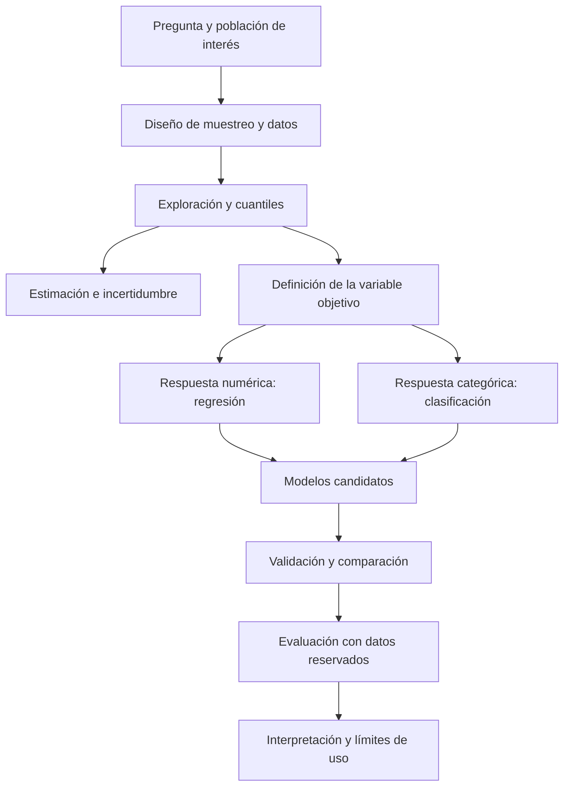

# Clase 8: Cuantiles, inferencia muestral y selección de modelos predictivos

> **Objetivo académico:** Articular medidas de posición, incertidumbre estadística y diseños de muestreo con la formulación, selección y evaluación de modelos de regresión y clasificación, distinguiendo exploración visual, evidencia empírica y supuestos inferenciales.

## 1. Contexto y marco conceptual

La sesión conecta el análisis exploratorio de datos con la inferencia y el aprendizaje supervisado. El recorrido comienza con los cuantiles, continúa con intervalos de confianza y muestreo, y culmina en regresión lineal simple, regresión múltiple, selección del grado polinomial y regresión logística. El hilo conductor consiste en transformar observaciones en conclusiones justificadas y predicciones evaluables.

Conviene separar tres propósitos: describir la distribución observada, estimar propiedades de una población y predecir respuestas de nuevas observaciones. Un cuantil describe posición relativa; un intervalo de confianza expresa incertidumbre sobre un parámetro; un modelo predictivo aproxima una relación entre características y respuesta. Ninguno sustituye automáticamente a los demás.



**Enriquecimiento conceptual:** La distinción entre regresión y clasificación depende del tipo de respuesta que se desea predecir, no de la forma de una nube de puntos. Una frontera recta puede separar categorías, mientras que una relación curva puede describir una respuesta numérica. Asimismo, regresión y clasificación son tareas centrales del aprendizaje supervisado, pero no agotan todo el aprendizaje automático: la sesión menciona también el aprendizaje no supervisado y las redes neuronales sin desarrollarlos técnicamente.

## 2. Fundamentos teóricos y arquitectura

### 2.1. Cuantiles y partición de una distribución

Los cuantiles ubican puntos de corte en datos ordenados. En la sesión se comparan mediana, terciles, cuartiles, quintiles, deciles y percentiles mediante datos simulados y gráficos.

| Partición | Número de grupos | Probabilidades de los cortes internos |
| --- | --- | --- |
| Mediana | 2 | $0.5$ |
| Terciles | 3 | $1/3,\;2/3$ |
| Cuartiles | 4 | $0.25,\;0.50,\;0.75$ |
| Quintiles | 5 | $0.20,\;0.40,\;0.60,\;0.80$ |
| Deciles | 10 | $0.10,\;0.20,\ldots,0.90$ |
| Percentiles | 100 | $0.01,\;0.02,\ldots,0.99$ |

**Enriquecimiento conceptual:** Para una variable aleatoria real $X$ con función de distribución acumulada $F$, el cuantil de orden $p$, con $0<p<1$, puede definirse mediante:

$$
Q(p)=\inf\{x\in\mathbb{R}:F(x)\geq p\}.
$$

Aquí $F(x)=P(X\leq x)$ y $Q(p)$ conserva las unidades de $X$. La definición no exige normalidad. En distribuciones discretas o muestras con valores repetidos, los cortes no garantizan grupos con exactamente la misma cantidad de observaciones. Además, los cuantiles muestrales pueden variar ligeramente según la convención de interpolación utilizada por el software.

Los grupos definidos por cuantiles tienen aproximadamente la misma proporción de observaciones, pero sus amplitudes numéricas pueden ser distintas. Utilizar percentiles aumenta la resolución de la descripción; no introduce por sí mismo sesgo estadístico, aunque en muestras pequeñas produce cortes menos estables.

### 2.2. Dispersión, varianza y desviación estándar

La fuente relaciona la dispersión de los datos con la incertidumbre de las estimaciones. Esa conexión requiere distinguir la variabilidad entre individuos de la variabilidad de un estimador.

**Enriquecimiento conceptual:** Para observaciones reales $x_1,\ldots,x_n$, con $n>1$, la media, la varianza muestral y la desviación estándar muestral son:

$$
\bar{x}=\frac{1}{n}\sum_{i=1}^{n}x_i,
\qquad
s^2=\frac{1}{n-1}\sum_{i=1}^{n}(x_i-\bar{x})^2,
\qquad
s=\sqrt{s^2}.
$$

El índice $i$ identifica cada observación y $n$ es el tamaño de la muestra. Si $x_i$ se mide en centímetros, $s^2$ se expresa en centímetros cuadrados y $s$ en centímetros. Los cuadrados evitan que desviaciones positivas y negativas se cancelen y dan mayor peso a desviaciones grandes. La raíz recupera la escala de la variable: no deshace una duplicación de valores ni una potencia cúbica.

Para observaciones independientes e idénticamente distribuidas con varianza finita, el error estándar estimado de la media es:

$$
\widehat{\operatorname{SE}}(\bar{x})=\frac{s}{\sqrt{n}}.
$$

Este error estándar mide la incertidumbre de la media como estimador. A dispersión fija, una muestra mayor reduce esa incertidumbre; a tamaño fijo, una dispersión mayor la incrementa. La relación debe adaptarse cuando el diseño incluye dependencia, conglomerados o ponderaciones.

### 2.3. Normalidad e intervalos de confianza

En la sesión se emplean estaturas para ilustrar una distribución aproximadamente acampanada y se consideran niveles de confianza del 90 %, 95 % y 99 %. El ejemplo simulado contempla 100 observaciones, una media generadora de 170 cm y una desviación estándar generadora de 8 cm.

**Enriquecimiento conceptual:** No todos los datos siguen una distribución normal. La cercanía entre media, mediana y moda puede ser compatible con simetría, pero no demuestra normalidad. Agrupar subpoblaciones con distribuciones diferentes también puede producir asimetría o varias modas.

Un intervalo de confianza frecuentista procede de un método que, al repetir el muestreo bajo sus supuestos, contiene el parámetro verdadero en una proporción especificada de ocasiones. El nivel de confianza no representa el porcentaje de observaciones dentro del intervalo ni una medida automática de calidad del conjunto de datos.

Si las observaciones son independientes y normales, y la desviación estándar poblacional $\sigma$ es conocida, un intervalo bilateral para la media poblacional $\mu$ es:

$$
\bar{x}\pm z_{1-\alpha/2}\frac{\sigma}{\sqrt{n}}.
$$

Aquí $\mu$ y $\bar{x}$ tienen las unidades de la variable; $\sigma>0$ es su desviación estándar poblacional; $n$ es el tamaño muestral; $\alpha\in(0,1)$ es la tasa de no cobertura; y $z_{1-\alpha/2}$ es el cuantil de la normal estándar. El nivel de confianza es $1-\alpha$. Con muestras suficientemente grandes, una aproximación normal puede justificarse bajo condiciones adicionales sin exigir normalidad exacta de las observaciones.

Cuando $\sigma$ es desconocida y se estima con $s$, bajo normalidad corresponde el intervalo:

$$
\bar{x}\pm t_{1-\alpha/2,n-1}\frac{s}{\sqrt{n}},
$$

con $t_{1-\alpha/2,n-1}$ como cuantil de Student con $n-1$ grados de libertad. Los intervalos para proporciones o medianas requieren procedimientos específicos: no se obtienen sustituyendo el nombre del parámetro en la fórmula de la media.

**Enriquecimiento conceptual — ejemplo trabajado:** Si, para ilustrar el mecanismo, la media observada fuese exactamente 170 cm y se conociera $\sigma=8$ cm con $n=100$, el error estándar sería $8/\sqrt{100}=0.8$ cm. Para una confianza del 95 %, el margen normal aproximado sería $1.96\times0.8=1.568$ cm y el intervalo sería $[168.432,\;171.568]$ cm. Este cálculo es ilustrativo y no reproduce una salida observada del notebook.

A igualdad de datos y método, aumentar el nivel de confianza ensancha el intervalo. No mejora por sí mismo el muestreo, la representatividad ni la capacidad predictiva.

### 2.4. Población, muestra y mecanismos de selección

La población es el conjunto sobre el que se pretende concluir; la muestra es el subconjunto observado. La sesión aborda selección aleatoria simple, sistemática, estratificada y por conglomerados.

| Diseño | Mecanismo | Aspecto que debe revisarse |
| --- | --- | --- |
| Aleatorio simple | Selección aleatoria de unidades desde un marco definido | Cobertura del marco y probabilidades de inclusión |
| Sistemático | Inicio aleatorio y selección a intervalos regulares | Posible periodicidad en el orden de las unidades |
| Estratificado | División en estratos y selección dentro de cada uno | Asignación de tamaños, aleatorización y ponderaciones |
| Por conglomerados | Selección de grupos y observación de todas o algunas de sus unidades | Dependencia intragrupo y efecto del diseño |

**Enriquecimiento conceptual:** En el muestreo sistemático, un intervalo orientativo es $k\approx N/n$, donde $N$ es el tamaño de la población accesible y $n$ el tamaño muestral deseado. Su aplicación requiere definir el inicio aleatorio y el tratamiento de extremos o redondeos. Elegir siempre una posición central sin aleatorización no garantiza un diseño probabilístico.

En la estratificación se busca representar subpoblaciones relevantes; en conglomerados se seleccionan grupos que suelen facilitar la recolección. Elegir cuotas por características sin selección aleatoria dentro de ellas no equivale necesariamente a muestreo estratificado probabilístico.

## 3. Implementación técnica y lógica de negocio

### 3.1. Herramientas y alcance de la evidencia

La sesión emplea NumPy para simulación y cálculo numérico; pandas para lectura y organización de datos; Matplotlib y Seaborn para visualización; SciPy para funciones estadísticas; y scikit-learn para partición, transformación y modelado. Se mencionan `LinearRegression`, `LogisticRegression`, `PolynomialFeatures`, `train_test_split` y `StandardScaler`.

El código íntegro no aparece en la transcripción. Por ello, los fragmentos siguientes son reconstrucciones mínimas identificadas como enriquecimiento, sin afirmar que reproduzcan los notebooks originales o sus resultados.

### 3.2. Cuantiles con NumPy

La demostración describe la generación de un arreglo aleatorio y un bucle que recorre distintas particiones para dibujar sus cortes sobre la distribución.

**Enriquecimiento conceptual — reconstrucción mínima:**

```python
import numpy as np

# datos: vector numérico unidimensional previamente validado
probabilidades = np.array([0.25, 0.50, 0.75])
cuartiles = np.quantile(datos, probabilidades)
```

`probabilidades` contiene niveles acumulados adimensionales; `cuartiles` contiene los valores correspondientes en la escala de `datos`. Antes del cálculo deben revisarse valores ausentes, unidades y forma del arreglo. Para otras particiones cambian las probabilidades, no la naturaleza del procedimiento.

### 3.3. Compatibilidad de SciPy y significado de los argumentos

La sesión documenta un error al invocar una función `interval` con `alpha`: la firma disponible requiere `confidence`. El cambio permite continuar con los niveles de confianza considerados.

**Enriquecimiento conceptual:** La correspondencia depende del significado del argumento. Si `confidence` representa cobertura, para un intervalo del 95 % recibe `0.95`; si $\alpha$ representa no cobertura en la notación matemática, entonces $\alpha=0.05$. No deben intercambiarse esos valores por semejanza de nombres.

Además, una función que devuelve un intervalo central de una distribución no construye automáticamente un intervalo para la media. Para ese propósito, la localización y la escala deben representar el estimador y su error estándar, y debe seleccionarse la distribución de referencia apropiada. Es necesario revisar firma, versión y semántica, además de corregir el error de ejecución.

### 3.4. Muestreo del conjunto de diabetes

El conjunto descrito contiene 768 filas y dos variables: índice de masa corporal y glucosa. Se selecciona aleatoriamente el 10 %, obteniendo 77 registros según la salida relatada. El interés es mostrar cómo explorar una muestra en lugar de recorrer todos los registros.

**Enriquecimiento conceptual — reconstrucción mínima:**

```python
# df: DataFrame previamente cargado y validado
muestra = df.sample(frac=0.10, replace=False, random_state=42)
```

`frac=0.10` expresa la fracción solicitada; `replace=False` evita repetir registros, y `random_state` permite reproducir la selección. El valor de la semilla es ilustrativo. La reproducibilidad no demuestra representatividad.

**Enriquecimiento conceptual:** El índice de masa corporal se calcula como masa en kilogramos dividida por estatura en metros al cuadrado y se expresa en kg/m². Es un indicador indirecto y no una medición directa del porcentaje de grasa corporal. Los valores de glucosa requieren unidades, condiciones de medición y contexto clínico; la información de la transcripción no permite establecer reglas diagnósticas fiables.

### 3.5. Regresión lineal simple y múltiple

El caso de producción contiene horas trabajadas, horas de descanso y productos terminados. En el modelo simple, las horas trabajadas son el predictor y los productos terminados la respuesta. La sesión describe una nube ascendente y una pendiente positiva; no aporta resultados completos verificables.

**Enriquecimiento conceptual:** El modelo simple se expresa como:

$$
Y_i=\beta_0+\beta_1X_i+\varepsilon_i.
$$

$Y_i$ es el número de productos terminados en la observación $i$; $X_i$ son las horas trabajadas; $\beta_0$ es el intercepto, medido en productos; $\beta_1$ es la variación media asociada a una hora adicional, en productos por hora; y $\varepsilon_i$ recoge variación no explicada. Su interpretación como media condicional presupone $E(\varepsilon_i\mid X_i)=0$. Un intercepto en cero horas puede carecer de interpretación operativa si ese valor está fuera del rango observado.

El modelo múltiple incorpora descanso:

$$
Y_i=\beta_0+\beta_1X_{i1}+\beta_2X_{i2}+\varepsilon_i.
$$

$X_{i1}$ representa horas trabajadas y $X_{i2}$ horas de descanso en una ventana temporal consistente. Cada pendiente describe una asociación manteniendo fijo el otro predictor. Con dos predictores, la respuesta ajustada puede visualizarse como un plano tridimensional.

**Enriquecimiento conceptual:** Regresión múltiple significa varios predictores; regresión polinomial significa incorporar potencias o productos de predictores. No son sinónimos. Un modelo polinomial puede seguir siendo lineal en sus coeficientes. Los papeles de respuesta y predictores tampoco se intercambian sin reformular la pregunta y la interpretación.

### 3.6. Selección del grado polinomial y validación

La demostración compara grados entre 1 y 15 mediante errores de entrenamiento y validación y relata la selección de grado ocho para un conjunto particular. Las cifras transcritas son incompletas, de modo que no permiten reproducir ni confirmar esa selección.

**Enriquecimiento conceptual:** Para un predictor real $x$, un modelo de grado $d$, entero positivo, adopta la forma:

$$
\hat{y}(x)=\hat{\beta}_0+\hat{\beta}_1x+\cdots+\hat{\beta}_dx^d.
$$

$\hat{y}$ es la respuesta estimada y $\hat{\beta}_j$ el coeficiente ajustado del término de grado $j$. Sus unidades deben compensar las de $x^j$ para que cada término tenga unidades de respuesta. El grado es polinomial, no exponencial.

El error cuadrático medio sobre $m$ observaciones de evaluación es:

$$
\operatorname{MSE}=\frac{1}{m}\sum_{i=1}^{m}(y_i-\hat{y}_i)^2.
$$

Aquí $y_i$ es la respuesta observada, $\hat{y}_i$ la predicción y $m>0$ la cantidad de casos evaluados. El MSE se expresa en unidades de respuesta al cuadrado y penaliza especialmente errores grandes. Se compara entre modelos evaluados sobre datos y escalas compatibles.

En validación cruzada, diferentes particiones alternan su función de entrenamiento y validación. La selección debe apoyarse en rendimiento de validación, no en el mínimo error de entrenamiento. Un conjunto final de prueba se reserva para estimar el comportamiento del procedimiento seleccionado. La validación cruzada también es aplicable a clasificación, con métricas adecuadas a esa tarea.

### 3.7. Regresión logística para defectos de producción

El caso logístico utiliza tamaño del lote y tiempo de entrega para predecir una etiqueta binaria de defecto. La sesión describe dos regiones de decisión con cierta superposición de clases. Se menciona el ajuste con `LogisticRegression`, el solucionador `liblinear` y el escalado de características. Las unidades temporales y las predicciones hipotéticas no quedan establecidas de manera fiable.

**Enriquecimiento conceptual:** Si $Y=1$ representa defecto y $Y=0$ ausencia de defecto, la probabilidad modelada es:

$$
P(Y=1\mid\mathbf{x})=\frac{1}{1+\exp[-(\beta_0+\beta_1x_1+\beta_2x_2)]}.
$$

$\mathbf{x}=(x_1,x_2)$ contiene tamaño del lote y tiempo de entrega; $\beta_0,\beta_1,\beta_2$ son parámetros ajustados. El argumento de la exponencial debe ser adimensional, y la salida pertenece a $(0,1)$. Con un umbral $\tau\in(0,1)$ se predice defecto cuando esa probabilidad es al menos $\tau$.

Sin términos adicionales, la frontera de decisión es lineal en las características de entrada, aunque la probabilidad tenga forma sigmoide. Una malla sirve para visualizar las predicciones en el espacio de características; no constituye otro tipo de modelo. El escalador debe ajustarse exclusivamente con entrenamiento y aplicarse después a los demás datos.

## 4. Análisis crítico de casos y auditoría práctica

### 4.1. Inferencia desde una muestra clínica

Seleccionar 77 registros de un archivo permite describir ese subconjunto y, con un diseño adecuado, estimar propiedades del conjunto de referencia. No demuestra que cada una de las 768 personas comparta una condición clínica. Tampoco convierte automáticamente el archivo en una muestra representativa de una población externa.

**Enriquecimiento conceptual:** La inferencia debe declarar población objetivo, marco de selección, mecanismo de muestreo, posibles ausencias y calidad de medición. Una confianza del 95 % no equivale a 95 % de aciertos individuales ni a un margen de error de cinco puntos porcentuales. El margen depende del estimador, del tamaño de muestra, de la dispersión y del diseño.

### 4.2. Producción, descanso y causalidad

La asociación positiva entre trabajo y producción es una hipótesis plausible, pero no demuestra crecimiento indefinido. Fatiga, capacidad instalada, complejidad del producto y organización del trabajo pueden cambiar la relación.

**Enriquecimiento conceptual:** El descanso no debe interpretarse únicamente como pérdida de tiempo productivo: puede estar asociado con recuperación y reducción de errores. Si horas de trabajo y descanso están restringidas por una jornada fija, su dependencia puede dificultar separar sus efectos estadísticos. Una regresión observacional identifica asociaciones condicionadas; afirmar efectos causales requiere supuestos y diseño adicionales.

La fuente menciona correlación y coeficiente de determinación como apoyo al análisis visual.

**Enriquecimiento conceptual:** Una correlación alta no demuestra linealidad, ausencia de puntos influyentes o causalidad. Un valor alto del coeficiente de determinación tampoco garantiza predicción adecuada fuera de muestra. La revisión de residuos y la evaluación independiente aportan información que el gráfico de la recta y una medida global no capturan.

### 4.3. Ciclos comerciales y alcance del pronóstico

Los ejemplos de bebidas y ciclos de vida de productos ilustran crecimiento, madurez, declive e intervenciones comerciales. Su función es motivar que la forma de la relación puede cambiar y que la gestión utiliza indicadores históricos para orientar decisiones. La sesión no aporta series ni evidencia que permita verificar las afirmaciones comerciales específicas.

**Enriquecimiento conceptual:** Una parábola representa una función cuadrática, no una hipérbola. Un polinomio cúbico no produce oscilaciones indefinidas ni garantiza que las ventas recuperen su crecimiento. Los ejemplos comerciales deben entenderse como analogías, no como leyes matemáticas del mercado.

Un pronóstico o *forecast* estima valores futuros a partir de información disponible. Extrapolar polinomios lejos del rango observado puede generar valores extremos o incompatibles con el negocio. Para datos temporales, la evaluación debe respetar el orden cronológico; una partición aleatoria puede ocultar dificultades reales de predicción futura. Las series temporales y ARIMA se mencionan en la fuente, pero no se desarrollan sus fundamentos o supuestos.

### 4.4. Fronteras de clasificación y geometría

Las figuras descritas incluyen clases separadas aproximadamente por una línea, una clase concentrada en el centro y otra alrededor, y regiones separadas con una etiqueta común. Los ejemplos muestran que las fronteras pueden requerir distinta flexibilidad.

**Enriquecimiento conceptual:** La regresión logística con características originales no representa por sí sola una frontera circular o varias regiones desconectadas. Podría requerir transformaciones, interacciones o un modelo distinto. Árboles, bosques aleatorios, vecinos cercanos y máquinas de vectores de soporte son alternativas mencionadas, pero su elección exige evaluación y ajuste, además de inspección visual. Algunos de estos métodos también disponen de variantes para regresión.

### 4.5. Defectos, probabilidades y decisiones económicas

En el ejemplo verbal, 30 elementos defectuosos de 50 representan el 60 %. Esa frecuencia global aporta información descriptiva, pero no basta para predecir un lote condicionado por tiempo y tamaño.

**Enriquecimiento conceptual:** Modificar entradas hasta que cambie una etiqueta permite observar la frontera aprendida, pero no descubre necesariamente un punto operativo óptimo. La optimización exige considerar costes de falsos positivos y falsos negativos, restricciones productivas e incertidumbre. Si tiempos muy bajos y muy altos aumentaran el riesgo, una relación logística lineal en tiempo podría ser insuficiente.

La matriz de confusión se anuncia, pero no se desarrolla en la fuente. No se dispone de conteos de aciertos o errores ni de métricas que permitan evaluar el clasificador demostrado.

## 5. Principios de diseño, buenas prácticas y anti-patrones

| Principio | Justificación | Anti-patrón que debe evitarse |
| --- | --- | --- |
| Formular primero la respuesta objetivo | Determina la tarea y las métricas pertinentes | Elegir clasificación únicamente por la apariencia de los puntos |
| Declarar población y selección | Delimita el alcance de las conclusiones | Suponer que toda muestra aleatoria de un archivo representa cualquier población |
| Separar desviación estándar y error estándar | Distingue heterogeneidad individual e incertidumbre del estimador | Usar dispersión individual como escala de un intervalo para la media |
| Conservar variabilidad legítima | Permite representar el fenómeno real | Eliminar observaciones solo para estrechar intervalos o mejorar un ajuste |
| Reservar datos para evaluación | Reduce el optimismo en la estimación de rendimiento | Seleccionar y reportar el modelo sobre los mismos datos |
| Ajustar transformaciones dentro de entrenamiento | Evita incorporar información de validación | Escalar todo el conjunto antes de dividirlo |
| Evaluar complejidad y estabilidad | Favorece generalización e interpretación | Aumentar el grado polinomial porque baja el error de entrenamiento |
| Respetar unidades, tipos y esquema | Mantiene el significado de entradas y salidas | Aplicar un notebook a cualquier archivo sin revisar compatibilidad |
| Revisar límites de extrapolación | Evita predicciones fuera del soporte empírico | Prolongar indefinidamente tendencias lineales o polinomiales |
| Verificar API y significado estadístico | Asegura que el cálculo ejecutado corresponde al problema | Corregir un argumento sin revisar lo que representa |

**Enriquecimiento conceptual:** Con más de tres variables siguen existiendo recursos visuales útiles, como proyecciones y gráficos por pares. Su limitación es que muestran vistas parciales y pueden ocultar interacciones. La dificultad de representar todas las dimensiones simultáneamente no impide ajustar modelos multivariables, pero aumenta la importancia de la evaluación y del razonamiento sustantivo.

## 6. Síntesis conceptual y profundización académica

La clase articula una secuencia de decisiones: describir distribuciones, reconocer dispersión, seleccionar observaciones, estimar incertidumbre, definir una respuesta y comparar modelos. Los cuantiles resumen posiciones; el muestreo condiciona qué puede inferirse; los intervalos cuantifican incertidumbre bajo supuestos; y los modelos predictivos requieren evaluación con información que no haya determinado su ajuste.

La regresión lineal simple relaciona una respuesta numérica con un predictor; la múltiple incorpora varios; la polinomial amplía la forma funcional mediante potencias; y la logística estima probabilidades de una respuesta categórica. La apariencia visual orienta hipótesis, pero no reemplaza la definición del objetivo, la revisión de supuestos ni la validación.

**Enriquecimiento conceptual:** La selección de complejidad puede comprenderse mediante el compromiso entre sesgo y varianza del estimador. Un modelo poco flexible puede omitir estructura relevante, mientras que uno excesivamente flexible puede seguir ruido particular de la muestra. Esta varianza del estimador se refiere a su sensibilidad a distintas muestras y no debe confundirse con la varianza descriptiva de las observaciones.

Como líneas de profundización conceptual resultan pertinentes la diferencia entre intervalos de confianza e intervalos de predicción, el efecto del diseño muestral sobre la incertidumbre, el diagnóstico de residuos, la calibración de probabilidades y la evaluación temporal. Todas desarrollan una idea común: una conclusión estadística es tan sólida como la correspondencia entre pregunta, datos, método y condiciones de uso.
