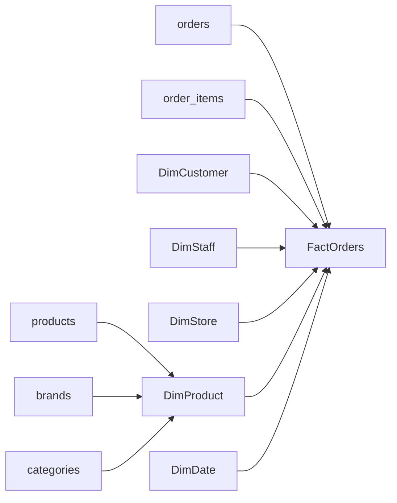

# Clase 2: Agregación SQL, modelado dimensional y cargas incrementales de un data warehouse

> **Objetivo académico:** Comprender cómo la granularidad y la semántica de las agregaciones orientan la transformación de una base transaccional en un esquema estrella, y analizar la detección de cambios, la resolución de claves y la infraestructura necesarias para mantener un data warehouse mediante cargas incrementales.

## 1. Contexto y marco conceptual

La sesión conecta tres problemas: producir información resumida mediante SQL, diseñar estructuras apropiadas para su consumo analítico y mantenerlas actualizadas sin trasladar repetidamente todos los datos. El caso conductor es un negocio de bicicletas con clientes, empleados, tiendas, productos, marcas, categorías, existencias, órdenes y detalles de órdenes.

El punto de partida es una base **OLTP**, orientada a registrar operaciones y preservar su consistencia. El destino es un **data warehouse**, orientado a integrar información histórica y facilitar consultas analíticas. La transformación conserva el significado del negocio, pero modifica la organización física y lógica de los datos para favorecer su lectura.

### 1.1. Agregar significa cambiar el nivel de observación

Una función escalar, como `UPPER`, transforma un valor por cada fila procesada sin resumir por sí misma el conjunto. Una función de agregación, como `SUM`, `COUNT`, `AVG`, `MIN`, `MAX` o una función de desviación estándar, produce un resultado por grupo.

La **granularidad** indica qué representa una fila. En el ejemplo, una fila puede representar un producto, una línea de orden, una orden completa o las ventas acumuladas de un empleado en una tienda. Cambiar de granularidad modifica las preguntas que pueden responderse directamente.

La sesión muestra una relación de productos y categorías con 321 productos. Al incorporar la categoría, su descripción se repite para distintos productos. Esa repetición es consecuencia del nivel de detalle; no demuestra que existan duplicados incorrectos.

### 1.2. El análisis parte de los procesos del negocio

Las tablas de órdenes y sus detalles registran eventos que crecen con la actividad comercial. Clientes, tiendas, empleados y productos aportan el contexto descriptivo para interpretarlos.

Las existencias permiten analizar disponibilidad de productos. Las órdenes permiten analizar operaciones comerciales registradas. Aunque ambos análisis pueden relacionarse, responden a preguntas diferentes y requieren definir sus propias medidas y granularidades.

**Enriquecimiento conceptual:** Una orden registrada no equivale necesariamente a una venta finalizada ni a un ingreso reconocido. Para denominar una medida «unidades vendidas» debe precisarse qué estados de orden, cancelaciones y devoluciones incluye. La sesión utiliza las órdenes como aproximación analítica a las ventas, sin desarrollar esa política de reconocimiento.

## 2. Fundamentos teóricos y arquitectura

### 2.1. Del modelo normalizado al esquema estrella

En el modelo transaccional, `orders` contiene la cabecera de la orden y `order_items` sus líneas. Para analizar cantidades por tienda y empleado se necesita relacionar el detalle con la cabecera y acceder a las entidades descriptivas correspondientes.

El esquema estrella propuesto centraliza el evento en `FactOrders` y conecta directamente sus dimensiones de análisis:

| Estructura analítica | Procedencia y función |
| --- | --- |
| `FactOrders` | Integra información de `orders` y `order_items`; conserva identificadores, referencias dimensionales y medidas del detalle. |
| `DimCustomer` | Describe al cliente. |
| `DimStaff` | Describe al empleado. |
| `DimStore` | Describe la tienda. |
| `DimProduct` | Describe el producto e incorpora marca y categoría como atributos. |
| `DimDate` | Describe el calendario y proporciona atributos temporales precalculados. |



Las flechas desde las fuentes indican la integración conceptual de datos; las flechas desde las dimensiones representan el contexto al que se vincula cada hecho. El diagrama no representa el orden completo de ejecución de una carga.

La absorción de marca y categoría por `DimProduct` evita recorrer esas relaciones en cada consulta analítica. El esquema sigue siendo relacional: desnormalizar dimensiones no implica adoptar una base NoSQL.

**Enriquecimiento conceptual:** El grano apropiado para el ejemplo es **una fila por línea de orden**. Si una misma orden puede contener varias líneas del mismo producto, la combinación orden-producto no basta para identificar una fila: debe conservarse el identificador de línea. Integrar cabecera y detalle no significa resumir automáticamente todas las líneas en una sola fila por orden.

### 2.2. Hechos, dimensiones y medidas

Una **dimensión** aporta atributos con los que se filtran, agrupan y describen los eventos. Una **tabla de hechos** registra observaciones del proceso y contiene las referencias necesarias para situarlas en ese contexto. Las **medidas** son valores asociados al hecho, como cantidad, precio y descuento.

La distinción depende del papel analítico, no solo del tipo de dato. Un identificador numérico no se convierte en una medida sumable por ser un número. De forma semejante, una tabla de hechos puede incluir identificadores y estados que no deben agregarse aritméticamente.

La sesión introduce también modelos con varias tablas de hechos que comparten dimensiones, como ocurre en modelos más amplios de Adventure Works.

**Enriquecimiento conceptual:** Para compartir dimensiones de forma consistente, sus claves, atributos y definiciones deben estar conformados entre procesos. Dos tablas de hechos pueden compartir `DimDate` y `DimProduct` sin tener el mismo grano. Unirlas directamente por esas claves puede multiplicar filas y producir medidas incorrectas.

### 2.3. Claves subrogadas e historia dimensional

La clave de negocio identifica a una entidad en el sistema de origen. La **clave subrogada**, o `SK`, identifica una fila dimensional dentro del warehouse y permite conservar varias versiones de la misma entidad.

El ejemplo de un cliente cuyo nombre pasa de Pedro a Pietro ilustra el problema: si ambas versiones conservan el mismo identificador de origen, ese identificador ya no puede ser por sí solo la clave primaria de la dimensión histórica. Cada versión necesita su propia clave subrogada.

| Estrategia | Tratamiento del cambio | Consecuencia histórica |
| --- | --- | --- |
| Sobrescritura | Se modifica la fila existente. | Se pierde el valor anterior del atributo modificado. |
| Nueva versión | Se inserta otra fila con una nueva `SK` y se identifica la vigencia. | Pueden conservarse ambas versiones. |
| Columnas de valor anterior y actual | Se amplía la fila con posiciones históricas específicas. | Se conserva una historia limitada por el diseño. |

**Enriquecimiento conceptual:** Estas estrategias corresponden, respectivamente, a patrones SCD de tipo 1, tipo 2 y tipo 3. En una SCD tipo 2 suelen mantenerse inicio de vigencia, fin de vigencia y una marca de fila actual. Para asociar correctamente un hecho histórico debe seleccionarse la versión válida en la fecha del evento; elegir siempre la versión actual altera la interpretación histórica.

Preservar versiones no es obligatorio para cualquier cambio. Corregir un error tipográfico puede justificar una sobrescritura; registrar un cambio real de residencia o clasificación puede requerir historia. Esa decisión pertenece a la semántica del negocio.

### 2.4. Dimensión fecha y resolución temporal

`DimDate` almacena una fila por fecha del calendario, con atributos como año, mes, día, semana, trimestre y semestre. La sesión propone precargarla para evitar reconstruir repetidamente estos atributos durante las consultas.

Para datos subdiarios se discuten dos alternativas: combinar fecha y hora en una dimensión o separar `DimDate` y `DimTime`. El caso de llamadas introduce intervalos de 15 minutos como resolución útil para los reportes, aun cuando el origen registre eventos con precisión mucho mayor.

**Enriquecimiento conceptual:** Separar fecha y hora permite reutilizar los intervalos horarios en distintos días. No obliga a perder la marca temporal original ni a agregar los hechos: la resolución de almacenamiento del evento y la resolución de presentación son decisiones diferentes. Una dimensión diaria no necesita una fila nueva por cada segundo registrado.

## 3. Implementación técnica y lógica de negocio

Los siguientes fragmentos son **Enriquecimiento conceptual:** reconstrucciones didácticas de las operaciones descritas. La transcripción no contiene el texto íntegro de las consultas ni de los procedimientos mostrados, por lo que no se presentan como código literal del docente ni como ejecuciones verificadas.

### 3.1. Conteo de productos por categoría

```sql
SELECT
    c.category_id,
    c.category_name,
    COUNT(*) AS product_count
FROM production.categories AS c
INNER JOIN production.products AS p
    ON p.category_id = c.category_id
GROUP BY
    c.category_id,
    c.category_name;
```

El resultado tiene una fila por categoría representada en la unión. Incluir `product_id` en `GROUP BY` mantendría el detalle de producto y frustraría el resumen pretendido. El conteo genera información derivada: la sesión muestra, por ejemplo, 59 productos para Children Bicycles y 30 para Comfort Bicycles.

**Enriquecimiento conceptual:** `COUNT(*)` cuenta filas; `COUNT(columna)` cuenta valores no nulos de esa columna; `COUNT(1)` también cuenta todas las filas porque la constante `1` no es nula. En esta función, `1` no significa «primera columna». Con una unión interna se omiten las categorías sin productos; para incluirlas con cero podría usarse una unión externa y contar una clave no nula del producto.

La regla práctica de agrupación es que cada expresión seleccionada debe quedar determinada por el grupo o agregarse. En SQL Server, una columna seleccionada fuera de una agregación debe incluirse en la agrupación correspondiente. No es necesario mostrar todas las columnas utilizadas en `GROUP BY`; ocultarlas en `SELECT` tampoco elimina su efecto sobre el grano.

### 3.2. Cantidades por orden y por tienda-empleado

La sesión parte de 1615 órdenes y posteriormente identifica 4722 líneas de detalle. Al unir cabecera y detalle se repiten cliente, fecha, tienda y empleado para las distintas líneas de una misma orden.

Para cada grupo $g$, la cantidad total se expresa como:

$$
Q_g = \sum_{i \in I_g} q_i
$$

Aquí $I_g$ es el conjunto de líneas pertenecientes al grupo, $i$ identifica una línea y $q_i$ es su cantidad de producto, expresada en unidades. En el ejemplo comercial se presupone una cantidad entera positiva; el tratamiento de devoluciones o cantidades negativas no se desarrolla en la fuente. $Q_g$ representa unidades acumuladas, no el número de productos distintos ni el número de órdenes.

```sql
SELECT
    o.order_id,
    SUM(oi.quantity) AS total_units
FROM sales.orders AS o
INNER JOIN sales.order_items AS oi
    ON oi.order_id = o.order_id
GROUP BY
    o.order_id;
```

Este resumen conserva una fila por orden y suma sus cantidades. Si el resultado es ocho unidades, no permite concluir que se compraron ocho productos diferentes.

Para cambiar a tienda-empleado se eliminan del agrupamiento las columnas que mantienen el detalle de orden, cliente o fecha:

```sql
SELECT
    s.store_id,
    s.store_name,
    st.staff_id,
    CONCAT(st.first_name, ' ', st.last_name) AS employee_name,
    SUM(oi.quantity) AS total_units
FROM sales.orders AS o
INNER JOIN sales.order_items AS oi
    ON oi.order_id = o.order_id
INNER JOIN sales.stores AS s
    ON s.store_id = o.store_id
INNER JOIN sales.staffs AS st
    ON st.staff_id = o.staff_id
GROUP BY
    s.store_id,
    s.store_name,
    st.staff_id,
    st.first_name,
    st.last_name
ORDER BY
    s.store_name,
    employee_name;
```

Los identificadores evitan que personas o tiendas homónimas se fusionen por compartir una descripción. No se necesita unir clientes cuando el resultado no utiliza atributos de cliente y esa unión no aporta una condición de negocio.

En el warehouse, la consulta equivalente parte de `FactOrders`, se une a `DimStore` y `DimStaff` por sus claves subrogadas y realiza la misma agregación. La integración de cabecera y detalle ya se resolvió durante la carga.

### 3.3. Aditividad y significado de las expresiones

Sumar cantidades responde a una pregunta definida. Sumar precios de catálogo de distintos productos puede ser matemáticamente válido y, aun así, carecer de utilidad comercial. La función debe elegirse después de definir la medida.

**Enriquecimiento conceptual:** Si se quisiera calcular un importe de línea después de descuento, una expresión posible sería:

$$
a_i = q_i p_i (1-d_i)
$$

Aquí $a_i$ es el importe monetario de la línea $i$; $q_i$ es la cantidad en unidades; $p_i$ es el precio por unidad en una moneda común, con $p_i \geq 0$; y $d_i \in [0,1]$ es el descuento proporcional. La expresión supone un descuento único sobre el precio, sin impuestos, transporte ni otros ajustes.

Por ejemplo, para dos unidades a 100 unidades monetarias cada una y un descuento del 10 %, se obtiene $a_i = 2 \times 100 \times (1-0.10) = 180$ unidades monetarias. Este ejemplo no constituye un resultado observado en la base utilizada.

El importe agregado sería la suma de los importes de línea. El porcentaje de descuento no debe sumarse como si fuera un importe; su agregación requiere definir una ponderación y una interpretación comercial.

### 3.4. Inicialización del calendario

La sesión utiliza un script que recorre un intervalo de fechas y genera sus atributos. Los extremos pueden orientarse con la fecha mínima y máxima del origen, ampliando la cobertura según las necesidades del modelo.

**Enriquecimiento conceptual:** Una clave determinista diaria puede definirse como:

$$
k(d) = 10000\,y(d) + 100\,m(d) + j(d)
$$

La variable $d$ es una fecha válida del calendario; $y(d)$, $m(d)$ y $j(d)$ son, respectivamente, su año, mes y día. Se supone un año positivo de cuatro cifras, $m(d) \in \{1,\ldots,12\}$ y un día válido para ese mes. El resultado es un entero con formato `YYYYMMDD`: el 1 de enero de 2016 se representa como `20160101`.

Esta es una codificación de calendario, no un contador de días transcurridos; restar dos claves no calcula una duración. La clave derivada del origen debe existir en `DimDate` antes de cargar el hecho.

La tabla de hechos puede conservar una fecha original y una clave de calendario si ambas tienen una finalidad clara. Las fechas de orden, requerimiento y envío pueden vincularse a la misma dimensión en distintos roles.

**Enriquecimiento conceptual:** La precarga no elimina el mantenimiento futuro del calendario: debe extenderse cuando aparezcan fechas fuera de su cobertura. También se necesita una política para fechas nulas, como un envío todavía no realizado.

### 3.5. Detección incremental con `rowversion`

Para mover solo registros nuevos o modificados, la sesión incorpora una columna de versión en el origen y conserva una marca de la última carga en una tabla de configuración del warehouse.

**Enriquecimiento conceptual:** En SQL Server, `rowversion` es un valor binario de ocho bytes generado automáticamente a partir de un contador de la base de datos. `timestamp` es un sinónimo histórico de ese tipo; no representa fecha ni hora. Una tabla admite una sola columna de este tipo. Para registrar instantes se requieren tipos temporales, como `datetime2` o `datetimeoffset`.

```sql
ALTER TABLE dbo.Employee
ADD RowVersion rowversion;
```

El ejemplo añade la columna a una tabla existente. Los valores se asignan automáticamente al insertar o actualizar filas. La columna identifica una versión, pero no guarda por sí misma los valores anteriores ni el tipo de operación realizado.

Para explicar el corte incremental, se utiliza la condición:

$$
v_{\mathrm{prev}} < v(r) \leq v_{\mathrm{cut}}
$$

Aquí $r$ es una fila del origen; $v(r)$ es su versión; $v_{\mathrm{prev}}$ es la última marca confirmada por el proceso; y $v_{\mathrm{cut}}$ es el límite superior fijado para la extracción. Las versiones son marcas ordenadas dentro de la misma base de datos, sin unidad temporal. El intervalo abierto por la izquierda evita volver a incluir la marca ya procesada; el extremo derecho fija un corte reproducible a nivel conceptual.

La sesión utiliza `@@DBTS` para consultar el último valor de versión utilizado por la base de datos. La marca inicial proviene de la configuración de la carga anterior.

**Enriquecimiento conceptual:** `@@DBTS` no es un identificador de la última transacción confirmada ni cambia necesariamente con cualquier operación sobre cualquier tabla. Refleja el último valor utilizado del contador `rowversion`. Tampoco debe suponerse que el orden de asignación de versiones coincide con el de confirmación de transacciones. El uso de esa marca requiere una estrategia adicional de consistencia para evitar omisiones bajo concurrencia.

### 3.6. Propagación de cambios desde varias tablas

La extracción de `DimProduct` combina productos, marcas y categorías. Si cambia cualquiera de esas fuentes, el producto dimensional puede necesitar actualizarse:

$$
C(p) = C_P(p) \lor C_B(b(p)) \lor C_K(c(p))
$$

Aquí $p$ identifica un producto; $b(p)$ es su marca; $c(p)$ es su categoría; y cada predicado $C_P$, $C_B$ o $C_K$ indica si la fila correspondiente cambió dentro del intervalo de carga. El operador $\lor$ es una disyunción lógica. La condición supone que esas relaciones pueden resolverse en el conjunto extraído.

Modificar una marca puede afectar a todos sus productos asociados, aunque las versiones de las filas de producto no hayan cambiado. Por ello, observar únicamente `products.RowVersion` dejaría atributos dimensionales desactualizados.

El mismo principio se aplica a `FactOrders`: un cambio en cabecera o detalle puede afectar a la representación analítica de las líneas. Detectar el cambio es una operación distinta de decidir si corresponde insertar, sobrescribir o crear una versión histórica.

### 3.7. Paquetes, catálogo y orquestación

La infraestructura presentada utiliza SQL Server Integration Services y proyectos de integración compatibles con Visual Studio 2022. Un paquete puede encargarse de una dimensión o de una tabla de hechos. Los paquetes de producto requieren combinar varias fuentes; otros, como tienda, parten de una correspondencia más directa.

El catálogo `SSISDB` proporciona un destino para desplegar y gestionar proyectos y paquetes. En la creación mostrada se habilita la integración CLR. La automatización se plantea mediante trabajos de SQL Server Agent; la edición Express carece de ese componente.

Los `lookups` se introducen como búsquedas necesarias para traducir claves del origen a claves subrogadas del warehouse. La carga de dimensiones debe permitir que las claves requeridas por los hechos estén disponibles.

Las tablas de *staging* aparecen en la estructura, pero su función no se desarrolla en esta sesión. Tampoco se presenta un paquete completo de integración con todos sus componentes y tratamiento de errores.

## 4. Análisis crítico de casos y auditoría práctica

### 4.1. Cardinalidad y validación de agregaciones

Al unir una orden con sus líneas, la repetición de atributos de cabecera es esperable. Sin embargo, la cantidad resultante depende de la relación entre las tablas, de las claves y del tipo de unión; no basta con afirmar que «predomina la tabla más grande».

**Enriquecimiento conceptual:** En una unión uno-a-muchos con una cabecera única por orden, cada línea aparece una vez si encuentra su cabecera. Una unión incorrecta o una dimensión con varias coincidencias puede multiplicarla. Antes de aceptar una medida deben revisarse:

- El significado de una fila antes y después de cada unión.
- La unicidad de las claves utilizadas.
- La conservación de cantidades e importes entre origen y destino.
- La diferencia entre contar líneas, órdenes, productos distintos y unidades.

Un resultado ejecutable no garantiza una medida correcta. Agrupar por demasiadas columnas impide resumir; agrupar solo por descripciones puede fusionar entidades diferentes.

### 4.2. Comparación de planes OLTP y warehouse

La sesión compara consultas que devuelven cantidades por tienda y empleado. El plan del warehouse presenta menos relaciones intermedias porque `FactOrders` ya integra cabecera y detalle. Ambos resultados se muestran como equivalentes, pero el volumen reducido impide concluir una mejora cuantitativa representativa.

**Enriquecimiento conceptual:** El orden lógico de una consulta —origen y uniones, filtrado, agrupación, filtrado de grupos, proyección y ordenación— ayuda a comprender su significado. El plan físico puede reorganizar operaciones equivalentes. Escribir la tabla de hechos primero en `FROM` no obliga al motor a comenzar físicamente por ella.

Los `JOIN` pueden ser costosos, pero no son siempre la operación dominante. Lecturas extensas, ordenaciones, agregaciones, estimaciones deficientes o falta de memoria también pueden determinar el rendimiento. La evaluación requiere planes reales y mediciones de lecturas, CPU, duración y comportamiento concurrente.

### 4.3. Lecturas concurrentes y separación de cargas

La motivación de separar la analítica es evitar que consultas extensas compitan con las operaciones comerciales. Una copia periódica puede aislar cargas, aunque introduce una diferencia temporal entre la información operativa y la consultada.

**Enriquecimiento conceptual:** OLTP no significa incapacidad para leer eficientemente. Su diseño y sus índices priorizan determinados accesos transaccionales. Los bloqueos entre lectores y escritores dependen del motor y del aislamiento; los mecanismos de versionado pueden permitir lecturas consistentes sin esperar de la misma manera a los escritores. Tampoco una separación de bases garantiza aislamiento físico si ambas compiten por el mismo servidor.

### 4.4. Vistas, materialización y consultas precalculadas

Una vista convencional encapsula una consulta, pero no almacena necesariamente su resultado. Por tanto, no elimina por sí sola el costo de unir y agregar las tablas subyacentes.

**Enriquecimiento conceptual:** En SQL Server, `SCHEMABINDING` no materializa una vista por sí mismo. Una vista indexada requiere condiciones adicionales y la creación del índice correspondiente. Las estructuras materializadas pueden acelerar lecturas, pero añaden costos de almacenamiento, mantenimiento y restricciones de actualización.

### 4.5. Historia prevista frente a carga demostrada

Existe una diferencia explícita entre la explicación de nuevas versiones dimensionales y el ejemplo simplificado de integración. El modelo mostrado admite detectar inserciones y modificaciones, pero la demostración trata ciertas modificaciones mediante actualización directa de la fila del warehouse.

Ese comportamiento corresponde a una política de sobrescritura para los atributos afectados. No debe interpretarse como una implementación completa de SCD tipo 2. Las claves subrogadas posibilitan versionar; su presencia aislada no garantiza que se conserve la historia.

### 4.6. Límites del patrón incremental

**Enriquecimiento conceptual:** El patrón de marcas necesita resolver varias condiciones antes de considerarse robusto:

| Condición | Riesgo y tratamiento conceptual |
| --- | --- |
| Transacciones activas durante el corte | Una fila puede recibir versión antes de confirmarse. Se necesita coordinar aislamiento, límites y tratamiento de transacciones pendientes. |
| Eliminaciones físicas | La fila desaparece y no puede recuperarse mediante un filtro sobre su versión actual. Se requiere otra estrategia de detección. |
| Varios cambios entre cargas | Solo se observa la versión que permanece en el origen; no se reconstruyen todos los estados intermedios. |
| Fallo parcial | La marca debe avanzar después de confirmar la carga completa correspondiente, evitando declarar procesados datos que no llegaron al destino. |
| Reejecución | La carga debe evitar duplicar hechos o versiones por repetir el mismo intervalo. |
| Cambios en entidades absorbidas | Una modificación en marca o categoría debe propagarse a los productos afectados. |

Por estas razones, una columna `rowversion` no equivale a un historial de modificaciones. Tampoco distingue directamente una inserción de una actualización. La carga necesita consultar el estado del destino o utilizar un mecanismo que proporcione explícitamente esa información.

## 5. Principios de diseño, buenas prácticas y anti-patrones

1. **Definir el grano antes de las medidas.** Una fila por línea de orden exige reglas diferentes de una fila por orden, producto-día o intervalo de llamadas. Mezclar granos produce agregaciones ambiguas.
2. **Derivar las medidas de preguntas de negocio.** Unidades, órdenes, clientes distintos e importes no son intercambiables. La disponibilidad de una columna numérica no justifica sumarla.
3. **Desnormalizar con un propósito verificable.** Absorber marca y categoría en producto simplifica accesos concretos, pero aumenta la responsabilidad de propagación de cambios durante la carga.
4. **Usar claves estables para agrupar e integrar.** Los nombres sirven para presentar; las claves permiten distinguir entidades y versiones. La nomenclatura de tablas y columnas debe seguir una convención consistente.
5. **Separar detección, transformación y política histórica.** Identificar una fila modificada no decide automáticamente si sobrescribirla, versionarla o actualizar un hecho.
6. **Resolver claves dimensionales antes de cargar los hechos dependientes.** Los `lookups` deben manejar claves ausentes y, cuando corresponda, versiones históricas válidas.
7. **Ajustar la resolución temporal a la necesidad analítica.** Registrar milisegundos, agrupar por intervalos y consultar por día son decisiones distintas. Deben evaluarse sus efectos sobre volumen, carga y utilidad.
8. **Conservar marcas de control confiables.** La configuración incremental forma parte del estado del proceso. Debe reflejar cargas efectivamente confirmadas y permitir recuperación.
9. **Medir rendimiento con condiciones representativas.** Menos uniones es una hipótesis favorable, no una garantía universal. El resultado depende también del almacenamiento, índices, estadísticas y concurrencia.
10. **Mantener la integridad durante la inicialización.** Vaciar dimensiones relacionadas con hechos exige un procedimiento controlado. Eliminar dependencias para facilitar una demostración no es un patrón de mantenimiento generalizable.

**Enriquecimiento conceptual:** La sesión cuestiona las cargas construidas enteramente con SQL por sus posibles problemas de rendimiento. Esa afirmación no debe convertirse en una prohibición universal: SQL puede implementar procesos ETL o ELT eficientes. La elección entre SQL, SSIS u otras herramientas depende del movimiento de datos, las transformaciones, la observabilidad y la operación requerida. El uso de servidores vinculados tampoco determina por sí solo el rendimiento; debe analizarse qué se ejecuta remotamente y cuánto dato se transfiere.

La similitud entre desnormalización dimensional y ciertos modelos NoSQL se limita a organizar datos para patrones de acceso. NoSQL no elimina por definición la transformación, la integración ni la necesidad de asegurar consistencia semántica.

## 6. Síntesis conceptual y profundización académica

La clase establece una cadena de decisiones: comprender el evento comercial, definir el grano, construir medidas interpretables, organizar su contexto en dimensiones y mantener el modelo mediante una carga controlada. La agregación SQL introduce la misma responsabilidad semántica que después asumirá el modelo analítico: un cálculo formalmente válido puede responder a una pregunta equivocada.

El esquema estrella traslada parte del trabajo de integración desde cada consulta hacia el proceso de carga. En el caso analizado, cabecera y detalle alimentan una tabla de hechos a nivel de línea; producto incorpora marca y categoría; cliente, empleado, tienda y calendario proporcionan los ejes de análisis. La separación de cargas busca mejorar la capacidad de consulta y reducir la interferencia con la operación.

La historia y la actualidad requieren políticas diferenciadas. Una clave subrogada identifica filas dimensionales; la vigencia permite interpretar versiones; la marca incremental identifica candidatos a transferencia. Ninguno de esos mecanismos sustituye a los otros.

La sesión también menciona otras estructuras de hechos: tablas sin medidas numéricas, instantáneas y tablas agregadas. Su elección depende de qué se necesita observar y de cómo crece la información.

**Enriquecimiento conceptual:** Una tabla de hechos sin medidas puede representar la ocurrencia de una relación o evento, cuyo conteo aporta información. Una instantánea registra el estado en un momento o período definido. Una tabla agregada resume hechos de menor grano para acelerar consultas, conservando únicamente el detalle que permite su diseño. Estos patrones deben distinguirse de una política de archivo: resumir, conservar y retirar historia son decisiones diferentes.

Las principales líneas de profundización son la aditividad de medidas, las dimensiones conformadas, la resolución temporal de SCD, la captura de eliminaciones y cambios intermedios, y la consistencia de las marcas bajo concurrencia. El criterio rector permanece constante: preservar el significado del negocio mientras se mejora la capacidad de análisis.
