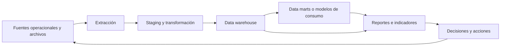
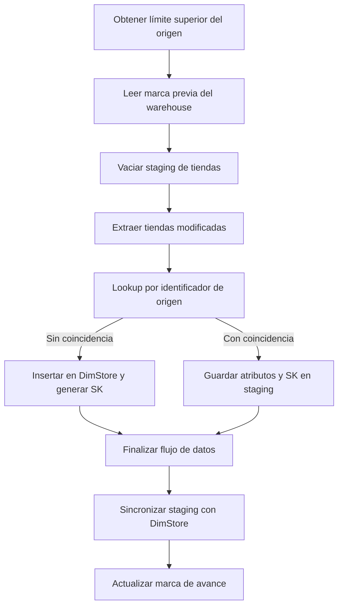

# Clase 3: Inteligencia de negocios y construcción de un ETL incremental con SSIS

> **Objetivo académico:** Comprender la inteligencia de negocios como un proceso de generación de valor para la toma de decisiones y analizar la arquitectura, implementación y límites de una carga incremental de dimensiones mediante SQL Server Integration Services, staging y marcas de avance basadas en rowversion.

## 1. Contexto y marco conceptual

### La inteligencia de negocios como proceso organizacional

La inteligencia de negocios, o Business Intelligence (BI), articula fuentes de datos, integración, almacenamiento analítico y consumo de información para apoyar decisiones. Power BI, Tableau o Qlik son herramientas que participan en ese proceso; su adquisición no constituye por sí sola una solución de BI.

La necesidad surge cuando una organización acumula registros de ventas, clientes, personal, inventarios u operaciones, pero estos permanecen dispersos y no permiten interpretar conjuntamente su funcionamiento. La diversidad de fuentes intensifica el problema: bases relacionales, sistemas ERP y CRM, archivos CSV, bases NoSQL, API, registros de aplicaciones y dispositivos IoT pueden describir aspectos complementarios de una misma actividad.

El propósito no es reunir todos los datos indiscriminadamente, sino producir información pertinente, consistente y disponible a tiempo. El data warehouse proporciona una base integrada para el análisis y participa en un sistema de soporte a las decisiones, o DSS. Su utilidad depende tanto de la calidad técnica como de la correspondencia entre los indicadores y las necesidades de negocio.

La sesión menciona los enfoques de Ralph Kimball y Bill Inmon como referentes del diseño de almacenes de datos, pero no desarrolla sus diferencias. También presenta una evolución desde soluciones fuertemente vinculadas a infraestructura propia hacia servicios de nube y arquitecturas de ingeniería de datos. Estas referencias contextualizan la disciplina; no constituyen una comparación histórica exhaustiva.

### Datos, información y conocimiento

La clase utiliza tres niveles para explicar el valor creciente del procesamiento:

| Nivel | Caracterización | Ejemplo conceptual |
|---|---|---|
| Datos | Valores registrados sin suficiente contexto interpretativo | Un identificador o un nombre aislado |
| Información | Datos relacionados y contextualizados según un propósito | Identificar a una persona como cliente y relacionarla con sus compras |
| Conocimiento | Interpretaciones que permiten orientar una decisión | Comprender un patrón de compra o estimar una propensión de respuesta |

En la sesión, la capa de información se vincula principalmente con integración, visualización y estadística descriptiva: sumas, promedios, mínimos y máximos. La capa de conocimiento se ilustra mediante modelos supervisados y no supervisados.

**Enriquecimiento conceptual:** esta separación es pedagógica, no una frontera tecnológica estricta. Un modelo predictivo produce una estimación que requiere validación e interpretación; su ejecución no garantiza conocimiento útil. Del mismo modo, un análisis descriptivo bien contextualizado puede generar conocimiento sin aprendizaje automático.

### De la información a la acción

Los ejemplos de negocio incluyen identificar sucursales con bajo rendimiento, reconocer clientes de alto volumen, orientar promociones, evaluar mercados y adaptar capacidad a picos de demanda. El equipo de datos proporciona evidencia; la decisión corresponde a quienes tienen responsabilidad organizacional.

Una información técnicamente correcta puede perder valor si llega después de la oportunidad de actuar. Por ello, velocidad, precisión y relevancia deben evaluarse conjuntamente. El intervalo de actualización se deriva del comportamiento del negocio, no de una preferencia arbitraria por ejecutar procesos con mayor frecuencia.

**Enriquecimiento conceptual:** una fuente única de verdad requiere definiciones compartidas, responsables de los datos y reglas de calidad. Centralizar físicamente tablas no elimina por sí solo discrepancias sobre qué significa una venta, un cliente activo o una duración de contacto.

## 2. Fundamentos teóricos y arquitectura

### Arquitectura tradicional de BI

El flujo presentado comprende fuentes operacionales, un área intermedia de staging, procesos ETL, un warehouse y mecanismos de consumo analítico. Los data marts pueden organizar la información por ámbitos como compras, ventas, finanzas o inventarios.

El warehouse no replica necesariamente todas las tablas del sistema transaccional. Su estructura debe responder a preguntas analíticas. En el ejemplo comercial, las dimensiones de tienda, producto, empleado y cliente permiten analizar los hechos desde diferentes perspectivas; la dimensión fecha organiza su evolución temporal.

La separación entre OLTP y almacenamiento analítico busca evitar que consultas intensivas de reportes compitan con las operaciones del negocio. Los modelos dimensionales facilitan agregaciones y navegación por dimensiones, mientras que los modelos operacionales suelen priorizar integridad y actualización transaccional.

**Enriquecimiento conceptual:** consultar una base normalizada no es intrínsecamente incorrecto. Puede ser razonable para reportes operacionales acotados o cargas pequeñas. La advertencia de la clase se dirige a convertir el OLTP en una plataforma analítica creciente mediante numerosas vistas y procedimientos, sin revisar concurrencia, mantenimiento y rendimiento. Tampoco es obligatorio crear data marts físicos separados: consumir directamente un warehouse puede ser adecuado si existen modelos semánticos, controles y capacidad suficientes.

### ETL, ELT e ingeniería de datos

ETL significa extraer, transformar y cargar. En ELT, la carga precede a las transformaciones principales, que se ejecutan en la plataforma de destino.

| Aspecto | ETL presentado en la clase | ELT presentado en la clase |
|---|---|---|
| Secuencia principal | Extraer, transformar y cargar | Extraer, cargar y transformar |
| Ubicación del procesamiento | Motor de integración o área intermedia | Plataforma de destino |
| Contexto ilustrado | SSIS y warehouse relacional | Servicios de nube y grandes volúmenes |
| Datos de entrada | Fuentes seleccionadas para integración | Datos que pueden conservarse inicialmente en bruto |
| Consideración central | Preparar la información antes de su carga final | Aprovechar capacidad de procesamiento del destino |

La arquitectura de ingeniería de datos amplía la mirada hacia generación, ingestión, almacenamiento, transformación y servicio de datos. Incluye fuentes heterogéneas y formatos como JSON, XML, video y archivos columnares como Parquet u ORC. La sesión asocia estos últimos con ecosistemas de data lake, sin implementar uno.

Seguridad, gestión de datos, DataOps, arquitectura, orquestación e ingeniería de software atraviesan el ciclo completo. La orquestación coordina dependencias y ejecuciones; SQL Server Agent y Airflow aparecen como alternativas con alcances distintos.

**Enriquecimiento conceptual:** ETL y ELT no se distinguen obligatoriamente por nube frente a infraestructura propia ni por tamaño de empresa. La elección depende de capacidad, costos, gobierno y requisitos de transformación. La ingestión tampoco equivale exclusivamente a cargar en la nube. El almacenamiento de nube es elástico, pero tiene cuotas, costos y restricciones operativas; no es literalmente infinito.

**Enriquecimiento conceptual:** reverse ETL consiste en llevar datos o resultados del entorno analítico a aplicaciones operacionales para activar acciones. Puede actualizar un CRM, por ejemplo; no se define por convertir nuevamente toda la información a un esquema relacional.

### Batch, streaming, pull y push

Estas categorías describen aspectos diferentes del procesamiento:

| Eje | Alternativa | Interpretación |
|---|---|---|
| Organización del procesamiento | Batch | Procesar un conjunto delimitado de registros en una ejecución |
| Organización del procesamiento | Streaming | Procesar un flujo de eventos de forma continua o con baja latencia |
| Iniciativa de captura | Pull | El consumidor consulta si existen novedades |
| Iniciativa de captura | Push | Los cambios se notifican o publican hacia consumidores |

El ejemplo práctico utiliza batch y pull: el paquete consulta periódicamente el origen y procesa los registros modificados. Esto simplifica la programación, pero puede consumir recursos incluso cuando no existen cambios.

La sesión presenta Change Data Capture (CDC) como mecanismo para identificar cambios y alimentar arquitecturas orientadas a eventos. También describe una coexistencia posible: mantener ETL existentes en infraestructura propia y enviar cambios hacia la nube.

**Enriquecimiento conceptual:** CDC es una capacidad de captura; su entrega puede realizarse mediante conectores que consultan cambios. En SQL Server, no debe equipararse automáticamente con una notificación directa a suscriptores por cada modificación. Sus requisitos dependen de versión, edición y configuración.

**Enriquecimiento conceptual:** streaming no significa ausencia de persistencia. Kafka organiza eventos en topics y mantiene registros persistentes; la memoria, el disco, la red y las políticas de confirmación participan en sus garantías. La baja latencia exige analizar el sistema completo, no únicamente sustituir disco por RAM.

## 3. Implementación técnica y lógica de negocio

### Transformaciones y calidad de datos

La transformación concentra reglas que convierten registros heterogéneos en información utilizable. En la sesión se identifican las siguientes operaciones:

- Limpieza y normalización de formatos, caracteres y valores inconsistentes.
- Estandarización de tipos y convenciones de representación.
- Tratamiento de datos faltantes.
- Cálculo de atributos derivados y métricas de negocio.
- Agregación a una granularidad definida.
- Actualización de metadatos cuando cambia la estructura de origen o destino.

El ejemplo de atención multicanal muestra que la duración no tiene una definición universal. Una llamada puede atravesar varios estados, mientras que un contacto por correo puede permanecer abierto durante semanas. La regla de cálculo debe especificar qué intervalo y qué estados cuentan, antes de incorporarse al ETL.

Las agregaciones cada quince minutos ilustran otra transformación: resumir eventos a una granularidad útil para análisis. Esa decisión reduce volumen, pero también limita el detalle disponible en el resultado agregado.

**Enriquecimiento conceptual:** codificación de caracteres y collation son cuestiones relacionadas, pero diferentes. La codificación permite representar caracteres; la collation regula comparaciones y ordenación. En denominaciones habituales de SQL Server, `CI` expresa insensibilidad a mayúsculas y `AS` sensibilidad a acentos; el prefijo `Latin` no determina por sí mismo esas propiedades. Admitir o preservar caracteres japoneses exige revisar tipos de texto y codificación de extremo a extremo.

**Enriquecimiento conceptual:** eliminar eñes, acentos o apóstrofes puede destruir información válida. La protección frente a inyección SQL se basa en parametrización y controles de acceso, no en borrar signos de nombres. Para los faltantes, deben distinguirse desconocido, no disponible y no aplicable; sustituir cualquier nulo por una cadena vacía mezcla significados y puede alterar cálculos.

### Entorno y organización de SSIS

La demostración emplea Visual Studio con las herramientas de SQL Server Integration Services y conexiones OLE DB hacia las bases de origen y destino. Se recomienda organizar un paquete por dimensión, con nombres que permitan reconocer su función y localizar fallos. Los paquetes se almacenan en archivos `.dtsx`.

La dimensión fecha se presenta como una carga inicial de un rango previamente definido. Las demás dimensiones requieren integración recurrente. Su carga precede lógicamente a la de hechos cuando estos necesitan resolver claves de dimensión.

**Enriquecimiento conceptual:** la dimensión fecha debe cubrir el horizonte histórico y futuro requerido, y ampliarse cuando sea necesario. Un rango fijo no constituye una regla universal. Los proveedores de conexión también deben seleccionarse según compatibilidad y soporte; que un controlador haya funcionado en una instalación no garantiza su funcionamiento en otra.

SSIS distingue dos planos de trabajo:

| Plano | Responsabilidad | Componentes utilizados |
|---|---|---|
| Control Flow | Coordinar tareas, dependencias y condiciones de ejecución | Execute SQL Task y Data Flow Task |
| Data Flow | Mover y transformar conjuntos de filas | OLE DB Source, Lookup y OLE DB Destination |

La clase describe las tareas del flujo de control como unidades de trabajo secuenciales. **Enriquecimiento conceptual:** esa unidad lógica no implica atomicidad transaccional automática. Una tarea o un paquete puede dejar efectos parciales si no se definen transacciones y recuperación.

### Estado incremental y variables

El paquete de tiendas obtiene dos valores antes de extraer cambios:

- `LastRowVersion`: marca de avance registrada en la configuración del warehouse para esa entidad.
- `DBTS`: valor de referencia obtenido del origen para establecer el límite de la ejecución.

En la demostración ambos se transportan en variables SSIS de 64 bits y se envían al procedimiento que devuelve tiendas modificadas. La configuración se mantiene por entidad o paquete; no representa necesariamente un único avance para todo el warehouse.

**Enriquecimiento conceptual:** `rowversion` es un valor binario de ocho bytes generado por SQL Server y asociado a modificaciones; no es una fecha ni un contador exclusivo de una tabla. La representación como entero exige conversiones consistentes y revisión del dominio admitido. El uso de `Int64` en SSIS debe corresponder con el contrato de tipos de los procedimientos, sin asumir equivalencia irrestricta entre dominios binarios y enteros con signo.

Para hacer explícita una posible convención de extracción, puede definirse el conjunto:

$$
C_k = \{r \in R : L_k < v(r) \leq U_k\}.
$$

**Enriquecimiento conceptual:** $R$ es la relación de origen visible a la consulta; $r$ es una fila; $v(r)$ es su versión; $k$ identifica una ejecución; $L_k$ es la última marca confirmada y $U_k$ el límite superior seleccionado para esa ejecución. $C_k$ contiene las filas visibles dentro de esa ventana. Las versiones son marcas ordenables, sin unidad temporal. Esta convención evita solapar límites si se conserva de forma consistente, pero el cuerpo del procedimiento mostrado en pantalla no está disponible en la transcripción y no permite confirmar sus operadores exactos.

### Secuencia del paquete de tiendas

1. **Obtener el límite superior.** Una tarea SQL consulta el origen y recibe una fila. El resultado se asigna a la variable `DBTS`.
2. **Leer la marca anterior.** Otra tarea consulta la configuración del warehouse para la entidad tienda y asigna el resultado a `LastRowVersion`.
3. **Limpiar staging.** Se vacía la tabla intermedia antes de procesar el lote. La tarea no requiere conjunto de resultados.
4. **Extraer cambios.** Un OLE DB Source invoca el procedimiento de cambios con las dos marcas. Las variables se vinculan a parámetros de entrada; las columnas de salida constituyen los metadatos del flujo.
5. **Resolver existencia y clave sustituta.** Un Lookup busca el identificador operacional en `DimStore`. Si encuentra una tienda, recupera su clave sustituta o SK.
6. **Separar las rutas.** Las filas sin coincidencia se insertan directamente en la dimensión. Las filas con coincidencia se depositan en staging junto con su SK.
7. **Sincronizar actualizaciones.** Una tarea SQL ejecuta un procedimiento que actualiza la dimensión a partir de staging.
8. **Confirmar el avance.** Tras completar la integración, se guarda el límite superior utilizado como referencia para la siguiente ejecución.

El Lookup relaciona la clave de negocio del origen con la clave sustituta del warehouse. Para tiendas nuevas, el destino omite la columna SK y deja que `IDENTITY` genere el valor. Para tiendas existentes, la SK se conserva, aunque cambien atributos como nombre o teléfono.

La demostración distingue la ruta sin coincidencia de la ruta de error: no encontrar una tienda es un resultado esperado para un registro nuevo. Las opciones de caché completa o parcial del Lookup se mencionan como decisiones de rendimiento.

**Enriquecimiento conceptual:** una caché completa evita consultas repetidas al destino, pero consume memoria y refleja la referencia cargada para esa ejecución. La clave usada para buscar debe ser única dentro de su dominio; con múltiples sistemas de origen puede requerirse incluir el identificador del sistema para evitar colisiones.

### Parámetros, resultados y staging

Las tareas que consultan las marcas utilizan un resultado de una fila; las tareas de limpieza y sincronización no necesitan devolver datos. La actualización de configuración recibe un parámetro de entrada. En las conexiones OLE DB ilustradas, los marcadores `?` se enlazan por posición y el orden comienza en cero. El mapeo debe verificarse contra el proveedor y componente utilizados.

Staging funciona como almacenamiento intermedio. En este patrón recibe las filas existentes que deben actualizarse, mientras que las nuevas se insertan directamente en la dimensión. Por tanto, no contiene necesariamente una copia completa del lote extraído.

La clase justifica tablas intermedias ligeras por el costo de mantener índices y restricciones durante cargas, y por la posibilidad de realizar después operaciones locales sobre el destino.

**Enriquecimiento conceptual:** una tabla staging sin clave primaria es una opción, no una obligación. Conviene evaluar integridad, duplicados, tamaño y consultas de sincronización. El costo real de la carga depende también del registro transaccional, los bloqueos y la configuración. Una limpieza global exige impedir ejecuciones concurrentes que compartan staging o aislar sus datos mediante un identificador de ejecución.

### Despliegue y orquestación

El paquete se despliega en el catálogo de Integration Services y se ejecuta fuera de Visual Studio. Después se configura un job de SQL Server Agent con una programación recurrente; en la demostración se utiliza un intervalo de un minuto para observar cambios.

Despliegue y orquestación resuelven problemas diferentes: el primero coloca el artefacto en el entorno de ejecución; la segunda establece cuándo debe ejecutarse y cómo se coordina con otros procesos. Nombrar tareas y paquetes según su propósito facilita interpretar los registros y diagnosticar fallos.

## 4. Análisis crítico de casos y auditoría práctica

### Indicadores y decisiones en telecomunicaciones

La sesión presenta un panel de una empresa de telecomunicaciones con indicadores por línea de servicio y resultados territoriales. Los medidores comparan desempeño con metas, mientras que los acumulados permiten reconocer diferencias entre regiones. La visualización resume agregaciones para orientar decisiones de inversión o diversificación.

**Enriquecimiento conceptual:** para separar cumplimiento y desviación, pueden emplearse dos medidas:

$$
\text{Cumplimiento} = \frac{A}{M}\times 100\%,
$$

$$
\text{Desviación relativa} = \frac{A-M}{M}\times 100\%.
$$

Aquí $A$ es el valor observado y $M>0$ la meta, ambos con la misma unidad, alcance y período. Con una meta de 100 productos y 80 vendidos, el cumplimiento es 80 % y la desviación es $-20\%$. Con 110 vendidos, son 110 % y $+10\%$, respectivamente. Si la meta es cero, las razones no están definidas. Su interpretación también depende de si valores mayores representan un mejor resultado: en costos o defectos, superar la meta puede ser desfavorable.

La transcripción no proporciona las etiquetas visuales necesarias para interpretar inequívocamente todos los porcentajes citados en el panel. Por ello, no deben convertirse en conclusiones cuantitativas adicionales.

**Enriquecimiento conceptual:** un dashboard puede contener varias visualizaciones y no equivale necesariamente a un cuadro de mando integral. Este último requiere una estructura de objetivos e indicadores estratégicos; la presencia de varios gráficos no basta para identificarlo.

### Picos de demanda y oportunidad de actualización

El caso de una plataforma telefónica multicliente muestra cómo campañas y celebraciones generan picos de llamadas en determinadas franjas horarias. Un ETL actualizado cada cinco minutos permitía observar variaciones intradiarias. Otro caso describe procesamiento nocturno de actividad para preparar acciones comerciales al día siguiente.

Los dos ejemplos ilustran requisitos distintos: una operación puede necesitar seguimiento de minutos, mientras que otra obtiene valor con una ventana nocturna. La frecuencia debe corresponder al tiempo disponible para decidir y actuar.

### Verificaciones observadas en la demostración

| Situación | Comportamiento descrito | Qué permite verificar |
|---|---|---|
| Dimensión inicialmente vacía | Las cuatro tiendas extraídas siguen la ruta sin coincidencia | Carga inicial y generación de SK |
| Reejecución sin novedades | No se extraen filas nuevas | Filtrado incremental básico |
| Cambio del nombre de una tienda | La fila encuentra coincidencia, pasa por staging y actualiza la dimensión | Conservación de SK y sincronización de atributos |
| Inserción de una quinta tienda | La fila sigue la ruta sin coincidencia y se inserta directamente | Incorporación incremental de entidades nuevas |
| Cambio de teléfono con job activo | El destino refleja posteriormente la modificación | Ejecución recurrente y desfase entre origen y destino |

Estos resultados pertenecen a la demostración narrada; no acreditan rendimiento a escala, tolerancia a fallos ni corrección bajo concurrencia. La secuencia de claves sustitutas continúa después de limpiar datos sin reiniciar el generador, por lo que sus valores no tienen que coincidir con los identificadores del origen.

### Límites del patrón incremental

**Ausencia de eliminaciones.** La clase confirma que el paquete no captura borrados. Una fila eliminada físicamente deja de estar disponible para una consulta de versiones sobre la tabla actual. El warehouse puede conservarla aunque ya no exista en el origen.

**Sobrescritura de atributos.** El procedimiento de sincronización reemplaza atributos de la dimensión; no conserva todas sus versiones anteriores. **Enriquecimiento conceptual:** este comportamiento corresponde a una dimensión lentamente cambiante de tipo 1. Para preservar historia de tipo 2 se requieren nuevas filas, intervalos de vigencia y una resolución temporal adecuada de claves. Conservar hechos históricos no implica conservar la historia de todos los atributos de dimensión.

**Confirmación del avance.** Guardar la marca antes de completar la carga puede provocar omisiones en la siguiente ejecución. Guardarla después de una carga parcial exige una estrategia de reintento segura.

**Enriquecimiento conceptual:** capturar `@@DBTS` no garantiza por sí solo una frontera de transacciones confirmadas. Una transacción puede tener una versión asignada y confirmar después de la lectura del lote; avanzar la marca sin controlar esta situación puede omitir cambios. Un diseño de producción debe definir aislamiento, lectura de límites seguros y recuperación, o emplear mecanismos de captura con garantías apropiadas.

**Enriquecimiento conceptual:** la consulta de una tabla por `rowversion` devuelve el estado visible actual de las filas, no una historia completa de eventos. Si una fila cambia varias veces entre consultas, el patrón puede reflejar su estado final sin reproducir cada modificación intermedia.

### Consistencia eventual y latencia

La dimensión puede diferir temporalmente del OLTP y converger después de una ejecución. La sesión denomina a este comportamiento consistencia eventual y distingue correctamente el intervalo de programación de la duración real de integración.

**Enriquecimiento conceptual:** una descomposición útil de la latencia es:

$$
D = W + Q + P.
$$

$D$ es el tiempo desde el cambio confirmado hasta su disponibilidad analítica; $W$ es la espera hasta una captura que lo incluya; $Q$ es la espera por recursos o ejecuciones previas; $P$ es el procesamiento y confirmación del lote. Todas las variables son duraciones no negativas, expresadas en la misma unidad. Con un intervalo fijo $\Delta$ y sin retrasos de programación, $W$ puede aproximarse entre cero y $\Delta$; eso no implica que $D\leq\Delta$. Los fallos, reintentos o acumulaciones pueden aumentar el desfase. La convergencia requiere que los cambios se capturen correctamente y las ejecuciones lleguen a completarse.

## 5. Principios de diseño, buenas prácticas y anti-patrones

### Diseñar desde las preguntas del negocio

Las dimensiones y hechos deben justificarse por los análisis necesarios. Copiar todas las tablas del OLTP puede aumentar costo y complejidad sin aportar valor. La definición de métricas debe incorporar alcance, granularidad, período y significado de los valores faltantes.

Los proyectos de BI también requieren apoyo organizacional. La existencia de herramientas no resuelve desacuerdos sobre indicadores ni garantiza que los resultados se utilicen.

### Separar responsabilidades y hacer explícitas las dependencias

El ejemplo distingue extracción, resolución de claves, inserción, staging, actualización y persistencia de estado. Esa separación facilita localizar el origen de un fallo. Organizar paquetes por entidad favorece el mantenimiento, aunque la granularidad debe revisarse si produce excesiva fragmentación.

**Enriquecimiento conceptual:** las conexiones locales por paquete proporcionan aislamiento, pero duplican configuración. Parámetros y administradores de conexión compartidos pueden reducir inconsistencias entre ambientes. La elección debe equilibrar autonomía, reutilización y gobierno de credenciales.

### Diseñar recuperación además de la ruta exitosa

**Enriquecimiento conceptual:** la idempotencia implica que repetir un lote no introduce duplicados ni altera indebidamente el resultado esperado. Requiere claves de negocio bien definidas, actualizaciones controladas y una política consistente para las marcas de avance. También deben registrarse inicio, fin, filas extraídas, insertadas, actualizadas y rechazadas, junto con el error que interrumpió una ejecución.

El staging temporal no debe confundirse con una copia de auditoría. Si se vacía en cada ejecución, no conserva por sí mismo evidencia histórica para reconstruir cargas fallidas.

### Evaluar cuándo introducir BI

La discusión contrapone dos riesgos: incorporar una arquitectura costosa cuando procesos y necesidades aún cambian, o postergarla hasta acumular una gran dependencia de reportes sobre el sistema transaccional. La sesión reconoce que intervienen costos, tiempo disponible, retorno esperado y horizonte de continuidad de la empresa.

**Enriquecimiento conceptual:** no existe una antigüedad mínima universal de datos para que un warehouse sea útil. Un historial de varios años puede ser necesario para ciertos análisis estacionales o longitudinales, pero otros generan valor con períodos menores. La madurez de procesos y el tamaño empresarial son factores relevantes, no criterios suficientes por separado.

| Anti-patrón | Consecuencia | Criterio de mejora |
|---|---|---|
| Equiparar BI con una herramienta visual | Desatender integración, calidad y gobierno | Diseñar el proceso completo |
| Acumular reportes sobre OLTP sin revisar arquitectura | Competencia de recursos y creciente costo de cambio | Evaluar separación según carga y criticidad |
| Actualizar la marca antes de completar la integración | Posible pérdida lógica de cambios | Confirmar avance con garantías de recuperación |
| Confundir ausencia de coincidencia con error | Rechazo de entidades nuevas válidas | Definir rutas explícitas de inserción y fallo |
| Considerar SK e identificador operacional equivalentes | Colisiones o referencias incorrectas | Mantener su correspondencia explícita |
| Suponer que una frecuencia de un minuto garantiza frescura de un minuto | Expectativas de servicio incorrectas | Medir latencia completa y acumulación |
| Limpiar caracteres válidos para prevenir inyección | Pérdida de información sin protección suficiente | Parametrizar consultas y preservar semántica |
| Tratar una prueba pequeña como validación de producción | Fallos no detectados bajo carga o concurrencia | Evaluar volumen, recuperación y consistencia |

## 6. Síntesis conceptual y profundización académica

La inteligencia de negocios convierte datos dispersos en evidencia utilizable mediante integración, organización analítica y presentación contextualizada. Su calidad se aprecia en la pertinencia de las decisiones que permite respaldar y en la confiabilidad y oportunidad de la información.

El paquete de tiendas concreta esa arquitectura: consulta límites de extracción, recupera cambios, resuelve claves sustitutas, distingue entidades nuevas de existentes, utiliza staging para actualizaciones y confirma una marca de avance. Su despliegue y ejecución recurrente muestran que la integración es un servicio continuo y no una copia aislada.

El alcance demostrado es una carga incremental de inserciones y actualizaciones con sobrescritura de atributos. No incluye captura de eliminaciones, conservación completa de versiones dimensionales ni una demostración de recuperación transaccional. Reconocer estos límites permite utilizar el patrón como fundamento sin atribuirle garantías que no fueron verificadas.

**Enriquecimiento conceptual:** las conexiones de mayor interés para profundizar son la relación entre granularidad y significado de los indicadores; la diferencia entre estado actual e historia de eventos; las garantías de captura bajo concurrencia; y el equilibrio entre frescura, costo y observabilidad. Estas relaciones explican por qué una arquitectura adecuada debe combinar semántica de negocio, modelado de datos y comportamiento operativo.
