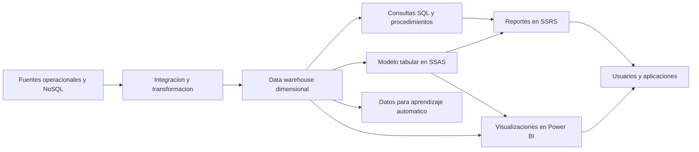

# Clase 7: Serving analítico, bases de datos NoSQL y orquestación del procesamiento de datos

> **Objetivo académico:** Comprender cómo exponer un data warehouse y un modelo tabular para consumo analítico, comparar familias de almacenamiento según sus patrones de acceso y precisar el papel de la replicación, el staging, las claves subrogadas y la orquestación en una solución de inteligencia de negocios.

## 1. Contexto y marco conceptual

La sesión conecta tres niveles de una arquitectura de datos: el consumo de información previamente integrada, la diversidad de motores que pueden actuar como fuentes y la coordinación de las cargas que alimentan el sistema analítico. El caso conductor es Bike Stores, con un data warehouse dimensional y un modelo tabular desplegado en SQL Server Analysis Services, SSAS.

El ciclo recorrido comprende ingestión, transformación, almacenamiento y análisis. La capa de **serving** hace que estos activos sean utilizables por personas o aplicaciones: expone consultas, métricas, reportes y visualizaciones con mecanismos de acceso y distribución. En la clase se aborda principalmente mediante SQL Server Reporting Services, SSRS, y Power BI.

Una necesidad de negocio precede a la herramienta: conocer el rendimiento de ventas por sucursal, con referencias a los años 2016 y 2017. La demostración inicial simplifica esa demanda a la cantidad de unidades vendidas por tienda. Esta precisión es fundamental: cantidad vendida, ingresos, rentabilidad y rendimiento comercial son conceptos diferentes. Un reporte de unidades solo responde una parte del problema.

Tanto el warehouse como el modelo tabular pueden suministrar esa agregación. La coincidencia visual del resultado no implica igualdad arquitectónica: cambian el motor consultado, la ubicación de las reglas de negocio, los conectores y los costos de procesamiento. El cubo o modelo tabular no elimina necesariamente el acceso relacional.



**Enriquecimiento conceptual:** Serving es una función arquitectónica más amplia que la visualización. Incluye contratos de datos, autorización y formas de acceso para consumidores humanos o automatizados. La demostración cubre una parte de esa función, centrada en reportes y herramientas de BI.

## 2. Fundamentos teóricos y arquitectura

### 2.1. Warehouse, modelo semántico y presentación

El warehouse organiza hechos y dimensiones para análisis histórico. El modelo tabular añade una capa semántica con relaciones, medidas y atributos disponibles para los clientes. El reporte determina cómo presentar los resultados y cómo permitir su consumo.

| Capa | Responsabilidad principal | Ejemplo de la sesión |
| --- | --- | --- |
| Integración | Extraer, transformar y cargar datos | SQL Server Integration Services, SSIS |
| Almacenamiento analítico | Conservar hechos y dimensiones | Warehouse Bike Stores |
| Modelo semántico | Definir medidas y relaciones analíticas | Modelo tabular en SSAS |
| Presentación | Consultar, organizar y distribuir resultados | SSRS y Power BI |
| Orquestación | Coordinar ejecuciones y dependencias | Jobs de SQL Server Agent |

La separación permite reutilizar reglas. Si cada reporte reconstruye una medida por su cuenta, aumenta la posibilidad de obtener resultados incompatibles. Centralizar medidas en el modelo semántico o consultas reutilizables en el warehouse reduce esa dispersión, aunque exige gobernar sus definiciones.

### 2.2. Arquitectura de SSRS

SSRS se presenta como una plataforma de reportes con servicio de ejecución, portal web y almacenamiento de configuración. En la demostración aparecen las bases ReportServer y ReportServerTempDB, configuradas mediante Reporting Services Configuration Manager.

El reporte no equivale a un resultado estático: contiene una definición de presentación, referencias a orígenes de datos, consultas y metadatos. Al ejecutarse, recupera información y la renderiza. El diseño distingue:

- **Data source:** proveedor, servidor, base o catálogo y autenticación.
- **Dataset:** consulta o procedimiento que produce los campos consumidos por el reporte.
- **Diseño:** tablas, encabezados y otros elementos de presentación.
- **Despliegue:** publicación de la definición en el servidor de reportes.

El portal incorpora organización por carpetas, permisos, exportación, impresión y paginación. También se mencionan suscripciones y APIs para distribución o integración con otras aplicaciones.

**Enriquecimiento conceptual:** La URL del servicio de reportes y la del portal cumplen funciones diferentes. Las rutas mostradas, como `/ReportServer` y `/Reports`, no son intercambiables; el puerto depende de la configuración. Que una responda no garantiza que la otra esté inicializada.

### 2.3. Power BI y modos de acceso

La conexión demostrada desde Power BI utiliza Analysis Services en directo. Así, el cliente consume atributos y medidas del modelo existente. La interfaz permite construir una visualización de cantidad por tienda con menos trabajo manual de diseño que el reporte tabular mostrado en SSRS.

| Aspecto | SSRS en la demostración | Power BI en la demostración |
| --- | --- | --- |
| Énfasis | Reporte tabular y paginado | Visualización interactiva |
| Diseño | Distribución explícita de elementos | Selección y configuración de objetos visuales |
| Fuente | Warehouse o SSAS | SSAS con conexión en directo |
| Distribución | Portal de reportes | Servicio de Power BI |
| Reutilización | Consultas, datasets y conexiones | Medidas y dimensiones del modelo semántico |

**Enriquecimiento conceptual:** Importación, conexión en directo y DirectQuery no son sinónimos. La importación crea una copia de datos en el modelo de Power BI; una conexión en directo a SSAS consulta el modelo externo; DirectQuery consulta un origen compatible sin importar sus datos al modo de almacenamiento habitual. Las opciones disponibles dependen del conector y del modelo.

Power BI también incorpora transformación de datos mediante Power Query. Comparte objetivos de preparación con herramientas ETL, pero no constituye por ello un sustituto equivalente de SSIS en todos los escenarios de integración y operación.

### 2.4. Familias de almacenamiento y patrones de acceso

La segunda parte amplía el conjunto de posibles fuentes. La elección del motor se vincula con consultas, volumen, latencia, disponibilidad y forma de los datos.

| Familia | Organización conceptual | Casos tratados | Ejemplos mencionados |
| --- | --- | --- | --- |
| Relacional | Tablas, relaciones y restricciones | Transacciones, consultas y warehouse | SQL Server, PostgreSQL, MySQL, Oracle, DB2 |
| Clave-valor | Acceso mediante una clave | Sesiones, caché y contadores | Redis, DynamoDB |
| Documental | Documentos con atributos y anidamiento | Datos de aplicaciones y objetos heterogéneos | MongoDB, DynamoDB |
| Familias de columnas | Datos distribuidos organizados para patrones de acceso definidos | Almacenamiento distribuido | Cassandra |
| Grafos | Nodos, relaciones y propiedades | Conexiones entre entidades | Neo4j, Amazon Neptune |

También se mencionan bases de series temporales y de registro contable, sin desarrollo técnico suficiente para analizarlas con el mismo detalle.

**Enriquecimiento conceptual:** NoSQL no exige que todo motor sea distribuido, jerárquico o incapaz de agregar datos. Tampoco significa almacenamiento temporal. Estas propiedades dependen del producto y de su configuración. Las capacidades transaccionales, de consulta y de consistencia deben evaluarse por motor; no pueden deducirse únicamente de la etiqueta NoSQL.

## 3. Implementación técnica y lógica de negocio

### 3.1. Agregación de cantidad vendida por sucursal

La consulta relacional demostrada une ventas con la dimensión de tiendas mediante una clave subrogada y suma la cantidad vendida. Después se encapsula en un procedimiento almacenado para reutilizar la lógica desde SSRS.

**Enriquecimiento conceptual:** La siguiente expresión formaliza esa agregación; no introduce resultados numéricos de la demostración:

$$
Q_s = \sum_{i \in F_s} q_i
$$

Aquí, $s$ identifica una sucursal; $F_s$ es el conjunto de filas de hechos asociadas a ella bajo los filtros vigentes; $i$ identifica una fila; $q_i$ es la cantidad de unidades de esa fila, normalmente un entero no negativo si no se representan devoluciones mediante cantidades negativas; y $Q_s$ expresa unidades vendidas. La suma presupone un grano definido y uniones que no multipliquen filas. Si se solicita un período, el conjunto $F_s$ debe restringirse por fecha. Sin ese filtro, la agregación no responde específicamente a los años solicitados.

La transcripción no reproduce íntegramente el SQL ni los nombres exactos de todas sus columnas. El procedimiento conserva la lógica de agrupación; no se reconstruye aquí un script literal que la fuente no permite verificar.

### 3.2. Flujo de construcción y publicación en SSRS

El flujo observado es:

1. Crear un proyecto Report Server Project en Visual Studio, con la extensión correspondiente.
2. Añadir una definición de reporte.
3. Configurar un origen hacia el warehouse y probar la conexión.
4. Crear un dataset basado en el procedimiento almacenado.
5. Revisar los campos detectados a partir de los metadatos.
6. Incorporar una tabla con identificador de tienda, nombre y cantidad total.
7. Revisar la vista previa y configurar carpeta y servidor de destino.
8. Compilar, desplegar y comprobar la ejecución desde el portal.

El reporte inicial usa conexiones y datasets embebidos. Se señala que existen conexiones compartidas, aunque no se desarrolla su implementación. El caso inicial carece de parámetros; la parametrización se menciona como una extensión posible, no como una funcionalidad ya demostrada.

Para el reporte alternativo, el origen cambia a Analysis Services. El diseñador permite seleccionar el nombre de tienda y la medida de cantidad, y genera una consulta que la sesión identifica como DAX. La consulta completa no aparece en el texto. El identificador de tienda no se expone en ese modelo, por lo que la segunda tabla muestra nombre y cantidad.

### 3.3. Autenticación y protección de credenciales

Se utiliza autenticación integrada de Windows. La discusión contrasta esta opción con usar una cuenta SQL y señala el riesgo de incorporar credenciales en cadenas de conexión y archivos del proyecto. La cuenta `sa` aparece como un recurso de demostraciones previas.

**Enriquecimiento conceptual:** El objetivo de diseño debe ser evitar secretos incrustados y aplicar mínimo privilegio. No puede afirmarse que toda contraseña usada por SSRS quede necesariamente en texto plano en un archivo XML: su tratamiento depende de la configuración y del almacenamiento de credenciales. La autenticación integrada también requiere planificar la identidad efectiva de ejecución y, cuando corresponde, la delegación. Una cuenta administrativa como `sa` no es apropiada como identidad ordinaria de consumo de reportes.

### 3.4. Redis: estructuras accesibles por clave

La demostración utiliza un cliente Linux y comprueba conectividad mediante `PING`. Se muestran cadenas, listas, conjuntos, conjuntos ordenados y hashes. La clave identifica la estructura; el valor no está limitado a una cadena simple.

| Estructura | Operaciones relevantes | Semántica |
| --- | --- | --- |
| Cadena | `SET`, `GET` | Escritura y lectura por clave |
| Lista | `LPUSH`, `RPUSH`, `LRANGE`, `LLEN`, `LPOP` | Secuencia ordenada con inserción y extracción por extremos |
| Conjunto | `SADD`, `SISMEMBER`, `SMEMBERS`, `SPOP` | Miembros únicos sin orden garantizado |
| Conjunto ordenado | `ZADD`, `ZRANGE`, `ZRANGEBYSCORE` | Miembros asociados a una puntuación |
| Hash | `HSET`, `HGET` | Campos y valores bajo una misma clave |

**Enriquecimiento conceptual:** Esta reconstrucción didáctica conserva las operaciones descritas, con nombres normalizados. Las salidas indicadas son consecuencias esperadas de los comandos, no registros de una ejecución adicional:

```redis
SET saludo "Hello world"
GET saludo

LPUSH amigos "Bob"
LPUSH amigos "Fred"
RPUSH amigos "Tony"
LRANGE amigos 0 -1
LLEN amigos
LPOP amigos

SADD marcas "Toyota" "Ford" "Chevy" "Honda"
SISMEMBER marcas "Toyota"

ZADD personas 1970 "Juan Perez" 1985 "Julio Rodriguez" 1980 "Marta Martinez"
ZRANGE personas 0 -1 WITHSCORES
ZRANGEBYSCORE personas 1980 1985

HSET usuario:kate nombre "Kate Smith" correo "kate@example.com" edad 30
HGET usuario:kate nombre
```

La lista queda inicialmente en el orden Fred, Bob y Tony; `LPOP` retira Fred. No es intrínsecamente una pila: el comportamiento de pila o cola depende de los extremos elegidos para insertar y extraer. En el conjunto ordenado, la clasificación principal proviene de las puntuaciones 1970, 1980 y 1985, no del orden alfabético de los nombres. En un conjunto ordinario, `SPOP` extrae un miembro aleatorio.

Los hashes permiten representar perfiles con campos diferentes entre claves. Una convención como `usuario:kate` aporta organización lógica, pero no establece por sí sola relaciones ni restricciones entre entidades.

Redis se vincula con sesiones, caché, carritos, contadores, colas y tablas de posiciones. Estas aplicaciones aprovechan distintas estructuras; un hash no equivale necesariamente a una sesión.

**Enriquecimiento conceptual:** Redis trabaja principalmente en memoria, pero la durabilidad depende de la persistencia, la replicación y la configuración operativa. No debe caracterizarse universalmente como pseudopersistente ni suponerse recuperación garantizada tras cualquier fallo. Para sesiones y caché, la expiración mediante TTL es una decisión adicional; no se muestra configurada en la sesión.

### 3.5. MongoDB: documentos, filtros y proyecciones

La demostración documental usa MongoDB desde un cliente gráfico identificado como Studio 3T. La organización distingue base de datos, colección y documento. Al insertar empleados, algunos documentos contienen únicamente nombre y departamento, mientras otros incorporan edad, dirección u otros atributos.

JSON se presenta como una notación de intercambio con pares atributo-valor, objetos anidados y arreglos. MongoDB almacena documentos en BSON, una representación binaria que admite tipos adicionales a los de JSON.

**Enriquecimiento conceptual:** El siguiente código usa métodos explícitos actuales para ilustrar las operaciones descritas; no es una transcripción literal del código proyectado:

```javascript
db.getCollection("employee").insertOne({
  employeeName: "Juan Perez",
  department: "Ventas",
  age: 30
});

db.getCollection("employee").find({});

db.getCollection("libros").find(
  { author: "Robert Louis Stevenson" },
  { title: 1, description: 1, _id: 0 }
);

db.getCollection("libros").updateOne(
  { title: "Secuestrado" },
  { $set: { author: "Robert Louis Stevenson" } }
);

db.getCollection("libros").deleteOne({ title: "Secuestrado" });
```

En `find`, el primer objeto define el filtro y el segundo la proyección. El valor `1` incluye un campo; `_id: 0` excluye el identificador de la salida. El filtro vacío recupera documentos sin imponer una condición de selección. Actualizar o eliminar requiere distinguir entre afectar un documento o varios; un título no garantiza unicidad.

**Enriquecimiento conceptual:** MongoDB admite índices secundarios, agregaciones, validación de esquemas, operaciones `$lookup` y transacciones multidocumento bajo condiciones compatibles. La afirmación de que solo existe un índice o de que no puede haber transacciones es una simplificación incorrecta. Tener estas capacidades tampoco elimina la necesidad de evaluar su costo y adecuación al modelo documental.

### 3.6. Replicación y escalamiento en AWS

La exploración de Amazon RDS utiliza MySQL para mostrar que un motor relacional también puede operar con réplicas. Se revisan parámetros de instancia, almacenamiento, endpoint y reglas de red mediante security groups. Tras restricciones operativas, se alcanza a iniciar la creación de una réplica; no se documenta una validación completa de conexión y reparto de consultas.

La arquitectura descrita separa un nodo principal que acepta escrituras y réplicas destinadas principalmente a lecturas. El escalamiento vertical aumenta recursos del mismo nodo; el horizontal incorpora nodos. La elasticidad añade la capacidad de ajustar recursos conforme cambia la demanda.

**Enriquecimiento conceptual:** Una réplica de lectura no equivale a fragmentar los datos ni implica un único endpoint que distribuya automáticamente todas las operaciones. El enrutamiento depende del servicio y de la aplicación. La replicación asíncrona puede producir retrasos de lectura. También deben distinguirse las réplicas para escalar consultas de las configuraciones orientadas a alta disponibilidad y conmutación por fallo.

### 3.7. Staging y orquestación

El staging se explica como una zona intermedia para desacoplar extracción y carga. Primero se materializan datos procedentes del OLTP; después se transforman y trasladan al warehouse. La copia tiene un costo de almacenamiento y procesamiento, pero reduce la dependencia de mantener la conexión operacional durante todo el proceso posterior.

La sesión describe además una variante concreta: los registros nuevos se insertan directamente en la dimensión, mientras los cambios detectados se llevan a una zona intermedia con la clave subrogada ya resuelta para localizar el registro de destino. Esta variante no debe confundirse con una regla universal para todo staging.

SQL Server Agent actúa como orquestador de paquetes. Los pasos del job mostrado son secuenciales: primero se cargan dimensiones y después la tabla de hechos. La ubicación de esta coordinación es Agent, no el catálogo de Integration Services.

**Enriquecimiento conceptual:** Los jobs pueden definirse mediante scripts para conservar una configuración reproducible. La secuencialidad corresponde al diseño mostrado; una arquitectura más amplia puede coordinar cargas paralelas mediante paquetes, varios jobs u otros orquestadores, respetando las dependencias.

## 4. Análisis crítico de casos y auditoría práctica

### 4.1. Equivalencia entre SQL y el modelo tabular

La comparación entre reportes debe verificar semántica además de apariencia. Es necesario comprobar que ambos usan el mismo período, la misma definición de cantidad y datos con igual nivel de actualización. La ausencia de un atributo en el modelo semántico también limita qué puede mostrarse, aunque exista en el warehouse.

**Enriquecimiento conceptual:** La equivalencia de resultados requiere revisar el grano del hecho, las cardinalidades de las relaciones y el contexto de filtro de las medidas. Una unión que duplica hechos o un filtro temporal ausente puede producir un reporte plausible y conceptualmente incorrecto. La fuente no aporta cifras completas para certificar una conciliación numérica.

### 4.2. Configuración incompleta de SSRS

Un caso de diagnóstico muestra que disponer de las bases de reportes no basta para tener un portal funcional. Se revisan cuenta de servicio, URL del servicio, conexión a base de datos y URL del portal. El acceso se recupera después de completar y aplicar la configuración pendiente.

La conclusión técnica es distinguir existencia de componentes, inicialización y disponibilidad del endpoint correcto. Un error HTTP o una página inesperada no permite atribuir el problema directamente a falta de recursos.

### 4.3. Lectura por filas, almacenamiento columnar y Cassandra

La explicación compara recorrer registros completos con leer únicamente columnas pertinentes. En un almacenamiento por filas, un escaneo puede transportar atributos ajenos al filtro; en uno columnar, la lectura de unas pocas columnas puede reducir el volumen procesado.

**Enriquecimiento conceptual:** La ventaja no implica que cualquier filtro acceda directamente a un único bloque ni que el motor conozca de antemano dónde están todos los valores coincidentes. Influyen índices, particiones, estadísticas, compresión y eliminación de segmentos. Un motor por filas con un índice adecuado tampoco necesita siempre un escaneo completo.

**Enriquecimiento conceptual:** Cassandra es un motor distribuido de familias de columnas o wide-column. No debe equipararse sin matices con un motor analítico columnar que almacena cada atributo contiguamente para agregaciones. En Cassandra son decisivos la clave de partición, las columnas de clustering y las consultas previstas. Sus limitaciones de joins no se explican simplemente por almacenar columnas: son decisiones de su modelo y de su arquitectura distribuida.

### 4.4. Grafos y relaciones con significado propio

El ejemplo de grafos representa personas y vehículos como nodos, y vínculos como conducir, poseer o convivir como relaciones. Tanto los nodos como las relaciones pueden tener propiedades: una relación de conducción puede registrar desde cuándo existe.

**Enriquecimiento conceptual:** El valor del modelo está en tratar las conexiones como elementos explícitos de consulta y recorrido. Una red social es un caso ilustrativo, pero no basta para afirmar qué motor utiliza una empresa concreta para todo su almacenamiento. Tampoco la categoría de grafo garantiza ausencia de esquema o un modo específico de distribución.

### 4.5. Claves subrogadas e historia dimensional

La discusión final contiene una confusión entre clave de negocio, clave subrogada y versión. La coincidencia inicial de sus valores numéricos no establece equivalencia conceptual.

**Enriquecimiento conceptual:** Una clave de negocio identifica la entidad en el sistema fuente. Una clave subrogada identifica una fila dimensional y es generada por el warehouse. Una versión representa un estado histórico y puede modelarse mediante vigencias y otros atributos; no se obtiene simplemente renombrando el identificador operacional.

| Situación conceptual | Clave de negocio | Clave subrogada | Interpretación |
| --- | --- | --- | --- |
| Estado inicial de un empleado | E1 | 101 | Primera fila dimensional |
| Cambio con sobrescritura | E1 | 101 | Se reemplaza el atributo sin conservar ese estado previo |
| Cambio con historia | E1 | 205 | Se crea otra fila para una nueva vigencia |

Los valores son ilustrativos. En una dimensión de cambio lento tipo 2, los hechos se vinculan con la fila dimensional vigente para la fecha pertinente. En un tratamiento tipo 1, se conserva la clave subrogada y se sobrescribe el atributo. La sesión menciona el potencial histórico de estas claves, pero no demuestra una implementación completa de versionado.

Un staging crudo puede conservar la forma de la fuente sin contener claves subrogadas del warehouse. Una zona de trabajo posterior sí puede incorporar esas claves tras un lookup. Por ello, replicar la estructura del OLTP y preparar actualizaciones dimensionales son funciones distintas que pueden existir en etapas diferentes.

### 4.6. Métricas vacías y datos para aprendizaje automático

La sesión insiste en revisar que las medidas agreguen correctamente y no produzcan salidas inesperadamente vacías.

**Enriquecimiento conceptual:** Un valor vacío no demuestra por sí solo un error. Puede representar ausencia de observaciones, un contexto de filtro sin coincidencias o una regla deliberada. Debe distinguirse de cero y de un fallo de relaciones o carga antes de modificar la medida.

El warehouse se propone también como fuente de tablas para aprendizaje automático. La semejanza entre una tabla de hechos y una tabla analítica de modelado es útil como punto de partida: ambas pueden reunir observaciones y atributos. Sin embargo, no son automáticamente intercambiables.

**Enriquecimiento conceptual:** Preparar datos para aprendizaje supervisado exige definir unidad de observación, variable objetivo y momento de predicción. En análisis no supervisado pueden buscarse grupos u otras estructuras sin etiquetas objetivo. La selección de atributos, las uniones y las ventanas temporales deben evitar fuga de información futura. La clase no ejecuta modelos ni presenta resultados predictivos.

## 5. Principios de diseño, buenas prácticas y anti-patrones

| Principio | Aplicación | Anti-patrón asociado |
| --- | --- | --- |
| Partir del requerimiento | Precisar indicador, período, grano y audiencia | Equiparar unidades con rendimiento comercial completo |
| Reutilizar semántica | Mantener medidas y consultas coherentes | Redefinir una misma métrica de forma incompatible en cada reporte |
| Separar conexión, consulta y diseño | Diferenciar data source, dataset y presentación | Diagnosticar todos los fallos como problemas de visualización |
| Gobernar credenciales | Usar identidades con permisos necesarios y evitar secretos incrustados | Consumir reportes con una cuenta administrativa |
| Diseñar según acceso | Elegir estructura y motor conforme a lecturas y escrituras | Elegir NoSQL solo por volumen o por tendencia tecnológica |
| Gobernar esquemas flexibles | Definir campos, tipos y convenciones aun cuando el motor permita variación | Interpretar flexibilidad como ausencia de contrato |
| Distinguir identidad e historia | Separar clave de negocio, clave subrogada y vigencia | Suponer que claves numéricamente iguales significan lo mismo |
| Explicitar dependencias | Cargar hechos cuando sus dimensiones requeridas estén disponibles | Ejecutar todas las cargas en paralelo sin analizar relaciones |
| Medir antes de concluir | Evaluar latencia, recursos y corrección con cargas representativas | Inferir rendimiento únicamente de la interfaz o de la licencia |

**Enriquecimiento conceptual:** Las siguientes precisiones delimitan recomendaciones de la sesión:

- Una base relacional puede representar jerarquías mediante relaciones entre filas y otras técnicas. La jerarquía no es exclusiva de los documentos.
- SQL Server y otros motores relacionales también usan memoria caché; SSAS requiere almacenamiento y puede experimentar presión de memoria. El contraste entre disco y memoria no es absoluto.
- PostgreSQL o MySQL no son intrínsecamente inferiores a motores comerciales para toda carga grande. La decisión requiere evaluar configuración, diseño físico, soporte, operación y costo total.
- La reducción de bloqueos mediante staging depende de cómo se realiza la extracción. La zona intermedia no elimina por sí sola la contención en el origen.
- La ausencia de claves o índices en un staging puede favorecer cargas rápidas, pero debe justificarse por su uso; no constituye una condición obligatoria.
- Un security group regula tráfico de red, pero no sustituye autenticación ni autorización en la base de datos.
- Las condiciones de licenciamiento deben verificarse para el producto, edición y uso concretos. Una instalación de desarrollo no establece gratuidad general para producción.

La portabilidad depende también de conectores. El acceso relacional suele contar con amplio soporte entre herramientas; un modelo SSAS requiere un cliente compatible. Esta diferencia puede justificar mantener ambas vías de consumo. No implica que ningún cliente externo pueda conectarse a SSAS ni que toda herramienta compatible con SQL preserve automáticamente la semántica del modelo tabular.

## 6. Síntesis conceptual y profundización académica

La capa de serving convierte datos integrados en información accesible. SSRS ejemplifica la definición y distribución de reportes paginados; Power BI muestra un entorno de interacción visual sobre un modelo semántico. Ambos dependen de la calidad del modelo, de la definición de métricas y de la configuración de acceso.

La revisión de Redis, MongoDB, Cassandra y grafos amplía el repertorio de fuentes y estructuras. Redis organiza valores mediante estructuras accesibles por clave; MongoDB agrupa documentos con atributos potencialmente variables; Cassandra requiere diseño orientado a particiones y consultas; los grafos hacen explícitas las relaciones entre entidades. Estos motores pueden alimentar un warehouse mediante procesos de integración adecuados.

La replicación ilustra que la escalabilidad distribuida también existe en sistemas relacionales. Deben distinguirse capacidad de lectura, disponibilidad, particionamiento y elasticidad: resolver una dimensión no garantiza resolver las restantes.

Staging, claves subrogadas y orquestación completan la conexión entre operación y análisis. El staging desacopla etapas; las claves permiten identificar filas dimensionales y, con un diseño adicional, preservar historia; el orquestador asegura que las cargas respeten dependencias.

**Enriquecimiento conceptual:** Las líneas de profundización que se desprenden de la sesión son la consistencia semántica entre SQL y DAX, los compromisos entre frescura y costo de consulta, la gobernanza de esquemas flexibles, las garantías de lectura sobre réplicas y el tratamiento temporal de dimensiones. El criterio transversal consiste en evaluar cada tecnología por su contrato de datos, patrón de acceso y comportamiento operativo, conservando conceptos transferibles entre herramientas.
