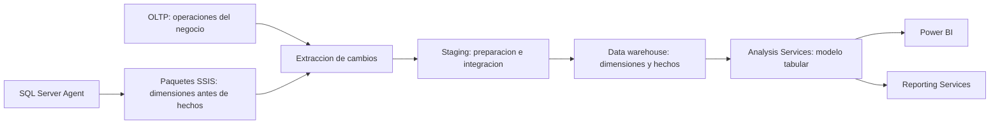
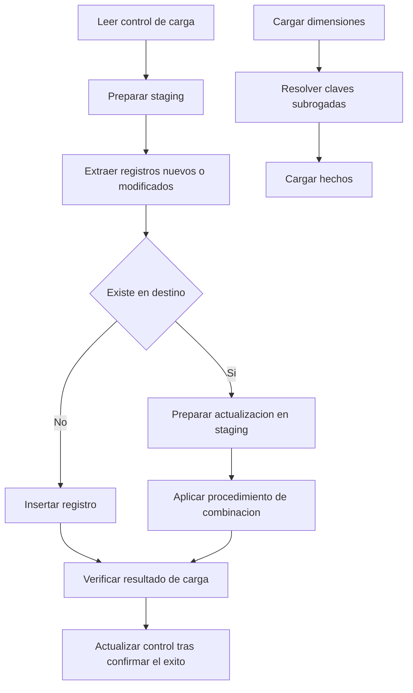

# Clase 8: Integración de Business Intelligence: modelado dimensional, ETL y auditoría de métricas

> **Objetivo académico:** Analizar una solución de Business Intelligence de extremo a extremo, relacionando el conocimiento del negocio, el grano del modelo dimensional, la integración incremental, la capa semántica y la visualización; evaluar sus decisiones de diseño y los riesgos de interpretación de sus indicadores.

## 1. Contexto y marco conceptual

La sesión integra experiencias técnicas sobre soluciones construidas con bases transaccionales de librerías y editoriales, principalmente Bookstore y Pubs, además de un caso con AdventureWorks. El núcleo académico es la revisión de la cadena que transforma registros operativos en información para la toma de decisiones: OLTP, data warehouse, ETL, modelo tabular y herramientas de consumo.

El sistema **OLTP** registra operaciones y conserva relaciones propias del negocio: clientes, pedidos, líneas, libros, autores, direcciones y métodos de envío. El **data warehouse** reorganiza esa información para facilitar agregaciones y análisis. La **capa semántica tabular** define relaciones, columnas calculadas y medidas reutilizables; las visualizaciones permiten explorar esas medidas por tiempo, producto, cliente, ubicación o canal logístico.

El valor de esta arquitectura depende de entender qué representa cada registro. En Bookstore, una orden puede contener varias líneas y cada línea corresponde a un libro. Los datos descritos no incorporan una cantidad explícita de varias unidades del mismo libro por línea: se trabaja con una unidad por línea. Esto no significa que una orden contenga un solo libro. La diferencia entre orden, línea y unidad determina el significado de los conteos y los importes.

Las preguntas de negocio orientan el diseño: cuáles son los títulos con mayor ingreso, qué tiendas concentran ventas, cómo se distribuyen las compras por país, qué métodos de envío se utilizan y cuánto representa el envío respecto del importe vendido. La sesión también muestra que construir dimensiones sin preguntas analíticas claras conduce a cambios posteriores en el modelo y en los procesos de extracción.

**Enriquecimiento conceptual:** Una solución puede ser técnicamente ejecutable y semánticamente incorrecta. La conexión exitosa de Power BI con Analysis Services demuestra conectividad; la confiabilidad de una cifra exige además una definición de negocio, un grano coherente y reglas de agregación verificables.

## 2. Fundamentos teóricos y arquitectura

### 2.1. Separación de responsabilidades

Los casos siguen una arquitectura común, implementada mediante proyectos de base de datos, Integration Services, Analysis Services y herramientas de visualización o reporting.

La zona de **staging** recibe y prepara datos antes de su incorporación definitiva. En los casos expuestos se usa para consolidar información, ajustar tipos, normalizar textos, tratar valores nulos y preparar actualizaciones. Su estructura responde al flujo de integración; no debe confundirse automáticamente con una copia completa del origen ni con la capa analítica definitiva.

La automatización mediante SQL Server Agent organiza la ejecución de paquetes. El orden importa: las dimensiones deben estar disponibles antes de resolver las referencias de la tabla de hechos. El despliegue de paquetes y la revisión de su historial de ejecución permiten comprobar la operación del proceso fuera del entorno de desarrollo.

### 2.2. Esquema estrella y declaración del grano

En Bookstore se presentan tablas de hechos de ventas o pedidos relacionadas con dimensiones de libro, cliente, fecha, dirección y método de envío. Algunas variantes incorporan el estado del pedido. En Pubs aparecen dimensiones de tienda, título, editorial, autor y fecha.

El nombre de una tabla, como `FactOrders` o `FactSales`, no determina por sí mismo su grano. En uno de los casos se declara expresamente que cada fila representa una **línea de pedido**. Por tanto, los atributos y medidas deben interpretarse a ese nivel.

| Elemento | Función analítica | Riesgo que requiere revisión |
| --- | --- | --- |
| Dimensión de fecha | Organizar análisis por día, mes, trimestre y año | Mezclar años al comparar únicamente nombres de meses |
| Dimensión de cliente | Caracterizar compradores y contar clientes distintos | Confundir clientes con empleados, vendedores o proveedores |
| Dimensión de libro o título | Analizar catálogo e ingresos por producto | Perder autores o duplicar ventas al expandir relaciones múltiples |
| Dimensión de dirección | Analizar ubicación | Interpretar el país del cliente como destino efectivo del envío |
| Dimensión de método de envío | Analizar modalidades logísticas | Repetir un importe de cabecera en todas las líneas |
| Dimensión de estado | Filtrar situaciones del pedido | Suponer que un estado actual describe toda la trayectoria histórica |
| Tabla de hechos | Registrar eventos y medidas al grano declarado | Mezclar líneas, pedidos y eventos de cambio de estado |

Las claves subrogadas vinculan los hechos con las dimensiones del warehouse. Los paquetes de hechos realizan búsquedas para traducir identificadores del origen a esas claves.

**Enriquecimiento conceptual:** La clave natural identifica una entidad en el sistema fuente; la clave subrogada identifica un registro dimensional en el warehouse. Si se conservan versiones históricas, una misma entidad natural puede corresponder a varias claves subrogadas. En ese caso, resolver la dimensión exige considerar la vigencia pertinente al evento, además del identificador natural.

### 2.3. Relaciones de varios autores por libro

Una dificultad recurrente es la relación de muchos a muchos entre libros y autores. En un caso se selecciona únicamente el primer autor para simplificar la dimensión; en otro, una dimensión de autor queda sin uso por la dificultad de integrarla.

Seleccionar un solo autor simplifica el flujo, pero pierde información de coautoría. No constituye una representación completa del negocio y limita cualquier interpretación de ventas por autor.

**Enriquecimiento conceptual:** Una tabla puente entre libro y autor permite representar la coautoría sin exigir otra tabla de hechos de ventas. Sin embargo, se debe decidir si una venta se atribuye íntegramente a cada autor o si se reparte mediante pesos. La atribución íntegra permite analizar participación, pero sus subtotales por autor pueden superar la venta total cuando se suman. Un reparto requiere pesos definidos y una regla de negocio explícita.

### 2.4. Historia y estados

Se menciona control de vigencia en clientes y preparación de estructuras para cambios históricos, aunque no se muestra una implementación suficientemente detallada para identificar una estrategia concreta. También aparecen estados como pendiente, en proceso y cancelado.

**Enriquecimiento conceptual:** Conservar el estado actual permite describir la situación vigente. Analizar duraciones o transiciones requiere registros históricos de eventos o instantáneas con fechas pertinentes. Una dimensión de estado, por sí sola, no reconstruye el ciclo completo de un pedido.

## 3. Implementación técnica y lógica de negocio

### 3.1. Organización de los componentes

Las soluciones descritas organizan cuatro componentes principales:

1. **Proyecto OLTP:** definición de tablas, scripts de población y procedimientos de extracción.
2. **Proyecto de warehouse:** dimensiones, hechos, staging, procedimientos de actualización y carga de la dimensión de fecha.
3. **Proyecto ETL:** paquetes SSIS por dimensión y por tabla de hechos, conexiones y variables de control.
4. **Proyecto tabular:** importación del warehouse, relaciones, columnas calculadas, medidas y publicación en Analysis Services.

Agrupar los componentes en una solución facilita su navegación y hace visibles sus dependencias. Los perfiles de publicación permiten reutilizar configuraciones de despliegue. No sustituyen la necesidad de parametrizar conexiones para distintos equipos o ambientes.

### 3.2. Patrón de integración incremental

En los flujos expuestos se recuperan valores de control asociados a `rowversion`, se limpia staging, se extraen cambios y se consulta si los registros ya existen en destino. Los nuevos pueden insertarse directamente y los existentes pasan por staging para aplicar actualizaciones mediante procedimientos de combinación. El flujo de hechos añade búsquedas de todas las dimensiones y una comprobación de existencia según la clave del evento.

El diagrama sintetiza el patrón descrito. La confirmación explícita del éxito antes de avanzar el control es un **enriquecimiento conceptual** para preservar recuperabilidad; la transcripción no documenta sus límites transaccionales.

**Enriquecimiento conceptual:** En SQL Server, `rowversion` es un valor binario de versión asociado a modificaciones, no una fecha ni una hora. Puede ayudar a identificar inserciones y actualizaciones, pero no permite detectar por sí solo filas eliminadas físicamente. La coherencia de una extracción incremental también depende de la concurrencia y del modo de fijar y confirmar sus límites. No basta con almacenar un último valor para garantizar ausencia de pérdidas.

### 3.3. Importe de línea, cantidad y conteos

Una transformación presentada consiste en calcular el importe de línea a partir de cantidad y precio unitario.

**Enriquecimiento conceptual:** La expresión general que formaliza esta regla es:

$$
A_i=q_i p_i
$$

Aquí, $i$ identifica una línea; $q_i$ es su cantidad de unidades, normalmente un entero positivo en ventas sin devoluciones; $p_i$ es el precio por unidad, en moneda por unidad; y $A_i$ es el importe de línea, en moneda. Se supone que el precio corresponde a la operación y que todavía no se aplican descuentos, impuestos u otros ajustes. En Bookstore se adopta $q_i=1$ por la estructura descrita de las líneas; esa convención debe documentarse y no generalizarse a otras fuentes.

La cantidad total de libros, el número de líneas, el número de órdenes y el número de clientes son medidas diferentes. Contar líneas equivale a contar unidades únicamente bajo el supuesto de una unidad por línea. El número de órdenes exige identificar pedidos distintos; el número de clientes exige identificar compradores distintos dentro del contexto analizado.

### 3.4. Prorrateo del envío desde la cabecera

El caso técnico más discutido es un cargo de envío asociado a la cabecera de una orden, mientras la tabla de hechos representa líneas. Un caso distribuye ese importe entre los libros del pedido mediante una columna calculada del modelo tabular. Otro decide mantener el envío separado del análisis de ventas de libros. También se describe una implementación que repite el cargo en cada línea, reconociendo el problema.

**Enriquecimiento conceptual:** Para distribuir un cargo uniformemente entre líneas:

$$
s_i=\frac{S_o}{n_o},\qquad i\in L_o
$$

$o$ identifica una orden; $L_o$ es su conjunto de líneas; $n_o=|L_o|$ es el número entero positivo de líneas; $S_o$ es el cargo de envío de la orden, en moneda; y $s_i$ es el importe asignado a la línea $i$, también en moneda. Se supone reparto uniforme entre líneas y un cargo único por orden.

La propiedad de conservación es:

$$
\sum_{i\in L_o}s_i=\sum_{i\in L_o}\frac{S_o}{n_o}=n_o\frac{S_o}{n_o}=S_o
$$

El ejemplo verbal de cinco libros y un envío de 15 unidades monetarias produce una asignación de 3 por línea cuando cada línea contiene un libro. Copiar 15 en las cinco líneas produciría una suma de 75 y multiplicaría indebidamente el cargo original. En una implementación monetaria, los redondeos requieren un ajuste residual para conservar el total.

Si las cantidades por línea varían, repartir por unidades exige otra regla:

$$
s_i=S_o\frac{q_i}{\sum_{j\in L_o}q_j}
$$

$q_i$ y $q_j$ son cantidades de unidades de las líneas respectivas; el denominador debe ser positivo. Esta regla distribuye por unidades y no necesariamente por peso, volumen o costo logístico real. La elección depende del propósito del análisis.

### 3.5. Ubicación de los cálculos

Se discute trasladar el prorrateo desde una fórmula tabular compleja hacia el ETL. El motivo es simplificar la capa semántica y evitar cálculos repetidos o costosos al crecer el volumen. La contrapartida es modificar estructuras, procedimientos y flujos dependientes.

**Enriquecimiento conceptual:** Conviene distinguir el momento de ejecución. Una columna calculada de un modelo importado se materializa durante el procesamiento y ocupa memoria; una medida se evalúa según el contexto de consulta. Por ello, una fórmula compleja puede aumentar el tiempo de procesamiento, el consumo de memoria o la latencia de consulta según cómo esté implementada. La sesión no aporta mediciones para cuantificar estos efectos.

| Criterio | Cálculo en ETL | Columna calculada tabular | Medida tabular |
| --- | --- | --- | --- |
| Uso principal | Transformación estable y reutilizable | Atributo o valor materializado por fila | Agregación sensible a filtros |
| Momento habitual | Carga e integración | Procesamiento del modelo importado | Consulta |
| Ventaja | Centralizar reglas y simplificar consumo | Facilitar clasificación y reutilización en el modelo | Responder al contexto analítico |
| Costo o límite | Propagar cambios y reprocesar datos | Almacenamiento y tiempo de procesamiento | Complejidad y costo de evaluación |

### 3.6. Medidas y clasificaciones analíticas

Se describen cantidades, importes, clientes distintos, ticket promedio, tamaño de cesta, envío total y segmentaciones por venta grande o simple, precio y costo relativo del envío. Otros casos clasifican ventas como estándar, premium o lujosas, distinguen mercados locales e internacionales y analizan pedidos según su estado.

Esas categorías son convenciones de cada caso. No constituyen una taxonomía universal y sus umbrales requieren unidad, tratamiento de valores límite y justificación de negocio. Las etiquetas utilizadas para precios nulos o gratuitos tampoco permiten inferir por sí solas una preventa o una promoción.

**Enriquecimiento conceptual:** Dos cocientes útiles para precisar las definiciones son:

$$
T=\frac{V}{N_o},\qquad B=\frac{Q}{N_o}
$$

$V$ es el importe vendido en moneda; $Q$ es la cantidad de unidades; $N_o$ es el número de órdenes distintas; $T$ es el ticket promedio, en moneda por orden; y $B$ es el tamaño promedio de cesta, en unidades por orden. Los tres agregados deben corresponder al mismo universo de pedidos y contexto temporal. Si $N_o=0$, el resultado requiere un tratamiento explícito, por ejemplo un valor vacío.

La distinción entre `gross sales`, `net sales`, `profit` y margen no queda uniformemente definida entre los casos. Algunos suman el envío al importe de libros; otros igualan bruto y neto por ausencia de descuentos; otro resta el envío a las ventas y denomina al resultado margen bruto.

**Enriquecimiento conceptual:** Sumar un cargo de envío cobrado al cliente puede representar un total facturado, según la definición del negocio. Restar un costo de envío a ventas genera un resultado después de ese costo, pero no acredita un margen bruto contable si faltan costos de los productos y otros ajustes. Además, la tarifa cobrada al cliente y el costo pagado al transportista son magnitudes distintas aunque una fuente use un nombre similar para ambas.

## 4. Análisis crítico de casos y auditoría práctica

### 4.1. Bookstore: coherencia entre cabecera y detalle

La auditoría debe comprobar que los importes de libros se sumen al grano de línea y los cargos de pedido se contabilicen una sola vez o se distribuyan de forma conservativa. Omitir el envío del indicador de venta de libros puede ser coherente con una definición explícita; repetirlo sin ajuste genera sobreconteo.

También se necesita distinguir un libro gratuito de un ingreso inexistente para toda la orden: puede haber un cargo de envío aunque el precio del libro sea cero. Las comparaciones entre envío y venta requieren indicar si se realizan por línea o por orden y si el envío representa cargo o costo.

**Enriquecimiento conceptual:** Un ratio agregado de envío sobre ventas debe definir su denominador y el tratamiento de ventas iguales a cero. Promediar ratios por pedido y dividir el envío total entre las ventas totales responden a preguntas diferentes; el segundo resultado pondera implícitamente por el importe vendido.

### 4.2. Pubs: rankings dinámicos y filtros fijos

Los análisis abarcan ventas por tienda, libros por autor, títulos más vendidos y evolución anual. En un caso, indicadores con nombres como editorial con menos ventas o tienda con más ventas se implementan filtrando identificadores previamente seleccionados.

**Enriquecimiento conceptual:** Un filtro fijo calcula el desempeño de una entidad concreta; un ranking determina qué entidad ocupa una posición según la medida y el contexto actual. Un indicador de liderazgo requiere resolver empates, mantener coherencia con los filtros y actualizar la entidad cuando cambia el período. Un identificador fijo puede servir para seguimiento individual, pero su título debe reflejar ese alcance.

La relación autor–título merece especial revisión para evitar que una unión con coautores multiplique hechos. La facilidad de elaborar gráficos no elimina ese riesgo de modelado.

### 4.3. Geografía, usuarios y significado de los atributos

Algunos gráficos se construyen con el país del cliente. Ese atributo caracteriza al comprador, pero puede diferir del país de entrega. De modo similar, una tabla de clientes no demuestra ventas por empleado: el rol analítico debe corresponder a la entidad y a la relación disponible en la fuente.

**Enriquecimiento conceptual:** Las perspectivas de un modelo tabular organizan subconjuntos de objetos para facilitar su uso. No constituyen por sí mismas control de acceso. Si se necesita restringir información por usuario, deben definirse mecanismos de seguridad específicos. Ocultar columnas también mejora la experiencia de consumo, pero no equivale a proteger los datos.

### 4.4. Reporting y exploración multidimensional

Se muestran tanto conexiones de Power BI al modelo tabular como un informe de Reporting Services conectado a Analysis Services. También aparecen reportes obtenidos mediante procedimientos almacenados.

Un reporte SQL puede resolver una pregunta concreta sobre títulos, cantidades e importes. La capa semántica agrega definiciones compartidas y exploración por dimensiones. Su utilidad se aprecia cuando distintos gráficos reutilizan medidas y relaciones, aunque la corrección de sus resultados sigue dependiendo de esas definiciones.

### 4.5. Separación de cargas operativas y analíticas

Se expone un caso clínico en el que una consulta de cierre contable compite con aplicaciones móviles, cajas y otros usuarios del mismo sistema transaccional. Se reporta una utilización del procesador superior al 90 % durante ese proceso. Otro caso menciona consultas de tracking de 15 a 20 minutos y dificultades de confiabilidad de indicadores.

Estas observaciones ilustran la motivación para separar cargas, pero no constituyen un análisis experimental de causas ni una demostración de mejora. La extracción programada y el procesamiento en un warehouse pueden reducir la competencia por recursos del OLTP; la extracción también consume recursos y debe diseñarse según las ventanas operativas y la frescura requerida.

**Enriquecimiento conceptual:** Un ETL puede normalizar e integrar datos, pero no recupera eventos nunca registrados ni convierte automáticamente una definición ambigua en una métrica confiable. La calidad exige revisar instrumentación, completitud, duplicados, correspondencia de identificadores y reglas de negocio.

## 5. Principios de diseño, buenas prácticas y anti-patrones

### 5.1. Diseñar desde preguntas y grano

La definición del modelo estrella fue una de las dificultades centrales. Las modificaciones posteriores afectaron procedimientos de extracción, tipos de datos, paquetes y cálculos. La experiencia muestra que el warehouse debe diseñarse con una comprensión explícita del negocio y del nivel de detalle disponible.

**Enriquecimiento conceptual:** Una secuencia útil consiste en declarar el proceso de negocio, el grano del hecho, las dimensiones, las medidas y sus reglas de agregación. Luego se contrasta esa definición con la fuente. Esto permite descubrir tempranamente una relación de coautoría o un costo de cabecera que no encaja directamente en el grano de línea.

### 5.2. Colaboración y control de versiones

Los casos presentan conflictos al combinar proyectos SSIS y modelos visuales, pérdida de cambios y divergencia entre bases locales. Aunque sus archivos son versionables, una combinación textual puede alterar identificadores y referencias internas y producir un paquete inválido.

**Enriquecimiento conceptual:** Las medidas prácticas incluyen asignar responsables por paquete, evitar ediciones simultáneas del mismo artefacto visual, realizar cambios pequeños y verificar que los proyectos abran y se ejecuten después de integrarlos. La imposibilidad observada de combinar ciertos cambios no significa que Git sea incompatible con SSIS; evidencia que la integración semántica requiere cuidado adicional.

Versionar solamente la solución tampoco garantiza ambientes equivalentes. Las definiciones de tablas, procedimientos, configuración y datos de referencia deben desplegarse de forma reproducible. Cuando una máquina contiene procedimientos ausentes en otra, el repositorio ya no describe por completo el sistema ejecutable.

### 5.3. Compatibilidad y conexiones

Se describen problemas con versiones de SQL Server, Visual Studio, extensiones, plantillas, permisos e instancias nombradas. Un nombre como `localhost` identifica el equipo, pero no basta para seleccionar una segunda instancia con nombre. Estas diferencias pueden impedir abrir proyectos, restaurar bases o conectar el modelo analítico.

**Enriquecimiento conceptual:** Conviene mantener una matriz de compatibilidad entre entorno de desarrollo, extensiones, versión objetivo y servicios instalados. Las conexiones deben parametrizarse por ambiente para evitar depender de nombres particulares de una estación de trabajo. Las recomendaciones de actualización realizadas durante la sesión fueron posibilidades de diagnóstico, no causas confirmadas de todos los fallos.

Se menciona Pentaho Data Integration, basado en Java, como alternativa para integración en ambientes Linux. Tableau aparece en la conversación como otra herramienta del ecosistema analítico; no se demuestra una sustitución funcional equivalente de toda la arquitectura utilizada.

### 5.4. Automatización observable

La ejecución programada aporta continuidad, pero el historial de un job debe interpretarse junto con los resultados de los datos. Un proceso puede finalizar sin errores y producir duplicados, omisiones o importes inconsistentes.

**Enriquecimiento conceptual:** Una auditoría útil registra filas extraídas, insertadas, actualizadas y rechazadas; verifica claves dimensionales no resueltas; contrasta importes del origen y destino; y comprueba que reprocesar una misma ventana no duplique hechos. Esta última propiedad se denomina idempotencia y requiere claves y reglas de actualización adecuadas.

| Anti-patrón | Consecuencia | Principio correctivo |
| --- | --- | --- |
| Construir dimensiones sin propósito analítico | Retrabajo y atributos irrelevantes | Vincular el modelo con preguntas de negocio |
| Repetir el envío de cabecera en cada línea | Sobreestimación del total | Separar o prorratear preservando el importe |
| Elegir un autor sin declarar la pérdida | Sesgo en análisis de coautoría | Explicitar alcance o modelar la relación múltiple |
| Denominar margen a una resta incompleta | Interpretación financiera errónea | Definir componentes y límites del indicador |
| Fijar un ID en una medida de liderazgo | Ranking desactualizado | Calcular posición según contexto |
| Fusionar archivos visuales sin validación | Referencias o paquetes dañados | Verificar integración y ejecución |
| Ocultar campos como supuesto control de acceso | Exposición de información | Separar usabilidad y seguridad |
| Atribuir calidad automática al ETL | Persistencia de errores de origen | Auditar datos y reglas de negocio |

## 6. Síntesis conceptual y profundización académica

La clase muestra que Business Intelligence requiere coordinar decisiones de modelado, integración, cálculo y consumo. El modelo estrella hace explícita una visión del negocio; el ETL la materializa y mantiene; la capa tabular ofrece medidas compartidas; y la visualización facilita explorar resultados y formular nuevas preguntas.

El caso del envío concentra el razonamiento principal: una magnitud de cabecera no puede sumarse indiscriminadamente al nivel de línea. Su tratamiento requiere elegir entre conservarla en su grano, distribuirla con una regla explícita o limitar el indicador al importe de los libros. La misma disciplina se aplica a clientes distintos, órdenes, coautores y estados históricos.

La complejidad también es arquitectónica. Una regla estable puede beneficiarse de cálculo previo en ETL, mientras una medida dependiente de filtros pertenece a la capa semántica. La decisión debe considerar reutilización, frecuencia de actualización, almacenamiento y costo de consulta; la sesión identifica riesgos de rendimiento, pero no ofrece mediciones comparativas.

**Enriquecimiento conceptual:** Tres líneas de profundización se desprenden de los casos: la sumarizabilidad de medidas cuando cambian los niveles de detalle; la representación temporal de dimensiones y estados; y la observabilidad de procesos incrementales bajo concurrencia y fallos. Estas líneas permiten pasar de una solución que ejecuta a una solución cuyos resultados pueden explicarse, reconciliarse y sostenerse operativamente.

El conocimiento del negocio articula todas las capas: determina qué se cuenta, qué se suma, qué relación se preserva y qué afirmaciones permiten los datos. Una visualización aporta valor cuando mantiene esa trazabilidad desde el evento operativo hasta el indicador mostrado.
