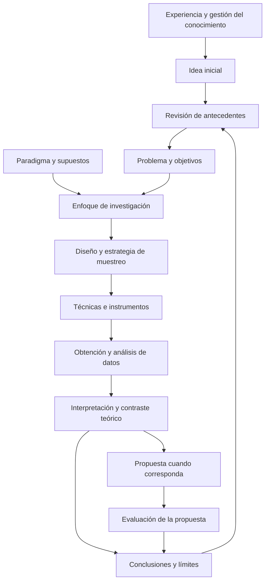

# Clase 1: Conocimiento científico, proceso monográfico y diseños de investigación

> **Objetivo académico:** Comprender la construcción del conocimiento científico y relacionar el problema de investigación con los paradigmas, enfoques y diseños metodológicos pertinentes para estudios monográficos en ciencias de datos e inteligencia artificial.

## 1. Contexto y marco conceptual

### Gestión del conocimiento y actividad investigativa

La gestión del conocimiento comprende identificar, capturar, almacenar, compartir y utilizar conocimientos para mejorar prácticas y desempeño. En una organización, supone crear condiciones para descubrir soluciones, conservar experiencias y transferir información de manera verificable. La investigación se nutre de ese proceso, pero introduce una exigencia específica: justificar cómo se obtuvieron los conocimientos y qué evidencia respalda sus conclusiones.

La sesión reconoce diversas vías de adquisición del conocimiento: experiencia directa, educación formal, investigación y análisis, comunicación y colaboración, y aprendizaje informal. Estas vías se relacionan entre sí. La experiencia puede revelar un problema; una conversación puede reformularlo; la revisión de antecedentes permite situarlo; y la investigación organizada permite contrastar las primeras interpretaciones.

La comunicación científica hace posible que otros conozcan, revisen y utilicen un aporte. Un producto tecnológico necesita una explicación de su problema, fundamento y resultados para que su contribución pueda ser valorada más allá de quien lo desarrolló.

### Conocimiento común y conocimiento científico

El conocimiento común surge de experiencias, observaciones cotidianas, creencias e intuiciones. Tiene valor práctico y puede originar preguntas relevantes. El ejemplo de los saberes agrícolas ancestrales ilustra cómo una experiencia acumulada puede aportar puntos de partida para investigaciones posteriores.

El conocimiento científico exige un tratamiento sistemático de las preguntas y de la evidencia. Una observación adquiere valor investigativo cuando se registra, se contextualiza y se analiza mediante procedimientos explícitos. La sesión menciona documentos, entrevistas, cuestionarios, grupos focales y distintas modalidades de observación como vías para obtener información.

| Dimensión | Conocimiento común | Conocimiento científico |
| --- | --- | --- |
| Origen frecuente | Experiencia, costumbre e intuición | Problemas formulados y procedimientos sistemáticos |
| Justificación | Convicción personal o utilidad cotidiana | Evidencia y argumentación susceptibles de revisión |
| Registro del procedimiento | Puede permanecer implícito | Debe explicitarse para permitir evaluación crítica |
| Revisión | Puede depender del entorno inmediato | Incorpora contraste y discusión especializada |
| Alcance | Habitualmente contextual | Debe delimitar las condiciones de sus conclusiones |

**Enriquecimiento conceptual:** La diferencia no establece una jerarquía absoluta entre personas o culturas. Una experiencia cotidiana puede ser acertada y una conclusión científica puede ser revisada. Lo distintivo es el modo de justificar las afirmaciones y someterlas a crítica.

### Investigación y ciencia

La investigación, entendida ampliamente como indagación, no siempre constituye investigación científica. Buscar una explicación y aceptarla por intuición, tradición o creencia no equivale a contrastarla mediante procedimientos rigurosos. El ensayo y error puede formar parte del trabajo científico, pero por sí solo no garantiza sistematicidad ni evidencia suficiente.

En la sesión, la ciencia se concibe como actividad social, sistemática e institucionalizada orientada a producir, difundir y aplicar conocimientos. Su dimensión social incluye cooperación, comunicación, revisión especializada y construcción de procedimientos compartidos.

**Enriquecimiento conceptual:** La objetividad no equivale únicamente a que algo sea palpable. También pueden investigarse entidades abstractas, procesos computacionales y experiencias humanas. La exigencia relevante es que las afirmaciones tengan fundamentos explícitos y procedimientos de análisis adecuados al objeto de estudio.

## 2. Fundamentos teóricos y arquitectura

### Condiciones y criterios del conocimiento científico

La producción científica está condicionada por las teorías disponibles, la tradición disciplinar, los métodos dominados, el contexto socioeconómico y cultural, el acceso a recursos y la colaboración entre investigadores. Estas condiciones influyen en qué preguntas se consideran relevantes y qué estudios resultan viables.

La sesión destaca objetividad, validación empírica, replicabilidad, generalización, formalización y revisión por pares. Su función es favorecer conocimientos justificables y confiables.

**Enriquecimiento conceptual:** Estos criterios requieren matices. La revisión por pares aporta control crítico, pero no garantiza ausencia de errores. La generalización depende del diseño y del contexto; un estudio de caso puede producir conocimiento valioso sin representar estadísticamente una población. En investigación computacional conviene distinguir reproducir un análisis con los mismos datos y procedimientos de replicar un resultado mediante una investigación independiente.

### Investigación básica, aplicada y orientación propositiva

La investigación básica busca comprender fenómenos y desarrollar conocimientos o teorías sin exigir una aplicación inmediata. La investigación aplicada utiliza conocimientos para abordar problemas concretos y desarrollar o mejorar tecnologías, productos y servicios.

La orientación propositiva presentada en la clase articula diagnóstico y solución: revisa antecedentes, fundamenta el problema, obtiene evidencia, contrasta resultados con la teoría, diseña una propuesta y evalúa su posible contribución. En ciencias de datos e inteligencia artificial, la propuesta puede adoptar la forma de un modelo predictivo, sistema, metodología o marco de trabajo.

**Enriquecimiento conceptual:** La revisión de teoría dentro de un estudio aplicado no constituye automáticamente investigación básica original. Ambas orientaciones pueden retroalimentarse, pero no son etapas obligatorias de toda investigación. Tampoco toda investigación de posgrado requiere producir un servicio o producto: la preferencia propositiva corresponde al marco institucional expuesto en la sesión.

### Paradigma, enfoque, diseño e instrumentos

Un paradigma orienta los supuestos sobre la realidad, el conocimiento y la relación entre investigador y objeto de estudio. El enfoque expresa una orientación general de producción y análisis de evidencia. El diseño organiza la estrategia concreta para responder la pregunta. Las técnicas e instrumentos permiten obtener y registrar los datos.

El diagrama representa una relación de coherencia, con retroalimentación entre resultados, antecedentes y nuevas preguntas. No implica que toda investigación siga una secuencia rígida ni que toda investigación deba formular una propuesta.

### Paradigmas abordados

| Paradigma | Orientación presentada | Pregunta metodológica central |
| --- | --- | --- |
| Positivista | Medición, contrastación y explicación de regularidades | ¿Qué variables y relaciones pueden estudiarse mediante evidencia observable? |
| Interpretativo o hermenéutico | Comprensión de significados y experiencias contextualizadas | ¿Cómo interpretan los participantes una situación? |
| Crítico o sociocrítico | Análisis de condiciones sociales y transformación de prácticas | ¿Qué condiciones sostienen un problema y cómo pueden transformarse? |
| Constructivista | Construcción situada del conocimiento mediante interacción | ¿Cómo se producen y negocian los significados? |
| Sistémico o complejo | Interdependencias entre componentes y contexto | ¿Cómo influyen las relaciones del sistema en el fenómeno estudiado? |

**Enriquecimiento conceptual:** La exposición aproxima el positivismo a lo cuantitativo, la interpretación a lo cualitativo y los paradigmas crítico, constructivista y complejo a lo mixto. Son asociaciones orientativas, no equivalencias obligatorias. Un paradigma no determina por sí solo el tipo de datos. Tampoco estos paradigmas forman necesariamente una sucesión histórica en la que uno sustituye o supera a los demás.

## 3. Implementación técnica y lógica de negocio

La fuente desarrolla una implementación metodológica: cómo organizar una investigación y su comunicación. No presenta código, conjuntos de datos ni ejecuciones computacionales cuyos resultados puedan reproducirse.

### De una idea inicial a un problema investigable

Las ideas iniciales suelen ser vagas. Pueden surgir de experiencias profesionales, teorías, descubrimientos, materiales escritos o audiovisuales, conversaciones, observación e intuición. Su maduración requiere revisar antecedentes y precisar qué se quiere conocer y por qué resulta relevante.

El conocimiento previo del área facilita reconocer problemas y valorar la factibilidad. Sin embargo, una idea puede modificarse o descartarse durante la indagación. La formulación inicial debe admitir refinamiento a medida que se conoce mejor el tema.

**Enriquecimiento conceptual:** Que un asunto haya sido estudiado no lo vuelve improcedente. Puede justificarse una investigación por un nuevo contexto, una limitación metodológica, un resultado contradictorio o una necesidad de replicación. La originalidad debe argumentarse a partir de los antecedentes.

### Ubicación en líneas de investigación

La clasificación institucional presentada organiza el conocimiento desde un área general hacia áreas específicas, subáreas, líneas y ejes temáticos. La ubicación de una investigación debe justificarse por su objeto y contribución predominante, aunque pueda relacionarse con varias líneas.

La sesión distingue tres grandes áreas: ciencias de la computación aplicada; ciencia básica de la computación o cómputo científico; y plataformas tecnológicas de información y comunicación. Entre los campos mencionados se encuentran:

- Ingeniería del computador, ingeniería de software, automatización, robótica e inteligencia artificial, computación ubicua, computación gráfica y sistemas de información.
- Sistemas cognitivos e inteligentes, procesamiento digital, informática aplicada, bioinformática y ciencias de datos.
- Comportamiento humano y psicolingüística vinculados a tecnologías de información, y sistemas concurrentes, paralelos y distribuidos.
- Teoría de la computación, algoritmos y estructuras de datos, metodologías y lenguajes de programación, y arquitectura y hardware de alto rendimiento.
- Redes y comunicaciones, internet de las cosas, circuitos y sistemas electrónicos, y ciberseguridad.

La enumeración recoge los campos verbalizados; no reconstruye los ejes que solo se mostraron en pantalla. La ubicación temática puede afinarse conforme se delimita la investigación.

### Arquitectura de una monografía propositiva

La monografía se presenta como un estudio concentrado en un tema, de alcance más acotado que una tesis. En la modalidad institucional descrita, no se limita a una revisión bibliográfica: puede incluir marco metodológico, obtención de datos, discusión y propuesta.

| Componente | Función académica |
| --- | --- |
| Resumen ejecutivo | Sintetizar el estudio una vez que se conocen su desarrollo y resultados |
| Introducción | Contextualizar la importancia del tema, sus antecedentes, problema y objetivos |
| Marco teórico, conceptual y referencial | Definir conceptos y fundamentar el análisis |
| Metodología | Explicar enfoque, diseño y procedimientos de obtención y análisis de datos |
| Resultados y discusión | Presentar la evidencia e interpretarla frente a los objetivos y antecedentes |
| Propuesta, cuando corresponda | Describir una alternativa de solución sustentada en el análisis |
| Conclusiones | Responder a los objetivos con base en los resultados |
| Recomendaciones, si proceden | Señalar continuidad o aplicaciones justificadas |
| Referencias y anexos | Identificar las fuentes y documentar instrumentos relevantes |

La explicación oral modifica el orden de algunos apartados para situar la metodología antes de los resultados. La relación lógica es clara: el lector debe conocer cómo se obtuvo la evidencia antes de valorar su interpretación.

La estructura expuesta relaciona objetivos específicos con tres núcleos: fundamentación teórica; análisis de la evidencia sobre el problema; y descripción de alternativas de propuesta. Es una organización propia del modelo explicado, no una cantidad universal de objetivos.

La clase menciona APA 7 para citas y referencias y distingue ese uso de la estructura institucional del documento. No se desarrollan reglas específicas de citación.

### Diseños cuantitativos

El enfoque cuantitativo permite medir variables, analizar relaciones y, cuando corresponde, contrastar hipótesis. La sesión distingue diseños experimentales y no experimentales.

| Diseño | Rasgo central | Límite interpretativo |
| --- | --- | --- |
| Preexperimental | Intervención con control reducido | Dificultad para atribuir el cambio exclusivamente a la intervención |
| Cuasiexperimental | Intervención sin asignación aleatoria plena | Necesidad de atender diferencias iniciales y explicaciones alternativas |
| Experimental con asignación aleatoria | Manipulación deliberada y comparación bajo condiciones controladas | La validez depende también de la ejecución, medición y condiciones del estudio |
| No experimental transversal | Observación en un corte temporal | Una asociación no establece por sí sola causalidad |
| No experimental longitudinal | Observaciones distribuidas en el tiempo | Seguir cambios no elimina automáticamente factores de confusión |

**Enriquecimiento conceptual:** La asignación aleatoria es una diferencia clave entre experimento aleatorizado y cuasiexperimento. El emparejamiento puede mejorar la comparabilidad, pero no equivale a aleatorizar. Además, existen diseños cuasiexperimentales de un solo grupo, como ciertas series temporales interrumpidas; dos grupos no son un requisito universal.

**Enriquecimiento conceptual:** Exploratorio, descriptivo, correlacional y explicativo expresan propósitos o alcances; no deben confundirse con la dimensión temporal ni con la existencia de intervención. La condición transversal depende del corte temporal de la observación, no del número de instrumentos utilizados.

En los estudios longitudinales se mencionan tendencia, cohorte y panel. **Enriquecimiento conceptual:** Un estudio de tendencia sigue cambios en una población, aunque observe personas diferentes; uno de cohorte sigue un grupo definido por una característica o acontecimiento compartido; y un panel observa repetidamente las mismas unidades. No se distinguen únicamente por medir al inicio, durante y al final.

### Diseños cualitativos

El enfoque cualitativo busca comprender experiencias, prácticas y significados mediante procedimientos sensibles al contexto. Su flexibilidad permite ajustar preguntas y categorías a medida que avanza el análisis. La sesión destaca entrevistas, grupos focales y observación participante.

| Diseño | Centro de interés | Operación analítica característica |
| --- | --- | --- |
| Teoría fundamentada | Desarrollo de una explicación teórica desde los datos | Comparación y construcción progresiva de categorías |
| Etnográfico | Prácticas y significados de grupos o culturas | Interpretación contextual de la vida colectiva |
| Narrativo | Historias, trayectorias y experiencias relatadas | Análisis de secuencias, relatos y sentidos |
| Investigación-acción | Comprensión y transformación de prácticas | Ciclos de acción, observación y reflexión |
| Fenomenológico | Experiencia vivida respecto de un fenómeno | Comprensión de significados de esa experiencia |
| Estudio de caso cualitativo | Comprensión intensiva de un caso delimitado | Integración contextual de distintas evidencias |

En teoría fundamentada se mencionan codificación abierta, axial y selectiva. **Enriquecimiento conceptual:** En las tradiciones que emplean esa secuencia, la codificación abierta identifica conceptos; la axial relaciona categorías; y la selectiva integra la explicación alrededor de una categoría central. La codificación axial no se define por estudiar valores personales, y las variantes de teoría fundamentada no utilizan necesariamente procedimientos idénticos.

La sesión vincula el muestreo cualitativo con selección por conveniencia o voluntad de participación. **Enriquecimiento conceptual:** También puede existir selección intencional basada en criterios y muestreo teórico. La saturación requiere justificar qué información o categorías dejan de aportar novedades relevantes; no equivale simplemente a acumular entrevistas.

### Diseños mixtos

La investigación mixta integra componentes cuantitativos y cualitativos para producir una interpretación conjunta. La sesión denomina metainferencias a las conclusiones derivadas de relacionar inferencias de ambos componentes y destaca una orientación pragmática: elegir procedimientos por su utilidad para responder el problema.

**Enriquecimiento conceptual:** Tres configuraciones permiten precisar la integración:

- Exploratoria secuencial: una fase cualitativa ayuda a identificar dimensiones que posteriormente se estudian cuantitativamente.
- Explicativa secuencial: resultados cuantitativos orientan una fase cualitativa destinada a comprenderlos mejor.
- Concurrente o convergente: ambos componentes se desarrollan en un periodo comparable y sus resultados se contrastan e integran.

La sesión también menciona diseños transformativos secuenciales y concurrentes, anidados o incrustados, de varios niveles y de integración múltiple. Su complejidad exige planificar recursos y coordinación. **Enriquecimiento conceptual:** La cantidad de investigadores depende del alcance y de los recursos, no de una prohibición inherente al nombre del diseño.

## 4. Análisis crítico de casos y auditoría práctica

### Caso metodológico: diagnóstico transversal y evaluación antes-después

La sesión propone combinar una encuesta inicial sobre un problema con una observación anterior y posterior a la introducción de una solución tecnológica. La encuesta corresponde a un diagnóstico transversal; la comparación antes-después corresponde a un componente de intervención con control reducido.

La combinación recibe en la clase la denominación de diseño múltiple. Ambos componentes pueden mantenerse dentro del enfoque cuantitativo. Usar varios instrumentos no convierte automáticamente el estudio en mixto.

**Enriquecimiento conceptual:** Para una única unidad o grupo observado antes y después puede describirse el cambio mediante:

$$
\Delta Y = Y_{\text{después}} - Y_{\text{antes}}
$$

Aquí, $Y_{\text{antes}}$ y $Y_{\text{después}}$ son mediciones numéricas del mismo indicador, con la misma definición y unidad; $\Delta Y$ es la diferencia observada y conserva esa unidad. Su interpretación supone mediciones comparables. Que la diferencia sea positiva o negativa solo expresa mejora si se conoce la dirección deseable del indicador.

Esta expresión describe un cambio; no identifica por sí sola un efecto causal. En ausencia de una comparación adecuada, pueden intervenir aprendizaje, cambios externos, diferencias en los datos o variaciones del procedimiento de medición. La fuente no aporta valores ni resultados de una ejecución.

### Monografía, tesis y artículo

La monografía propositiva descrita puede aportar antecedentes, decisiones metodológicas, evidencia inicial y una propuesta que posteriormente se profundicen. Su utilidad para una tesis no se limita al marco teórico. La continuidad exige revisar qué elementos siguen siendo pertinentes y cuáles requieren ampliación o reformulación.

La sesión contrasta una monografía breve, organizada en epígrafes, con una tesis de mayor profundidad y desarrollo capitular. También presenta una instrumentación más acotada para la primera y una exploración más amplia para la segunda.

**Enriquecimiento conceptual:** La profundidad no se determina por contar instrumentos o capítulos. Depende de la relevancia de la pregunta, suficiencia de la evidencia, calidad del análisis y alcance de la contribución. Una tesis tampoco requiere siempre hipótesis explícitas: su pertinencia depende del enfoque y del problema.

Respecto de los artículos, la discusión distingue revisión, opinión y comunicación de resultados mediante la estructura IMRyD: introducción, métodos, resultados y discusión.

**Enriquecimiento conceptual:** Una revisión rigurosa puede constituir investigación científica y debe explicitar sus procedimientos de selección y síntesis. IMRyD es una estructura de comunicación, no una certificación automática de calidad. Un artículo de investigación no necesita proceder necesariamente de una tesis.

### Evaluación de propuestas y triangulación

La sesión contempla evaluar una propuesta mediante aplicación práctica o valoración de especialistas. Ambas vías producen evidencias distintas: la revisión experta puede valorar coherencia y pertinencia; una aplicación permite observar comportamiento bajo condiciones determinadas.

**Enriquecimiento conceptual:** Una valoración favorable de especialistas no demuestra por sí sola efectividad operativa. De modo similar, combinar métodos no produce automáticamente una representación exacta de la realidad. La triangulación debe analizar convergencias, complementariedades y discrepancias; una contradicción entre fuentes puede revelar un aspecto importante del fenómeno.

## 5. Principios de diseño, buenas prácticas y anti-patrones

### Coherencia metodológica

La pregunta y los objetivos deben orientar el enfoque, diseño, muestreo e instrumentos. Un estudio centrado en medir desempeño puede requerir evidencia cuantitativa; uno centrado en comprender experiencias de uso puede requerir evidencia cualitativa; y uno que necesite relacionar ambos planos puede justificar una integración mixta.

**Enriquecimiento conceptual:** Ningún enfoque es universalmente superior. La amplitud de un diseño solo aporta valor cuando responde a una necesidad del problema y puede sostenerse con los recursos disponibles.

### Instrumentación y trazabilidad

La clase diferencia la estabilización previa de instrumentos cuantitativos y el refinamiento progresivo de instrumentos cualitativos. En el primer caso, destaca revisión especializada o pilotaje antes de la aplicación principal. En el segundo, resalta el aprendizaje durante el trabajo de campo.

**Enriquecimiento conceptual:** El pilotaje contribuye a revisar comprensión y funcionamiento, pero no demuestra por sí solo toda la validez de un instrumento. La adaptación cualitativa debe documentarse: qué cambió, por qué y cómo afecta la interpretación. Flexibilidad no significa ausencia de criterios ni que aplicar un instrumento lo valide automáticamente.

La observación participante exige reflexionar sobre la influencia del investigador en el contexto. **Enriquecimiento conceptual:** La observación encubierta mencionada en la fuente plantea cuestiones de consentimiento, privacidad y justificación ética; no debe tratarse como una alternativa rutinaria equivalente a cualquier observación.

### Uso crítico de inteligencia artificial generativa

La sesión plantea la inteligencia artificial generativa como apoyo a la exploración de ideas y a la redacción académica, bajo una perspectiva de cocreación y revisión crítica. No se proporcionan instrucciones técnicas reproducibles ni resultados de uso de una herramienta.

**Enriquecimiento conceptual:** La responsabilidad del argumento permanece en el investigador. Las referencias, afirmaciones y síntesis generadas deben contrastarse con fuentes efectivamente consultadas. La fluidez de un texto no demuestra su veracidad ni sustituye la obtención y el análisis de evidencia.

| Anti-patrón | Consecuencia | Buena práctica |
| --- | --- | --- |
| Elegir el enfoque por prestigio o aparente complejidad | Desajuste entre método y pregunta | Justificar cada decisión por el conocimiento requerido |
| Equiparar varios instrumentos con enfoque mixto | Confusión de la arquitectura metodológica | Identificar tipos de datos y explicar su integración |
| Atribuir causalidad a una diferencia antes-después | Conclusiones superiores a la evidencia | Considerar explicaciones alternativas y límites del diseño |
| Confundir revisión experta con efectividad demostrada | Sobreestimación de una propuesta | Precisar qué dimensión se evaluó y con qué evidencia |
| Modificar instrumentos sin registrar cambios | Pérdida de comparabilidad y trazabilidad | Documentar versiones y decisiones |
| Añadir métodos solo para aumentar su número | Complejidad sin ganancia de conocimiento | Evaluar la contribución de cada componente |
| Adoptar texto generado como evidencia | Afirmaciones o referencias no verificadas | Revisar fuentes y sostener autoría intelectual |

## 6. Síntesis conceptual y profundización académica

La investigación científica transforma una inquietud inicial en una pregunta abordable mediante procedimientos explícitos. El tránsito decisivo no consiste solo en obtener información, sino en justificar su procedencia, analizarla con criterios adecuados y delimitar lo que permite concluir.

La monografía propositiva expuesta integra, a una escala acotada, fundamentación teórica, metodología, evidencia y alternativas de solución. Puede constituir una base para investigaciones posteriores, siempre que su continuidad responda a una pregunta más precisa y a necesidades reales de profundización.

Los paradigmas orientan supuestos; los enfoques organizan la producción e interpretación de evidencia; los diseños articulan la estrategia; y los instrumentos concretan su registro. Mantener estas distinciones evita presentar una lista de términos metodológicos sin coherencia interna.

**Enriquecimiento conceptual:** En ciencias de datos e inteligencia artificial conviene distinguir tres planos de evaluación: desempeño técnico de un artefacto, comprensión de su uso en un contexto y evidencia de su contribución a resolver un problema. Son planos relacionados, pero una mejora en uno no demuestra automáticamente mejoras en los otros.

Las líneas de profundización que se desprenden de la clase incluyen la relación entre construcción tecnológica e investigación, las diferencias entre descripción y explicación causal, los criterios de rigor cualitativo, la integración de evidencias heterogéneas y la responsabilidad intelectual en la escritura asistida por inteligencia artificial.
