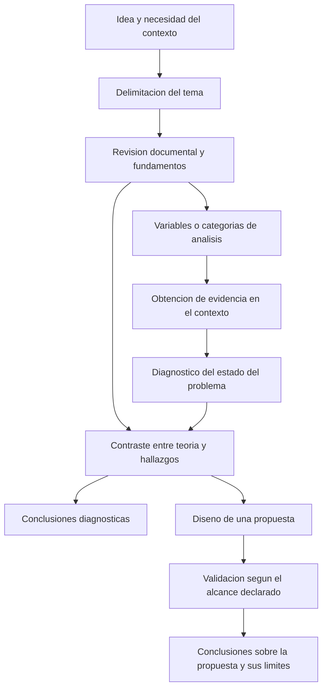

# Clase 2: Delimitación del tema, resultados diagnósticos y propositivos y construcción de la monografía científica

> **Objetivo académico:** Comprender cómo transformar una idea inicial en un tema investigable, distinguir resultados diagnósticos y propositivos y articular una monografía científica mediante la coherencia entre problema, fundamentos, diseño metodológico, evidencia y contribución.

## 1. Contexto y marco conceptual

La sesión desarrolla la monografía como informe científico y examina el tránsito desde una inquietud profesional hasta un tema delimitado. Los casos de apicultura, indicadores financieros, precios de materias primas y seguridad informática muestran que identificar una tecnología de interés no basta: es necesario precisar qué fenómeno se estudiará, con qué finalidad, en qué contexto y con qué alcance.

### De la idea inicial al tema investigable

Una idea puede comenzar de manera amplia e imprecisa. La revisión inicial de literatura, el conocimiento del entorno y la formulación de preguntas permiten reducir esa amplitud hasta obtener un objeto reconocible y abordable. El proceso es iterativo: la literatura puede revelar que una supuesta novedad ya existe, mientras que el diagnóstico del contexto puede mostrar necesidades distintas de las inicialmente previstas.

En la clase se propone delimitar el tema mediante los siguientes componentes:

| Componente | Pregunta orientadora | Función metodológica |
|---|---|---|
| Objeto o propuesta | ¿Qué se analizará o desarrollará? | Identifica el fenómeno, producto o servicio central. |
| Finalidad | ¿Para qué se estudiará o propondrá? | Explicita el propósito y el resultado esperado. |
| Sujetos o unidades | ¿Con quiénes o con qué se trabajará? | Precisa personas, organizaciones, registros, procesos o sistemas. |
| Contexto espacial | ¿Dónde se sitúa el estudio? | Delimita el entorno de aplicación y las condiciones de interpretación. |
| Contexto temporal | ¿Qué periodo se considera? | Acota la evidencia y evita conclusiones temporalmente indefinidas. |

La formulación debe equilibrar precisión y economía verbal. Un título excesivamente extenso puede ocultar el aporte central bajo una enumeración de variables, tecnologías y beneficios. En el caso apícola, productividad, salud de las colmenas y riesgo de pérdida pueden desarrollarse como dimensiones del problema sin que todas deban figurar literalmente en el título.

La palabra «propuesta» resulta pertinente cuando se pretende diseñar una solución. En una investigación diagnóstica, el núcleo del tema puede ser el análisis o la caracterización de un fenómeno, sin comprometer el desarrollo de un producto.

**Enriquecimiento conceptual:** La delimitación no equivale a añadir mecánicamente un lugar y un periodo al título. También exige restringir la población, las variables y las afirmaciones que se podrán sostener. Algunos detalles pueden quedar en el planteamiento del problema o en la metodología cuando incorporarlos al título perjudique su claridad.

### La monografía como producción científica

La monografía se presenta como un trabajo escrito, metódico y centrado en un tema particular. Su carácter científico depende de la aplicación razonada de procedimientos de investigación, de la selección crítica de información y de la posibilidad de reconocer y discutir sus aportes.

Se destacan cuatro rasgos:

- Un objeto de estudio identificable por otras personas.
- Una contribución que aporte conocimiento o una perspectiva distinta sobre lo ya conocido.
- Utilidad intelectual o práctica para quienes consultan el informe.
- Elementos de evidencia y argumentación que permitan revisar sus conclusiones y sustentar investigaciones posteriores.

La monografía no consiste en ensamblar párrafos de libros o artículos. Requiere comprender las fuentes, relacionarlas, evaluar sus alcances y construir una exposición propia con atribución de ideas. En la sesión se recomienda una redacción en tercera persona como criterio de estilo del informe.

**Enriquecimiento conceptual:** La originalidad puede residir en una contextualización, una comparación, una síntesis crítica o un diagnóstico fundamentado. No requiere afirmar que se ha descubierto un fenómeno enteramente desconocido. La persona gramatical utilizada tampoco garantiza objetividad: esta depende de la transparencia del procedimiento y de la calidad de la evidencia.

## 2. Fundamentos teóricos y arquitectura

### Resultados diagnósticos y propositivos

La distinción central de la sesión se refiere al tipo de resultado que produce la investigación.

Un **resultado diagnóstico** caracteriza el estado de un problema mediante evidencia obtenida en el contexto. En estudios cuantitativos suele expresarse mediante variables e indicadores; en estudios cualitativos, mediante categorías y relaciones interpretativas. Su función es establecer qué ocurre, cómo se manifiesta y qué necesidades o limitaciones se observan.

Un **resultado propositivo** presenta una alternativa de transformación: un modelo, una estrategia, una metodología, una herramienta, un marco de trabajo, una aplicación o un servicio. La propuesta debe derivarse de la confrontación entre los fundamentos teóricos y los hallazgos del diagnóstico.

| Dimensión | Resultado diagnóstico | Resultado propositivo |
|---|---|---|
| Pregunta central | ¿Cuál es el estado del problema? | ¿Qué alternativa puede responder al problema identificado? |
| Operación principal | Caracterizar, describir, analizar o relacionar. | Diseñar, elaborar o estructurar una solución fundamentada. |
| Evidencia necesaria | Datos del contexto y criterios de análisis. | Fundamentos teóricos y evidencia diagnóstica que justifiquen decisiones de diseño. |
| Producto intelectual | Descripción o interpretación sustentada del estado del problema. | Modelo, sistema, estrategia, metodología, producto o servicio. |
| Límite de la conclusión | Conocer el problema no demuestra haberlo resuelto. | Formular una solución no demuestra su efectividad. |

El diagnóstico no es un paso prescindible en un estudio propositivo. Permite evitar que la solución responda únicamente a preferencias tecnológicas o a supuestos no contrastados. A su vez, la teoría ayuda a definir qué observar y cómo interpretar lo observado.

**Enriquecimiento conceptual:** La representación anterior sistematiza la lógica expuesta en la sesión e incorpora explícitamente la validación como distinción entre diseñar una solución y aportar evidencia sobre ella. No todos los estudios recorren todas las etapas ni utilizan el mismo procedimiento de validación.

En la sesión, la progresión hacia una tesis se asocia con un mayor desarrollo propositivo. Esta orientación debe entenderse dentro del marco formativo presentado.

**Enriquecimiento conceptual:** La diferencia entre monografía y tesis no puede establecerse universalmente mediante la presencia de un producto tecnológico. Una tesis puede realizar una contribución empírica, teórica o metodológica sin desarrollar una aplicación, y una investigación diagnóstica puede alcanzar gran profundidad. El criterio decisivo depende de la pregunta, el rigor, la contribución y la normativa académica correspondiente.

### Paradigma, enfoque, diseño y alcance

Los casos permiten distinguir decisiones metodológicas que suelen confundirse:

| Nivel | Qué define | Ejemplos discutidos |
|---|---|---|
| Paradigma | Supuestos sobre el conocimiento y su justificación. | Positivista; sistémico-complejo. |
| Enfoque | Orientación general de producción y análisis de evidencia. | Cuantitativo, cualitativo o mixto. |
| Diseño | Organización del estudio y relación con el fenómeno. | No experimental, transversal; posible comparación antes-después. |
| Alcance | Tipo de conocimiento buscado. | Descriptivo, correlacional y formulación propositiva. |
| Técnica e instrumento | Procedimiento concreto para obtener información. | Revisión documental, encuesta con cuestionario, entrevista y observación. |

En el discurso docente, los estudios cuantitativos se vinculan con el paradigma positivista y el enfoque sistémico-complejo se relaciona con una comprensión integral mediante información cuantitativa y cualitativa. También se propone limitar el alcance metodológico de una monografía para mantener su viabilidad.

**Enriquecimiento conceptual:** Estas asociaciones son orientativas y no equivalencias necesarias. Un análisis sistémico puede utilizar métodos exclusivamente cuantitativos, y la investigación cuantitativa no pertenece de manera exclusiva a una sola posición epistemológica. Un estudio es mixto cuando integra deliberadamente evidencia cuantitativa y cualitativa para responder la pregunta; el número de instrumentos utilizados no determina por sí mismo esa condición.

### Tipos de monografía

La sesión distingue tres modalidades:

| Modalidad | Núcleo del trabajo | Exigencia intelectual |
|---|---|---|
| Compilación | Selección y presentación crítica de bibliografía sobre un tema. | Comprender posiciones, contrastar argumentos y construir una síntesis. |
| Análisis de experiencias | Descripción y evaluación de una experiencia práctica, con comparación de experiencias semejantes. | Contextualizar la práctica y fundamentar las conclusiones obtenidas. |
| Investigación | Estudio propio sobre un problema nuevo o poco explorado en un contexto. | Articular antecedentes, evidencia y una elaboración o conclusión con aporte identificable. |

La modalidad desarrollada conceptualmente en la sesión es la monografía de investigación, que puede culminar en un diagnóstico o avanzar hacia una propuesta.

**Enriquecimiento conceptual:** Estas modalidades no constituyen una jerarquía automática de calidad. Una compilación crítica puede requerir procedimientos rigurosos de búsqueda y síntesis, y el análisis de experiencias puede producir conocimiento relevante si explicita sus evidencias y límites.

## 3. Implementación técnica y lógica de negocio

La fuente no presenta código, experimentos ejecutados ni resultados de rendimiento. Su implementación es metodológica: define cómo organizar la investigación y cómo vincular una necesidad profesional con decisiones de obtención y análisis de evidencia.

### Secuencia para estructurar una investigación

1. **Identificar un área de interés.** Reconocer una necesidad o dificultad del contexto profesional y valorar el conocimiento previo disponible.
2. **Realizar una revisión inicial.** Identificar qué se sabe, qué soluciones existen y qué aspectos requieren mayor comprensión.
3. **Formular una pregunta preliminar.** Transformar una inquietud general en una interrogación susceptible de análisis.
4. **Delimitar el tema.** Precisar objeto, finalidad, unidades, contexto y periodo.
5. **Definir el resultado esperado.** Distinguir entre caracterizar el problema y diseñar una alternativa de solución.
6. **Alinear metodología y evidencia.** Seleccionar enfoque, diseño, técnicas y análisis según la pregunta.
7. **Relacionar hallazgos y fundamentos.** Explicar coincidencias, diferencias y vacíos entre lo descrito por las fuentes y lo observado en el contexto.
8. **Formular conclusiones proporcionales.** Sostener únicamente aquello que la evidencia permita y, cuando corresponda, justificar la propuesta.

### Organización del informe

La estructura general expuesta comprende introducción, desarrollo, conclusión y referencias bibliográficas. El desarrollo articula los fundamentos teóricos, la metodología, el análisis de resultados y la propuesta cuando esta forma parte del alcance. Los anexos pueden documentar los instrumentos empleados.

En la guía descrita en clase se favorece una estructura monográfica breve, sin reproducir la organización capitular extensa de una tesis. Esta es una convención del formato presentado, no una propiedad universal de toda monografía.

La introducción cumple tres funciones intelectuales:

- Explicar la relevancia del tema mediante una contextualización que avance desde el panorama general hasta el entorno específico.
- Fundamentar su pertenencia a un área, línea y eje temático de investigación.
- Presentar antecedentes que permitan reconocer qué aportes preceden al estudio y qué relación guardan con el problema.

La secuencia global, regional, nacional y local ayuda a contextualizar, pero cada nivel debe aportar información pertinente. Repetir afirmaciones generales sobre la importancia de la tecnología no sustituye la explicación del problema concreto.

### Vinculación con áreas, líneas y ejes temáticos

La estructura institucional descrita distingue áreas de conocimiento, líneas de investigación y ejes temáticos. El tema particular se ubica en esa estructura mediante una justificación de su aporte.

Un mismo estudio puede relacionarse con varias líneas. La recomendación es identificar una vinculación central: aquella en la que el objeto y la contribución tengan mayor correspondencia. La interdisciplinariedad no obliga a declarar todas las conexiones posibles.

**Enriquecimiento conceptual:** Una justificación sólida establece la relación entre el objeto estudiado, la contribución esperada y el contenido de la línea seleccionada. La coincidencia de palabras como «inteligencia artificial», «datos» o «plataforma» resulta insuficiente. La adscripción concreta requiere consultar el documento institucional; la transcripción no reproduce su catálogo completo.

### Revisión documental y construcción de antecedentes

La revisión bibliográfica permite identificar autores relevantes, enfoques, conceptos, soluciones previas y vacíos de conocimiento. La sesión enfatiza la actualidad de las fuentes, especialmente en campos tecnológicos de evolución rápida, y su selección por calidad, relevancia y veracidad.

**Enriquecimiento conceptual:** Actualidad y pertinencia deben ponderarse conjuntamente. Una fuente reciente puede ser poco rigurosa y una fuente clásica puede seguir siendo indispensable. Además, la distinción entre fuente primaria y secundaria depende de su relación con el conocimiento original, no de su antigüedad ni de su prestigio. Un trabajo que comunica resultados propios puede actuar como fuente primaria; una síntesis que analiza esos trabajos puede actuar como secundaria.

Un antecedente debe identificar al autor y el año, describir su aporte y explicar su relación con el tema. La sesión utiliza como referencia el estilo APA 7 y distingue la cita directa de la paráfrasis.

**Enriquecimiento conceptual:** Para convertir la mención de antecedentes en una síntesis analítica conviene registrar problema, contexto, método, aporte, limitaciones y pertinencia para el nuevo estudio. No todos esos elementos deben ocupar la misma extensión, pero su revisión evita construir una sucesión de resúmenes desconectados. La paráfrasis conserva la obligación de atribuir la idea; una cita textual requiere además el localizador correspondiente cuando esté disponible.

### Obtención y análisis de información

En el tratamiento cuantitativo se consideran mediciones, registros, cuestionarios e indicadores. En el cualitativo se describe el análisis de entrevistas mediante categorías, temas y subtemas, con apoyo posible de ATLAS.ti para organizar y representar relaciones.

**Enriquecimiento conceptual:** Una encuesta es una técnica y el cuestionario puede ser su instrumento. La entrevista puede producir distintos tipos de datos según su estructura y propósito. ATLAS.ti facilita la organización del material, pero no determina por sí mismo categorías válidas ni reemplaza la interpretación del investigador.

### Uso de inteligencia artificial generativa

La sesión presenta la IA generativa como apoyo para concretar preguntas, sintetizar información, explorar la ubicación temática y mejorar la redacción. Recomienda proporcionar contexto, indicar el tipo de análisis requerido y utilizar fuentes reales y verificables.

El control humano comprende comprobar la existencia de las fuentes, verificar los enlaces, contrastar el contenido atribuido y corregir generalizaciones que excedan el estudio. También se enfatiza distinguir el aporte del investigador del contenido generado mediante herramientas.

**Enriquecimiento conceptual:** Solicitar referencias auténticas no garantiza que la herramienta las produzca. La revisión debe comprobar por separado existencia, datos bibliográficos, correspondencia entre la fuente y la afirmación, y pertinencia para el contexto. Una redacción fluida tampoco constituye evidencia de validez científica.

## 4. Análisis crítico de casos y auditoría práctica

### Caso 1: predicción y gestión apícola

La idea integra temperatura, humedad, lluvia, flora, cantidad de abejas, condiciones sanitarias y producción de miel. Su motivación es apoyar decisiones en un entorno donde la inspección de colmenas se realiza manualmente y las condiciones ambientales afectan la actividad.

El aporte previsto es un modelo predictivo basado en IA. La retroalimentación distingue dos niveles: caracterizar variables críticas y prácticas de gestión, o desarrollar un modelo orientado a anticipar resultados relevantes. El contexto mencionado es un emprendimiento en la zona chaqueña de Villamontes; no se presentan datos ni resultados del modelo.

La diversidad de componentes justifica estudiar interacciones, pero no basta para clasificar automáticamente el trabajo como mixto. La decisión depende de la pregunta y de las evidencias integradas.

**Enriquecimiento conceptual:** Antes de elegir el algoritmo debe definirse qué se desea predecir. Producción de miel, riesgo de pérdida y estado sanitario son resultados distintos y pueden requerir diseños de medición diferentes. También deben precisarse la unidad de análisis —por ejemplo, la colmena— y el horizonte de predicción. Los datos de sensores y los pronósticos meteorológicos deben corresponder al momento en que se tomaría la decisión para evitar utilizar información que aún no estaría disponible.

### Caso 2: indicadores financieros, aprendizaje automático y agentes

El problema presentado es la interpretación manual de indicadores financieros, asociada con retrasos, inconsistencias y dificultades para detectar desviaciones. La alternativa combina modelos de aprendizaje automático para identificar o predecir variaciones con agentes que apoyen la interpretación y la generación de alertas.

La diferencia entre «analizar el aporte de un sistema existente» y «proponer un sistema híbrido» modifica el resultado esperado. En el primer caso se estudia una solución previa; en el segundo, la revisión y el diagnóstico fundamentan una estructura de solución propia.

La secuencia argumental expuesta comprende revisar fundamentos sobre integración de modelos y agentes, caracterizar el estado de su uso en el contexto y diseñar una propuesta coherente con las necesidades encontradas.

**Enriquecimiento conceptual:** Un cuestionario sobre tiempos percibidos o utilidad puede describir necesidades y expectativas. No demuestra que el sistema mejore la eficiencia ni que detecte desviaciones con precisión. La percepción de los usuarios, la calidad predictiva y el rendimiento operativo son dimensiones diferentes. La automatización de interpretaciones requiere además comprobar que las explicaciones estén respaldadas por los indicadores y no incorporen afirmaciones inventadas.

### Caso 3: simulación y alerta temprana sobre materias primas

La idea inicial relaciona precios de materias primas, exportaciones, producto interno bruto, endeudamiento, riesgo y gobernanza. La discusión identifica un problema de amplitud: cada relación adicional exige fundamentos, datos y criterios de interpretación.

La recomendación metodológica es concentrar el estudio en una organización o contexto de aplicación y en una finalidad precisa, como pronóstico de precios y alerta temprana. De esta manera, la utilidad potencial a escala nacional no se confunde con el ámbito efectivo de análisis.

La sesión menciona una posible comparación antes-después para estudiar el uso de la herramienta y la aproxima a un diseño preexperimental.

**Enriquecimiento conceptual:** Comparar periodos anteriores y posteriores no establece por sí mismo un efecto causal. Los cambios pueden deberse al mercado, a acontecimientos externos o a diferencias entre periodos. Para valorar un pronóstico deben definirse variable, horizonte, referencia de comparación y procedimiento de validación temporal. Tampoco puede deducirse la conveniencia del endeudamiento a partir del precio de las materias primas como única evidencia: esa conclusión excedería el alcance de un modelo centrado en precios.

### Caso 4: análisis de seguridad mediante SIEM

El caso describe registros de redes, accesos, aplicaciones y eventos de seguridad centralizados mediante un sistema SIEM, sigla de *Security Information and Event Management*. La dificultad planteada es que la información se utiliza principalmente de forma reactiva y no siempre se aprovecha para apoyar una detección más efectiva de amenazas.

Se proponen como elementos de análisis el número de alertas, la frecuencia de eventos sospechosos, los tiempos de respuesta y las relaciones entre eventos. El tratamiento inicial se formula como aplicado, cuantitativo y no experimental, con alcance descriptivo y correlacional.

La discusión amplía el diagnóstico hacia una propuesta: una aplicación o agente que ayude a reconocer falsos positivos y comunicar qué alertas requieren atención. Se distingue entre presentar un modelo de diseño, someterlo a valoración de expertos y desarrollar una aplicación basada en dicho modelo.

**Enriquecimiento conceptual:** El volumen de alertas no equivale al volumen de incidentes reales. Un falso positivo es una alerta clasificada como amenaza cuando no corresponde a una amenaza real. Su identificación requiere un criterio de referencia confiable; que una alerta se parezca a otra revisada anteriormente no demuestra que sea inocua. Reducir alertas sin controlar los falsos negativos podría ocultar amenazas verdaderas.

**Enriquecimiento conceptual:** El uso de registros históricos no convierte automáticamente el diseño en transversal. Si se estudian cambios y secuencias de eventos a lo largo del tiempo, existe una dimensión longitudinal o de serie temporal que debe reconocerse. La clasificación depende de la pregunta y de la estructura analítica, además del momento en que se extraigan los registros.

Cuando no se dispone de información real, la sesión contempla el uso explícito de un escenario simulado. La condición simulada debe declararse para evitar presentar sus resultados como observaciones de una organización.

**Enriquecimiento conceptual:** La revisión por expertos puede aportar evidencia sobre coherencia, pertinencia o factibilidad del diseño. No sustituye la validación del rendimiento de una aplicación en condiciones operativas. Del mismo modo, los datos simulados permiten analizar comportamientos bajo supuestos definidos, pero limitan la generalización a entornos reales.

### Criterios comunes de auditoría

| Pregunta de revisión | Problema que permite detectar |
|---|---|
| ¿El título promete más de lo que el diseño permite conocer? | Desajuste entre alcance declarado y evidencia. |
| ¿Se distingue el diagnóstico de la propuesta y de su validación? | Confusión entre conocer, diseñar y demostrar resultados. |
| ¿Las variables o categorías tienen una función clara? | Acumulación de dimensiones sin relación con la pregunta. |
| ¿El diseño temporal corresponde al análisis realizado? | Clasificaciones metodológicas basadas solo en disponer de registros históricos. |
| ¿Se comprueban las referencias y los aportes atribuidos? | Bibliografía ficticia o citas que no respaldan el argumento. |
| ¿Se explicitan las condiciones de simulación? | Presentación de escenarios hipotéticos como evidencia empírica. |

## 5. Principios de diseño, buenas prácticas y anti-patrones

### Coherencia entre pregunta, método y conclusión

El diseño debe partir del problema. La selección de IA, agentes o modelos predictivos necesita una función concreta dentro de la investigación. Una propuesta tecnológica se justifica por su relación con necesidades verificadas y fundamentos pertinentes.

La caracterización del contexto constituye un puente entre literatura y diseño: permite identificar qué ideas previas son aplicables, cuáles requieren adaptación y qué restricciones condicionan la solución.

### Viabilidad y control del alcance

Cada variable adicional introduce exigencias de medición, información e interpretación. La delimitación permite mantener una relación razonable entre ambición, acceso a datos, recursos y experiencia del investigador. Un alcance acotado puede producir conclusiones más sólidas que una formulación amplia sostenida por evidencia insuficiente.

### Selección y comunicación de evidencia

Las fuentes deben evaluarse por calidad científica, pertinencia, veracidad y actualidad. El informe necesita una relación trazable entre afirmaciones, citas y referencias. La escritura propia exige comprensión y síntesis; sustituir palabras en un texto ajeno sin reconocer su procedencia no cumple esa función.

### Competencias del investigador

La sesión destaca la identificación de preguntas relevantes, la aplicación de metodologías, el análisis y la síntesis de información, la colaboración, la comunicación de resultados y la responsabilidad profesional. El contraste de ideas contribuye a reconocer supuestos débiles y a mejorar la delimitación.

La investigación en ciencia de datos e IA se vincula con necesidades sociales y organizacionales, transformación digital y posibles aportes a políticas públicas o participación ciudadana. Esa pertinencia debe explicarse a través del problema y de los beneficiarios concretos.

**Enriquecimiento conceptual:** El impacto social constituye una posibilidad que necesita argumentación y, cuando se afirme como resultado, evidencia. La mera incorporación de una tecnología a un proceso no demuestra que se hayan producido beneficios sociales o mejoras organizacionales.

| Buena práctica | Anti-patrón | Consecuencia del anti-patrón |
|---|---|---|
| Precisar objeto, finalidad y contexto. | Enumerar tecnologías sin formular un problema. | Tema atractivo pero difícil de investigar. |
| Definir la contribución central. | Incorporar todos los ejes y relaciones posibles. | Dispersión conceptual y metodológica. |
| Fundamentar la propuesta en teoría y diagnóstico. | Diseñar la solución antes de comprender la necesidad. | Desajuste entre producto y problema. |
| Separar expectativas de resultados demostrados. | Afirmar mejoras a partir de una descripción o una opinión. | Conclusiones que exceden la evidencia. |
| Verificar referencias generadas con IA. | Confiar en la apariencia formal de una cita. | Argumentación sustentada en fuentes inexistentes o impertinentes. |
| Declarar supuestos y datos simulados. | Presentar una simulación como observación real. | Pérdida de validez y transparencia. |
| Utilizar software como apoyo analítico. | Delegar la interpretación en una herramienta. | Categorías o conclusiones sin justificación. |

## 6. Síntesis conceptual y profundización académica

La arquitectura intelectual de la sesión conecta delimitación del tema, revisión documental, diagnóstico y posible propuesta. La revisión proporciona conceptos y criterios; el diagnóstico caracteriza su manifestación en un contexto; la propuesta responde a la confrontación entre ambos. Las conclusiones deben mantener la misma escala que la evidencia obtenida.

La monografía científica se distingue por el tratamiento metódico de un objeto acotado, la selección crítica de fuentes y la construcción de una elaboración propia. Su rigor no depende de la cantidad de tecnologías mencionadas ni del volumen del texto, sino de la claridad de la pregunta, la coherencia del procedimiento y la solidez de los argumentos.

Los cuatro casos muestran una tensión recurrente: una aspiración tecnológica amplia debe traducirse en una unidad de análisis, un resultado esperado y un criterio de evidencia. Predecir producción apícola, interpretar indicadores financieros, anticipar precios y priorizar alertas de seguridad son problemas diferentes, aunque todos puedan incorporar IA. La metodología debe responder a la especificidad de cada problema.

**Enriquecimiento conceptual:** Como líneas de profundización se desprenden la operacionalización de variables, la integración de evidencias cuantitativas y cualitativas, la validez de comparaciones temporales y la diferencia entre validación conceptual y operativa. Estas distinciones permiten evitar que una propuesta plausible sea presentada prematuramente como una solución efectiva.

La IA generativa puede apoyar la búsqueda de formulaciones y la organización textual, pero la responsabilidad sobre las fuentes, la interpretación y las conclusiones permanece en el investigador. El aporte académico surge de esa capacidad de contrastar, seleccionar y justificar.
