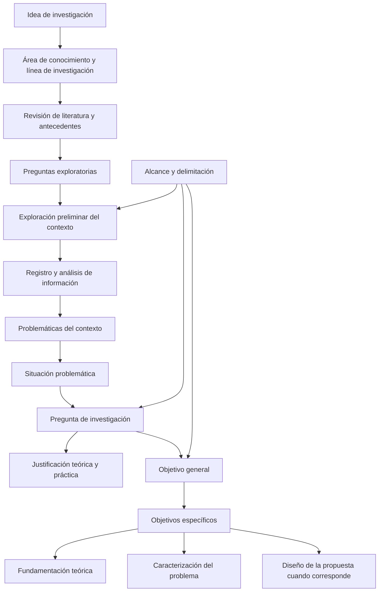

# Clase 3: Proyecto monográfico: planteamiento del problema, objetivos y congruencia metodológica

> **Objetivo académico:** Comprender y articular el tránsito desde una idea de investigación y sus antecedentes hasta la situación problemática, la pregunta de investigación, las justificaciones, los objetivos y la delimitación de un estudio monográfico, manteniendo congruencia conceptual y correspondencia con su alcance.

## 1. Contexto y marco conceptual

### El proyecto monográfico como arquitectura de la investigación

El proyecto monográfico organiza las decisiones que orientan el estudio: qué problema se aborda, por qué merece investigarse, qué conocimiento o producto se pretende obtener y dentro de qué límites. En el esquema presentado, estos componentes forman parte de la introducción y anticipan la organización del desarrollo en epígrafes.

La sesión distingue entre la monografía, de alcance acotado, y la tesis, que puede desarrollar con mayor profundidad el diagnóstico, la propuesta y su valoración. Esta distinción corresponde al encuadre institucional expuesto: no constituye una clasificación universal de todos los formatos de investigación.

### Pertinencia disciplinar y líneas de investigación

Una idea debe ubicarse en el área de conocimiento del programa, una línea de investigación y uno o varios ejes temáticos pertinentes. Esta ubicación establece el contexto epistémico desde el cual se formularán el problema y la contribución.

El caso comentado de una investigación metodológicamente consistente, pero ajena al campo del programa, muestra que la coherencia interna y la pertinencia disciplinar son dimensiones diferentes. Un estudio puede estar bien organizado y, aun así, no contribuir al área en la que pretende inscribirse. El interés profesional del investigador necesita traducirse en una pregunta reconocible dentro de ese campo.

**Enriquecimiento conceptual:** En una investigación interdisciplinaria, el sector de aplicación no determina por sí solo la pertenencia disciplinar. Una investigación sobre ganadería puede contribuir a inteligencia artificial si su núcleo está en un problema de modelado, inferencia o decisión; la sola mención de una tecnología no demuestra esa contribución.

### Vinculación entre teoría y práctica

La clase plantea dos apoyos complementarios:

- **Antecedentes:** permiten reconocer conocimientos disponibles, enfoques utilizados, aportes cercanos y limitaciones del campo.
- **Exploración preliminar del contexto:** permite conocer necesidades, carencias y condiciones reales del entorno donde se sitúa el estudio.

El planteamiento del problema surge de contrastar ambos apoyos. La literatura orienta qué observar; la exploración permite identificar qué aspectos del conocimiento disponible requieren revisión, adaptación o desarrollo en ese contexto. Los antecedentes pueden actualizarse a medida que aumenta la comprensión del tema.

## 2. Fundamentos teóricos y arquitectura

### De los problemas del contexto al problema de investigación

La sesión diferencia tres niveles que no deben confundirse:

| Nivel | Función | Forma de expresión |
|---|---|---|
| Problemáticas del contexto | Identificar dificultades, insuficiencias o necesidades concretas | Desglose de hallazgos sustentados en información preliminar |
| Situación problemática | Sintetizar la contradicción o carencia esencial que articula los hallazgos | Párrafo descriptivo, compacto y preciso |
| Problema de investigación | Orientar la indagación necesaria para comprender o atender esa carencia | Pregunta delimitada y susceptible de investigación |

Las problemáticas son manifestaciones particulares. La situación problemática integra sus regularidades y expresa la tensión entre el estado observado y el estado deseado. La pregunta transforma esa síntesis en una dirección de investigación.

La situación problemática no consiste en concatenar todas las dificultades registradas. Debe seleccionar lo esencial y explicar su relación con el fenómeno estudiado. Su precisión depende de la calidad del sustento empírico y conceptual, no únicamente de su brevedad.

El diagrama representa la lógica predominante expuesta, sin convertirla en una secuencia irreversible. La exploración puede conducir a revisar la idea inicial, los antecedentes o la delimitación.

### Preguntas exploratorias y pregunta de investigación

Las preguntas exploratorias ayudan a reconocer qué ocurre, qué falta y qué información conviene buscar. Funcionan como orientación provisional del acercamiento al contexto. La pregunta de investigación se formula con mayor precisión después de analizar la situación problemática.

En el enfoque propositivo promovido en la sesión, la pregunta debe abrir la búsqueda de una alternativa de transformación. Si únicamente pregunta por el estado de un fenómeno, orienta un estudio diagnóstico. Ambos pueden producir resultados, pero sus compromisos metodológicos son distintos.

La clase menciona como criterios de formulación la relevancia científica y social, actualidad, claridad, factibilidad, utilidad, posibilidad de descomposición y delimitación espacial y temporal. También destaca la relación entre variables.

**Enriquecimiento conceptual:** La exigencia de expresar relaciones entre variables resulta especialmente pertinente en diseños cuantitativos. Otros enfoques pueden organizarse mediante categorías, procesos o experiencias. Asimismo, una insuficiencia operativa no se convierte automáticamente en problema científico: debe precisarse qué conocimiento falta para comprenderla o atenderla y por qué se requiere una indagación sistemática.

### Justificación teórica y práctica

| Dimensión | Pregunta orientadora | Contenido central | Confusión que debe evitarse |
|---|---|---|---|
| Justificación teórica | ¿Por qué es pertinente estudiar el problema desde el conocimiento disponible? | Vacíos, limitaciones, controversias y enfoques conceptuales relevantes | Reproducir todo el marco teórico o limitarse a enumerar fuentes |
| Justificación práctica | ¿Qué utilidad potencial tendría el conocimiento o producto obtenido? | Necesidades reales, destinatarios y posibles contribuciones aplicadas | Presentar beneficios esperados como efectos ya demostrados |

La justificación teórica anticipa el encuadre conceptual que respaldará el estudio; el marco teórico lo desarrolla y argumenta. La justificación práctica explica hacia dónde se dirigiría la contribución, sin sustituir el diagnóstico ni presentar un reporte de resultados.

La relevancia social, económica o política puede apoyar ambas justificaciones. La diferencia está en la función del argumento: sustentar la necesidad de conocimiento o explicar su posible utilidad aplicada.

## 3. Implementación técnica y lógica de negocio

### Exploración preliminar y procedencia de la información

La implementación tratada es metodológica: no se presentan código, modelos entrenados ni experimentos tecnológicos. Se describe cómo obtener y organizar información inicial mediante observación directa o indirecta, revisión documental, entrevistas, cuestionarios, pruebas y registros de experiencia profesional.

La elección de la vía de obtención debe responder a la información necesaria y a la factibilidad del acceso. La experiencia del investigador puede orientar la exploración, pero necesita explicitar qué se observó, cómo se registró y qué permite sostener.

La sesión considera que una monografía acotada puede apoyarse en una vía de obtención de datos. Esto debe entenderse como una decisión de alcance dentro del esquema presentado, no como garantía de suficiencia para cualquier problema.

**Enriquecimiento conceptual:** La suficiencia de una técnica depende de la afirmación que se pretende respaldar. Una entrevista puede documentar percepciones sobre fallas de monitoreo; establecer su frecuencia puede requerir registros operativos. La factibilidad no reemplaza la correspondencia entre evidencia y conclusión.

Se mencionan herramientas para organizar las problemáticas, entre ellas una matriz de fortalezas, debilidades, oportunidades y amenazas y el árbol de problemas. No se desarrolla su aplicación. Otra denominación de herramienta resulta ambigua en la transcripción y no permite reconstruirla con seguridad.

### Formulación del objetivo general

El objetivo general expresa la meta de mayor alcance y debe ser claro, específico, breve, factible, relevante y orientado a un resultado. En la estructura explicada combina:

- Un verbo en infinitivo que indique la acción principal.
- El fenómeno, las variables o el producto de interés.
- La unidad o unidades de análisis.
- El ámbito espacial y el período de referencia, según corresponda.

La unidad de análisis identifica sobre qué entidades se producirán afirmaciones. La entidad donde se desarrolla el estudio delimita el contexto, aunque no siempre coincide con esas unidades.

**Enriquecimiento conceptual:** En un estudio organizacional, la empresa puede ser el contexto, los incidentes de seguridad las unidades analizadas y el personal una fuente de información. Distinguir estos papeles evita confundir lugar de acceso, participantes y objeto de las conclusiones.

### Verbos y alcance efectivo

La sesión utiliza una convención local para diferenciar niveles de resultado:

| Alcance | Verbos destacados | Resultado previsto |
|---|---|---|
| Diagnóstico o análisis | Analizar, caracterizar, diagnosticar, evaluar | Caracterización sustentada del estado del problema |
| Diseño de una alternativa | Diseñar, desarrollar, formular, elaborar | Estructura y descripción de una propuesta |
| Propuesta sometida a valoración | Proponer, según la convención expuesta | Alternativa que ha pasado por alguna forma explícita de valoración, evaluación o validación |

En la monografía propositiva descrita se privilegia el diseño de una alternativa sin atribuirle automáticamente efectividad. La clase reserva el término «proponer» para un alcance que incorpora un filtro de valoración.

**Enriquecimiento conceptual:** Esta jerarquía verbal es una convención del protocolo presentado. Los verbos no certifican por sí mismos el método: «desarrollar» puede referirse a un diseño conceptual o a un sistema implementado. El alcance debe aclararse mediante el producto esperado, los procedimientos y los criterios de valoración.

### Objetivos específicos y productos parciales

Los objetivos específicos deben seguir un orden metodológico y expresar procesos de conocimiento o productos verificables, en lugar de una lista de actividades instrumentales. Para la monografía propositiva se presenta una estructura de tres componentes:

1. Determinar o analizar los fundamentos teóricos y referenciales del problema.
2. Caracterizar o diagnosticar su estado en el contexto delimitado.
3. Elaborar o formular la propuesta correspondiente al objetivo general.

Cada componente se relaciona con un epígrafe del desarrollo. En un estudio exclusivamente diagnóstico, la secuencia cambia: no corresponde añadir una propuesta ajena a su alcance.

Consultar documentos o aplicar cuestionarios son actividades que pueden contribuir a un objetivo. El resultado de investigación es, por ejemplo, una fundamentación organizada o una caracterización sustentada.

### Congruencia metodológica

El título, la pregunta, el objetivo general y los objetivos específicos deben mantener el mismo núcleo conceptual. La clase insiste en conservar términos estables porque sustituirlos por aparentes sinónimos puede modificar el significado del constructo.

La pregunta suele destacar lo afectado y abrir la búsqueda de una respuesta; el título y el objetivo general pueden incorporar el producto previsto. Por tanto, congruencia no significa identidad literal entre todos los enunciados, sino correspondencia de fenómeno, contexto y alcance.

**Enriquecimiento conceptual:** El objetivo general integra la finalidad del estudio, mientras que el último objetivo específico identifica el producto de diseño que contribuye a ella. Cambiar «diseñar» por «formular» no resuelve por sí solo una duplicación: debe quedar claro qué aporta cada resultado parcial y cómo se integran en la meta general.

### Alcance y delimitación

La profundidad expresa hasta dónde llega el conocimiento o producto: análisis del estado, diseño de una alternativa o valoración de esta. La delimitación espacial precisa el entorno y la temporal el período al que se refiere el estudio. En la exposición, el límite temático se integra en la descripción de la profundidad.

**Enriquecimiento conceptual:** El período de los datos y el período de realización del estudio pueden ser distintos. Explicitar cuál se delimita evita ambigüedades y permite valorar si las conclusiones siguen siendo pertinentes cuando cambian las condiciones del contexto.

## 4. Análisis crítico de casos y auditoría práctica

### Caso de tecnologías IoT para la ganadería

El ejemplo sitúa un estudio sobre Internet de las cosas —IoT— y monitoreo inteligente en la actividad ganadera de Santa Rosa de Yacuma, Beni. Se presentan como problemáticas el predominio de métodos tradicionales, la falta de monitoreo en tiempo real, limitaciones de infraestructura y conectividad, dificultades de gestión de recursos y presiones ambientales.

Estas afirmaciones forman parte del caso ilustrativo leído. La sesión no proporciona datos primarios, mediciones ni referencias completas que permitan verificarlas de manera independiente.

La situación problemática reúne las dificultades en torno a eficiencia, sostenibilidad y modernización tecnológica. La pregunta vincula las tecnologías IoT y el monitoreo con posibles mejoras de procesos y recursos. Las justificaciones explican el interés conceptual de esa relación y la utilidad potencial para productores y responsables de decisiones.

La revisión del objetivo general cuestiona el uso de «optimizar» y propone concentrarlo en el diseño de un procedimiento, estrategia o modelo de implementación. El punto metodológico es distinguir el producto que puede elaborarse de los beneficios que requerirían demostración.

**Enriquecimiento conceptual:** «Optimizar» sí puede tener un significado científico preciso cuando se establece qué criterio se optimiza, sobre qué decisiones y bajo qué restricciones. En este caso no se especifican esos componentes ni se muestran resultados que acrediten una mejora. Por ello, el problema es la falta de operacionalización y de correspondencia con el alcance, no una invalidez general del término.

El ejemplo reúne objetivos relacionados con análisis, diseño, desarrollo de sistemas, evaluación de impacto potencial y estrategias de adopción. Su revisión exige comprobar si todos corresponden al mismo nivel de profundidad. Diseñar una alternativa y evaluar sus efectos requieren evidencias diferentes.

### Caso de gestión de seguridad de la información

El segundo ejemplo corresponde a un perfil de tesis referido a una estrategia de gestión de seguridad de la información, prevención de intrusiones y accesos no autorizados en una empresa de Santa Cruz, Bolivia. Se utiliza para mostrar cómo conservar el mismo núcleo conceptual entre título, pregunta y objetivos.

La adaptación al nivel monográfico mantiene tres componentes: fundamentos teóricos, caracterización del estado del problema y elaboración de la estrategia. Se explica que el primer componente debe concentrarse en la teoría pertinente al problema, aunque no se desarrollen por separado todas las categorías propias de un perfil de tesis.

En el intercambio se aproxima el campo de acción al problema de investigación. Esa relación orienta la redacción dentro del esquema utilizado, pero no elimina la distinción conceptual entre ambos.

**Enriquecimiento conceptual:** El problema expresa una incertidumbre o insuficiencia que necesita investigación; el campo de acción delimita el aspecto específico donde se concentra el estudio. Pueden compartir términos, pero cumplen funciones diferentes.

La discusión también muestra que un diagnóstico puede organizarse por participantes, fuentes o instrumentos cuando el diseño lo necesita. Esa desagregación no debe aumentar artificialmente el número de objetivos: se justifica si produce conocimientos parciales diferenciados.

### Diseño, valoración y efectividad

La clase distingue entre describir una propuesta, valorar su pertinencia mediante especialistas y evaluar su efectividad o impacto. Estos procedimientos no son intercambiables.

**Enriquecimiento conceptual:** Una valoración favorable puede respaldar claridad, coherencia o viabilidad percibida. Demostrar una mejora operativa requiere evidencia sobre resultados y condiciones de comparación. La posibilidad de replicar o transferir una propuesta tampoco queda establecida únicamente por haber recibido una valoración favorable.

### Uso de inteligencia artificial generativa

La sesión advierte que una descripción generada no reemplaza la exploración del contexto. Las problemáticas sugeridas deben contrastarse antes de incorporarlas como hechos.

**Enriquecimiento conceptual:** Una generación puede apoyar la organización provisional de preguntas o categorías. Sin observación, registros o fuentes comprobables, su contenido conserva el carácter de conjetura. Presentarlo como diagnóstico introduciría evidencia inexistente en toda la cadena metodológica.

## 5. Principios de diseño, buenas prácticas y anti-patrones

| Principio | Buena práctica | Anti-patrón |
|---|---|---|
| Pertinencia disciplinar | Explicar la contribución a la línea de investigación | Elegir un tema solo por afinidad profesional |
| Sustento del problema | Vincular cada afirmación con información identificable | Convertir intuiciones o texto generado en hechos |
| Síntesis conceptual | Integrar las regularidades de las problemáticas | Repetir una lista sin establecer su relación |
| Justificación | Argumentar necesidad de conocimiento y utilidad potencial | Confundir justificación con marco teórico o resultados |
| Orientación a resultados | Expresar productos y conocimientos verificables | Usar actividades de recolección como metas finales |
| Congruencia | Mantener estables constructos, contexto y alcance | Cambiar términos centrales por variación estilística |
| Factibilidad | Ajustar compromisos a recursos, acceso y profundidad | Prometer diseño, implementación e impacto sin sustento |
| Prudencia inferencial | Separar beneficios esperados de efectos observados | Atribuir eficacia a una propuesta no evaluada |
| Adaptación institucional | Reconocer el protocolo aplicable y sus convenciones | Presentar un formato local como regla universal |

La estandarización facilita la lectura y la revisión de la estructura metodológica. La sesión reconoce que instituciones y revistas pueden organizar de forma diferente sus componentes. Adaptarse al formato exige conservar las relaciones conceptuales, aunque cambien el orden y el estilo de exposición.

**Enriquecimiento conceptual:** El mismo cuidado se aplica a la distinción entre monografía y tesis. Ni un número fijo de objetivos ni el uso de un enfoque mixto determinan por sí solos la calidad o categoría de una investigación. Su pertinencia depende de la pregunta, del diseño y de la profundidad exigida en el contexto correspondiente.

## 6. Síntesis conceptual y profundización académica

La aportación central de la sesión es una cadena de fundamentación: la pertenencia disciplinar orienta los antecedentes; estos guían la exploración; la evidencia preliminar permite desglosar problemáticas; su síntesis produce una situación problemática; y la pregunta resultante organiza justificación, objetivos y alcance.

La congruencia metodológica permite que cada componente conserve la identidad del estudio. La evidencia responde qué puede sostenerse; la justificación explica por qué merece conocerse; los objetivos precisan qué se busca obtener; y la delimitación establece dónde y hasta dónde resultan pertinentes las afirmaciones.

En el modelo monográfico propositivo presentado, la articulación entre fundamentación teórica, diagnóstico contextual y diseño de una alternativa constituye la estructura principal. El resultado de diseño debe describirse con precisión, sin anticipar como demostradas su efectividad, sostenibilidad o transferencia.

**Enriquecimiento conceptual:** Tres distinciones permiten profundizar esta arquitectura: la diferencia entre necesidad práctica y vacío de conocimiento; la diferencia entre coherencia terminológica y correspondencia efectiva entre métodos y resultados; y la diferencia entre pertinencia de una propuesta y evidencia de sus efectos. Mantenerlas explícitas fortalece el rigor sin añadir complejidad formal innecesaria.
