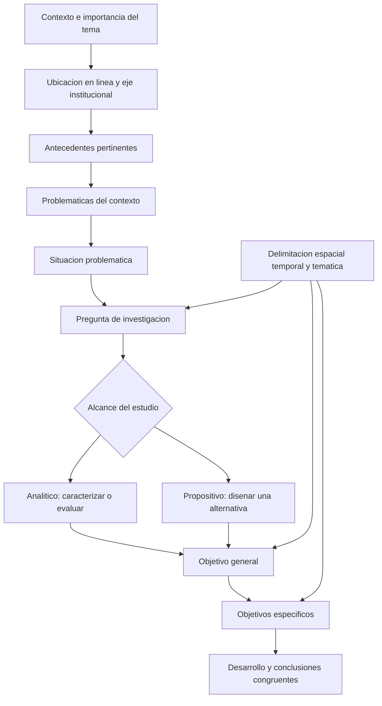

# Clase 4: Congruencia metodológica y delimitación del proyecto monográfico

> **Objetivo académico:** Analizar la correspondencia entre contexto, antecedentes, situación problemática, pregunta, objetivos y delimitación de una investigación monográfica, distinguiendo los alcances analíticos y propositivos mediante la revisión crítica de casos de inteligencia artificial y ciencia de datos.

## 1. Contexto y marco conceptual

El perfil de proyecto monográfico representa la planificación de la investigación y sirve de base para su introducción. Su función es establecer qué se investigará, por qué resulta pertinente, qué conocimiento previo lo sustenta, cuál es el problema y hasta dónde llegará el estudio. La consistencia de esta planificación condiciona la coherencia del desarrollo y de las conclusiones.

La sesión articula esta planificación mediante la revisión de casos tecnológicos. El interés principal no es determinar cuál tecnología resulta superior, sino comprobar si cada investigación declara un propósito reconocible y mantiene ese propósito en todos sus componentes.

### La introducción como argumento de pertinencia

La exposición inicial avanza desde la importancia general del tema hacia su contexto específico. El recorrido internacional, regional y local permite situar la investigación, pero debe evitar convertirse en una acumulación de generalidades. Cada nivel aporta razones para comprender el problema contextual.

A continuación se fundamenta la ubicación del tema en un área, una línea de investigación y un eje temático institucional. No basta afirmar que el estudio pertenece al programa académico: debe explicarse su correspondencia con las categorías oficiales. Una denominación plausible generada por inteligencia artificial no acredita que esa categoría exista en el documento institucional.

Cuando un tema intersecta varias líneas, la sesión recomienda identificar aquella en la que se concentra su contribución principal. Esta selección favorece una identidad investigativa clara sin negar sus conexiones interdisciplinarias.

### Monografía y tesis: continuidad con distinta profundidad

En el enfoque presentado, la monografía y la tesis comparten una lógica de investigación, aunque difieren en profundidad y desarrollo de componentes. El objeto de estudio y el campo de acción se discutieron como categorías de una planificación más desarrollada, especialmente asociada al perfil de tesis. Su aparición en los ejemplos no implica que deban incorporarse automáticamente como apartados del perfil monográfico.

La arquitectura documental debe responder al alcance real. Un estudio monográfico acotado no adquiere mayor rigor por incorporar más apartados, técnicas o promesas de intervención. El rigor depende de la adecuación entre pregunta, evidencia y conclusión.

## 2. Fundamentos teóricos y arquitectura

### De los problemas comunes al problema científico

La clase distingue tres niveles que no conviene fusionar:

| Nivel | Función | Riesgo frecuente |
|---|---|---|
| Problemáticas del contexto | Identificar problemas comunes observados en torno al tema | Presentar afirmaciones generales sin sustento contextual |
| Situación problemática | Integrar la carencia, dificultad o insatisfacción esencial que relaciona esas problemáticas | Repetir una lista extensa o introducir directamente la solución |
| Pregunta de investigación | Formular con precisión qué se necesita conocer, evaluar o transformar | Incorporar términos nuevos o anticipar una propuesta no justificada |

La situación problemática no surge de manera aislada. Se obtiene al revisar las dificultades identificadas y reconocer qué insuficiencia las articula. Su redacción debe concentrar esa relación, en lugar de mezclar estadísticas, antecedentes, soluciones y consecuencias sin jerarquía.

La sesión privilegia un párrafo compacto, aunque admite dos párrafos cuando existe continuidad argumental clara, como en el caso financiero. El criterio sustantivo es la unidad conceptual; la extensión por sí sola no demuestra precisión.

### Congruencia metodológica y estabilidad conceptual

La congruencia metodológica consiste en mantener una relación lógica entre título, problema, objetivo general, objetivos específicos y desarrollo. En la sesión se enfatiza la estabilidad de los términos: sustituir una categoría por otra aparentemente semejante puede modificar aquello que debe definirse, observarse o explicarse.

Por ejemplo, «detección de efectos colaterales» y «determinación de problemas latentes» no son equivalentes de manera automática. Si ambos términos se utilizan, corresponde definirlos y justificar su relación. De lo contrario, el estudio puede prometer un diagnóstico distinto del problema formulado.

Esta continuidad no exige copiar mecánicamente una oración. El título identifica el estudio; la pregunta formula la incertidumbre; el objetivo declara la acción cognoscitiva o de diseño que permitirá abordarla. La función discursiva cambia, mientras el núcleo conceptual permanece.

**Enriquecimiento conceptual:** La consistencia terminológica no prohíbe los sinónimos lingüísticos ni implica que toda categoría sea una variable medible. Lo decisivo es conservar el significado y declarar las relaciones entre constructos. Una repetición literal puede ocultar incoherencia si el término cambia de sentido entre apartados.

### Alcance analítico y alcance propositivo

| Aspecto | Investigación analítica | Investigación propositiva |
|---|---|---|
| Propósito central | Comprender, caracterizar o evaluar un fenómeno o una alternativa existente | Diseñar una alternativa para abordar un problema |
| Resultado principal | Diagnóstico, comparación o valoración fundamentada | Modelo, arquitectura, metodología, sistema u otro artefacto definido |
| Objetivo general | Analizar o evaluar un objeto delimitado | Diseñar o desarrollar una propuesta delimitada |
| Riesgo de incongruencia | Añadir como resultado obligatorio una propuesta que excede el análisis declarado | Confundir el diseño con implementación y validación ya demostradas |

La clase utiliza las formas «cómo» y «de qué manera» como indicios de orientación propositiva, y «cuál es el estado», «cuál es la aplicabilidad» o «qué tan efectivas» como formulaciones próximas al análisis. Sin embargo, la discusión del caso bancario matiza esta orientación: una pregunta con «de qué manera» puede ser analítica cuando su sentido completo busca comprender la contribución de un sistema existente.

**Enriquecimiento conceptual:** La palabra interrogativa no determina el diseño. La clasificación depende de la respuesta esperada, las operaciones necesarias y la evidencia requerida. Preguntar cómo funciona un sistema puede ser analítico; preguntar cómo construir una alternativa puede ser propositivo.

### Objeto de estudio, campo de acción y relaciones entre variables

En la discusión ampliada sobre tesis, el objeto de estudio se presenta como el ámbito general y el campo de acción como una dimensión específica de ese ámbito afectada por el problema. La relación entre ambos debe resultar inteligible para un lector externo.

El ejemplo de «sistemas expertos» como objeto e «incertidumbre en la selección de personal» como campo mostró una conexión insuficientemente explicitada. Faltaba describir la aplicación concreta que permitiera comprender la relación entre esas categorías.

También se discutió una guía de gestión de riesgos para servicios SaaS. La relación propuesta fue: guía de gestión, mitigación de riesgos y mejora de la seguridad de la información. La mitigación actuaría como mecanismo intermedio entre la intervención y el resultado esperado.

**Enriquecimiento conceptual:** Esta secuencia representa una hipótesis de funcionamiento, no una relación causal demostrada. Diseñar una guía no prueba que los riesgos disminuyan; mostrar esa disminución exige criterios de evaluación y evidencia apropiados. Asimismo, un estudio de diseño no necesita adoptar automáticamente el lenguaje de variables independientes y dependientes.

## 3. Implementación técnica y lógica de negocio

La fuente no presenta código, experimentos ejecutados, conjuntos de datos inspeccionados ni resultados empíricos. La implementación abordada es metodológica: transformar una idea tecnológica en un proyecto investigativo coherente.

### Construcción del objetivo general

El objetivo general debe declarar una acción central y precisar su objeto, finalidad y contexto. La sesión utiliza como guía las preguntas qué, cómo, para qué, dónde y cuándo. Estas dimensiones permiten detectar omisiones, aunque no todas requieren aparecer con igual detalle en una única oración.

En el caso de la arquitectura agéntica, la propuesta era una arquitectura basada en modelos de lenguaje de gran escala —LLM— para sistematizar el análisis de impacto transversal y mejorar la detección de efectos colaterales derivados de cambios en un sistema distribuido. La organización constituía el contexto de aplicación; la temporalidad aún debía concretarse.

Acumular «diseñar, implementar y validar» introduce compromisos distintos. Un diseño puede quedar descrito mediante componentes y relaciones; la implementación requiere materialización operativa; la validación necesita criterios y evidencia sobre su adecuación. La sesión recomienda concentrar el objetivo en una acción compatible con el alcance.

### Objetivos específicos y acciones subordinadas

Para los casos propositivos se utiliza una secuencia de tres etapas:

1. Establecer o sistematizar los fundamentos teóricos pertinentes.
2. Caracterizar o diagnosticar el estado del problema en el contexto delimitado.
3. Desarrollar el diseño de la propuesta coherente con ese diagnóstico.

Esta secuencia evita que todos los objetivos se concentren en operaciones del diagnóstico. Analizar resultados, organizar datos o redactar un reporte pueden ser acciones necesarias dentro de una etapa, sin constituir por ello objetivos específicos autónomos.

En los casos analíticos, la estructura puede ser más breve. La evaluación de técnicas de recuperación de jurisprudencia permitió reconocer dos objetivos principales: fundamentación y evaluación. El análisis del estado actual de las herramientas podía integrarse como una acción subordinada a la segunda etapa.

**Enriquecimiento conceptual:** El número de objetivos no es una constante metodológica. Debe reflejar resultados parciales distinguibles, necesarios y suficientes para alcanzar el objetivo general. La secuencia de dos o tres objetivos discutida en clase funciona como orientación para estos casos.

### Justificación teórica y práctica

La justificación teórica identifica los dominios conceptuales que sustentan el estudio y la contribución esperada de su articulación o sistematización. No sustituye al marco teórico ni requiere desarrollar anticipadamente cada teoría.

La justificación práctica explica qué utilidad tendría el conocimiento o la propuesta frente al problema delimitado. En el caso agrícola podía relacionarse con el uso de recursos y las condiciones productivas; en el caso financiero, con la interpretación oportuna de indicadores. Tales beneficios deben expresarse como expectativas razonadas mientras no exista evidencia de realización.

Ambas justificaciones deben ser proporcionadas y complementarias. Una descripción tecnológica extensa no reemplaza la explicación del aporte teórico, y enumerar beneficiarios no basta para establecer utilidad práctica.

### Delimitación espacial, temporal y temática

La delimitación espacial establece el ámbito al que se referirá el estudio: organizaciones, repositorios, sector o territorio pertinente. En la sesión se diferencia de una descripción cartográfica detallada. El contenido necesario depende de qué límites afectan la interpretación de los resultados.

La delimitación temporal exige distinguir el periodo de realización de la investigación del periodo representado en los documentos o datos. Un análisis de registros de años anteriores es retrospectivo; no debe redactarse como si el estudio se extendiera prospectivamente durante todos esos años.

La delimitación temática aclara qué fenómenos, técnicas y operaciones se incluyen. En recuperación jurídica se mencionó comparar búsqueda por palabras clave, TF-IDF y representaciones del texto, excluyendo el entrenamiento de modelos desde cero y arquitecturas complejas. La fuente no especifica suficientemente estas últimas representaciones ni un protocolo comparativo completo.

La confidencialidad no impide delimitar. Una organización puede mantenerse anónima y, aun así, describirse mediante características relevantes, ámbito general, sistemas considerados y periodo de observación.

## 4. Análisis crítico de casos y auditoría práctica

### Arquitectura agéntica para cambios en microservicios

El caso distingue la compatibilidad de contratos entre servicios del impacto sobre el comportamiento global del sistema. Mantener un contrato de API no garantiza que un cambio preserve todas las intenciones funcionales ni que carezca de consecuencias transversales.

La segunda formulación revisada fue considerada más coherente porque relacionaba la sistematización del análisis de impacto con la detección de efectos colaterales. La primera introducía «problemas latentes» únicamente en el objetivo diagnóstico, ampliando el vocabulario conceptual sin continuidad en la pregunta.

Quedó abierta la necesidad de justificar la relación entre análisis transversal y detección predictiva. Si se presentan como dos finalidades independientes, el alcance se expande; si una funciona como medio para la otra, esa dependencia debe explicitarse. No se presentó una arquitectura implementada ni evidencia de capacidad predictiva.

### Aplicabilidad del aprendizaje automático en precios inmobiliarios

El caso de Cochabamba permitió distinguir el análisis de aplicabilidad de la construcción de una solución predictiva. La formulación inicial añadía «ciencia de datos» en la pregunta, mientras el título se refería a modelos de aprendizaje automático. La revisión buscó mantener el mismo objeto conceptual.

Al definirse un alcance analítico, la pregunta se orientó hacia la aplicabilidad de esos modelos sobre datos estructurales, geográficos y de mercado. El propósito pasó a evaluar la aplicación, sin asumir que el resultado principal fuera un modelo nuevo.

El periodo histórico considerado debía declararse como cobertura documental. No se proporcionaron datos ni resultados que permitieran concluir qué modelos eran más adecuados.

### Procesamiento del lenguaje natural para recuperar jurisprudencia

El problema presentado se relacionó con las limitaciones de búsquedas literales y filtros para consultas jurídicas más amplias. Estas dificultades se expusieron como diagnóstico preliminar del caso, sin mediciones independientes en la sesión.

La pregunta «qué técnicas pueden evaluarse» fue revisada porque podía responderse mediante una enumeración. El propósito declarado era evaluar su efectividad, por lo que convenía preguntar por esa efectividad en la recuperación de jurisprudencia.

**Enriquecimiento conceptual:** Una comparación válida requiere definir relevancia documental, seleccionar consultas y establecer un criterio de referencia. Recuperar más documentos no equivale necesariamente a recuperar mejores documentos. La utilidad jurídica también depende del contexto normativo y de la pertinencia de las resoluciones. Estos criterios no quedaron operacionalizados en la fuente.

### IoT para riego y manejo fitosanitario

El caso agrícola reunía riego, detección temprana de plagas, reducción de desperdicio de agua, disminución de pérdidas y replicabilidad territorial. La revisión mostró cómo acumular beneficios esperados incrementa las dimensiones que después deben definirse y sostenerse.

También aparecieron «plataforma», «sistema» y «prototipo» como denominaciones intercambiables. La observación central fue definir el artefacto y mantenerlo estable: un prototipo de sistema no equivale a un sistema operativo completo.

Las restricciones de conectividad resultan relevantes para la propuesta: se mencionaron redes de largo alcance y procesamiento en el borde. Estas condiciones justifican decisiones de diseño, pero la sesión no desarrolla una arquitectura técnica ni demuestra su operación sin internet.

### Modelo antifraude para compras digitales

El caso combinaba verificación centralizada, blockchain, APIs y capacitación. La discusión destacó la amplitud de la propuesta y la necesidad de aclarar el problema principal. «Antifraude», «estafas digitales» y «compras en línea» no designan por sí solos el mismo fenómeno.

La formulación definitiva quedó abierta. Los intentos de redacción durante la conversación fueron tentativos y no constituyen un modelo metodológico cerrado.

**Enriquecimiento conceptual:** Registrar información de manera resistente a modificaciones no garantiza que esa información sea verdadera. Por ello, incorporar blockchain no demuestra por sí mismo la detección o prevención del fraude; se requiere explicar qué problema resuelve dentro del mecanismo de verificación.

### Sistemas híbridos para interpretar indicadores financieros

El caso bancario se definió inicialmente como análisis de un sistema existente. La discusión de la pregunta mostró que debía atenderse su significado completo: el docente reconsideró su objeción inicial al reconocer que la formulación buscaba analizar la contribución del sistema a la interpretación de indicadores.

La incongruencia principal apareció en un objetivo específico que proponía formular un esquema conceptual nuevo. Ese resultado excedía el objetivo general de analizar el uso de un sistema. Se plantearon dos alternativas coherentes: mantener el alcance analítico o reformular el conjunto como investigación propositiva.

Las afirmaciones sobre procesos manuales o semiautomatizados y dificultades de interpretación pertenecen al planteamiento del caso; no se aportó evidencia para generalizarlas a todas las entidades bancarias.

### Predicción de talento deportivo y detección de amenazas informáticas

En el caso deportivo se propuso un modelo predictivo basado en algoritmos de ensamble, con imputación para datos incompletos. La revisión se concentró en ordenar fundamentación, diagnóstico y propuesta, pues los objetivos iniciales se acumulaban en acciones diagnósticas. El periodo 2021–2025 debía identificarse como cobertura de revisión documental. No se presentaron algoritmos seleccionados, desempeño predictivo ni procedimientos de imputación ejecutados.

El caso final de seguridad informática mostró una redundancia de alcance: declarar «análisis de datos y propuesta de modelo» podía presentar como dos finalidades lo que era una secuencia. Si el resultado central es un modelo de detección, el análisis de datos puede quedar como etapa subordinada. La denominación de una de las herramientas no es inteligible en la transcripción y no se reconstruye.

## 5. Principios de diseño, buenas prácticas y anti-patrones

### Integridad de fuentes y uso de inteligencia artificial

La sesión advierte que las referencias generadas por IA pueden ser inexistentes, inaccesibles o representar de forma inexacta una idea. La generación de una cita no acredita la existencia ni la pertinencia de la fuente.

La práctica defendida consiste en consultar el documento original, comprobar su relación con la afirmación, revisar la paráfrasis y mantener correspondencia entre citas y lista final de referencias. Se menciona APA 7 como norma de presentación bibliográfica.

En los antecedentes se prioriza la síntesis de autor, fecha y aporte pertinente. Esa síntesis cumple una función distinta de la revisión extensa del estado del arte en el marco teórico.

**Enriquecimiento conceptual:** La necesidad de citar depende de la procedencia y verificabilidad de la afirmación, no del apartado donde aparece. Una paráfrasis de terceros requiere atribución también en la introducción; una cifra o afirmación empírica específica exige sustento aunque una herramienta de IA no haya proporcionado referencias. La experiencia profesional puede aportar contexto, pero debe distinguirse de evidencia generalizable.

### Buenas prácticas de congruencia

- Mantener estable el significado de los términos centrales en título, pregunta y objetivos.
- Derivar la situación problemática de dificultades reconocibles del contexto.
- Definir el resultado principal antes de seleccionar técnicas o multiplicar objetivos.
- Diferenciar diseño, implementación y validación según los compromisos de evidencia de cada acción.
- Ajustar el alcance a la disponibilidad de información, acceso y recursos.
- Tratar los ejemplos de repositorios como materiales para evaluación crítica.

La sesión privilegia una redacción compacta del perfil. Esta orientación busca evitar fragmentación, reiteraciones y énfasis visuales que sustituyan relaciones argumentales. Su aplicación corresponde al género y contexto documental discutidos; no constituye una prohibición universal de tablas, listas o subtítulos en investigación.

### Anti-patrones identificados

| Anti-patrón | Consecuencia metodológica |
|---|---|
| Incorporar categorías institucionales inventadas por IA | Desvincula el estudio de su clasificación real |
| Introducir términos nuevos únicamente en un objetivo | Amplía el compromiso conceptual sin justificación |
| Presentar la solución como si fuera la carencia contextual | Debilita la explicación de por qué esa alternativa sería pertinente |
| Cambiar entre modelo, plataforma, prototipo y sistema | Vuelve indeterminado el resultado esperado |
| Añadir diseño de una solución a un objetivo general solo analítico | Produce un alcance superior al declarado |
| Confundir periodo de datos con duración del estudio | Hace ambiguo el carácter retrospectivo o prospectivo |
| Copiar la estructura de otra investigación sin revisar su lógica | Traslada decisiones que pueden ser inadecuadas para el nuevo problema |
| Confiar en una referencia por estar generada o publicada | Sustituye la revisión de evidencia por una apariencia de autoridad |

La publicación de una tesis en un repositorio no garantiza congruencia perfecta. Los documentos pueden presentar distintos niveles de calidad y seguir siendo útiles para reconocer decisiones acertadas, límites y errores. La sesión plantea la catalogación de fuentes según criterios de calidad como una posibilidad de apoyo a la consulta, sin desarrollar un procedimiento validado para realizarla.

## 6. Síntesis conceptual y profundización académica

El proyecto monográfico se sostiene en una cadena de decisiones: reconocer un contexto, sintetizar antecedentes pertinentes, identificar una carencia, formular una pregunta, declarar el alcance y organizar resultados parciales que permitan responderla. La delimitación atraviesa esta cadena y restringe lo que puede afirmarse al concluir.

La congruencia se comprueba en dos planos. En el plano conceptual, los términos conservan significados compatibles. En el plano operativo, los objetivos y procedimientos producen evidencia suficiente para la respuesta prometida. Un título consistente no compensa un diseño incapaz de sustentar sus conclusiones.

Los casos analíticos muestran que evaluar una alternativa existente constituye un resultado legítimo sin añadir obligatoriamente una propuesta. Los casos propositivos muestran que diseñar una alternativa exige definir qué artefacto se producirá y qué problema aborda, sin confundir beneficios esperados con efectos comprobados.

**Enriquecimiento conceptual:** Una línea de profundización es distinguir entre pertinencia del problema, calidad del artefacto y efectividad de su uso. Son dimensiones relacionadas, pero requieren evidencia diferente: justificar una necesidad, describir un diseño y demostrar una mejora representan compromisos epistemológicos distintos.

La principal conclusión metodológica es que el valor del estudio depende de una promesa investigativa precisa y sostenible. La sofisticación tecnológica contribuye cuando responde a esa promesa y cuando sus límites quedan explícitos.
