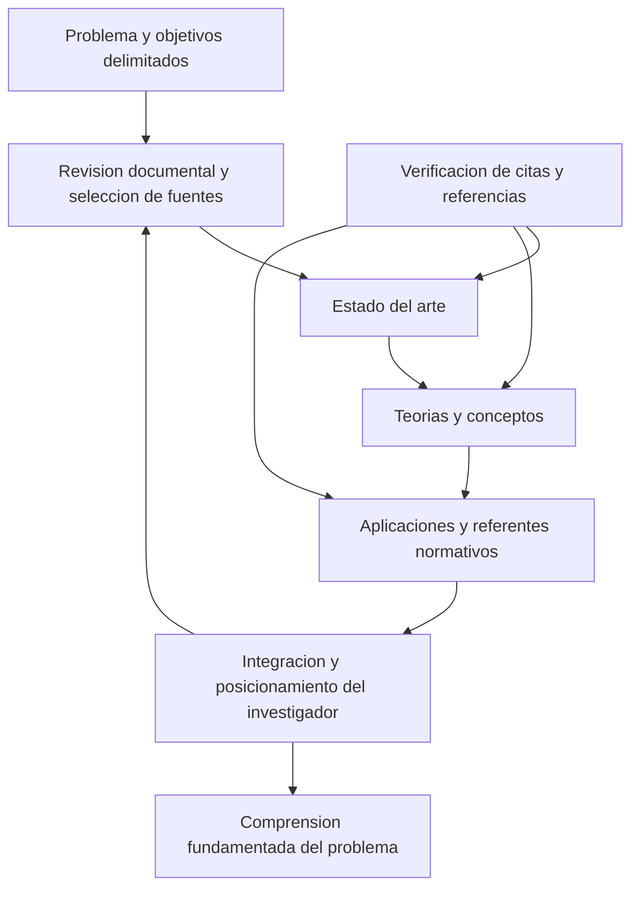

# Clase 5: Construcción del marco teórico referencial y trazabilidad de fuentes con APA 7

> **Objetivo académico:** Comprender la construcción integrada del estado del arte, el marco teórico conceptual y el marco referencial de una investigación monográfica, articulando el problema de investigación con la selección crítica de fuentes, el posicionamiento del investigador y la trazabilidad de citas y referencias según APA 7.

## 1. Contexto y marco conceptual

El marco teórico referencial constituye el sustento documental y argumentativo de la investigación: sitúa el problema frente al conocimiento existente, precisa los conceptos utilizados y reconoce las aplicaciones y regulaciones pertinentes. Su función no consiste en acumular definiciones, sino en explicar desde qué perspectiva se comprenderá el problema y por qué esa perspectiva resulta adecuada.

En la estructura monográfica presentada en la sesión, este marco abre el desarrollo del informe después del planteamiento del problema y los objetivos. Comparte componentes con el marco de una tesis, aunque su tratamiento es más selectivo, compacto y acotado. La menor extensión exige jerarquizar aportes relevantes y mantener una argumentación consistente.

La sesión distingue dos alcances posibles de investigación: **analítico**, cuando se busca comprender o evaluar una situación, y **propositivo**, cuando se formula una alternativa de intervención. El marco debe responder al alcance elegido; una investigación analítica no necesita transformarse artificialmente en una propuesta.

La delimitación espacial, temporal y temática orienta la selección de literatura. En el contexto abordado, se enfatiza la pertinencia de los problemas para Bolivia y su vinculación explícita con un área, una línea y un eje temático de investigación. Declarar únicamente un campo amplio, como inteligencia artificial o ciencia de datos, no explica todavía la contribución específica del estudio.

**Enriquecimiento conceptual:** La pertinencia territorial se fundamenta mostrando la relación entre el problema y las necesidades, instituciones, datos o procesos del contexto. Un tema internacional puede ser relevante para Bolivia si esa relación se demuestra. La procedencia extranjera de una fuente o aplicación no determina por sí sola su falta de pertinencia.

La coherencia del informe depende de la relación entre problema, objetivos, desarrollo y conclusiones. Los objetivos específicos orientan qué conocimiento debe construirse; el desarrollo presenta los argumentos y evidencias correspondientes; las conclusiones expresan lo que efectivamente puede sostenerse a partir de ese recorrido.

## 2. Fundamentos teóricos y arquitectura

### 2.1. Tres componentes y una integración transversal

La arquitectura expuesta comprende tres componentes principales. Su integración exige revisar los nexos conceptuales y las transiciones entre ellos.

| Componente | Pregunta que organiza su contenido | Operación intelectual principal | Redacción predominante |
| --- | --- | --- | --- |
| Estado del arte | ¿Cómo ha evolucionado el conocimiento relevante sobre el problema? | Seleccionar y describir hitos, aportes y antecedentes | Descriptiva y cronológica |
| Marco teórico conceptual | ¿Qué teorías y conceptos permiten comprender el problema y por qué se adoptan? | Explicar, relacionar y justificar una perspectiva | Explicativa y argumentativa |
| Marco referencial | ¿Qué aplicaciones y condiciones normativas contextualizan el problema? | Describir experiencias y analizar regulaciones, límites y vacíos | Descriptiva con posicionamiento crítico |

El marco referencial incluye tanto aplicaciones efectivas de las teorías como elementos legales y normativos. Por ello, reducirlo automáticamente a legislación puede dejar fuera experiencias relevantes para la comprensión del problema.

El retorno desde la integración hacia la revisión documental representa el carácter iterativo de la construcción: una aplicación puede revelar una teoría ausente; una norma puede exigir precisar un concepto; una brecha puede modificar la búsqueda de antecedentes.

### 2.2. Estado del arte

El estado del arte presenta la evolución histórica y actual de los aportes más relevantes para el problema. En la sesión se propone una exposición breve, organizada desde antecedentes más antiguos hacia contribuciones recientes, con atención a la esencia de cada aporte.

Su selección debe responder al problema, a sus conceptos centrales y al contexto del estudio. No toda publicación relacionada con el tema general tiene la misma relevancia. La descripción debe permitir reconocer qué cambió en el conocimiento disponible y cuáles son sus principales límites.

La sesión menciona ventanas recientes de literatura como orientación para temas de rápida evolución.

**Enriquecimiento conceptual:** Una ventana temporal reciente no debe convertirse en una prohibición de consultar trabajos fundacionales. Conviene distinguir entre vigencia de la evidencia empírica y relevancia de una contribución teórica. Además, en otros enfoques metodológicos el estado del arte puede organizarse por problemas, métodos o controversias; la cronología es la opción enfatizada en esta clase, no una estructura universal.

### 2.3. Marco teórico conceptual

Este componente selecciona las teorías y los conceptos que permiten interpretar el problema. Debe explicar las definiciones asumidas, sus relaciones y las razones por las que se consideran pertinentes.

El **posicionamiento del investigador** consiste en justificar la elección conceptual: qué se adopta de una teoría, para qué aspecto del problema sirve y qué límites presenta. No equivale a expresar una preferencia sin fundamento ni a reiterar las definiciones de los autores.

La relación entre conceptos es tan importante como su definición individual. Si se analizan sostenibilidad, eficiencia y monitoreo inteligente, debe aclararse cómo se conectan dentro del problema, evitando tratarlos como entradas independientes de un glosario.

### 2.4. Aplicaciones y marco legal o normativo

Las aplicaciones contextualizadas muestran cómo se han utilizado las teorías en situaciones semejantes o diferentes. Pueden aportar criterios de diseño, experiencias de implementación y límites de transferencia al contexto propio. Si no se identifican aplicaciones pertinentes, corresponde explicitar esa limitación sin inventarlas.

El análisis normativo identifica las disposiciones que sustentan, regulan, condicionan o restringen el tratamiento del problema. La clase incluye regulaciones nacionales e internacionales y menciona normas técnicas, como las ISO, sin desarrollar ninguna disposición específica.

**Enriquecimiento conceptual:** Una ley, un reglamento y una norma técnica no poseen necesariamente la misma fuerza obligatoria. Su análisis requiere distinguir ámbito territorial, vigencia, destinatarios y condiciones de aplicación. Una norma técnica puede adquirir obligatoriedad por incorporación legal o contractual; su existencia no basta para presumirla.

### 2.5. Brechas e integración

La revisión debe reconocer lagunas o limitaciones del conocimiento existente. Estas pueden ayudar a justificar el estudio, siempre que se vinculen con evidencia documental y con el problema delimitado.

**Enriquecimiento conceptual:** No encontrar una publicación durante una búsqueda inicial no demuestra que el conocimiento no exista. Una afirmación sobre una brecha debe considerar el alcance de la búsqueda, los términos empleados y las fuentes consultadas.

La integración final verifica que el estado del arte conduzca a la selección conceptual y que esta permita comprender las aplicaciones y condiciones normativas. Las transiciones deben hacer visibles esas relaciones, evitando cambios abruptos entre apartados.

## 3. Implementación técnica y lógica de negocio

La implementación desarrollada en la sesión es metodológica y documental. No se presentan algoritmos, código, experimentos ejecutados ni resultados empíricos que permitan evaluar una solución tecnológica.

### 3.1. Procedimiento de construcción documental

1. **Delimitar el problema y el objetivo general.** Identificar los conceptos, variables o dimensiones efectivamente implicados y su ubicación espacial y temporal.
2. **Derivar palabras clave.** Usar los términos centrales del problema para orientar la búsqueda de antecedentes, teorías, aplicaciones y regulaciones.
3. **Revisar y seleccionar fuentes pertinentes.** Comprobar su identidad y contenido antes de incorporarlas como sustento.
4. **Organizar las relaciones conceptuales.** Elaborar un esquema o mapa que conecte antecedentes, conceptos, aplicaciones y normas.
5. **Redactar según la función de cada componente.** Describir la evolución, argumentar la elección teórica y contextualizar sus aplicaciones y regulaciones.
6. **Identificar límites y brechas.** Diferenciar lo que las fuentes permiten sostener de aquello que permanece abierto.
7. **Integrar y depurar.** Revisar transiciones, claridad, consistencia terminológica y correspondencia entre citas y referencias.

El proceso es cíclico. El criterio de cierre no consiste en agotar toda la literatura, sino en disponer de una selección suficiente para fundamentar el problema con el alcance previsto.

**Enriquecimiento conceptual:** Una matriz documental puede facilitar la trazabilidad. Para cada fuente, resulta útil registrar identificación bibliográfica, objetivo, contexto, conceptos, método, aporte, limitaciones y relación con el problema. Esta organización permite comparar trabajos antes de redactar y evita confundir notas propias con fragmentos literales.

### 3.2. Sistema autor-fecha y tipos de cita

El sistema autor-fecha vincula una identificación breve dentro del texto con una entrada completa en la lista de referencias. El lector puede así reconocer la fuente y recuperar el documento correspondiente.

| Modalidad | Característica | Información necesaria |
| --- | --- | --- |
| Cita textual breve | Reproduce literalmente un fragmento de menos de 40 palabras, entre comillas | Autor, año y localizador |
| Cita textual en bloque | Reproduce un fragmento de 40 palabras o más, separado del párrafo | Autor, año y localizador |
| Paráfrasis | Expresa una idea ajena con formulación propia y fidelidad a su significado | Autor y año; el localizador puede facilitar la consulta |
| Cita narrativa | Integra el autor en la oración | Año junto al autor y localizador cuando corresponde |
| Cita parentética | Reúne la identificación de la fuente entre paréntesis | Autor, año y localizador cuando corresponde |

Para las citas en bloque se explica una sangría izquierda de 1,27 cm y doble espacio. La transcripción alterna la expresión «más de 40» con «40 o más»; el umbral se presenta aquí de manera consistente como **40 palabras o más**.

**Enriquecimiento conceptual:** En APA 7, una cita en bloque no lleva comillas y el punto final del fragmento precede a la referencia parentética que lo cierra. Los siguientes son patrones sintácticos, no citas de obras reales:

- Paráfrasis narrativa: `Apellido (año) sostiene que [idea expresada con palabras propias].`
- Cita textual breve parentética: `“[Fragmento literal]” (Apellido, año, p. número).`
- Cita textual narrativa: `Apellido (año) afirma: “[fragmento literal]” (p. número).`

Una paráfrasis conserva la obligación de atribuir la idea a su fuente. Cambiar algunas palabras o alterar el orden de una oración no garantiza una reformulación adecuada.

### 3.3. Localizadores y situaciones especiales

Cuando el documento no tiene páginas, la clase propone localizar el pasaje mediante un título de sección, un número de párrafo o su combinación. Para fuentes audiovisuales se utiliza una marca temporal correspondiente al inicio del fragmento citado.

Las expresiones de participantes de una investigación constituyen datos del propio estudio. Se identifican en el texto y pueden presentarse como citas breves o en bloque, pero no se incorporan como referencias bibliográficas. Su presentación debe respetar confidencialidad, anonimato y acuerdos éticos.

La **autocita** permite atribuir un aporte a una publicación propia anterior. Debe tratarse como una fuente identificable, con cita y referencia, cuando su contenido resulte pertinente para el argumento actual.

La sesión también aborda las **fuentes secundarias**, cuando una obra permite conocer lo planteado por otra.

**Enriquecimiento conceptual:** Si no se consultó la obra original, debe indicarse la mediación mediante una fórmula como `Autor original (año, como se citó en Autor consultado, año)`. En la lista de referencias se incorpora la fuente efectivamente consultada. Esto evita aparentar acceso directo a un documento que no se leyó.

### 3.4. Número de autores y fuentes múltiples

La clase distingue fuentes de uno, dos y más de dos autores. Para tres o más autores se utiliza el apellido del primero seguido de `et al.`. Cuando una afirmación se apoya en varias obras, sus referencias breves pueden reunirse en un mismo paréntesis, separadas por punto y coma.

**Enriquecimiento conceptual:** En APA 7, para dos autores se conservan ambos apellidos: en redacción narrativa en español se emplea «y», mientras que en la cita parentética se utiliza `&`. Para tres o más autores se emplea `et al.` desde la primera cita, salvo cuando sea necesario desambiguar. Las fuentes múltiples dentro de un mismo paréntesis se ordenan alfabéticamente.

### 3.5. Referencias y gestión bibliográfica

Una referencia contiene normalmente cuatro elementos: **autor**, **fecha**, **título** y **fuente**. Cada elemento responde a una pregunta: quién es responsable, cuándo se publicó, cómo se identifica la obra y dónde puede recuperarse.

La autoría puede corresponder a una persona, un grupo o una institución. Según el tipo de obra, también puede identificarse a quien desempeñó una función creadora específica, como edición o dirección. No se incorporan títulos académicos, cargos ni rangos como parte del nombre del autor.

Si una institución es responsable del contenido, puede funcionar como autor corporativo. Si la autoría no puede determinarse, debe aplicarse el tratamiento de obra sin autor, sin inventar una identidad.

La lista de referencias recoge las obras citadas; una bibliografía puede incluir lecturas adicionales. La clase enfatiza la correspondencia entre texto y referencias, con las excepciones que derivan de la naturaleza de ciertos materiales, como los testimonios de participantes.

Las entradas se ordenan alfabéticamente. Para un mismo autor se considera el orden temporal; si coinciden autor y año, se atiende al título para distinguir las obras. En el formato general APA se emplean doble espacio y sangría francesa. La sesión diferencia estas reglas de algunas adaptaciones locales de presentación.

**Enriquecimiento conceptual:** Cuando corresponde distinguir obras del mismo autor y año, se emplean sufijos como `a` y `b`, que deben mantenerse tanto en las citas como en las referencias. Las adaptaciones institucionales de presentación deben distinguirse de las reglas generales de APA.

La clase revisa categorías como libros impresos y electrónicos, artículos de revistas, videos, publicaciones en redes sociales, blogs, tesis y documentos no publicados. Los ejemplos proyectados no se reproducen íntegramente en la transcripción; por ello, no se reconstruyen como referencias concretas.

Un enlace aislado no sustituye una referencia. Para libros electrónicos se mencionan autor, año, título, editorial y el identificador o enlace pertinente. Los DOI se expresan como URL; APA 7 no requiere anteponer la etiqueta `DOI:`. La expresión de recuperación y la fecha de consulta no se agregan indiscriminadamente.

**Enriquecimiento conceptual:** La fecha de recuperación resulta pertinente para contenidos diseñados para cambiar y sin versiones archivadas estables. Un DOI facilita la identificación persistente de un objeto, pero no garantiza por sí mismo su calidad ni el acceso gratuito.

Zotero y Mendeley se mencionan como herramientas para organizar fuentes y producir citas y referencias. También puede ser necesario registrar manualmente documentos disponibles fuera de la web. La automatización requiere revisar los metadatos y la adecuación de cada entrada al tipo de fuente.

## 4. Análisis crítico de casos y auditoría práctica

### 4.1. Fuente sugerida por inteligencia artificial que no puede verificarse

La discusión incluye el caso de referencias obtenidas mediante inteligencia artificial generativa cuya existencia o acceso no se había confirmado. La clase reconoce que pueden ser reales, simuladas o mezclas de datos auténticos e inventados.

El principio metodológico recuperable es verificar antes de citar: comprobar título, autoría, fecha, contenido y relación con la afirmación que se pretende respaldar. Un documento que existe pero sostiene algo distinto tampoco sirve como evidencia de esa afirmación.

**Enriquecimiento conceptual:** Pedir «fuentes reales» en una instrucción a un modelo expresa una restricción, pero no constituye una comprobación. Si no se puede verificar el documento, no debe presentarse como leído ni utilizarse para sostener un contenido desconocido. Una fuente sustituta solo es adecuada si respalda efectivamente el argumento.

La clase propone usar instrucciones específicas para apoyar la redacción: problema, tema, componente, tipo de discurso, alcance y requisitos de citación. Esta especificidad puede mejorar la pertinencia del borrador, pero el posicionamiento conceptual y la validación de evidencias siguen siendo responsabilidad del investigador.

### 4.2. Página institucional inaccesible

Se plantea la dificultad de comprobar información atribuida a una página gubernamental temporalmente caída. La preocupación central es la recuperabilidad de la evidencia y la posibilidad de que un lector posterior pueda contrastarla.

**Enriquecimiento conceptual:** La indisponibilidad de una página no demuestra que el documento nunca haya existido. Puede buscarse una copia institucional, un repositorio o una versión archivada verificable. Tampoco debe inferirse que una página oficial es inferior a un artículo arbitrado en todos los casos: para una norma vigente o un dato administrativo, la fuente oficial puede ser la fuente primaria apropiada. La calidad se evalúa según la afirmación que se necesita sustentar.

### 4.3. Del problema al índice conceptual: monitoreo ganadero

El ejemplo técnico final relaciona tecnologías de monitoreo inteligente con procesos ganaderos, sostenibilidad y eficiencia. Su función consiste en mostrar cómo los conceptos del problema orientan los títulos y subtítulos del marco.

| Núcleo conceptual del ejemplo | Desarrollo documental pertinente | Precaución analítica |
| --- | --- | --- |
| Sistemas de monitoreo inteligente | Definiciones, componentes y capacidades | No atribuir capacidades sin evidencia |
| Procesos ganaderos | Procesos sobre los que actuaría el monitoreo | Precisar contexto y unidad de análisis |
| Eficiencia | Relación entre monitoreo y uso de recursos | Definir qué dimensión de eficiencia se estudia |
| Sostenibilidad | Criterios que conectan tecnología y efectos del proceso | No equiparar digitalización con sostenibilidad |
| Regulaciones y normas | Condiciones aplicables al sistema y su uso | Comprobar pertinencia y vigencia |

La transcripción registra de manera imprecisa la sigla de las tecnologías mencionadas; no se desarrolla una definición técnica de esa sigla. El ejemplo no aporta mediciones ni demuestra mejoras de eficiencia o sostenibilidad.

**Enriquecimiento conceptual:** La relación entre monitoreo y optimización debe justificarse mediante mecanismos y evidencia. Obtener más datos no implica automáticamente mejorar decisiones: también intervienen calidad del dato, capacidad de interpretación y posibilidad de actuar sobre los procesos observados.

### 4.4. Similitud, plagio y reutilización de material propio

La clase relaciona la subcitación con problemas de atribución y la sobrecitación con una redacción que pierde elaboración propia. También presenta herramientas de similitud, entre ellas Turnitin y Plagiarism Checker X, como apoyo para revisar coincidencias textuales. No se muestran resultados comparativos que permitan demostrar su efectividad relativa.

En la exposición se propone distinguir plagio y similitud según la conciencia del autor. Esa distinción necesita una precisión conceptual.

**Enriquecimiento conceptual:** La similitud es una coincidencia detectada entre textos; no determina por sí sola la existencia de plagio. Una coincidencia puede corresponder a una cita correctamente atribuida o a una expresión convencional. A su vez, una apropiación indebida de ideas puede producir poca similitud literal. La falta de intención no elimina automáticamente un problema de atribución; su tratamiento depende de las normas académicas y jurídicas aplicables. La clase no ofrece una base suficiente para sostener una calificación jurídica universal.

**Enriquecimiento conceptual:** El índice de similitud requiere revisión de los pasajes, fuentes, comillas y atribuciones. No existe en esta sesión un umbral numérico demostrado que certifique originalidad. La sustitución superficial de palabras para reducir coincidencias tampoco resuelve la apropiación de ideas.

La reutilización de una publicación propia debe transparentarse. La autocita permite reconocer su procedencia; presentar material anterior como enteramente nuevo puede inducir a error sobre la originalidad del aporte.

### 4.5. Auditoría de consistencia documental

| Dimensión | Criterio de revisión | Problema que permite detectar |
| --- | --- | --- |
| Cobertura | Los conceptos centrales del problema tienen sustento | Apartados genéricos o conceptos ausentes |
| Pertinencia | Cada fuente cumple una función argumentativa | Acumulación de lecturas sin relación demostrada |
| Posicionamiento | La elección teórica se justifica | Sucesión de definiciones sin análisis |
| Trazabilidad | Citas y referencias permiten identificar las fuentes | Referencias inexistentes o citas huérfanas |
| Fidelidad | La afirmación coincide con lo que sostiene la fuente | Paráfrasis distorsionadas |
| Contextualización | Se explican aplicaciones y límites de transferencia | Generalizaciones injustificadas |
| Integración | Los componentes forman un razonamiento continuo | Fragmentación entre historia, teoría y normas |

## 5. Principios de diseño, buenas prácticas y anti-patrones

**Seleccionar con un criterio explícito.** La brevedad monográfica se logra jerarquizando fuentes y conceptos. Un marco compacto puede ser riguroso si preserva las relaciones necesarias para comprender el problema.

**Mantener una voz analítica propia.** Las citas respaldan afirmaciones; el investigador explica su función, compara perspectivas y justifica decisiones. La abundancia de citas no sustituye la argumentación.

**Distinguir evidencia, interpretación y propuesta.** Un antecedente documentado, una inferencia del investigador y una alternativa de intervención poseen estatus diferentes. La redacción debe permitir identificarlos.

**Verificar antes de automatizar.** Los gestores bibliográficos y la inteligencia artificial pueden apoyar búsqueda, organización y revisión. La identidad de las fuentes, la fidelidad de las paráfrasis y la pertinencia de las afirmaciones requieren control humano.

**Cuidar la atribución y la recuperación.** Deben utilizarse las citas necesarias, con localizadores adecuados cuando correspondan, y referencias completas. La estabilidad del acceso es un criterio relevante, junto con la autoridad y adecuación de la fuente.

**Revisar la integración de manera iterativa.** Cada incorporación puede alterar el conjunto. Conviene comprobar si una nueva teoría contradice una definición asumida, si una norma modifica la aplicabilidad de un antecedente o si una conclusión excede el sustento disponible.

| Anti-patrón | Consecuencia | Buena práctica correspondiente |
| --- | --- | --- |
| Construir un glosario sin relaciones | No explica el problema | Articular conceptos y justificar su función |
| Encadenar citas sin interpretación | Debilita el posicionamiento | Sintetizar, comparar y argumentar |
| Incorporar fuentes no verificadas | Rompe la trazabilidad | Comprobar documento y contenido |
| Copiar texto generado sin depuración | Introduce errores y discontinuidades | Contrastar fuentes y revisar el razonamiento |
| Adjuntar enlaces como referencias completas | Dificulta identificar la obra | Registrar autor, fecha, título y fuente |
| Usar toda norma como obligación aplicable | Distorsiona las condiciones del estudio | Distinguir naturaleza y ámbito normativo |
| Tomar similitud como veredicto automático | Confunde coincidencia y apropiación | Revisar cada coincidencia en contexto |
| Afirmar una brecha desde una búsqueda limitada | Sobredimensiona la novedad | Delimitar el alcance de la evidencia consultada |

**Enriquecimiento conceptual:** La cientificidad no queda garantizada por citar autores. También depende de la claridad del problema, la calidad de la evidencia, la coherencia del razonamiento y la transparencia del método. Las referencias hacen rastreable el argumento; su validez requiere evaluación crítica.

## 6. Síntesis conceptual y profundización académica

El marco teórico referencial integra tres operaciones complementarias: reconstruir los aportes relevantes, justificar una perspectiva conceptual y situarla frente a aplicaciones y condiciones normativas. Su unidad proviene del problema de investigación y de los objetivos, que orientan la selección y la organización del conocimiento.

La revisión documental es una construcción iterativa. Seleccionar, relacionar, redactar y verificar son operaciones que se retroalimentan. La suficiencia del marco depende de que sus componentes permitan comprender el problema dentro del alcance declarado, sin pretender una exhaustividad ilimitada.

El sistema autor-fecha conecta afirmaciones y documentos. La cita textual preserva una formulación; la paráfrasis reelabora una idea manteniendo la atribución; la referencia identifica la obra. La gestión bibliográfica facilita estas operaciones, pero no reemplaza la lectura ni la evaluación de las fuentes.

La inteligencia artificial generativa puede apoyar la organización y la depuración del discurso, siempre que se mantenga la separación entre texto plausible y evidencia verificada. Del mismo modo, un informe de similitud aporta indicios para una revisión contextual, sin certificar por sí solo originalidad o integridad.

**Enriquecimiento conceptual:** La profundización académica puede orientarse a tres relaciones: entre teoría y definición de los conceptos; entre evidencia producida en otros contextos y transferibilidad al propio; y entre transparencia documental e integridad científica. Estas relaciones permiten que el marco funcione como fundamento del razonamiento posterior, en lugar de quedar aislado como un apartado introductorio.
