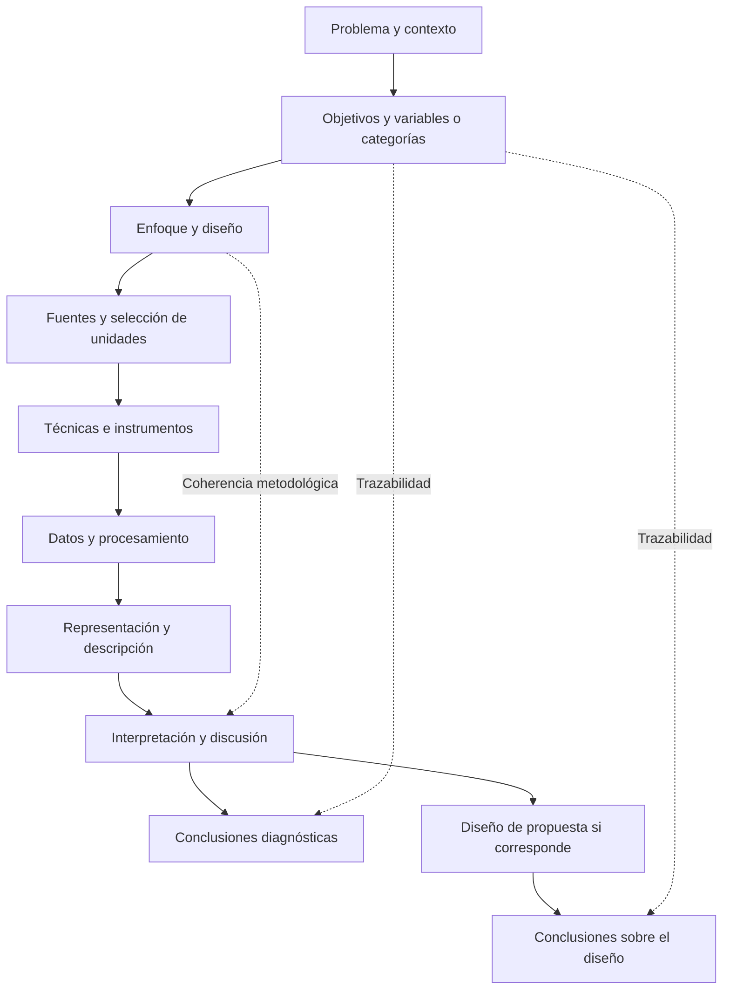

# Clase 7: Coherencia metodológica, reporte de resultados y fundamentación de propuestas

> **Objetivo académico:** Comprender la correspondencia entre problema, objetivos, enfoque, diseño e instrumentos de investigación, y emplearla para organizar resultados diagnósticos, fundamentar propuestas y formular conclusiones respaldadas por evidencia.

## 1. Contexto y marco conceptual

La sesión desarrolla el tránsito desde la fundamentación metodológica hacia la presentación y discusión de resultados en una investigación monográfica. Su eje es la **congruencia metodológica**: los objetivos, las variables, las fuentes, los procedimientos de obtención de datos y las afirmaciones finales deben formar una cadena argumental verificable.

Un diseño metodológico no es una colección de etiquetas. Declarar que una investigación es descriptiva, correlacional o predictiva compromete procedimientos y evidencias diferentes. Del mismo modo, establecer un período histórico, una población o un instrumento implica delimitar qué información puede respaldar los resultados.

La clase diferencia dos alcances fundamentales:

- **Analítico o diagnóstico:** caracteriza el estado de un problema mediante datos, representaciones, regularidades y tendencias. Puede concluir con una evaluación comparativa sin formular una solución.
- **Propositivo:** utiliza el diagnóstico como fundamento para diseñar un producto, servicio, modelo, estrategia, metodología u otra intervención orientada a transformar una situación.

Una tabla comparativa, una distribución de respuestas o un mapa de categorías constituyen resultados analíticos. Una propuesta incorpora una estructura de actuación: define qué se pretende cambiar, mediante qué componentes y con qué recursos. Elaborar una propuesta tampoco equivale a demostrar que funciona.

El diagrama expresa una relación de justificación, no una secuencia irrevisable: una dificultad para acceder a datos o una inconsistencia detectada en el instrumento puede exigir revisar las delimitaciones iniciales.

## 2. Fundamentos teóricos y arquitectura

### 2.1. Enfoque, diseño y alcance

El **enfoque cuantitativo** organiza la investigación mediante variables operacionalizadas, registros comparables y procedimientos de análisis numérico. El **enfoque cualitativo** se orienta a comprender significados, prácticas, narrativas y experiencias situadas. El **enfoque mixto** articula componentes cuantitativos y cualitativos e integra sus resultados.

La sesión insiste en que la forma prevista de obtener y procesar información permite comprobar si el enfoque declarado es coherente. Por ejemplo, un cuestionario de respuestas cerradas analizado mediante frecuencias exige una fundamentación diferente de una entrevista centrada en experiencias profesionales.

**Enriquecimiento conceptual:** esta relación debe entenderse como alineación recíproca. El instrumento no determina por sí solo el enfoque: primero importan la pregunta y el tipo de conocimiento buscado. Un cuestionario puede contener respuestas abiertas y una observación puede generar registros cualitativos o cuantitativos. La clasificación depende del diseño y del análisis, además del formato de obtención de datos.

| Dimensión | Distinción conceptual | Consecuencia para los resultados |
|---|---|---|
| Intervención | Diseño experimental frente a no experimental | Diferencia entre evaluar una intervención deliberada y registrar fenómenos sin manipularlos experimentalmente |
| Temporalidad | Transversal frente a longitudinal | Diferencia entre un corte definido y el análisis de cambios o trayectorias temporales |
| Alcance exploratorio | Aproximación inicial a un fenómeno poco delimitado | Identificación de aspectos relevantes y posibles relaciones |
| Alcance descriptivo | Caracterización de atributos y distribuciones | Presentación de frecuencias, perfiles, categorías o patrones |
| Alcance correlacional | Análisis de asociaciones | Evidencia de relaciones entre variables, sin identificación causal automática |
| Alcance explicativo | Análisis de mecanismos o relaciones causales | Exigencia de argumentos y evidencia que descarten explicaciones alternativas |
| Alcance predictivo | Estimación de valores o eventos no observados | Necesidad de evaluar capacidad de predicción con datos adecuados |

**Enriquecimiento conceptual:** comparar variables o encontrar una correlación no demuestra causalidad. Una interpretación explicativa necesita supuestos explícitos y un diseño capaz de abordar factores de confusión, temporalidad y explicaciones alternativas. Tampoco un estudio adquiere capacidad predictiva por incluir esa palabra en su denominación.

### 2.2. Diseños cualitativos y construcción interpretativa

La clase presenta distintas orientaciones cualitativas:

- **Fenomenológica:** comprensión de experiencias y percepciones de quienes viven un fenómeno.
- **Narrativa:** análisis de relatos y de la forma en que los participantes organizan su experiencia.
- **Etnográfica:** comprensión de prácticas, significados y dinámicas culturales de un grupo.
- **Investigación acción:** vinculación entre comprensión de una práctica y transformación participativa de esa práctica.

Las técnicas mencionadas son la entrevista, el grupo focal y la observación participante. En entrevistas y grupos focales, el diálogo permite solicitar aclaraciones, profundizar respuestas y explorar significados que un formulario cerrado puede dejar sin desarrollar. El grupo focal requiere conducción metodológica y conocimiento suficiente del tema; no consiste únicamente en reunir especialistas.

El análisis cualitativo se describe mediante la identificación de ideas, su codificación y su agrupación en categorías. La obtención y el análisis de información pueden retroalimentarse, ajustando preguntas y criterios de selección.

**Enriquecimiento conceptual:** la saturación no equivale a satisfacción personal con la cantidad de respuestas. Debe justificarse en relación con la pregunta, la diversidad de participantes y la ausencia de aportaciones analíticas sustantivamente nuevas; su pertinencia varía según la tradición cualitativa. La flexibilidad tampoco elimina la necesidad de una orientación inicial, registros de decisiones y criterios de rigor.

**Enriquecimiento conceptual:** algunas distinciones formuladas oralmente requieren matices. La observación no participante puede ser cualitativa; la observación participante no exige pertenecer previamente al equipo observado, aunque sí involucrarse en su contexto y explicitar el papel del investigador. La investigación cualitativa puede acompañar intervenciones. Asimismo, la presencia de recuentos auxiliares no anula automáticamente un análisis cualitativo. No existe una jerarquía general de rigor entre enfoques.

### 2.3. Métodos teóricos, métodos empíricos, técnicas e instrumentos

La sesión distingue los métodos que organizan el razonamiento de aquellos que permiten obtener información del fenómeno.

| Nivel | Ejemplos tratados | Función |
|---|---|---|
| Teórico | Análisis y síntesis; análisis histórico-lógico; modelación | Descomponer, integrar, contextualizar y representar conceptualmente el objeto |
| Empírico | Observación y revisión de fuentes | Obtener registros vinculados con el problema |
| Técnica | Encuesta, entrevista, grupo focal, observación o revisión documental | Organizar el procedimiento de obtención de información |
| Instrumento | Cuestionario, guía de entrevista, guía o matriz de observación, matriz documental | Especificar preguntas, criterios y campos de registro |

La terminología puede variar entre tradiciones metodológicas. Lo sustantivo es explicar qué procedimiento se realiza, sobre qué unidades y con qué reglas de registro y análisis. Enumerar métodos sin mostrar su uso produce una fundamentación nominal.

### 2.4. Población, muestra y censo

La **población** es el conjunto de unidades al que se refiere el estudio. Si se estudian todas sus unidades, se realiza un **censo**. Si se selecciona una parte, deben explicitarse el procedimiento y los criterios de inclusión.

La sesión contrapone selección probabilística y no probabilística, con atención a la selección intencional y por conveniencia.

**Enriquecimiento conceptual:** una muestra probabilística se define por un mecanismo aleatorio y probabilidades de inclusión conocidas y positivas para las unidades de la población cubierta. No se define por representar un porcentaje fijo ni por reproducir proporcionalmente cada característica poblacional. La selección por conveniencia prioriza accesibilidad; la intencional prioriza características relevantes para la pregunta. Ambas requieren reconocer sus límites de generalización.

No existe un mínimo universal de participantes que asegure suficiencia. El tamaño pertinente depende del objetivo, la heterogeneidad, el diseño y la precisión o profundidad requerida. Los tamaños reducidos comentados en la sesión deben entenderse como ejemplos contextuales, no como umbrales científicos generales.

## 3. Implementación técnica y lógica de negocio

La fuente no presenta código, ejecuciones de modelos ni bases de datos analizadas. La implementación desarrollada es **metodológica y documental**: cómo obtener registros, estructurar un reporte y mantener la correspondencia entre evidencia y afirmaciones.

### 3.1. Trazabilidad entre variables e instrumentos

Las preguntas y secciones del instrumento deben proceder de las variables o categorías delimitadas en el problema y desarrolladas en el marco conceptual. Incorporar preguntas sobre temas ajenos al objetivo aumenta la carga de análisis sin fortalecer la respuesta investigativa.

**Enriquecimiento conceptual:** una matriz de trazabilidad permite auditar esa correspondencia antes de interpretar resultados:

| Componente | Pregunta de control |
|---|---|
| Objetivo específico | ¿Qué conocimiento se busca producir? |
| Variable o categoría | ¿Qué aspecto del fenómeno representa ese objetivo? |
| Dimensión o indicador | ¿Cómo se concreta el aspecto estudiado? |
| Fuente e instrumento | ¿Dónde y mediante qué registro se obtiene evidencia? |
| Procedimiento de análisis | ¿Cómo se transforma el registro en un resultado? |
| Conclusión | ¿Qué afirmación queda respaldada y con qué límites? |

### 3.2. Secuencia del reporte de resultados

El reporte comienza ubicando los datos en su diseño: población o unidades estudiadas, instrumento utilizado, delimitación temporal y alcance analítico. A continuación, desarrolla tres operaciones por pregunta, dimensión, indicador o categoría:

1. **Representación:** organiza la evidencia mediante tablas, gráficos o mapas de relaciones conceptuales.
2. **Descripción:** identifica qué muestran los registros, destacando distribuciones, contrastes o patrones.
3. **Interpretación:** explica el significado de esos patrones respecto del problema y los objetivos, sin exceder la evidencia disponible.

Después se formula una **discusión integrada**. Esta relaciona los hallazgos de distintas dimensiones, identifica tendencias y contradicciones y delimita lo que puede sostenerse. No debe convertirse en una sucesión de comentarios aislados sobre gráficos.

La sesión menciona formularios digitales para registrar respuestas y obtener resúmenes descriptivos, así como ATLAS.ti para apoyar la codificación y representación de relaciones entre categorías. El software facilita el registro y la organización; las decisiones interpretativas siguen siendo responsabilidad del investigador.

**Enriquecimiento conceptual:** en una pregunta de respuesta única puede calcularse la proporción de una categoría mediante:

$$
p_j = \frac{n_j}{n_{\mathrm{válido}}}, \qquad P_j = 100p_j.
$$

Aquí, $j$ identifica una categoría de respuesta; $n_j$ es su frecuencia, un entero no negativo; $n_{\mathrm{válido}}$ es el número entero positivo de respuestas válidas para esa pregunta; $p_j$ pertenece a $[0,1]$ y $P_j$ expresa el porcentaje. Si las categorías son mutuamente excluyentes y exhaustivas, sus proporciones suman uno. Esta condición no se cumple necesariamente en preguntas de selección múltiple. La expresión describe las respuestas observadas y no garantiza representatividad poblacional.

El denominador debe hacerse explícito, especialmente cuando existen omisiones o preguntas condicionadas. Un porcentaje sin recuento y sin base de cálculo puede ocultar que procede de muy pocas respuestas.

### 3.3. Diseño y documentación de instrumentos

El cuestionario mostrado en la sesión incluye:

- Título y propósito de la consulta.
- Consigna sobre participación, uso de los datos y tratamiento de la información.
- Instrucciones de respuesta.
- Datos preliminares pertinentes.
- Secciones temáticas vinculadas con las variables.
- Preguntas cerradas o semicerradas que permitan un registro consistente.

Las guías de observación, entrevista o revisión documental cumplen una función equivalente: hacer explícito qué se registra y bajo qué criterios. Los instrumentos se documentan como anexos, mientras que los resultados y su interpretación pertenecen al cuerpo analítico del informe.

**Enriquecimiento conceptual:** anonimato y confidencialidad no son sinónimos. El anonimato implica no poder vincular una respuesta con una persona identificable; la confidencialidad regula el acceso y uso de información que puede ser identificable. Las declaraciones del instrumento deben corresponder a las prácticas efectivas de recopilación y almacenamiento.

### 3.4. Fundamentación y estructura de una propuesta

La clase organiza una propuesta mediante once componentes:

| Componente | Función |
|---|---|
| 1. Denominación | Identificar el producto, servicio o sistema planteado |
| 2. Fundamentación teórico-conceptual | Explicar sus bases y su relación con el problema |
| 3. Objetivo general | Precisar la finalidad propia de la propuesta |
| 4. Objetivos específicos | Desglosar acciones o logros necesarios para esa finalidad |
| 5. Representación modélica | Mostrar relaciones mediante un esquema lógico |
| 6. Fases o etapas | Ordenar el funcionamiento o despliegue |
| 7. Acciones o actividades | Concretar cada fase |
| 8. Métodos, técnicas e instrumentos | Definir medios de aplicación |
| 9. Recursos | Identificar requerimientos para operar |
| 10. Valoración de pertinencia | Analizar el ajuste a las necesidades del contexto |
| 11. Evaluación de efectividad | Determinar si produce los efectos buscados |

El objetivo de la propuesta se distingue del objetivo de investigación. El primero expresa una transformación pretendida por el sistema o servicio; el segundo, el conocimiento o resultado que el estudio busca alcanzar.

Cuando el alcance se limita al diseño, pueden desarrollarse la fundamentación, la estructura y los recursos, y describirse criterios de evaluación futura. No corresponde presentar pertinencia validada o efectividad demostrada si esas evaluaciones no se realizaron.

## 4. Análisis crítico de casos y auditoría práctica

### 4.1. Recuperación de jurisprudencia con procesamiento del lenguaje natural

Se plantea comparar búsqueda por palabras clave, ponderación de términos y representaciones vectoriales o *embeddings* sobre un conjunto reducido de sentencias judiciales. La investigación puede concluir en una evaluación analítica sin diseñar una solución nueva.

La matriz de registro debe permitir comparar las técnicas sobre una base común. La fuente no especifica el algoritmo concreto de ponderación, las consultas, los juicios de relevancia ni las métricas; por tanto, no permite afirmar cuál técnica funciona mejor.

**Enriquecimiento conceptual:** evaluar recuperación requiere distinguir documentos del corpus, consultas y criterios de relevancia. Aplicar técnicas al mismo corpus no basta si cada una recibe consultas o criterios diferentes. También debe distinguirse una comparación computacional controlada de un diseño experimental sobre usuarios: ejecutar algoritmos puede constituir experimentación computacional, aunque no exista intervención sobre personas. La etiqueta de diseño depende de la unidad y del procedimiento efectivamente estudiados.

### 4.2. Viabilidad de una alerta temprana sobre el precio del oro

El caso muestra una confusión entre la naturaleza del fenómeno y el enfoque. Que el precio dependa de factores externos no convierte el estudio en cualitativo.

Un análisis de experiencias de especialistas puede justificar entrevistas y un diseño interpretativo; un análisis de series históricas exige procedimientos cuantitativos; un cuestionario cerrado puede describir percepciones sobre viabilidad. Estas rutas responden preguntas diferentes.

**Enriquecimiento conceptual:** viabilidad técnica, utilidad percibida y capacidad predictiva deben distinguirse. La opinión favorable de especialistas no demuestra rendimiento de predicción. Asimismo, si se analiza la evolución histórica del precio, la dimensión temporal no desaparece por descargar o procesar los datos una sola vez.

### 4.3. Modelo de atención de amenazas informáticas

El diagnóstico del estado de atención de amenazas puede fundamentar el diseño posterior de un modelo que integre herramientas de seguridad y agentes de inteligencia artificial. La sesión separa el análisis inicial de la evaluación de efectividad del modelo.

La auditoría consiste en verificar que cada componente propuesto responda a un hallazgo o una necesidad identificada. Si el modelo no se implementa ni se evalúa, el resultado defendible es su diseño fundamentado. La fuente no detalla suficientemente las herramientas ni la arquitectura para reconstruir una solución técnica específica.

### 4.4. Aprendizaje automático en dispositivos para contextos con conectividad limitada

El caso aborda procesamiento en el dispositivo frente al uso de servicios externos, con interés en áreas rurales o con dificultades de conectividad. La decisión metodológica depende de si se busca comprender experiencias de desarrolladores, describir opiniones o medir prestaciones tecnológicas.

Entrevistas o grupos focales permiten explorar decisiones y dificultades experimentadas por especialistas. Una encuesta cerrada describe respuestas estandarizadas. Una comparación de prestaciones requeriría registros técnicos que la fuente no presenta.

**Enriquecimiento conceptual:** las experiencias profesionales pueden informar restricciones y criterios de adopción, pero no sustituyen mediciones de latencia, consumo de recursos o funcionamiento sin conexión cuando el objetivo sea comparar desempeño técnico.

### 4.5. Predicción del rendimiento agrícola mediante fusión multimodal

Se presenta una idea que combina imágenes satelitales, datos climáticos, variables edáficas y rendimiento de cultivos en provincias productoras de Santa Cruz. El planteamiento menciona datos históricos del período 2018–2024 y una consulta a productores.

La discusión evidencia que se trata de unidades y fuentes distintas: parcelas y registros ambientales, por un lado; productores y percepciones de uso, por otro. Una matriz documental o de extracción de datos permite registrar fuentes ya existentes, mientras que el cuestionario obtiene respuestas de personas.

**Enriquecimiento conceptual:** conservar únicamente el cuestionario cambia el alcance defendible. Permite estudiar necesidades, aceptación o utilidad percibida, pero no evaluar precisión predictiva ni ejecutar la fusión multimodal. Si se reduce la evidencia disponible, también deben revisarse objetivos, título y conclusiones. Del mismo modo, una serie con observaciones de varios años requiere analizar su estructura temporal; no se vuelve transversal por procesarse en una sola ocasión.

La selección por conveniencia debe declararse como tal. Afirmar que determinadas parcelas son representativas exige una justificación adicional que no consta en la fuente.

### 4.6. Prevención de estafas digitales, trazabilidad y formación

El caso final articula ciencia de datos, alertas, trazabilidad mediante blockchain y formación de usuarios. El marco conceptual propone que la inteligencia artificial apoye la priorización de riesgos y conserve intervención humana en las decisiones.

El cuestionario comprende perfil de usuarios, exposición al riesgo y hábitos de verificación antes de pagar. Su coherencia depende de que esas dimensiones estén fundamentadas y vinculadas con los objetivos.

Una sección posterior a una capacitación presupone que la intervención ocurrió. Si solo se estudia el estado inicial del problema, esa sección no produce evidencia válida y debe diferenciarse de un instrumento destinado a una evaluación posterior.

**Enriquecimiento conceptual:** la resistencia a modificaciones de un registro no garantiza la veracidad de su contenido. Blockchain puede contribuir a la trazabilidad bajo ciertos supuestos de implementación y gobernanza, pero no demuestra que una denuncia sea auténtica ni que una clasificación de fraude sea correcta. Las afirmaciones sobre evolución internacional, regulación o vacíos institucionales expuestas en el caso requieren fuentes específicas; no quedan verificadas por su mención oral.

## 5. Principios de diseño, buenas prácticas y anti-patrones

### 5.1. Calidad de resultados y propuestas

La sesión distingue resultados **teóricos**, orientados a conceptos, modelos, principios y conocimiento metodológico, y **prácticos**, orientados a procedimientos, programas, sistemas, estrategias o medios de actuación. Esta clasificación se refiere a la naturaleza del aporte. La distinción entre diagnóstico y propuesta se refiere a su función investigativa; ambas clasificaciones pueden cruzarse.

**Enriquecimiento conceptual:** el nivel académico del documento no determina por sí solo si puede haber aportaciones teóricas. La asociación realizada en la sesión entre teoría y formación doctoral debe entenderse como una delimitación de profundidad y alcance del contexto tratado. Además, un instrumento solo constituye una aportación propositiva cuando su desarrollo y justificación tienen entidad propia, no por el mero hecho de utilizarlo para recopilar datos.

| Criterio | Pregunta sustantiva | Límite de la afirmación |
|---|---|---|
| Pertinencia | ¿Responde a una necesidad real del contexto? | Debe vincularse con evidencia del diagnóstico |
| Validez funcional | ¿Cumple la función para la que se plantea? | Su demostración requiere criterios y procedimientos de evaluación |
| Factibilidad | ¿Puede llevarse a la práctica con los recursos disponibles? | Un diseño conceptual no acredita implementación viable por sí solo |
| Aplicabilidad | ¿Otras personas pueden utilizarlo en condiciones definidas? | Requiere claridad operativa y condiciones de uso |
| Generalización o transferencia | ¿Puede funcionar en contextos semejantes? | La semejanza debe justificarse; el éxito no se presume |
| Novedad y originalidad | ¿Qué diferencia introduce frente a lo existente? | Debe compararse con antecedentes pertinentes |

**Enriquecimiento conceptual:** una adaptación local o una replicación también puede tener valor científico o práctico. La falta de novedad absoluta no invalida automáticamente una investigación; obliga a precisar el tipo de contribución y sus límites.

### 5.2. Buenas prácticas de coherencia y comunicación

- Declarar únicamente procedimientos que se realizan y resultados que pueden respaldarse.
- Mantener consistentes las delimitaciones temporales, poblacionales y conceptuales a lo largo del documento.
- Seleccionar representaciones según la estructura de los datos y explicar siempre su significado.
- Organizar el análisis por dimensiones cuando ello integre mejor la evidencia, conservando trazabilidad hacia las preguntas originales.
- Diferenciar la síntesis de antecedentes, los hallazgos empíricos y el diseño propositivo.
- Conectar estado del arte, marco conceptual y contexto normativo mediante transiciones argumentales.
- Mantener correspondencia entre citas y referencias bibliográficas.
- Documentar los instrumentos y sus versiones para que el lector comprenda cómo se obtuvo la información.

### 5.3. Anti-patrones identificados

| Anti-patrón | Problema que genera |
|---|---|
| Acumular etiquetas metodológicas | Promete análisis que no aparecen en los resultados |
| Llamar mixto a cualquier uso de varias fuentes | Confunde diversidad de información con integración de enfoques |
| Declarar correlación o predicción sin analizarlas | Produce conclusiones sin respaldo metodológico |
| Sustituir desempeño técnico por opiniones | Responde una pregunta diferente de la planteada |
| Presentar una propuesta como validada | Confunde diseño con evidencia de efectividad |
| Incluir preguntas sin vínculo conceptual | Amplía el instrumento y debilita su pertinencia |
| Introducir hallazgos nuevos en las conclusiones | Rompe la trazabilidad del argumento |
| Confundir gráficos automáticos con discusión | Reduce el análisis a una reproducción de salidas de software |

### 5.4. Uso crítico de inteligencia artificial y simulaciones

La sesión menciona herramientas generativas y de consulta documental como apoyo para describir gráficos, interpretar información y redactar síntesis. Su uso exige comprobar que las salidas sean fieles a los datos y al documento analizado.

**Enriquecimiento conceptual:** los datos simulados deben identificarse explícitamente y mantenerse diferenciados de observaciones reales. Pueden ilustrar un procedimiento o explorar un escenario, pero no demostrar el estado empírico de una población. Del mismo modo, una explicación generada por inteligencia artificial no acredita relaciones causales ni añade evidencia. La revisión debe comprobar cifras, denominadores, atribuciones y alcance de cada afirmación, además de proteger información personal o confidencial.

## 6. Síntesis conceptual y profundización académica

El resultado investigativo surge de una cadena de correspondencias: el problema orienta los objetivos; estos delimitan variables o categorías; el diseño organiza la evidencia; los instrumentos producen registros; y el análisis permite formular conclusiones. La calidad se deteriora cuando alguno de esos componentes promete algo que los siguientes no pueden sostener.

Las **conclusiones** expresan la esencia de los resultados en relación con los objetivos específicos. Deben mostrar qué se logró, qué quedó sin resolver y cuáles son los límites del aporte. No incorporan información nueva ni se limitan a repetir el procedimiento o anunciar que se cumplieron los objetivos.

La sesión propone vincular cada objetivo específico con una idea conclusiva. En una investigación cuyo recorrido abarque fundamentos, diagnóstico y propuesta, el cierre puede sintetizar esas tres contribuciones. Ese orden depende de los objetivos reales y no constituye una cantidad universal de conclusiones. La redacción puede ser compacta o distribuirse en párrafos, siempre que preserve claridad y trazabilidad.

Las **recomendaciones** se distinguen de las conclusiones porque orientan continuidad o aplicación. Pueden ser metodológicas, cuando proponen otras fuentes, procedimientos o diseños; prácticas, cuando señalan condiciones de uso o mejora en organizaciones y comunidades; o académicas, cuando se refieren a formación y desarrollo del conocimiento. Su pertinencia depende de los límites y resultados del estudio, no de añadir un apartado por rutina.

**Enriquecimiento conceptual:** en los enfoques mixtos, la contribución específica se encuentra en la integración. Combinar entrevistas y cuestionarios no basta: es necesario explicar si sus resultados se contrastan, se complementan o si una fase informa a la otra. Los diseños concurrentes obtienen componentes en períodos coincidentes; los secuenciales los articulan por etapas. Ninguna de estas alternativas está prohibida por la naturaleza monográfica del documento, aunque su alcance debe ser realizable y estar justificado.

Las principales líneas de profundización que deja la clase son la validez de los instrumentos, los límites de inferencia de muestras por conveniencia, la distinción entre asociación y causalidad, la evaluación de modelos predictivos y la separación entre diseño, implementación y efectividad. Todas convergen en un principio: **la fuerza de una conclusión debe corresponder a la fuerza de la evidencia que la sostiene**.
