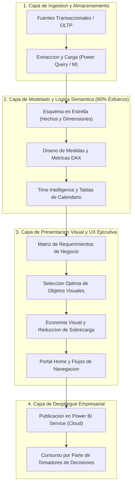
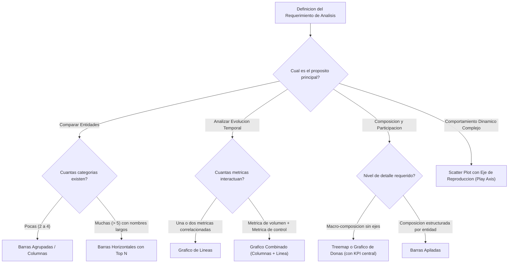
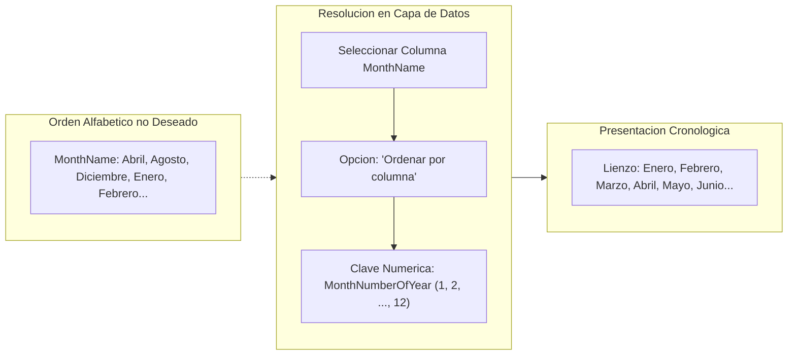
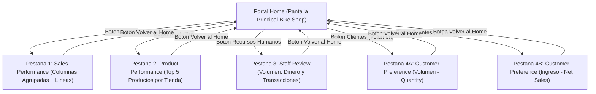
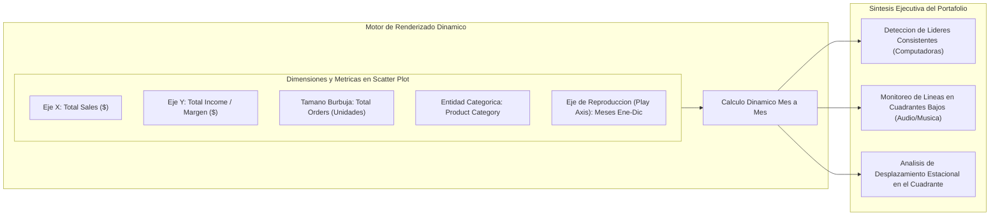
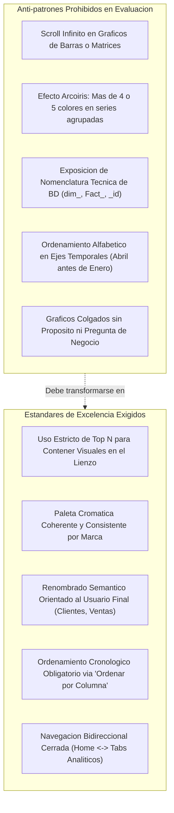
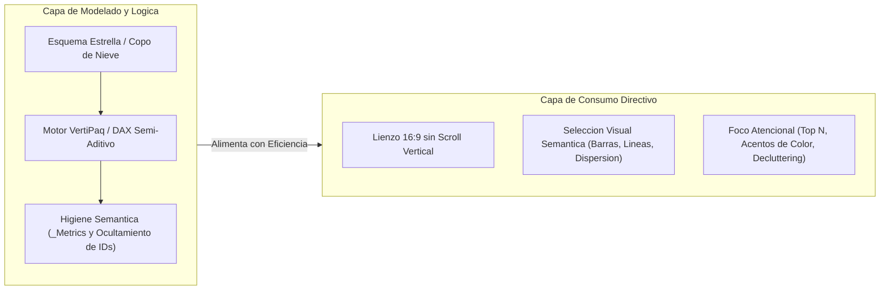

# Clase 5: Materializacion de la Capa de Presentacion, Principios de Diseno Visual de Dashboards y Analitica Empresarial Multidimensional en Power BI

> **Objetivo de la Sesion**<br>
> Abordar la transicion critica entre la fase de modelado logico-semantico de datos y la materializacion de la capa de presentacion visual empresarial en Power BI. Se profundiza en la traduccion formal de requerimientos de negocio hacia componentes visuales optimizados (ventas por sucursal, demanda de inventario, evaluacion 360 de personal y segmentacion bimodal de clientes), la mitigacion de la sobrecarga cognitiva mediante economia visual, la seleccion rigurosa de graficos segun dimensionalidad y volumen de datos, y el diseno de interfaces ejecutivas interactivas orientadas al soporte de decisiones.

## 1\. Contexto y Arquitectura Analitica

En el ciclo de vida del desarrollo de soluciones de Inteligencia de Negocios (BI), la construccion del modelo relacional en estrella y la formulacion de metricas analiticas en DAX representan aproximadamente el 60% del esfuerzo tecnico. No obstante, una capa semantica robusta resulta inocua si la capa superior de presentacion no logra comunicar hallazgos accionables con claridad ejecutiva.

La sesion formaliza el puente entre los requerimientos abstractos de gestion y su despliegue visual en Power BI, transitando desde un caso base de tres sucursales (*Bike Stores*) hasta un entorno corporativo de escala masiva (*Contoso*), demostrando la adaptabilidad del disenador analitico ante diferentes niveles de granularidad.



---

## 2\. Fundamentos Metodologicos de la Visualizacion Empresarial

### 2.1 Economia Visual y Gestion del Espacio como Recurso Critico

El lienzo de un dashboard representa un recurso espacial estrictamente limitado. La dispersion caotica de elementos o la acumulacion desmedida de graficos en una sola pagina genera fatiga cognitiva inmediata. Los principios rectores demandan:

- **Prioridad del Mensaje de Negocio:** Ningun grafico debe incluirse con fines exclusivamente decorativos; cada objeto visual debe responder a una pregunta operativa o estrategica puntual.

- **Eliminacion de Redundancias:** Supresion de titulos de ejes cuando la variable es autoevidente (por ejemplo, meses cronologicos en el eje horizontal o monedas estandarizadas).

- **Prohibicion del Scroll Infinito:** Un tablero analitico que fuerza al usuario a desplazarse vertical u horizontalmente a traves de cientos de barras denota una falla arquitectonica en el modelado visual. Debe acotarse mediante tecnicas de agregacion, agrupacion o filtrado Top N.

### 2.2 Taxonomia y Criterios de Seleccion de Objetos Visuales

La efectividad de la comunicacion analitica depende de la correlacion exacta entre la naturaleza de los datos y el tipo de codificacion visual:

| Tipo de Visual | Proposito Analitico Principal | Idoneidad Dimensional | Riesgos y Anti-patrones |
| --- | --- | --- | --- |
| **Barras Agrupadas (Clustered Bars)** | Comparacion directa de magnitudes discretas. | Optimo para cardinalidades reducidas (maximo 3 a 4 categorias). | Fallo critico con alta granularidad; dispersion visual extrema. |
| **Barras Apiladas (Stacked Bars)** | Evaluacion de composicion interna dentro de un total absoluto. | Adecuado para composicion de grupos primarios con pocos subgrupos. | Dificultad para comparar magnitudes de subsegmentos no alineados al origen base. |
| **Barras Horizontales** | Ranking y comparacion de entidades con nombres descriptivos extensos. | Ideal para catalogos de productos o nombres de personal (evita truncamiento de texto). | Scroll vertical si no se aplica delimitacion de rango (Top N). |
| **Grafico de Lineas** | Identificacion de tendencias, ciclos y variaciones temporales continuas. | Series temporales continuas (meses, trimestres, anos) y brechas entre dos metricas. | Inadecuado para datos cualitativos sin orden secuencial intrinseco. |
| **Grafico Combinado (Columnas y Lineas)** | Correlacion simultanea entre una metrica de volumen y una de razon/devolucion. | Dos metricas con escalas diferentes sobre el mismo horizonte temporal. | Correlacion espuria si las metricas carecen de vinculo semantico en el negocio. |
| **Grafico de Dispersion Animado (Scatter Plot)** | Correlacion multidimensional (3 metricas numericas + 2 dimensiones). | Analisis de portafolio y distribucion dinamica en el tiempo (Play Axis). | Requiere alfabetizacion analitica avanzada por parte del usuario. |
| **Mapa de Arbol (Treemap)** | Proporciones relativas de composicion jerarquica sin ejes. | Visualizacion rapida de participacion de categorias sin saturacion de leyendas. | Imprecision en la cuantificacion de diferencias marginales minimas. |



---

## 3\. Demostracion e Implementacion en Power BI (Caso Practico Bike Stores)

El desarrollo del caso practico abarco la traduccion integral de cuatro requerimientos de negocio, complementados por un portal de navegacion estructurado.

### 3.1 Requerimiento 1: Sales Performance (Rendimiento de Sucursales en el Tiempo)

- **Necesidad del Negocio:** Visualizar la evolucion mensual de ventas en las tres tiendas del negocio (*Baldwin Bikes*, *Rowlett Bikes*, *Santa Cruz Bikes*), analizando el comportamiento de los ingresos netos frente a los brutos para revelar la dinamica de descuentos.

- **Implementacion:**

  - **Slicer / Segmentador Temporal:** Configuracion de un selector interactivo tipo mosaico (*tile*) para los anos (2016, 2017, 2018), suprimiendo valores nulos o registros cero para garantizar higiene visual.
  
  - **Grafico de Columnas Agrupadas:** Eje horizontal configurado con el mes del ano; eje vertical con ` Total Quantity `; leyenda asignada a la tienda. Al existir unicamente tres sucursales, las barras agrupadas permiten contrastar de forma directa la dominancia de la casa central (*Baldwin Bikes*) frente a las sucursales secundarias.
  
  - **Grafico de Lineas (Tendencia y Brecha de Descuento):** Eje X temporal (meses); Eje Y comparando ` Gross Sales ` y ` Total Net Sales `. La separacion visual entre ambas curvas refleja explicitamente el impacto de las politicas de descuento comercial aplicadas a lo largo de los meses.
  
  - **Estandarizacion de Branding:** Asignacion consistente de una paleta cromatica corporativa (Azul/Celeste para Baldwin, Naranja para Santa Cruz, tono complementario para Rowlett), preservada en todas las vistas subsiguientes.



### 3.2 Requerimiento 2: Product Performance (Disponibilidad y Gestion de Demanda de Stock)

- **Necesidad del Negocio:** La gerencia requiere identificar con precision los articulos de mayor rotacion fisica por tienda, a fin de optimizar el abastecimiento y prevenir quiebres de inventario.

- **Manejo de la Hipergranularidad (Anti-patron del Scroll Infinito):** La inclusion directa de cientos de referencias genera un visual ininteligible. Se implemento un filtro de nivel de objeto visual (*Visual-level filter*) configurado en **Top N (Superior)**, delimitado a los **5 productos lideres** segun la metrica ` Total Quantity `.

- **Estructuracion por Sucursal:** En lugar de agregar la demanda globalmente (lo cual ocultaria las necesidades especificas de cada plaza), se desplegaron tres paneles independientes de barras horizontales (uno por tienda). La orientacion horizontal garantiza la lectura completa de las descripciones de los productos sin cortes de texto.

### 3.3 Requerimiento 3: Staff Review (Evaluacion Integral 360 del Personal de Ventas)

- **Necesidad del Negocio:** Proveer al departamento de Recursos Humanos de una instantanea objetiva para evaluar el desempeno de los colaboradores en cada tienda.

- **Matriz Analitica Multidimensional:** Dado que el exito de un vendedor no puede medirse bajo una sola dimension (vender muchos articulos economicos difiere de concretar pocas ventas de alto margen), se estructuraron tres visualizaciones paralelas:

  1. **Volumen Fisico:** Evaluado mediante ` Total Quantity ` (rotacion fisica de stock).
  
  1. **Ingreso Financiero:** Evaluado mediante ` Total Net Sales ` (generacion efectiva de flujo de caja).
  
  1. **Volumen Transaccional:** Evaluado mediante ` Total Orders ` o ` Total Sales ` (capacidad de cierre de ventas y gestion operativa).

- **Optimizacion de Espacio y Reduccion de Nombres:** Ante la limitacion del lienzo y el desborde tipografico, se definio la buena practica de construir columnas calculadas DAX para derivar alias ejecutivos (ejemplo: ` Nombre + Inicial del Apellido `), eliminando la aparicion de puntos suspensivos que degradan el reporte.

```javascript
-- Patron conceptual para la derivacion de seudonimos ejecutivos en la dimension Staff
StaffExecutiveName = 
VAR FirstName = DimStaff[FirstName]
VAR LastNameInitial = LEFT(DimStaff[LastName], 1)
RETURN
    FirstName & " " & LastNameInitial & "."
```

### 3.4 Requerimiento 4: Customer Preference (Segmentacion Bimodal de Clientes)

- **Necesidad del Negocio:** Identificar los clientes mas representativos de cada sucursal a lo largo del horizonte historico.

- **Hallazgo Bimodal de Negocio:**

  - Al filtrar por ` Total Quantity `, emergen clientes de consumo masivo recurrente (ejemplo: *Emit Sanchez*, 19 unidades), quienes adquieren repuestos o accesorios de menor costo unitario.
  
  - Al evaluar mediante ` Total Net Sales `, emergen clientes estrategicos o corporativos (ejemplo: *Sharine Hopkins*, \$34,807), quienes adquieren modelos de alta gama.
  
  - **Implicacion Estrategica:** Ambas tipologias de clientes son criticas pero exigen tacticas de retencion dismiles: programas de lealtad por volumen frente a servicios postventa VIP personalizados.

- **Manejo de Empates en Top N:** Cuando multiples clientes comparten exactamente la misma cantidad fisica comprada, el motor de Power BI incluye a todos los registros empatados en el limite inferior, expandiendo visualmente el Top 5 a 6 o 7 filas. Se discutio la necesidad de formulas DAX con desempates por ranking denso (` RANKX `) para escenarios que demanden precision estricta.

### 3.5 Arquitectura de Navegacion del Lienzo Empresarial

Para consolidar una experiencia de usuario (UX) corporativa, se implemento una arquitectura de navegacion en estrella:

- **Pantalla Home / Portal Principal:** Panel de bienvenida corporativo (*Bike Shop*) provisto de accesos directos tematicos mediante tarjetas y botones interactivos.

- **Mapeo de Acciones:** Configuracion de la propiedad ` Accion ` -&gt; ` Navegacion de paginas ` vinculada a cada pestana (*Sales Performance*, *Product Performance*, *Staff Review*, *Customer Preference*).

- **Ciclo de Retorno Cerrado:** Cada pagina secundaria integra un boton de navegacion de retorno inmediato al Home, garantizando fluidez de exploracion y evitando que el tomador de decisiones quede estancado en un tab transaccional.



---

## 4\. Analisis Comparativo Avanzado: Entornos de Alta Dimensionalidad (Caso Contoso)

Para ilustrar los limites de las visualizaciones estandar y explorar capacidades avanzadas de BI, se analizo el modelo corporativo *Contoso*, caracterizado por alta granularidad: 8 dimensiones, 310 tiendas, 1,690 productos, 44 subcategorias y mas de 2.28 millones de transacciones.

### 4.1 Patologia del "Efecto Arcoiris" en Barras Apiladas

Cuando se intenta modelar una dimension con cardinalidad excesiva (como 44 subcategorias de producto) dentro de la leyenda de un grafico de barras apiladas:

- Se satura la memoria de trabajo visual del usuario con decenas de colores arbitrarios.

- Resulta imposible discriminar la proporcion de cada segmento.

- **Solucion Metodologica:** Invertir la jerarquia (pivotear categoria en el eje y subcategoria en leyenda previa reduccion), o crear agrupaciones sinteticas de mayor orden mediante modelos de agrupacion (*Grouping/Binning*).

### 4.2 Grafico de Dispersion con Eje de Reproduccion (Dynamic Animated Scatter Plot)

Constituye uno de los instrumentos analiticos mas potentes para sintesis ejecutiva macroeconomica de un negocio:

- **Eje X (Metrica 1):** ` Total Sales ` (Monto total comercial).

- **Eje Y (Metrica 2):** ` Total Income ` o Margen Neto.

- **Tamano de la Burbuja (Metrica 3):** ` Total Orders ` (Volumen de transacciones operativas).

- **Valores / Agrupacion Categorica:** ` Product Category ` (Computadoras, Camaras, Telefonia, Audio, Video).

- **Eje de Reproduccion (Play Axis):** Dimension temporal cronologica (Meses de Enero a Diciembre).

- **Comportamiento Revelado:** Permite observar la trayectoria cinematica del portafolio. En la demostracion se constato que el segmento de **Computadoras** mantiene una dominancia consistente en volumen e ingresos a lo largo de todo el ano, con oscilaciones estacionales controladas, mientras que **Telefonia** y **Audio** exhiben un comportamiento estatico en cuadrantes inferiores de bajo margen.



### 4.3 Treemaps, Donut Charts y Analisis Geografico

- **Donut Chart:** Utilizado como alternativa al grafico circular estandar, aprovechando el espacio negativo central para incrustar tarjetas de valor agregado (` Card `) con el KPI consolidado total.

- **Treemap:** Representacion optima de participacion relativa entre familias de producto sin recurrir a ejes cartesianos, confirmando la hegemonia de computadoras y grabadoras portatiles.

- **Visuales Cartograficos (Maps):** Georreferenciacion de sucursales a partir de atributos descriptivos (` City `, ` Country `). Se puntualiza que en niveles ejecutivos no se requiere precision catastral milimetrica, sino una representacion de cobertura global y dispersion de puntos de venta.

---

## 5\. Directrices, Buenas Practicas y Anti-patrones de Diseno

En la evaluacion de proyectos analiticos, el docente establecio un marco normativo riguroso que distingue una aplicacion corporativa de un ejercicio amateur:



### 5.1 Protocolo de Higiene de la Capa Semantica para Consumo Final

1. **Ocultamiento de Metadatos y Llaves Subrogadas:** Todas las columnas de identificacion tecnica (` CustomerID `, ` StoreID `, ` SalesDateKey `, relaciones puente) deben marcarse como **Ocultas en la vista de informe**. El usuario final jamas debe visualizar llaves primarias o foraneas.

1. **Nomenclatura Semantica de Negocio:** Queda terminantemente prohibido mantener prefijos tecnicos de bases de datos relacionales en la lista de campos visibles (` dim_customer ` -&gt; ` Clientes `, ` fact_sales ` -&gt; ` Ventas `, ` product_name ` -&gt; ` Nombre del Producto `).

1. **Manejo de Prefijos DAX:** Las metricas calculadas deben estar agrupadas en tablas exclusivas de medidas (ejemplo: ` _Metrics `), con nombres autoexplicativos que no requieran manuales de usuario para su comprension.

### 5.2 Retroalimentacion Constructiva al Proyecto Estudiantil (Caso Willy Alejandro Aranivar)

Durante la sesion se evaluo el avance del proyecto de un estudiante basado en un dataset de retail de Kaggle:

- **Diagnostico del Modelo:** Estructura en estrella correcta con tabla de hechos desnormalizada y tabla de fechas dinamica para metricas de Time Intelligence (` Average Ticket `, ` Average Sales per Day `, ventas YTD/QTD/MTD).

- **Critica Metodologica:**

  - *Monotematismo Analitico:* La totalidad de las metricas formuladas se concentraban unicamente en el monto bruto de ventas, desaprovechando los ricos cualificadores dimensionales presentes en la tabla de hechos.
  
  - *Recomendacion de Expansion Semantica:* Derivar medidas segmentadas utilizando la funcion ` CALCULATE ` en combinacion con filtros contextuales:
  
    - Ventas por segmento de cliente (` Customer Segment `).
    
    - Ventas por formato de tienda (` Store Type `).
    
    - Rendimiento por ubicacion geografica (` Store Location `).
    
    - Efectividad por campana de marketing (` Campaign `).
  
  - *Adecuacion de Nomenclatura:* Corregir los nombres de tablas tecnicas expuestas antes de la evaluacion final.

---

## 6\. Sintesis Conceptual y Profundizacion Academica

### 6.1 Matriz de Integracion: Del Modelado Logico a la Capa Visual

El desarrollo de soluciones analiticas de inteligencia de negocios exige un balance riguroso entre la complejidad computacional en el backend y la simplicidad perceptual en el frontend:



### 6.2 Principios Rectores para la Maestria en Business Intelligence

1. **La Regla de Oro del 60-40:** La robustez analitica descansa sobre el modelo relacional (60%); no obstante, el impacto estrategico frente a comites directivos reside en la capacidad de sintetizar el dato en un lienzo intuitivo y accionable (40%).

1. **Ergonomia Visual y Carga Cognitiva:** La proliferacion de graficos o la inclusion de barras de desplazamiento vertical fragmentan la atencion. El disenador debe forzar la sintesis visual mediante filtros de visualizacion (` Top N `) y metricas cardinales claras.

1. **Desacoplamiento Semantico:** Las llaves tecnicas y estructuras relacionales pertenecen al motor interno. El usuario de negocio debe interactuar unicamente con conceptos que reflejen la realidad operativa de su organizacion.

---

---
