# Clase 7: Data Storytelling en la Practica, Evaluacion Estrategica del Ecosistema BI y Adquisicion de Datos via Web Scraping

> **Objetivo de la Sesion:**<br>
> 
> 
> Consolidar e integrar las tres competencias fundamentales del ciclo analitico moderno en el nivel de posgrado: (1) Disenar e implementar narrativas de datos ejecutivas (Data Storytelling) orientadas a la alta direccion mediante tecnicas de atenuacion visual (Lienzo en Plomo / Gray Canvas), anclaje de supuestos de negocio y estructuracion de portales analiticos corporativos (Home / Menu); (2) Realizar una evaluacion comparativa, arquitectonica y estrategica de las plataformas de Business Intelligence del mercado, analizando su evolucion desde motores de autoservicio (plugins de hoja de calculo) hasta ecosistemas empresariales integrados a Data Warehouses corporativos, evaluando escalabilidad, modelos de licenciamiento y mecanismos de gobernanza (Row-Level Security); y (3) Dominar la adquisicion indirecta de datos externos mediante Web Scraping cuando no existe acceso directo a bases de datos o APIs privadas, interpretando el Document Object Model (DOM), navegando protocolos de comunicacion web e implementando flujos reproducibles en Python para alimentar pipelines de integracion y modelos analiticos.

---

## 1\. Contexto y Marco Conceptual

### 1.1. La Convergencia Analitica: Comunicacion Ejecutiva, Evaluacion de Ecosistemas y Recoleccion Externa

En el diseno de sistemas de informacion y soluciones analiticas para la toma de decisiones empresariales, los profesionales en Ciencia de Datos e Inteligencia de Negocios se enfrentan a un ecosistema que exige competencias concurrentes en tres niveles de abstraccion:

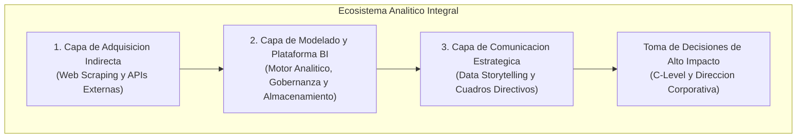

1. **La Capa de Comunicacion Directiva (Data Storytelling):** Un modelo de datos relacional y un conjunto de medidas DAX avanzadas carecen de impacto tactico si los hallazgos son presentados de forma neutra y sin direccion intencional. La alta direccion corporativa (CEOs, CFOs, VPs) no evalua codigo ni esquemas relacionales; demanda respuestas concretas a problemas de asignacion de recursos, proyecciones de demanda y explicacion causal de desviaciones historicas. El Data Storytelling directivo transforma metricas estaticas en arcos narrativos con supuestos fundados y foco preatentivo.

1. **La Capa de Seleccion de Infraestructura de Inteligencia de Negocios (BI):** La arquitectura analitica debe responder a un balance optimo entre inversion, escalabilidad, seguridad y democratizacion del acceso a la informacion. Es indispensable discernir con criterio tecnico cuando adoptar una solucion de autoservicio para usuarios avanzados (Power Users) y cuando orquestar una integracion centralizada basada en Data Warehouses empresariales (EDW) y cubos analiticos multidimensionales.

1. **La Capa de Adquisicion Indirecta de Datos (Web Scraping):** En multiples escenarios de negocio, las organizaciones requieren capturar senales del entorno competitivo, cotizaciones de materias primas o criptoactivos, catalogos de competidores y percepciones cualitativas de clientes (reviews y testimonios) que residen en la web abierta y no cuentan con mecanismos de conexion directa a bases de datos ni con APIs REST abiertas. El scraping emerge como una tecnica cientifica y metodologica de adquisicion indirecta, requiriendo rigor en el parsing del DOM, resiliencia estructural y consideraciones eticas de persistencia.

---

### 1.2. La Estructuracion de la Navegacion Corporativa: Menu Centralizado (Home) y Vision de Negocio

Un error recurrente en proyectos de visualizacion es la presentacion inconexa de graficos densos sin una jerarquia que guie al usuario. Para mitigar la sobrecarga cognitiva en entornos directivos, la arquitectura de presentacion debe articularse a partir de un **Centro de Navegacion o Portal Ejecutivo (Home / Menu)** que responda directamente a las unidades funcionales del negocio:

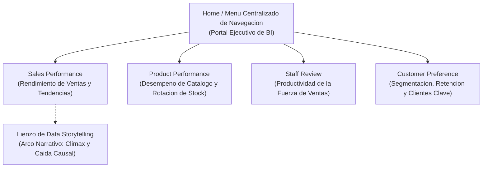

#### Fundamentos del Portal de Reportes:

- **Alineacion con Unidades de Negocio:** Cada punto de entrada refleja un dominio estrategico (Ventas, Productos, Personal, Clientes), permitiendo al tomador de decisiones explorar el negocio segun su rol sin perder la coherencia global.

- **Transicion de lo Descriptivo a lo Diagnostico y Narrativo:** Los paneles analiticos estandar exponen el estado operativo cotidiano (*Sales Performance*), mientras que las laminas de storytelling se reservan para explicar hitos criticos o anomalias significativas que justifican una intervencion estrategica.

- **Perspectiva del Propietario (Owner Perspective):** La evaluacion de cualquier entidad analitica debe plantearse desde las interrogantes del directorio: *¿Cual tienda aporta el mayor margen neto?, ¿Cuales campanas generaron retorno real?, ¿Que factores causales explican la caida abrupta de ingresos en un periodo determinado?*.

---

## 2\. Fundamentos Teoricos y Arquitectura

### 2.1. Teoria de la Narrativa Visual Directiva: El Arco Narrativo y la Tecnica del "Lienzo en Plomo" (Gray Canvas)

El Data Storytelling en entornos corporativos adapta la estructura dramatica clasica a los ciclos operacionales de la empresa. En conjuntos de datos historicos no siempre convergen con rigidez los cuatro estadios teoricos tradicionales (exposicion, crisis, climax y resolucion), pero los datos siempre revelan puntos de inflexion que ameritan una narrativa causal estructurada.

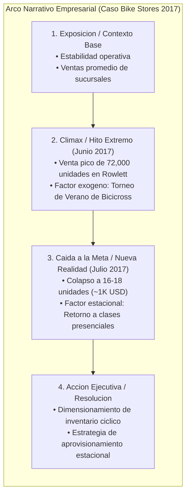

#### Fundamentos de la Atenuacion Visual (Lienzo en Plomo / Gray Canvas):

El cerebro humano procesa atributos visuales preatentivos (color, intensidad lumínica, tamano, posicion) en milisegundos antes del procesamiento consciente. Cuando un panel presenta tres series temporales con colores vibrantes saturados (ej. azul primario, naranja encendido y verde intenso), la atencion del directivo se dispersa por sobrecarga sensorial.

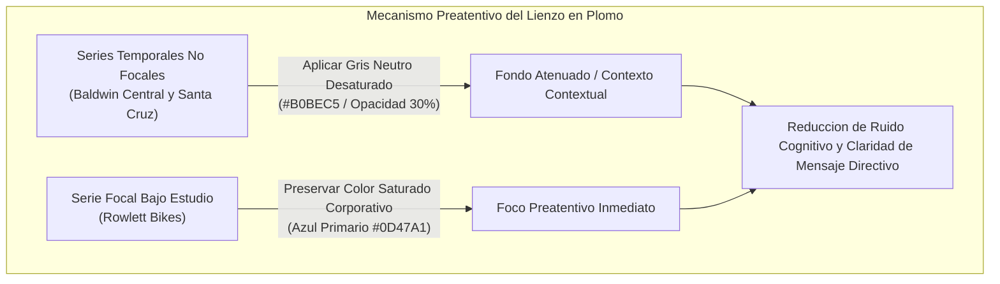

Al asignar un tono gris neutro desaturado a las entidades contextuales (Baldwin Bikes y Santa Cruz Bikes), los datos historicos permanecen disponibles para evaluacion comparativa, pero dejan de competir por el ancho de banda visual. La mirada del interlocutor se fija automaticamente sobre Rowlett Bikes, facilitando la interpretacion instantanea de las anotaciones directas (Callouts).

---

### 2.2. Genesis y Arquitectura Modular de Microsoft Power BI

Para comprender la posicion estructural de Microsoft Power BI en el ecosistema corporativo, es necesario examinar su genealogia tecnica. Power BI Desktop no nacio como una aplicacion monolitica aislada, sino como la consolidacion, empaquetado y evolucion de cuatro complementos avanzados (plugins COM) desarrollados originalmente para Microsoft Excel:

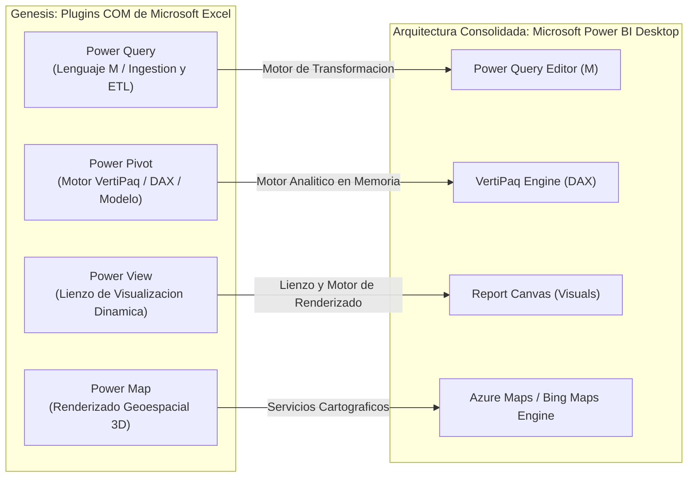

#### Componentes del Nucleo Tecnologico:

1. **Power Query (Lenguaje M):** Motor declarativo funcional especializado en la extraccion, limpieza, dinamizacion y transformacion de datos tabulares. Opera como la capa de ETL visual de autoservicio.

1. **Power Pivot (Motor VertiPaq y DAX):** Base de datos columnar en memoria (In-Memory Columnar Database) de alto rendimiento. Utiliza algoritmos de compresion por longitud de ejecucion (Run-Length Encoding - RLE), codificacion por diccionario y segmentacion binaria para ejecutar calculos analiticos masivos en segundos mediante DAX (Data Analysis Expressions).

1. **Power View y Power Map:** Prototipos originales de visualizacion interactiva y georreferenciacion tridimensional que fueron reemplazados por el moderno motor de renderizado HTML5/D3.js e integraciones cartograficas avanzadas en Power BI.

1. **Data Streamer y Azure IoT:** Capacidades de recepcion de telemetria en tiempo casi real integrables al ecosistema.

#### Dualidad Arquitectonica: Autoservicio vs. Data Warehouse Corporativo

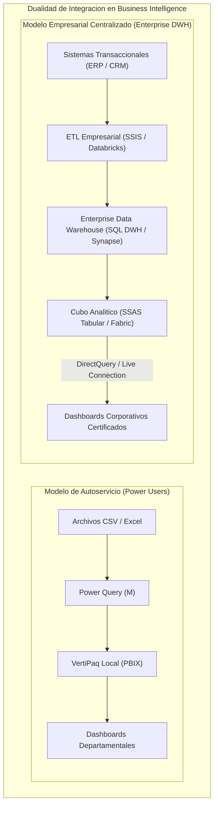

- **Autoservicio (Self-Service BI):** Dirigido a analistas funcionales y usuarios avanzados que integran extractos locales, archivos de texto y consultas departamentales. El modelado, transformacion y logica DAX residen localmente en el archivo ` .pbix `.

- **Inteligencia de Negocios Corporativa (Enterprise BI):** La capa de visualizacion se conecta de manera directa (DirectQuery o Live Connection) al Data Warehouse o al servicio de modelos semanticos (SSAS Tabular / Power BI Datasets). La logica de transformacion pesada ha sido ejecutada previamente en motores de integracion dedicados (SQL Server Integration Services - SSIS, ADF o pipelines de PySpark), preservando una unica version de la verdad gobernada corporativamente.

---

### 2.3. Taxonomia de Protocolos y Arquitectura de la Web Moderna

Cuando los datos requeridos no se encuentran persistidos en un repositorio relacional institucional, la adquisicion se desplaza hacia la red de datos publica. Es crucial comprender los mecanismos de exposicion e intercambio de datos:

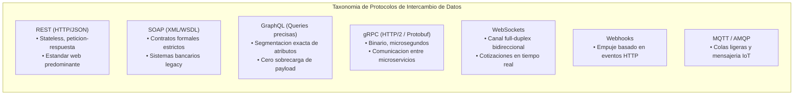

#### Anatomia del Protocolo HTTP/HTTPS:

Toda comunicacion web convencional sigue un patron transaccional de peticion (Request) y respuesta (Response) regido por verbos semanticos y codigos de estado normalizados:

- **Verbos Primarios:** ` GET ` (recuperacion idempotente de recursos sin alteracion del servidor), ` POST ` (envio de datos para creacion o procesamiento), ` PUT `/` PATCH ` (modificacion de estado), ` DELETE ` (supresion de entidades).

- **Codigos de Estado Relevantes en Ingestion:**

  - ` 200 OK `: Transaccion exitosa con retorno de payload.
  
  - ` 400 Bad Request `: Formato de peticion o parametros invalidos.
  
  - ` 401 Unauthorized ` / ` 403 Forbidden `: Credenciales ausentes o politicas de exclusion (bloqueo por User-Agent o firewall de aplicaciones web).
  
  - ` 404 Not Found `: Recurso o ruta inexistente en el servidor de destino.
  
  - ` 409 Conflict `: Estado transaccional incompatible con la solicitud actual.
  
  - ` 500 Internal Server Error `: Fallo interno no capturado en el servidor anfitrion.

#### El Document Object Model (DOM) y el Front-End Moderno:

Independientemente de la tecnologia utilizada en el servidor (Node.js, Python, Java, Go) o de los frameworks reactivos ejecutados en el cliente (Angular, React, Vue, Svelte), el navegador web interpreta y estructura los datos mediante el arbol jerarquico del **Document Object Model (DOM)**.

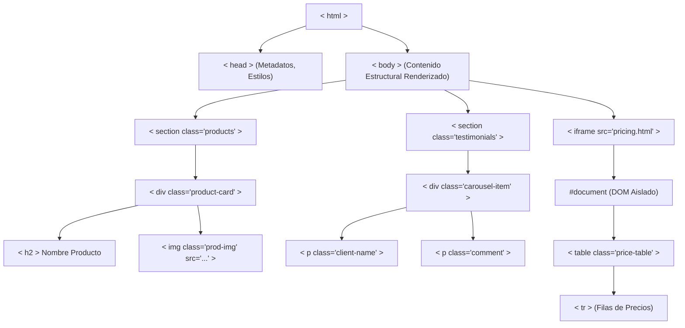

El web scraping consiste en conectarse mediante HTTP, descargar el flujo de hipertexto y aplicar un **parser especializado** que transforme el texto plano en un arbol DOM navegable, posibilitando la indexacion precisa de nodos por etiquetas, clases CSS o jerarquias semanticas.

---

## 3\. Implementacion Tecnica y Logica de Negocio

### 3.1. Caso Bike Stores (Rowlett, Texas - Gestion 2017) en Power BI

#### Contexto del Negocio y Analisis Causal

Bike Stores opera tres sucursales distribuidas en distintas regiones de Estados Unidos:

1. **Baldwin Bikes (Nueva York):** Tienda central con facturacion continua, volumen alto y varianza moderada entre meses.

1. **Santa Cruz Bikes (California):** Sucursal con rendimiento consistente y participacion historica en segundo orden.

1. **Rowlett Bikes (Texas):** Sucursal de volumen menor, caracterizada por ventas estables pero reducidas, hasta el registro de un fenomeno excepcional durante la temporada estival de 2017.

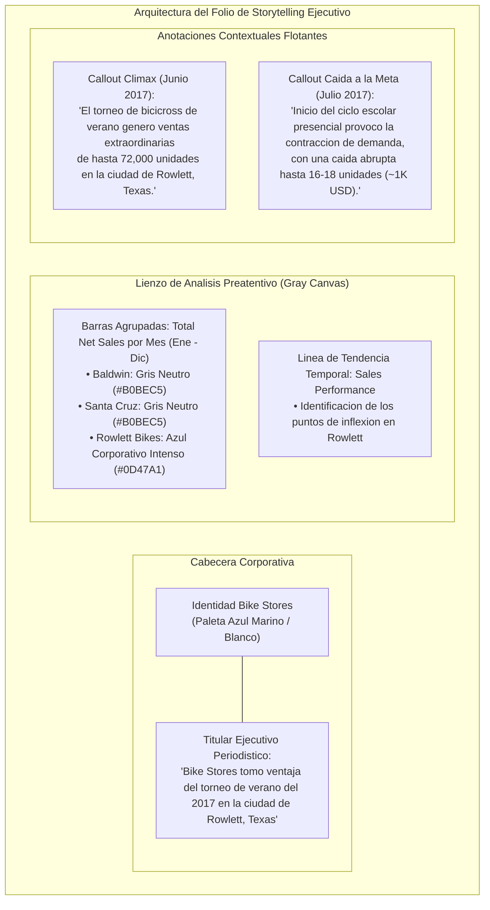

#### Protocolo de Configuracion en Power BI Desktop:

1. **Seleccion de Visuales Conectados:**

   - Panel superior/izquierdo: Gráfico de columnas agrupadas con eje X dimensional ` Calendario[Mes] `, eje Y con la medida ` [Total Net Sales] ` y leyenda ` Store[Store Name] `.
   
   - Panel de soporte: Gráfico de líneas temporales de 12 meses para evaluar la estabilidad de las otras dos tiendas.

1. **Aplicacion de la Tecnica del Lienzo en Plomo:**

   - Acceder al panel de formato de la visualizacion: ` Visual > Columnas (Colors) `.
   
   - Seleccionar la serie ` Baldwin Bikes ` y modificar el color corporativo por un gris neutro claro (\#CFD8DC o \#B0BEC5).
   
   - Seleccionar la serie ` Santa Cruz Bikes ` y asignar el mismo tono gris neutro atenuado.
   
   - Preservar ` Rowlett Bikes ` con el azul primario de la marca corporativa (\#0D47A1 o \#1565C0).

1. **Insercion de Elementos Contextuales y Semanticos:**

   - Insertar cuadros de texto con bordes suaves y fondo translucido alineados exactamente sobre los nodos de junio y julio de 2017.
   
   - Insertar elementos de branding institucional (logotipo corporativo de Bike Stores) e imagenes representativas de los eventos de negocio (fotografia de competidores de BMX en el hito de junio y de estudiantes escolares en el hito de julio).

1. **Redaccion del Titular de Alto Impacto:**

   - Titulo directivo: ` "Bike Stores tomo ventaja del torneo de verano del 2017 en la ciudad de Rowlett, Texas" `.
   
   - Subtitulo tecnico: ` "Evolucion de unidades y ventas netas mensuales comparativas entre sucursales de NY, CA y TX" `.

---

### 3.2. Demos Practicas de Web Scraping y Adquisicion Indirecta con Python

A continuacion se presentan las seis implementaciones tecnicas modulares desarrolladas en la clase, ejecutables mediante las librerias especializadas ` requests ` (para la capa de transporte HTTP) y ` beautifulsoup4 ` (para el parseo y navegacion del DOM).

#### Demo 1: Peticion HTTP y Lectura de Headers y Contenido Crudo

Este modulo valida la conectividad con el servidor web remoto, verifica el codigo de retorno HTTP, examina los metadatos de respuesta en las cabeceras (headers) y extrae el texto HTML sin procesar.

```python
"""
Modulo 01: Peticion HTTP, inspeccion de cabeceras de respuesta y extraccion de HTML crudo.
Librerias: requests
"""
import requests

def ejecutar_peticion_http(url: str) -> None:
    # Definicion de cabeceras para emular un navegador convencional
    headers = {
        "User-Agent": "Mozilla/5.0 (Windows NT 10.0; Win64; x64) AppleWebKit/537.36"
    }
    
    print(f"Iniciando peticion HTTP GET hacia: {url}")
    try:
        response = requests.get(url, headers=headers, timeout=10)
        
        # Validacion del codigo de estado HTTP
        print(f"Codigo de Estado HTTP: {response.status_code}")
        
        if response.status_code == 200:
            print("Cabeceras de Respuesta del Servidor:")
            for header, value in response.headers.items():
                print(f"  {header}: {value}")
                
            # Inspeccion de los primeros 300 caracteres del HTML crudo
            print("\nFragmento de HTML Crudo Recibido:")
            print(response.text[:300])
        else:
            print(f"Respuesta no satisfactoria. Estado: {response.status_code}")
            
    except requests.exceptions.RequestException as e:
        print(f"Fallo en la conexion HTTP: {str(e)}")

if __name__ == "__main__":
    target_url = "https://es.wikipedia.org"
    ejecutar_peticion_http(target_url)
```

---

#### Demo 2: Consulta a API Meteorologica y Procesamiento de Payload JSON

Cuando el servicio remoto expone una interfaz de programacion estructurada (API REST), no se requiere analizar codigo HTML. Este modulo consume un endpoint estructurado pasando parametros de ubicacion y fecha, procesando el objeto JSON resultante.

```python
"""
Modulo 02: Consulta a API REST externa y procesamiento estructurado de payload JSON.
Librerias: requests, json
"""
import requests
import json

def consultar_api_clima(lat: float, lon: float, fecha: str) -> None:
    endpoint_url = "https://archive-api.open-meteo.com/v1/archive"
    parametros = {
        "latitude": lat,
        "longitude": lon,
        "start_date": fecha,
        "end_date": fecha,
        "daily": "temperature_2m_max,temperature_2m_min,precipitation_sum",
        "timezone": "America/La_Paz"
    }
    
    print(f"Consultando API para coordenadas ({lat}, {lon}) en fecha {fecha}...")
    try:
        response = requests.get(endpoint_url, params=parametros, timeout=10)
        
        if response.status_code == 200:
            datos_json = response.json()
            print("Estructura JSON recuperada con exito:")
            print(json.dumps(datos_json, indent=2))
        else:
            print(f"Error en consulta de API: Estado {response.status_code}")
            
    except requests.exceptions.RequestException as e:
        print(f"Excepcion en peticion a API: {str(e)}")

if __name__ == "__main__":
    # Parametros de Santa Cruz de la Sierra, Bolivia
    consultar_api_clima(lat=-17.7833, lon=-63.1821, fecha="2024-09-15")
```

---

#### Demo 3: Parsing de DOM con BeautifulSoup y Extraccion de Nodos H2

Demostracion de parseo de hipertexto utilizando la libreria ` BeautifulSoup `. Se navega el arbol del DOM para localizar todas las etiquetas de encabezado ` <h2> `, limpiando los elementos de presentacion para extraer exclusivamente el contenido textual.

```python
"""
Modulo 03: Parseo del DOM con BeautifulSoup y filtrado por etiquetas H2.
Librerias: requests, bs4 (BeautifulSoup)
"""
import requests
from bs4 import BeautifulSoup

def extraer_titulos_h2(url: str) -> None:
    headers = {"User-Agent": "Mozilla/5.0"}
    
    try:
        response = requests.get(url, headers=headers, timeout=10)
        if response.status_code == 200:
            # Inicializacion del parser de HTML
            soup = BeautifulSoup(response.text, "html.parser")
            
            # Busqueda del primer nodo H2
            primer_h2 = soup.find("h2")
            if primer_h2:
                print(f"Primer nodo H2 completo: {primer_h2}")
                print(f"Texto del primer H2: {primer_h2.get_text(strip=True)}\n")
            
            # Busqueda recursiva de todos los encabezados H2 en la pagina
            todos_h2 = soup.find_all("h2")
            print(f"Se identificaron {len(todos_h2)} encabezados H2 en el documento:")
            for idx, tag in enumerate(todos_h2, 1):
                print(f"  [{idx}] {tag.get_text(strip=True)}")
        else:
            print(f"Error al descargar la pagina: {response.status_code}")
            
    except Exception as e:
        print(f"Error durante el parseo del DOM: {str(e)}")

if __name__ == "__main__":
    url_prueba = "http://localhost:8000/tienda_demo.html"
    extraer_titulos_h2(url_prueba)
```

---

#### Demo 4: Extraccion y Descarga Automatizada de Recursos Multimedia (Imagenes)

El web scraping permite capturar atributos de etiquetas HTML para reconstruir URLs de recursos y descargarlos a disco, alimentando catalogos visuales para enriquecer dimensiones de producto en Power BI.

```python
"""
Modulo 04: Extraccion de atributos 'src' en etiquetas 'img' y persistencia local de imagenes.
Librerias: requests, bs4, os, urllib.parse
"""
import requests
from bs4 import BeautifulSoup
import os
from urllib.parse import urljoin

def descargar_imagenes_catalogo(url_origen: str, carpeta_destino: str) -> None:
    os.makedirs(carpeta_destino, exist_ok=True)
    headers = {"User-Agent": "Mozilla/5.0"}
    
    try:
        res = requests.get(url_origen, headers=headers, timeout=10)
        if res.status_code == 200:
            soup = BeautifulSoup(res.text, "html.parser")
            
            # Localizar contenedores div con clase especifica de tarjeta de producto
            contenedores = soup.find_all("div", class_="product-card")
            print(f"Tarjetas de producto identificadas: {len(contenedores)}")
            
            for idx, card in enumerate(contenedores, 1):
                img_tag = card.find("img")
                if img_tag and img_tag.get("src"):
                    ruta_relativa = img_tag["src"]
                    ruta_absoluta = urljoin(url_origen, ruta_relativa)
                    nombre_archivo = os.path.basename(ruta_relativa)
                    ruta_local = os.path.join(carpeta_destino, f"prod_{idx}_{nombre_archivo}")
                    
                    # Descarga del archivo binario
                    img_data = requests.get(ruta_absoluta, headers=headers).content
                    with open(ruta_local, "wb") as f_img:
                        f_img.write(img_data)
                    print(f"Recurso guardado: {ruta_local}")
                    
    except Exception as e:
        print(f"Error al procesar imagenes: {str(e)}")

if __name__ == "__main__":
    descargar_imagenes_catalogo("http://localhost:8000/catalogo.html", "./media_productos")
```

---

#### Demo 5: Navegacion e Ingestion de Marcos Embebidos (IFrames)

Las paginas web empresariales suelen incrustar tablas de precios o modulos de transacciones externas dentro de etiquetas ` <iframe> `. Dado que el contenido de un iframe constituye un documento HTML independiente, el parser debe identificar el atributo ` src `, realizar una peticion secundaria y parsear la tabla hija.

```python
"""
Modulo 05: Resolucion de documentos anidados en iframes y parseo de tablas HTML.
Librerias: requests, bs4, urllib.parse
"""
import requests
from bs4 import BeautifulSoup
from urllib.parse import urljoin

def extraer_tabla_desde_iframe(url_padre: str) -> None:
    headers = {"User-Agent": "Mozilla/5.0"}
    
    try:
        res_padre = requests.get(url_padre, headers=headers, timeout=10)
        soup_padre = BeautifulSoup(res_padre.text, "html.parser")
        
        # Localizacion del tag iframe
        iframe_tag = soup_padre.find("iframe")
        if not iframe_tag or not iframe_tag.get("src"):
            print("No se localizo ninguna etiqueta iframe con atributo 'src'.")
            return
            
        url_iframe = urljoin(url_padre, iframe_tag["src"])
        print(f"Documento embebido localizado en: {url_iframe}")
        
        # Peticion secundaria al documento hijo
        res_hijo = requests.get(url_iframe, headers=headers, timeout=10)
        soup_hijo = BeautifulSoup(res_hijo.text, "html.parser")
        
        tabla = soup_hijo.find("table")
        if tabla:
            filas = tabla.find_all("tr")
            print(f"Extrayendo matriz de {len(filas)} filas:")
            for fila in filas:
                celdas = [c.get_text(strip=True) for c in fila.find_all(["th", "td"])]
                print(f"  | {' | '.join(celdas)} |")
                
    except Exception as e:
        print(f"Error en extraccion de iframe: {str(e)}")

if __name__ == "__main__":
    extraer_tabla_desde_iframe("http://localhost:8000/pagina_con_iframe.html")
```

---

#### Demo 6: Extraccion de Testimonios y Persistencia Estructurada a CSV para ETL

Este script captura listas de testimonios y resenas de clientes en un carrusel web (Single Page Application), estructura los registros con metadatos de autor, calificacion y texto, y persiste el resultado en un archivo CSV formateado segun los estandares de ingestion de Power Query y Data Warehouses.

```python
"""
Modulo 06: Extraccion de testimonios de clientes y persistencia directa a archivo CSV.
Librerias: requests, bs4, csv
"""
import requests
from bs4 import BeautifulSoup
import csv

def recolectar_testimonios_a_csv(url: str, archivo_salida: str) -> None:
    headers = {"User-Agent": "Mozilla/5.0"}
    registros_limpios = []
    
    try:
        response = requests.get(url, headers=headers, timeout=10)
        if response.status_code == 200:
            soup = BeautifulSoup(response.text, "html.parser")
            
            # Localizar todos los bloques de testimonios en el carrusel
            items_carrusel = soup.find_all("div", class_="carousel-item")
            print(f"Elementos de testimonio identificados: {len(items_carrusel)}")
            
            for item in items_carrusel:
                nodo_nombre = item.find("p", class_="client-name")
                nodo_comentario = item.find("p", class_="testimonial-text")
                nodo_rating = item.find("span", class_="rating-score")
                
                nombre = nodo_nombre.get_text(strip=True) if nodo_nombre else "Anonimo"
                comentario = nodo_comentario.get_text(strip=True) if nodo_comentario else ""
                rating = nodo_rating.get_text(strip=True) if nodo_rating else "N/A"
                
                # Depuracion y saneamiento de caracteres de control
                comentario_limpio = comentario.replace("\n", " ").replace("\r", " ")
                
                registros_limpios.append({
                    "Cliente": nombre,
                    "Puntuacion": rating,
                    "Comentario": comentario_limpio
                })
                
            # Escritura a archivo CSV gobernado
            with open(archivo_salida, mode="w", newline="", encoding="utf-8") as csv_file:
                fieldnames = ["Cliente", "Puntuacion", "Comentario"]
                writer = csv.DictWriter(csv_file, fieldnames=fieldnames, delimiter=";")
                
                writer.writeheader()
                for reg in registros_limpios:
                    writer.writerow(reg)
                    
            print(f"Persistencia completada: {len(registros_limpios)} registros exportados a '{archivo_salida}'.")
            
    except Exception as e:
        print(f"Error durante la recoleccion y persistencia: {str(e)}")

if __name__ == "__main__":
    recolectar_testimonios_a_csv("http://localhost:8000/ecommerce.html", "testimonios_clientes.csv")
```

---

## 4\. Analisis Critico de Casos y Auditoria Practica

### 4.1. Auditoria del Caso Bike Stores: Climax y Caida Causal

El analisis de la serie temporal anual de Bike Stores en la gestion 2017 exhibe un comportamiento dispar entre las tres unidades de negocio:

| Sucursal | Ubicacion | Comportamiento Anual | Hito Junio 2017 | Hito Julio 2017 | Hipotesis Causal de Negocio |
| --- | --- | --- | --- | --- | --- |
| **Baldwin Bikes** | Nueva York (NY) | Facturacion alta y estable (media de 180K - 220K USD/mes). | Operacion regular dentro del rango historico proyectado. | Ligero ajuste estacional sin quiebre de tendencia. | Mercado maduro consolidado en zona urbana con demanda diversificada. |
| **Santa Cruz Bikes** | California (CA) | Segunda sucursal en volumen (media de 80K - 110K USD/mes). | Superada excepcionalmente por Rowlett Bikes. | Contraccion moderada en linea con el verano de la costa oeste. | Base de clientes aficionada al ciclismo recreativo de montana. |
| **Rowlett Bikes** | Texas (TX) | Sucursal de baja rotacion habitual (media de 15K - 30K USD/mes). | **Pico extraordinario de 72,000 unidades vendidas.** | **Colapso abrupto a 16-18 unidades (\~1K USD).** | **Climax generado por el Torneo de Verano de Bicicross (BMX). Caida provocada por el inicio del ciclo escolar presencial en Rowlett.** |

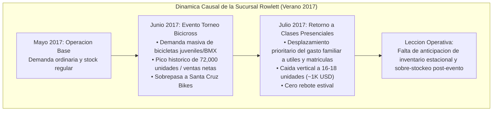

---

### 4.2. Evaluacion Estrategica de Plataformas de Business Intelligence en el Cuadrante de Gartner

El mercado de plataformas analiticas y de BI se evalua anualmente mediante el Cuadrante Magico de Gartner, estructurado sobre dos dimensiones: **Vision Integral (Completeness of Vision)** y **Capacidad de Ejecucion (Ability to Execute)**.

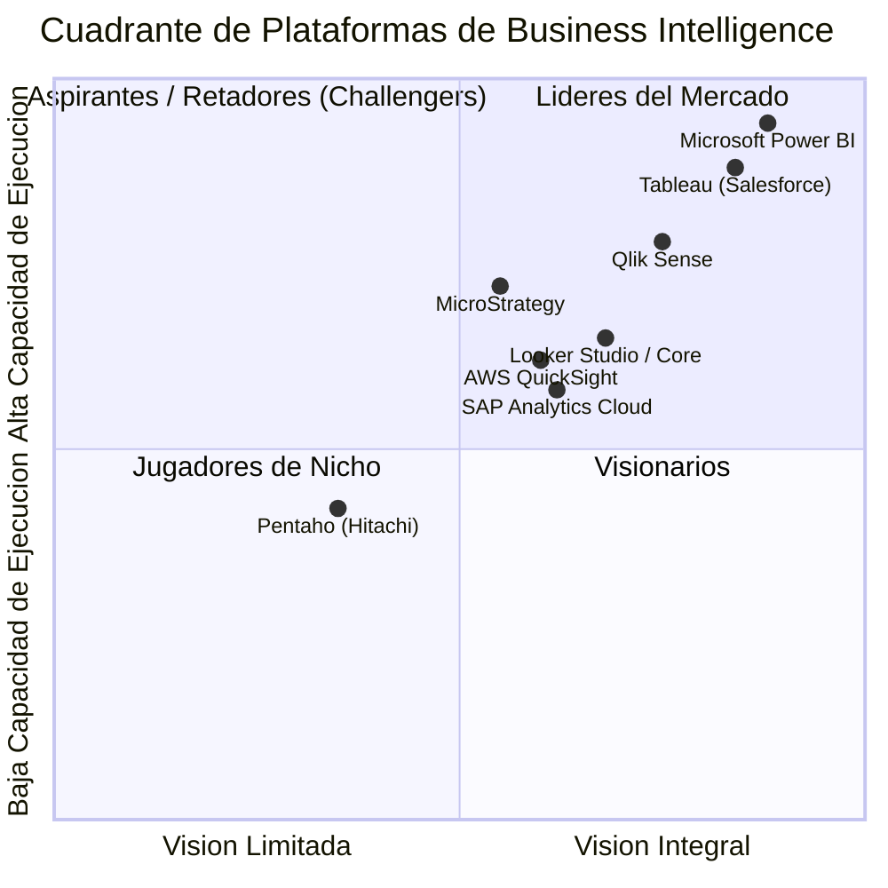

#### Tabla Comparativa Exhaustiva de Plataformas Analiticas:

| Plataforma | Desarrollador | Motor Analitico / Arquitectura | Fortalezas Principales | Limitaciones y Costos | Gobernanza y Seguridad | Posicionamiento de Mercado |
| --- | --- | --- | --- | --- | --- | --- |
| **Microsoft Power BI** | Microsoft | VertiPaq Columnar In-Memory + DirectQuery + DAX. | Dominancia de mercado, integracion nativa con Office 365 y Fabric, interfaz intuitiva heredada de Excel. | Desktop gratuito limitado a 1 GB; requiere licenciamiento Pro por usuario o Premium/Dedicated en Azure para compartir. | Robusta: RLS (Row-Level Security) nativa, Workspaces certificados, Purview. | **Lider indiscutido** en ejecucion y costo-beneficio empresarial. |
| **Tableau** | Salesforce | Hyper Data Engine en memoria + VizQL (lenguaje visual). | Estetica visual de vanguardia, exploracion ad-hoc de variables complejas, comunidad global masiva. | Curva de aprendizaje y costo de licenciamiento por creador elevado; transformacion pesada requiere Tableau Prep. | Muy alta a nivel de servidor corporativo (Tableau Server / Cloud). | **Lider historico** enfocado en diseno avanzado y analitica exploratoria. |
| **Qlik Sense** | Qlik | QIX Associative Engine (indexacion asociativa en memoria). | Capacidad unica para descubrir datos "no asociados" o huerfanos; alto rendimiento analitico. | Sintaxis de calculo propietaria compleja; menor adopcion comercial frente a Microsoft. | Completa en Qlik Cloud y despliegues hibridos on-premise. | **Lider / Visionario** con fuerte traccion en arquitecturas de datos asociativas. |
| **Looker / Looker Studio** | Google Cloud | Motor SQL centralizado basado en modelo semantico LookML (Cloud). | Cero footprint de motor local; consultas push-down directamente en BigQuery/Snowflake. Version Studio es gratuita. | Looker Core exige codigo LookML experto; Looker Studio gratuito es limitado para modelos complejos. | Centralizada mediante politicas de IAM en Google Cloud Platform. | **Visionario / Retador** para ecosistemas modernos basados en Cloud Data Warehouses. |
| **AWS QuickSight** | Amazon Web Services | SPICE (Super-fast, Parallel, In-memory Calculation Engine). | Escalabilidad elastica sin gestion de servidores; pago por sesion activa; integracion con Redshift y S3. | Capacidades de diseno y formateo visual rigido; dependiente de infraestructura AWS. | Integracion nativa con AWS IAM y cifrado de llaves KMS. | **Retador** en organizaciones nativas de nube de AWS. |
| **MicroStrategy** | MicroStrategy | Motor relacional ROLAP empresarial con capa semantica unificada. | Extraordinaria capacidad de gobernanza en datos a escala de petabytes; reportes altamente reglamentados. | Curva de adopcion muy empinada; costo prohibitivo para pequenas y medianas empresas. | **Referente historico de maxima seguridad y gobernanza** en banca y salud. | **Aspirante / Jugador de Nicho** de alto perfil institucional. |
| **SAP Analytics Cloud** | SAP | Motor HANA In-Memory nativo en la nube. | Integracion transaccional y analitica directa con ERP SAP S/4HANA y BW; capacidades financieras predictivas. | Complejidad operacional; valor limitado si la empresa no opera sobre el stack ERP de SAP. | Integracion profunda con esquemas de autorizacion de SAP NetWeaver. | **Jugador de Nicho / Visionario** para organizaciones con infraestructura SAP. |
| **Pentaho Data Integration** | Hitachi Vantara | Java Engine + Mondrian OLAP + PDI (Kettle). | Codigo abierto (Community Edition); capacidades ETL lideres en su clase; altamente extensible en Java. | Capa de visualizacion tradicional (Pentaho Reports) anticuada frente a herramientas modernas. | Dependiente de configuracion en servidor de aplicaciones y base de datos. | **Herramienta de integracion y procesamiento** mas que de visualizacion directiva. |

---

### 4.3. Arquitectura de Modelado: Resolucion de Referencias Circulares y Modelos Multi-Fact

En la practica analitica avanzada, es frecuente encontrarse con modelos que abarcan mas de un proceso transaccional de negocio (ej. Ventas y Compras, o Presupuesto y Ejecucion), introduciendo multiples tablas de hechos (**Multi-Fact Tables**).

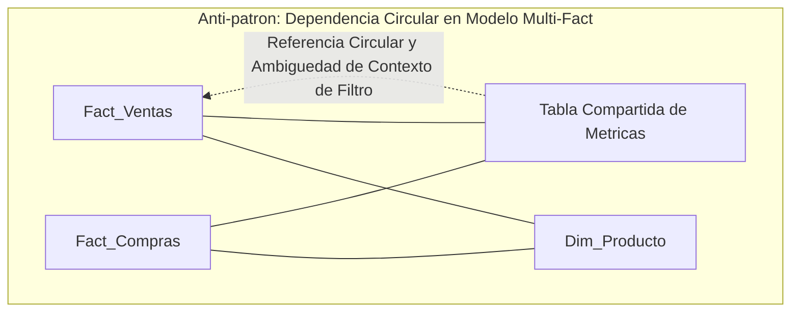

#### Patologia Analitica:

Al ubicar calculos y medidas DAX en una tabla no conectada que hace referencia simultanea a dos tablas de hechos que comparten dimensiones, el motor VertiPaq puede entrar en una relacion de ambiguedad de propagacion de filtros. Como consecuencia, las visualizaciones muestran valores estaticos repetidos (el total general) o celdas en blanco, ignorando los segmentadores de la interfaz.

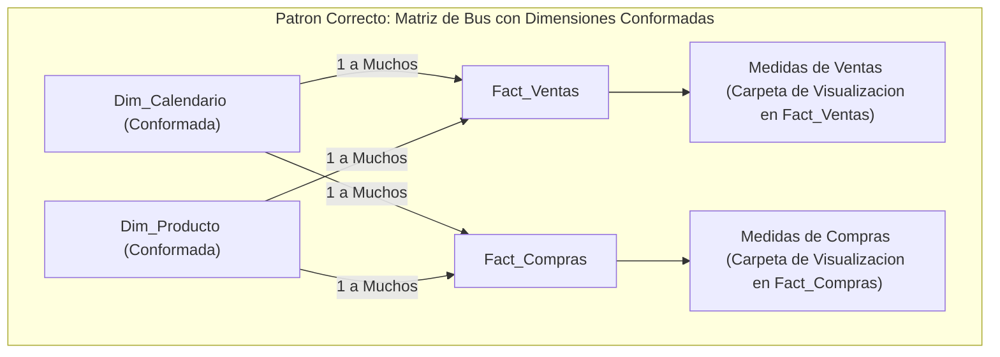

#### Directrices de Resolucion:

1. **Dimensiones Conformadas:** Garantizar que las tablas de dimension (Calendario, Producto, Sucursal) posean claves unicas estrictas y se conecten con relaciones de direccion unica (1 a Muchos) hacia cada tabla de hechos por separado.

1. **Desacoplamiento de Metricas:** Organizar las medidas DAX dentro de carpetas de visualizacion (` Display Folders `) anidadas en la respectiva tabla de hechos de origen o en una tabla de medidas aislada sin relaciones fisicas con el modelo.

1. **Manejo Explicito de Contexto:** Utilizar funciones como ` USERELATIONSHIP() `, ` TREATAS() ` o ` CROSSFILTER() ` para gobernar las relaciones inactivas sin inducir bidireccionalidad involuntaria en el grafo del esquema.

---

## 5\. Principios de Diseno, Buenas Practicas y Anti-patrones

### 5.1. Catalogo de Buenas Practicas vs. Anti-patrones en Visualizacion y Storytelling

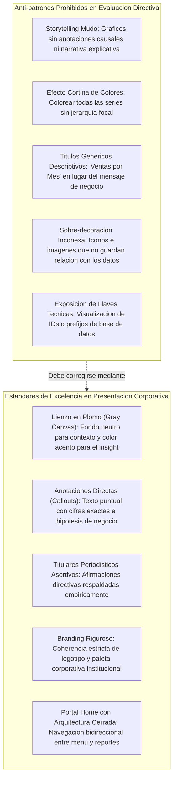

### 5.2. Gobernanza y Resiliencia en Ingestion via Web Scraping

La adquisicion automatizada de hipertexto introduce desafios singulares de gobernanza que no se presentan en pipelines convencionales de bases de datos relacionales:

1. **Politica de Peticiones Eticas (Rate Limiting y Backoff):**

   - No saturar los servidores de destino. Implementar retardos estocasticos (` time.sleep(uniform(1, 3)) `) entre llamadas y respetar directivas en archivos ` robots.txt `.

1. **Resiliencia ante Cambios en el Frontend (Schema Drift del DOM):**

   - Las interfaces web sufren redisenos frecuentes. Evitar selectores CSS fragiles o rutas XPath absolutas dependientes de indices numericos rigidos (ej. ` /html/body/div[2]/div[1]/table/tbody/tr[3] `).
   
   - Priorizar selectores basados en atributos de accesibilidad, IDs semanticos o clases estables de negocio (ej. ` soup.find_all("div", class_="product-card") `).

1. **Mecanismo de Carga Incremental (Delta Scraping):**

   - En procesos recurrentes, es computacionalmente ineficiente e invasivo descargar el catalogo completo en cada ciclo. Al igual que en procesos de CDC (Change Data Capture) de Data Warehouses, se debe persistir una firma o hash de estado para capturar exclusivamente los registros nuevos o modificados.

---

## 6\. Sintesis Conceptual y Profundizacion Academica

### 6.1. Matriz de Integracion: Del Dato Abierto a la Decision Ejecutiva

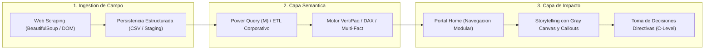

### 6.2. Conclusiones Epistemologicas y Metodologicas

1. **La Primacia de la Intencion Comunicativa:** Ninguna sofisticacion en DAX o en normalizacion dimensional compensa una visualizacion ambigua. La tecnica del Lienzo en Plomo (Gray Canvas) demostro que el silencio visual (atenuacion de lo accesorio) es el mecanismo mas eficaz para potenciar la atencion directiva sobre anomalias y records operacionales.

1. **La Dualidad Complementaria del Ecosistema BI:** Power BI logro democratizar la inteligencia de negocios al integrar los complementos nativos de Excel (Power Query, Power Pivot y VertiPaq) en un entorno visual unificado. No obstante, para organizaciones de gran escala, su valor maximo se alcanza cuando se acopla como capa semantica a un Data Warehouse corporativo gobernado, evitando la proliferacion descontrolada de modelos locales huerfanos.

1. **El Web Scraping como Disciplina de Ingestion Cientifica:** La recoleccion indirecta de datos publicos representa una competencia indispensable para complementar modelos internos con contexto de mercado. Sin embargo, su exito a largo plazo depende de la comprension profunda del Document Object Model (DOM), de la resiliencia arquitectonica ante cambios en el frontend y del diseno de estrategias de carga incremental que garanticen la sostenibilidad de los pipelines de datos.

---

### 6.3. Preguntas de Reflexion y Profundizacion para el Dominio de Posgrado

1. **Rendimiento y Escalabilidad:** Si el motor columnar en memoria (VertiPaq) comprime los datos de manera altamente eficiente, ¿bajo que umbrales volumetricos y de gobernanza se vuelve imperativo abandonar el modo ` Import ` para transicionar hacia arquitecturas ` DirectQuery ` o modelos compuestos hibridos?

1. **Gobernanza y Conectividad Externa:** Al alimentar un modelo de Power BI con fuentes no convencionales derivadas de Web Scraping, ¿que mecanismos de trazabilidad, linaje de datos (Data Lineage) y calidad de datos deben instaurarse para certificar los reportes ante auditorias de directorio?

1. **Ergonomia Cognitiva:** ¿Cuales son los limites cuantitativos y cualitativos recomendados para la inclusion de anotaciones contextuales (Callouts) en un solo folio visual antes de inducir una nueva fatiga analitica en tomadores de decisiones?

---

---

---
