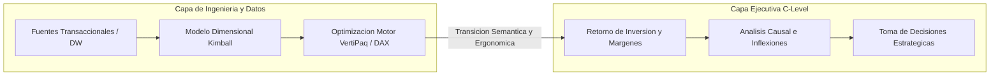
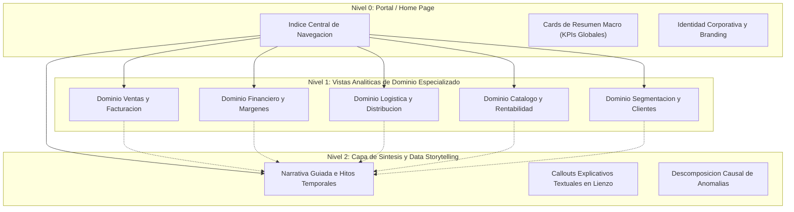
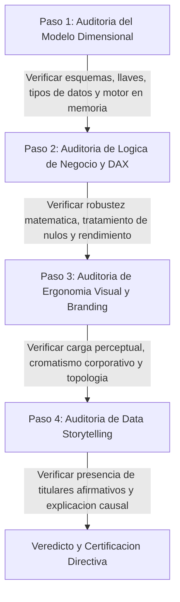
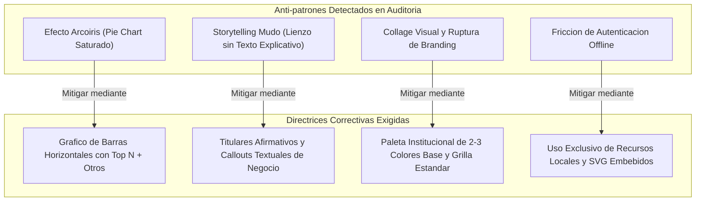
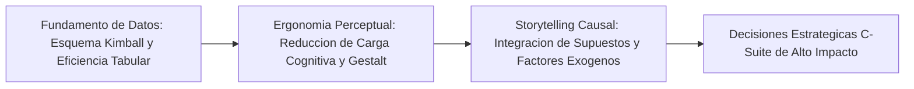

# Clase 8: Auditoria y Defensa de Modelos Dimensionales, Arquitectura de Tableros Ejecutivos y Storytelling Aplicado en la Industria

> **Objetivo de la Sesion:**<br>
> 
> 
> Consolidar y auditar la transicion critica desde la capa de ingenieria dimensional y calculo analitico (DAX/VertiPaq) hacia suites de inteligencia de negocios directivas (C-Level). La sesion evalua de forma exhaustiva la arquitectura funcional de navegacion, la definicion rigurosa de metricas financieras y operativas, las tecnicas de Data Storytelling causal y explicativo con evidencia documental en el lienzo, y la aplicacion sistematica de principios de ergonomia visual y mitigacion de anti-patrones en entornos corporativos reales.

## 1\. Contexto y Marco Conceptual

El despliegue de soluciones analiticas en el ambito empresarial contemporaneo enfrenta una brecha persistente entre la sofisticacion tecnica del backend de datos y su asimilacion efectiva en los estratos de toma de decisiones estrategicas. Durante las etapas preliminares del ciclo de vida analitico, la ingenieria de datos concentra sus esfuerzos en la optimizacion de esquemas relacionales, particionamiento de hechos, desnormalizacion dimensional segun la metodologia Kimball, compresion en motores tabulares en memoria y diseno de medidas escalares complejas. No obstante, al alcanzar el hito de presentacion y defensa ejecutiva frente a perfiles directivos (Directores Generales, Directores de Finanzas, Directores de Operaciones), dicho andamiaje tecnico debe replegarse hacia un segundo plano invisible para dar paso a la articulacion del impacto economico, rentabilidad, margenes operacionales y trayectorias de crecimiento.



La comunicacion analitica de alto nivel exige una distincion epistemologica y practica fundamental entre dos paradigmas de entrega visual:

1. **Reporte Operacional Descriptivo:** Responde a la interrogante *"¿Que sucedio?"*. Se caracteriza por la agregacion parametrica de volumenes transaccionales, visualizacion de distribuciones estaticas, matrices multidimensionales y tablas de control. Su objetivo es la monitorizacion rutinaria, pero carece intrinsecamente de una narrativa contextualizada; traslada la carga cognitiva de interpretar anomalias, inferir correlaciones y descifrar causas directamente al observador.

1. **Tablero de Data Storytelling (Narrativa Explicativa y Accionable):** Responde a las interrogantes *"¿Por que sucedio?"*, *"¿Cual es el impacto en el negocio?"* y *"¿Que accion correctiva o preventiva se debe ejecutar?"*. No se limita a exhibir fluctuaciones de lineas temporales; incorpora anotaciones explicitas, callouts contextuales y contrastes con variables exogenas (politicas de confinamiento, dinamicas macroeconomicas, campanas de mercado, estacionalidad climatica o fenomenos socioculturales). En este paradigma, el dato visualizado funge como evidencia probatoria de una hipotesis de negocio validada.

El exito de un sistema de Business Intelligence radica en dotar a la suite analitica de una estructura ergonomica autosuficiente, donde el usuario directivo identifique de inmediato las conclusiones centrales sin requerir una mediacion verbal obligatoria por parte del analista.

---

## 2\. Fundamentos Teoricos y Arquitectura

### 2.1 Arquitectura Funcional de una Suite Analitica Empresarial

Una suite analitica directiva no debe concebirse como un repositorio disperso de graficos inconexos, sino como un sistema de navegacion jerarquico y modular disenado bajo principios de progressive disclosure (revelacion progresiva de informacion). La arquitectura estandar adoptada a nivel corporativo se organiza en tres estratos claramente delimitados:



- **Portal Home (Nivel 0):** Constituye el nodo raiz de la suite. Integra elementos de accion interactiva (action buttons) vinculados a marcadores (bookmarks) internos o navegacion por paginas. Sintetiza los indicadores macro del desempeno institucional y establece la linea de branding cromatica e iconografica.

- **Vistas de Dominio de Negocio (Nivel 1):** Segmentan la complejidad del Data Warehouse en silos funcionales interrelacionados:

  - *Vistas Financieras y de Ventas:* Analizan el flujo de caja, margen de contribucion, EBITDA, descuentos y desviaciones presupuestarias.
  
  - *Vistas de Logistica y Cadena de Suministro:* Evaluan tiempos de despacho, plazos de entrega, costos de flete por zona geografica y rotura de stock.
  
  - *Vistas de Catalogo y Rendimiento de Producto:* Concentran el analisis de rotacion, rentabilidad por SKU, matriz BCG y ciclo de vida de productos.
  
  - *Vistas de Comportamiento de Clientes:* Exploran metricas de retencion, frecuencia de compra, ticket promedio, recencia y cohortes de valor.

- **Pestaña de Data Storytelling (Nivel 2):** Punto culminante del proyecto analitico. A diferencia de las vistas exploratorias que permiten manipulacion multidimensional arbitraria, esta vista conduce al interlocutor a traves de una secuencia argumentativa estructurada: estado basal, evento disruptivo o inflexion critica, impacto cuantitativo en indicadores clave y prescripcion estrategica.

### 2.2 Metodologia de Auditoria Integral de Dashboards

La evaluacion rigurosa de una solucion visual se ejecuta mediante un ciclo de auditoria de cuatro etapas sucesivas:



---

## 3\. Implementacion Tecnica y Logica de Negocio

El diseno de medidas escalares en DAX (Data Analysis Expressions) para consumo directivo debe garantizar estabilidad ante contextos de filtro cruzado, prevencion matematica de errores por division entre cero y optimizacion de tiempo de escaneo en el motor VertiPaq.

### 3.1 Catalogo de Indicadores Clave de Desempeno (KPIs)

1. **Ventas Netas Totales (**` Total Net Sales `**):** Representa el ingreso real percibido tras descontar deducciones, politicas de descuento comercial y devoluciones operativas:

   $\text{Total Net Sales} = \sum (\text{Cantidad} \times \text{Precio Unitario}) - \text{Descuentos} - \text{Devoluciones}$

1. **Ratio de Rentabilidad Operativa (**` Profit Ratio `**):** Mide la eficiencia en la captura de valor respecto a los ingresos brutos facturados:

   $\text{Profit Ratio} = \frac{\text{Margen de Utilidad Neta}}{\text{Ventas Netas Totales}}$

1. **Tamano Medio de Cesta (**` Average Basket Size `**):** Indicador de profundidad transaccional, computado como el cociente entre unidades fisicas vendidas y el numero cardinal de ordenes unicas:

   $\text{Average Basket Size} = \frac{\sum \text{Cantidad}}{\text{Cardinalidad de Transacciones Unicas}}$

1. **Indice de Margen Logistico Negativo (**` Negative Logistics Margin `**):** Condicion de perdida transaccional donde el flete supera el valor de venta del producto:

   $\text{Condicion} = \text{Costo de Envio Prorrateado} > \text{Venta Neta del Item}$

1. **Tasa de Desercion de Consumo (**` Skip Rate `**):** En plataformas de streaming y medios digitales, mide la proporcion de pistas o videos descartados antes de superar el umbral critico de engagement:

   $\text{Skip Rate} = \frac{\text{Conteo de Reproducciones Abandonadas}}{\text{Total de Reproducciones Iniciadas}}$

1. **Ratio de Escucha Profunda (**` Deep Listening Ratio `**):** Proporcion de tiempo real reproducido frente a la duracion nominal de la obra:

   $\text{Deep Listening Ratio} = \frac{\text{Segundos Efectivamente Reproducidos}}{\text{Duracion Nominal en Segundos}}$

### 3.2 Snippets Estandarizados en DAX

```javascript
// Medida: Total Net Sales gobernada con tratamiento de devoluciones
Total Net Sales = 
SUMX(
    FactSales,
    (FactSales[Quantity] - FactSales[ReturnQuantity]) * FactSales[UnitPrice] * (1 - FactSales[Discount])
)

// Medida: Profit Ratio con proteccion contra division por cero
Profit Ratio = 
DIVIDE(
    [Total Net Sales] - [Total Product Cost],
    [Total Net Sales],
    0.0
)

// Medida: Average Basket Size con granularidad transaccional
Average Basket Size = 
DIVIDE(
    SUM(FactSales[Quantity]),
    DISTINCTCOUNT(FactSales[OrderID]),
    0.0
)

// Medida: Deteccion de Margenes Logisticos Negativos
Negative Shipping Orders = 
CALCULATE(
    DISTINCTCOUNT(FactSales[OrderID]),
    FILTER(
        FactSales,
        FactSales[ShippingCost] > (FactSales[Quantity] * FactSales[UnitPrice])
    )
)

// Medida: Tasa de Crecimiento Interanual (YoY)
Sales Growth YoY = 
VAR VentasActuales = [Total Net Sales]
VAR VentasAnteriores = CALCULATE([Total Net Sales], SAMEPERIODLASTYEAR(DimDate[Date]))
RETURN
DIVIDE(VentasActuales - VentasAnteriores, VentasAnteriores, 0.0)

// Medida: Top N Dinamico de Productos lideres por Rentabilidad
Top 5 Products Net Sales = 
CALCULATE(
    [Total Net Sales],
    KEEPFILTERS(
        TOPN(
            5,
            ALLSELECTED(DimProduct[ProductName]),
            [Total Net Sales],
            DESC
        )
    )
)
```

---

## 4\. Analisis Critico de Casos y Auditoria Practica

Durante la sesion plenaria se defendieron y auditaron proyectos analiticos desarrollados sobre conjuntos de datos representativos de multiples sectores de la economia digital, logistica y retail. A continuacion se presenta la sintesis evaluativa y la matriz comparativa de auditoria.

### 4.1 Desglose Pormenorizado de Proyectos Auditados

#### Caso 1: Bookstore Data Warehouse

- **Equipo Evaluado:** Luis Alfredo Carvajal, Luis Brian Cueva, Paul Fernando Grimaldo, Eliot German Humes, Sergio Dris Melendez, Omar Terceros.

- **Modelo Dimensional y Unidades de Negocio:** Suite ejecutiva integral dividida en: Resumen Ejecutivo, Analisis Financiero, Shipping y Logistica, Rendimiento de Catalogo/Productos, Perfilamiento de Clientes y Data Storytelling.

- **Metricas Implementadas:** Total Net Sales, Gross Sales, Profit Ratio, Basket Size (\~2 libros/orden), Margen Logistico Negativo.

- **Hallazgos Analiticos y Narrativa de Negocio:**

  - *Explosion de Demanda en Confinamiento (2020-2023):* Procesamiento de 7,329 ordenes totales, con una base de 2,000 clientes activos y un revenue acumulado superior a \$245,000.
  
  - *Inflexion y Consolidacion:* Tras el colapso del canal fisico en abril 2020, las ordenes crecieron +38% en 2021. Lejos de ser un efecto transitorio, el ejercicio 2022 mostro consolidacion estructural (variacion interanual inferior al 1%).
  
  - *Concentracion Geografica Asombrosa:* Pese a despachar a mas de 50 paises, el 31.5% del revenue bruto total se concentro en dos economias del sudeste asiatico: China e Indonesia. Los Estados Unidos ocuparon apenas el septimo lugar en ventas brutas pese a ser literatura en lengua inglesa.
  
  - *Comportamiento del Consumidor:* Existencia de lectores internacionales anglofilos en mercados no anglofonos con alta disposicion a pagar costos de envio internacional que en reiteradas ocasiones superan el costo del propio libro.
  
  - *Matriz Heatmap de Estacionalidad:* Picos anuales consistentes en enero, julio y diciembre (coincidentes con recesos vacacionales de invierno/verano en el hemisferio norte y festividades). Septiembre se identifico como el valle anual con solo 551 ordenes. Anomalia clave: Noviembre registro un volumen bajo atipico, revelando una oportunidad de marketing prenavideno desaprovechada.

- **Feedback y Auditoria Docente:** Presentacion ejemplar por profundidad analitica, rigor conceptual, articulacion causal de supuestos de negocio y cumplimiento estricto del branding en toda la suite.

#### Caso 2: Retail Multicanal

- **Equipo Evaluado:** Jose Carlos Camacho, Americo Itamar Chalo, Adrian Humberto Fernandez, Cristian Calixto Flores, Jose Antonio Gutierrez.

- **Modelo Dimensional:** Segmentacion en cuatro modulos funcionales: Tiendas, Productos, Ventas y Segmentacion de Clientes.

- **Hallazgos Analiticos:** Ventas totales consolidadas por \$250 millones, 100,000 clientes unicos. Octubre represento el mes con mayor facturacion (61,000 transacciones y \$15 billones de volumen bruto), traccionado por la campana de Black Friday y eventos de temporada de otono. Marcas dominantes: Nike (\$17 billones historicos), Samsung y Puma. Categoria lider: calzado de carrera (*running shoes*).

- **Feedback y Auditoria Docente:** Se señalo una desviacion metodologica critica: el equipo elaboro un reporte operacional descriptivo de alta calidad, pero omitio la construccion formal de la pestana de Data Storytelling. El docente remarco la necesidad imperativa de incorporar callouts textuales explicitos en el lienzo que expliquen la razon de las curvas e inflexiones (ej. justificar por escrito el salto de octubre por Black Friday), dado que un directivo no debe depender de la explicacion oral para enterarse de la causa de un fenomeno comercial. Branding grafico elogiado.

#### Caso 3: StreamBeat Music Streaming Platform

- **Equipo Evaluado:** Ignacio Arispe, Wilmer Arturo Calumani, Mauricio Canseco.

- **Modelo Dimensional:** Arquitectura modular orientada a metricas de uso digital: Platform Overview, Content Performance, User Behavior, Device/Context, Geographic Insights y Engagement Analytics.

- **Hallazgos Analiticos:** Mas de 2,000 usuarios fidelizados, 50,000 reproducciones y 105,000 minutos de escucha. Skip rate reducido evidenciando alta precision algoritmica. Comportamiento dual: aunque el fin de semana concentra picos masivos de reproduccion en solo 48 horas, de lunes a viernes existe un consumo sostenido como banda sonora de actividades cotidianas.

- **Analisis de Catalogo y Fidelidad:** Coexistencia armonica de exitos comerciales contemporaneos (Blinding Lights, Despacito) con obras clasicas atemporales (Bohemian Rhapsody). Los generos con mayor tasa de retencion y escucha profunda (*deep listening*) fueron Folk (liderado por Bob Dylan), Latin (Juanes) y EDM, con usuarios que consumen la pista de principio a fin sin interrupciones.

- **Feedback y Auditoria Docente:** Gran consistencia visual, contextualizacion analitica sobresaliente y construccion rigurosa de historias de negocio basadas en habitos de vida y perfiles socioculturales.

#### Caso 4: ElectroHogar Distribucion de Linea Blanca

- **Equipo Evaluado:** Julio Cesar Pinto, David Valverde.

- **Modelo Dimensional:** Estructurado en Ventas, Rendimiento de Personal Comercial, Catalogo/Productos, Compras/Proveedores y Storytelling.

- **Hallazgos Analiticos:** Dinamica comercial fuertemente orientada al contado (90% del volumen financiero, 80% de los tickets). El personal comercial exhibe alta concentracion (un solo vendedor centraliza cerca del 50% de la facturacion global). En abastecimiento, compras centralizadas en contenedores de gran volumen desde China (marca Equilux con lotes superiores a 200 unidades).

- **Storytelling Climatico Validado:** Producto estrella absoluto: acondicionador de aire de 12,000 BTU. Correlacion directa con datos meteorologicos historicos de Santa Cruz (cruzados contra registros de SENAMHI). Durante el invierno las ventas colapsan a 15 unidades mensuales, mientras que en septiembre (transicion primaveral y olas de calor tempranas) la demanda explota alcanzando un record historico de 433 unidades vendidas en el mes.

- **Feedback y Auditoria Docente:** Evaluacion sobresaliente por fundamentar la explicacion del dato interno con variables meteorologicas exogenas verificables, cerrando el circulo analitico de causa-efecto.

#### Caso 5: Olist Marketplace E-commerce (Valoracion Pre-Adquisicion)

- **Equipo Evaluado:** Pablo Calderon, Aldair Guzman.

- **Modelo Dimensional:** Enfocado en la auditoria previa a adquisicion por el fondo Dealforce. Modulos: Ventas Generales, Desempeno de Categorias, Concentracion Regional y Storytelling de Demanda.

- **Hallazgos Analiticos:** Ingresos totales de 15.8 millones de reales sobre 99,000 ordenes con ticket medio de 19 reales. Mas de 30,000 productos distribuidos en 71 categorias. Categorias tractoras de revenue: *Health &amp; Beauty* y *Watches*. Categoria con aceleracion explosiva: telefonia y soporte telefonico con un salto de +391% en septiembre. Concentracion geografica abrumadora en el estado de Sao Paulo.

- **Feedback y Auditoria Docente:** Excelente contextualizacion estrategica orientada a valoracion corporativa. Se recomendo explicitar de forma textual en el lienzo las hipotesis sobre por que el departamento de marketing recorta presupuestos hacia el cierre del tercer trimestre, estabilizando las ordenes tras los picos de agosto.

#### Caso 6: Istanbul Shopping Malls

- **Equipo Evaluado:** Luis Gabriel Buergo, Samanda Colque.

- **Modelo Dimensional:** Resumen Ejecutivo Directivo, Detalle Operacional Comercial y Analisis de Tendencias de Consumo sobre 10 centros comerciales de Estambul (2021-2023).

- **Hallazgos Analiticos:** Utilizacion formal de filtros ejecutivos interanuales: Trailing 12 Months (ultimos 12 meses vs periodo previo), Quarter-to-Date vs Same Quarter Last Year, y Year-to-Date vs SPLY. Se detecto un crecimiento moderado pero solido del +2% interanual. Distribucion de categorias balanceada (Clothing liderando, pero secundada por calzado y tecnologia sin riesgo de monocultivo). Alta estabilidad estructural en medios de pago (efectivo, tarjeta de credito y debito con ratios identicos interanuales).

- **Feedback y Auditoria Docente:** La arquitectura de formulas y comparativas temporales fue excelente. No obstante, el storytelling requirio la adicion de titulares y notas narrativas integradas para no depender de la lectura guiada del presentador.

#### Caso 7: Olist Logistics &amp; Freight Paradox

- **Equipo Evaluado:** Aquilardo Caricari, Grover Plaza.

- **Modelo Dimensional:** Analisis de catalogos de gran tamano, fletes y metodos de recaudo en Brasil (tarjetas, debito, vouchers y boletos bancarios).

- **Hallazgos Analiticos:** Categorias lideres en ventas: belleza/salud y regalos/presentes (superando 120 millones).

- **Deteccion de la Paradoja Logistica:** Se observo que el costo medio del flete se incrementa proporcionalmente con las dimensiones fisicas del paquete hasta alcanzar el umbral de los 76 a 80 cm de ancho; a partir de este punto, el costo medio de envio decae abruptamente de manera contra-intuitiva, sugiriendo subsidios de plataforma, convenios de flete plano por volumen para articulos sobredimensionados o sesgos de registro en el despacho.

- **Feedback y Auditoria Docente:** Proyecto valorado por la identificacion de una anomalia analitica rica en valor de negocio. Se vio perjudicado por incidencias tecnicas de autenticacion en el entorno de desarrollo y carencia de la pestana final de cierre.

#### Caso 8: Northwind Food Distribution

- **Equipo Evaluado:** Pedro Luis Acho, Luger Arancibia, Miguel Aldo Valderrama.

- **Modelo Dimensional:** Optimizacion comercial y logistica en distribucion mayorista de alimentos.

- **Hallazgos Analiticos:** Analisis de ventas netas por volumen de orden, distribucion geografica mediante mapas de arbol (*treemaps*) y concentracion de pedidos por empresa transportista.

- **Feedback y Auditoria Docente:** Llamado de atencion metodologico de alta severidad: el equipo utilizo un grafico circular (*pie chart*) saturado con decenas de productos, generando un **efecto arcoiris** ilegible e ininterpretable. El docente insto a erradicar dicho antipatron sustituyendolo por graficos de barras horizontales filtrados mediante ranking Top N (Top 5 o Top 10) y agregando una categoria residual ("Otros").

#### 4.1.9 Casos de Investigacion Individual

- **Willy Alejandro Aranibar (US Retail &amp; Outdoor Segment):**

  - *Hallazgos:* Facturacion de \$300,000 millones y 1 millon de transacciones con un ticket promedio de \$2,280. Pico historico en octubre traccionado por la festividad de Halloween y demanda masiva de articulos de acampada, pesca y vehiculos recreativos (*motor homes*) en zonas suburbanas de Estados Unidos. Caida abrupta en noviembre por agotamiento de temporada.
  
  - *Feedback Docente:* Rigor analitico sobresaliente. Se recomendo corregir la dispersion cromatica en los iconos del portal Home para afianzar una paleta corporativa coherente.

- **Rider Arvin Gallo (Netflix Content Portfolio Strategy):**

  - *Hallazgos:* Analisis de 8,790 titulos (69% largometrajes, 31% series). Demostracion empirica del punto de inflexion de 2015: el catalogo experimento un crecimiento del +92% en produccion audiovisual (+937 peliculas y +479 series) debido a la transicion deliberada de Netflix hacia el licenciamiento global de producciones originales para mitigar la dependencia de distribuidores tradicionales.
  
  - *Feedback Docente:* Solido valor analitico. Se recomendo unificar los estilos tipograficos y de contenedor HTML con la paleta oscura oficial de la plataforma.

- **Cesar Jose Mesa (Chinook Music Store Analytics):**

  - *Hallazgos:* Facturacion acumulada de \$124,000 sobre 1,000 clientes unicos. Gran dispersion en consumo de artistas y generos (inclinacion por variedad y consumo de Jazz). Identificacion grafica mediante diagramas de dispersion (*scatter plots*) de los clientes VIP con mayores consumos per capita.
  
  - *Descubrimiento de la "Ley del Segundo Semestre":* Las ventas se concentran de manera estacional en el tercer y cuarto trimestre (Q3 y Q4), lo que demanda anticipar campanas de marketing y capacitacion de fuerza de ventas durante Q1 y Q2 para capitalizar la demanda tardia.
  
  - *Feedback Docente:* Se felicito la deteccion del ciclo semestral. Se recomendo incorporar calidez cromatica y logotipo institucional para evitar la sensacion de lienzo excesivamente frio.

- **Renan Francisco Zoruco (Bangladesh E-commerce Patterns):**

  - *Hallazgos:* Segmentacion temporal del comercio digital en Daca y distritos metropolitanos (*upazilas*). Identificacion del patron de consumo nocturno: cerca del 30% de las transacciones se efectuan en la franja tardia (&gt;23:00 horas).
  
  - *Impacto Exogeno del Mundial FIFA 2018:* Descomposicion del impacto de eventos globales en habitos locales; los partidos transmitidos entre las 18:00 y las 23:00 retuvieron a la poblacion en sus hogares, desatando una explosion sostenida de compras en linea de bebidas energizantes, comestibles y tecnologia durante los meses del torneo, retornando a los niveles normales al termino de la final.
  
  - *Feedback Docente:* Felicitacion por la originalidad en el cruce de datos temporales, horarios y acontecimientos socioculturales para explicar el comportamiento transaccional.

---

### 4.2 Matriz Comparativa de Auditoria Tecnica y Metodologica

A continuacion se sintetizan las dimensiones tecnicas, hallazgos, anti-patrones detectados y estado de certificacion de todos los proyectos auditados:

| Caso de Estudio / Autores | Dominio de Industria | Granularidad y Modelo | Metricas Clave | Hallazgo Central / Causa de Negocio | Anti-patron / Observacion Docente | Estado de Auditoria |
| --- | --- | --- | --- | --- | --- | --- |
| **Bookstore DW**<br> *(Carvajal, Cueva, Grimaldo, Humes, Melendez, Terceros)* | Editorial &amp; E-commerce Global | Transaccion por item, orden y despacho (2020-2023) | Net Sales, Gross Sales, Profit Ratio, Basket Size, Flete Negativo | Crecimiento +38% en 2021 consolidado en 2022. 31.5% del revenue en China e Indonesia por compradores anglofilos. | Ninguno. Arquitectura modular y Data Storytelling causal completos. | **Aprobado con Distincion** |
| **Retail Multicanal**<br> *(Camacho, Chalo, Fernandez, Flores, Gutierrez)* | Retail Departamental y Supermercados | Facturacion agregada por sucursal, tienda y marca | Ganancia bruta, ticket de tienda, volumen por formato | Pico de 61k ordenes y \$15B en octubre traccionado por campanas de Black Friday. Nike y calzado deportivo lideres. | Ausencia de narrativa textual explicativa en lienzo (Reporte Operacional en lugar de Storytelling). | **Aprobado Condicionado a Storytelling** |
| **StreamBeat Platform**<br> *(Arispe, Calumani, Canseco)* | Streaming de Audio y Medios Digitales | Registro de evento por reproduccion, contexto y device | Minutos escucha, skip rate, tasa de finalizacion, deep listening | Consumo sostenido entre semana y concentrado en fin de semana. Retencion en Folk (Dylan), Latin y EDM. | Ninguno. Solida identidad corporativa y explicacion causal de habitos de vida. | **Aprobado con Distincion** |
| **ElectroHogar**<br> *(Pinto, Valverde)* | Distribucion de Linea Blanca y Climatizacion | Comprobante transaccional, importacion por lote y vendedor | Margen unitario, ventas contado vs credito, lotes contenedor | Aire acondicionado 12k BTU como lider. Record de 433 unidades en septiembre impulsado por olas de calor (SENAMHI). | Ninguno. Validacion rigurosa mediante correlacion con variables climaticas exogenas. | **Aprobado con Distincion** |
| **Olist Marketplace**<br> *(Calderon, Guzman)* | E-commerce Marketplace B2C/B2B | Orden, item, categoria y estado de despacho | Ingreso neto, ordenes por estado, % riesgo de categoria | Concentracion en Sao Paulo. Salto de +391% en telefonia en septiembre. Evaluacion para compra por Dealforce. | Falta explicitar en el lienzo las razones comerciales del recorte publicitario en Q3/Q4. | **Aprobado con Observacion Menor** |
| **Istanbul Malls**<br> *(Buergo, Colque)* | Centros Comerciales y Puntos de Venta | Factura de compra, centro comercial y metodo de pago | YoY, QoQ, Trailing 12M, ticket promedio, recencia | Crecimiento constante y estable del +2%. Dominancia de vestimenta y calzado con estabilidad en pagos. | Storytelling apoyado unicamente en la exposicion oral sin bloques de texto directivos en la pantalla. | **Aprobado Condicionado a Textos** |
| **Olist Freight Logistics**<br> *(Caricari, Plaza)* | Operaciones Postales y Flete E-commerce | Envio, tamano volumetrico y medio de pago | Costo medio de flete, ventas por categoria, recaudacion | Paradoja logistica: el costo medio de envio colapsa anomalousmente a partir de los 76-80 cm de ancho de paquete. | Errores tecnicos de cuenta/autenticacion y ausencia de la vista final de Data Storytelling. | **Pendiente de Regularizacion** |
| **Northwind Food**<br> *(Acho, Arancibia, Valderrama)* | Distribucion Mayorista de Alimentos | Linea de orden de compra, flete y cliente internacional | Ventas netas, contribucion marginal, volumen flete | Concentracion de pedidos en selectos distribuidores y mercados regionales clave. | **Uso critico de grafico de torta con decenas de valores ("Efecto Arcoiris")**. Debe migrar a Top N de barras. | **Rechazado en Visualizacion (Requiere Refactor)** |
| **US Retail Outdoor**<br> *(W. Aranibar)* | Comercio Minorista de Articulos Especiales | Venta transaccional por departamento y cliente | Ventas totales, transacciones, ticket promedio (\$2.2k) | Picos en octubre por Halloween y articulos para motor homes y campamentos al aire libre en zonas rurales. | Inconsistencia cromatica y estetica heterogenea en los iconos del menu principal. | **Aprobado con Observacion Grafica** |
| **Netflix Content Growth**<br> *(R. Gallo)* | Plataforma de Video on Demand | Titulo incorporado, tipo (film/serie), director y pais | Total titulos, ratio film/serie, producciones anuales | Salto exponencial en 2015 (+92%) como pivote hacia licenciamiento y propiedad de series originales. | Ruptura de linea grafica en el contenedor HTML de la vista de conclusiones. | **Aprobado con Observacion Grafica** |
| **Chinook Audio Store**<br> *(C. Mesa)* | Tienda Virtual de Formatos de Audio | Transaccion por track, factura, cliente y vendedor | Total revenue, transacciones, ticket (\$4.98), dispersores VIP | Inclinacion hacia consumo diverso de Jazz. Regla del segundo semestre: las ventas se disparan en Q3 y Q4. | Diseno visual excesivamente plano y frio; carencia de isotipo corporativo en la cabecera. | **Aprobado con Observacion Grafica** |
| **Bangladesh E-commerce**<br> *(R. Zoruco)* | Comercio Electronico Multiproducto | Transaccion por tienda, franja horaria, banco y distrito | Facturacion por franja, volumen bancario, ranking SKU | Consumo nocturno mayoritario (&gt;23:00). Explosion transaccional impulsada por el Mundial FIFA 2018 (partidos 18-23h). | Ninguno. Excelente cruce de habitos domesticos y eventos socioculturales globales. | **Aprobado con Distincion** |

---

## 5\. Principios de Diseno, Buenas Practicas y Anti-patrones

El analisis transversal de las defensas permitio tipificar los errores de diseno mas frecuentes y consolidar las reglas de oro para la visualizacion de datos ejecutiva:

### 5.1 Anti-patrones de Visualizacion Identificados



1. **El "Efecto Arcoiris" en Graficos Circulares (Pie / Donut Charts):**

   - *Mecanismo del Fallo:* Utilizar un grafico de sectores circulares para variables con alta cardinalidad (ej. mas de 5 o 7 categorias, como ocurrio en el caso Northwind con decenas de SKUs). El ojo humano es fisiologicamente incompetente para comparar angulos, areas y arcos sutiles; la inclusion de multiples colores arbitrarios dispersa la atencion y demanda una decodificacion constante de la leyenda.
   
   - *Solucion Tecnica:* Sustituir por un grafico de barras horizontales, donde la magnitud se mapea directamente en una posicion lineal compartida. Implementar un filtro ` Top N ` (ej. Top 5 o Top 10) y agrupar el remanente en una barra consolidada denominada *"Resto del Mercado"* o *"Otros"*.

1. **El "Storytelling Mudo" o Descriptivismo Pasivo:**

   - *Mecanismo del Fallo:* Presentar graficas de lineas temporales limpias pero sin incorporar cajas de anotacion textual ni titulares causales. Si un observador C-Level necesita que el analista este presente en la sala para enterarse de que el pico de octubre se debio al Black Friday o que la subida de septiembre correspondio a la primavera de Santa Cruz, el dashboard ha fracasado en su funcion comunicacional.
   
   - *Solucion Tecnica:* Incluir etiquetas de datos destacadas exclusivamente en los puntos de inflexion (*data labels on anomalies*) y callouts textuales integrados en el lienzo que expliquen la causa subyacente.

1. **El "Collage Visual" y Heterogeneidad de Estilos:**

   - *Mecanismo del Fallo:* Mezclar colores primarios brillantes no corporativos, fuentes tipograficas heterogeneas, estilos dispares de botones o alternar entre temas oscuros y claros entre pestanas del mismo archivo.
   
   - *Solucion Tecnica:* Seleccionar una paleta cromatica corporativa restringida: 1 color dominante de marca, 1 color de soporte neutral (plomo/pizarra) y 1 color de acento semantico (para alertar anomalias o metas alcanzadas). Estandarizar el espaciado y redondeo de contenedores (grilla de 8px).

1. **Friccion de Autenticacion en Entornos Desktop:**

   - *Mecanismo del Fallo:* Depender de imagenes o recursos enlazados a servidores web externos que forzan ventanas emergentes de inicio de sesion corporativo de Microsoft Power BI mientras se trabaja en modo offline o local, bloqueando la ejecucion del reporte.
   
   - *Solucion Tecnica:* Embeber graficos vectoriales en base64 o utilizar formas y botones nativos provistos por el motor de diseno.

### 5.2 Directrices Ergonomicas y Semioticas de Excelencia

- **La Tecnica del "Lienzo en Plomo" (Neutral Canvas):** El fondo del reporte debe descansar en tonalidades neutrales (blanco hueso ` #F8F9FA `, gris claro ` #E9ECEF ` o grafito mate ` #1E1E24 ` en interfaces oscuras). El color vivo debe ser un recurso sumamente escaso, reservado exclusivamente para guiar la atencion preatencional del directivo hacia la cifra o categoria que requiere accion inmediata.

- **Titulares Afirmativos y Contextualizados:** Todo encabezado de visualizacion debe redactarse como un hallazgo concluyente, no como una descripcion generica de ejes:

  - *Encabezado Inadecuado:* "Ventas Mensuales de Unidades (2020-2023)".
  
  - *Titular Afirmativo de Negocio:* "Pico Historico de 433 Unidades en Septiembre Impulsado por Olas de Calor Tempranas".

- **Relacion Datos-Tinta (Data-Ink Ratio de Tufte):** Maximizar la proporcion de pixeles dedicados a comunicar informacion util. Eliminar lineas de cuadricula pesadas, bordes saturados, sombras tridimensionales y leyendas redundantes que puedan sustituirse por etiquetas directas en las series.

---

## 6\. Sintesis Conceptual y Profundizacion Academica

La sesion de defensa y auditoria permitio consolidar el cuerpo de conocimientos de la visualizacion de datos moderna, ratificando que un modelo de inteligencia de negocios solo alcanza la madurez cuando su capa visual sintetiza con precision matematica y elegancia cognitiva la realidad transaccional de la organizacion.



### Lecciones Metodologicas Consolidadas

1. **La Primacia del Contexto Exogeno:** Los datos corporativos internos no operan en un vacio fisico ni economico. Los casos defendidos demostraron que las fluctuaciones mas pronunciadas de la demanda estuvieron gobernadas por factores externos contextuales: confinamientos sanitarios (Bookstore), olas de calor y transiciones climaticas (ElectroHogar), eventos deportivos globales (E-commerce Bangladesh) y calendarios comerciales instituidos como Black Friday o festividades estacionales (Retail multicanal y camping). El verdadero cientifico de datos sabe enriquecer las tablas transaccionales con variables del entorno.

1. **La Desmitificacion de las Preferencias Geograficas y de Idioma:** Como demostro la auditoria de Bookstore DW, no debe asumirse que la lengua o la naturaleza de un catalogo restringe su demanda a los mercados de origen. Los patrones de compra de lectores anglofilos en mercados emergentes de Asia evidencian nichos de alto margen dispuestos a absorber sobrecostos de transporte con tal de adquirir el producto especializado.

1. **El Tablero como Activo Decisional Autosuficiente:** La prueba definitiva de calidad de un dashboard reside en su autonomia. Si el informe puede ser remitido al comite de direccion y ser interpretado unanimente de forma rapida, inequivoca y orientada a la accion sin requerir la presencia del autor, cumple a cabalidad su proposito en la ingenieria analitica contemporanea.

### Referencias Bibliograficas y Marcos Avanzados

- **Few, Stephen (2006).** *Information Dashboard Design: The Effective Visual Communication of Data.* O'Reilly Media. (Referencia fundamental en diseno ergonomico, reduccion de ruido visual y disposicion de cuadros de mando ejecutivos).

- **Knaflic, Cole Nussbaumer (2015).** *Storytelling with Data: A Data Visualization Guide for Business Professionals.* John Wiley &amp; Sons. (Marco rector para la transicion de visualizaciones exploratorias a narrativas explicativas estructuradas).

- **Tufte, Edward R. (2001).** *The Visual Display of Quantitative Information.* Graphics Press. (Teoria del Data-Ink ratio, densidad de informacion y eliminacion del chartjunk).

- **Kimball, Ralph &amp; Ross, Margy (2013).** *The Data Warehouse Toolkit: The Definitive Guide to Dimensional Modeling (3rd Edition).* John Wiley &amp; Sons. (Fundamentos de modelado dimensional en estrella, diseno de hechos y conformacion dimensional para reporting corporativo).
