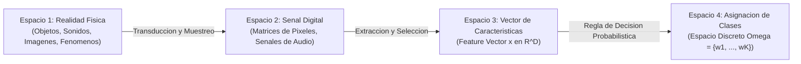
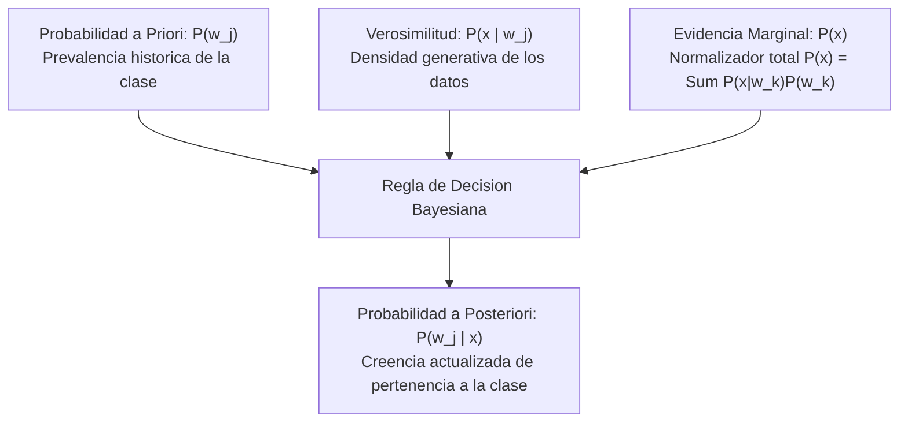
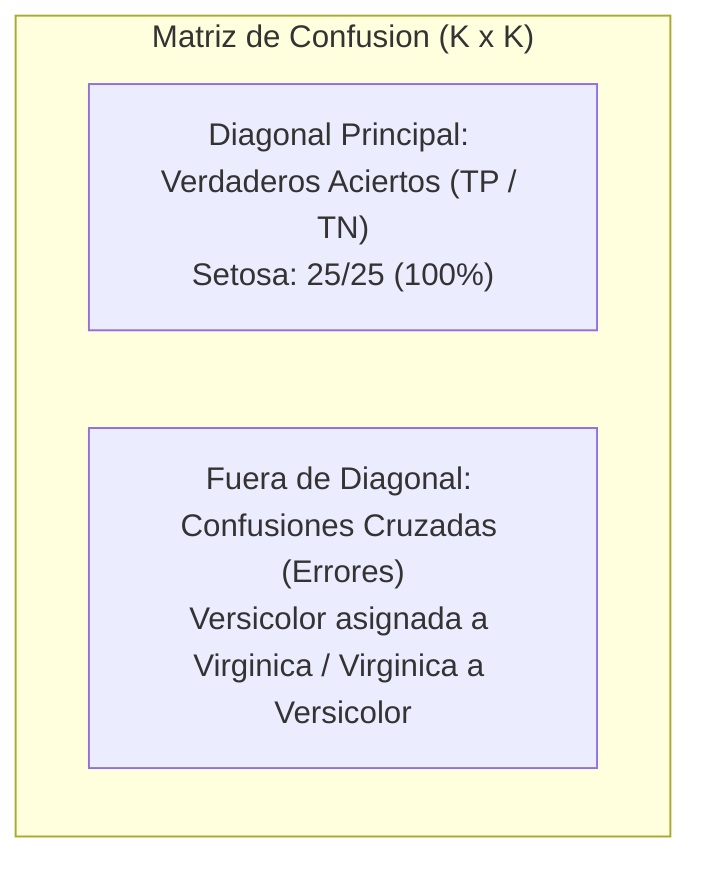
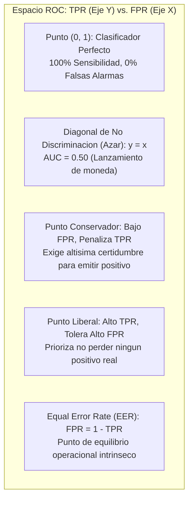
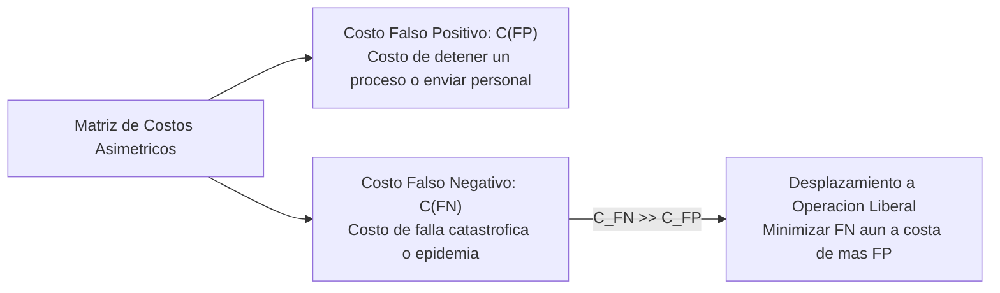
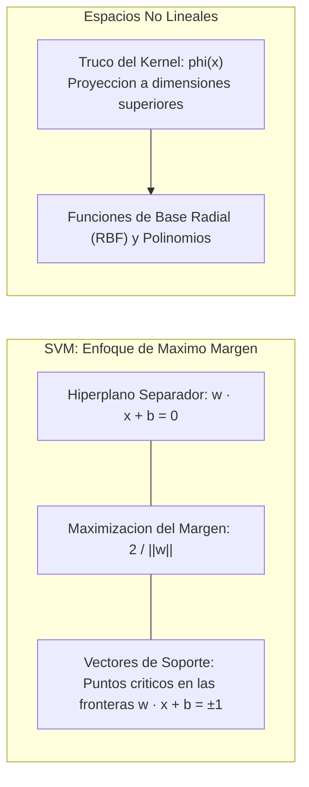

> **Objetivo de la Sesion**<br>
> 
> 
> Comprender los fundamentos matematicos y metodologicos del Reconocimiento de Patrones y la Clasificacion Supervisada en Machine Learning; derivar analiticamente el modelo probabilistico de Bayes Ingenuo (Gaussian Naive Bayes) desde densidades univariadas hasta formulaciones multivariadas en espacios vectoriales multidimensionales; implementar el clasificador tanto a nivel algebraico matricial explicito como en arquitecturas de produccion con Scikit-Learn utilizando el conjunto de datos canonico de Fisher; y evaluar formalmente el desempeno diagnostico mediante matrices de confusion, el balance de errores Tipo I y Tipo II, y la dinamica operativa en la Curva ROC bajo condiciones de costos de clasificacion asimetricos.

---
# Clase 2: Reconocimiento de Patrones, Inferencia Bayesiana y Gaussian Naive Bayes

## 1\. Contexto y Marco Conceptual del Reconocimiento de Patrones

### 1.1. El Pipeline Formal de Clasificacion de Patrones

En el marco de la Inteligencia Artificial y la Ciencia de Datos, el Reconocimiento de Patrones (*Pattern Recognition*) formaliza la transicion sistematica desde senales fisicas del entorno hacia decisiones categoricas computables. Este flujo se estructura en cuatro espacios fundamentales:



1. **Espacio 1 (Realidad Fisica):** Objetos tangibles y fenomenos a categorizar (especies botanicas, insectos vectores, tumores, fraudes financieros).

1. **Espacio 2 (Digitalizacion / Senal Cruda):** Captura continua mediante sensores opticos, acusticos o telemetricos (espectros de sonido, valores RGB de imagenes, registros termicos).

1. **Espacio 3 (Espacio de Caracteristicas / Feature Space):** Reduccion de dimensionalidad y extraccion de variables descriptivas relevantes consolidadas en un vector continuo o discreto $\mathbf{x} = [x_1, x_2, \dots, x_D]^T \in \mathbb{R}^D$.

1. **Espacio 4 (Espacio de Clasificacion):** Asignacion de la muestra a una de $K$ clases mutuamente excluyentes $\Omega = \{\omega_1, \omega_2, \dots, \omega_K\}$.

   - **Problemas de Deteccion (**$K = 2$**):** Clasificacion binaria (Presencia vs. Ausencia, Piel vs. No Piel, Fraude vs. Legítimo).
   
   - **Problemas de Reconocimiento / Identificacion (**$K \ge 3$**):** Clasificacion multiclase (identificacion de especies de lirios, tipos de mosquitos, reconocimiento de digitos manuscritos).

### 1.2. El Traslape (Overlap) como Justificacion del Aprendizaje Automatico

Existe una distincion epistemologica clave entre la programacion clasica basada en reglas y el Machine Learning:

- **Separabilidad Perfecta Determinista:** Si las clases estuvieran aisladas en el espacio vectorial sin interseccion alguna, la clasificacion seria un problema trivial resoluble mediante bifurcaciones condicionales rigidas (` if/else `) con umbrales fijos.

- **La Inevitabilidad del Traslape (Stochastic Overlap):** En la naturaleza y los sistemas de informacion reales, las distribuciones de probabilidad de las clases se superponen debido al ruido en la medicion, la variabilidad biologica y factores latentes no observados.

- **Proposito del Clasificador:** No existe una frontera magica con error cero en presencia de traslape. El objetivo de la inferencia estadistica es encontrar la frontera de decision optima que minimice la probabilidad esperada de error y el costo del riesgo bayesiano.

### 1.3. Frontera Unidimensional Ingenua vs. Inferencia Estadistica

En un escenario discreto o continuo unidimensional simple con dos clases ($X$ con poblacion $N$, y $O$ con poblacion $M$), la busqueda por fuerza bruta de un umbral $u^*$ persigue igualar el error proporcional a ambos lados de la division:

$u^* = \arg\min_U \left| \frac{n}{N} - \frac{m}{M} \right|$

donde $n$ y $m$ representan la cantidad de observaciones mal clasificadas de cada clase respecto a dicho umbral. Sin embargo, este criterio manual carece de generalizacion cuando las densidades son continuas, asimetricas, multivariadas o exhiben costos de error heterogeneos, exigiendo la rigurosidad del Teorema de Bayes.

---

## 2\. Fundamentos Teoricos: Teorema de Bayes y Modelado Multivariado

### 2.1. Anatomia del Teorema de Bayes

El principio matematico central radica en la no conmutatividad de las probabilidades condicionales:

$P(A \mid B) \neq P(B \mid A)$

En el reconocimiento de patrones, esta asimetria permite actualizar el estado de conocimiento previo mediante la evidencia empirica observada:

$P(\omega_j \mid \mathbf{x}) = \frac{P(\mathbf{x} \mid \omega_j) P(\omega_j)}{P(\mathbf{x})}$



- **Probabilidad a Posteriori** $P(\omega_j \mid \mathbf{x})$**:** Grado de certidumbre de que el patron observado pertenezca a la clase $\omega_j$ tras medir las caracteristicas $\mathbf{x}$.

- **Verosimilitud (Likelihood)** $P(\mathbf{x} \mid \omega_j)$**:** Densidad de probabilidad condicional que cuantifica que tan factible es observar el vector $\mathbf{x}$ asumiendo que proviene de la clase $\omega_j$.

- **Probabilidad a Priori (Class Prior)** $P(\omega_j)$**:** Conocimiento previo de la proporcion o prevalencia natural de la clase antes de registrar cualquier observacion.

- **Evidencia Marginal (Predictor Prior)** $P(\mathbf{x})$**:** Sumatoria de verosimilitudes ponderadas a traves de todo el conjunto de clases posibles $P(\mathbf{x}) = \sum_{k=1}^K P(\mathbf{x} \mid \omega_k) P(\omega_k)$.

### 2.2. La Simplificacion de Bayes Ingenuo (Naive Bayes) y la Regla MAP

Para la asignacion de clases de un vector observado $\mathbf{x}$, la evidencia marginal $P(\mathbf{x})$ actua como un factor de escala constante positivo e independiente de $\omega_j$. Por consiguiente, la comparacion relativa de probabilidades a posteriori se reduce a evaluar el numerador:

$\hat{\omega} = \arg\max_{\omega_j} P(\omega_j \mid \mathbf{x}) = \arg\max_{\omega_j} \left[ P(\mathbf{x} \mid \omega_j) P(\omega_j) \right]$

Si las clases se asumen equiprobables (priores uniformes $P(\omega_j) = 1/K$), la regla MAP (*Maximum A Posteriori*) colapsa exactamente en el principio de Maxima Verosimilitud (*Maximum Likelihood*):

$\hat{\omega} = \arg\max_{\omega_j} P(\mathbf{x} \mid \omega_j)$

La denominacion de "Ingenuo" (*Naive*) responde al supuesto de **independencia condicional** entre las dimensiones $x_1, x_2, \dots, x_D$ dada la clase, lo cual factoriza la verosimilitud multivariada en el producto de densidades univariadas:

$P(\mathbf{x} \mid \omega_j) = \prod_{i=1}^D P(x_i \mid \omega_j)$

### 2.3. Formulacion de la Densidad Gaussiana Multivariada

Cuando las variables predictoras son continuas, la hipotesis de modelado predominante es la Distribucion Normal o Gaussiana.

#### Caso Unidimensional (1D)

$f(x \mid \mu, \sigma^2) = \frac{1}{\sigma \sqrt{2\pi}} \exp\left(-\frac{1}{2} \left(\frac{x - \mu}{\sigma}\right)^2\right)$

- **Altura del Pico (**$\frac{1}{\sigma \sqrt{2\pi}}$**):** Representa la concentracion de probabilidad en torno a la media $\mu$.

- **Ancho de la Curva (**$\sigma, \sigma^2$**):** Representa la dispersion e incertidumbre. A mayor varianza, menor es el pico de probabilidad y mayor es la ambiguedad en la frontera de corte.

#### Caso Multivariado ($D$ Dimensiones)

Para vectores continuos de caracteristicas en $\mathbb{R}^D$, la funcion de densidad de probabilidad multivariada se define como:

$P(\mathbf{x} \mid \boldsymbol{\mu}, \boldsymbol{\Sigma}) = \frac{1}{(2\pi)^{D/2} |\boldsymbol{\Sigma}|^{1/2}} \exp\left(-\frac{1}{2} (\mathbf{x} - \boldsymbol{\mu})^T \boldsymbol{\Sigma}^{-1} (\mathbf{x} - \boldsymbol{\mu})\right)$

| Componente Matematico | Notacion y Dimension | Rol y Significado Algebraico |
| --- | --- | --- |
| Vector de Caracteristicas | $\mathbf{x} \in \mathbb{R}^{D \times 1}$ | Punto de prueba evaluado en el espacio de atributos. |
| Vector de Medias | $\boldsymbol{\mu} \in \mathbb{R}^{D \times 1}$ | Centroide geometrico y valor esperado de la clase. |
| Matriz de Covarianzas | $\boldsymbol{\Sigma} \in \mathbb{R}^{D \times D}$ | Estructura de dispersion y covarianza entre dimensiones. |
| Determinante | \$\\ | boldsymbol&\#123;Sigma&\#125;\\ |
| Matriz Inversa (Precision) | $\boldsymbol{\Sigma}^{-1} \in \mathbb{R}^{D \times D}$ | Normalizador de escalas para la distancia ponderada. |
| Distancia de Mahalanobis | $(\mathbf{x} - \boldsymbol{\mu})^T \boldsymbol{\Sigma}^{-1} (\mathbf{x} - \boldsymbol{\mu})$ | Forma cuadratica $(1 \times D)(D \times D)(D \times 1) = (1 \times 1)$ escalar. |

Bajo la hipotesis de **Gaussian Naive Bayes**, se fuerza a que la matriz de covarianzas sea diagonal:

$\boldsymbol{\Sigma}_k = \begin{bmatrix} \sigma_{k,1}^2 & 0 & \dots & 0 \\ 0 & \sigma_{k,2}^2 & \dots & 0 \\ \vdots & \vdots & \ddots & \vdots \\ 0 & 0 & \dots & \sigma_{k,D}^2 \end{bmatrix}$

Esto implica que el determinante se computa de forma directa como el producto de varianzas individuales $|\boldsymbol{\Sigma}_k| = \prod_{i=1}^D \sigma_{k,i}^2$, acelerando sustancialmente la computacion y eliminando el sobreajuste provocado por la correlacion espuria entre caracteristicas.

### 2.4. Geometria Espacial de las Superficies de Verosimilitud

- En dos dimensiones ($D=2$), la funcion de densidad se asemeja a una campana tridimensional sobre el plano cartesiano.

- Visto en planta (proyeccion cartografica 2D), los contornos de equiprobabilidad son elipses concentricas centradas en $\boldsymbol{\mu}$.

- La **frontera de decision optima** entre dos clases $\omega_1$ y $\omega_2$ corresponde a la traza espacial donde ambas funciones de densidad se cruzan:

$\{\mathbf{x} \in \mathbb{R}^D : P(\mathbf{x} \mid \omega_1) P(\omega_1) = P(\mathbf{x} \mid \omega_2) P(\omega_2)\}$

---

## 3\. Implementacion Practica: Del Calculo Matricial Manual a Scikit-Learn

### 3.1. El Caso de Estudio Canonico: Dataset Iris de Ronald Fisher (1936)

El dataset *Iris* representa el benchmark fundacional del Reconocimiento de Patrones:

- **150 observaciones** distribuidas equitativamente en 3 clases (50 muestras por especie).

- **3 Clases Botanicas:**

  - ` Clase 0 `: *Iris setosa* (linealmente separable de las demas).
  
  - ` Clase 1 `: *Iris versicolor* (traslape moderado con virginica).
  
  - ` Clase 2 `: *Iris virginica* (traslape sustancial con versicolor).

- **4 Dimensiones Cuantitativas:**

  1. Sepal Length (largo del sepalo en cm).
  
  1. Sepal Width (ancho del sepalo en cm).
  
  1. Petal Length (largo del petalo en cm).
  
  1. Petal Width (ancho del petalo en cm).

### 3.2. Implementacion Matricial Explicita en Python ("From Scratch")

Para desmitificar el comportamiento interno del algoritmo, se implementa el flujo matematico completo en dos dimensiones (variables 3 y 4 del petalo), utilizando un particionamiento didactico del 50% para entrenamiento (25 muestras/clase) y 50% para validacion (25 muestras/clase):

```python
import numpy as np
import matplotlib.pyplot as plt
from sklearn.datasets import load_iris

# 1. Carga y preparacion del dataset Iris
iris = load_iris()
X_raw = iris.data[:, 2:4]  # Se seleccionan Petal Length y Petal Width (2D)
y_raw = iris.target

# 2. Particion manual didactica estratificada (50% Train, 50% Test)
# Clase 0: Setosa (0 a 50) | Clase 1: Versicolor (50 a 100) | Clase 2: Virginica (100 a 150)
X_train_c0, X_test_c0 = X_raw[0:25], X_raw[25:50]
X_train_c1, X_test_c1 = X_raw[50:75], X_raw[75:100]
X_train_c2, X_test_c2 = X_raw[100:125], X_raw[125:150]

# Consolidacion de conjuntos de entrenamiento y evaluacion
X_train = np.vstack([X_train_c0, X_train_c1, X_train_c2])
y_train = np.array([0]*25 + [1]*25 + [2]*25)

X_test = np.vstack([X_test_c0, X_test_c1, X_test_c2])
y_test = np.array([0]*25 + [1]*25 + [2]*25)

# 3. Fase de Entrenamiento: Estimacion de Centroides y Covarianzas Diagonales
def fit_gaussian_class(X_c):
    # Vector de medias (centroide) de dimension (1 x D)
    mu = np.mean(X_c, axis=0)
    # Matriz de covarianzas muestral
    cov_full = np.cov(X_c, rowvar=False)
    # Hipotesis Naive Bayes: Retencion exclusiva de la diagonal principal
    cov_diag = np.diag(np.diag(cov_full))
    # Matriz inversa de precision y determinante del hipervolumen
    inv_cov = np.linalg.inv(cov_diag)
    det_cov = np.linalg.det(cov_diag)
    return mu, cov_diag, inv_cov, det_cov

mu_0, cov_0, inv_cov_0, det_0 = fit_gaussian_class(X_train_c0)
mu_1, cov_1, inv_cov_1, det_1 = fit_gaussian_class(X_train_c1)
mu_2, cov_2, inv_cov_2, det_2 = fit_gaussian_class(X_train_c2)

# 4. Funcion de Densidad de Probabilidad Multivariada (Verosimilitud)
def calculate_likelihood(x, mu, inv_cov, det_cov, d=2):
    diff = x - mu  # Vector fila (1 x D)
    # Forma cuadratica de Mahalanobis: diff * Sigma^-1 * diff^T
    mahalanobis_sq = np.dot(np.dot(diff, inv_cov), diff.T)
    # Normalizador escalar del hiperelipsoide
    norm_factor = ((2 * np.pi) ** (d / 2.0)) * np.sqrt(det_cov)
    # Densidad de verosimilitud resultante
    pdf_value = (1.0 / norm_factor) * np.exp(-0.5 * mahalanobis_sq)
    return float(pdf_value)

# 5. Inferencia y Clasificacion en el Conjunto de Test
y_pred = []
for sample in X_test:
    p_c0 = calculate_likelihood(sample, mu_0, inv_cov_0, det_0)
    p_c1 = calculate_likelihood(sample, mu_1, inv_cov_1, det_1)
    p_c2 = calculate_likelihood(sample, mu_2, inv_cov_2, det_2)
    
    # Regla de decision competitiva por maxima verosimilitud
    if p_c0 >= p_c1 and p_c0 >= p_c2:
        y_pred.append(0)
    elif p_c1 >= p_c0 and p_c1 >= p_c2:
        y_pred.append(1)
    else:
        y_pred.append(2)

y_pred = np.array(y_pred)
accuracy_manual = np.mean(y_pred == y_test)
print(f"Exactitud obtenida por calculo matricial explícito: {accuracy_manual * 100:.2f}%")
```

### 3.3. Implementacion Optimizada en Scikit-Learn

En entornos profesionales de ingenieria, el desarrollo analitico manual anterior se encapsula en la arquitectura vectorizada de ` scikit-learn `, incorporando muestreo aleatorio reproducible mediante ` train_test_split `:

```python
from sklearn.model_selection import train_test_split
from sklearn.naive_bayes import GaussianNB
from sklearn.metrics import confusion_matrix, classification_report

# Particion estocastica estratificada reproducible (50% Train, 50% Test)
X_tr, X_te, y_tr, y_te = train_test_split(
    X_raw, y_raw, test_size=0.50, random_state=42, stratify=y_raw
)

# Inicializacion del estimador Gaussian Naive Bayes
gnb = GaussianNB()

# Ajuste analitico de parametros (media y varianza por variable)
gnb.fit(X_tr, y_tr)

# Prediccion probabilistica en el conjunto no observado
y_hat = gnb.predict(X_te)

# Diagnostico del desempeno
matriz_conf = confusion_matrix(y_te, y_hat)
print("Matriz de Confusion:\n", matriz_conf)
print("\nReporte de Clasificacion:\n", classification_report(y_te, y_hat, target_names=iris.target_names))
```

---

## 4\. Auditoria de Desempeno: Matriz de Confusion y la Curva ROC

### 4.1. Estructura de la Matriz de Confusion

La matriz de contingencia o confusion permite auditar de forma granular los aciertos y las confusiones inter-clase entre las etiquetas deseadas (reales) y las obtenidas (predichas):



En la evaluacion de los 75 casos de prueba de *Iris*:

- **Setosa (25 muestras):** 25 clasificadas como Setosa (100% precision). El aislamiento espacial garantiza cero solapamiento.

- **Versicolor (25 muestras):** 24 clasificadas como Versicolor y 1 clasificada como Virginica (Falso Negativo para Versicolor).

- **Virginica (25 muestras):** 24 clasificadas como Virginica y 1 clasificada como Versicolor (Falso Positivo para Versicolor).

### 4.2. Tipos de Error y Metricas Diagnosticas

| Concepto Tecnico | Sinonimo Estadistico | Definicion Formal | Impacto en el Sistema |
| --- | --- | --- | --- |
| **Verdadero Positivo (TP)** | Acierto / Hit | La condicion es positiva y se predice como positiva. | Confirmacion correcta del evento de interes. |
| **Verdadero Negativo (TN)** | Rechazo Correcto | La condicion es negativa y se predice como negativa. | Ausencia de alarma ante estados normales. |
| **Error Tipo I (FP)** | Falsa Alarma ($\alpha$) | La condicion es negativa pero se predice como positiva. | Accion correctiva innecesaria, costo operativo. |
| **Error Tipo II (FN)** | Omision / Fallo ($\beta$) | La condicion es positiva pero se predice como negativa. | Incumplimiento critico, escape de riesgo latente. |

#### Formulaciones Derivadas

- **Sensibilidad / True Positive Rate (TPR):** Capacidad del modelo para capturar casos positivos reales:

  $TPR = \frac{TP}{P} = \frac{TP}{TP + FN}$

- **Tasa de Falsos Positivos / False Positive Rate (FPR):** Fraccion de negativos que generan falsas alarmas:

  $FPR = \frac{FP}{N} = \frac{FP}{FP + TN} = 1 - \text{Especificidad}$

- **Exactitud Global (Accuracy):** Proporcion global de clasificaciones correctas:

  $ACC = \frac{TP + TN}{P + N}$

### 4.3. El Espacio y la Curva ROC (Receiver Operating Characteristics)

La curva ROC desacopla la evaluacion del modelo de un umbral fijo, trazando la trayectoria de pares $(FPR, TPR)$ a medida que el umbral de decision probabilistico $\theta \in [0, 1]$ barre el espectro completo:



#### Construccion Algoritmica de la Curva ROC

1. Se evalua el conjunto de test generando el score probabilistico continuo de pertenencia a la clase positiva.

1. Se ordenan las observaciones de forma descendente en funcion del score.

1. Se desplaza un umbral operativo $\theta$ desde $+\infty$ hasta $-\infty$:

   - Cada muestra positiva superando el umbral desplaza la curva verticalmente una fraccion $1/P$.
   
   - Cada muestra negativa superando el umbral desplaza la curva horizontalmente una fraccion $1/N$.

1. **Criterio de Dominancia:** Un clasificador cuya curva ROC se ubique consistentemente por encima de otro domina en rendimiento en cualquier rango operacional. Todo modelo por debajo de la diagonal funciona peor que el azar (puede invertirse negando la salida).

---

## 5\. Casos de Estudio en Literatura Cientifica y Costos Asimetricos

### 5.1. El Principio de Costos Asimetricos

En entornos reales de produccion, los errores de clasificacion conllevan costos economicos, operativos o de salud humana radicalmente dispares. 



- **Caso Mandarinas vs. Naranjas (Domingo Mery, PUC Chile):** La clasificacion por tamano (pixeles) y longitud de onda del color verde genera traslapes. El costo comercial de empaquetar una mandarina al precio de una naranja exportable define la posicion del umbral optimo.

- **Diagnostico Oncologico / Seguridad Critica:** El costo de un Falso Negativo (omitir un paciente con patologia grave) es infinitamente superior al de un Falso Positivo (ordenar una biopsia confirmatoria). El umbral bayesiano debe ajustarse hacia la region liberal.

### 5.2. Caso 1: Deteccion Acustica y Optoelectronica de Mosquitos Vectores de Dengue

En investigaciones para el control epidemiologico mediante trampas automatizadas de bajo costo, se clasifica el aleteo acustico de insectos voladores:

- **Especies Analizadas:**

  - *Aedes aegypti* (vector biologico del dengue, zika y fiebre amarilla).
  
  - *Culex quinquefasciatus* (especie no objetivo en este contexto).
  
  - *Bombus impatiens* (abejorro benefico polinizador).

- **Desafio del Desbalance de Clases:** A diferencia del dataset academico de Fisher, los datos reales presentan fuerte asimetria: 499 muestras de *Bombus*, 4252 muestras de *Culex*, y 1231 muestras de *Aedes*.

- **Enriquecimiento Multimodal (Aleteo + Ritmo Circadiano):**

  - **Caracteristica Acustica:** Frecuencia fundamental del aleteo captada por fototransistores infrarrojos al atravesar el tunel de la trampa.
  
  - **Ritmo Circadiano:** La probabilidad horaria de actividad biologica (picos marcados de actividad en medianoche y mediodia).

- **Analisis de Rendimiento Comparativo:**

| Vector de Caracteristicas | Modelo Naive Bayes | Modelo K-Nearest Neighbors (KNN) | Observacion Metodologica |
| --- | --- | --- | --- |
| **Solo Ritmo Circadiano** | 70.69% | 68.50% | Naive Bayes modela mejor la distribucion temporal continua. |
| **Solo Frecuencia Acustica** | 90.73% | 91.30% | KNN captura leves irregularidades no gaussianas del zumbido. |
| **Fusion Multimodal (Acustica + Circadiano)** | **93.00%** | **91.00%** | **Naive Bayes supera a KNN** gracias a la composicion probabilistica de factores independientes. |

La accion mecanica derivada del clasificador: al identificarse *Aedes aegypti*, se activa el cierre hermetico de la compuerta por un intervalo calibrado (5 minutos a alta temperatura ambiental), logrando la eliminacion selectiva del vector sin danar polinizadores.

### 5.3. Caso 2: Deteccion de Piel y Filtro de Imagenes mediante Modelos de Mezclas de Gaussianas (GMM)

En el filtrado temprano de contenidos digitales y vision por computadora, la deteccion de pixeles de piel humana presento el desafio de la variabilidad etnica y las condiciones de iluminacion:

- **Espacio de Atributos:** Vectores tridimensionales de color RGB ($D=3$). El normalizador incluye el termino $(2\pi)^{3/2}$.

- **Insuficiencia de la Gaussiana Unimodal:** La piel humana no puede representarse mediante una campana unica debido a que las distintas tonalidades forman un continuo complejo y multimodal.

- **Solucion Arquitectonica (GMM - Gaussian Mixture Models):** Modelar la verosimilitud de la clase piel como una combinacion lineal convexa de $M$ funciones gaussianas:

$P(\mathbf{x} \mid \text{Piel}) = \sum_{m=1}^M \alpha_m \mathcal{N}(\mathbf{x} \mid \boldsymbol{\mu}_m, \boldsymbol{\Sigma}_m)$

- **Prueba de Razon de Verosimilitud (Likelihood Ratio Test):** La asignacion de pertenencia a pixel de piel se decide contrastando contra la densidad de no-piel:

$\frac{P(\text{RGB} \mid \text{Piel})}{P(\text{RGB} \mid \neg\text{Piel})} \ge \theta$

donde $\theta$ es el umbral regulador calibrable a traves del analisis ROC para equilibrar el filtrado de spam sin incurrir en falsas censuras de texturas de madera o cuero.

---

## 6\. Principios Metodologicos, Buenas Practicas y Anti-patrones

### 6.1. Reglas de Oro en Clasificadores Probabilisticos

1. **Comprobar la Hipotesis de Normalidad:** Antes de adoptar Gaussian Naive Bayes, inspeccionar histogramas y pruebas de bondad de ajuste (Shapiro-Wilk o Kolmogorov-Smirnov). Si las variables son multimodales o altamente asimetricas, recurrir a transformaciones de potencia (Box-Cox, Yeo-Johnson) o a modelos de mezclas (GMM).

1. **Regularizacion de la Varianza (Variance Smoothing):** En muestras pequenas o clases concentradas, una varianza observada cercana a cero colapsa el determinante $|\boldsymbol{\Sigma}| \to 0$ y genera desbordamiento numerico en $\boldsymbol{\Sigma}^{-1}$. Scikit-Learn incorpora por defecto el parametro ` var_smoothing ` (anadiendo una fraccion de la varianza maxima observada a la diagonal para estabilizar el algebra).

1. **Muestreo Aleatorio Estratificado:** Jamas particionar datasets ordenados de forma secuencial contigua. Utilizar particiones estratificadas que preserven la proporcion de clases en entrenamiento y prueba (` stratify=y `).

1. **Calculo en Espacio Logaritmico (Log-Probabilities):** En espacios de alta dimensionalidad ($D \gg 1$), el producto continuado de probabilidades induce subdesbordamiento numerico (*underflow*). Se debe transformar la regla de decision al espacio logaritmico:

$\ln P(\omega_j \mid \mathbf{x}) \propto \ln P(\omega_j) - \frac{1}{2} \ln |\boldsymbol{\Sigma}_j| - \frac{1}{2} (\mathbf{x} - \boldsymbol{\mu}_j)^T \boldsymbol{\Sigma}_j^{-1} (\mathbf{x} - \boldsymbol{\mu}_j)$

### 6.2. Anti-patrones Comunes en Modelado Estadistico

| Anti-patron | Descripcion del Error | Consecuencia Analitica | Solucion Tecnica |
| --- | --- | --- | --- |
| **Supuesto Ciego de Independencia** | Aplicar Naive Bayes sobre caracteristicas colineales o redundantes. | Doble ponderacion artificial de la misma senal en la verosimilitud. | Eliminar multicolinealidad con analisis de correlacion de Pearson o PCA previo. |
| **Ignorar la Asimetria de Clases** | Utilizar Accuracy como metrica primaria en problemas con desbalance severo. | Modelos ingenuos que aciertan la clase mayoritaria ocultando cero deteccion en la minoritaria. | Evaluar F1-Score, Balanced Accuracy, Precision-Recall y Curva ROC-AUC. |
| **Fuga de Datos (Data Leakage)** | Calcular $\boldsymbol{\mu}$ y $\boldsymbol{\Sigma}$ sobre todo el dataset antes de separar Train/Test. | Evaluacion optimista irreal al contaminar el test con estadisticas de entrenamiento. | Ajustar el modelo estrictamente sobre ` X_train ` y evaluar en ` X_test `. |
| **Umbral Rigido Simetrico en 0.5** | Asumir que la frontera de decision debe situarse en probabilidad 0.5 sin analizar costos. | Incremento inaceptable de errores catastroficos de Tipo II. | Calibrar el umbral operativo mediante el analisis de la curva ROC y costos relativos. |

---

## 7\. Sintesis Conceptual y Proyeccion hacia Modelos Discriminativos

### 7.1. Modelos Generativos vs. Modelos Discriminativos

- **Gaussian Naive Bayes es un Modelo Generativo:** Modela como cada clase genera las caracteristicas mediante densidades conjuntas $P(\mathbf{x}, \omega) = P(\mathbf{x} \mid \omega) P(\omega)$. Permite generar datos sinteticos muestreando desde las gaussianas aprendidas.

- **Limitacion Fundamental:** Cuando la dimensionalidad crece o las correlaciones cruzadas son criticas para la separacion, los modelos generativos simplificados pierden poder descriptivo.

- **Transicion hacia Modelos Discriminativos:** En lugar de modelar la distribucion estadistica de cada clase en todo el espacio, los modelos discriminativos buscan directamente la frontera de separacion $P(\omega \mid \mathbf{x})$ o una funcion de decision geométrica.

### 7.2. Proyeccion: Maquinas de Vectores de Soporte (SVM) y Maximo Margen

Como extension natural ante datos no separables por densidades gaussianas clasicas, se introducen las Maquinas de Vectores de Soporte (*Support Vector Machines* \- Vapnik y Chervonenkis, 1992):



- **Optimizacion Convexa de Margen:** Minimizar $\frac{1}{2} \|\mathbf{w}\|^2$ sujeto a restricciones lineales de separacion $y_i (\mathbf{w} \cdot \mathbf{x}_i + b) \ge 1$, resuelto mediante multiplicadores de Lagrange en su forma dual.

- **El Truco del Kernel (Kernel Trick):** Proyeccion implicita de los vectores de caracteristicas a espacios de Hilbert de mayor dimensionalidad mediante kernels RBF (*Radial Basis Function*) o polinomicos, volviendo linealmente separables patrones que exhiben traslape severo o distribuciones concentricas en el espacio original.

### 7.3. Referencias Epistemologicas y Lectura Recomendada

- **Obra de Referencia:** *Pattern Classification* (Richard O. Duda, Peter E. Hart, David G. Stork - 2da Edicion, Wiley-Interscience). Texto canonico indispensable para consolidar el rigor analitico en decision bayesiana, estimacion de maxima verosimilitud y superficies de decision optimas.
