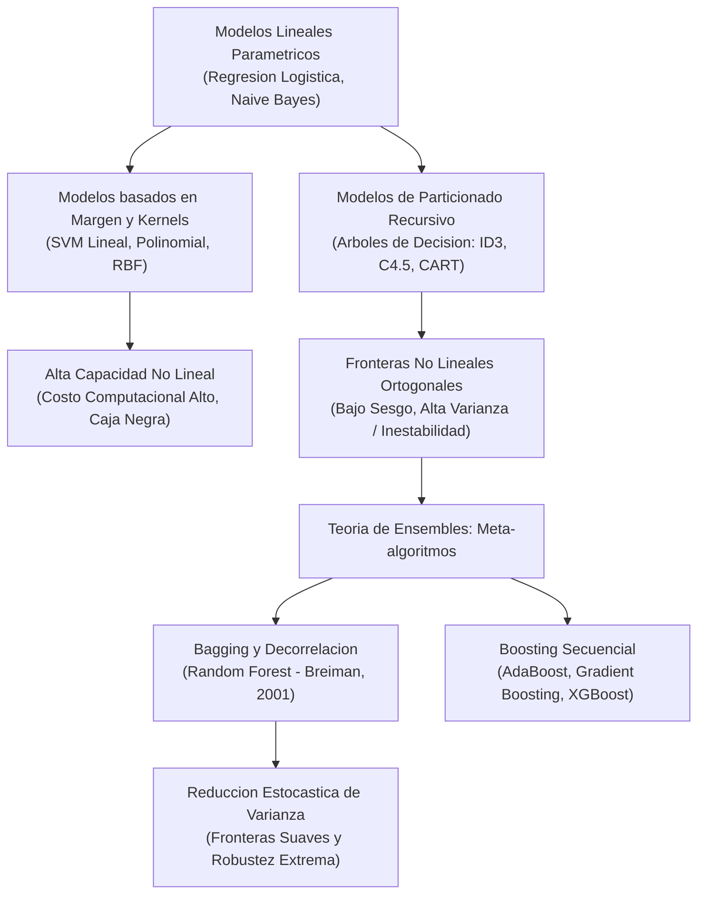
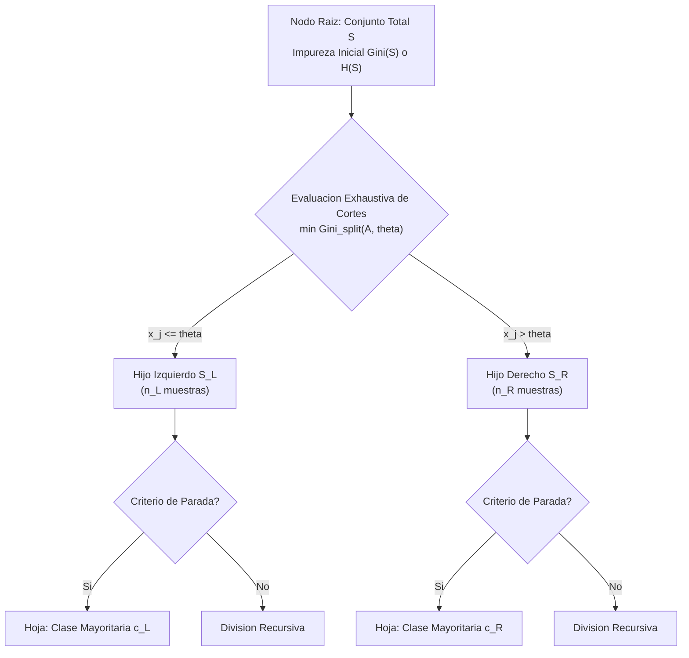
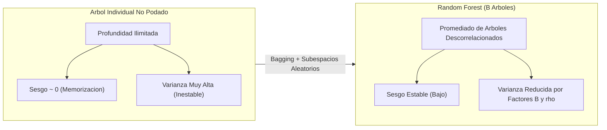
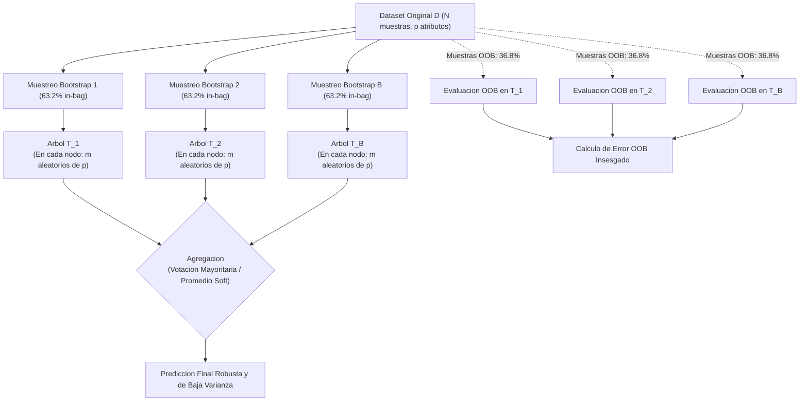
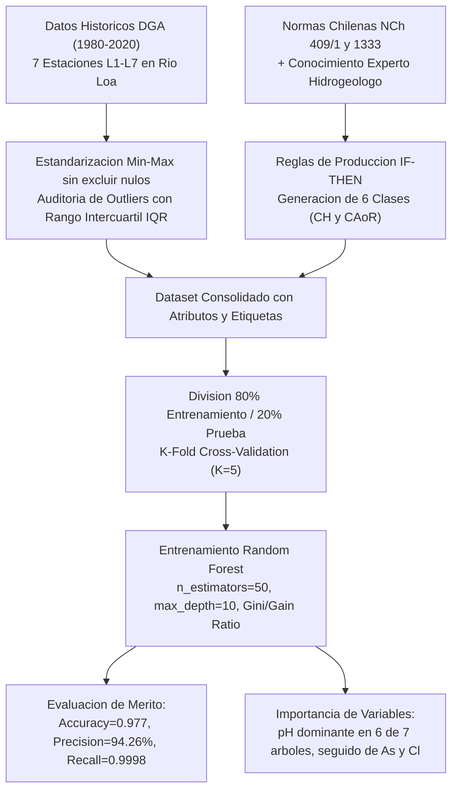
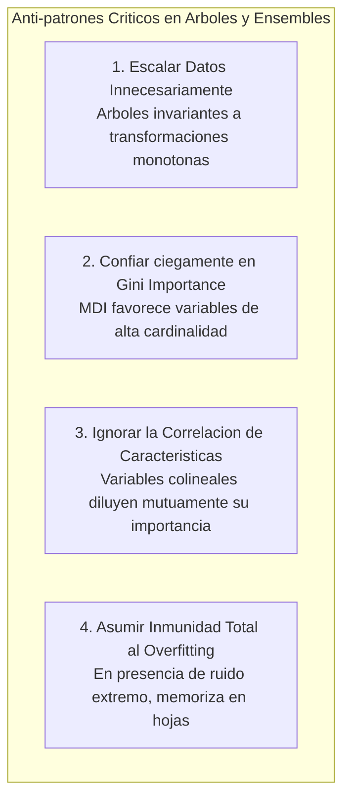
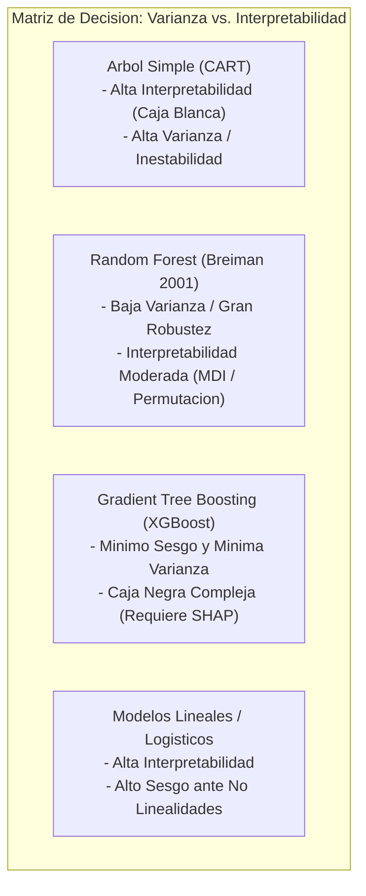

# Clase 3: Arboles de Decision, Teoria de Ensembles y Random Forest

Fuente de analisis primario: clase3.txt  

Material complementario: Diapositivas oficiales ("4 ArbolesD\_RForest .pdf") y Paper de aplicacion ("Random Forest - water-15-02868-v2.pdf")  

Area tematica: Modulo 8 - Machine Learning \| Maestria en Ciencia de Datos e Inteligencia Artificial

> **Objetivo Academico y Pedagogico**<br>
> 
> 
> Formalizar y analizar rigurosamente la transicion desde clasificadores parametricos y continuos hacia modelos no lineales de particionado ortogonal recursivo (CART) y arquitecturas de ensamble estocastico (Random Forest). Dominar los fundamentos matematicos de impureza (Entropia de Shannon, Indice de Gini, Ganancia de Informacion y Gain Ratio), la descomposicion analitica del compromiso sesgo-varianza mediante Bootstrap Aggregating (Bagging), la evaluacion Out-Of-Bag (OOB), el mecanismo de decorrelacion por subespacios aleatorios (Random Subspaces) y la aplicacion metodologica en problemas de alta complejidad e impacto ambiental.

---

## 1\. Contexto y Marco Conceptual

### 1.1 Motivacion y Limitaciones de los Clasificadores Parametricos y Basados en Hiperplanos

El debate pedagogico parte de una pregunta estructural: una vez conocidos los clasificadores probabilisticos clasicos (como Naive Bayes) y los modelos lineales (como la Regresion Logistica), ¿como se mide y optimiza el rendimiento cuando las distribuciones de datos presentan solapamiento severo, asimetria de costos o geometrias altamente no lineales?

Los modelos lineales clasicos asumen una frontera de decision plana definida por:

$g(x) = w^T x + w_0 = 0$

Asimismo, modelos probabilisticos parametricos como el Clasificador Bayesiano Gaussiano requieren estimar vectores de medias $\mu_k$ y matrices de covarianza $\Sigma_k$. Cuando los datos violan estos supuestos distribucionales (por ejemplo, distribuciones multimodales, variables categoricas heterogeneas o fronteras discontinuas), estos metodos degradan sensiblemente su precision.

Para superar la restriccion lineal, las Maquinas de Soporte Vectorial (SVM, Vapnik &amp; Chervonenkis, 1992) proyectan el espacio de entrada a un espacio de caracteristicas de mayor dimension mediante el truco del kernel $\phi(x)$, resolviendo un problema de optimizacion cuadratica con multiplicadores de Lagrange:

$\max_{\alpha} \sum_{i=1}^{N} \alpha_i - \frac{1}{2} \sum_{i=1}^{N} \sum_{j=1}^{N} \alpha_i \alpha_j y_i y_j K(x_i, x_j)$

Sujeto a:

$0 \le \alpha_i \le C, \quad \sum_{i=1}^{N} \alpha_i y_i = 0$

Sin embargo, al contrastar kernels lineales, polinomiales de grado $d$ y funciones de base radial RBF, SVM exhibe desafios criticos:

1. Alta sensibilidad a la escala de las caracteristicas (requiere estandarizacion estricta $z = (x - \mu)/\sigma$).

1. Elevada complejidad computacional en entrenamiento $O(N^3)$ a $O(N^2)$, limitando su escalabilidad.

1. Baja interpretabilidad de las decisiones en dominios criticos (medicina, gestion de recursos hidricos o control ambiental).

### 1.2 El Paradigma del Particionado Ortogonal Recursivo

Frente a la formulacion analitica global de SVM y Regresion Logistica, los Arboles de Decision representan un cambio de paradigma: en lugar de buscar un hiperplano continuo o una superficie suave en un espacio transformado, dividen el espacio de caracteristicas $\mathcal{X} \subset \mathbb{R}^p$ en un conjunto de regiones rectangulares hiperdimensionales ortogonales y disjuntas $\{R_1, R_2, \dots, R_M\}$, ajustando un modelo simple (usualmente una constante o una distribucion empirica de clases) en cada region:

$\hat{f}(x) = \sum_{m=1}^{M} c_m \cdot \mathbb{I}(x \in R_m)$

Donde $\mathbb{I}(\cdot)$ es la funcion indicatriz y $c_m$ representa la clase mayoritaria en la region $R_m$:

$c_m = \arg\max_{k} \frac{1}{|R_m|} \sum_{x_i \in R_m} \mathbb{I}(y_i = k)$

### 1.3 Evolucion hacia Ensambles

Un arbol individual profundo posee sesgo despreciable pero una varianza sumamente elevada: una ligera perturbacion en el conjunto de entrenamiento altera de manera radical los puntos de corte optimos en la raiz y en los niveles superiores. 

Para resolver esta inestabilidad intrinseca sin reintroducir sesgo, surgen las teorias de ensamble:

- **Bagging (Bootstrap Aggregating, Breiman 1996):** Disminucion de varianza mediante el entrenamiento independiente de estimadores sobre muestras bootstrap y agregacion por votacion.

- **Random Forest (Breiman 2001):** Incorporacion de la inyeccion estocastica de subespacios de caracteristicas en cada division para romper la correlacion entre arboles individuales.

- **Boosting (Schapire &amp; Freund 1996, Friedman 2001):** Construccion secuencial donde cada modelo nuevo entrena sobre los residuos o errores ponderados de la combinacion previa.



---

## 2\. Fundamentos Teoricos y Arquitectura Matematica

### 2.1 Criterios de Impureza y Seleccion de Atributos

Sea $S$ un subconjunto de entrenamiento en un nodo dado, compuesto por $|S|$ instancias distribuidas en $K$ clases, donde $p_i$ representa la proporcion empirica de instancias pertenecientes a la clase $i$:

$p_i = \frac{1}{|S|} \sum_{x \in S} \mathbb{I}(y = i), \quad \sum_{i=1}^{K} p_i = 1$

#### 2.1.1 Entropia de Shannon (ID3 y C4.5)

La entropia mide el grado de incertidumbre o desorden informacional contenido en la distribucion de clases de $S$:

$H(S) = - \sum_{i=1}^{K} p_i \log_2(p_i)$

Con la convencion formal de que si $p_i = 0$, entonces $0 \log_2(0) = 0$.

- Si el nodo es completamente puro (todas las instancias pertenecen a la misma clase), $H(S) = 0$.

- Si las clases estan uniformemente distribuidas ($p_i = 1/K$), $H(S)$ alcanza su valor maximo: $\log_2(K)$.

#### 2.1.2 Ganancia de Informacion (Information Gain - Quinlan, ID3)

La Ganancia de Informacion $IG(S, A)$ evalua la reduccion esperada de entropia al particionar el nodo $S$ utilizando el atributo $A$:

$IG(S, A) = H(S) - \sum_{v \in \text{Valores}(A)} \frac{|S_v|}{|S|} H(S_v)$

Donde $S_v = \{x \in S \mid A(x) = v\}$. El algoritmo selecciona en cada paso el atributo que maximiza $IG(S, A)$.

**Defecto teorico de la Ganancia de Informacion:** Presenta un sesgo inherente hacia atributos con gran cantidad de valores unicos (por ejemplo, identificadores, fechas o claves primarias). Una particion con $|S|$ ramas unipuntuales tendra $H(S_v) = 0$ para todo $v$, produciendo una ganancia artificialmente maxima pero sin capacidad de generalizacion.

#### 2.1.3 Ganancia de Razon (Gain Ratio - Quinlan, C4.5)

Para neutralizar el sesgo de cardinalidad de $IG$, el algoritmo C4.5 introduce la Informacion de Division (*Split Information*), que cuantifica la entropia intrinseca del esquema de particionado:

$\text{SplitInformation}(S, A) = - \sum_{v \in \text{Valores}(A)} \frac{|S_v|}{|S|} \log_2 \left( \frac{|S_v|}{|S|} \right)$

El coeficiente de Ganancia de Razon normaliza la ganancia por dicha entropia:

$\text{GainRatio}(S, A) = \frac{IG(S, A)}{\text{SplitInformation}(S, A)}$

Si un atributo divide los datos en ramas minusculas y triviales, $\text{SplitInformation}(S, A)$ sera elevado, penalizando fuertemente su ratio y evitando el sobreajuste.

#### 2.1.4 Indice de Impureza de Gini (Breiman et al., CART)

El indice de Gini mide la probabilidad de clasificar incorrectamente un elemento elegido al azar de $S$ si se le asignara una clase segun la distribucion empirica de probabilidades:

$\text{Gini}(S) = 1 - \sum_{i=1}^{K} p_i^2 = \sum_{i=1}^{K} p_i (1 - p_i)$

- Si el nodo es puro, $\text{Gini}(S) = 1 - 1 = 0$.

- En el caso binario equilibrado ($p_1 = p_2 = 0.5$), $\text{Gini}(S) = 1 - (0.25 + 0.25) = 0.50$.

- Su ventaja computacional sobre la entropia radica en prescindir del calculo de logaritmos trascendentes, optimizando ciclos de reloj en datasets masivos.

Para una division binaria en un punto de corte continuo $\theta$ del atributo $A$, generando subconjuntos izquierdo $S_L$ y derecho $S_R$:

$\text{Gini}_{\text{split}}(S, A, \theta) = \frac{|S_L|}{|S|} \text{Gini}(S_L) + \frac{|S_R|}{|S|} \text{Gini}(S_R)$

CART elige el par $(A^*, \theta^*)$ que minimiza $\text{Gini}_{\text{split}}$ o, equivalentemente, maximiza el decremento de impureza:

$\Delta \text{Gini} = \text{Gini}(S) - \text{Gini}_{\text{split}}(S, A, \theta)$



### 2.2 Comparacion Estructural de Algoritmos de Arboles

| Caracteristica | ID3 (Iterative Dichotomiser 3) | C4.5 | CART (Classification &amp; Regression Trees) |
| --- | --- | --- | --- |
| **Creador y Ano** | Ross Quinlan (1986) | Ross Quinlan (1993) | Breiman, Friedman, Olshen, Stone (1984) |
| **Tipo de Division** | Multi-via (tantas ramas como valores discretos) | Multi-via y binaria | Estrictamente binaria ($x_j \le \theta$ vs $x_j > \theta$) |
| **Criterio de Division** | Ganancia de Informacion ($IG$) | Ganancia de Razon ($\text{GainRatio}$) | Indice de Gini (Clasificacion) / MSE-MAE (Regresion) |
| **Variables Continuas** | No soportadas de forma nativa | Soportadas mediante discretizacion local | Soportadas nativamente mediante ordenamiento y barrido |
| **Valores Faltantes** | No admite valores nulos | Ponderacion probabilistica en ramas | Variables sustitutas (*Surrogate splits*) |
| **Estrategia de Poda** | Sin poda integrada (alta susceptibilidad a ruido) | Poda post-arbol basada en error pesimista | Poda Costo-Complejidad (*Cost-Complexity Pruning*) |

### 2.3 Descomposicion Sesgo-Varianza y la Patologia del Arbol Aislado

El error esperado de generalizacion de un estimador cuadratico $\hat{f}(x)$ sobre una etiqueta $y = f(x) + \epsilon$ (con $\mathbb{E}[\epsilon] = 0$ y $\text{Var}(\epsilon) = \sigma^2$) se descompone formalmente en tres componentes ortogonales:

$\mathbb{E}_{\mathcal{D}} \left[ (y - \hat{f}(x; \mathcal{D}))^2 \right] = \underbrace{\left( f(x) - \mathbb{E}_{\mathcal{D}}[\hat{f}(x; \mathcal{D})] \right)^2}_{\text{Sesgo}^2} + \underbrace{\mathbb{E}_{\mathcal{D}}\left[ \left( \hat{f}(x; \mathcal{D}) - \mathbb{E}_{\mathcal{D}}[\hat{f}(x; \mathcal{D})] \right)^2 \right]}_{\text{Varianza}} + \underbrace{\sigma^2}_{\text{Ruido Irreducible}}$

1. **Arbol no podado:** Puede particionar el espacio hasta que cada hoja contenga una sola observacion ($\text{Gini} = 0$). En este limite, $\text{Sesgo} \approx 0$, pero la estructura del arbol varia dramaticamente ante minimas fluctuaciones muestrales en $\mathcal{D}$, haciendo que la **Varianza** se dispare.

1. **Arbol fuertemente restringido (*****stump*** **o profundidad baja):** Presenta baja varianza pero alto sesgo, cometiendo error sistematico por incapacidad estructural de capturar patrones no lineales.



### 2.4 Teoria de Ensembles: De Bagging a Random Forest

#### 2.4.1 Bootstrap Aggregating (Bagging)

Dado un conjunto de entrenamiento $\mathcal{D} = \{(x_1, y_1), \dots, (x_N, y_N)\}$, el metodo genera $B$ conjuntos bootstrap $\mathcal{D}_1^*, \mathcal{D}_2^*, \dots, \mathcal{D}_B^*$ extrayendo $N$ observaciones de forma uniforme y con reemplazo de $\mathcal{D}$.

Sobre cada muestra $\mathcal{D}_b^*$, se entrena de forma independiente un arbol no podado $T_b(x)$. La prediccion del ensamble se obtiene por votacion mayoritaria en clasificacion:

$\hat{C}_{\text{bag}}(x) = \arg\max_{k} \sum_{b=1}^{B} \mathbb{I}(T_b(x) = k)$

O mediante el promedio de probabilidades predichas (*soft voting*):

$\hat{P}_{\text{bag}}(Y = k \mid x) = \frac{1}{B} \sum_{b=1}^{B} \hat{P}_{b}(Y = k \mid x)$

#### 2.4.2 Derivacion Analitica de las Instancias Out-Of-Bag (OOB)

Para un tamano de muestra $N$, la probabilidad de que una observacion particular $x_i$ **no** sea seleccionada en una sola extraccion bootstrap es $1 - \frac{1}{N}$.

Al realizar $N$ extracciones independientes con reemplazo, la probabilidad de que $x_i$ quede excluida del conjunto bootstrap $\mathcal{D}_b^*$ es:

$P(x_i \notin \mathcal{D}_b^*) = \left( 1 - \frac{1}{N} \right)^N$

Tomando el limite asintotico cuando $N \to \infty$:

$\lim_{N \to \infty} \left( 1 - \frac{1}{N} \right)^N = e^{-1} \approx 0.367879 \approx 36.8\%$

Por tanto, en cada arbol $T_b$, aproximadamente el **63.2%** de las muestras originales son utilizadas en el entrenamiento (muestras *in-bag*), mientras que el **36.8%** restante queda sin participar (muestras *Out-Of-Bag* o OOB).

**Estimacion del Error OOB:**

Para cada observacion $x_i$, se identifica el subconjunto de arboles en los cuales $x_i$ fue OOB:

$\mathcal{B}_i = \{b \in \{1, \dots, B\} \mid x_i \notin \mathcal{D}_b^*\}$

La prediccion OOB agregada para $x_i$ es:

$\hat{y}_i^{\text{OOB}} = \arg\max_{k} \sum_{b \in \mathcal{B}_i} \mathbb{I}(T_b(x_i) = k)$

El error OOB global se define como:

$\text{Error}_{\text{OOB}} = \frac{1}{N} \sum_{i=1}^{N} \mathbb{I}(\hat{y}_i^{\text{OOB}} \ne y_i)$

Este estimador provee una evaluacion insesgada del error de generalizacion directamente en la fase de entrenamiento, prescindiendo de esquemas de validacion cruzada computacionalmente onerosos.

#### 2.4.3 Teorema de Reduccion de Varianza y Decorrelacion (Breiman, 2001)

Considere un ensamble de $B$ estimadores $T_1(x), \dots, T_B(x)$, cada uno con varianza identica $\sigma^2(x)$ y coeficiente de correlacion par a par $\rho(x) = \text{Corr}(T_j(x), T_k(x))$ para todo $j \ne k$. La varianza del promedio del ensamble $\bar{T}(x) = \frac{1}{B} \sum_{b=1}^{B} T_b(x)$ es:

$\text{Var}(\bar{T}(x)) = \text{Var}\left( \frac{1}{B} \sum_{b=1}^{B} T_b(x) \right) = \frac{1}{B^2} \left[ \sum_{b=1}^{B} \text{Var}(T_b(x)) + \sum_{j \ne k} \text{Cov}(T_j(x), T_k(x)) \right]$

Dado que $\text{Cov}(T_j, T_k) = \rho \sigma^2$:

$\text{Var}(\bar{T}(x)) = \frac{1}{B^2} \left[ B \sigma^2 + B(B - 1) \rho \sigma^2 \right] = \rho \sigma^2 + \frac{1 - \rho}{B} \sigma^2$

Analisis asintotico:

$\lim_{B \to \infty} \text{Var}(\bar{T}(x)) = \rho \sigma^2$

- El termino $\frac{1-\rho}{B} \sigma^2$ se reduce arbitrariamente incrementando el numero de arboles $B$ (` n_estimators `).

- Sin embargo, la varianza total queda limitada inferiormente por el termino $\rho \sigma^2$.

- Si los arboles estan correlacionados ($\rho \to 1$), el ensamble no ofrece ventajas significativas sobre un unico arbol.

- **La innovacion de Random Forest:** Inyectar estocasticidad en la division de nodos (metodo de subespacios aleatorios). En cada division de cada arbol, se seleccionan aleatoriamente $m$ atributos de un total de $p$ (con $m \approx \sqrt{p}$). El arbol esta obligado a dividir utilizando solo las caracteristicas de ese subconjunto. Esto destruye la dominancia de una variable globalmente fuerte en todos los arboles, reduciendo drasticamente $\rho$ y provocando que $\rho \sigma^2$ caiga sustancialmente.



---

## 3\. Implementacion Tecnica y Laboratorio en Python

A continuacion se presenta la implementacion de referencia en Python utilizando ` scikit-learn `, ` numpy ` y ` pandas `. El script realiza una comparativa experimental rigurosa entre ` DecisionTreeClassifier ` y ` RandomForestClassifier `, evaluando hiperparametros criticos, error OOB, importancia de caracteristicas (MDI vs. Permutacion) y matrices de confusion.

```python
"""
Laboratorio Avanzado: Arboles de Decision vs. Random Forest
Modulo 8: Machine Learning - Nivel Posgrado
"""

import numpy as np
import pandas as pd
from typing import Dict, Any, Tuple

from sklearn.datasets import load_breast_cancer
from sklearn.model_selection import train_test_split, cross_val_score, StratifiedKFold
from sklearn.tree import DecisionTreeClassifier, export_text
from sklearn.ensemble import RandomForestClassifier
from sklearn.inspection import permutation_importance
from sklearn.metrics import (
    accuracy_score,
    precision_score,
    recall_score,
    f1_score,
    roc_auc_score,
    confusion_matrix,
    classification_report
)


def cargar_preparar_datos(test_size: float = 0.25, random_state: int = 42) -> Tuple[np.ndarray, np.ndarray, np.ndarray, np.ndarray, list]:
    """
    Carga el dataset de diagnostico de Cancer de Mama (Wisconsin),
    un problema de clasificacion binaria con 30 predictores continuos.
    """
    data = load_breast_cancer()
    X = data.data
    y = data.target
    feature_names = list(data.feature_names)
    
    X_train, X_test, y_train, y_test = train_test_split(
        X, y, test_size=test_size, stratify=y, random_state=random_state
    )
    return X_train, X_test, y_train, y_test, feature_names


def evaluar_clasificador(modelo: Any, X_test: np.ndarray, y_test: np.ndarray) -> Dict[str, float]:
    """
    Calcula exhaustivamente metricas de desempeno academico para clasificacion binaria.
    """
    y_pred = modelo.predict(X_test)
    y_proba = modelo.predict_proba(X_test)[:, 1] if hasattr(modelo, "predict_proba") else None
    
    metricas = {
        "Accuracy": float(accuracy_score(y_test, y_pred)),
        "Precision": float(precision_score(y_test, y_pred)),
        "Recall": float(recall_score(y_test, y_pred)),
        "F1-Score": float(f1_score(y_test, y_pred)),
        "ROC-AUC": float(roc_auc_score(y_test, y_proba)) if y_proba is not None else 0.0
    }
    return metricas


def ejecutar_experimento_comparativo() -> None:
    # 1. Carga de datos
    X_train, X_test, y_train, y_test, feature_names = cargar_preparar_datos()
    
    print("=" * 80)
    print("EXPERIMENTO: ARBOL DE DECISION INDIVIDUAL VS. RANDOM FOREST")
    print("=" * 80)
    print(f"Dimensiones de entrenamiento: {X_train.shape[0]} muestras, {X_train.shape[1]} variables.")
    print(f"Dimensiones de prueba: {X_test.shape[0]} muestras.")
    
    # 2. Arbol de Decision sobreajustado (sin restriccion de profundidad)
    dt_unconstrained = DecisionTreeClassifier(
        criterion="gini",
        max_depth=None,
        min_samples_split=2,
        random_state=42
    )
    dt_unconstrained.fit(X_train, y_train)
    
    # 3. Arbol de Decision regularizado (pre-poda)
    dt_regularized = DecisionTreeClassifier(
        criterion="gini",
        max_depth=4,
        min_samples_split=10,
        min_samples_leaf=5,
        random_state=42
    )
    dt_regularized.fit(X_train, y_train)
    
    # 4. Random Forest con validacion Out-Of-Bag (OOB) habilitada
    # Hiperparametros clave:
    # n_estimators: 150 arboles
    # max_features: 'sqrt' (m = sqrt(30) ~ 5 variables seleccionadas aleatoriamente por nodo)
    # oob_score: True para computar el error insesgado OOB
    rf_classifier = RandomForestClassifier(
        n_estimators=150,
        criterion="gini",
        max_depth=None,
        min_samples_split=5,
        min_samples_leaf=2,
        max_features="sqrt",
        bootstrap=True,
        oob_score=True,
        n_jobs=-1,
        random_state=42
    )
    rf_classifier.fit(X_train, y_train)
    
    # 5. Evaluacion comparativa
    modelos = {
        "Arbol Completo (Sin Poda)": dt_unconstrained,
        "Arbol Regularizado (max_depth=4)": dt_regularized,
        "Random Forest (150 arboles, m=sqrt)": rf_classifier
    }
    
    resultados = {}
    for nombre, mod in modelos.items():
        resultados[nombre] = evaluar_clasificador(mod, X_test, y_test)
        
    df_resultados = pd.DataFrame(resultados).T
    print("\nMETRICAS DE RENDIMIENTO EN CONJUNTO DE PRUEBA INDEPENDIENTE:")
    print(df_resultados.to_string())
    
    # Evaluacion OOB en Random Forest
    print(f"\nExactitud Out-Of-Bag (OOB Score) en Random Forest: {rf_classifier.oob_score_:.4f}")
    print(f"Error Generalizacion OOB (1 - OOB Score): {1.0 - rf_classifier.oob_score_:.4f}")
    
    # 6. Analisis de Importancia de Variables (Feature Importance)
    print("\n" + "=" * 80)
    print("ANALISIS DE IMPORTANCIA DE VARIABLES EN RANDOM FOREST")
    print("=" * 80)
    
    # Metodo 1: Mean Decrease in Impurity (MDI / Gini Importance)
    mdi_importances = rf_classifier.feature_importances_
    
    # Metodo 2: Permutation Feature Importance (Insesgado ante cardinalidad)
    perm_importance = permutation_importance(
        rf_classifier, X_test, y_test, n_repeats=10, random_state=42, n_jobs=-1
    )
    
    df_importance = pd.DataFrame({
        "Variable": feature_names,
        "MDI_Gini": mdi_importances,
        "Permutation_Mean": perm_importance.importances_mean,
        "Permutation_Std": perm_importance.importances_std
    }).sort_values(by="Permutation_Mean", ascending=False)
    
    print("\nTop 10 Variables mas Determinantes segun Importancia por Permutacion:")
    print(df_importance.head(10).to_string(index=False))
    
    # 7. Matrices de Confusion
    print("\n" + "=" * 80)
    print("MATRICES DE CONFUSION (CONJUNTO DE PRUEBA)")
    print("=" * 80)
    for nombre, mod in modelos.items():
        cm = confusion_matrix(y_test, mod.predict(X_test))
        print(f"\nModelo: {nombre}")
        print(f"TN: {cm[0,0]} | FP: {cm[0,1]}")
        print(f"FN: {cm[1,0]} | TP: {cm[1,1]}")


if __name__ == "__main__":
    ejecutar_experimento_comparativo()
```

---

## 4\. Analisis Critico de Casos y Auditoria Practica

### 4.1 Tabla Comparativa de Arquitecturas de Aprendizaje Supervisado

| Criterio de Evaluacion | Arbol de Decision Individual (CART) | Random Forest (Bagging + Subespacios) | Gradient Tree Boosting (XGBoost / LightGBM) |
| --- | --- | --- | --- |
| **Mecanismo Fundamental** | Particionado ortogonal recursivo voraz | Ensamble paralelo de arboles sobre muestras bootstrap | Ensamble secuencial de arboles ajustados sobre residuos |
| **Perfil Sesgo-Varianza** | Bajo sesgo / Varianza extremadamente alta | Bajo sesgo / Varianza fuertemente reducida | Reduccion simultanea y agresiva de sesgo y varianza |
| **Tratamiento del Sobreajuste** | Muy propenso al overfitting; requiere poda estricta | Asintoticamente robusto al sobreajuste conforme $B \to \infty$ | Puede sobreajustar rapidamente si el learning rate es excesivo |
| **Interpretabilidad** | Totalmente transparente (Reglas *if-then* graficables) | Caja gris/negra (exige MDI, SHAP o PDP) | Caja negra (requiere explicabilidad post-hoc SHAP) |
| **Escalado de Datos** | Completamente invariante a transformaciones monotonas | Completamente invariante a transformaciones monotonas | Completamente invariante a transformaciones monotonas |
| **Valores Nulos / Outliers** | Robusto a outliers marginales; sensible en divisiones | Altamente robusto a ruido y outliers por votacion | Robusto; optimizacion nativa de direccion de nulos |
| **Costo Computacional (Train)** | Minimo: $O(p \cdot N \log N)$ | Moderado/Alto: $O(B \cdot m \cdot N \log N)$ (Paralelizable $100\%$) | Elevado: Secuencial por diseno (optimizado por GPU/histogramas) |
| **Costo Computacional (Inferencia)** | Ultrarrapido: $O(\text{profundidad})$ | Moderado: $O(B \cdot \text{profundidad})$ | Moderado: $O(M \cdot \text{profundidad})$ |

### 4.2 Evaluacion de Casos Reales

#### Caso de Estudio 1: Prediccion de Calidad del Agua Superficial en el Rio Loa (Desierto de Atacama, Chile)

En el trabajo cientifico de Flores, Bravo y Saavedra (publicado en *Water* 2023, 15, 2868), se implementa un modelo de clasificacion con Random Forest para estimar el estatus de calidad del agua superficial en la cuenca hidrografica mas arida del mundo.

1. **Contexto Hidroquimico y Geologico:**

   El Rio Loa recorre mas de 440 km cruzando el nucleo hiperarido del Desierto de Atacama, recibiendo aportes geotermicos del Rio Salado (afluente del campo geotermico de El Tatio) y atravesando zonas de explotacion minera intensiva de cobre y litio. El recurso hidrico exhibe concentraciones naturalmente extremas de arsenico (As), boro (B), sulfatos ($\text{SO}_4$), plomo (Pb) y cloruros (Cl), junto con una conductividad electrica (CE) altamente variable.

1. **Generacion de Etiquetas mediante Reglas de Produccion:**

   A partir de normativas chilenas vigentes (NCh-409/1 para consumo humano y NCh-1333 para riego y bebida de animales) y juicio de expertos hidrogeologos, se definieron 6 categorias operativas:
   
   $\{\text{CH-Alto, CH-Medio, CH-Bajo, CAoR-Alto, CAoR-Medio, CAoR-Bajo}\}$

1. **Comportamiento y Desempeno de Random Forest:**

   - Se evaluaron 7 estaciones de monitoreo estratificadas ($L_1$ a $L_7$).
   
   - Parametrizacion optima identificada: $B = 50$ arboles, profundidad maxima de 10, criterio de division por Ganancia de Razon e Impureza de Gini.
   
   - Rendimiento cuantitativo: Exactitud media $\text{acc} = 0.9770$, precision media $p = 94.26\%$ y recall medio $r = 0.9998$.
   
   - La estacion $L_1$ (Sifon Ayquina) presento la menor precision ($p = 89.66\%$) debido a la extrema dispersion y variabilidad inducida por las descargas hidrotermales.

1. **Validacion de Outliers mediante Rango Intercuartilico (IQR):**

   Para asegurar que las particiones de Random Forest no fueran distorsionadas por valores atipicos, se audito el IQR en las variables mas significativas: el pH presento rangos controlados ($IQR \in [0.241, 0.557]$ en todas las estaciones), consolidando al pH como el predictor de mayor ganancia informacional (raiz de los arboles en 6 de las 7 estaciones), seguido por As y Cl.



#### Caso de Estudio 2: Modelado Hidrologico y Riesgo de Inundaciones

En la sesion de clase se analizo la problematica de prediccion de inundaciones en cuencas de alta precipitacion (cuenca amazonica del Beni en Bolivia y cuencas en China documentadas en literatura hidrologica).

- **Limitacion de la Regresion Logistica:**

  La regresion logistica parametrizada asume una transicion sigmoidal lineal en las combinaciones lineales de atributos meteorologicos:
  
  $P(Y = 1 \mid X) = \frac{1}{1 + e^{-(\alpha + \beta_1 X_1 + \dots + \beta_p X_p)}}$
  
  Cuando la inundacion resulta de efectos de umbral discontinuos (por ejemplo, saturacion previa del suelo + precipitacion subita acumulada + tiempo de concentracion morfologico), una frontera suave subestima los eventos extremos o genera falsos positivos masivos.

- **Ventaja de Random Forest:**

  Random Forest modela de forma natural las interacciones no lineales y los efectos de umbral mediante particiones rectangulares independientes, aislando regimenes de bajo y alto caudal sin requerir transformaciones manuales de caracteristicas.

---

## 5\. Principios de Diseno, Buenas Practicas y Anti-patrones

### 5.1 Estrategias de Poda y Control de Complejidad

1. **Pre-poda (Pre-pruning /** ***Early Stopping*****):**

   Interrupcion prematura del crecimiento del arbol basada en umbrales heuristicos:
   
   - ` max_depth `: Limita la longitud maxima desde la raiz hasta cualquier hoja. Impide que el arbol afile particiones para muestras aisladas.
   
   - ` min_samples_split `: Numero minimo de observaciones necesarias en un nodo interno para habilitar una division.
   
   - ` min_samples_leaf `: Restringe el tamano minimo permitido en una hoja terminal. Un valor entre 5 y 20 suaviza enormemente las fronteras.
   
   - ` max_leaf_nodes `: Crece el arbol en orden de mejor decremento de impureza hasta alcanzar un numero fijo de hojas.

1. **Post-poda (Cost-Complexity Pruning - CART):**

   Crece el arbol completo $T_{\max}$ y luego colapsa subarboles minimizando la funcion de costo parametrizada por $\alpha \ge 0$:
   
   $R_\alpha(T) = R(T) + \alpha |T|$
   
   Donde $R(T)$ es el error de clasificacion del arbol y $|T|$ es el numero de hojas terminales. El hiperparametro ` ccp_alpha ` en ` scikit-learn ` permite podar de forma optima mediante validacion cruzada.

### 5.2 Diagnostico del Sobreajuste (Overfitting)

- **Sintoma:** Brecha acentuada entre el accuracy de entrenamiento ($100\%$ o proximo) y el accuracy de validacion/prueba (por ejemplo, $75\%$).

- **En Random Forest:** Aunque la varianza decrece conforme $B \to \infty$, si los arboles individuales se entrenan sin restricciones (` max_depth=None `, ` min_samples_split=2 `) sobre datos con etiquetas ruidosas o alta colinealidad, el bosque memorizara ruido en hojas profundas, reduciendo su precision.

- **Herramienta de Diagnostico:** Monitorizar la curva de error OOB a medida que crece ` n_estimators `. Si el error OOB se estabiliza y no disminuye, agregar mas arboles solo incrementa el costo computacional sin ganancias de generalizacion.

### 5.3 Balanceo de Clases en Modelos de Particionado

En distribuciones altamente desbalanceadas (como deteccion de fraude, fallas raras o presencia de contaminantes criticos):

- El criterio de impureza de Gini se sesga sistematicamente hacia la clase mayoritaria, ya que dividir nodos para purificar la clase dominante reduce mas la impureza total.

- **Solucion 1 - Pesos Inversos (**` class_weight='balanced' `**):** Pondera la impureza de cada muestra por el inverso de su frecuencia de clase:

  $w_k = \frac{N}{K \cdot N_k}$

- **Solucion 2 - Balanced Random Forest:** En cada extraccion bootstrap, submuestrea la clase mayoritaria para que tenga la misma proporcion que la clase minoritaria (*balanced bootstrap*), asegurando que cada arbol individual aprenda fronteras equilibradas.

### 5.4 Anti-patrones Comunes en la Practica Profesional



1. **Anti-patron 1: Normalizacion o Estandarizacion Obligatoria de Datos:**

   A diferencia de SVM, Regresion Logistica o Redes Neuronales, los algoritmos basados en arboles (CART, RF, GBM) evaluan unicamente el orden relativo de los valores de una caracteristica individual para encontrar el punto de corte optimo. Aplicar ` StandardScaler ` o ` MinMaxScaler ` no altera los cortes ni las metricas; es una operacion redundante salvo que se integre en un pipeline comparativo multimodelo.

1. **Anti-patron 2: Confianza Ciega en MDI (*****Mean Decrease Impurity*****) para Importancia de Variables:**

   La importancia nativa de Scikit-Learn (` feature_importances_ `) mide la reduccion promedio ponderada de Gini acumulada por cada variable. Esta metrica tiene un sesgo demostrado hacia variables continuas o variables categoricas con alta cardinalidad (muchos niveles unicos), porque ofrecen mas oportunidades de particionado aleatorio.
   
   *Buena Practica:* Utilizar siempre **Permutation Feature Importance** calculada sobre un conjunto de validacion independiente.

1. **Anti-patron 3: Ignorar la Correlacion entre Variables en la Evaluacion de Importancia:**

   Si dos predictores $X_1$ y $X_2$ presentan una correlacion lineal casi perfecta ($r > 0.95$), Random Forest seleccionara indistintamente una u otra en cada division por subespacio aleatorio. Como resultado, la importancia informacional se divide artificialmente entre ambas, haciendo que parezcan individualmente secundarias frente a un predictor solitario menos correlacionado.

1. **Anti-patron 4: Creer que Random Forest nunca Sobreajusta:**

   Aunque Breiman demostro que el error de generalizacion converge asintoticamente casi seguro a un limite conforme $B \to \infty$, la cota superior depende de la fuerza individual de los arboles y su correlacion:
   
   $\text{Error} \le \frac{\bar{\rho}(1 - s^2)}{s^2}$
   
   Donde $s$ es la fuerza marginal del arbol. Si el dataset contiene ruido en las etiquetas (*label noise*), arboles completamente no podados memorizaran las muestras erroneas, degradando el rendimiento general.

---

## 6\. Sintesis Conceptual y Profundizacion Academica

### 6.1 Sintesis Comparativa Global

Random Forest se posiciona en el estado del arte del aprendizaje supervisado para datos tabulares debido a su equilibrio optimo entre rendimiento empirico, minima necesidad de preprocesamiento y estabilidad de hiperparametros.

Al combinar **Bagging** con el **Metodo de Subespacios Aleatorios**, Random Forest mitiga la debilidad central de los arboles CART (su inestabilidad y alta varianza), produciendo un estimador colectivo cuya frontera de decision en el espacio original es suave, escalonada y altamente representativa de la estructura subyacente.

### 6.2 Matriz de Seleccion Arquitectonica para Machine Learning Tabular

| Interpretabilidad / Varianza | Alta Varianza (Modelo Simple / Local) | Baja Varianza (Ensamble / Robusto) |
| --- | --- | --- |
| **Alta Interpretabilidad (Caja Blanca)** | **Arbol de Decision Simple (CART):** Reglas *if-then* transparentes pero inestables ante perturbaciones muestrales. | **Modelos Aditivos Generalizados (GAM) / Regresion Lineal Penalizada:** Coeficientes interpretables con baja varianza. |
| **Baja Interpretabilidad (Caja Negra)** | **Arboles Profundos no Podados:** Memorizacion ruidosa con limites fractales de decision. | **Random Forest &amp; Gradient Boosting:** Ensamble de cientos de arboles con minima varianza y maxima precision, auditados post-hoc. |



### 6.3 Conexiones Teoricas Avanzadas

1. **Teorema No Free Lunch (Wolpert, 1996):**

   Como se debatio extensamente en clase, no existe una panacea algoritmica universal. Ningun modelo de clasificacion supera universalmente a los demas en todos los dominios posibles. La superioridad de Random Forest en datos tabulares proviene de que las hipotesis inductivas de los arboles (fronteras ortogonales, no linealidades locales, interacciones de orden superior) coinciden estrechamente con la distribucion de los fenomenos empiricos del mundo real.

1. **Teoria de Margenes en Ensambles (Schapire, Freund, Bartlett &amp; Lee, 1998):**

   El margen de una clasificacion se define como la diferencia entre la proporcion de votos recibida por la clase verdadera y la maxima proporcion recibida por cualquier clase incorrecta:
   
   $m(x, y) = P(T(x) = y) - \max_{k \ne y} P(T(x) = k)$
   
   Un margen positivo indica clasificacion correcta, y su magnitud representa la confianza. Random Forest funciona incrementando sistematicamente la distribucion de margenes sobre el espacio de instancias, lo cual explica por que agregar arboles adicionales despues de que el error de entrenamiento llegue a cero sigue mejorando el rendimiento de prueba.

### 6.4 Referencias Bibliograficas Seminales

- **Breiman, L. (2001).** Random Forests. *Machine Learning*, 45(1), 5-32.

- **Breiman, L., Friedman, J., Stone, C. J., &amp; Olshen, R. A. (1984).** *Classification and Regression Trees*. Belmont, CA: Wadsworth International Group.

- **Bishop, C. M. (2006).** *Pattern Recognition and Machine Learning*. Springer, New York.

- **Duda, R. O., Hart, P. E., &amp; Stork, D. G. (2000).** *Pattern Classification* (2nd ed.). John Wiley &amp; Sons.

- **Flores, V., Bravo, I., &amp; Saavedra, M. (2023).** Water Quality Classification and Machine Learning Model for Predicting Water Quality Status—A Study on Loa River Located in an Extremely Arid Environment: Atacama Desert. *Water*, 15(16), 2868.

- **Hastie, T., Tibshirani, R., &amp; Friedman, J. (2009).** *The Elements of Statistical Learning: Data Mining, Inference, and Prediction* (2nd ed.). Springer Series in Statistics.

- **Quinlan, J. R. (1986).** Induction of Decision Trees. *Machine Learning*, 1(1), 81-106.

- **Quinlan, J. R. (1993).** *C4.5: Programs for Machine Learning*. Morgan Kaufmann Publishers.

- **Vapnik, V. N. (1998).** *Statistical Learning Theory*. John Wiley &amp; Sons, New York.

---
